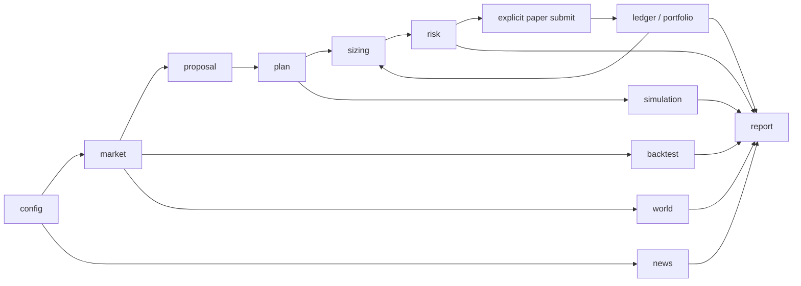

# Shared artifacts and stage contracts

Every skill uses the SAME `--workspace`. State is `<workspace>/trader/`. No credentials belong in these files. Prices, quantities and money are decimal strings; timestamps are timezone-aware UTC ISO 8601; base volume is explicitly labeled separately from quote prices.

```json
{
  "schema_version": 1,
  "kind": "plan",
  "created_at": "2026-11-17T12:00:00Z",
  "inputs": {"config": "sha256...", "market": "sha256...", "proposal": "sha256..."},
  "data": {"status": "ready", "side": "long", "entry": "100", "stop": "99", "target": "102"},
  "digest": "sha256 of canonical envelope excluding digest"
}
```

This abbreviated example explains shape; use scripts to create a real digest and full payload. `Workspace.read()` verifies schema and integrity. `Workspace.write()` atomically replaces one artifact. Downstream consumers validate specific fields, current input digests and time. Failed market refresh replaces market with invalid health, preventing fallback to an old valid snapshot.



All executable trade stages also bind config and market; later stages include earlier trade artifacts. Risk includes the current account digest and expiry. Submit verifies the whole chain again under the workspace writer lock. A changed account, market, config, proposal, plan or size invalidates prior approval; rebuild the affected downstream stages. Missing risk limits block the trade stages rather than inventing values.

| Artifact | Important data | Consumer action |
|---|---|---|
| config | mode, symbol, venue, product, costs, explicit personal limits | paper only; validate values and matching venue filters |
| market | as_of, source units/mode, closed OHLCV, bid/ask, metadata, health | valid, contiguous, current for entry/paper |
| news | items, source_health, checked_at, versions, first/last_seen | inspect per-source errors; context only |
| proposal | ready/waiting, side, signal_time, breakout, RVOL | proceed only on ready/current |
| plan | ready, entry/stop/target, signal_time, research_only | confirm stop/target ordering and lineage |
| sizing | ready/blocked, quantity, fill, fees, cash_required, loss assumption | explicit limits and current account |
| risk | approved/blocked, approved boolean, expires_at, account_digest, reasons | no cached approval after inputs change |
| ledger | cash, positions, orders, initial cash, realized/daily PnL | authoritative commit; never reset on config edits |
| portfolio/orders | projections bound to ledger digest | recover after committed journal, reject mismatches |
| backtest | metrics, trades, assumptions, limits | historical evidence only |
| simulation | outcomes, settled per-unit PnL/tails, pool/diversity, seed | conditional stress, no win-probability claim |
| world | participants, matching, cash/inventory conservation, seed, ledger hashes | synthetic batch economy only |
| report | summaries, input changes, chart, limits | inspection only; never execution authorization |

CLI exits: 0 success/inspection, 1 waiting/blocked/insufficient data/degraded, 2 invalid input or command failure. News source errors are per-source in `source_health` and can coexist with exit 0; always inspect them. `status` surfaces corrupt artifacts and changed direct input digests; risk validation, not status alone, determines trade eligibility. Status/pipeline/demo responses are orchestration summaries, not persisted trade envelopes.

`paper submit` is idempotent for the same risk approval; retrying that same order cannot spend cash again. `paper close` closes the current spot position, or returns the existing orders if already flat. `--price` is an explicit hypothetical fill mark (with exit fee), not a fetched or executable venue price. No exchange protective order is placed. Explicit paper watch performs bounded checks while that command runs; it stops afterward.

The standard historical collector allows 1000 imported bars per snapshot and supports 1m/5m/15m. Research computational caps are 20,000 bars, 10,000 replays × 256 steps, 10,000 agents × 100 steps; the current public/import collector is the tighter input-history limit. Same seed and numerical inputs reproduce scenario results; elapsed runtime and envelope wall-clock digests can differ. Respect bounds rather than claiming unmeasured scaling.

Watcher artifacts: quote_<symbol>.json stores the latest public snapshot; close orders also embed the triggering quote and exit model for durable audit after later snapshots replace the latest quote. watcher.json stores recent results, source errors, cycles, closed IDs and running=false/finished_at after completion. New positions carry exit_model snapshots; legacy verified entry config archives can supply them. Watcher checks15-second local request freshness, not exchange event age. .watcher.lock is a separate lease; .writer.lock remains the financial commit lock. Neither is automatically stolen. Ledger inputs describe committed historical events; later config/quote changes do not mean account cash should be reset or regenerated.
