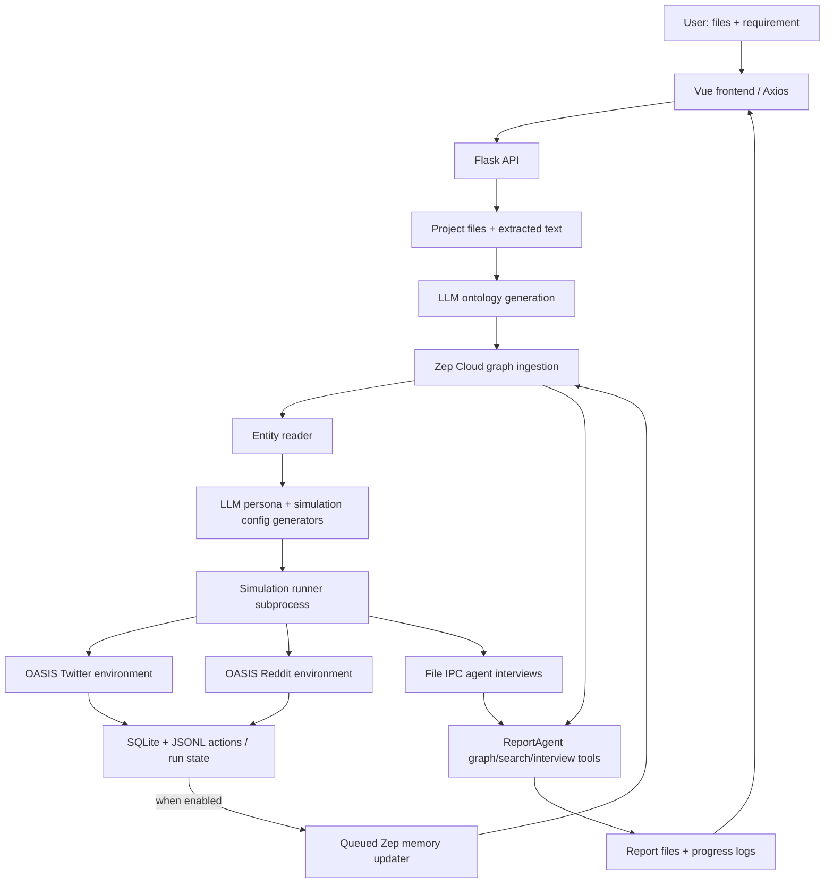

# MiroFish: source-backed deep analysis

## 1. Scope, snapshot aur evidence ka matlab

Yeh document repository **666ghj/MiroFish** ke actual tracked source ka analysis hai. Local checkout `E:\coding\code\Trade\MiroFish` hai. Pinned commit **7657031ac01184afe2cb220f5ee3545573b5e843** hai; inspection date **16 November 2026**. Yeh exact snapshot ki explanation hai, future `main` ka guarantee nahi. Source code mein feature add ya modify nahi kiya gaya. Analysis ka output yeh document aur sibling `mirofish-evidence` directory hai.

Repository inventory mein **128 tracked files**, **62 Python files**, **16 Vue components/views**, **9 JavaScript files**, aur Python AST mein **1,051 function/class definitions** mile. Route decorators se **60 HTTP route registrations** nikle: graph, simulation, report aur health. Definition count unique public APIs ya independent agents ki count nahi hai. Directory entries ko archive files mein add karne se REA counts alag hote hain; unhe source-file count ke saath confuse nahi karna.

Is analysis ke teen evidence levels hain: **source observed** matlab implementation se directly establish hua; **offline verified** matlab tests/build ya focused reproduction ne local behavior exercise kiya; **unverified external behavior** matlab real LLM, Zep Cloud ya OASIS end-to-end run is audit mein nahi chalaya. UI screenshots aur README demos ko runtime verification nahi maana gaya. Complete repository history clone nahi hui, isliye original development chronology, original authorship of every line aur unpublished design decisions establish nahi hote.

### REA ka actual use

User ke requested REA workflow ke liye pinned commit ka `git archive` ZIP banaya aur installed **REA CLI 6.7.0 `inspect-artifact`** se inspect kiya. Active session mein REA MCP tools available nahi the; CLI evidence actual REA result hai, MCP registration ka claim nahi. Archive SHA-256 **6f9ad7a2588a0faf975b8d9e8bd536b632c1e42fd3a21092ce27e1a4235ca0c6** hai. REA result mein root ZIP, **156 graph nodes, 157 occurrences, 156 edges**, complete-within-substeps coverage aur no integrity contradictions aaye. Evidence ID `ev_1081269a06ef80e5e55ddb32c323d0b31cf9f6cd9cf1714c2493d1e41fb19b0b` hai.

Yeh humne local source se banaye ZIP ki inventory hai, upstream released binary ki independently acquired identity nahi. REA ne ZIP members/relationships inventory kiye; usne Python/Vue execution, predictive accuracy ya hosted service behavior prove nahi kiya. Its own limitations: central-directory entries only; non-entry bytes out of scope; static artifact inspection does not execute target or establish language semantics. Semantic analysis normal source reading, AST inventory aur tests se hua. Raw `rea-artifact.json`, compact `rea-summary.json`, source manifest aur document validation evidence folder mein preserved hain.

## 2. Yeh project asal mein kya hai

MiroFish ek **LLM-driven multi-agent social scenario simulator aur reporting application** hai. User seed material upload karta hai aur natural-language simulation requirement deta hai. Application material se ontology aur knowledge graph banwati hai, graph entities ko simulated personas mein badalti hai, Twitter-like aur Reddit-like environments mein unke interactions chalati hai, graph-memory update enabled ho to simulated activity ko memory graph mein ingest karti hai (current Step3 UI ise enable karti hai), phir ReportAgent se evidence-guided narrative report aur chat provide karti hai. README ise “predicting anything” aur parallel digital world ke roop mein present karta hai; implementation ka concrete mechanism document-conditioned social simulation hai. Source: `README.md:35`, `README.md:113`, `backend/app/__init__.py:20`.

“Twitter/Reddit simulation” ka matlab OASIS ke local simulated platforms hai. Source mein real Twitter/Reddit publishing connector ya live brokerage order execution workflow nahi milta. Stock-price forecasting model, options engine, broker risk manager ya market-data terminal is project ka shipped core nahi hai. Financial signals seed text ho sakte hain, lekin upload ki gayi financial story se generated narrative ko calibrated market forecast kehne ka source evidence nahi. README financial prediction demos ko future examples ke roop mein mention karta hai. Source: `README.md:109`, `backend/pyproject.toml:31`, simulation scripts described below.

Model weights train karne ka pipeline yahan nahi: application configured OpenAI-compatible provider ko prompts/API requests bhejti hai. Social behavior execution OASIS aur CAMEL dependencies ko delegate hota hai. Knowledge-graph storage/extraction/search Zep Cloud ko delegate hota hai. MiroFish ka apna major code orchestration, data contracts, personas/config generation, lifecycle protection, monitoring, report tools aur frontend workflow hai. Isliye ise ek self-contained foundation model ya independent graph database samajhna galat hoga. Source: `backend/pyproject.toml:15`, `backend/app/config.py:32`, `backend/app/utils/llm_client.py:1`.

## 3. Architecture aur ek request ka complete journey

User ke actions ka durable identity chain **project_id → graph_id → simulation_id → report_id** hai. Project raw files aur source requirement rakhta hai; graph external Zep resource hai; simulation personas/config/action artifacts rakhti hai; report separate generated output rakhta hai. Yeh ek single relational transaction nahi: local JSON/files, process memory, child processes, OASIS SQLite aur remote Zep ki alag lifecycles hain. Failure, reset, delete aur post-simulation barrier logic isi split ko coordinate karta hai. Exact state transitions aur file contracts niche service sections mein hain.

Typical flow: ontology endpoint multipart upload leta hai; seed text normalize/extract hota hai; LLM entity/edge schema propose karta hai. Build endpoint background graph ingestion task banata hai. Frontend task poll karta hai. Simulation create/prepare graph entities filter karta hai, profiles aur config generate karta hai. Start endpoint child script launch karta hai; runner actions monitor karta hai aur graph-memory mode enabled ho to memory updates feed karta hai. Completion/stopping aur Zep ingestion drain ke baad report generation admissible hoti hai. Report planning, tool calls, sections aur final Markdown banata hai. Interaction view ReportAgent chat aur retained simulation agents ke interviews use karti hai. Sirf route ka 200 response milna har asynchronous stage ki completion nahi hoti.

## 4. Stack, dependencies aur versions

| Layer | Declared implementation / dependency |
|---|---|
| Frontend | Vue `^3.5.24`, Vue Router `^4.6.3`, Vue I18n `^11.3.0`, Axios `^1.18.1`, D3 `^7.9.0` |
| Build | Vite `^7.3.6`, `@vitejs/plugin-vue ^6.0.1`; npm lockfiles shipped |
| Backend | Flask `>=3`, Flask-CORS `>=6`; threaded development server entry point |
| Python range | `>=3.11,<3.13` in backend pyproject, i.e. 3.11 or 3.12 |
| LLM transport | OpenAI SDK `>=1`; provider base URL/model configurable |
| Remote memory | `zep-cloud==3.25.0`, HTTPX `>=0.27` |
| Social simulation | `camel-oasis==0.2.5`, `camel-ai==0.2.78` |
| Parsing/validation | PyMuPDF, charset-normalizer, chardet, Pydantic |
| Root process orchestration | npm `concurrently ^9.2.4` |
| Reproducibility | root/frontend package-lock and backend uv.lock; Docker uses frozen/CI installation |

Sources: `frontend/package.json:1`, `backend/pyproject.toml:1`, `backend/requirements.txt:1`, `package.json:1`, `Dockerfile:10`. Declared ranges aur actually resolved versions alag concepts hain: lockfile mein Vue 3.5.25 aur plugin-vue 6.0.2 resolve hote hain. `requirements.txt` broadly pyproject runtime dependencies repeat karta hai, lekin uv workflow locked dependency graph ke through install karta hai; unpinned pip install ko same environment claim nahi karna.

Preparation ke enable_twitter/enable_reddit flags profile/config generation ko control karte hain; simulation start ka `platform` argument alag script select karta hai. Omitted start platform `parallel` default hota hai, saved enable flags se automatically infer nahi hota. API-created single-platform preparation ko corresponding explicit start platform chahiye; current UI parallel start karti hai. Sources: `backend/app/api/simulation.py:1552`, `backend/app/services/simulation_runner.py:465`, `backend/scripts/run_parallel_simulation.py:1579`.

### Setup prerequisite discrepancy

README aur root engines Node 18+ bolte hain. **Locked Vite 7.3.6 aur plugin-vue 6.0.2 ka actual engine `^20.19.0 || >=22.12.0` hai.** Isliye README ka Node 18 minimum current lockfile ke liye sufficient nahi. Yeh source/lockfile discrepancy hai, full install failure har host par reproduce karne ka claim nahi. Is audit ka frontend build Node 24.18.1 par hua. Default shell Python 3.13.5 repo ke declared supported range ke bahar tha; offline backend checks ke liye Python 3.12 isolated venv banayi gayi.

## 5. Configuration, startup aur deployment

`backend/app/config.py` root `.env` locate karke `load_dotenv(..., override=True)` karta hai. Root file absent ho to normal dotenv discovery karta hai. Matlab dotenv values existing environment values ko replace kar sakti hain. Config import-time class attributes define karta hai. CLI `run.py` pehle validate karta hai: **LLM_API_KEY aur ZEP_API_KEY required**, aur nonempty `ZEP_API_URL` explicitly unsupported. Current implementation **Zep Cloud only** hai. Example placeholder strings nonempty hote hain; startup presence check valid credential authentication prove nahi karti. Source: `backend/app/config.py:10`, `backend/app/config.py:64`, `backend/run.py:28`.

| Setting | Code default / behavior |
|---|---|
| SECRET_KEY | `mirofish-secret-key` fallback |
| FLASK_DEBUG | false; validation warns if enabled |
| FLASK_HOST / FLASK_PORT | `0.0.0.0` / `5001` in run.py |
| LLM_BASE_URL | `https://api.openai.com/v1` |
| LLM_MODEL_NAME | `gpt-4o-mini` |
| Example LLM choice | `.env.example` uses DashScope compatible endpoint + qwen-plus; differs from code fallback |
| Upload cap | 50 MiB Flask MAX_CONTENT_LENGTH |
| Allowed uploads | pdf, md, txt, markdown |
| DEFAULT_CHUNK_SIZE / overlap | 500 / 50; service/request overrides can differ |
| OASIS_DEFAULT_MAX_ROUNDS | 10 declared config; not evidence every run uses exactly 10 |
| Simulation storage | backend/uploads/simulations |
| REPORT_AGENT_MAX_TOOL_CALLS | 5 |
| REPORT_AGENT_MAX_REFLECTION_ROUNDS | 2 declared; usage assessed in report section |
| REPORT_AGENT_TEMPERATURE | 0.5 |

Source: `backend/app/config.py:22`, `.env.example:1`. Example also includes optional `LLM_BOOST_API_KEY`, `LLM_BOOST_BASE_URL`, `LLM_BOOST_MODEL_NAME`. Parallel runner reads these to optionally use a separate model/provider for simulation; presence alone is not a measured speed guarantee. Unused placeholders should not be treated as working optional credentials. Source: `backend/scripts/run_parallel_simulation.py:999`.

Flask app factory configures JSON Unicode output, request/response logging, global `/api/*` CORS with `origins: '*'`, simulation cleanup hooks, and three blueprints. `/health` returns service status; it does not validate external LLM/Zep/OASIS availability. JSON request bodies are logged at DEBUG; uploaded material, prompts and generated artifacts may therefore appear in local logs as well as external provider requests. Logger writes rotating per-day files, 10 MiB per file with five backups. Source: `backend/app/__init__.py:20`, `backend/app/utils/logger.py:31`.

Repository backend routes do not install a login/user/tenant ownership authentication layer. Combined with broad CORS, bind-all host, upload and lifecycle endpoints, this is relevant when exposing the app to other machines. This observation is an application-boundary description, not a verified exploit or a claim about protections in the separately hosted service. Environment keys themselves are not intentionally sent to the frontend by config. Source: `backend/app/__init__.py:43`, `backend/app/api/__init__.py:1`, API catalog.

Source deployment commands are root `npm run setup:all`, then `npm run dev` after configuring `.env`. Root setup does npm installs and backend `uv sync`; dev starts backend and frontend concurrently with kill-others. Frontend Vite serves port 3000, proxying `/api` to localhost:5001. Its `open: true` asks the developer server to open a browser; this audit did not launch it. Vite production build produces assets but the checked-in Docker command still uses `npm run dev`, not a production static hosting stack. Source: `package.json:6`, `frontend/vite.config.js:1`, `Dockerfile:28`.

Docker base is `python:3.11`; apt installs distribution nodejs/npm, uv 0.9.26 copied from its official image. Build copies package locks and uv.lock, then `npm ci` and `uv sync --frozen`. Source copies follow dependency installation for caching. Compose uses `ghcr.io/666ghj/mirofish:latest`, `.env`, ports 3000/5001, restart unless-stopped and local uploads bind mount. It references a published image, not `build: .`; image digest is not pinned. Only uploads are mounted by compose, not backend logs. No image build/pull or external deployment was performed here. Source: `Dockerfile:1`, `docker-compose.yml:1`.

## 6. Supporting maintenance files, CI aur license

`.github/workflows/docker-image.yml` runs on tags or manual invocation, sets up QEMU/Buildx, builds Linux amd64/arm64 images and optionally logs in/publishes to GHCR. Manual publication is gated to default-branch runs with publish requested. Tags include tag ref, SHA and latest. Docker workflow is not proof that a particular container image has passed simulation tests. Source: `.github/workflows/docker-image.yml:1`.

Star-history workflow is unrelated to scenario simulation. It schedules aggregate GitHub star snapshots at 03:17 UTC on days 1 and 16, with repo/default-branch/actor controls. A small fetch-only script gets repository metadata count using a token; count output goes to an offline renderer; only JSON history and two SVG paths may be committed. Fetch helper refuses redirects, bounds responses, validates integer count and sanitizes errors; renderer validates schema, guards output paths and creates deterministic accessible light/dark SVGs. This workflow runs star-helper tests, not the complete application backend suite. Source: `.github/workflows/update-star-history.yml:1`, `scripts/fetch_star_count.py:18`, `scripts/star_history.py:1360`.

`star_history.py` CLI provides backfill, initialize, due, record, check. Backfill reads GitHub historical stargazer data through a gateway; initialize/record accept an aggregate count file; no fabricated interpolation is presented as observed daily stars. Static screenshots, logos, demo thumbnails, QR code and SVGs are presentation material, not model training data or run outputs. Third-party notices explain reviewed chart assets. Source: `scripts/star_history.py:1430`, `.github/star-history/THIRD_PARTY_NOTICES.md:1`.

Repository LICENSE is **AGPL-3.0**, also declared by root package and backend metadata. Yeh license identification hai; full legal advice ya third-party dependency license audit nahi. README acknowledgments explicitly credit OASIS/CAMEL and Shanda support. Developer history, commercial business terms aur hosted-service code not present in this snapshot remain unknown. Source: `LICENSE:1`, `package.json:20`, `README.md:189`.

## 7. Reading the detailed subsystems

Following sections independently trace the graph/data layer, simulation execution, report tools and UI, with source locations. API and file appendices at the end provide complete inventories. Documentation completeness here means each tracked source area and exposed route has been accounted for; it does not mean every possible input, provider failure, race or deployment combination was executed.
