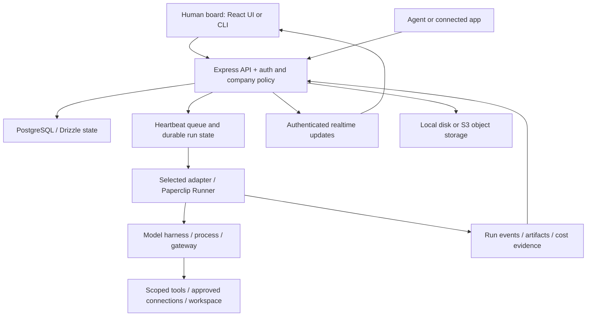

# Paperclip — deep source analysis

> Requested output name `mirofish.md` hai, lekin is report ka subject **paperclipai/paperclip** hai. Previous MiroFish report ka separate backup preserved hai. Yeh report kisi feature ko implement nahi karti.

## Snapshot aur method

Local checkout `E:\coding\code\Trade\paperclip`, upstream `https://github.com/paperclipai/paperclip`, branch master, pinned commit **9de343b3fe2e2d4dc84fc8386d9ce04d553f39d6**. Inspection date 16 November 2026. Code/tests current behavior ke authority hain; dated plans/docs ko current implementation samajhkar repeat nahi kiya. Shallow checkout development chronology ya original design decisions prove nahi karta. Source: [AGENTS.md:8](https://github.com/paperclipai/paperclip/blob/9de343b3fe2e2d4dc84fc8386d9ce04d553f39d6/AGENTS.md#L8).

REA skill aur parallel source-review workflow use hua. Installed **REA CLI 6.7.0** ne pinned git archive par `inspect-artifact --format json --full-output` run kiya. Actual raw result `paperclip-evidence/rea-artifact.json` hai. Active REA MCP connection ka claim nahi. Yeh local source ZIP ki member/integrity inventory hai, upstream released application binary ka decompilation ya JS/TS execution proof nahi. Source behavior direct source reading aur catalogs se establish hua. REA limitations aur exact archive digest final evidence summary mein hain; static inventory ko runtime correctness, sandbox security ya deployment acceptance nahi bola gaya.

## Yeh kya hai aur kaise bana hai

Paperclip **AI-agent organizations ka control plane** hai. Ismein company banana, goals/projects/tasks assign karna, human aur agent org chart manage karna, governed actions approve karna, agent runs schedule karna, budgets/spend monitor karna, execution artifacts review karna aur integrations connect karna ek application mein aata hai. Yeh foundation model train nahi karta. Claude/Codex aur doosre harnesses/adapters ko work context, identity, credentials, tools aur execution lifecycle deta hai. Agent ka proposed output aur server ka authoritative task/approval/run state alag hain. Source: [README.md:1](https://github.com/paperclipai/paperclip/blob/9de343b3fe2e2d4dc84fc8386d9ce04d553f39d6/README.md#L1), [AGENTS.md:57](https://github.com/paperclipai/paperclip/blob/9de343b3fe2e2d4dc84fc8386d9ce04d553f39d6/AGENTS.md#L57), [server/src/app.ts:1](https://github.com/paperclipai/paperclip/blob/9de343b3fe2e2d4dc84fc8386d9ce04d553f39d6/server/src/app.ts#L1).

Current repository purane small task-manager descriptions se bahut aage hai: native Paperclip Runner, multiple local/remote adapters, plugins/sandbox providers, app connections, chat/channels, cases/workflows, skills/team catalogs, evaluations, CLI, release and cloud tooling coexist karte hain. Har directory equal production maturity imply nahi karti: tests, prototypes, eval cases, catalog assets, static screenshots, plans aur vendored runtime copies bhi tracked hain. Package/service/schema catalogs niche aur evidence mein separate rakhe gaye hain.

Typical path: board actor creates company/agent/task; company/actor checks gate API; atomic checkout protects ownership; eligible heartbeat becomes persisted run; server selects execution mode and prepares identity/workspace/tools; adapter or Runner executes configured harness; events, cancellation, usage and artifacts return; server-side finalizers apply task/workflow/budget decisions; UI invalidates queries or reads live run streams. Reported model success by itself is not a governance bypass. Exact code branches/defaults are in domain sections below.

## Stack aur monorepo layout

Root is private ESM TypeScript/JavaScript pnpm workspace. Current root requires **Node >=24.11.0**, package manager **pnpm 9.15.4**. Node 24 policy is checked across manifests, workflows and Dockerfiles. Package versions commonly 0.3.1 are source manifest versions, not independently verified latest npm release versions. Source: [package.json:1](https://github.com/paperclipai/paperclip/blob/9de343b3fe2e2d4dc84fc8386d9ce04d553f39d6/package.json#L1), [pnpm-workspace.yaml:1](https://github.com/paperclipai/paperclip/blob/9de343b3fe2e2d4dc84fc8386d9ce04d553f39d6/pnpm-workspace.yaml#L1), [scripts/check-node-version-policy.mjs:7](https://github.com/paperclipai/paperclip/blob/9de343b3fe2e2d4dc84fc8386d9ce04d553f39d6/scripts/check-node-version-policy.mjs#L7).

| Area | Responsibility |
|---|---|
| server | Express REST, auth, policies, orchestration, services, events, storage, maintenance |
| ui | React/Vite board app, query/cache layer, realtime, workspace/run views |
| packages/db | Drizzle ORM, PostgreSQL clients, schema, SQL migrations, embedded DB management |
| packages/shared | Cross-layer types, validators, paths, constants and config contracts |
| packages/adapters + adapter-utils | Harness/process/gateway integrations and normalized adapter contracts |
| packages/paperclip-runner + paperclip-eval-kernel | Native execution protocol/runtime and evaluation infrastructure |
| packages/plugins | Plugin SDK, worker-facing features and sandbox providers |
| packages/mcp-server and companion MCP packages | Tool-facing interfaces; not unrestricted blanket agent access |
| packages/skills-catalog + teams-catalog | App-shipped reusable skills and teams; operational skills also exist under skills/ |
| cli | Published paperclipai entrypoint, onboarding, config, admin and agent/client commands |
| integrations | External app/provider connection implementation/assets; see domain notes |
| scripts + docker + .github/workflows | Development, verification, build, release, migration and runtime qualification |
| doc + docs + maps + evals + tests | Documentation, coverage maps, evaluation/acceptance fixtures and regression suites |

Server dependencies include Express, Better Auth-related identity infrastructure, provider SDKs and PostgreSQL. UI uses React with Vite, TanStack Query, editor and terminal libraries; exact manifest versions/dependency edges are preserved in `packages.json` and pnpm lockfile rather than inferred from product labels. DB package declares drizzle-orm ^0.45.2, postgres ^3.4.9 and embedded-postgres ^18.1.0-beta.16. Workspace patches alter PostgreSQL, embedded DB, ACP and chat-adapter packages; a plain npm install without workspace patch/override resolution is not an equivalent runtime. Source: [server/package.json:1](https://github.com/paperclipai/paperclip/blob/9de343b3fe2e2d4dc84fc8386d9ce04d553f39d6/server/package.json#L1), [ui/package.json:1](https://github.com/paperclipai/paperclip/blob/9de343b3fe2e2d4dc84fc8386d9ce04d553f39d6/ui/package.json#L1), [packages/db/package.json:1](https://github.com/paperclipai/paperclip/blob/9de343b3fe2e2d4dc84fc8386d9ce04d553f39d6/packages/db/package.json#L1), [pnpm-workspace.yaml:1](https://github.com/paperclipai/paperclip/blob/9de343b3fe2e2d4dc84fc8386d9ce04d553f39d6/pnpm-workspace.yaml#L1).

## Configuration, storage aur deployment

Server loads deployment/config/env through explicit policy helpers. Deployment modes include `local_trusted` and `authenticated`; local trusted forces private exposure. Authenticated mode defaults secrets strict mode true. Current default host fallback is **127.0.0.1**, port **3100**; env/file settings can override. Bind modes, public URL, allowed hosts, managed-cloud prerequisites and auth-signup options are separate contracts; changing host alone is not a full secure-public-deployment configuration. Source: [server/src/config.ts:190](https://github.com/paperclipai/paperclip/blob/9de343b3fe2e2d4dc84fc8386d9ce04d553f39d6/server/src/config.ts#L190), [server/src/config.ts:380](https://github.com/paperclipai/paperclip/blob/9de343b3fe2e2d4dc84fc8386d9ce04d553f39d6/server/src/config.ts#L380).

Absent DATABASE_URL uses embedded PostgreSQL with instance-local data; external PostgreSQL URL and separate migration URL are supported. SQL schema/migrations, not JSON files, own company/task/run records. Storage objects use provider **local_disk** by default or S3; S3 defaults bucket paperclip, region us-east-1, optional endpoint/prefix/path-style. Logs/traces, filesystem workspaces, object storage and database backups are different durability boundaries. Source: [doc/DATABASE.md:8](https://github.com/paperclipai/paperclip/blob/9de343b3fe2e2d4dc84fc8386d9ce04d553f39d6/doc/DATABASE.md#L8), [server/src/storage/config.ts:15](https://github.com/paperclipai/paperclip/blob/9de343b3fe2e2d4dc84fc8386d9ce04d553f39d6/server/src/storage/config.ts#L15), [server/src/config.ts:389](https://github.com/paperclipai/paperclip/blob/9de343b3fe2e2d4dc84fc8386d9ce04d553f39d6/server/src/config.ts#L389).

Scheduler enable flag defaults enabled; interval defaults **30,000 ms**, clamped at least10,000ms. DB backups default enabled; backup interval/retention and workspace cleanup/compaction flags have independent configuration. Compaction, git-cache expiry, restore points, skill retention and task-directory retention must not be collapsed into a single cleanup guarantee. Authenticated deployments default company deletion disabled unless explicitly configured; local trusted defaults it enabled. Source: [server/src/config.ts:273](https://github.com/paperclipai/paperclip/blob/9de343b3fe2e2d4dc84fc8386d9ce04d553f39d6/server/src/config.ts#L273), [server/src/config.ts:303](https://github.com/paperclipai/paperclip/blob/9de343b3fe2e2d4dc84fc8386d9ce04d553f39d6/server/src/config.ts#L303), [server/src/config.ts:399](https://github.com/paperclipai/paperclip/blob/9de343b3fe2e2d4dc84fc8386d9ce04d553f39d6/server/src/config.ts#L399), [server/src/config.ts:442](https://github.com/paperclipai/paperclip/blob/9de343b3fe2e2d4dc84fc8386d9ce04d553f39d6/server/src/config.ts#L442).

Root dev script delegates to scripts/dev-runner.ts; source development requires pnpm workspace dependency setup. Root build/typecheck/test scripts first ensure workspace links. CLI is a separately publishable entrypoint, not merely `server/src/index.ts`. Production build includes UI/runner vendor/assets materialization and platform tooling; standalone source-file checks are not enough to establish an installable release. Source: [package.json:6](https://github.com/paperclipai/paperclip/blob/9de343b3fe2e2d4dc84fc8386d9ce04d553f39d6/package.json#L6), [server/package.json:1](https://github.com/paperclipai/paperclip/blob/9de343b3fe2e2d4dc84fc8386d9ce04d553f39d6/server/package.json#L1), [cli/package.json:1](https://github.com/paperclipai/paperclip/blob/9de343b3fe2e2d4dc84fc8386d9ce04d553f39d6/cli/package.json#L1).

Docker uses multi-stage **node:24-trixie-slim**, pinned/digest-checked platform assets and frozen Runner lockfile validation; agent runtime images, runner image, smoke images and app image serve different purposes. Quickstart composes one app container with embedded DB, persistent `/paperclip`, port3100, pids_limit2048, 90-second stop grace, authenticated/private mode and required BETTER_AUTH_SECRET. Tool-action signing secret is a separate variable. Cloud stage separately bundles optional plugins/server dependencies; self-hosted and cloud image payloads are not identical. This audit did not build/pull/run these images. Source: [Dockerfile:1](https://github.com/paperclipai/paperclip/blob/9de343b3fe2e2d4dc84fc8386d9ce04d553f39d6/Dockerfile#L1), [docker/docker-compose.quickstart.yml:13](https://github.com/paperclipai/paperclip/blob/9de343b3fe2e2d4dc84fc8386d9ce04d553f39d6/docker/docker-compose.quickstart.yml#L13), [Dockerfile:1](https://github.com/paperclipai/paperclip/blob/9de343b3fe2e2d4dc84fc8386d9ce04d553f39d6/Dockerfile#L1).

## Verification scope and limits

This task is source analysis, not a repository behavior change. Source remains untouched. No provider keys, real agent work, GitHub writes, paid inference, cloud deployment or live Paperclip company was used. Full pnpm install/typecheck/build/Vitest/browser/database integration suites were not executed; checkout lacks installed workspace dependencies and native/external runtime prerequisites. Repository AGENTS explicitly prefers the smallest relevant verification rather than automatic repo-wide testing. Source: [AGENTS.md:124](https://github.com/paperclipai/paperclip/blob/9de343b3fe2e2d4dc84fc8386d9ce04d553f39d6/AGENTS.md#L124).

Executed focused Node helper suite: `node --test scripts/check-no-git-push.test.mjs scripts/release-package-map.test.mjs` on Windows/Node24.18.1: **26 tests, 19 pass, 7 fail**. Failures are release-manifest discovery paths: platform join produces backslashes, manifest directories contain slashes. Focused reproduction:35 public packages discovered,32 unmatched raw dirs,0 unmatched after slash normalization. No source fix was applied. This is a Windows release-helper finding; it does not prove Linux release CI fails or the Paperclip server is broken. Source: [scripts/release-package-map.mjs:18](https://github.com/paperclipai/paperclip/blob/9de343b3fe2e2d4dc84fc8386d9ce04d553f39d6/scripts/release-package-map.mjs#L18), [scripts/release-package-map.mjs:123](https://github.com/paperclipai/paperclip/blob/9de343b3fe2e2d4dc84fc8386d9ce04d553f39d6/scripts/release-package-map.mjs#L123); outputs and reproduction retained.

All-file hashes, package manifests, lexical route sites, SQL table declarations, module and test-file catalogs supplement domain reading. Route extraction is **lexical**, not a TypeScript AST/router runtime: includes router mount paths and possible same-named method calls; dynamic routes may be omitted. It must not be advertised as an exact complete runtime API count. File inventory is coverage bookkeeping, not proof every line was semantically audited. Model/runtime containment, real authorization combinations, concurrent DB schedules and adapter/provider failures remain unexecuted beyond source/test inspection.

Company/permission checks, checkout atomicity, approval gates and budget auto-pause are design and implementation boundaries; they are not a claim of bug-free isolation or sandbox exploit resistance. External model output, tool events, summaries and synthetic eval metrics require their own evidence. This report records observed structure and known verification limits, and adds no new product features or guarantees.

## Backend, data model aur governance

### 1. Express application ka actual shape

Backend ek REST CRUD wrapper bhar nahin hai. [server/src/index.ts:540](https://github.com/paperclipai/paperclip/blob/9de343b3fe2e2d4dc84fc8386d9ce04d553f39d6/server/src/index.ts#L540) external PostgreSQL client banata hai; embedded path [server/src/index.ts:747](https://github.com/paperclipai/paperclip/blob/9de343b3fe2e2d4dc84fc8386d9ce04d553f39d6/server/src/index.ts#L747) bhi same DB client interface tak pahunchta hai. [server/src/index.ts:993](https://github.com/paperclipai/paperclip/blob/9de343b3fe2e2d4dc84fc8386d9ce04d553f39d6/server/src/index.ts#L993) `createApp` invoke karta hai; live-event WebSocket attachment [server/src/index.ts:1089](https://github.com/paperclipai/paperclip/blob/9de343b3fe2e2d4dc84fc8386d9ce04d553f39d6/server/src/index.ts#L1089), actual listener [server/src/index.ts:1121](https://github.com/paperclipai/paperclip/blob/9de343b3fe2e2d4dc84fc8386d9ce04d553f39d6/server/src/index.ts#L1121) par hai. HTTP composition root [server/src/app.ts:452](https://github.com/paperclipai/paperclip/blob/9de343b3fe2e2d4dc84fc8386d9ce04d553f39d6/server/src/app.ts#L452) hai. Runtime/run orchestration ki detailed execution mechanics sibling runtime notes ka subject hain.

Request stack mein API timing, database-operation context aur idle admission pehle aate hain ([server/src/app.ts:508](https://github.com/paperclipai/paperclip/blob/9de343b3fe2e2d4dc84fc8386d9ce04d553f39d6/server/src/app.ts#L508), [server/src/app.ts:511](https://github.com/paperclipai/paperclip/blob/9de343b3fe2e2d4dc84fc8386d9ce04d553f39d6/server/src/app.ts#L511)). Body parsers uniform nahin: portable import ke liye separate larger JSON parser, raw webhook handling aur Dot/MCP upload bypass exist karte hain ([server/src/app.ts:537](https://github.com/paperclipai/paperclip/blob/9de343b3fe2e2d4dc84fc8386d9ce04d553f39d6/server/src/app.ts#L537), [server/src/app.ts:547](https://github.com/paperclipai/paperclip/blob/9de343b3fe2e2d4dc84fc8386d9ce04d553f39d6/server/src/app.ts#L547), [server/src/app.ts:555](https://github.com/paperclipai/paperclip/blob/9de343b3fe2e2d4dc84fc8386d9ce04d553f39d6/server/src/app.ts#L555)). Shared ordinary JSON cap 10 MiB, chat webhook cap 1 MiB, portable JSON cap 64 MiB hai ([server/src/http/body-limits.ts:1](https://github.com/paperclipai/paperclip/blob/9de343b3fe2e2d4dc84fc8386d9ce04d553f39d6/server/src/http/body-limits.ts#L1)). Compressed import ZIP default 1 GiB hai; environment override floor/clamp hota hai, upper bound 64 GiB; source comment explicitly warns whole upload buffering plus inflation memory cost ([server/src/http/body-limits.ts:8](https://github.com/paperclipai/paperclip/blob/9de343b3fe2e2d4dc84fc8386d9ce04d553f39d6/server/src/http/body-limits.ts#L8)). Yeh normal attachment cap ya universal request cap nahin samajhna.

Private hostname guard conditional hai: private exposure with local-trusted/authenticated deployment ([server/src/app.ts:350](https://github.com/paperclipai/paperclip/blob/9de343b3fe2e2d4dc84fc8386d9ce04d553f39d6/server/src/app.ts#L350)). Liveness/readiness normal actor chain se pehle mount hote hain ([server/src/app.ts:585](https://github.com/paperclipai/paperclip/blob/9de343b3fe2e2d4dc84fc8386d9ce04d553f39d6/server/src/app.ts#L585)). Customer-success, Muse transport, public MCP ingress, runtime connection intents, native-run MCP aur runner attachment download jaise routes bhi ordinary board API se pehle own protocol boundaries ke saath mount hote hain ([server/src/app.ts:591](https://github.com/paperclipai/paperclip/blob/9de343b3fe2e2d4dc84fc8386d9ce04d553f39d6/server/src/app.ts#L591), [server/src/app.ts:599](https://github.com/paperclipai/paperclip/blob/9de343b3fe2e2d4dc84fc8386d9ce04d553f39d6/server/src/app.ts#L599)). Voice webhook explicitly actor middleware se pehle mount hai ([server/src/app.ts:626](https://github.com/paperclipai/paperclip/blob/9de343b3fe2e2d4dc84fc8386d9ce04d553f39d6/server/src/app.ts#L626)). Isliye “har endpoint same bearer/session auth se protected hai” incorrect summary hogi; protocol-specific ingress ko separately audit karna padega.

Ordinary chain `actorMiddleware` → Cloud control → authorization-read scope → runner outcome → skill context hai ([server/src/app.ts:629](https://github.com/paperclipai/paperclip/blob/9de343b3fe2e2d4dc84fc8386d9ce04d553f39d6/server/src/app.ts#L629)). Main API Router board mutation guard lagata hai, then domain routers register karta hai ([server/src/app.ts:723](https://github.com/paperclipai/paperclip/blob/9de343b3fe2e2d4dc84fc8386d9ce04d553f39d6/server/src/app.ts#L723)). `/api` router [server/src/app.ts:1102](https://github.com/paperclipai/paperclip/blob/9de343b3fe2e2d4dc84fc8386d9ce04d553f39d6/server/src/app.ts#L1102) par mount hota hai; unmatched API handling uske turant baad; static UI aur final error middleware [server/src/app.ts:1278](https://github.com/paperclipai/paperclip/blob/9de343b3fe2e2d4dc84fc8386d9ce04d553f39d6/server/src/app.ts#L1278) par hain. UI modes `none`, `static`, `vite-dev` composition root mein defined hain ([server/src/app.ts:273](https://github.com/paperclipai/paperclip/blob/9de343b3fe2e2d4dc84fc8386d9ce04d553f39d6/server/src/app.ts#L273)).

Surface inventory: companies, folders, skills/policies, agents and agent permissions, avatars/assets, projects, task workspaces, cases/handoffs, workflows, issue subtree control, file resources, routines, environments/execution workspaces, email, goals, board chat, approvals, secrets, costs/activity/dashboard/attention, decisions/queues/training, preferences/memberships, instance settings/backups/metrics ([server/src/app.ts:730](https://github.com/paperclipai/paperclip/blob/9de343b3fe2e2d4dc84fc8386d9ce04d553f39d6/server/src/app.ts#L730), [server/src/app.ts:826](https://github.com/paperclipai/paperclip/blob/9de343b3fe2e2d4dc84fc8386d9ce04d553f39d6/server/src/app.ts#L826), [server/src/app.ts:832](https://github.com/paperclipai/paperclip/blob/9de343b3fe2e2d4dc84fc8386d9ce04d553f39d6/server/src/app.ts#L832), [server/src/app.ts:858](https://github.com/paperclipai/paperclip/blob/9de343b3fe2e2d4dc84fc8386d9ce04d553f39d6/server/src/app.ts#L858), [server/src/app.ts:878](https://github.com/paperclipai/paperclip/blob/9de343b3fe2e2d4dc84fc8386d9ce04d553f39d6/server/src/app.ts#L878), [server/src/app.ts:892](https://github.com/paperclipai/paperclip/blob/9de343b3fe2e2d4dc84fc8386d9ce04d553f39d6/server/src/app.ts#L892)). Additional routers include Slack tools, AI connections, prompt-injection prevention, browser use, tool gateway, MCP apps/skills, public MCP management, Dot/Grok runner, Muse ([server/src/app.ts:938](https://github.com/paperclipai/paperclip/blob/9de343b3fe2e2d4dc84fc8386d9ce04d553f39d6/server/src/app.ts#L938), [server/src/app.ts:949](https://github.com/paperclipai/paperclip/blob/9de343b3fe2e2d4dc84fc8386d9ce04d553f39d6/server/src/app.ts#L949), [server/src/app.ts:1040](https://github.com/paperclipai/paperclip/blob/9de343b3fe2e2d4dc84fc8386d9ce04d553f39d6/server/src/app.ts#L1040), [server/src/app.ts:1094](https://github.com/paperclipai/paperclip/blob/9de343b3fe2e2d4dc84fc8386d9ce04d553f39d6/server/src/app.ts#L1094)). Mount hona capability surface ka evidence hai; har provider integration ke internals ya production readiness ka proof nahin.

Background execution bhi application lifecycle ka part hai: voice recovery/reply/retention, receiver work, Teams recovery, interaction continuation, GitHub review/check/response/ack work, native chat progress, wake notices, milestone delivery, import spool cleanup aur browser cleanup register hote hain ([server/src/app.ts:1325](https://github.com/paperclipai/paperclip/blob/9de343b3fe2e2d4dc84fc8386d9ce04d553f39d6/server/src/app.ts#L1325), [server/src/app.ts:1333](https://github.com/paperclipai/paperclip/blob/9de343b3fe2e2d4dc84fc8386d9ce04d553f39d6/server/src/app.ts#L1333), [server/src/app.ts:1339](https://github.com/paperclipai/paperclip/blob/9de343b3fe2e2d4dc84fc8386d9ce04d553f39d6/server/src/app.ts#L1339), [server/src/app.ts:1345](https://github.com/paperclipai/paperclip/blob/9de343b3fe2e2d4dc84fc8386d9ce04d553f39d6/server/src/app.ts#L1345)). Several registrations warm-standby/idle-drain guards accept karte hain. In sabko generic polling timer kehna faithful nahin; delivery coordinator aur per-owner work registration evident hain, unke individual scheduling guarantees is note mein exhaustively trace nahin kiye.

### 2. Identity aur company boundary: authorization ke multiple layers

[server/src/middleware/auth.ts:239](https://github.com/paperclipai/paperclip/blob/9de343b3fe2e2d4dc84fc8386d9ce04d553f39d6/server/src/middleware/auth.ts#L239) actor middleware initial actor `none` rakhta hai, except local-trusted mode ka implicit Local Board (`local-board`, instance-admin flag). Lekin ambient local trust unconditional public bypass nahin: no-bearer path local process/socket boundary se `grantsImplicitBoard` check karta hai, failure par actor `none` ho jata hai ([server/src/middleware/auth.ts:329](https://github.com/paperclipai/paperclip/blob/9de343b3fe2e2d4dc84fc8386d9ce04d553f39d6/server/src/middleware/auth.ts#L329)). Public routine POST own bearer/signature authentication ke liye ambient actor clear karta hai ([server/src/middleware/auth.ts:257](https://github.com/paperclipai/paperclip/blob/9de343b3fe2e2d4dc84fc8386d9ce04d553f39d6/server/src/middleware/auth.ts#L257)). Public MCP gateway bearer protocol route khud validate kare, isliye narrowly matched path actor token interpretation bypass karta hai ([server/src/middleware/auth.ts:270](https://github.com/paperclipai/paperclip/blob/9de343b3fe2e2d4dc84fc8386d9ce04d553f39d6/server/src/middleware/auth.ts#L270)).

Authenticated no-bearer path trusted Cloud tenant actor try karta hai, phir Better Auth session; session user ke instance role aur active company memberships load hote hain ([server/src/middleware/auth.ts:282](https://github.com/paperclipai/paperclip/blob/9de343b3fe2e2d4dc84fc8386d9ce04d553f39d6/server/src/middleware/auth.ts#L282), [server/src/middleware/auth.ts:303](https://github.com/paperclipai/paperclip/blob/9de343b3fe2e2d4dc84fc8386d9ce04d553f39d6/server/src/middleware/auth.ts#L303)). Board API bearer keys bhi supported hain: token JWT nahin hua toh board-auth lookup, user access resolve, key last-used update aur membership-bound board actor ([server/src/middleware/auth.ts:344](https://github.com/paperclipai/paperclip/blob/9de343b3fe2e2d4dc84fc8386d9ce04d553f39d6/server/src/middleware/auth.ts#L344)). Auth instance Better Auth + Drizzle PostgreSQL schema use karta hai; secret `BETTER_AUTH_SECRET` or agent-JWT secret fallback mandatory; email/password enabled, email verification false, sign-up configurable ([server/src/auth/better-auth.ts:246](https://github.com/paperclipai/paperclip/blob/9de343b3fe2e2d4dc84fc8386d9ce04d553f39d6/server/src/auth/better-auth.ts#L246), [server/src/auth/better-auth.ts:269](https://github.com/paperclipai/paperclip/blob/9de343b3fe2e2d4dc84fc8386d9ce04d553f39d6/server/src/auth/better-auth.ts#L269), [server/src/auth/better-auth.ts:292](https://github.com/paperclipai/paperclip/blob/9de343b3fe2e2d4dc84fc8386d9ce04d553f39d6/server/src/auth/better-auth.ts#L292)). Cookie, rate-limit aur managed handoff behavior dedicated helpers mein hai; default Better Auth semantics ko bina source trace assume nahin karna.

Agent long-lived keys hashed SHA-256 lookup aur revocation filter se resolve hote hain ([server/src/middleware/auth.ts:52](https://github.com/paperclipai/paperclip/blob/9de343b3fe2e2d4dc84fc8386d9ce04d553f39d6/server/src/middleware/auth.ts#L52), [server/src/middleware/auth.ts:373](https://github.com/paperclipai/paperclip/blob/9de343b3fe2e2d4dc84fc8386d9ce04d553f39d6/server/src/middleware/auth.ts#L373); stored fields [packages/db/src/schema/agent_api_keys.ts:6](https://github.com/paperclipai/paperclip/blob/9de343b3fe2e2d4dc84fc8386d9ce04d553f39d6/packages/db/src/schema/agent_api_keys.ts#L6)). Local agent JWT run/company/agent binding carry karta hai. Default JWT TTL 48h, issuer `paperclip`, audience `paperclip-api`; new signing per-instance/per-company derived key se hoti hai; legacy master-key fallback configurable compatibility path hai ([server/src/agent-auth-jwt.ts:41](https://github.com/paperclipai/paperclip/blob/9de343b3fe2e2d4dc84fc8386d9ce04d553f39d6/server/src/agent-auth-jwt.ts#L41), [server/src/agent-auth-jwt.ts:66](https://github.com/paperclipai/paperclip/blob/9de343b3fe2e2d4dc84fc8386d9ce04d553f39d6/server/src/agent-auth-jwt.ts#L66), [server/src/agent-auth-jwt.ts:166](https://github.com/paperclipai/paperclip/blob/9de343b3fe2e2d4dc84fc8386d9ce04d553f39d6/server/src/agent-auth-jwt.ts#L166)). Strict-run-authority validation aur ordinary compatibility verification alag hain; uniform strict claim validation ka blanket claim avoid karein.

Agent record company match, setup lifecycle hold, terminated status, pending-approval status authentication par checked hain ([server/src/middleware/auth.ts:383](https://github.com/paperclipai/paperclip/blob/9de343b3fe2e2d4dc84fc8386d9ce04d553f39d6/server/src/middleware/auth.ts#L383), [server/src/middleware/auth.ts:500](https://github.com/paperclipai/paperclip/blob/9de343b3fe2e2d4dc84fc8386d9ce04d553f39d6/server/src/middleware/auth.ts#L500)). JWT run header mismatch audit path hai ([server/src/middleware/auth.ts:403](https://github.com/paperclipai/paperclip/blob/9de343b3fe2e2d4dc84fc8386d9ce04d553f39d6/server/src/middleware/auth.ts#L403)); JWT actor authoritative run ID claim se leta hai, with key scope and responsible-user/identity context ([server/src/middleware/auth.ts:478](https://github.com/paperclipai/paperclip/blob/9de343b3fe2e2d4dc84fc8386d9ce04d553f39d6/server/src/middleware/auth.ts#L478)). Long-lived agent key ko responsible user chahiye; missing owner audited 403 `RESPONSIBLE_USER_UNAVAILABLE` deta hai ([server/src/middleware/auth.ts:519](https://github.com/paperclipai/paperclip/blob/9de343b3fe2e2d4dc84fc8386d9ce04d553f39d6/server/src/middleware/auth.ts#L519)). Paused agent ko terminated ke equivalent auth-denial kehna incorrect hoga; run/admission constraints separate subsystem hain.

Company gate aur action authorization distinct hain. `assertAuthenticated` only actor presence check hai ([server/src/routes/authz.ts:27](https://github.com/paperclipai/paperclip/blob/9de343b3fe2e2d4dc84fc8386d9ce04d553f39d6/server/src/routes/authz.ts#L27)). `hasCompanyAccess` agent ke exact company, implicit local board ke all companies, otherwise actor membership list check karta hai ([server/src/routes/authz.ts:293](https://github.com/paperclipai/paperclip/blob/9de343b3fe2e2d4dc84fc8386d9ce04d553f39d6/server/src/routes/authz.ts#L293)). Signed-in instance admin ko HTTP company data ke liye blanket membership bypass nahin milta; comment explicit hai ([server/src/routes/authz.ts:289](https://github.com/paperclipai/paperclip/blob/9de343b3fe2e2d4dc84fc8386d9ce04d553f39d6/server/src/routes/authz.ts#L289)). `getAccessibleResource` missing aur cross-company resource dono same 404 banata hai, phir allowed tenant ke liye stronger write gate calls karta hai ([server/src/routes/authz.ts:318](https://github.com/paperclipai/paperclip/blob/9de343b3fe2e2d4dc84fc8386d9ce04d553f39d6/server/src/routes/authz.ts#L318)). Viewer writes read-only deny hote hain; active membership checked hoti hai ([server/src/routes/authz.ts:240](https://github.com/paperclipai/paperclip/blob/9de343b3fe2e2d4dc84fc8386d9ce04d553f39d6/server/src/routes/authz.ts#L240)). Agent acting-on-behalf company intersection bhi responsible user ke active membership/write role ko check karta hai, with shadow/enforce behavior ([server/src/routes/authz.ts:8](https://github.com/paperclipai/paperclip/blob/9de343b3fe2e2d4dc84fc8386d9ce04d553f39d6/server/src/routes/authz.ts#L8), [server/src/routes/authz.ts:230](https://github.com/paperclipai/paperclip/blob/9de343b3fe2e2d4dc84fc8386d9ce04d553f39d6/server/src/routes/authz.ts#L230)).

Fine-grained service [server/src/services/authorization.ts:856](https://github.com/paperclipai/paperclip/blob/9de343b3fe2e2d4dc84fc8386d9ce04d553f39d6/server/src/services/authorization.ts#L856) multiple action families cover karti hai: permission keys, agent config/instructions, issue read/comment/mutate, project read/workspace write, runtime management, secret read/propose ([server/src/services/authorization.ts:95](https://github.com/paperclipai/paperclip/blob/9de343b3fe2e2d4dc84fc8386d9ce04d553f39d6/server/src/services/authorization.ts#L95)). Explicit grant lookup/scope checks ([server/src/services/authorization.ts:1033](https://github.com/paperclipai/paperclip/blob/9de343b3fe2e2d4dc84fc8386d9ce04d553f39d6/server/src/services/authorization.ts#L1033)), private issue/project filters ([server/src/services/authorization.ts:655](https://github.com/paperclipai/paperclip/blob/9de343b3fe2e2d4dc84fc8386d9ce04d553f39d6/server/src/services/authorization.ts#L655), [server/src/services/authorization.ts:727](https://github.com/paperclipai/paperclip/blob/9de343b3fe2e2d4dc84fc8386d9ce04d553f39d6/server/src/services/authorization.ts#L727)), responsible-user intersection ([server/src/services/authorization.ts:2813](https://github.com/paperclipai/paperclip/blob/9de343b3fe2e2d4dc84fc8386d9ce04d553f39d6/server/src/services/authorization.ts#L2813)) extra boundaries hain. Issue privacy default `enforce`, env permits `off`/`shadow` ([server/src/services/authorization.ts:626](https://github.com/paperclipai/paperclip/blob/9de343b3fe2e2d4dc84fc8386d9ce04d553f39d6/server/src/services/authorization.ts#L626)). Responsible-user shadow mode separate configuration hai ([server/src/services/authorization.ts:772](https://github.com/paperclipai/paperclip/blob/9de343b3fe2e2d4dc84fc8386d9ce04d553f39d6/server/src/services/authorization.ts#L772)); some instruction/connection-management actions do not honor shadow permissiveness ([server/src/services/authorization.ts:2902](https://github.com/paperclipai/paperclip/blob/9de343b3fe2e2d4dc84fc8386d9ce04d553f39d6/server/src/services/authorization.ts#L2902)). Sirf `companyId` filter full permission model explain nahin karta.

Browser CSRF-style mutation guard safe GET/HEAD/OPTIONS skip karta hai; board session mutation trusted Origin/Referer require karti hai. Local implicit, board key, MCP OAuth, Cloud tenant/control sources skip karte hain ([server/src/middleware/board-mutation-guard.ts:89](https://github.com/paperclipai/paperclip/blob/9de343b3fe2e2d4dc84fc8386d9ce04d553f39d6/server/src/middleware/board-mutation-guard.ts#L89)). Trusted forwarded host tabhi accepted hai jab immediate proxy trusted ho; configured public URL bhi allowed origin source hai ([server/src/middleware/board-mutation-guard.ts:26](https://github.com/paperclipai/paperclip/blob/9de343b3fe2e2d4dc84fc8386d9ce04d553f39d6/server/src/middleware/board-mutation-guard.ts#L26), [server/src/middleware/board-mutation-guard.ts:45](https://github.com/paperclipai/paperclip/blob/9de343b3fe2e2d4dc84fc8386d9ce04d553f39d6/server/src/middleware/board-mutation-guard.ts#L45)). Yeh agent action authorization ka replacement nahin.

Company create concrete flow: board required, managed Cloud rejects local company creation, self-hosted creator local implicit or instance admin hona chahiye; creator default responsible user banta hai, owner membership/default grants create hote hain, activity logged, nonzero legacy monthly budget se calendar-month policy upsert hoti hai ([server/src/routes/companies.ts:1207](https://github.com/paperclipai/paperclip/blob/9de343b3fe2e2d4dc84fc8386d9ce04d553f39d6/server/src/routes/companies.ts#L1207)). Company import/export/preview/transfers, archive/delete separate API surfaces hain ([server/src/routes/companies.ts:531](https://github.com/paperclipai/paperclip/blob/9de343b3fe2e2d4dc84fc8386d9ce04d553f39d6/server/src/routes/companies.ts#L531), [server/src/routes/companies.ts:771](https://github.com/paperclipai/paperclip/blob/9de343b3fe2e2d4dc84fc8386d9ce04d553f39d6/server/src/routes/companies.ts#L771), [server/src/routes/companies.ts:1375](https://github.com/paperclipai/paperclip/blob/9de343b3fe2e2d4dc84fc8386d9ce04d553f39d6/server/src/routes/companies.ts#L1375)); exact deletion cascade/import fidelity internals unverified here.

### 3. Tasks/issues: state, claims aur ownership

Core issue record company, project/workspace, goal, parent tree, privacy lineage, assignee agent/user, checkout run, execution run, provenance/responsible user, status version/decision, execution policy/state, monitor and workspace binding store karta hai ([packages/db/src/schema/issues.ts:31](https://github.com/paperclipai/paperclip/blob/9de343b3fe2e2d4dc84fc8386d9ce04d553f39d6/packages/db/src/schema/issues.ts#L31)). Defaults backlog/medium/open, work mode standard; conversation identity has its own server-owned fields and SQL consistency check ([packages/db/src/schema/issues.ts:37](https://github.com/paperclipai/paperclip/blob/9de343b3fe2e2d4dc84fc8386d9ce04d553f39d6/packages/db/src/schema/issues.ts#L37), [packages/db/src/schema/issues.ts:103](https://github.com/paperclipai/paperclip/blob/9de343b3fe2e2d4dc84fc8386d9ce04d553f39d6/packages/db/src/schema/issues.ts#L103)). Public issue states backlog, todo, in_progress, in_review, done, blocked, cancelled hain ([packages/shared/src/constants.ts:196](https://github.com/paperclipai/paperclip/blob/9de343b3fe2e2d4dc84fc8386d9ce04d553f39d6/packages/shared/src/constants.ts#L196)). Yeh status vocabulary hai, complete arbitrary transition matrix nahin.

Service bahut substantial hai: `issueService` starts [server/src/services/issues.ts:7143](https://github.com/paperclipai/paperclip/blob/9de343b3fe2e2d4dc84fc8386d9ce04d553f39d6/server/src/services/issues.ts#L7143), create [server/src/services/issues.ts:10563](https://github.com/paperclipai/paperclip/blob/9de343b3fe2e2d4dc84fc8386d9ce04d553f39d6/server/src/services/issues.ts#L10563), update [server/src/services/issues.ts:11605](https://github.com/paperclipai/paperclip/blob/9de343b3fe2e2d4dc84fc8386d9ce04d553f39d6/server/src/services/issues.ts#L11605); route file also large, basic list/create ke beyond document revisions/annotations, thread interactions, approvals, attachments, work products, external objects, plan decomposition, privacy grants, monitoring, retries aur recovery actions expose karta hai ([server/src/routes/issues.ts:11333](https://github.com/paperclipai/paperclip/blob/9de343b3fe2e2d4dc84fc8386d9ce04d553f39d6/server/src/routes/issues.ts#L11333), [server/src/routes/issues.ts:11453](https://github.com/paperclipai/paperclip/blob/9de343b3fe2e2d4dc84fc8386d9ce04d553f39d6/server/src/routes/issues.ts#L11453), [server/src/routes/issues.ts:13202](https://github.com/paperclipai/paperclip/blob/9de343b3fe2e2d4dc84fc8386d9ce04d553f39d6/server/src/routes/issues.ts#L13202), [server/src/routes/issues.ts:14152](https://github.com/paperclipai/paperclip/blob/9de343b3fe2e2d4dc84fc8386d9ce04d553f39d6/server/src/routes/issues.ts#L14152), [server/src/routes/issues.ts:14421](https://github.com/paperclipai/paperclip/blob/9de343b3fe2e2d4dc84fc8386d9ce04d553f39d6/server/src/routes/issues.ts#L14421)). This inventory was inspected, every sub-flow not fully traced. List service default500/max1000 ([server/src/services/issues.ts:290](https://github.com/paperclipai/paperclip/blob/9de343b3fe2e2d4dc84fc8386d9ce04d553f39d6/server/src/services/issues.ts#L290)); comment-related cap500 ([server/src/routes/issues.ts:436](https://github.com/paperclipai/paperclip/blob/9de343b3fe2e2d4dc84fc8386d9ce04d553f39d6/server/src/routes/issues.ts#L436)).

Create path company privacy-tree advisory lock, same-company parent validation, conversation/title/idempotency guards use karta hai ([server/src/services/issues.ts:10634](https://github.com/paperclipai/paperclip/blob/9de343b3fe2e2d4dc84fc8386d9ce04d553f39d6/server/src/services/issues.ts#L10634), [server/src/services/issues.ts:10656](https://github.com/paperclipai/paperclip/blob/9de343b3fe2e2d4dc84fc8386d9ce04d553f39d6/server/src/services/issues.ts#L10656), [server/src/services/issues.ts:10675](https://github.com/paperclipai/paperclip/blob/9de343b3fe2e2d4dc84fc8386d9ce04d553f39d6/server/src/services/issues.ts#L10675)). Issue counter update `greatest(existingCounter,currentMax)+1` company row se number allocate karta hai ([server/src/services/issues.ts:11021](https://github.com/paperclipai/paperclip/blob/9de343b3fe2e2d4dc84fc8386d9ce04d553f39d6/server/src/services/issues.ts#L11021)). This is evidence concurrency-sensitive identifiers/creation hain, plain client-generated IDs par reliant nahin. Detailed duplicate-title/idempotency return contracts is note mein not fully traced.

Checkout route accessible issue fetch karta hai, paused project rejects409, agent sirf apne ID se checkout kar sakta hai; reassignment required ho toh assignment permission check; agent run ID required ([server/src/routes/issues.ts:17482](https://github.com/paperclipai/paperclip/blob/9de343b3fe2e2d4dc84fc8386d9ce04d553f39d6/server/src/routes/issues.ts#L17482)). Service assignable agent verifies, active subtree pause hold checks, terminal execution/checkout locks cleans, unresolved blockers pe422 returns ([server/src/services/issues.ts:12765](https://github.com/paperclipai/paperclip/blob/9de343b3fe2e2d4dc84fc8386d9ce04d553f39d6/server/src/services/issues.ts#L12765)). Atomic transaction conditional UPDATE expected statuses, assignee compatibility, execution lock aur optional blocked status-version decision guard use karti hai; successful claim assigneeUser null, assigneeAgent caller, both run locks, in_progress aur started timestamp set karta hai ([server/src/services/issues.ts:12832](https://github.com/paperclipai/paperclip/blob/9de343b3fe2e2d4dc84fc8386d9ce04d553f39d6/server/src/services/issues.ts#L12832), [server/src/services/issues.ts:12850](https://github.com/paperclipai/paperclip/blob/9de343b3fe2e2d4dc84fc8386d9ce04d553f39d6/server/src/services/issues.ts#L12850), [server/src/services/issues.ts:12878](https://github.com/paperclipai/paperclip/blob/9de343b3fe2e2d4dc84fc8386d9ce04d553f39d6/server/src/services/issues.ts#L12878)). Notifications transaction ke andar several delivery/dispatch owners ko signal karti hain. Concurrency safety ka core conditional SQL update hai.

Same-run checkout idempotent path aur stale lock adoption bhi hain; stale/missing terminal run ke claim ko guarded manner mein adopt kar sakte hain, lekin native/manual admission holds aur explicit continuation claims special-case hote hain ([server/src/services/issues.ts:12915](https://github.com/paperclipai/paperclip/blob/9de343b3fe2e2d4dc84fc8386d9ce04d553f39d6/server/src/services/issues.ts#L12915), [server/src/services/issues.ts:12974](https://github.com/paperclipai/paperclip/blob/9de343b3fe2e2d4dc84fc8386d9ce04d553f39d6/server/src/services/issues.ts#L12974), [server/src/services/issues.ts:13037](https://github.com/paperclipai/paperclip/blob/9de343b3fe2e2d4dc84fc8386d9ce04d553f39d6/server/src/services/issues.ts#L13037)). “Checkout always409 if already in_progress” inaccurate hai.

Release route mutation permission plus run identity verifies and activity logs ([server/src/routes/issues.ts:17636](https://github.com/paperclipai/paperclip/blob/9de343b3fe2e2d4dc84fc8386d9ce04d553f39d6/server/src/routes/issues.ts#L17636)). Service row-lock transaction mein assignee/run ownership check karta hai; live other run ke claim ko casually release nahin karta ([server/src/services/issues.ts:13215](https://github.com/paperclipai/paperclip/blob/9de343b3fe2e2d4dc84fc8386d9ce04d553f39d6/server/src/services/issues.ts#L13215)). In-progress unfinished work todo banta hai, agent assignee relinquish hota hai, execution/checkout locks clear; terminal done/cancelled issue historical agent assignee preserve karta hai ([server/src/services/issues.ts:13260](https://github.com/paperclipai/paperclip/blob/9de343b3fe2e2d4dc84fc8386d9ce04d553f39d6/server/src/services/issues.ts#L13260)). This distinction useful hai: terminal assignee historical ownership hai, live claim nahin. Admin force release separate method/route hai ([server/src/services/issues.ts:13292](https://github.com/paperclipai/paperclip/blob/9de343b3fe2e2d4dc84fc8386d9ce04d553f39d6/server/src/services/issues.ts#L13292), [server/src/routes/issues.ts:17676](https://github.com/paperclipai/paperclip/blob/9de343b3fe2e2d4dc84fc8386d9ce04d553f39d6/server/src/routes/issues.ts#L17676)). General update also execution-policy transitions apply karta hai; terminal transition workspace/finalization machinery ko involve karti hai ([server/src/services/issues.ts:12052](https://github.com/paperclipai/paperclip/blob/9de343b3fe2e2d4dc84fc8386d9ce04d553f39d6/server/src/services/issues.ts#L12052), [server/src/services/issues.ts:12379](https://github.com/paperclipai/paperclip/blob/9de343b3fe2e2d4dc84fc8386d9ce04d553f39d6/server/src/services/issues.ts#L12379)). Full status-decision engine, private-tree propagation and recovery automata sibling notes ya further targeted read demand karte hain.

### 4. Goals aur approvals

Goal levels company/team/agent/task; statuses planned/active/achieved/cancelled ([packages/shared/src/constants.ts:589](https://github.com/paperclipai/paperclip/blob/9de343b3fe2e2d4dc84fc8386d9ce04d553f39d6/packages/shared/src/constants.ts#L589)). DB default level task/status planned, company FK and optional parent ([packages/db/src/schema/goals.ts:12](https://github.com/paperclipai/paperclip/blob/9de343b3fe2e2d4dc84fc8386d9ce04d553f39d6/packages/db/src/schema/goals.ts#L12)). Service create/update transaction same-company parent key-share validates; update payload revalidates and company move rejects ([server/src/services/goals.ts:9](https://github.com/paperclipai/paperclip/blob/9de343b3fe2e2d4dc84fc8386d9ce04d553f39d6/server/src/services/goals.ts#L9), [server/src/services/goals.ts:85](https://github.com/paperclipai/paperclip/blob/9de343b3fe2e2d4dc84fc8386d9ce04d553f39d6/server/src/services/goals.ts#L85)). Default goal earliest active root company goal, else any root company goal, else earliest company-level goal hai ([server/src/services/goals.ts:21](https://github.com/paperclipai/paperclip/blob/9de343b3fe2e2d4dc84fc8386d9ce04d553f39d6/server/src/services/goals.ts#L21)). Routes CRUD use accessible/company gates and activity records ([server/src/routes/goals.ts:14](https://github.com/paperclipai/paperclip/blob/9de343b3fe2e2d4dc84fc8386d9ce04d553f39d6/server/src/routes/goals.ts#L14), [server/src/routes/goals.ts:28](https://github.com/paperclipai/paperclip/blob/9de343b3fe2e2d4dc84fc8386d9ce04d553f39d6/server/src/routes/goals.ts#L28), [server/src/routes/goals.ts:50](https://github.com/paperclipai/paperclip/blob/9de343b3fe2e2d4dc84fc8386d9ce04d553f39d6/server/src/routes/goals.ts#L50)). Goal CRUD apne aap autonomous goal planner ka proof nahin.

Approval types hire_agent, approve_ceo_strategy, budget_override_required, request_board_approval; statuses pending/revision_requested/approved/rejected/cancelled ([packages/shared/src/constants.ts:716](https://github.com/paperclipai/paperclip/blob/9de343b3fe2e2d4dc84fc8386d9ce04d553f39d6/packages/shared/src/constants.ts#L716)). Create route permission/run-context guard, deduplicated linked issue IDs, secret-normalized hire payload, server-forced pending status and requester attribution use karta hai ([server/src/routes/approvals.ts:397](https://github.com/paperclipai/paperclip/blob/9de343b3fe2e2d4dc84fc8386d9ce04d553f39d6/server/src/routes/approvals.ts#L397)). Approve/reject board-only; approval access masked404 gate and actor user attribution use hoti hai ([server/src/routes/approvals.ts:461](https://github.com/paperclipai/paperclip/blob/9de343b3fe2e2d4dc84fc8386d9ce04d553f39d6/server/src/routes/approvals.ts#L461), [server/src/routes/approvals.ts:580](https://github.com/paperclipai/paperclip/blob/9de343b3fe2e2d4dc84fc8386d9ce04d553f39d6/server/src/routes/approvals.ts#L580)). Approval comments, revision, cancel, resubmit separate endpoints hain ([server/src/routes/approvals.ts:616](https://github.com/paperclipai/paperclip/blob/9de343b3fe2e2d4dc84fc8386d9ce04d553f39d6/server/src/routes/approvals.ts#L616), [server/src/routes/approvals.ts:649](https://github.com/paperclipai/paperclip/blob/9de343b3fe2e2d4dc84fc8386d9ce04d553f39d6/server/src/routes/approvals.ts#L649), [server/src/routes/approvals.ts:666](https://github.com/paperclipai/paperclip/blob/9de343b3fe2e2d4dc84fc8386d9ce04d553f39d6/server/src/routes/approvals.ts#L666)).

Record resolution open states pending/revision_requested se conditional update karta hai; same final decision replay `applied:false` return karta hai, incompatible final resolution422 ([server/src/lib/approval-records.ts:7](https://github.com/paperclipai/paperclip/blob/9de343b3fe2e2d4dc84fc8386d9ce04d553f39d6/server/src/lib/approval-records.ts#L7), [server/src/lib/approval-records.ts:21](https://github.com/paperclipai/paperclip/blob/9de343b3fe2e2d4dc84fc8386d9ce04d553f39d6/server/src/lib/approval-records.ts#L21)). Request revision pending-only, resubmit revision-requested-only and decision fields clear ([server/src/services/approvals.ts:89](https://github.com/paperclipai/paperclip/blob/9de343b3fe2e2d4dc84fc8386d9ce04d553f39d6/server/src/services/approvals.ts#L89), [server/src/services/approvals.ts:112](https://github.com/paperclipai/paperclip/blob/9de343b3fe2e2d4dc84fc8386d9ce04d553f39d6/server/src/services/approvals.ts#L112)). Hire decisions normal row status change tak limited nahin: agent lifecycle approveHire/rejectHire call, approved built-in reconcile, async hire hook ([server/src/services/approvals.ts:173](https://github.com/paperclipai/paperclip/blob/9de343b3fe2e2d4dc84fc8386d9ce04d553f39d6/server/src/services/approvals.ts#L173)). Approval route successful application par linked issues/related continuation handling aur audit perform karta hai ([server/src/routes/approvals.ts:471](https://github.com/paperclipai/paperclip/blob/9de343b3fe2e2d4dc84fc8386d9ce04d553f39d6/server/src/routes/approvals.ts#L471)). Har approval type ko same generic execution semantics assign nahin karni.

### 5. Cost ledger, reliable pricing aur budget holds

Cost events attribution company/agent/user/issue/project/goal/run/subscription, tokens, provider/biller/billing type, cost status, pricing provenance and immutable receipt fingerprint store karte hain; `numeric(24,7)` cents fractional precision preserve karta hai ([packages/db/src/schema/cost_events.ts:12](https://github.com/paperclipai/paperclip/blob/9de343b3fe2e2d4dc84fc8386d9ce04d553f39d6/packages/db/src/schema/cost_events.ts#L12)). DB nonnegative amounts check aur company+idempotency unique index enforce karti hai ([packages/db/src/schema/cost_events.ts:45](https://github.com/paperclipai/paperclip/blob/9de343b3fe2e2d4dc84fc8386d9ce04d553f39d6/packages/db/src/schema/cost_events.ts#L45)). Usage kinds agent ke alawa decision, fast_response, prompt_injection supported hain; agent-kind requires agentId ([packages/db/src/schema/cost_events.ts:45](https://github.com/paperclipai/paperclip/blob/9de343b3fe2e2d4dc84fc8386d9ce04d553f39d6/packages/db/src/schema/cost_events.ts#L45)).

Receipt write shared validators se validate, exact decimal normalize, hash calculate, idempotency replay same hash par old event return, different payload same key409 ([server/src/services/costs.ts:65](https://github.com/paperclipai/paperclip/blob/9de343b3fe2e2d4dc84fc8386d9ce04d553f39d6/server/src/services/costs.ts#L65)). Agent/issue/project/goal/run linkage same company verify; run agent match; subscription attribution server-derived hai ([server/src/services/costs.ts:97](https://github.com/paperclipai/paperclip/blob/9de343b3fe2e2d4dc84fc8386d9ce04d553f39d6/server/src/services/costs.ts#L97)). Insert conflict recovery concurrent winner check karta hai; no winner indicates fresh-snapshot serialization retry ([server/src/services/costs.ts:120](https://github.com/paperclipai/paperclip/blob/9de343b3fe2e2d4dc84fc8386d9ce04d553f39d6/server/src/services/costs.ts#L120)). On successful new receipt budget evaluation queued and cost.reported activity recorded; public create reserves heartbeat: key namespace ([server/src/services/costs.ts:132](https://github.com/paperclipai/paperclip/blob/9de343b3fe2e2d4dc84fc8386d9ce04d553f39d6/server/src/services/costs.ts#L132), [server/src/services/costs.ts:142](https://github.com/paperclipai/paperclip/blob/9de343b3fe2e2d4dc84fc8386d9ce04d553f39d6/server/src/services/costs.ts#L142)). Accounting operations use bounded serialization retries and repeatable-read snapshots; buffered activities commit ke baad publish hote hain ([server/src/services/accounting-transaction.ts:30](https://github.com/paperclipai/paperclip/blob/9de343b3fe2e2d4dc84fc8386d9ce04d553f39d6/server/src/services/accounting-transaction.ts#L30), [server/src/services/accounting-transaction.ts:111](https://github.com/paperclipai/paperclip/blob/9de343b3fe2e2d4dc84fc8386d9ce04d553f39d6/server/src/services/accounting-transaction.ts#L111), [server/src/services/accounting-transaction.ts:121](https://github.com/paperclipai/paperclip/blob/9de343b3fe2e2d4dc84fc8386d9ce04d553f39d6/server/src/services/accounting-transaction.ts#L121)). Money report ko plain JS float sum assume karna incorrect hai.

Cost routes provide summary, by-user/agent/model/provider/biller/project, finance summaries, subscriptions, quota windows, data quality, provider imports and integrity inspect/repair/retry ([server/src/routes/costs.ts:100](https://github.com/paperclipai/paperclip/blob/9de343b3fe2e2d4dc84fc8386d9ce04d553f39d6/server/src/routes/costs.ts#L100), [server/src/routes/costs.ts:224](https://github.com/paperclipai/paperclip/blob/9de343b3fe2e2d4dc84fc8386d9ce04d553f39d6/server/src/routes/costs.ts#L224), [server/src/routes/costs.ts:243](https://github.com/paperclipai/paperclip/blob/9de343b3fe2e2d4dc84fc8386d9ce04d553f39d6/server/src/routes/costs.ts#L243), [server/src/routes/costs.ts:324](https://github.com/paperclipai/paperclip/blob/9de343b3fe2e2d4dc84fc8386d9ce04d553f39d6/server/src/routes/costs.ts#L324), [server/src/routes/costs.ts:445](https://github.com/paperclipai/paperclip/blob/9de343b3fe2e2d4dc84fc8386d9ce04d553f39d6/server/src/routes/costs.ts#L445)). Board-only readers helper and company/issue scope checks present hain ([server/src/routes/costs.ts:89](https://github.com/paperclipai/paperclip/blob/9de343b3fe2e2d4dc84fc8386d9ce04d553f39d6/server/src/routes/costs.ts#L89), [server/src/routes/costs.ts:153](https://github.com/paperclipai/paperclip/blob/9de343b3fe2e2d4dc84fc8386d9ce04d553f39d6/server/src/routes/costs.ts#L153)); budget mutation explicitly board-only ([server/src/routes/costs.ts:399](https://github.com/paperclipai/paperclip/blob/9de343b3fe2e2d4dc84fc8386d9ce04d553f39d6/server/src/routes/costs.ts#L399), [server/src/routes/costs.ts:418](https://github.com/paperclipai/paperclip/blob/9de343b3fe2e2d4dc84fc8386d9ce04d553f39d6/server/src/routes/costs.ts#L418)). Exact finance/provider reconciliation internals not fully verified.

Budget scope company/agent/project, sole metric billed_cents, windows calendar_month_utc/lifetime ([packages/shared/src/constants.ts:902](https://github.com/paperclipai/paperclip/blob/9de343b3fe2e2d4dc84fc8386d9ce04d553f39d6/packages/shared/src/constants.ts#L902)). Policy DB defaults warning80%, hardStop true, unpricedUsagePolicy block, notifications/active true; amount0 means no active cap in hard-stop logic ([packages/db/src/schema/budget_policies.ts:6](https://github.com/paperclipai/paperclip/blob/9de343b3fe2e2d4dc84fc8386d9ce04d553f39d6/packages/db/src/schema/budget_policies.ts#L6), [server/src/services/budgets.ts:256](https://github.com/paperclipai/paperclip/blob/9de343b3fe2e2d4dc84fc8386d9ce04d553f39d6/server/src/services/budgets.ts#L256)). Observed spend includes ledger plus live/reserved exposure and pending-terminal/unpriced data; reservation carry-over/started-run handling is explicit ([server/src/services/budget-exposure.ts:74](https://github.com/paperclipai/paperclip/blob/9de343b3fe2e2d4dc84fc8386d9ce04d553f39d6/server/src/services/budget-exposure.ts#L74), [server/src/services/budget-exposure.ts:158](https://github.com/paperclipai/paperclip/blob/9de343b3fe2e2d4dc84fc8386d9ce04d553f39d6/server/src/services/budget-exposure.ts#L158), [server/src/services/budget-exposure.ts:192](https://github.com/paperclipai/paperclip/blob/9de343b3fe2e2d4dc84fc8386d9ce04d553f39d6/server/src/services/budget-exposure.ts#L192)). Simple settled historical spend alone admission decision nahin hai.

Crossing warning creates soft incident/activity. Hard limit or blocked unpriced exposure creates hard incident/approval, pauses applicable scope and records cancellation intent ([server/src/services/budgets.ts:533](https://github.com/paperclipai/paperclip/blob/9de343b3fe2e2d4dc84fc8386d9ce04d553f39d6/server/src/services/budgets.ts#L533), [server/src/services/budgets.ts:695](https://github.com/paperclipai/paperclip/blob/9de343b3fe2e2d4dc84fc8386d9ce04d553f39d6/server/src/services/budgets.ts#L695), [server/src/services/budgets.ts:729](https://github.com/paperclipai/paperclip/blob/9de343b3fe2e2d4dc84fc8386d9ce04d553f39d6/server/src/services/budgets.ts#L729)). Hard enforcement guarded by policy isActive, hardStopEnabled and positive amount ([server/src/services/budgets.ts:256](https://github.com/paperclipai/paperclip/blob/9de343b3fe2e2d4dc84fc8386d9ce04d553f39d6/server/src/services/budgets.ts#L256)). Healthy policy/month rollover/raised budget reconciles only budget-owned pause; manual pauses remain operator decisions ([server/src/services/budgets.ts:716](https://github.com/paperclipai/paperclip/blob/9de343b3fe2e2d4dc84fc8386d9ce04d553f39d6/server/src/services/budgets.ts#L716), [server/src/services/budgets.ts:421](https://github.com/paperclipai/paperclip/blob/9de343b3fe2e2d4dc84fc8386d9ce04d553f39d6/server/src/services/budgets.ts#L421)). Durable enforcementVersion/deliveredVersion make cancellation delivery retryable: batch100, fresh policy/version/block check, hook cancellation, acknowledge matching version; failure logs “accounting is committed” and rotates pending scope ([server/src/services/budgets.ts:1179](https://github.com/paperclipai/paperclip/blob/9de343b3fe2e2d4dc84fc8386d9ce04d553f39d6/server/src/services/budgets.ts#L1179)). Isko synchronous magical guaranteed stop describe na karein: committed accounting + durable intent + separately delivered cancellation is observable architecture.

### 6. Secrets aur storage: implemented boundaries, stub distinctions

Secret provider registry actual local_encrypted and AWS Secrets Manager modules use karta hai; GCP/Vault stub modules hain ([server/src/secrets/provider-registry.ts:1](https://github.com/paperclipai/paperclip/blob/9de343b3fe2e2d4dc84fc8386d9ce04d553f39d6/server/src/secrets/provider-registry.ts#L1)). Stub external reference metadata accept karte hain, managed writes/runtime resolution fail and configured false health warn return karte hain ([server/src/secrets/external-stub-providers.ts:40](https://github.com/paperclipai/paperclip/blob/9de343b3fe2e2d4dc84fc8386d9ce04d553f39d6/server/src/secrets/external-stub-providers.ts#L40)). AWS implementation supports managed values, configured health descriptor and resolveVersion ([server/src/secrets/aws-secrets-manager-provider.ts:262](https://github.com/paperclipai/paperclip/blob/9de343b3fe2e2d4dc84fc8386d9ce04d553f39d6/server/src/secrets/aws-secrets-manager-provider.ts#L262), [server/src/secrets/aws-secrets-manager-provider.ts:1292](https://github.com/paperclipai/paperclip/blob/9de343b3fe2e2d4dc84fc8386d9ce04d553f39d6/server/src/secrets/aws-secrets-manager-provider.ts#L1292)); AWS availability ko sirf old stub export dekhkar reject karna galat hoga, registry is controlling import.

Local encrypted provider AES-256-GCM use karta hai ([server/src/secrets/local-encrypted-provider.ts:223](https://github.com/paperclipai/paperclip/blob/9de343b3fe2e2d4dc84fc8386d9ce04d553f39d6/server/src/secrets/local-encrypted-provider.ts#L223)). Master key env or configured/default key file se, safe creation race handling and POSIX0600 enforcement paths hain ([server/src/secrets/local-encrypted-provider.ts:26](https://github.com/paperclipai/paperclip/blob/9de343b3fe2e2d4dc84fc8386d9ce04d553f39d6/server/src/secrets/local-encrypted-provider.ts#L26), [server/src/secrets/local-encrypted-provider.ts:70](https://github.com/paperclipai/paperclip/blob/9de343b3fe2e2d4dc84fc8386d9ce04d553f39d6/server/src/secrets/local-encrypted-provider.ts#L70), [server/src/secrets/local-encrypted-provider.ts:109](https://github.com/paperclipai/paperclip/blob/9de343b3fe2e2d4dc84fc8386d9ce04d553f39d6/server/src/secrets/local-encrypted-provider.ts#L109)). DB backup alone local secret restore nahin kar sakta; health warning same key separately preserve karne ko kehti hai ([server/src/secrets/local-encrypted-provider.ts:151](https://github.com/paperclipai/paperclip/blob/9de343b3fe2e2d4dc84fc8386d9ce04d553f39d6/server/src/secrets/local-encrypted-provider.ts#L151), [server/src/secrets/local-encrypted-provider.ts:213](https://github.com/paperclipai/paperclip/blob/9de343b3fe2e2d4dc84fc8386d9ce04d553f39d6/server/src/secrets/local-encrypted-provider.ts#L213)). Windows ACL proof is note mein establish nahin hua.

Secret resolver exact company verifies; company/user/instance scope ownership paths distinguish; active secret, systemPurpose, allowed binding, latest or pinned version, disabled/destroyed/revoked version checks ke baad provider read hota hai ([server/src/services/secrets.ts:1389](https://github.com/paperclipai/paperclip/blob/9de343b3fe2e2d4dc84fc8386d9ce04d553f39d6/server/src/services/secrets.ts#L1389)). Reads audit secret access event; resolver specifically shared-locked secret row update avoid karta hai so accounting admission snapshots unnecessarily abort na hon ([server/src/services/secrets.ts:1452](https://github.com/paperclipai/paperclip/blob/9de343b3fe2e2d4dc84fc8386d9ce04d553f39d6/server/src/services/secrets.ts#L1452)). User secret declarations, per-user owned values, instance-owned plugin/project/agent values aur system-only Tailscale state boundaries exist karte hain ([server/src/services/secrets.ts:1403](https://github.com/paperclipai/paperclip/blob/9de343b3fe2e2d4dc84fc8386d9ce04d553f39d6/server/src/services/secrets.ts#L1403), [server/src/services/secrets.ts:1421](https://github.com/paperclipai/paperclip/blob/9de343b3fe2e2d4dc84fc8386d9ce04d553f39d6/server/src/services/secrets.ts#L1421), [server/src/services/secrets.ts:4300](https://github.com/paperclipai/paperclip/blob/9de343b3fe2e2d4dc84fc8386d9ce04d553f39d6/server/src/services/secrets.ts#L4300)). Environment binding normalization strict sensitive plain-value rejection support karti hai ([server/src/services/secrets.ts:1979](https://github.com/paperclipai/paperclip/blob/9de343b3fe2e2d4dc84fc8386d9ce04d553f39d6/server/src/services/secrets.ts#L1979)); strict default authenticated deployment se derived hai ([server/src/config.ts:191](https://github.com/paperclipai/paperclip/blob/9de343b3fe2e2d4dc84fc8386d9ce04d553f39d6/server/src/config.ts#L191)).

Agent secret access API ko “agents secrets dekh hi nahin sakte” kehna incorrect: me/secret-proposals, me/secrets, explicitly permitted value resolution surfaces hain ([server/src/routes/secrets.ts:194](https://github.com/paperclipai/paperclip/blob/9de343b3fe2e2d4dc84fc8386d9ce04d553f39d6/server/src/routes/secrets.ts#L194), [server/src/routes/secrets.ts:318](https://github.com/paperclipai/paperclip/blob/9de343b3fe2e2d4dc84fc8386d9ce04d553f39d6/server/src/routes/secrets.ts#L318), [server/src/routes/secrets.ts:340](https://github.com/paperclipai/paperclip/blob/9de343b3fe2e2d4dc84fc8386d9ce04d553f39d6/server/src/routes/secrets.ts#L340)). Company provider configs/catalog, user secret definitions/coverage, own user-secret values, rotate/usage/access events and deletion separate routes hain ([server/src/routes/secrets.ts:365](https://github.com/paperclipai/paperclip/blob/9de343b3fe2e2d4dc84fc8386d9ce04d553f39d6/server/src/routes/secrets.ts#L365), [server/src/routes/secrets.ts:606](https://github.com/paperclipai/paperclip/blob/9de343b3fe2e2d4dc84fc8386d9ce04d553f39d6/server/src/routes/secrets.ts#L606), [server/src/routes/secrets.ts:1003](https://github.com/paperclipai/paperclip/blob/9de343b3fe2e2d4dc84fc8386d9ce04d553f39d6/server/src/routes/secrets.ts#L1003)). Detailed per-route grant differences not exhaustively audited here; approved proposal ko unrestricted vault dump samajhna bhi wrong hoga.

Object storage config defaults local_disk; alternative S3 bucket default paperclip, region us-east-1, endpoint/prefix/path-style configurable ([server/src/storage/config.ts:15](https://github.com/paperclipai/paperclip/blob/9de343b3fe2e2d4dc84fc8386d9ce04d553f39d6/server/src/storage/config.ts#L15)). Factory actual local/S3 implementation selects ([server/src/storage/provider-registry.ts:7](https://github.com/paperclipai/paperclip/blob/9de343b3fe2e2d4dc84fc8386d9ce04d553f39d6/server/src/storage/provider-registry.ts#L7)). Storage service sanitized namespace/filename, company/namespace/UTC-date/random-UUID key generate karta hai; SHA256/byte-size metadata return, Buffer/Readable input support, abort/cleanup logic present ([server/src/storage/service.ts:25](https://github.com/paperclipai/paperclip/blob/9de343b3fe2e2d4dc84fc8386d9ce04d553f39d6/server/src/storage/service.ts#L25), [server/src/storage/service.ts:82](https://github.com/paperclipai/paperclip/blob/9de343b3fe2e2d4dc84fc8386d9ce04d553f39d6/server/src/storage/service.ts#L82), [server/src/storage/service.ts:119](https://github.com/paperclipai/paperclip/blob/9de343b3fe2e2d4dc84fc8386d9ce04d553f39d6/server/src/storage/service.ts#L119)). Get/head/delete company prefix enforce aur '..' reject karte hain ([server/src/storage/service.ts:66](https://github.com/paperclipai/paperclip/blob/9de343b3fe2e2d4dc84fc8386d9ce04d553f39d6/server/src/storage/service.ts#L66), [server/src/storage/service.ts:146](https://github.com/paperclipai/paperclip/blob/9de343b3fe2e2d4dc84fc8386d9ce04d553f39d6/server/src/storage/service.ts#L146)). Local provider separately normalized resolved path root escape prevents ([server/src/storage/local-disk-provider.ts:13](https://github.com/paperclipai/paperclip/blob/9de343b3fe2e2d4dc84fc8386d9ce04d553f39d6/server/src/storage/local-disk-provider.ts#L13)). General file storage encryption ka blanket claim source se establish nahin hua; vault AES encryption ko attachments par project nahin karna.

### 7. Activity aur realtime delivery

Activity persistence and publication separated: sensitive details sanitize/redact, responsible-user attribution resolve, DB insert, then publication object ([server/src/services/activity-log.ts:76](https://github.com/paperclipai/paperclip/blob/9de343b3fe2e2d4dc84fc8386d9ce04d553f39d6/server/src/services/activity-log.ts#L76), [server/src/services/activity-log.ts:94](https://github.com/paperclipai/paperclip/blob/9de343b3fe2e2d4dc84fc8386d9ce04d553f39d6/server/src/services/activity-log.ts#L94), [server/src/services/activity-log.ts:167](https://github.com/paperclipai/paperclip/blob/9de343b3fe2e2d4dc84fc8386d9ce04d553f39d6/server/src/services/activity-log.ts#L167)). `logActivity` optional post-commit publication accumulator accepts; absent accumulator immediately publish ([server/src/services/activity-log.ts:234](https://github.com/paperclipai/paperclip/blob/9de343b3fe2e2d4dc84fc8386d9ce04d553f39d6/server/src/services/activity-log.ts#L234)). Therefore every route domain change+activity necessarily same atomic transaction mein hai, aisa universal claim nahin. Publication company live event `activity.logged` and optional plugin domain event emit karti hai ([server/src/services/activity-log.ts:152](https://github.com/paperclipai/paperclip/blob/9de343b3fe2e2d4dc84fc8386d9ce04d553f39d6/server/src/services/activity-log.ts#L152)). Company activity, issue activity/runs/context, audit agent actions and CSV routes separate read/board permissions impose karte hain ([server/src/routes/activity.ts:231](https://github.com/paperclipai/paperclip/blob/9de343b3fe2e2d4dc84fc8386d9ce04d553f39d6/server/src/routes/activity.ts#L231), [server/src/routes/activity.ts:249](https://github.com/paperclipai/paperclip/blob/9de343b3fe2e2d4dc84fc8386d9ce04d553f39d6/server/src/routes/activity.ts#L249), [server/src/routes/activity.ts:355](https://github.com/paperclipai/paperclip/blob/9de343b3fe2e2d4dc84fc8386d9ce04d553f39d6/server/src/routes/activity.ts#L355)).

In-process live bus company-keyed EventEmitter subscriptions use karta hai ([server/src/services/live-events.ts:28](https://github.com/paperclipai/paperclip/blob/9de343b3fe2e2d4dc84fc8386d9ce04d553f39d6/server/src/services/live-events.ts#L28), [server/src/services/live-events.ts:48](https://github.com/paperclipai/paperclip/blob/9de343b3fe2e2d4dc84fc8386d9ce04d553f39d6/server/src/services/live-events.ts#L48)). WS path `/api/companies/:companyId/events/ws`; bearer or query token supported ([server/src/realtime/live-events-ws.ts:109](https://github.com/paperclipai/paperclip/blob/9de343b3fe2e2d4dc84fc8386d9ce04d553f39d6/server/src/realtime/live-events-ws.ts#L109), [server/src/realtime/live-events-ws.ts:151](https://github.com/paperclipai/paperclip/blob/9de343b3fe2e2d4dc84fc8386d9ce04d553f39d6/server/src/realtime/live-events-ws.ts#L151)). No-token local path process boundary; Cloud membership; authenticated Better Auth session membership/instance-role handshake check. Token handshake specifically non-revoked company agent API key and rejects scoped keys; it does not simply reuse REST JWT/board-key actor path ([server/src/realtime/live-events-ws.ts:156](https://github.com/paperclipai/paperclip/blob/9de343b3fe2e2d4dc84fc8386d9ce04d553f39d6/server/src/realtime/live-events-ws.ts#L156), [server/src/realtime/live-events-ws.ts:225](https://github.com/paperclipai/paperclip/blob/9de343b3fe2e2d4dc84fc8386d9ce04d553f39d6/server/src/realtime/live-events-ws.ts#L225)). Session handshake has instance-admin admission exception ([server/src/realtime/live-events-ws.ts:214](https://github.com/paperclipai/paperclip/blob/9de343b3fe2e2d4dc84fc8386d9ce04d553f39d6/server/src/realtime/live-events-ws.ts#L214)), unlike HTTP hasCompanyAccess; per-event authorization still separately filters.

Connection uses event visibility/auth checks, active principal/read permissions, case/task privacy, restricted payload projection and native run redaction ([server/src/realtime/live-events-ws.ts:288](https://github.com/paperclipai/paperclip/blob/9de343b3fe2e2d4dc84fc8386d9ce04d553f39d6/server/src/realtime/live-events-ws.ts#L288), [server/src/realtime/live-events-ws.ts:380](https://github.com/paperclipai/paperclip/blob/9de343b3fe2e2d4dc84fc8386d9ce04d553f39d6/server/src/realtime/live-events-ws.ts#L380), [server/src/realtime/live-events-ws.ts:392](https://github.com/paperclipai/paperclip/blob/9de343b3fe2e2d4dc84fc8386d9ce04d553f39d6/server/src/realtime/live-events-ws.ts#L392)). It subscribes company event stream plus optional invalidation → requestResync; binary messages rejected; close disposes subscriptions ([server/src/realtime/live-events-ws.ts:409](https://github.com/paperclipai/paperclip/blob/9de343b3fe2e2d4dc84fc8386d9ce04d553f39d6/server/src/realtime/live-events-ws.ts#L409)). WS max payload64KiB, ping30s with missing-pong termination ([server/src/realtime/live-events-ws.ts:265](https://github.com/paperclipai/paperclip/blob/9de343b3fe2e2d4dc84fc8386d9ce04d553f39d6/server/src/realtime/live-events-ws.ts#L265)). Delivery bounded1000 items/1MiB including socket backlog; overflow/resync protocol exists ([server/src/realtime/live-event-delivery.ts:4](https://github.com/paperclipai/paperclip/blob/9de343b3fe2e2d4dc84fc8386d9ce04d553f39d6/server/src/realtime/live-event-delivery.ts#L4), [server/src/realtime/live-event-delivery.ts:68](https://github.com/paperclipai/paperclip/blob/9de343b3fe2e2d4dc84fc8386d9ce04d553f39d6/server/src/realtime/live-event-delivery.ts#L68), [server/src/realtime/live-event-delivery.ts:89](https://github.com/paperclipai/paperclip/blob/9de343b3fe2e2d4dc84fc8386d9ce04d553f39d6/server/src/realtime/live-event-delivery.ts#L89)). Isko durable never-drop event replay stream assume nahin karein; source explicitly resync model dikhata hai.

### 8. DB schema aur migration discipline

DB layer PostgreSQL + postgres.js + Drizzle hai, SQLite nahin ([packages/db/src/client.ts:5](https://github.com/paperclipai/paperclip/blob/9de343b3fe2e2d4dc84fc8386d9ce04d553f39d6/packages/db/src/client.ts#L5), [packages/db/src/client.ts:577](https://github.com/paperclipai/paperclip/blob/9de343b3fe2e2d4dc84fc8386d9ce04d553f39d6/packages/db/src/client.ts#L577)). Inspection inventory 190 schema `.ts` files including index, 487 SQL migration files; numbering tail0488 hai, filename number ko file count na samjhein. Authoritative exports [packages/db/src/schema/index.ts:1](https://github.com/paperclipai/paperclip/blob/9de343b3fe2e2d4dc84fc8386d9ce04d553f39d6/packages/db/src/schema/index.ts#L1); recent migration `packages/db/src/migrations/0488_issue_recovery_full_passes.sql:1` recovery-full-pass state adds karti hai. Schema modules cluster core companies/agents/projects/goals/issues, auth/memberships/keys/grants, runs/wakeup/session/checkpoints, decisions/budgets/accounting, secret versions/bindings/access, workspaces/environments/recovery, chats/email/voice, tools/public MCP, plugins/jobs/lifecycle, documents/annotations, routines and user preferences. Broad breadth inventory hai; every index/FK/migration individually audited nahin.

Company status active, prefix PAP, counter0 and budget0 defaults ([packages/db/src/schema/companies.ts:4](https://github.com/paperclipai/paperclip/blob/9de343b3fe2e2d4dc84fc8386d9ce04d553f39d6/packages/db/src/schema/companies.ts#L4)); agents status idle, lifecycle ready, empty holds, adapter process, empty config/runtime/permissions and monthly budget0 ([packages/db/src/schema/agents.ts:21](https://github.com/paperclipai/paperclip/blob/9de343b3fe2e2d4dc84fc8386d9ce04d553f39d6/packages/db/src/schema/agents.ts#L21)). These raw schema defaults ko route defaults/effective configured runtime ke equivalent nahin samjhein. Projects company scoped, open visibility and backlog status, SQL open/private check ([packages/db/src/schema/projects.ts:10](https://github.com/paperclipai/paperclip/blob/9de343b3fe2e2d4dc84fc8386d9ce04d553f39d6/packages/db/src/schema/projects.ts#L10)). Many entities company FK carry karti hain, but no claim of universal database-level composite tenant FK/RLS made here; server validators and authorization boundaries observed protection hain. Membership table company/principal unique index hai ([packages/db/src/schema/company_memberships.ts:4](https://github.com/paperclipai/paperclip/blob/9de343b3fe2e2d4dc84fc8386d9ce04d553f39d6/packages/db/src/schema/company_memberships.ts#L4)).

DB client config exposes prepared statements, pool/idle/connect/max-lifetime and application/statement timeout ([packages/db/src/client.ts:264](https://github.com/paperclipai/paperclip/blob/9de343b3fe2e2d4dc84fc8386d9ce04d553f39d6/packages/db/src/client.ts#L264)). Runtime defaults include idle60s/application paperclip, driver pool default10; additional dedicated connections and private liveness/controller/checkpoint/storage pools exist ([packages/db/src/client.ts:183](https://github.com/paperclipai/paperclip/blob/9de343b3fe2e2d4dc84fc8386d9ce04d553f39d6/packages/db/src/client.ts#L183), [packages/db/src/client.ts:283](https://github.com/paperclipai/paperclip/blob/9de343b3fe2e2d4dc84fc8386d9ce04d553f39d6/packages/db/src/client.ts#L283), [packages/db/src/client.ts:365](https://github.com/paperclipai/paperclip/blob/9de343b3fe2e2d4dc84fc8386d9ce04d553f39d6/packages/db/src/client.ts#L365), [packages/db/src/client.ts:470](https://github.com/paperclipai/paperclip/blob/9de343b3fe2e2d4dc84fc8386d9ce04d553f39d6/packages/db/src/client.ts#L470)). Pool10 ko whole process total connection count na bolna.

Migration journal discovery and SQL file hash ordering tracked hain ([packages/db/src/client.ts:689](https://github.com/paperclipai/paperclip/blob/9de343b3fe2e2d4dc84fc8386d9ce04d553f39d6/packages/db/src/client.ts#L689), [packages/db/src/client.ts:743](https://github.com/paperclipai/paperclip/blob/9de343b3fe2e2d4dc84fc8386d9ce04d553f39d6/packages/db/src/client.ts#L743)); application obtains PostgreSQL advisory lock paperclip:migrations, verifies history/hash, executes SQL; special top-level-statement migrations support concurrent index work and invalid-index repair ([packages/db/src/client.ts:888](https://github.com/paperclipai/paperclip/blob/9de343b3fe2e2d4dc84fc8386d9ce04d553f39d6/packages/db/src/client.ts#L888), [packages/db/src/client.ts:918](https://github.com/paperclipai/paperclip/blob/9de343b3fe2e2d4dc84fc8386d9ce04d553f39d6/packages/db/src/client.ts#L918)). Startup inspects/reconciles history; stale schema without allowed apply refuses serving, operator command/env guidance returns ([server/src/index.ts:375](https://github.com/paperclipai/paperclip/blob/9de343b3fe2e2d4dc84fc8386d9ce04d553f39d6/server/src/index.ts#L375)). Exact auto-apply depends caller/config; doc zero-config empty DB auto-migrate statement alone generic production behavior nahin ([doc/DATABASE.md:9](https://github.com/paperclipai/paperclip/blob/9de343b3fe2e2d4dc84fc8386d9ce04d553f39d6/doc/DATABASE.md#L9)). Schema change docs require generated SQL, not silently substituting ad-hoc db push; this read-only analysis changed none.

Remaining scope explicitly unverified: complete error mapping; all company delete/import/export internals; complete permission matrix and every route authorization; full issue status-decision/privacy/dependency/recovery algorithms; financial reconciliation/pricing-provider correctness; AWS/S3/cloud integration behavior; listener cross-instance invalidation guarantees; delivery/job crash recovery; every migration and FK. Runtime/test presence is evidence of designed checks, passing acceptance ka proof nahin. No live deployment posture, secret values, real provider costs, production data or actual account permissions inspected.

## Agent execution, adapters aur runtime

### 1. Control plane aur actual model runtime ki boundary

Paperclip agent ko apne andar ek naya foundation model bana kar execute nahi karta. Server ki responsibility admission, identity, issue ownership, environment/workspace preparation, instructions/skills/tool exposure, dispatch, durable event/result accounting, cancellation aur eventual task-state application hai. Actual provider interaction adapter/harness/backend ki responsibility hai. Is distinction ka concrete contract `ServerAdapterModule.execute(ctx): Promise<AdapterExecutionResult>` hai; optional environment tests, skills sync, session codec, models discovery, quota discovery aur config schema separate hooks hain ([packages/adapter-utils/src/types.ts:508](https://github.com/paperclipai/paperclip/blob/9de343b3fe2e2d4dc84fc8386d9ce04d553f39d6/packages/adapter-utils/src/types.ts#L508)). Interpretation: ek company agent ka organizational record aur uska selected AI runtime ek hi cheez nahi hain; adapter/provider ko swap karne ke liye normalized server contract diya gaya hai.

Fresh execution mein native runner automatic upgrade nahi hai. `resolveNativeRuntimeMode` explicit `paperclip_runner` adapter selection ko dekhta hai; direct adapters obsolete native config ke bawajood legacy path par rehte hain. Native eligibility mein experimental enablement aur special provider flags check hote hain. Cursor Cloud ke liye local controller requirement bhi encoded hai. Persisted native runs recovery ke samay apna transport retain karte hain, rollout flag disable hone se existing run legacy nahi ban jata ([server/src/services/native-runtime/runtime-mode.ts:101](https://github.com/paperclipai/paperclip/blob/9de343b3fe2e2d4dc84fc8386d9ce04d553f39d6/server/src/services/native-runtime/runtime-mode.ts#L101), [server/src/services/native-runtime/runtime-mode.ts:136](https://github.com/paperclipai/paperclip/blob/9de343b3fe2e2d4dc84fc8386d9ce04d553f39d6/server/src/services/native-runtime/runtime-mode.ts#L136), [server/src/services/heartbeat.ts:3583](https://github.com/paperclipai/paperclip/blob/9de343b3fe2e2d4dc84fc8386d9ce04d553f39d6/server/src/services/heartbeat.ts#L3583)). Isliye “native” ko har adapter ka synonym kehna galat hoga.

Heartbeat orchestration actual branch `executeHeartbeatRuntime` tak pahunchti hai. Native path persisted native input aur runner instance ID maangta hai; missing selection par fail hota hai. Legacy branch selected `adapter.execute` ko run, runtime/config/context, execution target, runtime MCP/tools, identity, logs/events/usage callbacks aur cancellation signal pass karti hai ([server/src/services/heartbeat.ts:3688](https://github.com/paperclipai/paperclip/blob/9de343b3fe2e2d4dc84fc8386d9ce04d553f39d6/server/src/services/heartbeat.ts#L3688), [server/src/services/heartbeat/runtime-execution.ts:551](https://github.com/paperclipai/paperclip/blob/9de343b3fe2e2d4dc84fc8386d9ce04d553f39d6/server/src/services/heartbeat/runtime-execution.ts#L551), [server/src/services/heartbeat/runtime-execution.ts:886](https://github.com/paperclipai/paperclip/blob/9de343b3fe2e2d4dc84fc8386d9ce04d553f39d6/server/src/services/heartbeat/runtime-execution.ts#L886)). Yeh universal one-shot prompt API se kaafi zyada orchestration hai, lekin har run native durable semantics nahi paata.

### 2. Wake se running task tak: queue aur ownership

`heartbeatService` ek facade/orchestrator hai jisme queue, run control, lifecycle, retries, recovery, output aur preparation helpers wire hote hain. Public-looking wrapper names `enqueueWakeup`, `startNextQueuedRunForAgent`, `dispatchPendingNativeStatusWakeups`, `resumeQueuedRunsAfterDrain` respective queue owner ko delegate karte hain ([server/src/services/heartbeat.ts:1411](https://github.com/paperclipai/paperclip/blob/9de343b3fe2e2d4dc84fc8386d9ce04d553f39d6/server/src/services/heartbeat.ts#L1411)). Queue ke andar `claimQueuedRun`, per-agent dispatcher, queued candidates, enqueue aur deferred receipt recovery distinct operations hain ([server/src/services/heartbeat/queue.ts:1017](https://github.com/paperclipai/paperclip/blob/9de343b3fe2e2d4dc84fc8386d9ce04d553f39d6/server/src/services/heartbeat/queue.ts#L1017), [server/src/services/heartbeat/queue.ts:2510](https://github.com/paperclipai/paperclip/blob/9de343b3fe2e2d4dc84fc8386d9ce04d553f39d6/server/src/services/heartbeat/queue.ts#L2510), [server/src/services/heartbeat/queue.ts:2761](https://github.com/paperclipai/paperclip/blob/9de343b3fe2e2d4dc84fc8386d9ce04d553f39d6/server/src/services/heartbeat/queue.ts#L2761)). Wake receipt ko already executing provider turn samajhna isliye sahi nahi hai.

Issue execution claim mein predecessor cleanup explicit condition hai. Pichhle run ka terminal status akela release receipt nahi: agar predecessor live execution map mein hai ya pending cleanup rakhta hai to next claim decline hota hai. Superseded fresh continuation ka special case hai, jahan writes revoked aur workspace isolation ke baad predecessor cleanup independently chal sakta hai. Successful issue binding `executionRunId`, normalized execution agent name aur lock timestamp persist karti hai; routine execution uniqueness conflict transaction ko rollback karke run queued rakhta hai ([server/src/services/heartbeat/queue.ts:1458](https://github.com/paperclipai/paperclip/blob/9de343b3fe2e2d4dc84fc8386d9ce04d553f39d6/server/src/services/heartbeat/queue.ts#L1458), [server/src/services/heartbeat/queue.ts:1473](https://github.com/paperclipai/paperclip/blob/9de343b3fe2e2d4dc84fc8386d9ce04d553f39d6/server/src/services/heartbeat/queue.ts#L1473)). Interpretation: “one assignee” domain rule ke saath “one authorized execution owner” aur cleanup ownership separately managed hain.

Scheduling ek single permanent polling loop ka naam nahi hai. `createWorkScheduler` in-process keyed deadlines ko Map mein rakhta hai, earliest deadline ke liye timer arm karta hai, replaced/cancelled due callbacks skip karta hai aur timer unref karta hai. File explicitly kehti hai durable tasks startup par owners restore karte hain ([server/src/services/work-scheduler.ts:1](https://github.com/paperclipai/paperclip/blob/9de343b3fe2e2d4dc84fc8386d9ce04d553f39d6/server/src/services/work-scheduler.ts#L1)). Run dispatch owner deadline work register karta hai: scheduled retries, queue redrive, automatic-run wakes, scoped company refresh aur task-drain subscriptions. Suppression aur `canRun()` actual work se pehle check hote hain; failed/unprocessed scope re-add hota hai ([server/src/services/heartbeat/dispatch-work.ts:9](https://github.com/paperclipai/paperclip/blob/9de343b3fe2e2d4dc84fc8386d9ce04d553f39d6/server/src/services/heartbeat/dispatch-work.ts#L9)). Cron parser/next-tick calculator ek alag utility hai; uska existence har work item ke cron-based hone ka proof nahi ([server/src/services/cron.ts:204](https://github.com/paperclipai/paperclip/blob/9de343b3fe2e2d4dc84fc8386d9ce04d553f39d6/server/src/services/cron.ts#L204), [server/src/services/cron.ts:253](https://github.com/paperclipai/paperclip/blob/9de343b3fe2e2d4dc84fc8386d9ce04d553f39d6/server/src/services/cron.ts#L253)).

### 3. Sessions, continuation aur restart recovery

Adapter result legacy session ID ke saath structured `sessionParams`, display ID aur `clearSession` bhi de sakta hai. Codec serialization/deserialization ko provider-specific session representation se normalize karta hai. Execution context mein fresh-session history handoff lazy callback hai: bounded history tab banani hai jab actual fresh provider attempt start ho ([packages/adapter-utils/src/types.ts:130](https://github.com/paperclipai/paperclip/blob/9de343b3fe2e2d4dc84fc8386d9ce04d553f39d6/packages/adapter-utils/src/types.ts#L130), [packages/adapter-utils/src/types.ts:177](https://github.com/paperclipai/paperclip/blob/9de343b3fe2e2d4dc84fc8386d9ce04d553f39d6/packages/adapter-utils/src/types.ts#L177), [packages/adapter-utils/src/types.ts:261](https://github.com/paperclipai/paperclip/blob/9de343b3fe2e2d4dc84fc8386d9ce04d553f39d6/packages/adapter-utils/src/types.ts#L261)). Heartbeat session resolution task key, continuation, previous task session, workspace freshness/reuse aur compaction policy ko combine karti hai; sirf saved opaque provider ID ko blindly resume nahi karti ([server/src/services/heartbeat.ts:3411](https://github.com/paperclipai/paperclip/blob/9de343b3fe2e2d4dc84fc8386d9ce04d553f39d6/server/src/services/heartbeat.ts#L3411)).

Native checkpoint building previous run se execution rebind karne ka dedicated path rakhta hai. Runtime context compatibility aur tool-refresh-on-resume inputs explicit hain ([server/src/services/native-runtime/native-session-resume.ts:547](https://github.com/paperclipai/paperclip/blob/9de343b3fe2e2d4dc84fc8386d9ce04d553f39d6/server/src/services/native-runtime/native-session-resume.ts#L547), [server/src/services/native-runtime/native-session-resume.ts:613](https://github.com/paperclipai/paperclip/blob/9de343b3fe2e2d4dc84fc8386d9ce04d553f39d6/server/src/services/native-runtime/native-session-resume.ts#L613)). Runtime selection persisted recovery input ka company/run/issue/agent/workspace binding aur completion-contract ID/hash validate karti hai; mismatched recovered context ko equivalent nahi maana jata ([server/src/services/heartbeat/runtime-selection.ts:583](https://github.com/paperclipai/paperclip/blob/9de343b3fe2e2d4dc84fc8386d9ce04d553f39d6/server/src/services/heartbeat/runtime-selection.ts#L583)). In checks ka architectural implication: restart recovery ka goal existing execution authority ko safely recover karna hai, task ko arbitrary naya prompt dekar dobara start kar dena nahi.

Runner driver environment ownership ko local/SSH/sandbox surfaces se abstract karta hai. `RunnerExecutionDriver` mein launch preparation, control-plane registration, checkpoint, quiesce, release, private process launcher, external state preparation/archive aur verified existing-runner adoption hooks hain. Comment explicitly kehta hai preparation environment driver ki hai, PRP authority/session semantics Core ke hain. Existing runner adoption launcher ko dubara call nahi karti jab exact process alive ho ([packages/paperclip-runner/src/control-plane/runner-execution-driver.ts:5](https://github.com/paperclipai/paperclip/blob/9de343b3fe2e2d4dc84fc8386d9ce04d553f39d6/packages/paperclip-runner/src/control-plane/runner-execution-driver.ts#L5), [packages/paperclip-runner/src/control-plane/runner-execution-driver.ts:35](https://github.com/paperclipai/paperclip/blob/9de343b3fe2e2d4dc84fc8386d9ce04d553f39d6/packages/paperclip-runner/src/control-plane/runner-execution-driver.ts#L35), [packages/paperclip-runner/src/control-plane/runner-execution-driver.ts:92](https://github.com/paperclipai/paperclip/blob/9de343b3fe2e2d4dc84fc8386d9ce04d553f39d6/packages/paperclip-runner/src/control-plane/runner-execution-driver.ts#L92)). Warm process, resumed conversation, resumed same run aur fresh continuation isliye alag notions hain.

Durable PRP implementation protocol range 1–3 declare karti hai aur controller checkpoint v2 control metadata rakhti hai. Checkpoint capture/inspection identity, schema aur bounded size validate karte hain; header inspection ke comments specifically kehte hain ki metadata dekhna restore/attach authority nahi deta ([packages/paperclip-runner/src/control-plane/durable-prp-control-plane.ts:52](https://github.com/paperclipai/paperclip/blob/9de343b3fe2e2d4dc84fc8386d9ce04d553f39d6/packages/paperclip-runner/src/control-plane/durable-prp-control-plane.ts#L52), [packages/paperclip-runner/src/control-plane/durable-prp-control-plane.ts:357](https://github.com/paperclipai/paperclip/blob/9de343b3fe2e2d4dc84fc8386d9ce04d553f39d6/packages/paperclip-runner/src/control-plane/durable-prp-control-plane.ts#L357), [packages/paperclip-runner/src/control-plane/durable-prp-control-plane.ts:504](https://github.com/paperclipai/paperclip/blob/9de343b3fe2e2d4dc84fc8386d9ce04d553f39d6/packages/paperclip-runner/src/control-plane/durable-prp-control-plane.ts#L504)). Runner `ControlPlanePort` par openRun, appendEvent, replayEvents, checkpointSession aur completeRun call karta hai; package server/UI/database ko import karne ke bajay is surface se communicate karta hai. Events ke committed/duplicate receipts aur contiguous source sequence replay bookkeeping ka hissa hain ([packages/paperclip-runner/src/contracts/control-plane-port.ts:20](https://github.com/paperclipai/paperclip/blob/9de343b3fe2e2d4dc84fc8386d9ce04d553f39d6/packages/paperclip-runner/src/contracts/control-plane-port.ts#L20), [packages/paperclip-runner/src/contracts/control-plane-port.ts:88](https://github.com/paperclipai/paperclip/blob/9de343b3fe2e2d4dc84fc8386d9ce04d553f39d6/packages/paperclip-runner/src/contracts/control-plane-port.ts#L88)).

### 4. Cancellation mein acknowledgement aur physical stop alag hain

Adapter context run-scoped `AbortSignal` deta hai, aur adapters ko return se pehle settle karna hai. `onCancellationReady` startup cancellation opt-in boundary hai. `stopRemoteStartup` host-owned run sandbox stop hai, agent-selected lease nahi; `onProviderStopped` collection ke liye actual verified provider termination ke baad call hona chahiye, unverified timeout par nahi ([packages/adapter-utils/src/types.ts:244](https://github.com/paperclipai/paperclip/blob/9de343b3fe2e2d4dc84fc8386d9ce04d553f39d6/packages/adapter-utils/src/types.ts#L244)). Legacy dispatch yeh callbacks aur signal actual adapter ko pass karti hai ([server/src/services/heartbeat/runtime-execution.ts:926](https://github.com/paperclipai/paperclip/blob/9de343b3fe2e2d4dc84fc8386d9ce04d553f39d6/server/src/services/heartbeat/runtime-execution.ts#L926)).

Run-control local controller abort, native cancellation, process termination aur remote acknowledgement ke separate paths rakhta hai. Native stop owner ne abhi acknowledge nahi kiya to `native_stop_pending`; adapter stop incomplete ho to `adapter_stop_pending` return ho sakta hai. Budget Stop committed hona provider termination acknowledge hone ke barabar nahi; unchanged evidence ke saath acknowledgement guarded hai ([server/src/services/heartbeat/run-control.ts:1461](https://github.com/paperclipai/paperclip/blob/9de343b3fe2e2d4dc84fc8386d9ce04d553f39d6/server/src/services/heartbeat/run-control.ts#L1461), [server/src/services/heartbeat/run-control.ts:1581](https://github.com/paperclipai/paperclip/blob/9de343b3fe2e2d4dc84fc8386d9ce04d553f39d6/server/src/services/heartbeat/run-control.ts#L1581), [server/src/services/heartbeat/run-control.ts:1650](https://github.com/paperclipai/paperclip/blob/9de343b3fe2e2d4dc84fc8386d9ce04d553f39d6/server/src/services/heartbeat/run-control.ts#L1650)). Remote acknowledgement path explicitly notes native interrupt acknowledgement physical containment nahi hai ([server/src/services/heartbeat/run-control.ts:594](https://github.com/paperclipai/paperclip/blob/9de343b3fe2e2d4dc84fc8386d9ce04d553f39d6/server/src/services/heartbeat/run-control.ts#L594)). Is source ke basis par “Stop button instantly kills everything” guarantee nahi di ja sakti.

Native execution lease 20-minute TTL constant rakhti hai, lekin expiry akeli arbitrary takeover permission nahi. Local/remote conditions aur controller generation differ karte hain. Preparation authority company/run, leaseOwner, expected generation aur provider attempt bind karke verify hoti hai. Unstarted recovery claim release bhi exact owner/attempt ko match karta hai ([server/src/services/native-runtime/native-execution-lease.ts:10](https://github.com/paperclipai/paperclip/blob/9de343b3fe2e2d4dc84fc8386d9ce04d553f39d6/server/src/services/native-runtime/native-execution-lease.ts#L10), [server/src/services/native-runtime/native-execution-lease.ts:85](https://github.com/paperclipai/paperclip/blob/9de343b3fe2e2d4dc84fc8386d9ce04d553f39d6/server/src/services/native-runtime/native-execution-lease.ts#L85), [server/src/services/native-runtime/native-execution-lease.ts:185](https://github.com/paperclipai/paperclip/blob/9de343b3fe2e2d4dc84fc8386d9ce04d553f39d6/server/src/services/native-runtime/native-execution-lease.ts#L185), [server/src/services/native-runtime/native-execution-lease.ts:262](https://github.com/paperclipai/paperclip/blob/9de343b3fe2e2d4dc84fc8386d9ce04d553f39d6/server/src/services/native-runtime/native-execution-lease.ts#L262)). Cancellation requests correlated request IDs aur current native owner/attempt evidence use karte hain ([server/src/services/native-runtime/native-cancellation-request.ts:32](https://github.com/paperclipai/paperclip/blob/9de343b3fe2e2d4dc84fc8386d9ce04d553f39d6/server/src/services/native-runtime/native-cancellation-request.ts#L32), [server/src/services/native-runtime/native-cancellation-request.ts:158](https://github.com/paperclipai/paperclip/blob/9de343b3fe2e2d4dc84fc8386d9ce04d553f39d6/server/src/services/native-runtime/native-cancellation-request.ts#L158)).

### 5. Provider adapters aur shared engine

Built-in names include Claude, Codex, Cursor/Cursor Cloud, Gemini, Grok, Hermes local/gateway, Kimi, OpenClaw gateway, OpenCode, Pi, generic process/http aur paperclip_runner. `acpx_local` registration historical tombstone hai: registry usko retired declare karke Claude/Codex local with `engine="acp"` migration message deti hai, isliye builtin set mein naam hona working adapter proof nahi ([server/src/adapters/builtin-adapter-types.ts:4](https://github.com/paperclipai/paperclip/blob/9de343b3fe2e2d4dc84fc8386d9ce04d553f39d6/server/src/adapters/builtin-adapter-types.ts#L4), [server/src/adapters/registry.ts:219](https://github.com/paperclipai/paperclip/blob/9de343b3fe2e2d4dc84fc8386d9ce04d553f39d6/server/src/adapters/registry.ts#L219)). Codex adapter execution engine resolve karti hai; unavailable reason normalized failure deta hai, ACP selected ho to shared executor ko delegate karti hai ([packages/adapters/codex-local/src/server/execute.ts:583](https://github.com/paperclipai/paperclip/blob/9de343b3fe2e2d4dc84fc8386d9ce04d553f39d6/packages/adapters/codex-local/src/server/execute.ts#L583)).

Shared ACPX turn sequence ka actual order prompt build → pre-turn usage → turn start → event relay → turn finalize hai. Timer/abort handling sequence own karti hai; borrowed resources ki cleanup uska kaam nahi. Operator abort started turn ko cancel karta hai ([packages/adapter-utils/src/acpx-engine/turn-sequence.ts:68](https://github.com/paperclipai/paperclip/blob/9de343b3fe2e2d4dc84fc8386d9ce04d553f39d6/packages/adapter-utils/src/acpx-engine/turn-sequence.ts#L68)). Settlement separate owner hai: reuse/save decision pehle, phir ordered session/bridge/resource cleanup, sync-back aur finally staging-lease release. Earlier cleanup fault se final lease release skip nahi honi chahiye ([packages/adapter-utils/src/acpx-engine/settlement-sequence.ts:3](https://github.com/paperclipai/paperclip/blob/9de343b3fe2e2d4dc84fc8386d9ce04d553f39d6/packages/adapter-utils/src/acpx-engine/settlement-sequence.ts#L3), [packages/adapter-utils/src/acpx-engine/settlement-sequence.ts:132](https://github.com/paperclipai/paperclip/blob/9de343b3fe2e2d4dc84fc8386d9ce04d553f39d6/packages/adapter-utils/src/acpx-engine/settlement-sequence.ts#L132)). Provider protocol details adapters mein, lifecycle primitives adapter-utils mein rakhne ka concrete example hai.

Generic process adapter command/cwd/env/timeouts execute karti hai, normalized exit/signal/timedOut result deti hai; generic HTTP adapter guarded remote fetch use karti hai. HTTP private endpoint allowlist explicit configurable boundary hai ([server/src/adapters/process/execute.ts:73](https://github.com/paperclipai/paperclip/blob/9de343b3fe2e2d4dc84fc8386d9ce04d553f39d6/server/src/adapters/process/execute.ts#L73), [server/src/adapters/http/remote-fetch.ts:41](https://github.com/paperclipai/paperclip/blob/9de343b3fe2e2d4dc84fc8386d9ce04d553f39d6/server/src/adapters/http/remote-fetch.ts#L41), [server/src/adapters/http/remote-fetch.ts:65](https://github.com/paperclipai/paperclip/blob/9de343b3fe2e2d4dc84fc8386d9ce04d553f39d6/server/src/adapters/http/remote-fetch.ts#L65)). In adapters ko native runner ke durable completion/goals semantics automatically attribute nahi karni chahiye. Durable goal-control aur context compaction runs direct adapter par explicitly refuse hote hain ([server/src/services/heartbeat.ts:3560](https://github.com/paperclipai/paperclip/blob/9de343b3fe2e2d4dc84fc8386d9ce04d553f39d6/server/src/services/heartbeat.ts#L3560)).

### 6. Result, task completion, spend aur missing evidence

Runtime exit aur business task completion same signal nahi. Native status arbiter current assignee ownership check karta hai; another execution owner task hold kar sakta hai. Configured completion review `done` decision ko `in_review` mein convert kar sakti hai; stale/superseded owner completion existing status preserve karti hai ([server/src/services/native-runtime/status-arbiter.ts:107](https://github.com/paperclipai/paperclip/blob/9de343b3fe2e2d4dc84fc8386d9ce04d553f39d6/server/src/services/native-runtime/status-arbiter.ts#L107), [server/src/services/native-runtime/status-arbiter.ts:123](https://github.com/paperclipai/paperclip/blob/9de343b3fe2e2d4dc84fc8386d9ce04d553f39d6/server/src/services/native-runtime/status-arbiter.ts#L123), [server/src/services/native-runtime/status-arbiter.ts:139](https://github.com/paperclipai/paperclip/blob/9de343b3fe2e2d4dc84fc8386d9ce04d553f39d6/server/src/services/native-runtime/status-arbiter.ts#L139)). Runtime execution native finalizer ko call karti hai, workspace finalization/deferred recovery bhi separate concern hai ([server/src/services/heartbeat/runtime-execution.ts:1064](https://github.com/paperclipai/paperclip/blob/9de343b3fe2e2d4dc84fc8386d9ce04d553f39d6/server/src/services/heartbeat/runtime-execution.ts#L1064), [server/src/services/heartbeat/runtime-execution.ts:1297](https://github.com/paperclipai/paperclip/blob/9de343b3fe2e2d4dc84fc8386d9ce04d553f39d6/server/src/services/heartbeat/runtime-execution.ts#L1297)). Interpretation: model ka success proposal governed task-state commit ka replacement nahi.

Usage contract `per_run` versus `session_cumulative` explicit rakhta hai. Missing usageBasis per-run default hai; reused session ID dekhkar server ko cumulative infer nahi karna chahiye. Optional per-model receipts totals run total se match hone chahiye. Costs reported/estimated/unpriced, exact decimal, pricing provenance, biller/provider/model aur usage completeness ke saath represent hote hain ([packages/adapter-utils/src/types.ts:118](https://github.com/paperclipai/paperclip/blob/9de343b3fe2e2d4dc84fc8386d9ce04d553f39d6/packages/adapter-utils/src/types.ts#L118), [packages/adapter-utils/src/types.ts:139](https://github.com/paperclipai/paperclip/blob/9de343b3fe2e2d4dc84fc8386d9ce04d553f39d6/packages/adapter-utils/src/types.ts#L139)). Native accounting lost turn ko lower-bound usage evidence ke roop mein retain karta hai; known cost plus incomplete pricing ko track karta hai ([server/src/services/native-runtime/native-usage-accounting.ts:62](https://github.com/paperclipai/paperclip/blob/9de343b3fe2e2d4dc84fc8386d9ce04d553f39d6/server/src/services/native-runtime/native-usage-accounting.ts#L62), [server/src/services/native-runtime/native-usage-accounting.ts:76](https://github.com/paperclipai/paperclip/blob/9de343b3fe2e2d4dc84fc8386d9ce04d553f39d6/server/src/services/native-runtime/native-usage-accounting.ts#L76)).

`accountRunCost` operation accounting transaction mein durable run usage, ledger/reservation handoff aur accounted timestamp handle karta hai; already-accounted run idempotency check hai. Late/missing usage ko observed lower-bound estimate ya unpriced evidence bana sakta hai. Zero observed tokens ko unknown case mein free cost assume nahi karta ([server/src/services/run-cost-accounting.ts:228](https://github.com/paperclipai/paperclip/blob/9de343b3fe2e2d4dc84fc8386d9ce04d553f39d6/server/src/services/run-cost-accounting.ts#L228), [server/src/services/run-cost-accounting.ts:254](https://github.com/paperclipai/paperclip/blob/9de343b3fe2e2d4dc84fc8386d9ce04d553f39d6/server/src/services/run-cost-accounting.ts#L254), [server/src/services/run-cost-accounting.ts:290](https://github.com/paperclipai/paperclip/blob/9de343b3fe2e2d4dc84fc8386d9ce04d553f39d6/server/src/services/run-cost-accounting.ts#L290), [server/src/services/run-cost-accounting.ts:398](https://github.com/paperclipai/paperclip/blob/9de343b3fe2e2d4dc84fc8386d9ce04d553f39d6/server/src/services/run-cost-accounting.ts#L398)). Budget reserve provider dispatch se pehle liya jata hai; owned recovery held reservation reuse kar sakti hai, lekin newer pause/charge ko bypass nahi. Agent lifecycle readiness aur pending cancellation checks admission ko block kar sakte hain ([server/src/services/heartbeat.ts:3171](https://github.com/paperclipai/paperclip/blob/9de343b3fe2e2d4dc84fc8386d9ce04d553f39d6/server/src/services/heartbeat.ts#L3171), [server/src/services/budget-reservations.ts:91](https://github.com/paperclipai/paperclip/blob/9de343b3fe2e2d4dc84fc8386d9ce04d553f39d6/server/src/services/budget-reservations.ts#L91)). Yeh accounting ko raw log-parsed token counter se zyada strong banata hai, par invoice-perfect cost coverage har provider ke liye source se assume nahi ki ja sakti.

### 7. MCP aur connectors: assignment is execution authority ka input

Runtime MCP construction effective assignments load karti hai aur run/company/agent identity bind karke responsible-user/identity context resolve karti hai. Permitted connection IDs include entries aur allowed tools se nikalte hain; arbitrary installed connection automatically exposed nahi hoti ([server/src/services/heartbeat/run-preparation.ts:905](https://github.com/paperclipai/paperclip/blob/9de343b3fe2e2d4dc84fc8386d9ce04d553f39d6/server/src/services/heartbeat/run-preparation.ts#L905)). Native aggregate gateway exactly one hona chahiye, persisted expected assignment digest aur actual digest mismatch par fail hota hai ([server/src/services/heartbeat/runtime-execution.ts:554](https://github.com/paperclipai/paperclip/blob/9de343b3fe2e2d4dc84fc8386d9ce04d553f39d6/server/src/services/heartbeat/runtime-execution.ts#L554)). Legacy runtime managed MCP config aur runtime-tool delivery modes separately inject karta hai ([server/src/services/heartbeat/runtime-execution.ts:871](https://github.com/paperclipai/paperclip/blob/9de343b3fe2e2d4dc84fc8386d9ce04d553f39d6/server/src/services/heartbeat/runtime-execution.ts#L871)).

Tool gateway company/run-bound session contract aur token handling rakhta hai; named bearer tokens random bytes se mint aur SHA-256 se hash hote hain ([server/src/services/tool-gateway.ts:430](https://github.com/paperclipai/paperclip/blob/9de343b3fe2e2d4dc84fc8386d9ce04d553f39d6/server/src/services/tool-gateway.ts#L430), [server/src/services/tool-gateway.ts:839](https://github.com/paperclipai/paperclip/blob/9de343b3fe2e2d4dc84fc8386d9ce04d553f39d6/server/src/services/tool-gateway.ts#L839)). Connector runtime mein Slack/Agentmail jaise adapters registered hain; `executeConnectorTool` tool owner resolve karke current assignment/authorization dubara check karta hai, revoked connector par forbidden deta hai. Runtime-only connector skill overlay persist nahi hona chahiye ([server/src/services/connector-runtime.ts:162](https://github.com/paperclipai/paperclip/blob/9de343b3fe2e2d4dc84fc8386d9ce04d553f39d6/server/src/services/connector-runtime.ts#L162)). Public MCP alag large subsystem hai: OAuth/setup, discovery, device status/cutover, client mirrors, revocation index, events/webhooks, wake admission aur file transfers ke owners maujood hain; unke full wire/security flows is note mein individually trace nahi kiye gaye.

### 8. Plugins, skills/teams catalogs, evaluation

Plugin lifecycle allowed transitions installed/ready/disabled/error/upgrade_pending/uninstalled declare karti hai. New capabilities wali upgrade ready se upgrade_pending ja sakti hai; enabled/loaded/disabled/status events aur workers coordination separate concerns hain ([server/src/services/plugin-lifecycle.ts:58](https://github.com/paperclipai/paperclip/blob/9de343b3fe2e2d4dc84fc8386d9ce04d553f39d6/server/src/services/plugin-lifecycle.ts#L58)). Worker manager per-installed-plugin child process aur JSON-RPC 2.0 stdio routing use karta hai; graceful shutdown/escalation aur bounded restart policy hain. Incoming line/input queues ke explicit ceilings hostile/faulty worker se unbounded buffering ko avoid karte hain ([server/src/services/plugin-worker-manager.ts:7](https://github.com/paperclipai/paperclip/blob/9de343b3fe2e2d4dc84fc8386d9ce04d553f39d6/server/src/services/plugin-worker-manager.ts#L7), [server/src/services/plugin-worker-manager.ts:137](https://github.com/paperclipai/paperclip/blob/9de343b3fe2e2d4dc84fc8386d9ce04d553f39d6/server/src/services/plugin-worker-manager.ts#L137), [server/src/services/plugin-worker-manager.ts:3113](https://github.com/paperclipai/paperclip/blob/9de343b3fe2e2d4dc84fc8386d9ce04d553f39d6/server/src/services/plugin-worker-manager.ts#L3113)).

Plugin operation-capability mapping issue read/write, approvals, agents, local folders, namespaced DB aur other host operations ke liye explicit hai; unknown operation deny by default hota hai ([server/src/services/plugin-capability-validator.ts:93](https://github.com/paperclipai/paperclip/blob/9de343b3fe2e2d4dc84fc8386d9ce04d553f39d6/server/src/services/plugin-capability-validator.ts#L93), [server/src/services/plugin-capability-validator.ts:394](https://github.com/paperclipai/paperclip/blob/9de343b3fe2e2d4dc84fc8386d9ce04d553f39d6/server/src/services/plugin-capability-validator.ts#L394)). VM module sandbox helper root escape/import allowlist checks rakhta hai ([server/src/services/plugin-runtime-sandbox.ts:76](https://github.com/paperclipai/paperclip/blob/9de343b3fe2e2d4dc84fc8386d9ce04d553f39d6/server/src/services/plugin-runtime-sandbox.ts#L76)). Is helper ko universal OS isolation guarantee kehna justified nahi: actual installed plugin execution worker manager mein child process hai; sandbox helper ke existence se har package malicious-code secure prove nahi hota. Cloud-managed instance external adapter code installation platform-managed kehkar refuse karti hai ([server/src/services/adapter-code-policy.ts:4](https://github.com/paperclipai/paperclip/blob/9de343b3fe2e2d4dc84fc8386d9ce04d553f39d6/server/src/services/adapter-code-policy.ts#L4)).

App-shipped skills aur teams catalogs generated JSON manifest se export hote hain; ID/key/unique-slug resolution separate helper hai ([packages/skills-catalog/src/index.ts:1](https://github.com/paperclipai/paperclip/blob/9de343b3fe2e2d4dc84fc8386d9ce04d553f39d6/packages/skills-catalog/src/index.ts#L1), [packages/teams-catalog/src/index.ts:1](https://github.com/paperclipai/paperclip/blob/9de343b3fe2e2d4dc84fc8386d9ce04d553f39d6/packages/teams-catalog/src/index.ts#L1)). Root `skills/` runtime/operational skills hain; app catalog ke same namespace nahi ([AGENTS.md:50](https://github.com/paperclipai/paperclip/blob/9de343b3fe2e2d4dc84fc8386d9ce04d553f39d6/AGENTS.md#L50)). Company skill service installed/runtime entries aur materialized source resolve karti hai. Runtime skill cache file inventory, sizes aur digests verify karti hai, publish locking rakhti hai ([server/src/services/company-skills.ts:6103](https://github.com/paperclipai/paperclip/blob/9de343b3fe2e2d4dc84fc8386d9ce04d553f39d6/server/src/services/company-skills.ts#L6103), [server/src/services/runtime-skill-cache.ts:98](https://github.com/paperclipai/paperclip/blob/9de343b3fe2e2d4dc84fc8386d9ce04d553f39d6/server/src/services/runtime-skill-cache.ts#L98), [server/src/services/runtime-skill-cache.ts:229](https://github.com/paperclipai/paperclip/blob/9de343b3fe2e2d4dc84fc8386d9ce04d553f39d6/server/src/services/runtime-skill-cache.ts#L229)). Teams service list/detail/preview aur installation ko portability input aur skill preparations se build karti hai ([server/src/services/teams-catalog.ts:716](https://github.com/paperclipai/paperclip/blob/9de343b3fe2e2d4dc84fc8386d9ce04d553f39d6/server/src/services/teams-catalog.ts#L716), [server/src/services/teams-catalog.ts:844](https://github.com/paperclipai/paperclip/blob/9de343b3fe2e2d4dc84fc8386d9ce04d553f39d6/server/src/services/teams-catalog.ts#L844), [server/src/services/teams-catalog.ts:905](https://github.com/paperclipai/paperclip/blob/9de343b3fe2e2d4dc84fc8386d9ce04d553f39d6/server/src/services/teams-catalog.ts#L905)). Catalog presence ko already hired/running agents samajhna galat hai.

Evaluation ka generic kernel deterministic scenario×candidate matrix hai: IDs unique/nonempty verify, candidates preflight, execute callback, score callback, frozen results. Scenario/provider/scorer/report/persistence caller-owned hain ([packages/paperclip-eval-kernel/src/index.ts:38](https://github.com/paperclipai/paperclip/blob/9de343b3fe2e2d4dc84fc8386d9ce04d553f39d6/packages/paperclip-eval-kernel/src/index.ts#L38)). Runner eval exports bundle/execution/scoring/slicing, workflow contracts/catalog/harness/report/live matrix expose karte hain; behavior fault matrix green/red polarity aur fault coverage drift par fail closed assertion rakhti hai ([packages/paperclip-runner/src/eval/index.ts:1](https://github.com/paperclipai/paperclip/blob/9de343b3fe2e2d4dc84fc8386d9ce04d553f39d6/packages/paperclip-runner/src/eval/index.ts#L1), [packages/paperclip-runner/src/eval/eval-execution.ts:747](https://github.com/paperclipai/paperclip/blob/9de343b3fe2e2d4dc84fc8386d9ce04d553f39d6/packages/paperclip-runner/src/eval/eval-execution.ts#L747)). Yeh test/eval infrastructure ka proof hai, actual model quality ya live deployment pass ka proof nahi.

Coverage limit: above notes lifecycle boundaries ko selectively trace karte hain. Har provider parser, each sandbox provider implementation, every public MCP OAuth branch, all plugin host methods, all chat/voice integrations aur each eval scenario ka exhaustive review nahi hua. No live provider behavior, installed runtime availability, credential health, cloud deployment, actual stop latency, load capacity ya test pass claim kiya gaya hai.

## UI, CLI, onboarding aur app connections

### 1. Browser boot aur module map

UI sirf static dashboard nahin: React root ke andar React Query, theme, BrowserRouter, company identity, autocomplete, toast, primary-agent, live updates, breadcrumbs, sidebar, panels, plugin launchers, dialogs, voice calls aur link previews nested hain. Is order ka functional matlab hai ki live reconciliation aur primary agent company context padh sakte hain, aur task screens ke overlays/panels ek shell lifetime share karte hain. Voice calls selected company plus account user se scope hote hain; link previews account settled hone tak company null rakhte hain. Evidence: [ui/src/main.tsx:106](https://github.com/paperclipai/paperclip/blob/9de343b3fe2e2d4dc84fc8386d9ce04d553f39d6/ui/src/main.tsx#L106), [ui/src/main.tsx:111](https://github.com/paperclipai/paperclip/blob/9de343b3fe2e2d4dc84fc8386d9ce04d553f39d6/ui/src/main.tsx#L111), [ui/src/main.tsx:117](https://github.com/paperclipai/paperclip/blob/9de343b3fe2e2d4dc84fc8386d9ce04d553f39d6/ui/src/main.tsx#L117), [ui/src/main.tsx:126](https://github.com/paperclipai/paperclip/blob/9de343b3fe2e2d4dc84fc8386d9ce04d553f39d6/ui/src/main.tsx#L126).

Boot plugin bridge ko React/ReactDOM deta hai, chunk-load recovery start karta hai, aur React performance entries ka periodic reaper bhi lagata hai. Yeh long-lived browser tab ki memory/asset lifecycle concern hai; backend orchestration se alag UI responsibility hai. Query defaults 30-second stale time, five-minute garbage collection aur focus refetch set karte hain; connection binding outages ke time queries/replayable writes ko coordinate karti hai. Service-worker reload sirf online state, zero pending connectivity writes, zero active mutations aur reload-safety clean hone par allowed hai. Evidence: [ui/src/main.tsx:40](https://github.com/paperclipai/paperclip/blob/9de343b3fe2e2d4dc84fc8386d9ce04d553f39d6/ui/src/main.tsx#L40), [ui/src/main.tsx:66](https://github.com/paperclipai/paperclip/blob/9de343b3fe2e2d4dc84fc8386d9ce04d553f39d6/ui/src/main.tsx#L66), [ui/src/main.tsx:85](https://github.com/paperclipai/paperclip/blob/9de343b3fe2e2d4dc84fc8386d9ce04d553f39d6/ui/src/main.tsx#L85), [ui/src/main.tsx:95](https://github.com/paperclipai/paperclip/blob/9de343b3fe2e2d4dc84fc8386d9ce04d553f39d6/ui/src/main.tsx#L95).

Authoritative route tree `ui/src/App.tsx` mein hai: lazy-loaded dashboard, live dashboard, timeline, company settings, Apps, skills, agents, projects/workspaces, issues/tasks/chats, routines/cases/status, goals/artifacts, approvals, audit/activity/costs, decision queues, user profiles aur plugin pages. Specific routes generic plugin catchall se pehle registered hain; board unknown path own NotFound surface dikhata hai. Evidence: [ui/src/App.tsx:150](https://github.com/paperclipai/paperclip/blob/9de343b3fe2e2d4dc84fc8386d9ce04d553f39d6/ui/src/App.tsx#L150), [ui/src/App.tsx:202](https://github.com/paperclipai/paperclip/blob/9de343b3fe2e2d4dc84fc8386d9ce04d553f39d6/ui/src/App.tsx#L202), [ui/src/App.tsx:270](https://github.com/paperclipai/paperclip/blob/9de343b3fe2e2d4dc84fc8386d9ce04d553f39d6/ui/src/App.tsx#L270), [ui/src/App.tsx:295](https://github.com/paperclipai/paperclip/blob/9de343b3fe2e2d4dc84fc8386d9ce04d553f39d6/ui/src/App.tsx#L295), [ui/src/App.tsx:313](https://github.com/paperclipai/paperclip/blob/9de343b3fe2e2d4dc84fc8386d9ce04d553f39d6/ui/src/App.tsx#L313), [ui/src/App.tsx:372](https://github.com/paperclipai/paperclip/blob/9de343b3fe2e2d4dc84fc8386d9ce04d553f39d6/ui/src/App.tsx#L372), [ui/src/App.tsx:416](https://github.com/paperclipai/paperclip/blob/9de343b3fe2e2d4dc84fc8386d9ce04d553f39d6/ui/src/App.tsx#L416), [ui/src/App.tsx:447](https://github.com/paperclipai/paperclip/blob/9de343b3fe2e2d4dc84fc8386d9ce04d553f39d6/ui/src/App.tsx#L447).

Ek route list ko product availability mat samajhna. Cases, status cards, conference-room chat aur isolated workspace routes explicit gates mein hain; company/instance settings hidden-page gates mein hain. Classic streamlined flag OR coordinator-workspace flag effective streamlined surface choose karta hai; dono configuration reads loaded hone ka separate requirement hai. Us flag ke hisaab se Layout versus ProductionLayout, routines implementations aur audit compatibility flows badalte hain. Combined inbox/tasks flag inbox links ko issue-list view query mein convert kar sakta hai. Evidence: [ui/src/App.tsx:168](https://github.com/paperclipai/paperclip/blob/9de343b3fe2e2d4dc84fc8386d9ce04d553f39d6/ui/src/App.tsx#L168), [ui/src/App.tsx:304](https://github.com/paperclipai/paperclip/blob/9de343b3fe2e2d4dc84fc8386d9ce04d553f39d6/ui/src/App.tsx#L304), [ui/src/App.tsx:340](https://github.com/paperclipai/paperclip/blob/9de343b3fe2e2d4dc84fc8386d9ce04d553f39d6/ui/src/App.tsx#L340), [ui/src/App.tsx:408](https://github.com/paperclipai/paperclip/blob/9de343b3fe2e2d4dc84fc8386d9ce04d553f39d6/ui/src/App.tsx#L408), [ui/src/App.tsx:420](https://github.com/paperclipai/paperclip/blob/9de343b3fe2e2d4dc84fc8386d9ce04d553f39d6/ui/src/App.tsx#L420), [ui/src/App.tsx:767](https://github.com/paperclipai/paperclip/blob/9de343b3fe2e2d4dc84fc8386d9ce04d553f39d6/ui/src/App.tsx#L767), [ui/src/App.tsx:870](https://github.com/paperclipai/paperclip/blob/9de343b3fe2e2d4dc84fc8386d9ce04d553f39d6/ui/src/App.tsx#L870).

### 2. Login, company routing aur persisted browser state

Public entry routes `/auth`, board claim, CLI auth approval, invite, OAuth handoff, personal MCP connect/device aur Dot pairing hain. Main board routes CloudAccessGate phir ShellConfigurationGate se wrapped hain. Chat identity confirmation ka distinct gate membership request allow karta hai; comments specifically kehte hain ki experimental identity APIs rollout enforce karti hain. Isliye UI gate authentication implementation ka substitute nahin, sirf reader ko correct state dikhata hai. Evidence: [ui/src/App.tsx:785](https://github.com/paperclipai/paperclip/blob/9de343b3fe2e2d4dc84fc8386d9ce04d553f39d6/ui/src/App.tsx#L785), [ui/src/App.tsx:794](https://github.com/paperclipai/paperclip/blob/9de343b3fe2e2d4dc84fc8386d9ce04d553f39d6/ui/src/App.tsx#L794), [ui/src/App.tsx:806](https://github.com/paperclipai/paperclip/blob/9de343b3fe2e2d4dc84fc8386d9ce04d553f39d6/ui/src/App.tsx#L806).

CloudAccessGate health, session aur board access ko combine karta hai. Starting server ke liye loading/recovery behavior hai; cloud authenticated mode mein absent session cloud sign-in surface kholta hai; self-host authenticated mode absent session `/auth?next=...` redirect deta hai. Signed-in account jiske paas active company membership ya instance-admin access nahin hai usse NoBoardAccessPage milta hai. Bootstrap-pending install ka claim flow bhi isi gate mein hai. Temporary connection failures ko permanent access denial se alag handle kiya gaya hai. Evidence: [ui/src/components/CloudAccessGate.tsx:58](https://github.com/paperclipai/paperclip/blob/9de343b3fe2e2d4dc84fc8386d9ce04d553f39d6/ui/src/components/CloudAccessGate.tsx#L58), [ui/src/components/CloudAccessGate.tsx:75](https://github.com/paperclipai/paperclip/blob/9de343b3fe2e2d4dc84fc8386d9ce04d553f39d6/ui/src/components/CloudAccessGate.tsx#L75), [ui/src/components/CloudAccessGate.tsx:145](https://github.com/paperclipai/paperclip/blob/9de343b3fe2e2d4dc84fc8386d9ce04d553f39d6/ui/src/components/CloudAccessGate.tsx#L145), [ui/src/components/CloudAccessGate.tsx:169](https://github.com/paperclipai/paperclip/blob/9de343b3fe2e2d4dc84fc8386d9ce04d553f39d6/ui/src/components/CloudAccessGate.tsx#L169), [ui/src/components/CloudAccessGate.tsx:193](https://github.com/paperclipai/paperclip/blob/9de343b3fe2e2d4dc84fc8386d9ce04d553f39d6/ui/src/components/CloudAccessGate.tsx#L193), [ui/src/components/CloudAccessGate.tsx:197](https://github.com/paperclipai/paperclip/blob/9de343b3fe2e2d4dc84fc8386d9ce04d553f39d6/ui/src/components/CloudAccessGate.tsx#L197), [ui/src/components/CloudAccessGate.tsx:219](https://github.com/paperclipai/paperclip/blob/9de343b3fe2e2d4dc84fc8386d9ce04d553f39d6/ui/src/components/CloudAccessGate.tsx#L219).

Board canonical URLs `/:companyPrefix/...` hain; unprefixed old paths redirectors se selected company context adopt karte hain. Root available company ko `/{issuePrefix}/dashboard` bhejta hai. Router wrapper Link/NavLink/Navigate/useNavigate mein company prefix automatically applies; priority URL param, path prefix, phir selected company prefix hai. Issue links extra quicklook wrapper use karte hain. Yeh convenience scoping hai, server access check nahin. Evidence: [ui/src/App.tsx:649](https://github.com/paperclipai/paperclip/blob/9de343b3fe2e2d4dc84fc8386d9ce04d553f39d6/ui/src/App.tsx#L649), [ui/src/App.tsx:813](https://github.com/paperclipai/paperclip/blob/9de343b3fe2e2d4dc84fc8386d9ce04d553f39d6/ui/src/App.tsx#L813), [ui/src/App.tsx:870](https://github.com/paperclipai/paperclip/blob/9de343b3fe2e2d4dc84fc8386d9ce04d553f39d6/ui/src/App.tsx#L870), [ui/src/lib/router.tsx:15](https://github.com/paperclipai/paperclip/blob/9de343b3fe2e2d4dc84fc8386d9ce04d553f39d6/ui/src/lib/router.tsx#L15), [ui/src/lib/router.tsx:30](https://github.com/paperclipai/paperclip/blob/9de343b3fe2e2d4dc84fc8386d9ce04d553f39d6/ui/src/lib/router.tsx#L30), [ui/src/lib/router.tsx:67](https://github.com/paperclipai/paperclip/blob/9de343b3fe2e2d4dc84fc8386d9ce04d553f39d6/ui/src/lib/router.tsx#L67), [ui/src/lib/router.tsx:111](https://github.com/paperclipai/paperclip/blob/9de343b3fe2e2d4dc84fc8386d9ce04d553f39d6/ui/src/lib/router.tsx#L111).

CompanyProvider selection account-aware hai. Company list account-keyed query se aati hai, provider specifically one retry opt-in karta hai. Account identity settle/change hone par previous selection component state clear hoti hai; stored selection blindly inherited nahin hoti. Bootstrap existing valid selected company preserve karta hai, otherwise route's sidebar-visible company, valid stored company, phir first selectable company choose karta hai. Archived companies fresh sidebar boot se excluded hain, lekin already selected archived company routable reh sakti hai, taaki route-sync aur bootstrap infinite re-selection na karein. Evidence: [ui/src/context/CompanyContext.tsx:56](https://github.com/paperclipai/paperclip/blob/9de343b3fe2e2d4dc84fc8386d9ce04d553f39d6/ui/src/context/CompanyContext.tsx#L56), [ui/src/context/CompanyContext.tsx:113](https://github.com/paperclipai/paperclip/blob/9de343b3fe2e2d4dc84fc8386d9ce04d553f39d6/ui/src/context/CompanyContext.tsx#L113), [ui/src/context/CompanyContext.tsx:139](https://github.com/paperclipai/paperclip/blob/9de343b3fe2e2d4dc84fc8386d9ce04d553f39d6/ui/src/context/CompanyContext.tsx#L139), [ui/src/context/CompanyContext.tsx:162](https://github.com/paperclipai/paperclip/blob/9de343b3fe2e2d4dc84fc8386d9ce04d553f39d6/ui/src/context/CompanyContext.tsx#L162).

Failed company-list request ko empty account nahin maana gaya: error par stored selection delete nahin hoti; `companyListUnavailable` aur retryCompanies explicit recovery provide karte hain. Successful empty, non-unauthorized settled list storage clear kar sakti hai. Manual selection localStorage mein persists; company create success list invalidate karke new company select karta hai. Evidence: [ui/src/context/CompanyContext.tsx:88](https://github.com/paperclipai/paperclip/blob/9de343b3fe2e2d4dc84fc8386d9ce04d553f39d6/ui/src/context/CompanyContext.tsx#L88), [ui/src/context/CompanyContext.tsx:170](https://github.com/paperclipai/paperclip/blob/9de343b3fe2e2d4dc84fc8386d9ce04d553f39d6/ui/src/context/CompanyContext.tsx#L170), [ui/src/context/CompanyContext.tsx:208](https://github.com/paperclipai/paperclip/blob/9de343b3fe2e2d4dc84fc8386d9ce04d553f39d6/ui/src/context/CompanyContext.tsx#L208), [ui/src/context/CompanyContext.tsx:218](https://github.com/paperclipai/paperclip/blob/9de343b3fe2e2d4dc84fc8386d9ce04d553f39d6/ui/src/context/CompanyContext.tsx#L218), [ui/src/context/CompanyContext.tsx:239](https://github.com/paperclipai/paperclip/blob/9de343b3fe2e2d4dc84fc8386d9ce04d553f39d6/ui/src/context/CompanyContext.tsx#L239).

Query persistence carefully bounded localStorage projection hai, full database/offline replica nahin. Envelope user/company/build/revision/time validate karta hai, max age 24 hours, max 20 issue details, max record 2 MiB; task chat limit 50 comments, 192 KiB per task and 1 MiB aggregate. Tokens, passwords, API keys, credentials, environment and several rich document fields projection se excluded hain. Stale or mismatched owner/build records hydrate nahin hote. Isliye browser refresh fast ho sakta hai, lekin cached presentation ko fresh authorization evidence nahin maana ja sakta. Evidence: [ui/src/lib/persisted-query-cache.ts:11](https://github.com/paperclipai/paperclip/blob/9de343b3fe2e2d4dc84fc8386d9ce04d553f39d6/ui/src/lib/persisted-query-cache.ts#L11), [ui/src/lib/persisted-query-cache.ts:20](https://github.com/paperclipai/paperclip/blob/9de343b3fe2e2d4dc84fc8386d9ce04d553f39d6/ui/src/lib/persisted-query-cache.ts#L20), [ui/src/lib/persisted-query-cache.ts:30](https://github.com/paperclipai/paperclip/blob/9de343b3fe2e2d4dc84fc8386d9ce04d553f39d6/ui/src/lib/persisted-query-cache.ts#L30), [ui/src/lib/persisted-query-cache.ts:63](https://github.com/paperclipai/paperclip/blob/9de343b3fe2e2d4dc84fc8386d9ce04d553f39d6/ui/src/lib/persisted-query-cache.ts#L63), [ui/src/lib/persisted-query-cache.ts:314](https://github.com/paperclipai/paperclip/blob/9de343b3fe2e2d4dc84fc8386d9ce04d553f39d6/ui/src/lib/persisted-query-cache.ts#L314), [ui/src/lib/persisted-query-cache.ts:449](https://github.com/paperclipai/paperclip/blob/9de343b3fe2e2d4dc84fc8386d9ce04d553f39d6/ui/src/lib/persisted-query-cache.ts#L449), [ui/src/lib/persisted-query-cache.ts:478](https://github.com/paperclipai/paperclip/blob/9de343b3fe2e2d4dc84fc8386d9ce04d553f39d6/ui/src/lib/persisted-query-cache.ts#L478).

### 3. API client, outage behavior aur realtime

UI API client same-origin `/api`, `credentials: include`, JSON body by default aur FormData exception use karta hai. Non-success response error parser aur tenant-session recovery se guzarta hai; 204 undefined return hota hai. Visibility/route headers scheduling/observability hints hain, comments explicitly unhe non-authoritative security signals kehte hain. Dev/QA-only localStorage outage simulator 4xx/5xx/network shapes reproduce kar sakta hai; production feature nahin. Evidence: [ui/src/api/client.ts:8](https://github.com/paperclipai/paperclip/blob/9de343b3fe2e2d4dc84fc8386d9ce04d553f39d6/ui/src/api/client.ts#L8), [ui/src/api/client.ts:38](https://github.com/paperclipai/paperclip/blob/9de343b3fe2e2d4dc84fc8386d9ce04d553f39d6/ui/src/api/client.ts#L38), [ui/src/api/client.ts:119](https://github.com/paperclipai/paperclip/blob/9de343b3fe2e2d4dc84fc8386d9ce04d553f39d6/ui/src/api/client.ts#L119), [ui/src/api/client.ts:132](https://github.com/paperclipai/paperclip/blob/9de343b3fe2e2d4dc84fc8386d9ce04d553f39d6/ui/src/api/client.ts#L132), [ui/src/api/client.ts:154](https://github.com/paperclipai/paperclip/blob/9de343b3fe2e2d4dc84fc8386d9ce04d553f39d6/ui/src/api/client.ts#L154).

Identical safe GETs in-tab share one underlying fetch, mutations coalesce nahin hoti. Caller abort independently tracked hai; underlying fetch last caller leave karne par abort hota hai. `fresh` Symbol key older request joining bypass karta hai; timeout shared entry detach karke retry ko fresh read deta hai. Identity switch ke liye detachInflightGets old sharing scope end karta hai. Query client transient retries allow karta hai, lekin mutations default `networkMode: always`, retry zero hain; safe replay opt-in metadata se hota hai. Global error toast bhi opt-in hai aur local onError handler hone par duplicate toast avoid karta hai. Evidence: [ui/src/api/client.ts:160](https://github.com/paperclipai/paperclip/blob/9de343b3fe2e2d4dc84fc8386d9ce04d553f39d6/ui/src/api/client.ts#L160), [ui/src/api/client.ts:175](https://github.com/paperclipai/paperclip/blob/9de343b3fe2e2d4dc84fc8386d9ce04d553f39d6/ui/src/api/client.ts#L175), [ui/src/api/client.ts:227](https://github.com/paperclipai/paperclip/blob/9de343b3fe2e2d4dc84fc8386d9ce04d553f39d6/ui/src/api/client.ts#L227), [ui/src/api/client.ts:252](https://github.com/paperclipai/paperclip/blob/9de343b3fe2e2d4dc84fc8386d9ce04d553f39d6/ui/src/api/client.ts#L252), [ui/src/lib/query-client.ts:131](https://github.com/paperclipai/paperclip/blob/9de343b3fe2e2d4dc84fc8386d9ce04d553f39d6/ui/src/lib/query-client.ts#L131), [ui/src/lib/query-client.ts:149](https://github.com/paperclipai/paperclip/blob/9de343b3fe2e2d4dc84fc8386d9ce04d553f39d6/ui/src/lib/query-client.ts#L149), [ui/src/lib/query-client.ts:214](https://github.com/paperclipai/paperclip/blob/9de343b3fe2e2d4dc84fc8386d9ce04d553f39d6/ui/src/lib/query-client.ts#L214).

LiveUpdatesProvider selected company plus current user/session-derived scope ke liye socket banata hai. Local trusted deployment synthetic local-board actor fallback use kar sakta hai. Endpoint `/api/companies/{id}/events/ws` same origin hai; hidden tab socket effect stop karta hai, visible hone par missed updates active queries invalidate karke reconcile hote hain. Reconnect exponential one second se capped fifteen seconds hai; socket unavailable ho to fifteen-second disconnected poll active live-reconciled queries refresh karta hai. Evidence: [ui/src/context/LiveUpdatesProvider.tsx:73](https://github.com/paperclipai/paperclip/blob/9de343b3fe2e2d4dc84fc8386d9ce04d553f39d6/ui/src/context/LiveUpdatesProvider.tsx#L73), [ui/src/context/LiveUpdatesProvider.tsx:2440](https://github.com/paperclipai/paperclip/blob/9de343b3fe2e2d4dc84fc8386d9ce04d553f39d6/ui/src/context/LiveUpdatesProvider.tsx#L2440), [ui/src/context/LiveUpdatesProvider.tsx:2500](https://github.com/paperclipai/paperclip/blob/9de343b3fe2e2d4dc84fc8386d9ce04d553f39d6/ui/src/context/LiveUpdatesProvider.tsx#L2500), [ui/src/context/LiveUpdatesProvider.tsx:2534](https://github.com/paperclipai/paperclip/blob/9de343b3fe2e2d4dc84fc8386d9ce04d553f39d6/ui/src/context/LiveUpdatesProvider.tsx#L2534), [ui/src/context/LiveUpdatesProvider.tsx:2542](https://github.com/paperclipai/paperclip/blob/9de343b3fe2e2d4dc84fc8386d9ce04d553f39d6/ui/src/context/LiveUpdatesProvider.tsx#L2542), [ui/src/context/LiveUpdatesProvider.tsx:2558](https://github.com/paperclipai/paperclip/blob/9de343b3fe2e2d4dc84fc8386d9ce04d553f39d6/ui/src/context/LiveUpdatesProvider.tsx#L2558).

Important recovery detail: generic company events replay nahin hote. First connection bhi page-query/subscription gap reconcile karta hai; reconnect active caches refresh karta hai, pending browser reads follow-up refresh receive karte hain. Transcript interest channel separately receive/resync handle karta hai. Raw event subscribers cache handling ke baad notified hote hain. Handler mismatched company event discard karta hai; tool_progress frequent invalidations generate nahin karta. Cache writes immediate, invalidation storms batched, company-wide projections slower lane use karte hain. Therefore realtime ka purpose live UI + eventual reconciliation hai, durable domain execution guarantee nahin. Evidence: [ui/src/context/LiveUpdatesProvider.tsx:2168](https://github.com/paperclipai/paperclip/blob/9de343b3fe2e2d4dc84fc8386d9ce04d553f39d6/ui/src/context/LiveUpdatesProvider.tsx#L2168), [ui/src/context/LiveUpdatesProvider.tsx:2173](https://github.com/paperclipai/paperclip/blob/9de343b3fe2e2d4dc84fc8386d9ce04d553f39d6/ui/src/context/LiveUpdatesProvider.tsx#L2173), [ui/src/context/LiveUpdatesProvider.tsx:2474](https://github.com/paperclipai/paperclip/blob/9de343b3fe2e2d4dc84fc8386d9ce04d553f39d6/ui/src/context/LiveUpdatesProvider.tsx#L2474), [ui/src/context/LiveUpdatesProvider.tsx:2585](https://github.com/paperclipai/paperclip/blob/9de343b3fe2e2d4dc84fc8386d9ce04d553f39d6/ui/src/context/LiveUpdatesProvider.tsx#L2585), [ui/src/context/LiveUpdatesProvider.tsx:2604](https://github.com/paperclipai/paperclip/blob/9de343b3fe2e2d4dc84fc8386d9ce04d553f39d6/ui/src/context/LiveUpdatesProvider.tsx#L2604), [ui/src/context/LiveUpdatesProvider.tsx:2631](https://github.com/paperclipai/paperclip/blob/9de343b3fe2e2d4dc84fc8386d9ce04d553f39d6/ui/src/context/LiveUpdatesProvider.tsx#L2631).

### 4. Actual onboarding journey

Wizard conference-room-chat experiment se independent default surface hai. Dialog open OR onboarding URL requested condition overlay kholta hai; route-dismissed state close ke baad immediate reopen rokta hai. Numeric Step type purana 0–5 support rakhta hai, lekin current sequence organization name → agent name → model connection → ready/review hai, internal steps 1/3/4/5. Mission step removed hai. Company creation only trimmed name writes; goal mission later first-agent chat se collect honi hai. Default onboarding role `general` hai, CEO nahin; helper Chief of staff supplied-name convention rakhta hai. Evidence: [ui/src/components/OnboardingWizardVariant.tsx:9](https://github.com/paperclipai/paperclip/blob/9de343b3fe2e2d4dc84fc8386d9ce04d553f39d6/ui/src/components/OnboardingWizardVariant.tsx#L9), [ui/src/components/OnboardingWizardVariant.tsx:14](https://github.com/paperclipai/paperclip/blob/9de343b3fe2e2d4dc84fc8386d9ce04d553f39d6/ui/src/components/OnboardingWizardVariant.tsx#L14), [ui/src/components/OnboardingWizard.tsx:157](https://github.com/paperclipai/paperclip/blob/9de343b3fe2e2d4dc84fc8386d9ce04d553f39d6/ui/src/components/OnboardingWizard.tsx#L157), [ui/src/components/OnboardingWizard.tsx:2345](https://github.com/paperclipai/paperclip/blob/9de343b3fe2e2d4dc84fc8386d9ce04d553f39d6/ui/src/components/OnboardingWizard.tsx#L2345), [ui/src/components/OnboardingWizard.tsx:2880](https://github.com/paperclipai/paperclip/blob/9de343b3fe2e2d4dc84fc8386d9ce04d553f39d6/ui/src/components/OnboardingWizard.tsx#L2880), [ui/src/lib/onboarding-agent-role.ts:17](https://github.com/paperclipai/paperclip/blob/9de343b3fe2e2d4dc84fc8386d9ce04d553f39d6/ui/src/lib/onboarding-agent-role.ts#L17).

Draft `paperclip-onboarding-state` localStorage mein saves hota hai. Restore caller ki settled accessible companies list ke against saved company validates karta hai; previous account's inaccessible company ID whole blob reject kar deta hai. Storage access denied ho to read/write/clear catches onboarding ko usable rakhte hain. API key input localStorage draft ka part nahin: mode save hota hai, raw key memory-only hai. Explicitly selected source/model/login flows alag ready/waiting phases rakhte hain, sirf restored provider name ko completed authentication nahin samajhte. Evidence: [ui/src/lib/onboarding-state.ts:19](https://github.com/paperclipai/paperclip/blob/9de343b3fe2e2d4dc84fc8386d9ce04d553f39d6/ui/src/lib/onboarding-state.ts#L19), [ui/src/lib/onboarding-state.ts:35](https://github.com/paperclipai/paperclip/blob/9de343b3fe2e2d4dc84fc8386d9ce04d553f39d6/ui/src/lib/onboarding-state.ts#L35), [ui/src/lib/onboarding-state.ts:52](https://github.com/paperclipai/paperclip/blob/9de343b3fe2e2d4dc84fc8386d9ce04d553f39d6/ui/src/lib/onboarding-state.ts#L52), [ui/src/components/OnboardingWizard.tsx:573](https://github.com/paperclipai/paperclip/blob/9de343b3fe2e2d4dc84fc8386d9ce04d553f39d6/ui/src/components/OnboardingWizard.tsx#L573), [ui/src/components/OnboardingWizard.tsx:656](https://github.com/paperclipai/paperclip/blob/9de343b3fe2e2d4dc84fc8386d9ce04d553f39d6/ui/src/components/OnboardingWizard.tsx#L656), [ui/src/components/OnboardingWizard.tsx:923](https://github.com/paperclipai/paperclip/blob/9de343b3fe2e2d4dc84fc8386d9ce04d553f39d6/ui/src/components/OnboardingWizard.tsx#L923).

API-key path supported managed providers ke liye personal AI connection creates with allAgents and responsible_user default binding; legacy path storeProviderApiKey se secret reference banata hai. Comments personal secret scope explain karte hain: raw key company-readable secret ya agent adapter env mein directly embed karne ke bajay responsible user se resolve ho. Managed default selections serialized queue hain; overlap old request ko new selected default clobber karne nahin deta. Agent setup/hire duplicate guards, model-readiness check aur runner-discovery readiness wait use karta hai. Evidence: [ui/src/components/OnboardingWizard.tsx:1973](https://github.com/paperclipai/paperclip/blob/9de343b3fe2e2d4dc84fc8386d9ce04d553f39d6/ui/src/components/OnboardingWizard.tsx#L1973), [ui/src/components/OnboardingWizard.tsx:1994](https://github.com/paperclipai/paperclip/blob/9de343b3fe2e2d4dc84fc8386d9ce04d553f39d6/ui/src/components/OnboardingWizard.tsx#L1994), [ui/src/components/OnboardingWizard.tsx:2022](https://github.com/paperclipai/paperclip/blob/9de343b3fe2e2d4dc84fc8386d9ce04d553f39d6/ui/src/components/OnboardingWizard.tsx#L2022), [ui/src/components/OnboardingWizard.tsx:2387](https://github.com/paperclipai/paperclip/blob/9de343b3fe2e2d4dc84fc8386d9ce04d553f39d6/ui/src/components/OnboardingWizard.tsx#L2387).

Finish handler misleadingly handleLaunchToDashboard named hai: actual flow goal lookup, reusable onboarding project lookup/create, then first issue creation (`Paperclip onboarding`) with agent/project/goal references karta hai. Current-company guard async response ko another navigated company ke draft mein attribute hone se rokta hai; server work already completed ho sakta hai and is not rolled back. Final selection source route_sync hai, draft reset hota hai, overlay closes, destination first issue detail hai. Isliye wizard distributed multi-request workflow hai, single atomic transaction nahin; failure par durable created resources remain ho sakte hain. Evidence: [ui/src/components/OnboardingWizard.tsx:1858](https://github.com/paperclipai/paperclip/blob/9de343b3fe2e2d4dc84fc8386d9ce04d553f39d6/ui/src/components/OnboardingWizard.tsx#L1858), [ui/src/components/OnboardingWizard.tsx:1895](https://github.com/paperclipai/paperclip/blob/9de343b3fe2e2d4dc84fc8386d9ce04d553f39d6/ui/src/components/OnboardingWizard.tsx#L1895), [ui/src/components/OnboardingWizard.tsx:1910](https://github.com/paperclipai/paperclip/blob/9de343b3fe2e2d4dc84fc8386d9ce04d553f39d6/ui/src/components/OnboardingWizard.tsx#L1910), [ui/src/components/OnboardingWizard.tsx:1929](https://github.com/paperclipai/paperclip/blob/9de343b3fe2e2d4dc84fc8386d9ce04d553f39d6/ui/src/components/OnboardingWizard.tsx#L1929), [ui/src/components/OnboardingWizard.tsx:1947](https://github.com/paperclipai/paperclip/blob/9de343b3fe2e2d4dc84fc8386d9ce04d553f39d6/ui/src/components/OnboardingWizard.tsx#L1947).

### 5. CLI: setup, operations aur identities

Commander entry broad operator plus agent-facing CLI expose karta hai. Install/uninstall/update atomic managed-install lifecycle ke commands hain; update channels, pinned version, rollback/check/dry-run/no-backup flags hain. Setup group onboard, doctor/repair, configure sections, env, hostname and DB backup provide karta hai. Foreground run, service, heartbeat, runtime, test-drive/worktree commands alongside REST clients coexist karte hain. Entity clients company/issue/agent/project/goal/approval/activity/dashboard/cost/workspace/access/routines/skills/teams/plugins/secrets/assets/email/connections cover karte hain. Evidence: [cli/src/index.ts:75](https://github.com/paperclipai/paperclip/blob/9de343b3fe2e2d4dc84fc8386d9ce04d553f39d6/cli/src/index.ts#L75), [cli/src/index.ts:90](https://github.com/paperclipai/paperclip/blob/9de343b3fe2e2d4dc84fc8386d9ce04d553f39d6/cli/src/index.ts#L90), [cli/src/index.ts:132](https://github.com/paperclipai/paperclip/blob/9de343b3fe2e2d4dc84fc8386d9ce04d553f39d6/cli/src/index.ts#L132), [cli/src/index.ts:171](https://github.com/paperclipai/paperclip/blob/9de343b3fe2e2d4dc84fc8386d9ce04d553f39d6/cli/src/index.ts#L171), [cli/src/index.ts:200](https://github.com/paperclipai/paperclip/blob/9de343b3fe2e2d4dc84fc8386d9ce04d553f39d6/cli/src/index.ts#L200), [cli/src/index.ts:237](https://github.com/paperclipai/paperclip/blob/9de343b3fe2e2d4dc84fc8386d9ce04d553f39d6/cli/src/index.ts#L237).

`onboard --yes` absent explicit bind trusted local loopback quickstart forces karta hai; env values that conflict are tracked as ignored. Defaults database DATABASE_URL present ho to postgres otherwise embedded-postgres, embedded port 54329, server 3100, serveUi true, hourly backup enabled with 30-day retention, file logging aur auth auto-base unless public URL explicit hai. Lan/tailnet bind presets explicit path hain. Existing configuration preserve path user ko configure command dikhata hai; service install then foreground startup selection separate step hai. Evidence: [cli/src/commands/onboard.ts:174](https://github.com/paperclipai/paperclip/blob/9de343b3fe2e2d4dc84fc8386d9ce04d553f39d6/cli/src/commands/onboard.ts#L174), [cli/src/commands/onboard.ts:245](https://github.com/paperclipai/paperclip/blob/9de343b3fe2e2d4dc84fc8386d9ce04d553f39d6/cli/src/commands/onboard.ts#L245), [cli/src/commands/onboard.ts:254](https://github.com/paperclipai/paperclip/blob/9de343b3fe2e2d4dc84fc8386d9ce04d553f39d6/cli/src/commands/onboard.ts#L254), [cli/src/commands/onboard.ts:314](https://github.com/paperclipai/paperclip/blob/9de343b3fe2e2d4dc84fc8386d9ce04d553f39d6/cli/src/commands/onboard.ts#L314), [cli/src/commands/onboard.ts:471](https://github.com/paperclipai/paperclip/blob/9de343b3fe2e2d4dc84fc8386d9ce04d553f39d6/cli/src/commands/onboard.ts#L471), [cli/src/commands/onboard.ts:494](https://github.com/paperclipai/paperclip/blob/9de343b3fe2e2d4dc84fc8386d9ce04d553f39d6/cli/src/commands/onboard.ts#L494), [cli/src/commands/onboard.ts:556](https://github.com/paperclipai/paperclip/blob/9de343b3fe2e2d4dc84fc8386d9ce04d553f39d6/cli/src/commands/onboard.ts#L556).

Run configured instance environment/home paths prepares karta hai, service-manager collision check karta hai, no config + noninteractive terminal ko actionable error deta hai; otherwise onboard, deferred worktree seed, then doctor. Blocking doctor failure server start abort karta hai. Successful server import runtime-info PID/actual port/dashboard URL records karta hai and exit cleanup registers; authenticated embedded DB bootstrap invite post-start generate hota hai. Development source import workspace build deps prepare kar sakta hai. Isliye `run` read-only inspection command nahin hai. Evidence: [cli/src/commands/run.ts:49](https://github.com/paperclipai/paperclip/blob/9de343b3fe2e2d4dc84fc8386d9ce04d553f39d6/cli/src/commands/run.ts#L49), [cli/src/commands/run.ts:72](https://github.com/paperclipai/paperclip/blob/9de343b3fe2e2d4dc84fc8386d9ce04d553f39d6/cli/src/commands/run.ts#L72), [cli/src/commands/run.ts:89](https://github.com/paperclipai/paperclip/blob/9de343b3fe2e2d4dc84fc8386d9ce04d553f39d6/cli/src/commands/run.ts#L89), [cli/src/commands/run.ts:101](https://github.com/paperclipai/paperclip/blob/9de343b3fe2e2d4dc84fc8386d9ce04d553f39d6/cli/src/commands/run.ts#L101), [cli/src/commands/run.ts:112](https://github.com/paperclipai/paperclip/blob/9de343b3fe2e2d4dc84fc8386d9ce04d553f39d6/cli/src/commands/run.ts#L112), [cli/src/commands/run.ts:199](https://github.com/paperclipai/paperclip/blob/9de343b3fe2e2d4dc84fc8386d9ce04d553f39d6/cli/src/commands/run.ts#L199), [cli/src/commands/run.ts:257](https://github.com/paperclipai/paperclip/blob/9de343b3fe2e2d4dc84fc8386d9ce04d553f39d6/cli/src/commands/run.ts#L257).

REST CLI context precedence explicit API-base → PAPERCLIP_API_URL → profile → config inference hai; company explicit → PAPERCLIP_COMPANY_ID → profile. Token explicit → PAPERCLIP_API_KEY → configured profile env variable → stored board credential. Run ID explicit/env se X-Paperclip-Run-Id header ke liye pass hota hai. TTY interactive missing/expired board auth recover kar sakta hai, but explicit token path automatic board login nahin karta. Instance-admin denial specific elevated browser approval request ban sakti hai. Credentials context.json/auth.json mein home paths use karte hain; writes request mode 0600; config writes atomic temporary-file rename path use karte hain. Evidence: [cli/src/commands/client/common.ts:48](https://github.com/paperclipai/paperclip/blob/9de343b3fe2e2d4dc84fc8386d9ce04d553f39d6/cli/src/commands/client/common.ts#L48), [cli/src/commands/client/common.ts:73](https://github.com/paperclipai/paperclip/blob/9de343b3fe2e2d4dc84fc8386d9ce04d553f39d6/cli/src/commands/client/common.ts#L73), [cli/src/commands/client/common.ts:111](https://github.com/paperclipai/paperclip/blob/9de343b3fe2e2d4dc84fc8386d9ce04d553f39d6/cli/src/commands/client/common.ts#L111), [cli/src/commands/client/common.ts:167](https://github.com/paperclipai/paperclip/blob/9de343b3fe2e2d4dc84fc8386d9ce04d553f39d6/cli/src/commands/client/common.ts#L167), [cli/src/config/home.ts:30](https://github.com/paperclipai/paperclip/blob/9de343b3fe2e2d4dc84fc8386d9ce04d553f39d6/cli/src/config/home.ts#L30), [cli/src/client/context.ts:136](https://github.com/paperclipai/paperclip/blob/9de343b3fe2e2d4dc84fc8386d9ce04d553f39d6/cli/src/client/context.ts#L136), [cli/src/client/board-auth.ts:108](https://github.com/paperclipai/paperclip/blob/9de343b3fe2e2d4dc84fc8386d9ce04d553f39d6/cli/src/client/board-auth.ts#L108), [cli/src/config/store.ts:150](https://github.com/paperclipai/paperclip/blob/9de343b3fe2e2d4dc84fc8386d9ce04d553f39d6/cli/src/config/store.ts#L150).

### 6. Apps, OAuth and three different MCP boundaries

Apps Browse combines catalog, applications, connections, AI defaults/pools, chat endpoints, aggregator snapshots and Tailscale capabilities; it is not one static OAuth app list. Queries company-scope and some aggregator cache keys also include viewing user. Generic `/apps/:connectionId` redirects permissions; historical `/tools`, `/apps/connections`, attention paths translate toward current Apps surface. Fresh catalog setup policy checks supported connection methods, hidden/retired entries and plugin router slug patterns; exact reconnect/resume can retain hidden provider access, subject to later server validation. Evidence: [ui/src/pages/apps/Browse.tsx:1](https://github.com/paperclipai/paperclip/blob/9de343b3fe2e2d4dc84fc8386d9ce04d553f39d6/ui/src/pages/apps/Browse.tsx#L1), [ui/src/pages/apps/Browse.tsx:436](https://github.com/paperclipai/paperclip/blob/9de343b3fe2e2d4dc84fc8386d9ce04d553f39d6/ui/src/pages/apps/Browse.tsx#L436), [ui/src/pages/apps/Browse.tsx:479](https://github.com/paperclipai/paperclip/blob/9de343b3fe2e2d4dc84fc8386d9ce04d553f39d6/ui/src/pages/apps/Browse.tsx#L479), [ui/src/App.tsx:198](https://github.com/paperclipai/paperclip/blob/9de343b3fe2e2d4dc84fc8386d9ce04d553f39d6/ui/src/App.tsx#L198), [ui/src/App.tsx:243](https://github.com/paperclipai/paperclip/blob/9de343b3fe2e2d4dc84fc8386d9ce04d553f39d6/ui/src/App.tsx#L243), [ui/src/pages/apps/app-connect-policy.ts:60](https://github.com/paperclipai/paperclip/blob/9de343b3fe2e2d4dc84fc8386d9ce04d553f39d6/ui/src/pages/apps/app-connect-policy.ts#L60), [ui/src/pages/apps/app-connect-policy.ts:85](https://github.com/paperclipai/paperclip/blob/9de343b3fe2e2d4dc84fc8386d9ce04d553f39d6/ui/src/pages/apps/app-connect-policy.ts#L85).

Server connection guard is essential boundary: authenticated actor required; agent must have responsible user; request cannot spoof createdBy/responsibleUser identities; personal owner/subject must match responsible user. Both agent and user active memberships checked. Nested selectors bounded at 2048 resource references/1024 unique selectors, resources/company resolved before management authorization. Agents initiating authentication receive requiredUserAction with addressed human ID and setup path, rather than automatic provider consent. Tool route applies connections:configure/read management actions and additional tool permissions where relevant. Evidence: [server/src/routes/connection-management-authz.ts:20](https://github.com/paperclipai/paperclip/blob/9de343b3fe2e2d4dc84fc8386d9ce04d553f39d6/server/src/routes/connection-management-authz.ts#L20), [server/src/routes/connection-management-authz.ts:34](https://github.com/paperclipai/paperclip/blob/9de343b3fe2e2d4dc84fc8386d9ce04d553f39d6/server/src/routes/connection-management-authz.ts#L34), [server/src/routes/connection-management-authz.ts:77](https://github.com/paperclipai/paperclip/blob/9de343b3fe2e2d4dc84fc8386d9ce04d553f39d6/server/src/routes/connection-management-authz.ts#L77), [server/src/routes/connection-management-authz.ts:94](https://github.com/paperclipai/paperclip/blob/9de343b3fe2e2d4dc84fc8386d9ce04d553f39d6/server/src/routes/connection-management-authz.ts#L94), [server/src/routes/connection-management-authz.ts:107](https://github.com/paperclipai/paperclip/blob/9de343b3fe2e2d4dc84fc8386d9ce04d553f39d6/server/src/routes/connection-management-authz.ts#L107), [server/src/routes/connection-management-authz.ts:286](https://github.com/paperclipai/paperclip/blob/9de343b3fe2e2d4dc84fc8386d9ce04d553f39d6/server/src/routes/connection-management-authz.ts#L286), [server/src/routes/tool-access.ts:548](https://github.com/paperclipai/paperclip/blob/9de343b3fe2e2d4dc84fc8386d9ce04d553f39d6/server/src/routes/tool-access.ts#L548), [server/src/routes/tool-access.ts:817](https://github.com/paperclipai/paperclip/blob/9de343b3fe2e2d4dc84fc8386d9ce04d553f39d6/server/src/routes/tool-access.ts#L817), [server/src/routes/tool-access.ts:937](https://github.com/paperclipai/paperclip/blob/9de343b3fe2e2d4dc84fc8386d9ce04d553f39d6/server/src/routes/tool-access.ts#L937).

Outbound OAuth validates catalog-supported requested scopes; widening rejection and workspace-service selection are explicit. Machine client_credentials apps reject browser sign-in. State validation binds identity before atomic deletion, avoiding unbound callbacks consuming a valid person's state. Direct callback consumes state even for denial, validates issuer/redirect constraints, exchanges with saved codeVerifier and persists personal grant ownership/scopes; denial is terminal and fresh auth is recovery. Evidence: [server/src/services/tool-access/oauth/authorization-start.ts:123](https://github.com/paperclipai/paperclip/blob/9de343b3fe2e2d4dc84fc8386d9ce04d553f39d6/server/src/services/tool-access/oauth/authorization-start.ts#L123), [server/src/services/tool-access/oauth/authorization-start.ts:130](https://github.com/paperclipai/paperclip/blob/9de343b3fe2e2d4dc84fc8386d9ce04d553f39d6/server/src/services/tool-access/oauth/authorization-start.ts#L130), [server/src/services/tool-access/oauth/authorization-start.ts:447](https://github.com/paperclipai/paperclip/blob/9de343b3fe2e2d4dc84fc8386d9ce04d553f39d6/server/src/services/tool-access/oauth/authorization-start.ts#L447), [server/src/services/tool-access/oauth/state.ts:98](https://github.com/paperclipai/paperclip/blob/9de343b3fe2e2d4dc84fc8386d9ce04d553f39d6/server/src/services/tool-access/oauth/state.ts#L98), [server/src/services/tool-access/oauth/direct-callback.ts:73](https://github.com/paperclipai/paperclip/blob/9de343b3fe2e2d4dc84fc8386d9ce04d553f39d6/server/src/services/tool-access/oauth/direct-callback.ts#L73), [server/src/services/tool-access/oauth/direct-callback.ts:122](https://github.com/paperclipai/paperclip/blob/9de343b3fe2e2d4dc84fc8386d9ce04d553f39d6/server/src/services/tool-access/oauth/direct-callback.ts#L122), [server/src/services/tool-access/oauth/direct-callback.ts:152](https://github.com/paperclipai/paperclip/blob/9de343b3fe2e2d4dc84fc8386d9ce04d553f39d6/server/src/services/tool-access/oauth/direct-callback.ts#L152), [server/src/services/tool-access/oauth/direct-callback.ts:262](https://github.com/paperclipai/paperclip/blob/9de343b3fe2e2d4dc84fc8386d9ce04d553f39d6/server/src/services/tool-access/oauth/direct-callback.ts#L262).

MCP boundary one: `packages/mcp-server` is env-key authenticated stdio REST wrapper. Requires API URL/key, optional company/agent/run defaults; writes attach run ID when available. Dedicated tools map to REST; generic paperclipApiRequest supports unsupported API endpoints with relative path validation. It does not independently grant rights. Boundary two: public `/mcp` and `/dot-mcp` use OAuth discovery, registration, device authorization, bearer authentication and scoped dispatch. Personal connection and agent pairing have different declared scopes; management consent/revoke requires real browser user and same origin. CLI `mcp login --device --url` and `mcp proxy --url` use this human-consent model; proxy exposes initialize/ping/tools only and warns generically that failed writes may already complete. Evidence: [packages/mcp-server/src/config.ts:22](https://github.com/paperclipai/paperclip/blob/9de343b3fe2e2d4dc84fc8386d9ce04d553f39d6/packages/mcp-server/src/config.ts#L22), [packages/mcp-server/src/client.ts:78](https://github.com/paperclipai/paperclip/blob/9de343b3fe2e2d4dc84fc8386d9ce04d553f39d6/packages/mcp-server/src/client.ts#L78), [packages/mcp-server/src/tools.ts:677](https://github.com/paperclipai/paperclip/blob/9de343b3fe2e2d4dc84fc8386d9ce04d553f39d6/packages/mcp-server/src/tools.ts#L677), [server/src/routes/public-mcp.ts:43](https://github.com/paperclipai/paperclip/blob/9de343b3fe2e2d4dc84fc8386d9ce04d553f39d6/server/src/routes/public-mcp.ts#L43), [server/src/routes/public-mcp.ts:75](https://github.com/paperclipai/paperclip/blob/9de343b3fe2e2d4dc84fc8386d9ce04d553f39d6/server/src/routes/public-mcp.ts#L75), [server/src/routes/public-mcp.ts:84](https://github.com/paperclipai/paperclip/blob/9de343b3fe2e2d4dc84fc8386d9ce04d553f39d6/server/src/routes/public-mcp.ts#L84), [server/src/routes/public-mcp.ts:203](https://github.com/paperclipai/paperclip/blob/9de343b3fe2e2d4dc84fc8386d9ce04d553f39d6/server/src/routes/public-mcp.ts#L203), [server/src/routes/public-mcp.ts:235](https://github.com/paperclipai/paperclip/blob/9de343b3fe2e2d4dc84fc8386d9ce04d553f39d6/server/src/routes/public-mcp.ts#L235), [cli/src/commands/mcp.ts:5](https://github.com/paperclipai/paperclip/blob/9de343b3fe2e2d4dc84fc8386d9ce04d553f39d6/cli/src/commands/mcp.ts#L5).

Boundary three: MCP Apps are task-embedded UI documents, not ingress MCP server. Frame uses opaque-origin sandbox allow-scripts without allow-same-origin, own source-window postMessage check, declared CSP, capped inline height and remount on document/capability change/navigation. Host opens only http(s) external links. Model-context/message actions server-side require signed-in interactive person with issue:comment permission; board API keys, agents and MCP clients are excluded. Message attribution verifies recent matching comment by same user, company, task and client request ID before logging. Evidence: [ui/src/components/mcp-app/McpAppFrame.tsx:59](https://github.com/paperclipai/paperclip/blob/9de343b3fe2e2d4dc84fc8386d9ce04d553f39d6/ui/src/components/mcp-app/McpAppFrame.tsx#L59), [ui/src/components/mcp-app/McpAppFrame.tsx:84](https://github.com/paperclipai/paperclip/blob/9de343b3fe2e2d4dc84fc8386d9ce04d553f39d6/ui/src/components/mcp-app/McpAppFrame.tsx#L84), [ui/src/components/mcp-app/McpAppFrame.tsx:133](https://github.com/paperclipai/paperclip/blob/9de343b3fe2e2d4dc84fc8386d9ce04d553f39d6/ui/src/components/mcp-app/McpAppFrame.tsx#L133), [ui/src/components/mcp-app/mcp-app-host.ts:93](https://github.com/paperclipai/paperclip/blob/9de343b3fe2e2d4dc84fc8386d9ce04d553f39d6/ui/src/components/mcp-app/mcp-app-host.ts#L93), [server/src/routes/mcp-apps.ts:84](https://github.com/paperclipai/paperclip/blob/9de343b3fe2e2d4dc84fc8386d9ce04d553f39d6/server/src/routes/mcp-apps.ts#L84), [server/src/routes/mcp-apps.ts:110](https://github.com/paperclipai/paperclip/blob/9de343b3fe2e2d4dc84fc8386d9ce04d553f39d6/server/src/routes/mcp-apps.ts#L110), [server/src/routes/mcp-apps.ts:141](https://github.com/paperclipai/paperclip/blob/9de343b3fe2e2d4dc84fc8386d9ce04d553f39d6/server/src/routes/mcp-apps.ts#L141).

### 7. Documentation versus inspected behavior

Concrete drift: [doc/PRODUCT.md:29](https://github.com/paperclipai/paperclip/blob/9de343b3fe2e2d4dc84fc8386d9ce04d553f39d6/doc/PRODUCT.md#L29) and [doc/PRODUCT.md:329](https://github.com/paperclipai/paperclip/blob/9de343b3fe2e2d4dc84fc8386d9ce04d553f39d6/doc/PRODUCT.md#L329) conceptual journey starts defining CEO/company goal; present wizard defaults general role, omits mission collection and opens first task, as [ui/src/lib/onboarding-agent-role.ts:17](https://github.com/paperclipai/paperclip/blob/9de343b3fe2e2d4dc84fc8386d9ce04d553f39d6/ui/src/lib/onboarding-agent-role.ts#L17), [ui/src/components/OnboardingWizard.tsx:2345](https://github.com/paperclipai/paperclip/blob/9de343b3fe2e2d4dc84fc8386d9ce04d553f39d6/ui/src/components/OnboardingWizard.tsx#L2345), [ui/src/components/OnboardingWizard.tsx:1963](https://github.com/paperclipai/paperclip/blob/9de343b3fe2e2d4dc84fc8386d9ce04d553f39d6/ui/src/components/OnboardingWizard.tsx#L1963) prove. “Create CEO” remains useful product narrative but is not exact current first-run UI acceptance script. [doc/PRODUCT.md:354](https://github.com/paperclipai/paperclip/blob/9de343b3fe2e2d4dc84fc8386d9ce04d553f39d6/doc/PRODUCT.md#L354) historical no-chatbot/core task communication framing also coexists with explicit `/chats/:agentRef`, board-chat and voice providers in [ui/src/App.tsx:334](https://github.com/paperclipai/paperclip/blob/9de343b3fe2e2d4dc84fc8386d9ce04d553f39d6/ui/src/App.tsx#L334), [ui/src/App.tsx:408](https://github.com/paperclipai/paperclip/blob/9de343b3fe2e2d4dc84fc8386d9ce04d553f39d6/ui/src/App.tsx#L408), [ui/src/main.tsx:111](https://github.com/paperclipai/paperclip/blob/9de343b3fe2e2d4dc84fc8386d9ce04d553f39d6/ui/src/main.tsx#L111); this is evolution/tension, not proof every chat mode enabled.

README quickstart is relatively synchronized: local trusted loopback and explicit lan/tailnet distinction matches onboard code ([README.md:401](https://github.com/paperclipai/paperclip/blob/9de343b3fe2e2d4dc84fc8386d9ce04d553f39d6/README.md#L401), [cli/src/commands/onboard.ts:556](https://github.com/paperclipai/paperclip/blob/9de343b3fe2e2d4dc84fc8386d9ce04d553f39d6/cli/src/commands/onboard.ts#L556)). MCP package README accurately calls its package thin REST wrapper ([packages/mcp-server/README.md:5](https://github.com/paperclipai/paperclip/blob/9de343b3fe2e2d4dc84fc8386d9ce04d553f39d6/packages/mcp-server/README.md#L5)), but that describes only boundary one; public consent and embedded MCP Apps have separate code/security models above. Route existence, docs screenshots and source test names remain implementation/coverage clues; none of this inspection establishes a provider actually authenticated or a deployed browser journey completed.

## Verification, coverage aur evidence boundaries

Source inventory: **16844 tracked files**, 251,830,508 archive-member bytes, **51 named package manifests**, **330 lexical table declarations**, **1090 lexical route/mount literals**, 6590 test-classified source paths. These counts include fixtures/vendored/generated areas; they do not imply independently executing every feature or reading every test assertion. Hashes describe pinned git archive bytes; checkout line endings can differ.

REA archive SHA-256: `955ec49489a5c553deddaa827d37ebeed52c1fda686254be8d55acad665f85cb`. Actual REA root-manifest evidence is retained in rea-summary.json and full output. Inventory scope is static ZIP contents.

Selected verification command: `node --test scripts/check-no-git-push.test.mjs scripts/release-package-map.test.mjs` on Windows Node24.18.1. **26 tests:19 pass,7 fail**, exit1. These are script/release-helper tests, not application acceptance. Failures cluster in release manifest lookup: discovery uses Windows backslash paths while manifest keys use forward slashes. Focused reproduction:35 public packages discovered,32 raw lookup misses,0 after path normalization. No fix was applied. Saved raw test output and reproduction JSON establish this limited finding; Linux/CI behavior was not inferred from the Windows failure.

No workspace dependency installation, full Vitest/typecheck/build, browser acceptance, PostgreSQL startup/migrations, provider execution, live OAuth/MCP, Docker build, remote deployment or paid agent run was performed. Repository-wide test presence and documented CI workflows are not passing results. Source analysis and final document checks are the deliverable. Structural citations cannot prove absence of concurrency/security defects. Model/provider internals, hosted-only behavior, full Git history and future versions remain outside evidence.

Catalog coverage is complete for tracked files in source-inventory.json. Detailed semantic inspection focused the architecture and domains documented above; the large repository has more fixtures, optional plugins and integration combinations than this static review exercises. No speculative missing feature was added.

### Directory coverage

| Top-level area | Tracked files |
|---|---|
| `.agents` | 168 |
| `.claude` | 8 |
| `.codex` | 2 |
| `.devin` | 1 |
| `.dockerignore` | 1 |
| `.env.example` | 1 |
| `.env.runner-e2e.example` | 1 |
| `.gitattributes` | 1 |
| `.github` | 121 |
| `.gitignore` | 1 |
| `.greptile` | 4 |
| `.mailmap` | 1 |
| `.npmrc` | 1 |
| `.nvmrc` | 1 |
| `AGENTS.md` | 1 |
| `CONTRIBUTING.md` | 1 |
| `DESIGN.md` | 1 |
| `Dockerfile` | 1 |
| `LICENSE` | 1 |
| `README.md` | 1 |
| `ROADMAP.md` | 1 |
| `SECURITY.md` | 1 |
| `adapter-plugin.md` | 1 |
| `announcements` | 7 |
| `cli` | 178 |
| `doc` | 787 |
| `docker` | 29 |
| `docs` | 139 |
| `evals` | 11 |
| `integrations` | 17 |
| `maps` | 74 |
| `package.json` | 1 |
| `packages` | 4215 |
| `patches` | 13 |
| `pnpm-lock.yaml` | 1 |
| `pnpm-workspace.yaml` | 1 |
| `releases` | 35 |
| `report` | 1 |
| `rules` | 16 |
| `screenshots` | 12 |
| `scripts` | 465 |
| `server` | 4644 |
| `skills-releases` | 19 |
| `skills` | 32 |
| `tests` | 2213 |
| `tools` | 5 |
| `tsconfig.base.json` | 1 |
| `tsconfig.json` | 1 |
| `turbo.json` | 1 |
| `ui` | 3604 |
| `vitest.config.ts` | 1 |

### Package manifest catalog

All named package manifests, including fixture/private packages; not a list of51 independently published applications.

| Package | Version | Manifest |
|---|---|---|
| `paperclipai` | 0.3.1 | [cli/package.json:1](https://github.com/paperclipai/paperclip/blob/9de343b3fe2e2d4dc84fc8386d9ce04d553f39d6/cli/package.json#L1) |
| `paperclip` | private/unspecified | [package.json:1](https://github.com/paperclipai/paperclip/blob/9de343b3fe2e2d4dc84fc8386d9ce04d553f39d6/package.json#L1) |
| `@paperclipai/adapter-utils` | 0.3.1 | [packages/adapter-utils/package.json:1](https://github.com/paperclipai/paperclip/blob/9de343b3fe2e2d4dc84fc8386d9ce04d553f39d6/packages/adapter-utils/package.json#L1) |
| `@paperclipai/adapter-claude-local` | 0.3.1 | [packages/adapters/claude-local/package.json:1](https://github.com/paperclipai/paperclip/blob/9de343b3fe2e2d4dc84fc8386d9ce04d553f39d6/packages/adapters/claude-local/package.json#L1) |
| `@paperclipai/adapter-codex-local` | 0.3.1 | [packages/adapters/codex-local/package.json:1](https://github.com/paperclipai/paperclip/blob/9de343b3fe2e2d4dc84fc8386d9ce04d553f39d6/packages/adapters/codex-local/package.json#L1) |
| `@paperclipai/adapter-cursor-cloud` | 0.3.1 | [packages/adapters/cursor-cloud/package.json:1](https://github.com/paperclipai/paperclip/blob/9de343b3fe2e2d4dc84fc8386d9ce04d553f39d6/packages/adapters/cursor-cloud/package.json#L1) |
| `@paperclipai/adapter-cursor-local` | 0.3.1 | [packages/adapters/cursor-local/package.json:1](https://github.com/paperclipai/paperclip/blob/9de343b3fe2e2d4dc84fc8386d9ce04d553f39d6/packages/adapters/cursor-local/package.json#L1) |
| `@paperclipai/adapter-gemini-local` | 0.3.1 | [packages/adapters/gemini-local/package.json:1](https://github.com/paperclipai/paperclip/blob/9de343b3fe2e2d4dc84fc8386d9ce04d553f39d6/packages/adapters/gemini-local/package.json#L1) |
| `@paperclipai/adapter-grok-local` | 0.3.1 | [packages/adapters/grok-local/package.json:1](https://github.com/paperclipai/paperclip/blob/9de343b3fe2e2d4dc84fc8386d9ce04d553f39d6/packages/adapters/grok-local/package.json#L1) |
| `@paperclipai/adapter-hermes-gateway` | 0.1.0 | [packages/adapters/hermes-gateway/package.json:1](https://github.com/paperclipai/paperclip/blob/9de343b3fe2e2d4dc84fc8386d9ce04d553f39d6/packages/adapters/hermes-gateway/package.json#L1) |
| `@paperclipai/hermes-paperclip-adapter` | 0.3.1 | [packages/adapters/hermes/package.json:1](https://github.com/paperclipai/paperclip/blob/9de343b3fe2e2d4dc84fc8386d9ce04d553f39d6/packages/adapters/hermes/package.json#L1) |
| `@paperclipai/adapter-kimi-local` | 0.3.1 | [packages/adapters/kimi-local/package.json:1](https://github.com/paperclipai/paperclip/blob/9de343b3fe2e2d4dc84fc8386d9ce04d553f39d6/packages/adapters/kimi-local/package.json#L1) |
| `@paperclipai/adapter-openclaw-gateway` | 0.3.1 | [packages/adapters/openclaw-gateway/package.json:1](https://github.com/paperclipai/paperclip/blob/9de343b3fe2e2d4dc84fc8386d9ce04d553f39d6/packages/adapters/openclaw-gateway/package.json#L1) |
| `@paperclipai/adapter-opencode-local` | 0.3.1 | [packages/adapters/opencode-local/package.json:1](https://github.com/paperclipai/paperclip/blob/9de343b3fe2e2d4dc84fc8386d9ce04d553f39d6/packages/adapters/opencode-local/package.json#L1) |
| `@paperclipai/adapter-pi-local` | 0.3.1 | [packages/adapters/pi-local/package.json:1](https://github.com/paperclipai/paperclip/blob/9de343b3fe2e2d4dc84fc8386d9ce04d553f39d6/packages/adapters/pi-local/package.json#L1) |
| `@paperclipai/db` | 0.3.1 | [packages/db/package.json:1](https://github.com/paperclipai/paperclip/blob/9de343b3fe2e2d4dc84fc8386d9ce04d553f39d6/packages/db/package.json#L1) |
| `@paperclipai/google-sheets-mcp-server` | 0.1.0 | [packages/google-sheets-mcp-server/package.json:1](https://github.com/paperclipai/paperclip/blob/9de343b3fe2e2d4dc84fc8386d9ce04d553f39d6/packages/google-sheets-mcp-server/package.json#L1) |
| `@paperclipai/kv-demo-mcp-server` | 0.1.0 | [packages/kv-demo-mcp-server/package.json:1](https://github.com/paperclipai/paperclip/blob/9de343b3fe2e2d4dc84fc8386d9ce04d553f39d6/packages/kv-demo-mcp-server/package.json#L1) |
| `@paperclipai/mcp-server` | 0.1.0 | [packages/mcp-server/package.json:1](https://github.com/paperclipai/paperclip/blob/9de343b3fe2e2d4dc84fc8386d9ce04d553f39d6/packages/mcp-server/package.json#L1) |
| `@paperclipai/paperclip-eval-kernel` | 0.1.0 | [packages/paperclip-eval-kernel/package.json:1](https://github.com/paperclipai/paperclip/blob/9de343b3fe2e2d4dc84fc8386d9ce04d553f39d6/packages/paperclip-eval-kernel/package.json#L1) |
| `@paperclipai/paperclip-runner` | 0.0.0 | [packages/paperclip-runner/package.json:1](https://github.com/paperclipai/paperclip/blob/9de343b3fe2e2d4dc84fc8386d9ce04d553f39d6/packages/paperclip-runner/package.json#L1) |
| `paperclip-kimi-runtime-distribution` | 1.0.0 | [packages/paperclip-runner/scripts/kimi-distribution/package.json:1](https://github.com/paperclipai/paperclip/blob/9de343b3fe2e2d4dc84fc8386d9ce04d553f39d6/packages/paperclip-runner/scripts/kimi-distribution/package.json#L1) |
| `paperclip-pi-runtime-distribution` | 1.0.0 | [packages/paperclip-runner/scripts/pi-distribution/package.json:1](https://github.com/paperclipai/paperclip/blob/9de343b3fe2e2d4dc84fc8386d9ce04d553f39d6/packages/paperclip-runner/scripts/pi-distribution/package.json#L1) |
| `@paperclipai/create-paperclip-plugin` | 0.1.0 | [packages/plugins/create-paperclip-plugin/package.json:1](https://github.com/paperclipai/paperclip/blob/9de343b3fe2e2d4dc84fc8386d9ce04d553f39d6/packages/plugins/create-paperclip-plugin/package.json#L1) |
| `@paperclipai/plugin-authoring-smoke-example` | 0.1.0 | [packages/plugins/examples/plugin-authoring-smoke-example/package.json:1](https://github.com/paperclipai/paperclip/blob/9de343b3fe2e2d4dc84fc8386d9ce04d553f39d6/packages/plugins/examples/plugin-authoring-smoke-example/package.json#L1) |
| `@paperclipai/plugin-file-browser-example` | 0.1.0 | [packages/plugins/examples/plugin-file-browser-example/package.json:1](https://github.com/paperclipai/paperclip/blob/9de343b3fe2e2d4dc84fc8386d9ce04d553f39d6/packages/plugins/examples/plugin-file-browser-example/package.json#L1) |
| `@paperclipai/plugin-hello-world-example` | 0.1.0 | [packages/plugins/examples/plugin-hello-world-example/package.json:1](https://github.com/paperclipai/paperclip/blob/9de343b3fe2e2d4dc84fc8386d9ce04d553f39d6/packages/plugins/examples/plugin-hello-world-example/package.json#L1) |
| `@paperclipai/plugin-kitchen-sink-example` | 0.1.0 | [packages/plugins/examples/plugin-kitchen-sink-example/package.json:1](https://github.com/paperclipai/paperclip/blob/9de343b3fe2e2d4dc84fc8386d9ce04d553f39d6/packages/plugins/examples/plugin-kitchen-sink-example/package.json#L1) |
| `@paperclipai/plugin-orchestration-smoke-example` | 0.1.0 | [packages/plugins/examples/plugin-orchestration-smoke-example/package.json:1](https://github.com/paperclipai/paperclip/blob/9de343b3fe2e2d4dc84fc8386d9ce04d553f39d6/packages/plugins/examples/plugin-orchestration-smoke-example/package.json#L1) |
| `@paperclipai/plugin-fake-sandbox` | 0.1.0 | [packages/plugins/paperclip-plugin-fake-sandbox/package.json:1](https://github.com/paperclipai/paperclip/blob/9de343b3fe2e2d4dc84fc8386d9ce04d553f39d6/packages/plugins/paperclip-plugin-fake-sandbox/package.json#L1) |
| `@paperclipai/plugin-llm-wiki` | 0.1.0 | [packages/plugins/plugin-llm-wiki/package.json:1](https://github.com/paperclipai/paperclip/blob/9de343b3fe2e2d4dc84fc8386d9ce04d553f39d6/packages/plugins/plugin-llm-wiki/package.json#L1) |
| `@paperclipai/plugin-workspace-diff` | 0.1.0 | [packages/plugins/plugin-workspace-diff/package.json:1](https://github.com/paperclipai/paperclip/blob/9de343b3fe2e2d4dc84fc8386d9ce04d553f39d6/packages/plugins/plugin-workspace-diff/package.json#L1) |
| `@paperclipai/plugin-boxd` | 0.1.0 | [packages/plugins/sandbox-providers/boxd/package.json:1](https://github.com/paperclipai/paperclip/blob/9de343b3fe2e2d4dc84fc8386d9ce04d553f39d6/packages/plugins/sandbox-providers/boxd/package.json#L1) |
| `paperclip-cloudflare-sandbox-bridge-template` | private/unspecified | [packages/plugins/sandbox-providers/cloudflare/bridge-template/package.json:1](https://github.com/paperclipai/paperclip/blob/9de343b3fe2e2d4dc84fc8386d9ce04d553f39d6/packages/plugins/sandbox-providers/cloudflare/bridge-template/package.json#L1) |
| `@paperclipai/plugin-cloudflare-sandbox` | 0.1.0 | [packages/plugins/sandbox-providers/cloudflare/package.json:1](https://github.com/paperclipai/paperclip/blob/9de343b3fe2e2d4dc84fc8386d9ce04d553f39d6/packages/plugins/sandbox-providers/cloudflare/package.json#L1) |
| `@paperclipai/plugin-createos` | 0.1.0 | [packages/plugins/sandbox-providers/createos/package.json:1](https://github.com/paperclipai/paperclip/blob/9de343b3fe2e2d4dc84fc8386d9ce04d553f39d6/packages/plugins/sandbox-providers/createos/package.json#L1) |
| `@paperclipai/plugin-daytona` | 0.1.10 | [packages/plugins/sandbox-providers/daytona/package.json:1](https://github.com/paperclipai/paperclip/blob/9de343b3fe2e2d4dc84fc8386d9ce04d553f39d6/packages/plugins/sandbox-providers/daytona/package.json#L1) |
| `@paperclipai/plugin-e2b` | 0.1.0 | [packages/plugins/sandbox-providers/e2b/package.json:1](https://github.com/paperclipai/paperclip/blob/9de343b3fe2e2d4dc84fc8386d9ce04d553f39d6/packages/plugins/sandbox-providers/e2b/package.json#L1) |
| `@paperclipai/plugin-exe-dev` | 0.1.2 | [packages/plugins/sandbox-providers/exe-dev/package.json:1](https://github.com/paperclipai/paperclip/blob/9de343b3fe2e2d4dc84fc8386d9ce04d553f39d6/packages/plugins/sandbox-providers/exe-dev/package.json#L1) |
| `@paperclipai/plugin-kubernetes` | 0.1.0-alpha.1 | [packages/plugins/sandbox-providers/kubernetes/package.json:1](https://github.com/paperclipai/paperclip/blob/9de343b3fe2e2d4dc84fc8386d9ce04d553f39d6/packages/plugins/sandbox-providers/kubernetes/package.json#L1) |
| `@paperclipai/plugin-modal` | 0.1.1 | [packages/plugins/sandbox-providers/modal/package.json:1](https://github.com/paperclipai/paperclip/blob/9de343b3fe2e2d4dc84fc8386d9ce04d553f39d6/packages/plugins/sandbox-providers/modal/package.json#L1) |
| `@paperclipai/plugin-novita-sandbox` | 0.1.0 | [packages/plugins/sandbox-providers/novita/package.json:1](https://github.com/paperclipai/paperclip/blob/9de343b3fe2e2d4dc84fc8386d9ce04d553f39d6/packages/plugins/sandbox-providers/novita/package.json#L1) |
| `@paperclipai/plugin-sdk` | 1.0.0 | [packages/plugins/sdk/package.json:1](https://github.com/paperclipai/paperclip/blob/9de343b3fe2e2d4dc84fc8386d9ce04d553f39d6/packages/plugins/sdk/package.json#L1) |
| `@paperclipai/shared` | 0.3.1 | [packages/shared/package.json:1](https://github.com/paperclipai/paperclip/blob/9de343b3fe2e2d4dc84fc8386d9ce04d553f39d6/packages/shared/package.json#L1) |
| `@paperclipai/skills-catalog` | 0.3.1 | [packages/skills-catalog/package.json:1](https://github.com/paperclipai/paperclip/blob/9de343b3fe2e2d4dc84fc8386d9ce04d553f39d6/packages/skills-catalog/package.json#L1) |
| `@paperclipai/tailscale-https-broker` | 0.1.0 | [packages/tailscale-https-broker/package.json:1](https://github.com/paperclipai/paperclip/blob/9de343b3fe2e2d4dc84fc8386d9ce04d553f39d6/packages/tailscale-https-broker/package.json#L1) |
| `@paperclipai/teams-catalog` | 0.1.0 | [packages/teams-catalog/package.json:1](https://github.com/paperclipai/paperclip/blob/9de343b3fe2e2d4dc84fc8386d9ce04d553f39d6/packages/teams-catalog/package.json#L1) |
| `@paperclipai/typecheck-sandbox-providers` | private/unspecified | [scripts/typecheck-sandbox-providers/package.json:1](https://github.com/paperclipai/paperclip/blob/9de343b3fe2e2d4dc84fc8386d9ce04d553f39d6/scripts/typecheck-sandbox-providers/package.json#L1) |
| `@paperclipai/server` | 0.3.1 | [server/package.json:1](https://github.com/paperclipai/paperclip/blob/9de343b3fe2e2d4dc84fc8386d9ce04d553f39d6/server/package.json#L1) |
| `@paperclipai/speko-voice-proof` | private/unspecified | [tests/speko-voice-proof/package.json:1](https://github.com/paperclipai/paperclip/blob/9de343b3fe2e2d4dc84fc8386d9ce04d553f39d6/tests/speko-voice-proof/package.json#L1) |
| `@paperclipai/ui` | 0.3.1 | [ui/package.json:1](https://github.com/paperclipai/paperclip/blob/9de343b3fe2e2d4dc84fc8386d9ce04d553f39d6/ui/package.json#L1) |

### Database table declaration catalog

Lexically extracted literal pgTable/sqliteTable declarations in schema sources; relational behavior is explained above.

| Table | Source |
|---|---|
| `provider_billing_snapshots` | [packages/db/src/schema/accounting.ts:7](https://github.com/paperclipai/paperclip/blob/9de343b3fe2e2d4dc84fc8386d9ce04d553f39d6/packages/db/src/schema/accounting.ts#L7) |
| `run_usage_receipts` | [packages/db/src/schema/accounting.ts:23](https://github.com/paperclipai/paperclip/blob/9de343b3fe2e2d4dc84fc8386d9ce04d553f39d6/packages/db/src/schema/accounting.ts#L23) |
| `accounting_runtime_baselines` | [packages/db/src/schema/accounting.ts:40](https://github.com/paperclipai/paperclip/blob/9de343b3fe2e2d4dc84fc8386d9ce04d553f39d6/packages/db/src/schema/accounting.ts#L40) |
| `budget_reservations` | [packages/db/src/schema/accounting.ts:52](https://github.com/paperclipai/paperclip/blob/9de343b3fe2e2d4dc84fc8386d9ce04d553f39d6/packages/db/src/schema/accounting.ts#L52) |
| `billing_invoices` | [packages/db/src/schema/accounting.ts:77](https://github.com/paperclipai/paperclip/blob/9de343b3fe2e2d4dc84fc8386d9ce04d553f39d6/packages/db/src/schema/accounting.ts#L77) |
| `billing_invoice_lines` | [packages/db/src/schema/accounting.ts:88](https://github.com/paperclipai/paperclip/blob/9de343b3fe2e2d4dc84fc8386d9ce04d553f39d6/packages/db/src/schema/accounting.ts#L88) |
| `cost_adjustments` | [packages/db/src/schema/accounting.ts:108](https://github.com/paperclipai/paperclip/blob/9de343b3fe2e2d4dc84fc8386d9ce04d553f39d6/packages/db/src/schema/accounting.ts#L108) |
| `activity_log` | [packages/db/src/schema/activity_log.ts:7](https://github.com/paperclipai/paperclip/blob/9de343b3fe2e2d4dc84fc8386d9ce04d553f39d6/packages/db/src/schema/activity_log.ts#L7) |
| `adapter_auth_sessions` | [packages/db/src/schema/adapter_auth_sessions.ts:45](https://github.com/paperclipai/paperclip/blob/9de343b3fe2e2d4dc84fc8386d9ce04d553f39d6/packages/db/src/schema/adapter_auth_sessions.ts#L45) |
| `agent_api_keys` | [packages/db/src/schema/agent_api_keys.ts:6](https://github.com/paperclipai/paperclip/blob/9de343b3fe2e2d4dc84fc8386d9ce04d553f39d6/packages/db/src/schema/agent_api_keys.ts#L6) |
| `agent_commentary` | [packages/db/src/schema/agent_commentary.ts:9](https://github.com/paperclipai/paperclip/blob/9de343b3fe2e2d4dc84fc8386d9ce04d553f39d6/packages/db/src/schema/agent_commentary.ts#L9) |
| `agent_config_revisions` | [packages/db/src/schema/agent_config_revisions.ts:5](https://github.com/paperclipai/paperclip/blob/9de343b3fe2e2d4dc84fc8386d9ce04d553f39d6/packages/db/src/schema/agent_config_revisions.ts#L5) |
| `agent_file_roots` | [packages/db/src/schema/agent_file_roots.ts:10](https://github.com/paperclipai/paperclip/blob/9de343b3fe2e2d4dc84fc8386d9ce04d553f39d6/packages/db/src/schema/agent_file_roots.ts#L10) |
| `agent_identity_keys` | [packages/db/src/schema/agent_identity_keys.ts:5](https://github.com/paperclipai/paperclip/blob/9de343b3fe2e2d4dc84fc8386d9ce04d553f39d6/packages/db/src/schema/agent_identity_keys.ts#L5) |
| `agent_instruction_revisions` | [packages/db/src/schema/agent_instruction_revisions.ts:17](https://github.com/paperclipai/paperclip/blob/9de343b3fe2e2d4dc84fc8386d9ce04d553f39d6/packages/db/src/schema/agent_instruction_revisions.ts#L17) |
| `agent_instruction_heads` | [packages/db/src/schema/agent_instruction_revisions.ts:60](https://github.com/paperclipai/paperclip/blob/9de343b3fe2e2d4dc84fc8386d9ce04d553f39d6/packages/db/src/schema/agent_instruction_revisions.ts#L60) |
| `agent_instruction_working_copies` | [packages/db/src/schema/agent_instruction_revisions.ts:90](https://github.com/paperclipai/paperclip/blob/9de343b3fe2e2d4dc84fc8386d9ce04d553f39d6/packages/db/src/schema/agent_instruction_revisions.ts#L90) |
| `agent_memberships` | [packages/db/src/schema/agent_memberships.ts:5](https://github.com/paperclipai/paperclip/blob/9de343b3fe2e2d4dc84fc8386d9ce04d553f39d6/packages/db/src/schema/agent_memberships.ts#L5) |
| `agent_runtime_state` | [packages/db/src/schema/agent_runtime_state.ts:5](https://github.com/paperclipai/paperclip/blob/9de343b3fe2e2d4dc84fc8386d9ce04d553f39d6/packages/db/src/schema/agent_runtime_state.ts#L5) |
| `agent_task_sessions` | [packages/db/src/schema/agent_task_sessions.ts:16](https://github.com/paperclipai/paperclip/blob/9de343b3fe2e2d4dc84fc8386d9ce04d553f39d6/packages/db/src/schema/agent_task_sessions.ts#L16) |
| `agent_session_goal_actions` | [packages/db/src/schema/agent_task_sessions.ts:59](https://github.com/paperclipai/paperclip/blob/9de343b3fe2e2d4dc84fc8386d9ce04d553f39d6/packages/db/src/schema/agent_task_sessions.ts#L59) |
| `agent_wakeup_requests` | [packages/db/src/schema/agent_wakeup_requests.ts:15](https://github.com/paperclipai/paperclip/blob/9de343b3fe2e2d4dc84fc8386d9ce04d553f39d6/packages/db/src/schema/agent_wakeup_requests.ts#L15) |
| `agents` | [packages/db/src/schema/agents.ts:17](https://github.com/paperclipai/paperclip/blob/9de343b3fe2e2d4dc84fc8386d9ce04d553f39d6/packages/db/src/schema/agents.ts#L17) |
| `ai_connection_defaults` | [packages/db/src/schema/ai_connection_defaults.ts:16](https://github.com/paperclipai/paperclip/blob/9de343b3fe2e2d4dc84fc8386d9ce04d553f39d6/packages/db/src/schema/ai_connection_defaults.ts#L16) |
| `ai_connection_pools` | [packages/db/src/schema/ai_connection_routing.ts:7](https://github.com/paperclipai/paperclip/blob/9de343b3fe2e2d4dc84fc8386d9ce04d553f39d6/packages/db/src/schema/ai_connection_routing.ts#L7) |
| `ai_connection_router_cursors` | [packages/db/src/schema/ai_connection_routing.ts:19](https://github.com/paperclipai/paperclip/blob/9de343b3fe2e2d4dc84fc8386d9ce04d553f39d6/packages/db/src/schema/ai_connection_routing.ts#L19) |
| `ai_connection_task_pins` | [packages/db/src/schema/ai_connection_routing.ts:25](https://github.com/paperclipai/paperclip/blob/9de343b3fe2e2d4dc84fc8386d9ce04d553f39d6/packages/db/src/schema/ai_connection_routing.ts#L25) |
| `ai_provider_defaults` | [packages/db/src/schema/ai_provider_defaults.ts:9](https://github.com/paperclipai/paperclip/blob/9de343b3fe2e2d4dc84fc8386d9ce04d553f39d6/packages/db/src/schema/ai_provider_defaults.ts#L9) |
| `ai_subscriptions` | [packages/db/src/schema/ai_subscriptions.ts:7](https://github.com/paperclipai/paperclip/blob/9de343b3fe2e2d4dc84fc8386d9ce04d553f39d6/packages/db/src/schema/ai_subscriptions.ts#L7) |
| `ai_subscription_prices` | [packages/db/src/schema/ai_subscriptions.ts:32](https://github.com/paperclipai/paperclip/blob/9de343b3fe2e2d4dc84fc8386d9ce04d553f39d6/packages/db/src/schema/ai_subscriptions.ts#L32) |
| `ai_subscription_connections` | [packages/db/src/schema/ai_subscriptions.ts:52](https://github.com/paperclipai/paperclip/blob/9de343b3fe2e2d4dc84fc8386d9ce04d553f39d6/packages/db/src/schema/ai_subscriptions.ts#L52) |
| `announcement_publications` | [packages/db/src/schema/announcement_dismissals.ts:6](https://github.com/paperclipai/paperclip/blob/9de343b3fe2e2d4dc84fc8386d9ce04d553f39d6/packages/db/src/schema/announcement_dismissals.ts#L6) |
| `announcement_dismissals` | [packages/db/src/schema/announcement_dismissals.ts:12](https://github.com/paperclipai/paperclip/blob/9de343b3fe2e2d4dc84fc8386d9ce04d553f39d6/packages/db/src/schema/announcement_dismissals.ts#L12) |
| `approval_comments` | [packages/db/src/schema/approval_comments.ts:6](https://github.com/paperclipai/paperclip/blob/9de343b3fe2e2d4dc84fc8386d9ce04d553f39d6/packages/db/src/schema/approval_comments.ts#L6) |
| `approvals` | [packages/db/src/schema/approvals.ts:6](https://github.com/paperclipai/paperclip/blob/9de343b3fe2e2d4dc84fc8386d9ce04d553f39d6/packages/db/src/schema/approvals.ts#L6) |
| `assets` | [packages/db/src/schema/assets.ts:5](https://github.com/paperclipai/paperclip/blob/9de343b3fe2e2d4dc84fc8386d9ce04d553f39d6/packages/db/src/schema/assets.ts#L5) |
| `user` | [packages/db/src/schema/auth.ts:3](https://github.com/paperclipai/paperclip/blob/9de343b3fe2e2d4dc84fc8386d9ce04d553f39d6/packages/db/src/schema/auth.ts#L3) |
| `session` | [packages/db/src/schema/auth.ts:13](https://github.com/paperclipai/paperclip/blob/9de343b3fe2e2d4dc84fc8386d9ce04d553f39d6/packages/db/src/schema/auth.ts#L13) |
| `account` | [packages/db/src/schema/auth.ts:24](https://github.com/paperclipai/paperclip/blob/9de343b3fe2e2d4dc84fc8386d9ce04d553f39d6/packages/db/src/schema/auth.ts#L24) |
| `verification` | [packages/db/src/schema/auth.ts:47](https://github.com/paperclipai/paperclip/blob/9de343b3fe2e2d4dc84fc8386d9ce04d553f39d6/packages/db/src/schema/auth.ts#L47) |
| `automatic_run_brakes` | [packages/db/src/schema/automatic_run_brakes.ts:4](https://github.com/paperclipai/paperclip/blob/9de343b3fe2e2d4dc84fc8386d9ce04d553f39d6/packages/db/src/schema/automatic_run_brakes.ts#L4) |
| `board_api_keys` | [packages/db/src/schema/board_api_keys.ts:4](https://github.com/paperclipai/paperclip/blob/9de343b3fe2e2d4dc84fc8386d9ce04d553f39d6/packages/db/src/schema/board_api_keys.ts#L4) |
| `browser_use_settings` | [packages/db/src/schema/browser_use.ts:17](https://github.com/paperclipai/paperclip/blob/9de343b3fe2e2d4dc84fc8386d9ce04d553f39d6/packages/db/src/schema/browser_use.ts#L17) |
| `browser_use_sessions` | [packages/db/src/schema/browser_use.ts:30](https://github.com/paperclipai/paperclip/blob/9de343b3fe2e2d4dc84fc8386d9ce04d553f39d6/packages/db/src/schema/browser_use.ts#L30) |
| `browser_use_runs` | [packages/db/src/schema/browser_use.ts:71](https://github.com/paperclipai/paperclip/blob/9de343b3fe2e2d4dc84fc8386d9ce04d553f39d6/packages/db/src/schema/browser_use.ts#L71) |
| `browser_use_browsers` | [packages/db/src/schema/browser_use.ts:104](https://github.com/paperclipai/paperclip/blob/9de343b3fe2e2d4dc84fc8386d9ce04d553f39d6/packages/db/src/schema/browser_use.ts#L104) |
| `budget_evaluation_work` | [packages/db/src/schema/budget_evaluation_work.ts:5](https://github.com/paperclipai/paperclip/blob/9de343b3fe2e2d4dc84fc8386d9ce04d553f39d6/packages/db/src/schema/budget_evaluation_work.ts#L5) |
| `budget_incidents` | [packages/db/src/schema/budget_incidents.ts:7](https://github.com/paperclipai/paperclip/blob/9de343b3fe2e2d4dc84fc8386d9ce04d553f39d6/packages/db/src/schema/budget_incidents.ts#L7) |
| `budget_policies` | [packages/db/src/schema/budget_policies.ts:5](https://github.com/paperclipai/paperclip/blob/9de343b3fe2e2d4dc84fc8386d9ce04d553f39d6/packages/db/src/schema/budget_policies.ts#L5) |
| `budget_resume_claims` | [packages/db/src/schema/budget_resume_claims.ts:13](https://github.com/paperclipai/paperclip/blob/9de343b3fe2e2d4dc84fc8386d9ce04d553f39d6/packages/db/src/schema/budget_resume_claims.ts#L13) |
| `built_in_managed_resources` | [packages/db/src/schema/built_in_managed_resources.ts:4](https://github.com/paperclipai/paperclip/blob/9de343b3fe2e2d4dc84fc8386d9ce04d553f39d6/packages/db/src/schema/built_in_managed_resources.ts#L4) |
| `cases` | [packages/db/src/schema/cases.ts:25](https://github.com/paperclipai/paperclip/blob/9de343b3fe2e2d4dc84fc8386d9ce04d553f39d6/packages/db/src/schema/cases.ts#L25) |
| `case_issue_links` | [packages/db/src/schema/cases.ts:69](https://github.com/paperclipai/paperclip/blob/9de343b3fe2e2d4dc84fc8386d9ce04d553f39d6/packages/db/src/schema/cases.ts#L69) |
| `case_events` | [packages/db/src/schema/cases.ts:89](https://github.com/paperclipai/paperclip/blob/9de343b3fe2e2d4dc84fc8386d9ce04d553f39d6/packages/db/src/schema/cases.ts#L89) |
| `case_documents` | [packages/db/src/schema/cases.ts:132](https://github.com/paperclipai/paperclip/blob/9de343b3fe2e2d4dc84fc8386d9ce04d553f39d6/packages/db/src/schema/cases.ts#L132) |
| `case_labels` | [packages/db/src/schema/cases.ts:150](https://github.com/paperclipai/paperclip/blob/9de343b3fe2e2d4dc84fc8386d9ce04d553f39d6/packages/db/src/schema/cases.ts#L150) |
| `case_attachments` | [packages/db/src/schema/cases.ts:167](https://github.com/paperclipai/paperclip/blob/9de343b3fe2e2d4dc84fc8386d9ce04d553f39d6/packages/db/src/schema/cases.ts#L167) |
| `case_access_sources` | [packages/db/src/schema/cases.ts:184](https://github.com/paperclipai/paperclip/blob/9de343b3fe2e2d4dc84fc8386d9ce04d553f39d6/packages/db/src/schema/cases.ts#L184) |
| `case_handoffs` | [packages/db/src/schema/cases.ts:197](https://github.com/paperclipai/paperclip/blob/9de343b3fe2e2d4dc84fc8386d9ce04d553f39d6/packages/db/src/schema/cases.ts#L197) |
| `chat_endpoints` | [packages/db/src/schema/chat_channels.ts:38](https://github.com/paperclipai/paperclip/blob/9de343b3fe2e2d4dc84fc8386d9ce04d553f39d6/packages/db/src/schema/chat_channels.ts#L38) |
| `chat_endpoint_resources` | [packages/db/src/schema/chat_channels.ts:206](https://github.com/paperclipai/paperclip/blob/9de343b3fe2e2d4dc84fc8386d9ce04d553f39d6/packages/db/src/schema/chat_channels.ts#L206) |
| `chat_external_principals` | [packages/db/src/schema/chat_channels.ts:263](https://github.com/paperclipai/paperclip/blob/9de343b3fe2e2d4dc84fc8386d9ce04d553f39d6/packages/db/src/schema/chat_channels.ts#L263) |
| `chat_identity_links` | [packages/db/src/schema/chat_channels.ts:309](https://github.com/paperclipai/paperclip/blob/9de343b3fe2e2d4dc84fc8386d9ce04d553f39d6/packages/db/src/schema/chat_channels.ts#L309) |
| `chat_conversations` | [packages/db/src/schema/chat_channels.ts:363](https://github.com/paperclipai/paperclip/blob/9de343b3fe2e2d4dc84fc8386d9ce04d553f39d6/packages/db/src/schema/chat_channels.ts#L363) |
| `chat_deliveries` | [packages/db/src/schema/chat_channels.ts:431](https://github.com/paperclipai/paperclip/blob/9de343b3fe2e2d4dc84fc8386d9ce04d553f39d6/packages/db/src/schema/chat_channels.ts#L431) |
| `chat_publications` | [packages/db/src/schema/chat_channels.ts:516](https://github.com/paperclipai/paperclip/blob/9de343b3fe2e2d4dc84fc8386d9ce04d553f39d6/packages/db/src/schema/chat_channels.ts#L516) |
| `chat_message_links` | [packages/db/src/schema/chat_channels.ts:591](https://github.com/paperclipai/paperclip/blob/9de343b3fe2e2d4dc84fc8386d9ce04d553f39d6/packages/db/src/schema/chat_channels.ts#L591) |
| `chat_actions` | [packages/db/src/schema/chat_channels.ts:664](https://github.com/paperclipai/paperclip/blob/9de343b3fe2e2d4dc84fc8386d9ce04d553f39d6/packages/db/src/schema/chat_channels.ts#L664) |
| `chat_agent_routes` | [packages/db/src/schema/chat_channels.ts:746](https://github.com/paperclipai/paperclip/blob/9de343b3fe2e2d4dc84fc8386d9ce04d553f39d6/packages/db/src/schema/chat_channels.ts#L746) |
| `chat_endpoint_leases` | [packages/db/src/schema/chat_channels.ts:788](https://github.com/paperclipai/paperclip/blob/9de343b3fe2e2d4dc84fc8386d9ce04d553f39d6/packages/db/src/schema/chat_channels.ts#L788) |
| `chat_sdk_state` | [packages/db/src/schema/chat_channels.ts:820](https://github.com/paperclipai/paperclip/blob/9de343b3fe2e2d4dc84fc8386d9ce04d553f39d6/packages/db/src/schema/chat_channels.ts#L820) |
| `chat_task_handoffs` | [packages/db/src/schema/chat_completion_deliveries.ts:9](https://github.com/paperclipai/paperclip/blob/9de343b3fe2e2d4dc84fc8386d9ce04d553f39d6/packages/db/src/schema/chat_completion_deliveries.ts#L9) |
| `chat_completion_deliveries` | [packages/db/src/schema/chat_completion_deliveries.ts:19](https://github.com/paperclipai/paperclip/blob/9de343b3fe2e2d4dc84fc8386d9ce04d553f39d6/packages/db/src/schema/chat_completion_deliveries.ts#L19) |
| `chat_discord_command_owners` | [packages/db/src/schema/chat_discord_command_owners.ts:9](https://github.com/paperclipai/paperclip/blob/9de343b3fe2e2d4dc84fc8386d9ce04d553f39d6/packages/db/src/schema/chat_discord_command_owners.ts#L9) |
| `chat_github_configurations` | [packages/db/src/schema/chat_github.ts:27](https://github.com/paperclipai/paperclip/blob/9de343b3fe2e2d4dc84fc8386d9ce04d553f39d6/packages/db/src/schema/chat_github.ts#L27) |
| `chat_github_registrations` | [packages/db/src/schema/chat_github.ts:54](https://github.com/paperclipai/paperclip/blob/9de343b3fe2e2d4dc84fc8386d9ce04d553f39d6/packages/db/src/schema/chat_github.ts#L54) |
| `chat_github_reviews` | [packages/db/src/schema/chat_github.ts:118](https://github.com/paperclipai/paperclip/blob/9de343b3fe2e2d4dc84fc8386d9ce04d553f39d6/packages/db/src/schema/chat_github.ts#L118) |
| `chat_slack_manager_grants` | [packages/db/src/schema/chat_slack_manager_grants.ts:6](https://github.com/paperclipai/paperclip/blob/9de343b3fe2e2d4dc84fc8386d9ce04d553f39d6/packages/db/src/schema/chat_slack_manager_grants.ts#L6) |
| `chat_slack_registrations` | [packages/db/src/schema/chat_slack_registrations.ts:8](https://github.com/paperclipai/paperclip/blob/9de343b3fe2e2d4dc84fc8386d9ce04d553f39d6/packages/db/src/schema/chat_slack_registrations.ts#L8) |
| `chat_teams_file_transfers` | [packages/db/src/schema/chat_teams_file_transfers.ts:25](https://github.com/paperclipai/paperclip/blob/9de343b3fe2e2d4dc84fc8386d9ce04d553f39d6/packages/db/src/schema/chat_teams_file_transfers.ts#L25) |
| `chat_voice_callbacks` | [packages/db/src/schema/chat_voice_callbacks.ts:5](https://github.com/paperclipai/paperclip/blob/9de343b3fe2e2d4dc84fc8386d9ce04d553f39d6/packages/db/src/schema/chat_voice_callbacks.ts#L5) |
| `chat_voice_phone_lines` | [packages/db/src/schema/chat_voice_inbound.ts:8](https://github.com/paperclipai/paperclip/blob/9de343b3fe2e2d4dc84fc8386d9ce04d553f39d6/packages/db/src/schema/chat_voice_inbound.ts#L8) |
| `chat_voice_inbound_calls` | [packages/db/src/schema/chat_voice_inbound.ts:21](https://github.com/paperclipai/paperclip/blob/9de343b3fe2e2d4dc84fc8386d9ce04d553f39d6/packages/db/src/schema/chat_voice_inbound.ts#L21) |
| `chat_voice_reports` | [packages/db/src/schema/chat_voice_reports.ts:6](https://github.com/paperclipai/paperclip/blob/9de343b3fe2e2d4dc84fc8386d9ce04d553f39d6/packages/db/src/schema/chat_voice_reports.ts#L6) |
| `chat_voice_sessions` | [packages/db/src/schema/chat_voice_sessions.ts:9](https://github.com/paperclipai/paperclip/blob/9de343b3fe2e2d4dc84fc8386d9ce04d553f39d6/packages/db/src/schema/chat_voice_sessions.ts#L9) |
| `chat_voice_tool_calls` | [packages/db/src/schema/chat_voice_sessions.ts:54](https://github.com/paperclipai/paperclip/blob/9de343b3fe2e2d4dc84fc8386d9ce04d553f39d6/packages/db/src/schema/chat_voice_sessions.ts#L54) |
| `chat_voice_replies` | [packages/db/src/schema/chat_voice_sessions.ts:74](https://github.com/paperclipai/paperclip/blob/9de343b3fe2e2d4dc84fc8386d9ce04d553f39d6/packages/db/src/schema/chat_voice_sessions.ts#L74) |
| `cli_auth_challenges` | [packages/db/src/schema/cli_auth_challenges.ts:6](https://github.com/paperclipai/paperclip/blob/9de343b3fe2e2d4dc84fc8386d9ce04d553f39d6/packages/db/src/schema/cli_auth_challenges.ts#L6) |
| `companies` | [packages/db/src/schema/companies.ts:4](https://github.com/paperclipai/paperclip/blob/9de343b3fe2e2d4dc84fc8386d9ce04d553f39d6/packages/db/src/schema/companies.ts#L4) |
| `company_logos` | [packages/db/src/schema/company_logos.ts:5](https://github.com/paperclipai/paperclip/blob/9de343b3fe2e2d4dc84fc8386d9ce04d553f39d6/packages/db/src/schema/company_logos.ts#L5) |
| `company_memberships` | [packages/db/src/schema/company_memberships.ts:4](https://github.com/paperclipai/paperclip/blob/9de343b3fe2e2d4dc84fc8386d9ce04d553f39d6/packages/db/src/schema/company_memberships.ts#L4) |
| `company_observability` | [packages/db/src/schema/company_observability.ts:6](https://github.com/paperclipai/paperclip/blob/9de343b3fe2e2d4dc84fc8386d9ce04d553f39d6/packages/db/src/schema/company_observability.ts#L6) |
| `company_onboarding_seeds` | [packages/db/src/schema/company_onboarding_seeds.ts:18](https://github.com/paperclipai/paperclip/blob/9de343b3fe2e2d4dc84fc8386d9ce04d553f39d6/packages/db/src/schema/company_onboarding_seeds.ts#L18) |
| `company_secret_bindings` | [packages/db/src/schema/company_secret_bindings.ts:5](https://github.com/paperclipai/paperclip/blob/9de343b3fe2e2d4dc84fc8386d9ce04d553f39d6/packages/db/src/schema/company_secret_bindings.ts#L5) |
| `company_secret_proposals` | [packages/db/src/schema/company_secret_proposals.ts:10](https://github.com/paperclipai/paperclip/blob/9de343b3fe2e2d4dc84fc8386d9ce04d553f39d6/packages/db/src/schema/company_secret_proposals.ts#L10) |
| `company_secret_provider_configs` | [packages/db/src/schema/company_secret_provider_configs.ts:6](https://github.com/paperclipai/paperclip/blob/9de343b3fe2e2d4dc84fc8386d9ce04d553f39d6/packages/db/src/schema/company_secret_provider_configs.ts#L6) |
| `company_secret_versions` | [packages/db/src/schema/company_secret_versions.ts:5](https://github.com/paperclipai/paperclip/blob/9de343b3fe2e2d4dc84fc8386d9ce04d553f39d6/packages/db/src/schema/company_secret_versions.ts#L5) |
| `company_secrets` | [packages/db/src/schema/company_secrets.ts:10](https://github.com/paperclipai/paperclip/blob/9de343b3fe2e2d4dc84fc8386d9ce04d553f39d6/packages/db/src/schema/company_secrets.ts#L10) |
| `company_skill_policies` | [packages/db/src/schema/company_skill_policies.ts:4](https://github.com/paperclipai/paperclip/blob/9de343b3fe2e2d4dc84fc8386d9ce04d553f39d6/packages/db/src/schema/company_skill_policies.ts#L4) |
| `company_skill_sources` | [packages/db/src/schema/company_skill_sources.ts:9](https://github.com/paperclipai/paperclip/blob/9de343b3fe2e2d4dc84fc8386d9ce04d553f39d6/packages/db/src/schema/company_skill_sources.ts#L9) |
| `project_skill_sources` | [packages/db/src/schema/company_skill_sources.ts:50](https://github.com/paperclipai/paperclip/blob/9de343b3fe2e2d4dc84fc8386d9ce04d553f39d6/packages/db/src/schema/company_skill_sources.ts#L50) |
| `company_skill_source_entries` | [packages/db/src/schema/company_skill_sources.ts:76](https://github.com/paperclipai/paperclip/blob/9de343b3fe2e2d4dc84fc8386d9ce04d553f39d6/packages/db/src/schema/company_skill_sources.ts#L76) |
| `company_skill_import_budgets` | [packages/db/src/schema/company_skill_sources.ts:94](https://github.com/paperclipai/paperclip/blob/9de343b3fe2e2d4dc84fc8386d9ce04d553f39d6/packages/db/src/schema/company_skill_sources.ts#L94) |
| `company_skills` | [packages/db/src/schema/company_skills.ts:19](https://github.com/paperclipai/paperclip/blob/9de343b3fe2e2d4dc84fc8386d9ce04d553f39d6/packages/db/src/schema/company_skills.ts#L19) |
| `company_skill_mutation_receipts` | [packages/db/src/schema/company_skills.ts:73](https://github.com/paperclipai/paperclip/blob/9de343b3fe2e2d4dc84fc8386d9ce04d553f39d6/packages/db/src/schema/company_skills.ts#L73) |
| `skill_package_deletions` | [packages/db/src/schema/company_skills.ts:128](https://github.com/paperclipai/paperclip/blob/9de343b3fe2e2d4dc84fc8386d9ce04d553f39d6/packages/db/src/schema/company_skills.ts#L128) |
| `company_skill_repository_snapshots` | [packages/db/src/schema/company_skills.ts:138](https://github.com/paperclipai/paperclip/blob/9de343b3fe2e2d4dc84fc8386d9ce04d553f39d6/packages/db/src/schema/company_skills.ts#L138) |
| `company_skill_versions` | [packages/db/src/schema/company_skills.ts:158](https://github.com/paperclipai/paperclip/blob/9de343b3fe2e2d4dc84fc8386d9ce04d553f39d6/packages/db/src/schema/company_skills.ts#L158) |
| `company_skill_stars` | [packages/db/src/schema/company_skills.ts:198](https://github.com/paperclipai/paperclip/blob/9de343b3fe2e2d4dc84fc8386d9ce04d553f39d6/packages/db/src/schema/company_skills.ts#L198) |
| `company_skill_comments` | [packages/db/src/schema/company_skills.ts:219](https://github.com/paperclipai/paperclip/blob/9de343b3fe2e2d4dc84fc8386d9ce04d553f39d6/packages/db/src/schema/company_skills.ts#L219) |
| `company_skill_test_inputs` | [packages/db/src/schema/company_skills.ts:243](https://github.com/paperclipai/paperclip/blob/9de343b3fe2e2d4dc84fc8386d9ce04d553f39d6/packages/db/src/schema/company_skills.ts#L243) |
| `company_skill_test_run_templates` | [packages/db/src/schema/company_skills.ts:270](https://github.com/paperclipai/paperclip/blob/9de343b3fe2e2d4dc84fc8386d9ce04d553f39d6/packages/db/src/schema/company_skills.ts#L270) |
| `company_skill_test_runs` | [packages/db/src/schema/company_skills.ts:295](https://github.com/paperclipai/paperclip/blob/9de343b3fe2e2d4dc84fc8386d9ce04d553f39d6/packages/db/src/schema/company_skills.ts#L295) |
| `company_transfer_runs` | [packages/db/src/schema/company_transfer_runs.ts:10](https://github.com/paperclipai/paperclip/blob/9de343b3fe2e2d4dc84fc8386d9ce04d553f39d6/packages/db/src/schema/company_transfer_runs.ts#L10) |
| `company_user_sidebar_preferences` | [packages/db/src/schema/company_user_sidebar_preferences.ts:4](https://github.com/paperclipai/paperclip/blob/9de343b3fe2e2d4dc84fc8386d9ce04d553f39d6/packages/db/src/schema/company_user_sidebar_preferences.ts#L4) |
| `completion_contracts` | [packages/db/src/schema/completion_contracts.ts:15](https://github.com/paperclipai/paperclip/blob/9de343b3fe2e2d4dc84fc8386d9ce04d553f39d6/packages/db/src/schema/completion_contracts.ts#L15) |
| `connection_event_deliveries` | [packages/db/src/schema/connection_event_deliveries.ts:11](https://github.com/paperclipai/paperclip/blob/9de343b3fe2e2d4dc84fc8386d9ce04d553f39d6/packages/db/src/schema/connection_event_deliveries.ts#L11) |
| `connection_intent_deliveries` | [packages/db/src/schema/connection_intent_deliveries.ts:6](https://github.com/paperclipai/paperclip/blob/9de343b3fe2e2d4dc84fc8386d9ce04d553f39d6/packages/db/src/schema/connection_intent_deliveries.ts#L6) |
| `controller_instances` | [packages/db/src/schema/controller_instances.ts:13](https://github.com/paperclipai/paperclip/blob/9de343b3fe2e2d4dc84fc8386d9ce04d553f39d6/packages/db/src/schema/controller_instances.ts#L13) |
| `cost_events` | [packages/db/src/schema/cost_events.ts:11](https://github.com/paperclipai/paperclip/blob/9de343b3fe2e2d4dc84fc8386d9ce04d553f39d6/packages/db/src/schema/cost_events.ts#L11) |
| `company_decision_models` | [packages/db/src/schema/decision_models.ts:6](https://github.com/paperclipai/paperclip/blob/9de343b3fe2e2d4dc84fc8386d9ce04d553f39d6/packages/db/src/schema/decision_models.ts#L6) |
| `decision_invocations` | [packages/db/src/schema/decision_models.ts:20](https://github.com/paperclipai/paperclip/blob/9de343b3fe2e2d4dc84fc8386d9ce04d553f39d6/packages/db/src/schema/decision_models.ts#L20) |
| `decision_queues` | [packages/db/src/schema/decision_queues.ts:23](https://github.com/paperclipai/paperclip/blob/9de343b3fe2e2d4dc84fc8386d9ce04d553f39d6/packages/db/src/schema/decision_queues.ts#L23) |
| `decision_queue_items` | [packages/db/src/schema/decision_queues.ts:61](https://github.com/paperclipai/paperclip/blob/9de343b3fe2e2d4dc84fc8386d9ce04d553f39d6/packages/db/src/schema/decision_queues.ts#L61) |
| `decision_triage` | [packages/db/src/schema/decision_queues.ts:104](https://github.com/paperclipai/paperclip/blob/9de343b3fe2e2d4dc84fc8386d9ce04d553f39d6/packages/db/src/schema/decision_queues.ts#L104) |
| `decision_triage_events` | [packages/db/src/schema/decision_queues.ts:149](https://github.com/paperclipai/paperclip/blob/9de343b3fe2e2d4dc84fc8386d9ce04d553f39d6/packages/db/src/schema/decision_queues.ts#L149) |
| `decision_retention` | [packages/db/src/schema/decision_queues.ts:186](https://github.com/paperclipai/paperclip/blob/9de343b3fe2e2d4dc84fc8386d9ce04d553f39d6/packages/db/src/schema/decision_queues.ts#L186) |
| `decision_archive_notification_outbox` | [packages/db/src/schema/decision_queues.ts:225](https://github.com/paperclipai/paperclip/blob/9de343b3fe2e2d4dc84fc8386d9ce04d553f39d6/packages/db/src/schema/decision_queues.ts#L225) |
| `decision_training_examples` | [packages/db/src/schema/decision_training_examples.ts:11](https://github.com/paperclipai/paperclip/blob/9de343b3fe2e2d4dc84fc8386d9ce04d553f39d6/packages/db/src/schema/decision_training_examples.ts#L11) |
| `decision_bundles` | [packages/db/src/schema/decisions.ts:20](https://github.com/paperclipai/paperclip/blob/9de343b3fe2e2d4dc84fc8386d9ce04d553f39d6/packages/db/src/schema/decisions.ts#L20) |
| `decisions` | [packages/db/src/schema/decisions.ts:37](https://github.com/paperclipai/paperclip/blob/9de343b3fe2e2d4dc84fc8386d9ce04d553f39d6/packages/db/src/schema/decisions.ts#L37) |
| `decision_target_issues` | [packages/db/src/schema/decisions.ts:86](https://github.com/paperclipai/paperclip/blob/9de343b3fe2e2d4dc84fc8386d9ce04d553f39d6/packages/db/src/schema/decisions.ts#L86) |
| `decision_effect_executions` | [packages/db/src/schema/decisions.ts:100](https://github.com/paperclipai/paperclip/blob/9de343b3fe2e2d4dc84fc8386d9ce04d553f39d6/packages/db/src/schema/decisions.ts#L100) |
| `document_annotation_anchor_snapshots` | [packages/db/src/schema/document_annotation_anchor_snapshots.ts:12](https://github.com/paperclipai/paperclip/blob/9de343b3fe2e2d4dc84fc8386d9ce04d553f39d6/packages/db/src/schema/document_annotation_anchor_snapshots.ts#L12) |
| `document_annotation_comments` | [packages/db/src/schema/document_annotation_comments.ts:14](https://github.com/paperclipai/paperclip/blob/9de343b3fe2e2d4dc84fc8386d9ce04d553f39d6/packages/db/src/schema/document_annotation_comments.ts#L14) |
| `document_annotation_threads` | [packages/db/src/schema/document_annotation_threads.ts:17](https://github.com/paperclipai/paperclip/blob/9de343b3fe2e2d4dc84fc8386d9ce04d553f39d6/packages/db/src/schema/document_annotation_threads.ts#L17) |
| `document_memberships` | [packages/db/src/schema/document_memberships.ts:5](https://github.com/paperclipai/paperclip/blob/9de343b3fe2e2d4dc84fc8386d9ce04d553f39d6/packages/db/src/schema/document_memberships.ts#L5) |
| `document_revisions` | [packages/db/src/schema/document_revisions.ts:7](https://github.com/paperclipai/paperclip/blob/9de343b3fe2e2d4dc84fc8386d9ce04d553f39d6/packages/db/src/schema/document_revisions.ts#L7) |
| `documents` | [packages/db/src/schema/documents.ts:6](https://github.com/paperclipai/paperclip/blob/9de343b3fe2e2d4dc84fc8386d9ce04d553f39d6/packages/db/src/schema/documents.ts#L6) |
| `dot_agent_bindings` | [packages/db/src/schema/dot_runner.ts:8](https://github.com/paperclipai/paperclip/blob/9de343b3fe2e2d4dc84fc8386d9ce04d553f39d6/packages/db/src/schema/dot_runner.ts#L8) |
| `dot_runner_assignments` | [packages/db/src/schema/dot_runner.ts:32](https://github.com/paperclipai/paperclip/blob/9de343b3fe2e2d4dc84fc8386d9ce04d553f39d6/packages/db/src/schema/dot_runner.ts#L32) |
| `dot_runner_operations` | [packages/db/src/schema/dot_runner.ts:58](https://github.com/paperclipai/paperclip/blob/9de343b3fe2e2d4dc84fc8386d9ce04d553f39d6/packages/db/src/schema/dot_runner.ts#L58) |
| `dot_mailbox_items` | [packages/db/src/schema/dot_runner.ts:74](https://github.com/paperclipai/paperclip/blob/9de343b3fe2e2d4dc84fc8386d9ce04d553f39d6/packages/db/src/schema/dot_runner.ts#L74) |
| `email_endpoints` | [packages/db/src/schema/email.ts:26](https://github.com/paperclipai/paperclip/blob/9de343b3fe2e2d4dc84fc8386d9ce04d553f39d6/packages/db/src/schema/email.ts#L26) |
| `email_messages` | [packages/db/src/schema/email.ts:52](https://github.com/paperclipai/paperclip/blob/9de343b3fe2e2d4dc84fc8386d9ce04d553f39d6/packages/db/src/schema/email.ts#L52) |
| `email_sends` | [packages/db/src/schema/email.ts:96](https://github.com/paperclipai/paperclip/blob/9de343b3fe2e2d4dc84fc8386d9ce04d553f39d6/packages/db/src/schema/email.ts#L96) |
| `environment_custom_image_setup_sessions` | [packages/db/src/schema/environment_custom_image_setup_sessions.ts:12](https://github.com/paperclipai/paperclip/blob/9de343b3fe2e2d4dc84fc8386d9ce04d553f39d6/packages/db/src/schema/environment_custom_image_setup_sessions.ts#L12) |
| `environment_custom_image_templates` | [packages/db/src/schema/environment_custom_image_templates.ts:16](https://github.com/paperclipai/paperclip/blob/9de343b3fe2e2d4dc84fc8386d9ce04d553f39d6/packages/db/src/schema/environment_custom_image_templates.ts#L16) |
| `environment_leases` | [packages/db/src/schema/environment_leases.ts:9](https://github.com/paperclipai/paperclip/blob/9de343b3fe2e2d4dc84fc8386d9ce04d553f39d6/packages/db/src/schema/environment_leases.ts#L9) |
| `environments` | [packages/db/src/schema/environments.ts:4](https://github.com/paperclipai/paperclip/blob/9de343b3fe2e2d4dc84fc8386d9ce04d553f39d6/packages/db/src/schema/environments.ts#L4) |
| `project_task_execution_policies` | [packages/db/src/schema/execution_admissions.ts:12](https://github.com/paperclipai/paperclip/blob/9de343b3fe2e2d4dc84fc8386d9ce04d553f39d6/packages/db/src/schema/execution_admissions.ts#L12) |
| `execution_admissions` | [packages/db/src/schema/execution_admissions.ts:32](https://github.com/paperclipai/paperclip/blob/9de343b3fe2e2d4dc84fc8386d9ce04d553f39d6/packages/db/src/schema/execution_admissions.ts#L32) |
| `execution_admission_project_charges` | [packages/db/src/schema/execution_admissions.ts:54](https://github.com/paperclipai/paperclip/blob/9de343b3fe2e2d4dc84fc8386d9ce04d553f39d6/packages/db/src/schema/execution_admissions.ts#L54) |
| `execution_workspace_repositories` | [packages/db/src/schema/execution_workspace_repositories.ts:6](https://github.com/paperclipai/paperclip/blob/9de343b3fe2e2d4dc84fc8386d9ce04d553f39d6/packages/db/src/schema/execution_workspace_repositories.ts#L6) |
| `execution_workspace_repository_access` | [packages/db/src/schema/execution_workspace_repository_access.ts:5](https://github.com/paperclipai/paperclip/blob/9de343b3fe2e2d4dc84fc8386d9ce04d553f39d6/packages/db/src/schema/execution_workspace_repository_access.ts#L5) |
| `execution_workspace_repository_roots` | [packages/db/src/schema/execution_workspace_repository_roots.ts:5](https://github.com/paperclipai/paperclip/blob/9de343b3fe2e2d4dc84fc8386d9ce04d553f39d6/packages/db/src/schema/execution_workspace_repository_roots.ts#L5) |
| `execution_workspace_restore_points` | [packages/db/src/schema/execution_workspace_restore_points.ts:14](https://github.com/paperclipai/paperclip/blob/9de343b3fe2e2d4dc84fc8386d9ce04d553f39d6/packages/db/src/schema/execution_workspace_restore_points.ts#L14) |
| `execution_workspace_runtime_leases` | [packages/db/src/schema/execution_workspace_runtime_leases.ts:11](https://github.com/paperclipai/paperclip/blob/9de343b3fe2e2d4dc84fc8386d9ce04d553f39d6/packages/db/src/schema/execution_workspace_runtime_leases.ts#L11) |
| `execution_workspace_snapshots` | [packages/db/src/schema/execution_workspace_snapshots.ts:5](https://github.com/paperclipai/paperclip/blob/9de343b3fe2e2d4dc84fc8386d9ce04d553f39d6/packages/db/src/schema/execution_workspace_snapshots.ts#L5) |
| `execution_workspaces` | [packages/db/src/schema/execution_workspaces.ts:15](https://github.com/paperclipai/paperclip/blob/9de343b3fe2e2d4dc84fc8386d9ce04d553f39d6/packages/db/src/schema/execution_workspaces.ts#L15) |
| `external_object_mentions` | [packages/db/src/schema/external_object_mentions.ts:9](https://github.com/paperclipai/paperclip/blob/9de343b3fe2e2d4dc84fc8386d9ce04d553f39d6/packages/db/src/schema/external_object_mentions.ts#L9) |
| `external_objects` | [packages/db/src/schema/external_objects.ts:19](https://github.com/paperclipai/paperclip/blob/9de343b3fe2e2d4dc84fc8386d9ce04d553f39d6/packages/db/src/schema/external_objects.ts#L19) |
| `company_fast_responses` | [packages/db/src/schema/fast_responses.ts:16](https://github.com/paperclipai/paperclip/blob/9de343b3fe2e2d4dc84fc8386d9ce04d553f39d6/packages/db/src/schema/fast_responses.ts#L16) |
| `fast_response_requests` | [packages/db/src/schema/fast_responses.ts:41](https://github.com/paperclipai/paperclip/blob/9de343b3fe2e2d4dc84fc8386d9ce04d553f39d6/packages/db/src/schema/fast_responses.ts#L41) |
| `feedback_exports` | [packages/db/src/schema/feedback_exports.ts:7](https://github.com/paperclipai/paperclip/blob/9de343b3fe2e2d4dc84fc8386d9ce04d553f39d6/packages/db/src/schema/feedback_exports.ts#L7) |
| `feedback_votes` | [packages/db/src/schema/feedback_votes.ts:5](https://github.com/paperclipai/paperclip/blob/9de343b3fe2e2d4dc84fc8386d9ce04d553f39d6/packages/db/src/schema/feedback_votes.ts#L5) |
| `finance_events` | [packages/db/src/schema/finance_events.ts:10](https://github.com/paperclipai/paperclip/blob/9de343b3fe2e2d4dc84fc8386d9ce04d553f39d6/packages/db/src/schema/finance_events.ts#L10) |
| `folders` | [packages/db/src/schema/folders.ts:15](https://github.com/paperclipai/paperclip/blob/9de343b3fe2e2d4dc84fc8386d9ce04d553f39d6/packages/db/src/schema/folders.ts#L15) |
| `goals` | [packages/db/src/schema/goals.ts:12](https://github.com/paperclipai/paperclip/blob/9de343b3fe2e2d4dc84fc8386d9ce04d553f39d6/packages/db/src/schema/goals.ts#L12) |
| `grok_bot_routines` | [packages/db/src/schema/grok_bot.ts:11](https://github.com/paperclipai/paperclip/blob/9de343b3fe2e2d4dc84fc8386d9ce04d553f39d6/packages/db/src/schema/grok_bot.ts#L11) |
| `grok_bot_dispatches` | [packages/db/src/schema/grok_bot.ts:30](https://github.com/paperclipai/paperclip/blob/9de343b3fe2e2d4dc84fc8386d9ce04d553f39d6/packages/db/src/schema/grok_bot.ts#L30) |
| `heartbeat_run_events` | [packages/db/src/schema/heartbeat_run_events.ts:18](https://github.com/paperclipai/paperclip/blob/9de343b3fe2e2d4dc84fc8386d9ce04d553f39d6/packages/db/src/schema/heartbeat_run_events.ts#L18) |
| `heartbeat_run_watchdog_decisions` | [packages/db/src/schema/heartbeat_run_watchdog_decisions.ts:7](https://github.com/paperclipai/paperclip/blob/9de343b3fe2e2d4dc84fc8386d9ce04d553f39d6/packages/db/src/schema/heartbeat_run_watchdog_decisions.ts#L7) |
| `heartbeat_runs` | [packages/db/src/schema/heartbeat_runs.ts:31](https://github.com/paperclipai/paperclip/blob/9de343b3fe2e2d4dc84fc8386d9ce04d553f39d6/packages/db/src/schema/heartbeat_runs.ts#L31) |
| `inbox_dismissals` | [packages/db/src/schema/inbox_dismissals.ts:4](https://github.com/paperclipai/paperclip/blob/9de343b3fe2e2d4dc84fc8386d9ce04d553f39d6/packages/db/src/schema/inbox_dismissals.ts#L4) |
| `instance_settings` | [packages/db/src/schema/instance_settings.ts:4](https://github.com/paperclipai/paperclip/blob/9de343b3fe2e2d4dc84fc8386d9ce04d553f39d6/packages/db/src/schema/instance_settings.ts#L4) |
| `instance_user_roles` | [packages/db/src/schema/instance_user_roles.ts:3](https://github.com/paperclipai/paperclip/blob/9de343b3fe2e2d4dc84fc8386d9ce04d553f39d6/packages/db/src/schema/instance_user_roles.ts#L3) |
| `invites` | [packages/db/src/schema/invites.ts:4](https://github.com/paperclipai/paperclip/blob/9de343b3fe2e2d4dc84fc8386d9ce04d553f39d6/packages/db/src/schema/invites.ts#L4) |
| `issue_access_grants` | [packages/db/src/schema/issue_access_grants.ts:6](https://github.com/paperclipai/paperclip/blob/9de343b3fe2e2d4dc84fc8386d9ce04d553f39d6/packages/db/src/schema/issue_access_grants.ts#L6) |
| `issue_approvals` | [packages/db/src/schema/issue_approvals.ts:7](https://github.com/paperclipai/paperclip/blob/9de343b3fe2e2d4dc84fc8386d9ce04d553f39d6/packages/db/src/schema/issue_approvals.ts#L7) |
| `issue_attachments` | [packages/db/src/schema/issue_attachments.ts:8](https://github.com/paperclipai/paperclip/blob/9de343b3fe2e2d4dc84fc8386d9ce04d553f39d6/packages/db/src/schema/issue_attachments.ts#L8) |
| `issue_comments` | [packages/db/src/schema/issue_comments.ts:16](https://github.com/paperclipai/paperclip/blob/9de343b3fe2e2d4dc84fc8386d9ce04d553f39d6/packages/db/src/schema/issue_comments.ts#L16) |
| `issue_create_idempotency_keys` | [packages/db/src/schema/issue_create_idempotency_keys.ts:5](https://github.com/paperclipai/paperclip/blob/9de343b3fe2e2d4dc84fc8386d9ce04d553f39d6/packages/db/src/schema/issue_create_idempotency_keys.ts#L5) |
| `issue_documents` | [packages/db/src/schema/issue_documents.ts:6](https://github.com/paperclipai/paperclip/blob/9de343b3fe2e2d4dc84fc8386d9ce04d553f39d6/packages/db/src/schema/issue_documents.ts#L6) |
| `issue_execution_decisions` | [packages/db/src/schema/issue_execution_decisions.ts:7](https://github.com/paperclipai/paperclip/blob/9de343b3fe2e2d4dc84fc8386d9ce04d553f39d6/packages/db/src/schema/issue_execution_decisions.ts#L7) |
| `issue_inbox_archives` | [packages/db/src/schema/issue_inbox_archives.ts:8](https://github.com/paperclipai/paperclip/blob/9de343b3fe2e2d4dc84fc8386d9ce04d553f39d6/packages/db/src/schema/issue_inbox_archives.ts#L8) |
| `issue_labels` | [packages/db/src/schema/issue_labels.ts:6](https://github.com/paperclipai/paperclip/blob/9de343b3fe2e2d4dc84fc8386d9ce04d553f39d6/packages/db/src/schema/issue_labels.ts#L6) |
| `issue_plan_decompositions` | [packages/db/src/schema/issue_plan_decompositions.ts:10](https://github.com/paperclipai/paperclip/blob/9de343b3fe2e2d4dc84fc8386d9ce04d553f39d6/packages/db/src/schema/issue_plan_decompositions.ts#L10) |
| `issue_question_response_deliveries` | [packages/db/src/schema/issue_question_response_deliveries.ts:23](https://github.com/paperclipai/paperclip/blob/9de343b3fe2e2d4dc84fc8386d9ce04d553f39d6/packages/db/src/schema/issue_question_response_deliveries.ts#L23) |
| `issue_read_states` | [packages/db/src/schema/issue_read_states.ts:5](https://github.com/paperclipai/paperclip/blob/9de343b3fe2e2d4dc84fc8386d9ce04d553f39d6/packages/db/src/schema/issue_read_states.ts#L5) |
| `issue_recovery_actions` | [packages/db/src/schema/issue_recovery_actions.ts:16](https://github.com/paperclipai/paperclip/blob/9de343b3fe2e2d4dc84fc8386d9ce04d553f39d6/packages/db/src/schema/issue_recovery_actions.ts#L16) |
| `issue_recovery_full_passes` | [packages/db/src/schema/issue_recovery_full_passes.ts:11](https://github.com/paperclipai/paperclip/blob/9de343b3fe2e2d4dc84fc8386d9ce04d553f39d6/packages/db/src/schema/issue_recovery_full_passes.ts#L11) |
| `issue_recovery_deferrals` | [packages/db/src/schema/issue_recovery_full_passes.ts:27](https://github.com/paperclipai/paperclip/blob/9de343b3fe2e2d4dc84fc8386d9ce04d553f39d6/packages/db/src/schema/issue_recovery_full_passes.ts#L27) |
| `issue_reference_mentions` | [packages/db/src/schema/issue_reference_mentions.ts:6](https://github.com/paperclipai/paperclip/blob/9de343b3fe2e2d4dc84fc8386d9ce04d553f39d6/packages/db/src/schema/issue_reference_mentions.ts#L6) |
| `issue_relations` | [packages/db/src/schema/issue_relations.ts:6](https://github.com/paperclipai/paperclip/blob/9de343b3fe2e2d4dc84fc8386d9ce04d553f39d6/packages/db/src/schema/issue_relations.ts#L6) |
| `issue_thread_interaction_idempotency_keys` | [packages/db/src/schema/issue_thread_interaction_idempotency_keys.ts:7](https://github.com/paperclipai/paperclip/blob/9de343b3fe2e2d4dc84fc8386d9ce04d553f39d6/packages/db/src/schema/issue_thread_interaction_idempotency_keys.ts#L7) |
| `issue_thread_interactions` | [packages/db/src/schema/issue_thread_interactions.ts:16](https://github.com/paperclipai/paperclip/blob/9de343b3fe2e2d4dc84fc8386d9ce04d553f39d6/packages/db/src/schema/issue_thread_interactions.ts#L16) |
| `issue_tree_hold_members` | [packages/db/src/schema/issue_tree_hold_members.ts:8](https://github.com/paperclipai/paperclip/blob/9de343b3fe2e2d4dc84fc8386d9ce04d553f39d6/packages/db/src/schema/issue_tree_hold_members.ts#L8) |
| `issue_tree_holds` | [packages/db/src/schema/issue_tree_holds.ts:7](https://github.com/paperclipai/paperclip/blob/9de343b3fe2e2d4dc84fc8386d9ce04d553f39d6/packages/db/src/schema/issue_tree_holds.ts#L7) |
| `issue_watchdogs` | [packages/db/src/schema/issue_watchdogs.ts:8](https://github.com/paperclipai/paperclip/blob/9de343b3fe2e2d4dc84fc8386d9ce04d553f39d6/packages/db/src/schema/issue_watchdogs.ts#L8) |
| `issue_work_products` | [packages/db/src/schema/issue_work_products.ts:18](https://github.com/paperclipai/paperclip/blob/9de343b3fe2e2d4dc84fc8386d9ce04d553f39d6/packages/db/src/schema/issue_work_products.ts#L18) |
| `issues` | [packages/db/src/schema/issues.ts:26](https://github.com/paperclipai/paperclip/blob/9de343b3fe2e2d4dc84fc8386d9ce04d553f39d6/packages/db/src/schema/issues.ts#L26) |
| `join_requests` | [packages/db/src/schema/join_requests.ts:7](https://github.com/paperclipai/paperclip/blob/9de343b3fe2e2d4dc84fc8386d9ce04d553f39d6/packages/db/src/schema/join_requests.ts#L7) |
| `labels` | [packages/db/src/schema/labels.ts:4](https://github.com/paperclipai/paperclip/blob/9de343b3fe2e2d4dc84fc8386d9ce04d553f39d6/packages/db/src/schema/labels.ts#L4) |
| `managed_agent_profiles` | [packages/db/src/schema/managed_agent_profiles.ts:24](https://github.com/paperclipai/paperclip/blob/9de343b3fe2e2d4dc84fc8386d9ce04d553f39d6/packages/db/src/schema/managed_agent_profiles.ts#L24) |
| `muse_agent_bindings` | [packages/db/src/schema/muse_runner.ts:10](https://github.com/paperclipai/paperclip/blob/9de343b3fe2e2d4dc84fc8386d9ce04d553f39d6/packages/db/src/schema/muse_runner.ts#L10) |
| `muse_credentials` | [packages/db/src/schema/muse_runner.ts:25](https://github.com/paperclipai/paperclip/blob/9de343b3fe2e2d4dc84fc8386d9ce04d553f39d6/packages/db/src/schema/muse_runner.ts#L25) |
| `muse_runner_assignments` | [packages/db/src/schema/muse_runner.ts:33](https://github.com/paperclipai/paperclip/blob/9de343b3fe2e2d4dc84fc8386d9ce04d553f39d6/packages/db/src/schema/muse_runner.ts#L33) |
| `muse_runner_operations` | [packages/db/src/schema/muse_runner.ts:46](https://github.com/paperclipai/paperclip/blob/9de343b3fe2e2d4dc84fc8386d9ce04d553f39d6/packages/db/src/schema/muse_runner.ts#L46) |
| `muse_mailbox_items` | [packages/db/src/schema/muse_runner.ts:55](https://github.com/paperclipai/paperclip/blob/9de343b3fe2e2d4dc84fc8386d9ce04d553f39d6/packages/db/src/schema/muse_runner.ts#L55) |
| `muse_input_deliveries` | [packages/db/src/schema/muse_runner.ts:65](https://github.com/paperclipai/paperclip/blob/9de343b3fe2e2d4dc84fc8386d9ce04d553f39d6/packages/db/src/schema/muse_runner.ts#L65) |
| `external_agent_holds` | [packages/db/src/schema/muse_runner.ts:74](https://github.com/paperclipai/paperclip/blob/9de343b3fe2e2d4dc84fc8386d9ce04d553f39d6/packages/db/src/schema/muse_runner.ts#L74) |
| `muse_idle_receipts` | [packages/db/src/schema/muse_runner.ts:83](https://github.com/paperclipai/paperclip/blob/9de343b3fe2e2d4dc84fc8386d9ce04d553f39d6/packages/db/src/schema/muse_runner.ts#L83) |
| `muse_receiver_contact_buckets` | [packages/db/src/schema/muse_runner.ts:89](https://github.com/paperclipai/paperclip/blob/9de343b3fe2e2d4dc84fc8386d9ce04d553f39d6/packages/db/src/schema/muse_runner.ts#L89) |
| `native_harness_backups` | [packages/db/src/schema/native_harness_backups.ts:4](https://github.com/paperclipai/paperclip/blob/9de343b3fe2e2d4dc84fc8386d9ce04d553f39d6/packages/db/src/schema/native_harness_backups.ts#L4) |
| `native_provider_artifacts` | [packages/db/src/schema/native_provider_artifacts.ts:13](https://github.com/paperclipai/paperclip/blob/9de343b3fe2e2d4dc84fc8386d9ce04d553f39d6/packages/db/src/schema/native_provider_artifacts.ts#L13) |
| `native_provider_artifact_references` | [packages/db/src/schema/native_provider_artifacts.ts:37](https://github.com/paperclipai/paperclip/blob/9de343b3fe2e2d4dc84fc8386d9ce04d553f39d6/packages/db/src/schema/native_provider_artifacts.ts#L37) |
| `native_run_finalizations` | [packages/db/src/schema/native_run_finalizations.ts:20](https://github.com/paperclipai/paperclip/blob/9de343b3fe2e2d4dc84fc8386d9ce04d553f39d6/packages/db/src/schema/native_run_finalizations.ts#L20) |
| `native_run_results` | [packages/db/src/schema/native_run_results.ts:16](https://github.com/paperclipai/paperclip/blob/9de343b3fe2e2d4dc84fc8386d9ce04d553f39d6/packages/db/src/schema/native_run_results.ts#L16) |
| `native_runner_checkpoints` | [packages/db/src/schema/native_runner_checkpoints.ts:5](https://github.com/paperclipai/paperclip/blob/9de343b3fe2e2d4dc84fc8386d9ce04d553f39d6/packages/db/src/schema/native_runner_checkpoints.ts#L5) |
| `pipeline_case_events` | [packages/db/src/schema/pipeline_case_events.ts:8](https://github.com/paperclipai/paperclip/blob/9de343b3fe2e2d4dc84fc8386d9ce04d553f39d6/packages/db/src/schema/pipeline_case_events.ts#L8) |
| `pipeline_cases` | [packages/db/src/schema/pipeline_cases.ts:36](https://github.com/paperclipai/paperclip/blob/9de343b3fe2e2d4dc84fc8386d9ce04d553f39d6/packages/db/src/schema/pipeline_cases.ts#L36) |
| `pipeline_case_issue_links` | [packages/db/src/schema/pipeline_cases.ts:89](https://github.com/paperclipai/paperclip/blob/9de343b3fe2e2d4dc84fc8386d9ce04d553f39d6/packages/db/src/schema/pipeline_cases.ts#L89) |
| `pipeline_case_blockers` | [packages/db/src/schema/pipeline_cases.ts:114](https://github.com/paperclipai/paperclip/blob/9de343b3fe2e2d4dc84fc8386d9ce04d553f39d6/packages/db/src/schema/pipeline_cases.ts#L114) |
| `pipeline_documents` | [packages/db/src/schema/pipeline_cases.ts:132](https://github.com/paperclipai/paperclip/blob/9de343b3fe2e2d4dc84fc8386d9ce04d553f39d6/packages/db/src/schema/pipeline_cases.ts#L132) |
| `pipeline_case_documents` | [packages/db/src/schema/pipeline_cases.ts:158](https://github.com/paperclipai/paperclip/blob/9de343b3fe2e2d4dc84fc8386d9ce04d553f39d6/packages/db/src/schema/pipeline_cases.ts#L158) |
| `pipeline_automation_executions` | [packages/db/src/schema/pipeline_cases.ts:184](https://github.com/paperclipai/paperclip/blob/9de343b3fe2e2d4dc84fc8386d9ce04d553f39d6/packages/db/src/schema/pipeline_cases.ts#L184) |
| `pipelines` | [packages/db/src/schema/pipelines.ts:7](https://github.com/paperclipai/paperclip/blob/9de343b3fe2e2d4dc84fc8386d9ce04d553f39d6/packages/db/src/schema/pipelines.ts#L7) |
| `pipeline_stages` | [packages/db/src/schema/pipelines.ts:30](https://github.com/paperclipai/paperclip/blob/9de343b3fe2e2d4dc84fc8386d9ce04d553f39d6/packages/db/src/schema/pipelines.ts#L30) |
| `pipeline_transitions` | [packages/db/src/schema/pipelines.ts:50](https://github.com/paperclipai/paperclip/blob/9de343b3fe2e2d4dc84fc8386d9ce04d553f39d6/packages/db/src/schema/pipelines.ts#L50) |
| `plugin_company_settings` | [packages/db/src/schema/plugin_company_settings.ts:18](https://github.com/paperclipai/paperclip/blob/9de343b3fe2e2d4dc84fc8386d9ce04d553f39d6/packages/db/src/schema/plugin_company_settings.ts#L18) |
| `plugin_config` | [packages/db/src/schema/plugin_config.ts:15](https://github.com/paperclipai/paperclip/blob/9de343b3fe2e2d4dc84fc8386d9ce04d553f39d6/packages/db/src/schema/plugin_config.ts#L15) |
| `plugin_database_namespaces` | [packages/db/src/schema/plugin_database.ts:23](https://github.com/paperclipai/paperclip/blob/9de343b3fe2e2d4dc84fc8386d9ce04d553f39d6/packages/db/src/schema/plugin_database.ts#L23) |
| `plugin_migrations` | [packages/db/src/schema/plugin_database.ts:50](https://github.com/paperclipai/paperclip/blob/9de343b3fe2e2d4dc84fc8386d9ce04d553f39d6/packages/db/src/schema/plugin_database.ts#L50) |
| `plugin_entities` | [packages/db/src/schema/plugin_entities.ts:28](https://github.com/paperclipai/paperclip/blob/9de343b3fe2e2d4dc84fc8386d9ce04d553f39d6/packages/db/src/schema/plugin_entities.ts#L28) |
| `plugin_jobs` | [packages/db/src/schema/plugin_jobs.ts:31](https://github.com/paperclipai/paperclip/blob/9de343b3fe2e2d4dc84fc8386d9ce04d553f39d6/packages/db/src/schema/plugin_jobs.ts#L31) |
| `plugin_job_runs` | [packages/db/src/schema/plugin_jobs.ts:72](https://github.com/paperclipai/paperclip/blob/9de343b3fe2e2d4dc84fc8386d9ce04d553f39d6/packages/db/src/schema/plugin_jobs.ts#L72) |
| `plugin_lifecycle_acknowledgments` | [packages/db/src/schema/plugin_lifecycle_acknowledgments.ts:5](https://github.com/paperclipai/paperclip/blob/9de343b3fe2e2d4dc84fc8386d9ce04d553f39d6/packages/db/src/schema/plugin_lifecycle_acknowledgments.ts#L5) |
| `plugin_lifecycle_resource_cursors` | [packages/db/src/schema/plugin_lifecycle_resource_cursors.ts:11](https://github.com/paperclipai/paperclip/blob/9de343b3fe2e2d4dc84fc8386d9ce04d553f39d6/packages/db/src/schema/plugin_lifecycle_resource_cursors.ts#L11) |
| `plugin_logs` | [packages/db/src/schema/plugin_logs.ts:25](https://github.com/paperclipai/paperclip/blob/9de343b3fe2e2d4dc84fc8386d9ce04d553f39d6/packages/db/src/schema/plugin_logs.ts#L25) |
| `plugin_managed_resources` | [packages/db/src/schema/plugin_managed_resources.ts:5](https://github.com/paperclipai/paperclip/blob/9de343b3fe2e2d4dc84fc8386d9ce04d553f39d6/packages/db/src/schema/plugin_managed_resources.ts#L5) |
| `plugin_state` | [packages/db/src/schema/plugin_state.ts:36](https://github.com/paperclipai/paperclip/blob/9de343b3fe2e2d4dc84fc8386d9ce04d553f39d6/packages/db/src/schema/plugin_state.ts#L36) |
| `plugin_webhook_deliveries` | [packages/db/src/schema/plugin_webhooks.ts:35](https://github.com/paperclipai/paperclip/blob/9de343b3fe2e2d4dc84fc8386d9ce04d553f39d6/packages/db/src/schema/plugin_webhooks.ts#L35) |
| `plugins` | [packages/db/src/schema/plugins.ts:23](https://github.com/paperclipai/paperclip/blob/9de343b3fe2e2d4dc84fc8386d9ce04d553f39d6/packages/db/src/schema/plugins.ts#L23) |
| `principal_permission_grants` | [packages/db/src/schema/principal_permission_grants.ts:4](https://github.com/paperclipai/paperclip/blob/9de343b3fe2e2d4dc84fc8386d9ce04d553f39d6/packages/db/src/schema/principal_permission_grants.ts#L4) |
| `project_access_members` | [packages/db/src/schema/project_access_members.ts:7](https://github.com/paperclipai/paperclip/blob/9de343b3fe2e2d4dc84fc8386d9ce04d553f39d6/packages/db/src/schema/project_access_members.ts#L7) |
| `project_goals` | [packages/db/src/schema/project_goals.ts:6](https://github.com/paperclipai/paperclip/blob/9de343b3fe2e2d4dc84fc8386d9ce04d553f39d6/packages/db/src/schema/project_goals.ts#L6) |
| `project_memberships` | [packages/db/src/schema/project_memberships.ts:5](https://github.com/paperclipai/paperclip/blob/9de343b3fe2e2d4dc84fc8386d9ce04d553f39d6/packages/db/src/schema/project_memberships.ts#L5) |
| `project_workspaces` | [packages/db/src/schema/project_workspaces.ts:14](https://github.com/paperclipai/paperclip/blob/9de343b3fe2e2d4dc84fc8386d9ce04d553f39d6/packages/db/src/schema/project_workspaces.ts#L14) |
| `projects` | [packages/db/src/schema/projects.ts:10](https://github.com/paperclipai/paperclip/blob/9de343b3fe2e2d4dc84fc8386d9ce04d553f39d6/packages/db/src/schema/projects.ts#L10) |
| `company_prompt_injection_prevention` | [packages/db/src/schema/prompt_injection_prevention.ts:6](https://github.com/paperclipai/paperclip/blob/9de343b3fe2e2d4dc84fc8386d9ce04d553f39d6/packages/db/src/schema/prompt_injection_prevention.ts#L6) |
| `prompt_injection_invocations` | [packages/db/src/schema/prompt_injection_prevention.ts:17](https://github.com/paperclipai/paperclip/blob/9de343b3fe2e2d4dc84fc8386d9ce04d553f39d6/packages/db/src/schema/prompt_injection_prevention.ts#L17) |
| `provider_trace_records` | [packages/db/src/schema/provider_trace_records.ts:15](https://github.com/paperclipai/paperclip/blob/9de343b3fe2e2d4dc84fc8386d9ce04d553f39d6/packages/db/src/schema/provider_trace_records.ts#L15) |
| `mcp_oauth_clients` | [packages/db/src/schema/public_mcp.ts:9](https://github.com/paperclipai/paperclip/blob/9de343b3fe2e2d4dc84fc8386d9ce04d553f39d6/packages/db/src/schema/public_mcp.ts#L9) |
| `mcp_oauth_metadata_admissions` | [packages/db/src/schema/public_mcp.ts:20](https://github.com/paperclipai/paperclip/blob/9de343b3fe2e2d4dc84fc8386d9ce04d553f39d6/packages/db/src/schema/public_mcp.ts#L20) |
| `mcp_oauth_grants` | [packages/db/src/schema/public_mcp.ts:26](https://github.com/paperclipai/paperclip/blob/9de343b3fe2e2d4dc84fc8386d9ce04d553f39d6/packages/db/src/schema/public_mcp.ts#L26) |
| `mcp_oauth_requests` | [packages/db/src/schema/public_mcp.ts:47](https://github.com/paperclipai/paperclip/blob/9de343b3fe2e2d4dc84fc8386d9ce04d553f39d6/packages/db/src/schema/public_mcp.ts#L47) |
| `mcp_oauth_tokens` | [packages/db/src/schema/public_mcp.ts:68](https://github.com/paperclipai/paperclip/blob/9de343b3fe2e2d4dc84fc8386d9ce04d553f39d6/packages/db/src/schema/public_mcp.ts#L68) |
| `mcp_oauth_device_requests` | [packages/db/src/schema/public_mcp.ts:85](https://github.com/paperclipai/paperclip/blob/9de343b3fe2e2d4dc84fc8386d9ce04d553f39d6/packages/db/src/schema/public_mcp.ts#L85) |
| `mcp_mutation_receipts` | [packages/db/src/schema/public_mcp.ts:108](https://github.com/paperclipai/paperclip/blob/9de343b3fe2e2d4dc84fc8386d9ce04d553f39d6/packages/db/src/schema/public_mcp.ts#L108) |
| `mcp_event_subscriptions` | [packages/db/src/schema/public_mcp.ts:125](https://github.com/paperclipai/paperclip/blob/9de343b3fe2e2d4dc84fc8386d9ce04d553f39d6/packages/db/src/schema/public_mcp.ts#L125) |
| `mcp_event_admissions` | [packages/db/src/schema/public_mcp.ts:148](https://github.com/paperclipai/paperclip/blob/9de343b3fe2e2d4dc84fc8386d9ce04d553f39d6/packages/db/src/schema/public_mcp.ts#L148) |
| `mcp_event_deliveries` | [packages/db/src/schema/public_mcp.ts:163](https://github.com/paperclipai/paperclip/blob/9de343b3fe2e2d4dc84fc8386d9ce04d553f39d6/packages/db/src/schema/public_mcp.ts#L163) |
| `mcp_attachment_uploads` | [packages/db/src/schema/public_mcp.ts:182](https://github.com/paperclipai/paperclip/blob/9de343b3fe2e2d4dc84fc8386d9ce04d553f39d6/packages/db/src/schema/public_mcp.ts#L182) |
| `mcp_file_tickets` | [packages/db/src/schema/public_mcp.ts:210](https://github.com/paperclipai/paperclip/blob/9de343b3fe2e2d4dc84fc8386d9ce04d553f39d6/packages/db/src/schema/public_mcp.ts#L210) |
| `mcp_oauth_client_mirror_state` | [packages/db/src/schema/public_mcp.ts:221](https://github.com/paperclipai/paperclip/blob/9de343b3fe2e2d4dc84fc8386d9ce04d553f39d6/packages/db/src/schema/public_mcp.ts#L221) |
| `mcp_oauth_client_changes` | [packages/db/src/schema/public_mcp.ts:230](https://github.com/paperclipai/paperclip/blob/9de343b3fe2e2d4dc84fc8386d9ce04d553f39d6/packages/db/src/schema/public_mcp.ts#L230) |
| `remote_agent_profiles` | [packages/db/src/schema/remote_agent_profiles.ts:21](https://github.com/paperclipai/paperclip/blob/9de343b3fe2e2d4dc84fc8386d9ce04d553f39d6/packages/db/src/schema/remote_agent_profiles.ts#L21) |
| `resource_lifecycle_events` | [packages/db/src/schema/resource_lifecycle_events.ts:6](https://github.com/paperclipai/paperclip/blob/9de343b3fe2e2d4dc84fc8386d9ce04d553f39d6/packages/db/src/schema/resource_lifecycle_events.ts#L6) |
| `routine_documents` | [packages/db/src/schema/routine_documents.ts:6](https://github.com/paperclipai/paperclip/blob/9de343b3fe2e2d4dc84fc8386d9ce04d553f39d6/packages/db/src/schema/routine_documents.ts#L6) |
| `routines` | [packages/db/src/schema/routines.ts:23](https://github.com/paperclipai/paperclip/blob/9de343b3fe2e2d4dc84fc8386d9ce04d553f39d6/packages/db/src/schema/routines.ts#L23) |
| `routine_revisions` | [packages/db/src/schema/routines.ts:67](https://github.com/paperclipai/paperclip/blob/9de343b3fe2e2d4dc84fc8386d9ce04d553f39d6/packages/db/src/schema/routines.ts#L67) |
| `routine_triggers` | [packages/db/src/schema/routines.ts:106](https://github.com/paperclipai/paperclip/blob/9de343b3fe2e2d4dc84fc8386d9ce04d553f39d6/packages/db/src/schema/routines.ts#L106) |
| `routine_runs` | [packages/db/src/schema/routines.ts:144](https://github.com/paperclipai/paperclip/blob/9de343b3fe2e2d4dc84fc8386d9ce04d553f39d6/packages/db/src/schema/routines.ts#L144) |
| `routine_webhook_test_receipts` | [packages/db/src/schema/routines.ts:183](https://github.com/paperclipai/paperclip/blob/9de343b3fe2e2d4dc84fc8386d9ce04d553f39d6/packages/db/src/schema/routines.ts#L183) |
| `run_identity_contexts` | [packages/db/src/schema/run_identity_contexts.ts:14](https://github.com/paperclipai/paperclip/blob/9de343b3fe2e2d4dc84fc8386d9ce04d553f39d6/packages/db/src/schema/run_identity_contexts.ts#L14) |
| `runner_api_response_reservations` | [packages/db/src/schema/runner_api_response_reservations.ts:6](https://github.com/paperclipai/paperclip/blob/9de343b3fe2e2d4dc84fc8386d9ce04d553f39d6/packages/db/src/schema/runner_api_response_reservations.ts#L6) |
| `sandbox_creation_operations` | [packages/db/src/schema/sandbox_creation_operations.ts:5](https://github.com/paperclipai/paperclip/blob/9de343b3fe2e2d4dc84fc8386d9ce04d553f39d6/packages/db/src/schema/sandbox_creation_operations.ts#L5) |
| `secret_access_events` | [packages/db/src/schema/secret_access_events.ts:9](https://github.com/paperclipai/paperclip/blob/9de343b3fe2e2d4dc84fc8386d9ce04d553f39d6/packages/db/src/schema/secret_access_events.ts#L9) |
| `smoke_runs` | [packages/db/src/schema/smoke_lab.ts:10](https://github.com/paperclipai/paperclip/blob/9de343b3fe2e2d4dc84fc8386d9ce04d553f39d6/packages/db/src/schema/smoke_lab.ts#L10) |
| `smoke_run_steps` | [packages/db/src/schema/smoke_lab.ts:29](https://github.com/paperclipai/paperclip/blob/9de343b3fe2e2d4dc84fc8386d9ce04d553f39d6/packages/db/src/schema/smoke_lab.ts#L29) |
| `status_cards` | [packages/db/src/schema/status_cards.ts:27](https://github.com/paperclipai/paperclip/blob/9de343b3fe2e2d4dc84fc8386d9ce04d553f39d6/packages/db/src/schema/status_cards.ts#L27) |
| `status_card_updates` | [packages/db/src/schema/status_cards.ts:75](https://github.com/paperclipai/paperclip/blob/9de343b3fe2e2d4dc84fc8386d9ce04d553f39d6/packages/db/src/schema/status_cards.ts#L75) |
| `status_decision_effects` | [packages/db/src/schema/status_decision_effects.ts:17](https://github.com/paperclipai/paperclip/blob/9de343b3fe2e2d4dc84fc8386d9ce04d553f39d6/packages/db/src/schema/status_decision_effects.ts#L17) |
| `status_decisions` | [packages/db/src/schema/status_decisions.ts:16](https://github.com/paperclipai/paperclip/blob/9de343b3fe2e2d4dc84fc8386d9ce04d553f39d6/packages/db/src/schema/status_decisions.ts#L16) |
| `summary_slots` | [packages/db/src/schema/summary_slots.ts:8](https://github.com/paperclipai/paperclip/blob/9de343b3fe2e2d4dc84fc8386d9ce04d553f39d6/packages/db/src/schema/summary_slots.ts#L8) |
| `tailscale_connections` | [packages/db/src/schema/tailscale_connections.ts:5](https://github.com/paperclipai/paperclip/blob/9de343b3fe2e2d4dc84fc8386d9ce04d553f39d6/packages/db/src/schema/tailscale_connections.ts#L5) |
| `tool_applications` | [packages/db/src/schema/tool_access.ts:85](https://github.com/paperclipai/paperclip/blob/9de343b3fe2e2d4dc84fc8386d9ce04d553f39d6/packages/db/src/schema/tool_access.ts#L85) |
| `tool_connections` | [packages/db/src/schema/tool_access.ts:111](https://github.com/paperclipai/paperclip/blob/9de343b3fe2e2d4dc84fc8386d9ce04d553f39d6/packages/db/src/schema/tool_access.ts#L111) |
| `connection_grants` | [packages/db/src/schema/tool_access.ts:180](https://github.com/paperclipai/paperclip/blob/9de343b3fe2e2d4dc84fc8386d9ce04d553f39d6/packages/db/src/schema/tool_access.ts#L180) |
| `connection_grant_members` | [packages/db/src/schema/tool_access.ts:278](https://github.com/paperclipai/paperclip/blob/9de343b3fe2e2d4dc84fc8386d9ce04d553f39d6/packages/db/src/schema/tool_access.ts#L278) |
| `connection_grant_delegations` | [packages/db/src/schema/tool_access.ts:300](https://github.com/paperclipai/paperclip/blob/9de343b3fe2e2d4dc84fc8386d9ce04d553f39d6/packages/db/src/schema/tool_access.ts#L300) |
| `tool_connection_installs` | [packages/db/src/schema/tool_access.ts:321](https://github.com/paperclipai/paperclip/blob/9de343b3fe2e2d4dc84fc8386d9ce04d553f39d6/packages/db/src/schema/tool_access.ts#L321) |
| `tool_oauth_states` | [packages/db/src/schema/tool_access.ts:346](https://github.com/paperclipai/paperclip/blob/9de343b3fe2e2d4dc84fc8386d9ce04d553f39d6/packages/db/src/schema/tool_access.ts#L346) |
| `tool_catalog_entries` | [packages/db/src/schema/tool_access.ts:374](https://github.com/paperclipai/paperclip/blob/9de343b3fe2e2d4dc84fc8386d9ce04d553f39d6/packages/db/src/schema/tool_access.ts#L374) |
| `tool_profiles` | [packages/db/src/schema/tool_access.ts:420](https://github.com/paperclipai/paperclip/blob/9de343b3fe2e2d4dc84fc8386d9ce04d553f39d6/packages/db/src/schema/tool_access.ts#L420) |
| `tool_profile_entries` | [packages/db/src/schema/tool_access.ts:442](https://github.com/paperclipai/paperclip/blob/9de343b3fe2e2d4dc84fc8386d9ce04d553f39d6/packages/db/src/schema/tool_access.ts#L442) |
| `tool_profile_bindings` | [packages/db/src/schema/tool_access.ts:467](https://github.com/paperclipai/paperclip/blob/9de343b3fe2e2d4dc84fc8386d9ce04d553f39d6/packages/db/src/schema/tool_access.ts#L467) |
| `tool_mcp_gateways` | [packages/db/src/schema/tool_access.ts:493](https://github.com/paperclipai/paperclip/blob/9de343b3fe2e2d4dc84fc8386d9ce04d553f39d6/packages/db/src/schema/tool_access.ts#L493) |
| `tool_mcp_gateway_tokens` | [packages/db/src/schema/tool_access.ts:567](https://github.com/paperclipai/paperclip/blob/9de343b3fe2e2d4dc84fc8386d9ce04d553f39d6/packages/db/src/schema/tool_access.ts#L567) |
| `tool_policies` | [packages/db/src/schema/tool_access.ts:607](https://github.com/paperclipai/paperclip/blob/9de343b3fe2e2d4dc84fc8386d9ce04d553f39d6/packages/db/src/schema/tool_access.ts#L607) |
| `tool_runtime_slots` | [packages/db/src/schema/tool_access.ts:632](https://github.com/paperclipai/paperclip/blob/9de343b3fe2e2d4dc84fc8386d9ce04d553f39d6/packages/db/src/schema/tool_access.ts#L632) |
| `tool_stdio_command_templates` | [packages/db/src/schema/tool_access.ts:676](https://github.com/paperclipai/paperclip/blob/9de343b3fe2e2d4dc84fc8386d9ce04d553f39d6/packages/db/src/schema/tool_access.ts#L676) |
| `tool_gateway_sessions` | [packages/db/src/schema/tool_access.ts:702](https://github.com/paperclipai/paperclip/blob/9de343b3fe2e2d4dc84fc8386d9ce04d553f39d6/packages/db/src/schema/tool_access.ts#L702) |
| `tool_gateway_rate_limit_counters` | [packages/db/src/schema/tool_access.ts:737](https://github.com/paperclipai/paperclip/blob/9de343b3fe2e2d4dc84fc8386d9ce04d553f39d6/packages/db/src/schema/tool_access.ts#L737) |
| `tool_invocations` | [packages/db/src/schema/tool_access.ts:761](https://github.com/paperclipai/paperclip/blob/9de343b3fe2e2d4dc84fc8386d9ce04d553f39d6/packages/db/src/schema/tool_access.ts#L761) |
| `tool_mcp_app_views` | [packages/db/src/schema/tool_access.ts:827](https://github.com/paperclipai/paperclip/blob/9de343b3fe2e2d4dc84fc8386d9ce04d553f39d6/packages/db/src/schema/tool_access.ts#L827) |
| `tool_mcp_skills` | [packages/db/src/schema/tool_access.ts:863](https://github.com/paperclipai/paperclip/blob/9de343b3fe2e2d4dc84fc8386d9ce04d553f39d6/packages/db/src/schema/tool_access.ts#L863) |
| `tool_mcp_tasks` | [packages/db/src/schema/tool_access.ts:903](https://github.com/paperclipai/paperclip/blob/9de343b3fe2e2d4dc84fc8386d9ce04d553f39d6/packages/db/src/schema/tool_access.ts#L903) |
| `tool_mcp_elicitations` | [packages/db/src/schema/tool_access.ts:978](https://github.com/paperclipai/paperclip/blob/9de343b3fe2e2d4dc84fc8386d9ce04d553f39d6/packages/db/src/schema/tool_access.ts#L978) |
| `tool_mcp_skill_files` | [packages/db/src/schema/tool_access.ts:1033](https://github.com/paperclipai/paperclip/blob/9de343b3fe2e2d4dc84fc8386d9ce04d553f39d6/packages/db/src/schema/tool_access.ts#L1033) |
| `tool_action_requests` | [packages/db/src/schema/tool_access.ts:1050](https://github.com/paperclipai/paperclip/blob/9de343b3fe2e2d4dc84fc8386d9ce04d553f39d6/packages/db/src/schema/tool_access.ts#L1050) |
| `tool_call_events` | [packages/db/src/schema/tool_access.ts:1090](https://github.com/paperclipai/paperclip/blob/9de343b3fe2e2d4dc84fc8386d9ce04d553f39d6/packages/db/src/schema/tool_access.ts#L1090) |
| `connection_token_issuances` | [packages/db/src/schema/tool_access.ts:1146](https://github.com/paperclipai/paperclip/blob/9de343b3fe2e2d4dc84fc8386d9ce04d553f39d6/packages/db/src/schema/tool_access.ts#L1146) |
| `tool_rate_limit_counters` | [packages/db/src/schema/tool_access.ts:1181](https://github.com/paperclipai/paperclip/blob/9de343b3fe2e2d4dc84fc8386d9ce04d553f39d6/packages/db/src/schema/tool_access.ts#L1181) |
| `tool_runtime_metric_counters` | [packages/db/src/schema/tool_access.ts:1210](https://github.com/paperclipai/paperclip/blob/9de343b3fe2e2d4dc84fc8386d9ce04d553f39d6/packages/db/src/schema/tool_access.ts#L1210) |
| `tool_access_audit_events` | [packages/db/src/schema/tool_access.ts:1228](https://github.com/paperclipai/paperclip/blob/9de343b3fe2e2d4dc84fc8386d9ce04d553f39d6/packages/db/src/schema/tool_access.ts#L1228) |
| `tool_action_deliveries` | [packages/db/src/schema/tool_action_deliveries.ts:8](https://github.com/paperclipai/paperclip/blob/9de343b3fe2e2d4dc84fc8386d9ce04d553f39d6/packages/db/src/schema/tool_action_deliveries.ts#L8) |
| `tool_connection_app_snapshots` | [packages/db/src/schema/tool_connection_app_snapshots.ts:7](https://github.com/paperclipai/paperclip/blob/9de343b3fe2e2d4dc84fc8386d9ce04d553f39d6/packages/db/src/schema/tool_connection_app_snapshots.ts#L7) |
| `tool_connection_app_syncs` | [packages/db/src/schema/tool_connection_app_syncs.ts:6](https://github.com/paperclipai/paperclip/blob/9de343b3fe2e2d4dc84fc8386d9ce04d553f39d6/packages/db/src/schema/tool_connection_app_syncs.ts#L6) |
| `user_company_preferences` | [packages/db/src/schema/user_company_preferences.ts:5](https://github.com/paperclipai/paperclip/blob/9de343b3fe2e2d4dc84fc8386d9ce04d553f39d6/packages/db/src/schema/user_company_preferences.ts#L5) |
| `user_inbox_agent_policies` | [packages/db/src/schema/user_inbox_agent_policies.ts:5](https://github.com/paperclipai/paperclip/blob/9de343b3fe2e2d4dc84fc8386d9ce04d553f39d6/packages/db/src/schema/user_inbox_agent_policies.ts#L5) |
| `user_secret_declarations` | [packages/db/src/schema/user_secret_declarations.ts:6](https://github.com/paperclipai/paperclip/blob/9de343b3fe2e2d4dc84fc8386d9ce04d553f39d6/packages/db/src/schema/user_secret_declarations.ts#L6) |
| `user_secret_definitions` | [packages/db/src/schema/user_secret_definitions.ts:7](https://github.com/paperclipai/paperclip/blob/9de343b3fe2e2d4dc84fc8386d9ce04d553f39d6/packages/db/src/schema/user_secret_definitions.ts#L7) |
| `user_sidebar_preferences` | [packages/db/src/schema/user_sidebar_preferences.ts:3](https://github.com/paperclipai/paperclip/blob/9de343b3fe2e2d4dc84fc8386d9ce04d553f39d6/packages/db/src/schema/user_sidebar_preferences.ts#L3) |
| `user_workspace_preferences` | [packages/db/src/schema/user_workspace_preferences.ts:5](https://github.com/paperclipai/paperclip/blob/9de343b3fe2e2d4dc84fc8386d9ce04d553f39d6/packages/db/src/schema/user_workspace_preferences.ts#L5) |
| `work_assessments` | [packages/db/src/schema/work_assessments.ts:20](https://github.com/paperclipai/paperclip/blob/9de343b3fe2e2d4dc84fc8386d9ce04d553f39d6/packages/db/src/schema/work_assessments.ts#L20) |
| `workflows` | [packages/db/src/schema/workflows.ts:5](https://github.com/paperclipai/paperclip/blob/9de343b3fe2e2d4dc84fc8386d9ce04d553f39d6/packages/db/src/schema/workflows.ts#L5) |
| `workspace_operations` | [packages/db/src/schema/workspace_operations.ts:17](https://github.com/paperclipai/paperclip/blob/9de343b3fe2e2d4dc84fc8386d9ce04d553f39d6/packages/db/src/schema/workspace_operations.ts#L17) |
| `workspace_runtime_services` | [packages/db/src/schema/workspace_runtime_services.ts:19](https://github.com/paperclipai/paperclip/blob/9de343b3fe2e2d4dc84fc8386d9ce04d553f39d6/packages/db/src/schema/workspace_runtime_services.ts#L19) |

### Route and mount literal catalog

Source lexical extraction, **not** an Express runtime router expansion. Includes .use mounts and literal calls; nested mounts, generated/dynamic routes, indirect registration and method overloads need owning source interpretation. Relative paths below must not be called final externally accessible URLs without their parent mount/auth layer.

| Method | Literal | Source |
|---|---|---|
| USE | `/api` | [server/src/modules/agent-lifecycle/__tests__/environment-plugins.test.ts:60](https://github.com/paperclipai/paperclip/blob/9de343b3fe2e2d4dc84fc8386d9ce04d553f39d6/server/src/modules/agent-lifecycle/__tests__/environment-plugins.test.ts#L60) |
| USE | `/api` | [server/src/modules/agent-lifecycle/__tests__/lifecycle.test.ts:108](https://github.com/paperclipai/paperclip/blob/9de343b3fe2e2d4dc84fc8386d9ce04d553f39d6/server/src/modules/agent-lifecycle/__tests__/lifecycle.test.ts#L108) |
| USE | `/api` | [server/src/modules/agent-lifecycle/__tests__/lifecycle.test.ts:227](https://github.com/paperclipai/paperclip/blob/9de343b3fe2e2d4dc84fc8386d9ce04d553f39d6/server/src/modules/agent-lifecycle/__tests__/lifecycle.test.ts#L227) |
| USE | `/api` | [server/src/modules/agent-lifecycle/__tests__/lifecycle.test.ts:303](https://github.com/paperclipai/paperclip/blob/9de343b3fe2e2d4dc84fc8386d9ce04d553f39d6/server/src/modules/agent-lifecycle/__tests__/lifecycle.test.ts#L303) |
| USE | `/api` | [server/src/modules/agent-lifecycle/__tests__/lifecycle.test.ts:329](https://github.com/paperclipai/paperclip/blob/9de343b3fe2e2d4dc84fc8386d9ce04d553f39d6/server/src/modules/agent-lifecycle/__tests__/lifecycle.test.ts#L329) |
| USE | `/api` | [server/src/modules/agent-lifecycle/__tests__/lifecycle.test.ts:346](https://github.com/paperclipai/paperclip/blob/9de343b3fe2e2d4dc84fc8386d9ce04d553f39d6/server/src/modules/agent-lifecycle/__tests__/lifecycle.test.ts#L346) |
| USE | `/api` | [server/src/modules/agent-lifecycle/__tests__/lifecycle.test.ts:1133](https://github.com/paperclipai/paperclip/blob/9de343b3fe2e2d4dc84fc8386d9ce04d553f39d6/server/src/modules/agent-lifecycle/__tests__/lifecycle.test.ts#L1133) |
| USE | `/api` | [server/src/modules/agent-lifecycle/__tests__/setup.test.ts:146](https://github.com/paperclipai/paperclip/blob/9de343b3fe2e2d4dc84fc8386d9ce04d553f39d6/server/src/modules/agent-lifecycle/__tests__/setup.test.ts#L146) |
| GET | `x-selected-operator` | [server/src/modules/external-agents/original-token-principal.postgres.test.ts:35](https://github.com/paperclipai/paperclip/blob/9de343b3fe2e2d4dc84fc8386d9ce04d553f39d6/server/src/modules/external-agents/original-token-principal.postgres.test.ts#L35) |
| USE | `/api` | [server/src/modules/external-agents/original-token-principal.postgres.test.ts:36](https://github.com/paperclipai/paperclip/blob/9de343b3fe2e2d4dc84fc8386d9ce04d553f39d6/server/src/modules/external-agents/original-token-principal.postgres.test.ts#L36) |
| GET | `code` | [server/src/modules/external-agents/original-token-principal.postgres.test.ts:49](https://github.com/paperclipai/paperclip/blob/9de343b3fe2e2d4dc84fc8386d9ce04d553f39d6/server/src/modules/external-agents/original-token-principal.postgres.test.ts#L49) |
| USE | `/invites/:token` | [server/src/routes/access.ts:2671](https://github.com/paperclipai/paperclip/blob/9de343b3fe2e2d4dc84fc8386d9ce04d553f39d6/server/src/routes/access.ts#L2671) |
| USE | `/cli-auth/challenges` | [server/src/routes/access.ts:2702](https://github.com/paperclipai/paperclip/blob/9de343b3fe2e2d4dc84fc8386d9ce04d553f39d6/server/src/routes/access.ts#L2702) |
| GET | `/board-claim/:token` | [server/src/routes/access.ts:2715](https://github.com/paperclipai/paperclip/blob/9de343b3fe2e2d4dc84fc8386d9ce04d553f39d6/server/src/routes/access.ts#L2715) |
| POST | `/board-claim/:token/claim` | [server/src/routes/access.ts:2726](https://github.com/paperclipai/paperclip/blob/9de343b3fe2e2d4dc84fc8386d9ce04d553f39d6/server/src/routes/access.ts#L2726) |
| POST | `/bootstrap/claim` | [server/src/routes/access.ts:2763](https://github.com/paperclipai/paperclip/blob/9de343b3fe2e2d4dc84fc8386d9ce04d553f39d6/server/src/routes/access.ts#L2763) |
| POST | `/cli-auth/challenges` | [server/src/routes/access.ts:2788](https://github.com/paperclipai/paperclip/blob/9de343b3fe2e2d4dc84fc8386d9ce04d553f39d6/server/src/routes/access.ts#L2788) |
| GET | `/cli-auth/challenges/:id` | [server/src/routes/access.ts:2812](https://github.com/paperclipai/paperclip/blob/9de343b3fe2e2d4dc84fc8386d9ce04d553f39d6/server/src/routes/access.ts#L2812) |
| POST | `/cli-auth/challenges/:id/approve` | [server/src/routes/access.ts:2843](https://github.com/paperclipai/paperclip/blob/9de343b3fe2e2d4dc84fc8386d9ce04d553f39d6/server/src/routes/access.ts#L2843) |
| POST | `/cli-auth/challenges/:id/cancel` | [server/src/routes/access.ts:2873](https://github.com/paperclipai/paperclip/blob/9de343b3fe2e2d4dc84fc8386d9ce04d553f39d6/server/src/routes/access.ts#L2873) |
| GET | `/cli-auth/me` | [server/src/routes/access.ts:2887](https://github.com/paperclipai/paperclip/blob/9de343b3fe2e2d4dc84fc8386d9ce04d553f39d6/server/src/routes/access.ts#L2887) |
| GET | `/board-api-keys` | [server/src/routes/access.ts:2905](https://github.com/paperclipai/paperclip/blob/9de343b3fe2e2d4dc84fc8386d9ce04d553f39d6/server/src/routes/access.ts#L2905) |
| POST | `/board-api-keys` | [server/src/routes/access.ts:2915](https://github.com/paperclipai/paperclip/blob/9de343b3fe2e2d4dc84fc8386d9ce04d553f39d6/server/src/routes/access.ts#L2915) |
| DELETE | `/board-api-keys/:keyId` | [server/src/routes/access.ts:2958](https://github.com/paperclipai/paperclip/blob/9de343b3fe2e2d4dc84fc8386d9ce04d553f39d6/server/src/routes/access.ts#L2958) |
| POST | `/cli-auth/revoke-current` | [server/src/routes/access.ts:2974](https://github.com/paperclipai/paperclip/blob/9de343b3fe2e2d4dc84fc8386d9ce04d553f39d6/server/src/routes/access.ts#L2974) |
| GET | `/skills/available` | [server/src/routes/access.ts:3261](https://github.com/paperclipai/paperclip/blob/9de343b3fe2e2d4dc84fc8386d9ce04d553f39d6/server/src/routes/access.ts#L3261) |
| GET | `/skills/index` | [server/src/routes/access.ts:3266](https://github.com/paperclipai/paperclip/blob/9de343b3fe2e2d4dc84fc8386d9ce04d553f39d6/server/src/routes/access.ts#L3266) |
| GET | `/skills/:skillName` | [server/src/routes/access.ts:3287](https://github.com/paperclipai/paperclip/blob/9de343b3fe2e2d4dc84fc8386d9ce04d553f39d6/server/src/routes/access.ts#L3287) |
| POST | `/companies/:companyId/invites` | [server/src/routes/access.ts:3295](https://github.com/paperclipai/paperclip/blob/9de343b3fe2e2d4dc84fc8386d9ce04d553f39d6/server/src/routes/access.ts#L3295) |
| POST | `/companies/:companyId/openclaw/invite-prompt` | [server/src/routes/access.ts:3351](https://github.com/paperclipai/paperclip/blob/9de343b3fe2e2d4dc84fc8386d9ce04d553f39d6/server/src/routes/access.ts#L3351) |
| GET | `/invites/:token` | [server/src/routes/access.ts:3406](https://github.com/paperclipai/paperclip/blob/9de343b3fe2e2d4dc84fc8386d9ce04d553f39d6/server/src/routes/access.ts#L3406) |
| GET | `/invites/:token/logo` | [server/src/routes/access.ts:3438](https://github.com/paperclipai/paperclip/blob/9de343b3fe2e2d4dc84fc8386d9ce04d553f39d6/server/src/routes/access.ts#L3438) |
| GET | `/invites/:token/onboarding` | [server/src/routes/access.ts:3492](https://github.com/paperclipai/paperclip/blob/9de343b3fe2e2d4dc84fc8386d9ce04d553f39d6/server/src/routes/access.ts#L3492) |
| GET | `/invites/:token/onboarding.txt` | [server/src/routes/access.ts:3511](https://github.com/paperclipai/paperclip/blob/9de343b3fe2e2d4dc84fc8386d9ce04d553f39d6/server/src/routes/access.ts#L3511) |
| GET | `/invites/:token/skills/index` | [server/src/routes/access.ts:3534](https://github.com/paperclipai/paperclip/blob/9de343b3fe2e2d4dc84fc8386d9ce04d553f39d6/server/src/routes/access.ts#L3534) |
| GET | `/invites/:token/skills/:skillName` | [server/src/routes/access.ts:3556](https://github.com/paperclipai/paperclip/blob/9de343b3fe2e2d4dc84fc8386d9ce04d553f39d6/server/src/routes/access.ts#L3556) |
| GET | `/invites/:token/test-resolution` | [server/src/routes/access.ts:3575](https://github.com/paperclipai/paperclip/blob/9de343b3fe2e2d4dc84fc8386d9ce04d553f39d6/server/src/routes/access.ts#L3575) |
| POST | `/invites/:token/accept` | [server/src/routes/access.ts:3618](https://github.com/paperclipai/paperclip/blob/9de343b3fe2e2d4dc84fc8386d9ce04d553f39d6/server/src/routes/access.ts#L3618) |
| POST | `/invites/:inviteId/revoke` | [server/src/routes/access.ts:4112](https://github.com/paperclipai/paperclip/blob/9de343b3fe2e2d4dc84fc8386d9ce04d553f39d6/server/src/routes/access.ts#L4112) |
| GET | `/companies/:companyId/invites` | [server/src/routes/access.ts:4153](https://github.com/paperclipai/paperclip/blob/9de343b3fe2e2d4dc84fc8386d9ce04d553f39d6/server/src/routes/access.ts#L4153) |
| GET | `/companies/:companyId/join-requests` | [server/src/routes/access.ts:4161](https://github.com/paperclipai/paperclip/blob/9de343b3fe2e2d4dc84fc8386d9ce04d553f39d6/server/src/routes/access.ts#L4161) |
| POST | `/companies/:companyId/join-requests/:requestId/approve` | [server/src/routes/access.ts:4175](https://github.com/paperclipai/paperclip/blob/9de343b3fe2e2d4dc84fc8386d9ce04d553f39d6/server/src/routes/access.ts#L4175) |
| POST | `/companies/:companyId/join-requests/:requestId/reject` | [server/src/routes/access.ts:4326](https://github.com/paperclipai/paperclip/blob/9de343b3fe2e2d4dc84fc8386d9ce04d553f39d6/server/src/routes/access.ts#L4326) |
| POST | `/join-requests/:requestId/claim-api-key` | [server/src/routes/access.ts:4374](https://github.com/paperclipai/paperclip/blob/9de343b3fe2e2d4dc84fc8386d9ce04d553f39d6/server/src/routes/access.ts#L4374) |
| GET | `/companies/:companyId/members` | [server/src/routes/access.ts:4458](https://github.com/paperclipai/paperclip/blob/9de343b3fe2e2d4dc84fc8386d9ce04d553f39d6/server/src/routes/access.ts#L4458) |
| GET | `/companies/:companyId/user-directory` | [server/src/routes/access.ts:4471](https://github.com/paperclipai/paperclip/blob/9de343b3fe2e2d4dc84fc8386d9ce04d553f39d6/server/src/routes/access.ts#L4471) |
| PATCH | `/companies/:companyId/members/:memberId` | [server/src/routes/access.ts:4478](https://github.com/paperclipai/paperclip/blob/9de343b3fe2e2d4dc84fc8386d9ce04d553f39d6/server/src/routes/access.ts#L4478) |
| PATCH | `/companies/:companyId/members/:memberId/role-and-grants` | [server/src/routes/access.ts:4513](https://github.com/paperclipai/paperclip/blob/9de343b3fe2e2d4dc84fc8386d9ce04d553f39d6/server/src/routes/access.ts#L4513) |
| POST | `/companies/:companyId/members/:memberId/archive` | [server/src/routes/access.ts:4558](https://github.com/paperclipai/paperclip/blob/9de343b3fe2e2d4dc84fc8386d9ce04d553f39d6/server/src/routes/access.ts#L4558) |
| PATCH | `/companies/:companyId/members/:memberId/permissions` | [server/src/routes/access.ts:4599](https://github.com/paperclipai/paperclip/blob/9de343b3fe2e2d4dc84fc8386d9ce04d553f39d6/server/src/routes/access.ts#L4599) |
| POST | `/admin/users/:userId/promote-instance-admin` | [server/src/routes/access.ts:4635](https://github.com/paperclipai/paperclip/blob/9de343b3fe2e2d4dc84fc8386d9ce04d553f39d6/server/src/routes/access.ts#L4635) |
| GET | `/admin/users` | [server/src/routes/access.ts:4646](https://github.com/paperclipai/paperclip/blob/9de343b3fe2e2d4dc84fc8386d9ce04d553f39d6/server/src/routes/access.ts#L4646) |
| POST | `/admin/users/:userId/demote-instance-admin` | [server/src/routes/access.ts:4707](https://github.com/paperclipai/paperclip/blob/9de343b3fe2e2d4dc84fc8386d9ce04d553f39d6/server/src/routes/access.ts#L4707) |
| GET | `/admin/users/:userId/company-access` | [server/src/routes/access.ts:4719](https://github.com/paperclipai/paperclip/blob/9de343b3fe2e2d4dc84fc8386d9ce04d553f39d6/server/src/routes/access.ts#L4719) |
| PUT | `/admin/users/:userId/company-access` | [server/src/routes/access.ts:4726](https://github.com/paperclipai/paperclip/blob/9de343b3fe2e2d4dc84fc8386d9ce04d553f39d6/server/src/routes/access.ts#L4726) |
| GET | `/companies/:companyId/activity` | [server/src/routes/activity.ts:231](https://github.com/paperclipai/paperclip/blob/9de343b3fe2e2d4dc84fc8386d9ce04d553f39d6/server/src/routes/activity.ts#L231) |
| GET | `/companies/:companyId/audit/agent-actions` | [server/src/routes/activity.ts:249](https://github.com/paperclipai/paperclip/blob/9de343b3fe2e2d4dc84fc8386d9ce04d553f39d6/server/src/routes/activity.ts#L249) |
| GET | `/companies/:companyId/audit/agent-actions.csv` | [server/src/routes/activity.ts:287](https://github.com/paperclipai/paperclip/blob/9de343b3fe2e2d4dc84fc8386d9ce04d553f39d6/server/src/routes/activity.ts#L287) |
| POST | `/companies/:companyId/activity` | [server/src/routes/activity.ts:343](https://github.com/paperclipai/paperclip/blob/9de343b3fe2e2d4dc84fc8386d9ce04d553f39d6/server/src/routes/activity.ts#L343) |
| GET | `/issues/:id/activity` | [server/src/routes/activity.ts:355](https://github.com/paperclipai/paperclip/blob/9de343b3fe2e2d4dc84fc8386d9ce04d553f39d6/server/src/routes/activity.ts#L355) |
| GET | `/issues/:id/runs` | [server/src/routes/activity.ts:372](https://github.com/paperclipai/paperclip/blob/9de343b3fe2e2d4dc84fc8386d9ce04d553f39d6/server/src/routes/activity.ts#L372) |
| GET | `/issues/:id/context-usage` | [server/src/routes/activity.ts:392](https://github.com/paperclipai/paperclip/blob/9de343b3fe2e2d4dc84fc8386d9ce04d553f39d6/server/src/routes/activity.ts#L392) |
| GET | `/heartbeat-runs/:runId/issues` | [server/src/routes/activity.ts:402](https://github.com/paperclipai/paperclip/blob/9de343b3fe2e2d4dc84fc8386d9ce04d553f39d6/server/src/routes/activity.ts#L402) |
| GET | `/adapters` | [server/src/routes/adapters.ts:268](https://github.com/paperclipai/paperclip/blob/9de343b3fe2e2d4dc84fc8386d9ce04d553f39d6/server/src/routes/adapters.ts#L268) |
| POST | `/adapters/install` | [server/src/routes/adapters.ts:341](https://github.com/paperclipai/paperclip/blob/9de343b3fe2e2d4dc84fc8386d9ce04d553f39d6/server/src/routes/adapters.ts#L341) |
| GET | `/adapters/:type` | [server/src/routes/adapters.ts:466](https://github.com/paperclipai/paperclip/blob/9de343b3fe2e2d4dc84fc8386d9ce04d553f39d6/server/src/routes/adapters.ts#L466) |
| PATCH | `/adapters/:type` | [server/src/routes/adapters.ts:489](https://github.com/paperclipai/paperclip/blob/9de343b3fe2e2d4dc84fc8386d9ce04d553f39d6/server/src/routes/adapters.ts#L489) |
| PATCH | `/adapters/:type/override` | [server/src/routes/adapters.ts:547](https://github.com/paperclipai/paperclip/blob/9de343b3fe2e2d4dc84fc8386d9ce04d553f39d6/server/src/routes/adapters.ts#L547) |
| DELETE | `/adapters/:type` | [server/src/routes/adapters.ts:578](https://github.com/paperclipai/paperclip/blob/9de343b3fe2e2d4dc84fc8386d9ce04d553f39d6/server/src/routes/adapters.ts#L578) |
| POST | `/adapters/:type/reload` | [server/src/routes/adapters.ts:656](https://github.com/paperclipai/paperclip/blob/9de343b3fe2e2d4dc84fc8386d9ce04d553f39d6/server/src/routes/adapters.ts#L656) |
| POST | `/adapters/:type/reinstall` | [server/src/routes/adapters.ts:710](https://github.com/paperclipai/paperclip/blob/9de343b3fe2e2d4dc84fc8386d9ce04d553f39d6/server/src/routes/adapters.ts#L710) |
| GET | `/adapters/:type/config-schema` | [server/src/routes/adapters.ts:785](https://github.com/paperclipai/paperclip/blob/9de343b3fe2e2d4dc84fc8386d9ce04d553f39d6/server/src/routes/adapters.ts#L785) |
| GET | `/adapters/:type/ui-parser.js` | [server/src/routes/adapters.ts:825](https://github.com/paperclipai/paperclip/blob/9de343b3fe2e2d4dc84fc8386d9ce04d553f39d6/server/src/routes/adapters.ts#L825) |
| GET | `/agent-avatars/:version/:palette/:file` | [server/src/routes/agent-avatars.ts:31](https://github.com/paperclipai/paperclip/blob/9de343b3fe2e2d4dc84fc8386d9ce04d553f39d6/server/src/routes/agent-avatars.ts#L31) |
| GET | `if-none-match` | [server/src/routes/agent-avatars.ts:46](https://github.com/paperclipai/paperclip/blob/9de343b3fe2e2d4dc84fc8386d9ce04d553f39d6/server/src/routes/agent-avatars.ts#L46) |
| POST | `/agents/me/chat/messages` | [server/src/routes/agent-chat-messages.ts:9](https://github.com/paperclipai/paperclip/blob/9de343b3fe2e2d4dc84fc8386d9ce04d553f39d6/server/src/routes/agent-chat-messages.ts#L9) |
| GET | `/companies/:companyId/agent-commentary` | [server/src/routes/agent-commentary.ts:41](https://github.com/paperclipai/paperclip/blob/9de343b3fe2e2d4dc84fc8386d9ce04d553f39d6/server/src/routes/agent-commentary.ts#L41) |
| GET | `/companies/:companyId/agent-commentary/:id` | [server/src/routes/agent-commentary.ts:56](https://github.com/paperclipai/paperclip/blob/9de343b3fe2e2d4dc84fc8386d9ce04d553f39d6/server/src/routes/agent-commentary.ts#L56) |
| POST | `/companies/:companyId/agent-commentary` | [server/src/routes/agent-commentary.ts:74](https://github.com/paperclipai/paperclip/blob/9de343b3fe2e2d4dc84fc8386d9ce04d553f39d6/server/src/routes/agent-commentary.ts#L74) |
| GET | `/agents/:id/interaction-permissions` | [server/src/routes/agent-interaction-permissions.ts:20](https://github.com/paperclipai/paperclip/blob/9de343b3fe2e2d4dc84fc8386d9ce04d553f39d6/server/src/routes/agent-interaction-permissions.ts#L20) |
| PATCH | `/agents/:id/interaction-permissions` | [server/src/routes/agent-interaction-permissions.ts:25](https://github.com/paperclipai/paperclip/blob/9de343b3fe2e2d4dc84fc8386d9ce04d553f39d6/server/src/routes/agent-interaction-permissions.ts#L25) |
| GET | `/companies/:companyId/observability` | [server/src/routes/agent-observability.ts:21](https://github.com/paperclipai/paperclip/blob/9de343b3fe2e2d4dc84fc8386d9ce04d553f39d6/server/src/routes/agent-observability.ts#L21) |
| GET | `/companies/:companyId/observability/status` | [server/src/routes/agent-observability.ts:27](https://github.com/paperclipai/paperclip/blob/9de343b3fe2e2d4dc84fc8386d9ce04d553f39d6/server/src/routes/agent-observability.ts#L27) |
| PUT | `/companies/:companyId/observability` | [server/src/routes/agent-observability.ts:33](https://github.com/paperclipai/paperclip/blob/9de343b3fe2e2d4dc84fc8386d9ce04d553f39d6/server/src/routes/agent-observability.ts#L33) |
| DELETE | `/companies/:companyId/observability` | [server/src/routes/agent-observability.ts:37](https://github.com/paperclipai/paperclip/blob/9de343b3fe2e2d4dc84fc8386d9ce04d553f39d6/server/src/routes/agent-observability.ts#L37) |
| POST | `/companies/:companyId/observability/test` | [server/src/routes/agent-observability.ts:42](https://github.com/paperclipai/paperclip/blob/9de343b3fe2e2d4dc84fc8386d9ce04d553f39d6/server/src/routes/agent-observability.ts#L42) |
| PATCH | `/agents/:id/permission-grants` | [server/src/routes/agent-permission-grants.ts:14](https://github.com/paperclipai/paperclip/blob/9de343b3fe2e2d4dc84fc8386d9ce04d553f39d6/server/src/routes/agent-permission-grants.ts#L14) |
| PUT | `/companies/:companyId/agents/:agentId/avatar` | [server/src/routes/agent-profile-avatar.ts:13](https://github.com/paperclipai/paperclip/blob/9de343b3fe2e2d4dc84fc8386d9ce04d553f39d6/server/src/routes/agent-profile-avatar.ts#L13) |
| GET | `/agents/:id/project-access` | [server/src/routes/agent-project-access.ts:11](https://github.com/paperclipai/paperclip/blob/9de343b3fe2e2d4dc84fc8386d9ce04d553f39d6/server/src/routes/agent-project-access.ts#L11) |
| POST | `/agents/:id/project-access` | [server/src/routes/agent-project-access.ts:18](https://github.com/paperclipai/paperclip/blob/9de343b3fe2e2d4dc84fc8386d9ce04d553f39d6/server/src/routes/agent-project-access.ts#L18) |
| POST | `/agents/:id/qualify-runner` | [server/src/routes/agents.ts:1827](https://github.com/paperclipai/paperclip/blob/9de343b3fe2e2d4dc84fc8386d9ce04d553f39d6/server/src/routes/agents.ts#L1827) |
| GET | `/companies/:companyId/adapters/:type/models` | [server/src/routes/agents.ts:3082](https://github.com/paperclipai/paperclip/blob/9de343b3fe2e2d4dc84fc8386d9ce04d553f39d6/server/src/routes/agents.ts#L3082) |
| GET | `/companies/:companyId/adapters/:type/detect-model` | [server/src/routes/agents.ts:3199](https://github.com/paperclipai/paperclip/blob/9de343b3fe2e2d4dc84fc8386d9ce04d553f39d6/server/src/routes/agents.ts#L3199) |
| POST | `/companies/:companyId/adapters/:type/test-environment` | [server/src/routes/agents.ts:3297](https://github.com/paperclipai/paperclip/blob/9de343b3fe2e2d4dc84fc8386d9ce04d553f39d6/server/src/routes/agents.ts#L3297) |
| GET | `/companies/:companyId/adapters/:type/auth-signal` | [server/src/routes/agents.ts:3681](https://github.com/paperclipai/paperclip/blob/9de343b3fe2e2d4dc84fc8386d9ce04d553f39d6/server/src/routes/agents.ts#L3681) |
| POST | `/companies/:companyId/adapters/:type/login-sessions` | [server/src/routes/agents.ts:3716](https://github.com/paperclipai/paperclip/blob/9de343b3fe2e2d4dc84fc8386d9ce04d553f39d6/server/src/routes/agents.ts#L3716) |
| GET | `/companies/:companyId/adapters/:type/login-sessions/active` | [server/src/routes/agents.ts:3802](https://github.com/paperclipai/paperclip/blob/9de343b3fe2e2d4dc84fc8386d9ce04d553f39d6/server/src/routes/agents.ts#L3802) |
| GET | `/companies/:companyId/adapters/:type/login-sessions/:sessionId` | [server/src/routes/agents.ts:3826](https://github.com/paperclipai/paperclip/blob/9de343b3fe2e2d4dc84fc8386d9ce04d553f39d6/server/src/routes/agents.ts#L3826) |
| POST | `/companies/:companyId/adapters/:type/login-sessions/:sessionId/cancel` | [server/src/routes/agents.ts:3847](https://github.com/paperclipai/paperclip/blob/9de343b3fe2e2d4dc84fc8386d9ce04d553f39d6/server/src/routes/agents.ts#L3847) |
| GET | `/agents/:id/skills` | [server/src/routes/agents.ts:3876](https://github.com/paperclipai/paperclip/blob/9de343b3fe2e2d4dc84fc8386d9ce04d553f39d6/server/src/routes/agents.ts#L3876) |
| POST | `/agents/:id/skills/sync` | [server/src/routes/agents.ts:3920](https://github.com/paperclipai/paperclip/blob/9de343b3fe2e2d4dc84fc8386d9ce04d553f39d6/server/src/routes/agents.ts#L3920) |
| GET | `/companies/:companyId/agents` | [server/src/routes/agents.ts:4021](https://github.com/paperclipai/paperclip/blob/9de343b3fe2e2d4dc84fc8386d9ce04d553f39d6/server/src/routes/agents.ts#L4021) |
| GET | `/instance/scheduler-heartbeats` | [server/src/routes/agents.ts:4040](https://github.com/paperclipai/paperclip/blob/9de343b3fe2e2d4dc84fc8386d9ce04d553f39d6/server/src/routes/agents.ts#L4040) |
| GET | `/companies/:companyId/org` | [server/src/routes/agents.ts:4104](https://github.com/paperclipai/paperclip/blob/9de343b3fe2e2d4dc84fc8386d9ce04d553f39d6/server/src/routes/agents.ts#L4104) |
| GET | `/companies/:companyId/org.svg` | [server/src/routes/agents.ts:4112](https://github.com/paperclipai/paperclip/blob/9de343b3fe2e2d4dc84fc8386d9ce04d553f39d6/server/src/routes/agents.ts#L4112) |
| GET | `/companies/:companyId/org.png` | [server/src/routes/agents.ts:4124](https://github.com/paperclipai/paperclip/blob/9de343b3fe2e2d4dc84fc8386d9ce04d553f39d6/server/src/routes/agents.ts#L4124) |
| GET | `/companies/:companyId/agent-configurations` | [server/src/routes/agents.ts:4136](https://github.com/paperclipai/paperclip/blob/9de343b3fe2e2d4dc84fc8386d9ce04d553f39d6/server/src/routes/agents.ts#L4136) |
| GET | `/agents/me` | [server/src/routes/agents.ts:4143](https://github.com/paperclipai/paperclip/blob/9de343b3fe2e2d4dc84fc8386d9ce04d553f39d6/server/src/routes/agents.ts#L4143) |
| GET | `/agents/me/inbox-lite` | [server/src/routes/agents.ts:4180](https://github.com/paperclipai/paperclip/blob/9de343b3fe2e2d4dc84fc8386d9ce04d553f39d6/server/src/routes/agents.ts#L4180) |
| GET | `/agents/me/inbox/mine` | [server/src/routes/agents.ts:4230](https://github.com/paperclipai/paperclip/blob/9de343b3fe2e2d4dc84fc8386d9ce04d553f39d6/server/src/routes/agents.ts#L4230) |
| GET | `/agents/:id/identity` | [server/src/routes/agents.ts:4259](https://github.com/paperclipai/paperclip/blob/9de343b3fe2e2d4dc84fc8386d9ce04d553f39d6/server/src/routes/agents.ts#L4259) |
| GET | `/agents/:id` | [server/src/routes/agents.ts:4265](https://github.com/paperclipai/paperclip/blob/9de343b3fe2e2d4dc84fc8386d9ce04d553f39d6/server/src/routes/agents.ts#L4265) |
| GET | `/agents/:id/configuration` | [server/src/routes/agents.ts:4292](https://github.com/paperclipai/paperclip/blob/9de343b3fe2e2d4dc84fc8386d9ce04d553f39d6/server/src/routes/agents.ts#L4292) |
| GET | `/agents/:id/config-revisions` | [server/src/routes/agents.ts:4303](https://github.com/paperclipai/paperclip/blob/9de343b3fe2e2d4dc84fc8386d9ce04d553f39d6/server/src/routes/agents.ts#L4303) |
| GET | `/agents/:id/config-revisions/:revisionId` | [server/src/routes/agents.ts:4315](https://github.com/paperclipai/paperclip/blob/9de343b3fe2e2d4dc84fc8386d9ce04d553f39d6/server/src/routes/agents.ts#L4315) |
| POST | `/agents/:id/config-revisions/:revisionId/rollback` | [server/src/routes/agents.ts:4332](https://github.com/paperclipai/paperclip/blob/9de343b3fe2e2d4dc84fc8386d9ce04d553f39d6/server/src/routes/agents.ts#L4332) |
| GET | `/agents/:id/runtime-state` | [server/src/routes/agents.ts:4422](https://github.com/paperclipai/paperclip/blob/9de343b3fe2e2d4dc84fc8386d9ce04d553f39d6/server/src/routes/agents.ts#L4422) |
| GET | `/agents/:id/task-sessions` | [server/src/routes/agents.ts:4433](https://github.com/paperclipai/paperclip/blob/9de343b3fe2e2d4dc84fc8386d9ce04d553f39d6/server/src/routes/agents.ts#L4433) |
| POST | `/agents/:id/runtime-state/reset-session` | [server/src/routes/agents.ts:4449](https://github.com/paperclipai/paperclip/blob/9de343b3fe2e2d4dc84fc8386d9ce04d553f39d6/server/src/routes/agents.ts#L4449) |
| POST | `/companies/:companyId/agent-hires` | [server/src/routes/agents.ts:4868](https://github.com/paperclipai/paperclip/blob/9de343b3fe2e2d4dc84fc8386d9ce04d553f39d6/server/src/routes/agents.ts#L4868) |
| POST | `/companies/:companyId/agents` | [server/src/routes/agents.ts:4874](https://github.com/paperclipai/paperclip/blob/9de343b3fe2e2d4dc84fc8386d9ce04d553f39d6/server/src/routes/agents.ts#L4874) |
| PATCH | `/agents/:id/permissions` | [server/src/routes/agents.ts:5070](https://github.com/paperclipai/paperclip/blob/9de343b3fe2e2d4dc84fc8386d9ce04d553f39d6/server/src/routes/agents.ts#L5070) |
| PATCH | `/agents/:id/instructions-path` | [server/src/routes/agents.ts:5151](https://github.com/paperclipai/paperclip/blob/9de343b3fe2e2d4dc84fc8386d9ce04d553f39d6/server/src/routes/agents.ts#L5151) |
| GET | `/agents/:id/instructions-bundle` | [server/src/routes/agents.ts:5233](https://github.com/paperclipai/paperclip/blob/9de343b3fe2e2d4dc84fc8386d9ce04d553f39d6/server/src/routes/agents.ts#L5233) |
| PATCH | `/agents/:id/instructions-bundle` | [server/src/routes/agents.ts:5258](https://github.com/paperclipai/paperclip/blob/9de343b3fe2e2d4dc84fc8386d9ce04d553f39d6/server/src/routes/agents.ts#L5258) |
| GET | `/agents/:id/instructions-bundle/file` | [server/src/routes/agents.ts:5306](https://github.com/paperclipai/paperclip/blob/9de343b3fe2e2d4dc84fc8386d9ce04d553f39d6/server/src/routes/agents.ts#L5306) |
| PUT | `/agents/:id/instructions-bundle/file` | [server/src/routes/agents.ts:5339](https://github.com/paperclipai/paperclip/blob/9de343b3fe2e2d4dc84fc8386d9ce04d553f39d6/server/src/routes/agents.ts#L5339) |
| GET | `/agents/:id/instructions-bundle/candidates` | [server/src/routes/agents.ts:5436](https://github.com/paperclipai/paperclip/blob/9de343b3fe2e2d4dc84fc8386d9ce04d553f39d6/server/src/routes/agents.ts#L5436) |
| POST | `/agents/:id/instructions-bundle/candidates/:runId/resolve` | [server/src/routes/agents.ts:5443](https://github.com/paperclipai/paperclip/blob/9de343b3fe2e2d4dc84fc8386d9ce04d553f39d6/server/src/routes/agents.ts#L5443) |
| GET | `/agents/:id/instructions-bundle/history` | [server/src/routes/agents.ts:5454](https://github.com/paperclipai/paperclip/blob/9de343b3fe2e2d4dc84fc8386d9ce04d553f39d6/server/src/routes/agents.ts#L5454) |
| GET | `/agents/:id/instructions-bundle/revision/:revisionId` | [server/src/routes/agents.ts:5463](https://github.com/paperclipai/paperclip/blob/9de343b3fe2e2d4dc84fc8386d9ce04d553f39d6/server/src/routes/agents.ts#L5463) |
| GET | `/agents/:id/instructions-bundle/diff` | [server/src/routes/agents.ts:5472](https://github.com/paperclipai/paperclip/blob/9de343b3fe2e2d4dc84fc8386d9ce04d553f39d6/server/src/routes/agents.ts#L5472) |
| POST | `/agents/:id/instructions-bundle/restore` | [server/src/routes/agents.ts:5482](https://github.com/paperclipai/paperclip/blob/9de343b3fe2e2d4dc84fc8386d9ce04d553f39d6/server/src/routes/agents.ts#L5482) |
| DELETE | `/agents/:id/instructions-bundle/file` | [server/src/routes/agents.ts:5496](https://github.com/paperclipai/paperclip/blob/9de343b3fe2e2d4dc84fc8386d9ce04d553f39d6/server/src/routes/agents.ts#L5496) |
| POST | `/agents/:id/connection-intents/:interactionId/adopt` | [server/src/routes/agents.ts:5535](https://github.com/paperclipai/paperclip/blob/9de343b3fe2e2d4dc84fc8386d9ce04d553f39d6/server/src/routes/agents.ts#L5535) |
| PATCH | `/agents/:id` | [server/src/routes/agents.ts:5568](https://github.com/paperclipai/paperclip/blob/9de343b3fe2e2d4dc84fc8386d9ce04d553f39d6/server/src/routes/agents.ts#L5568) |
| POST | `/agents/:id/lifecycle/retry` | [server/src/routes/agents.ts:5917](https://github.com/paperclipai/paperclip/blob/9de343b3fe2e2d4dc84fc8386d9ce04d553f39d6/server/src/routes/agents.ts#L5917) |
| POST | `/agents/:id/pause` | [server/src/routes/agents.ts:5932](https://github.com/paperclipai/paperclip/blob/9de343b3fe2e2d4dc84fc8386d9ce04d553f39d6/server/src/routes/agents.ts#L5932) |
| POST | `/agents/:id/resume` | [server/src/routes/agents.ts:5958](https://github.com/paperclipai/paperclip/blob/9de343b3fe2e2d4dc84fc8386d9ce04d553f39d6/server/src/routes/agents.ts#L5958) |
| POST | `/agents/:id/clear-error` | [server/src/routes/agents.ts:5993](https://github.com/paperclipai/paperclip/blob/9de343b3fe2e2d4dc84fc8386d9ce04d553f39d6/server/src/routes/agents.ts#L5993) |
| POST | `/agents/:id/approve` | [server/src/routes/agents.ts:6025](https://github.com/paperclipai/paperclip/blob/9de343b3fe2e2d4dc84fc8386d9ce04d553f39d6/server/src/routes/agents.ts#L6025) |
| POST | `/agents/:id/terminate` | [server/src/routes/agents.ts:6061](https://github.com/paperclipai/paperclip/blob/9de343b3fe2e2d4dc84fc8386d9ce04d553f39d6/server/src/routes/agents.ts#L6061) |
| DELETE | `/agents/:id` | [server/src/routes/agents.ts:6117](https://github.com/paperclipai/paperclip/blob/9de343b3fe2e2d4dc84fc8386d9ce04d553f39d6/server/src/routes/agents.ts#L6117) |
| GET | `/agents/:id/keys` | [server/src/routes/agents.ts:6141](https://github.com/paperclipai/paperclip/blob/9de343b3fe2e2d4dc84fc8386d9ce04d553f39d6/server/src/routes/agents.ts#L6141) |
| POST | `/agents/:id/keys` | [server/src/routes/agents.ts:6152](https://github.com/paperclipai/paperclip/blob/9de343b3fe2e2d4dc84fc8386d9ce04d553f39d6/server/src/routes/agents.ts#L6152) |
| DELETE | `/agents/:id/keys/:keyId` | [server/src/routes/agents.ts:6181](https://github.com/paperclipai/paperclip/blob/9de343b3fe2e2d4dc84fc8386d9ce04d553f39d6/server/src/routes/agents.ts#L6181) |
| POST | `/agents/:id/wakeup` | [server/src/routes/agents.ts:6495](https://github.com/paperclipai/paperclip/blob/9de343b3fe2e2d4dc84fc8386d9ce04d553f39d6/server/src/routes/agents.ts#L6495) |
| POST | `/agents/:id/heartbeat/invoke` | [server/src/routes/agents.ts:6502](https://github.com/paperclipai/paperclip/blob/9de343b3fe2e2d4dc84fc8386d9ce04d553f39d6/server/src/routes/agents.ts#L6502) |
| POST | `/agents/:id/claude-login` | [server/src/routes/agents.ts:6620](https://github.com/paperclipai/paperclip/blob/9de343b3fe2e2d4dc84fc8386d9ce04d553f39d6/server/src/routes/agents.ts#L6620) |
| GET | `/companies/:companyId/claude-oauth-token-status` | [server/src/routes/agents.ts:6839](https://github.com/paperclipai/paperclip/blob/9de343b3fe2e2d4dc84fc8386d9ce04d553f39d6/server/src/routes/agents.ts#L6839) |
| POST | `/companies/:companyId/setup-token-login-sessions` | [server/src/routes/agents.ts:6855](https://github.com/paperclipai/paperclip/blob/9de343b3fe2e2d4dc84fc8386d9ce04d553f39d6/server/src/routes/agents.ts#L6855) |
| GET | `/companies/:companyId/setup-token-login-sessions/active` | [server/src/routes/agents.ts:6978](https://github.com/paperclipai/paperclip/blob/9de343b3fe2e2d4dc84fc8386d9ce04d553f39d6/server/src/routes/agents.ts#L6978) |
| GET | `/companies/:companyId/setup-token-login-sessions/:sessionId` | [server/src/routes/agents.ts:7005](https://github.com/paperclipai/paperclip/blob/9de343b3fe2e2d4dc84fc8386d9ce04d553f39d6/server/src/routes/agents.ts#L7005) |
| GET | `/companies/:companyId/setup-token-login-sessions/:sessionId/prompt` | [server/src/routes/agents.ts:7024](https://github.com/paperclipai/paperclip/blob/9de343b3fe2e2d4dc84fc8386d9ce04d553f39d6/server/src/routes/agents.ts#L7024) |
| POST | `/companies/:companyId/setup-token-login-sessions/:sessionId/code` | [server/src/routes/agents.ts:7057](https://github.com/paperclipai/paperclip/blob/9de343b3fe2e2d4dc84fc8386d9ce04d553f39d6/server/src/routes/agents.ts#L7057) |
| POST | `/companies/:companyId/setup-token-login-sessions/:sessionId/completion` | [server/src/routes/agents.ts:7094](https://github.com/paperclipai/paperclip/blob/9de343b3fe2e2d4dc84fc8386d9ce04d553f39d6/server/src/routes/agents.ts#L7094) |
| POST | `/companies/:companyId/setup-token-login-sessions/:sessionId/cancel` | [server/src/routes/agents.ts:7116](https://github.com/paperclipai/paperclip/blob/9de343b3fe2e2d4dc84fc8386d9ce04d553f39d6/server/src/routes/agents.ts#L7116) |
| GET | `/companies/:companyId/heartbeat-runs` | [server/src/routes/agents.ts:7153](https://github.com/paperclipai/paperclip/blob/9de343b3fe2e2d4dc84fc8386d9ce04d553f39d6/server/src/routes/agents.ts#L7153) |
| GET | `/companies/:companyId/provider-traces` | [server/src/routes/agents.ts:7171](https://github.com/paperclipai/paperclip/blob/9de343b3fe2e2d4dc84fc8386d9ce04d553f39d6/server/src/routes/agents.ts#L7171) |
| GET | `/companies/:companyId/assigned-work-invariant` | [server/src/routes/agents.ts:7203](https://github.com/paperclipai/paperclip/blob/9de343b3fe2e2d4dc84fc8386d9ce04d553f39d6/server/src/routes/agents.ts#L7203) |
| GET | `/companies/:companyId/live-runs` | [server/src/routes/agents.ts:7211](https://github.com/paperclipai/paperclip/blob/9de343b3fe2e2d4dc84fc8386d9ce04d553f39d6/server/src/routes/agents.ts#L7211) |
| GET | `/heartbeat-runs/:runId` | [server/src/routes/agents.ts:7339](https://github.com/paperclipai/paperclip/blob/9de343b3fe2e2d4dc84fc8386d9ce04d553f39d6/server/src/routes/agents.ts#L7339) |
| POST | `/heartbeat-runs/:runId/cancel` | [server/src/routes/agents.ts:7358](https://github.com/paperclipai/paperclip/blob/9de343b3fe2e2d4dc84fc8386d9ce04d553f39d6/server/src/routes/agents.ts#L7358) |
| POST | `/heartbeat-runs/:runId/runtime-requests/:requestId/resolve` | [server/src/routes/agents.ts:7397](https://github.com/paperclipai/paperclip/blob/9de343b3fe2e2d4dc84fc8386d9ce04d553f39d6/server/src/routes/agents.ts#L7397) |
| POST | `/heartbeat-runs/:runId/watchdog-decisions` | [server/src/routes/agents.ts:7608](https://github.com/paperclipai/paperclip/blob/9de343b3fe2e2d4dc84fc8386d9ce04d553f39d6/server/src/routes/agents.ts#L7608) |
| GET | `/heartbeat-runs/:runId/provider-trace` | [server/src/routes/agents.ts:7641](https://github.com/paperclipai/paperclip/blob/9de343b3fe2e2d4dc84fc8386d9ce04d553f39d6/server/src/routes/agents.ts#L7641) |
| POST | `/heartbeat-runs/:runId/provider-trace/reproject-workspace-diffs` | [server/src/routes/agents.ts:7668](https://github.com/paperclipai/paperclip/blob/9de343b3fe2e2d4dc84fc8386d9ce04d553f39d6/server/src/routes/agents.ts#L7668) |
| POST | `/heartbeat-runs/:runId/provider-trace/frames/:frameId/reveal` | [server/src/routes/agents.ts:7730](https://github.com/paperclipai/paperclip/blob/9de343b3fe2e2d4dc84fc8386d9ce04d553f39d6/server/src/routes/agents.ts#L7730) |
| GET | `/heartbeat-runs/:runId/provider-trace/download` | [server/src/routes/agents.ts:7770](https://github.com/paperclipai/paperclip/blob/9de343b3fe2e2d4dc84fc8386d9ce04d553f39d6/server/src/routes/agents.ts#L7770) |
| DELETE | `/heartbeat-runs/:runId/provider-trace` | [server/src/routes/agents.ts:7807](https://github.com/paperclipai/paperclip/blob/9de343b3fe2e2d4dc84fc8386d9ce04d553f39d6/server/src/routes/agents.ts#L7807) |
| GET | `/heartbeat-runs/:runId/events` | [server/src/routes/agents.ts:7831](https://github.com/paperclipai/paperclip/blob/9de343b3fe2e2d4dc84fc8386d9ce04d553f39d6/server/src/routes/agents.ts#L7831) |
| GET | `/heartbeat-runs/:runId/log` | [server/src/routes/agents.ts:7862](https://github.com/paperclipai/paperclip/blob/9de343b3fe2e2d4dc84fc8386d9ce04d553f39d6/server/src/routes/agents.ts#L7862) |
| GET | `/heartbeat-runs/:runId/workspace-operations` | [server/src/routes/agents.ts:7889](https://github.com/paperclipai/paperclip/blob/9de343b3fe2e2d4dc84fc8386d9ce04d553f39d6/server/src/routes/agents.ts#L7889) |
| GET | `/workspace-operations/:operationId/log` | [server/src/routes/agents.ts:7905](https://github.com/paperclipai/paperclip/blob/9de343b3fe2e2d4dc84fc8386d9ce04d553f39d6/server/src/routes/agents.ts#L7905) |
| GET | `/issues/:issueId/live-runs` | [server/src/routes/agents.ts:7926](https://github.com/paperclipai/paperclip/blob/9de343b3fe2e2d4dc84fc8386d9ce04d553f39d6/server/src/routes/agents.ts#L7926) |
| GET | `/issues/:issueId/execution` | [server/src/routes/agents.ts:7940](https://github.com/paperclipai/paperclip/blob/9de343b3fe2e2d4dc84fc8386d9ce04d553f39d6/server/src/routes/agents.ts#L7940) |
| GET | `/issues/:issueId/active-run` | [server/src/routes/agents.ts:7950](https://github.com/paperclipai/paperclip/blob/9de343b3fe2e2d4dc84fc8386d9ce04d553f39d6/server/src/routes/agents.ts#L7950) |
| GET | `/companies/:companyId/ai-connection-pools` | [server/src/routes/ai-connections.ts:158](https://github.com/paperclipai/paperclip/blob/9de343b3fe2e2d4dc84fc8386d9ce04d553f39d6/server/src/routes/ai-connections.ts#L158) |
| GET | `/companies/:companyId/ai-connection-pools/:poolId/inspection` | [server/src/routes/ai-connections.ts:165](https://github.com/paperclipai/paperclip/blob/9de343b3fe2e2d4dc84fc8386d9ce04d553f39d6/server/src/routes/ai-connections.ts#L165) |
| POST | `/companies/:companyId/ai-connection-pools` | [server/src/routes/ai-connections.ts:172](https://github.com/paperclipai/paperclip/blob/9de343b3fe2e2d4dc84fc8386d9ce04d553f39d6/server/src/routes/ai-connections.ts#L172) |
| DELETE | `/companies/:companyId/ai-connection-pools/:poolId` | [server/src/routes/ai-connections.ts:179](https://github.com/paperclipai/paperclip/blob/9de343b3fe2e2d4dc84fc8386d9ce04d553f39d6/server/src/routes/ai-connections.ts#L179) |
| POST | `/companies/:companyId/ai-connections/local/attempts` | [server/src/routes/ai-connections.ts:187](https://github.com/paperclipai/paperclip/blob/9de343b3fe2e2d4dc84fc8386d9ce04d553f39d6/server/src/routes/ai-connections.ts#L187) |
| POST | `/companies/:companyId/ai-connections/local/check` | [server/src/routes/ai-connections.ts:196](https://github.com/paperclipai/paperclip/blob/9de343b3fe2e2d4dc84fc8386d9ce04d553f39d6/server/src/routes/ai-connections.ts#L196) |
| DELETE | `/companies/:companyId/ai-connections/local/attempts/:sessionId` | [server/src/routes/ai-connections.ts:204](https://github.com/paperclipai/paperclip/blob/9de343b3fe2e2d4dc84fc8386d9ce04d553f39d6/server/src/routes/ai-connections.ts#L204) |
| POST | `/companies/:companyId/ai-connections/local/attempts/:sessionId/code` | [server/src/routes/ai-connections.ts:211](https://github.com/paperclipai/paperclip/blob/9de343b3fe2e2d4dc84fc8386d9ce04d553f39d6/server/src/routes/ai-connections.ts#L211) |
| GET | `/companies/:companyId/ai-connections` | [server/src/routes/ai-connections.ts:221](https://github.com/paperclipai/paperclip/blob/9de343b3fe2e2d4dc84fc8386d9ce04d553f39d6/server/src/routes/ai-connections.ts#L221) |
| GET | `/companies/:companyId/ai-connections/:connectionId/usage` | [server/src/routes/ai-connections.ts:254](https://github.com/paperclipai/paperclip/blob/9de343b3fe2e2d4dc84fc8386d9ce04d553f39d6/server/src/routes/ai-connections.ts#L254) |
| GET | `/companies/:companyId/ai-connections/:connectionId/identity` | [server/src/routes/ai-connections.ts:267](https://github.com/paperclipai/paperclip/blob/9de343b3fe2e2d4dc84fc8386d9ce04d553f39d6/server/src/routes/ai-connections.ts#L267) |
| GET | `/companies/:companyId/ai-connections/:connectionId/active-runs` | [server/src/routes/ai-connections.ts:283](https://github.com/paperclipai/paperclip/blob/9de343b3fe2e2d4dc84fc8386d9ce04d553f39d6/server/src/routes/ai-connections.ts#L283) |
| POST | `/companies/:companyId/ai-connections` | [server/src/routes/ai-connections.ts:324](https://github.com/paperclipai/paperclip/blob/9de343b3fe2e2d4dc84fc8386d9ce04d553f39d6/server/src/routes/ai-connections.ts#L324) |
| POST | `/companies/:companyId/ai-connections/local` | [server/src/routes/ai-connections.ts:357](https://github.com/paperclipai/paperclip/blob/9de343b3fe2e2d4dc84fc8386d9ce04d553f39d6/server/src/routes/ai-connections.ts#L357) |
| PUT | `/companies/:companyId/ai-connections/default` | [server/src/routes/ai-connections.ts:371](https://github.com/paperclipai/paperclip/blob/9de343b3fe2e2d4dc84fc8386d9ce04d553f39d6/server/src/routes/ai-connections.ts#L371) |
| GET | `/companies/:companyId/ai-connections/login/:sessionId/setup` | [server/src/routes/ai-connections.ts:397](https://github.com/paperclipai/paperclip/blob/9de343b3fe2e2d4dc84fc8386d9ce04d553f39d6/server/src/routes/ai-connections.ts#L397) |
| GET | `/companies/:companyId/ai-connections/login/:sessionId` | [server/src/routes/ai-connections.ts:409](https://github.com/paperclipai/paperclip/blob/9de343b3fe2e2d4dc84fc8386d9ce04d553f39d6/server/src/routes/ai-connections.ts#L409) |
| USE | `/announcements` | [server/src/routes/announcements.ts:15](https://github.com/paperclipai/paperclip/blob/9de343b3fe2e2d4dc84fc8386d9ce04d553f39d6/server/src/routes/announcements.ts#L15) |
| GET | `/announcements/current` | [server/src/routes/announcements.ts:22](https://github.com/paperclipai/paperclip/blob/9de343b3fe2e2d4dc84fc8386d9ce04d553f39d6/server/src/routes/announcements.ts#L22) |
| GET | `/announcements/:id/image` | [server/src/routes/announcements.ts:27](https://github.com/paperclipai/paperclip/blob/9de343b3fe2e2d4dc84fc8386d9ce04d553f39d6/server/src/routes/announcements.ts#L27) |
| GET | `/announcements/:id/animation` | [server/src/routes/announcements.ts:36](https://github.com/paperclipai/paperclip/blob/9de343b3fe2e2d4dc84fc8386d9ce04d553f39d6/server/src/routes/announcements.ts#L36) |
| POST | `/announcements/:id/dismiss` | [server/src/routes/announcements.ts:47](https://github.com/paperclipai/paperclip/blob/9de343b3fe2e2d4dc84fc8386d9ce04d553f39d6/server/src/routes/announcements.ts#L47) |
| GET | `/companies/:companyId/approvals` | [server/src/routes/approvals.ts:380](https://github.com/paperclipai/paperclip/blob/9de343b3fe2e2d4dc84fc8386d9ce04d553f39d6/server/src/routes/approvals.ts#L380) |
| GET | `/approvals/:id` | [server/src/routes/approvals.ts:389](https://github.com/paperclipai/paperclip/blob/9de343b3fe2e2d4dc84fc8386d9ce04d553f39d6/server/src/routes/approvals.ts#L389) |
| POST | `/companies/:companyId/approvals` | [server/src/routes/approvals.ts:397](https://github.com/paperclipai/paperclip/blob/9de343b3fe2e2d4dc84fc8386d9ce04d553f39d6/server/src/routes/approvals.ts#L397) |
| GET | `/approvals/:id/issues` | [server/src/routes/approvals.ts:452](https://github.com/paperclipai/paperclip/blob/9de343b3fe2e2d4dc84fc8386d9ce04d553f39d6/server/src/routes/approvals.ts#L452) |
| POST | `/approvals/:id/approve` | [server/src/routes/approvals.ts:461](https://github.com/paperclipai/paperclip/blob/9de343b3fe2e2d4dc84fc8386d9ce04d553f39d6/server/src/routes/approvals.ts#L461) |
| POST | `/approvals/:id/reject` | [server/src/routes/approvals.ts:580](https://github.com/paperclipai/paperclip/blob/9de343b3fe2e2d4dc84fc8386d9ce04d553f39d6/server/src/routes/approvals.ts#L580) |
| POST | `/approvals/:id/request-revision` | [server/src/routes/approvals.ts:616](https://github.com/paperclipai/paperclip/blob/9de343b3fe2e2d4dc84fc8386d9ce04d553f39d6/server/src/routes/approvals.ts#L616) |
| POST | `/approvals/:id/cancel` | [server/src/routes/approvals.ts:649](https://github.com/paperclipai/paperclip/blob/9de343b3fe2e2d4dc84fc8386d9ce04d553f39d6/server/src/routes/approvals.ts#L649) |
| POST | `/approvals/:id/resubmit` | [server/src/routes/approvals.ts:666](https://github.com/paperclipai/paperclip/blob/9de343b3fe2e2d4dc84fc8386d9ce04d553f39d6/server/src/routes/approvals.ts#L666) |
| GET | `/approvals/:id/comments` | [server/src/routes/approvals.ts:701](https://github.com/paperclipai/paperclip/blob/9de343b3fe2e2d4dc84fc8386d9ce04d553f39d6/server/src/routes/approvals.ts#L701) |
| POST | `/approvals/:id/comments` | [server/src/routes/approvals.ts:709](https://github.com/paperclipai/paperclip/blob/9de343b3fe2e2d4dc84fc8386d9ce04d553f39d6/server/src/routes/approvals.ts#L709) |
| POST | `/companies/:companyId/assets/images` | [server/src/routes/assets.ts:116](https://github.com/paperclipai/paperclip/blob/9de343b3fe2e2d4dc84fc8386d9ce04d553f39d6/server/src/routes/assets.ts#L116) |
| POST | `/companies/:companyId/logo` | [server/src/routes/assets.ts:225](https://github.com/paperclipai/paperclip/blob/9de343b3fe2e2d4dc84fc8386d9ce04d553f39d6/server/src/routes/assets.ts#L225) |
| GET | `/assets/:assetId/content` | [server/src/routes/assets.ts:327](https://github.com/paperclipai/paperclip/blob/9de343b3fe2e2d4dc84fc8386d9ce04d553f39d6/server/src/routes/assets.ts#L327) |
| GET | `/companies/:companyId/attention/summary` | [server/src/routes/attention.ts:68](https://github.com/paperclipai/paperclip/blob/9de343b3fe2e2d4dc84fc8386d9ce04d553f39d6/server/src/routes/attention.ts#L68) |
| GET | `/companies/:companyId/attention/tasks` | [server/src/routes/attention.ts:76](https://github.com/paperclipai/paperclip/blob/9de343b3fe2e2d4dc84fc8386d9ce04d553f39d6/server/src/routes/attention.ts#L76) |
| GET | `/companies/:companyId/attention/history` | [server/src/routes/attention.ts:84](https://github.com/paperclipai/paperclip/blob/9de343b3fe2e2d4dc84fc8386d9ce04d553f39d6/server/src/routes/attention.ts#L84) |
| GET | `/companies/:companyId/attention` | [server/src/routes/attention.ts:109](https://github.com/paperclipai/paperclip/blob/9de343b3fe2e2d4dc84fc8386d9ce04d553f39d6/server/src/routes/attention.ts#L109) |
| POST | `/companies/:companyId/attention/:sourceKind/:sourceId/claim` | [server/src/routes/attention.ts:162](https://github.com/paperclipai/paperclip/blob/9de343b3fe2e2d4dc84fc8386d9ce04d553f39d6/server/src/routes/attention.ts#L162) |
| POST | `/companies/:companyId/attention/:sourceKind/:sourceId/close` | [server/src/routes/attention.ts:203](https://github.com/paperclipai/paperclip/blob/9de343b3fe2e2d4dc84fc8386d9ce04d553f39d6/server/src/routes/attention.ts#L203) |
| POST | `/companies/:companyId/attention/:sourceKind/:sourceId/transfer` | [server/src/routes/attention.ts:290](https://github.com/paperclipai/paperclip/blob/9de343b3fe2e2d4dc84fc8386d9ce04d553f39d6/server/src/routes/attention.ts#L290) |
| GET | `/get-session` | [server/src/routes/auth.ts:46](https://github.com/paperclipai/paperclip/blob/9de343b3fe2e2d4dc84fc8386d9ce04d553f39d6/server/src/routes/auth.ts#L46) |
| GET | `/profile` | [server/src/routes/auth.ts:80](https://github.com/paperclipai/paperclip/blob/9de343b3fe2e2d4dc84fc8386d9ce04d553f39d6/server/src/routes/auth.ts#L80) |
| PATCH | `/profile` | [server/src/routes/auth.ts:88](https://github.com/paperclipai/paperclip/blob/9de343b3fe2e2d4dc84fc8386d9ce04d553f39d6/server/src/routes/auth.ts#L88) |
| POST | `/board/chat/stream` | [server/src/routes/board-chat.ts:99](https://github.com/paperclipai/paperclip/blob/9de343b3fe2e2d4dc84fc8386d9ce04d553f39d6/server/src/routes/board-chat.ts#L99) |
| USE | `/issues/:issueId/browsers` | [server/src/routes/browser-use.ts:23](https://github.com/paperclipai/paperclip/blob/9de343b3fe2e2d4dc84fc8386d9ce04d553f39d6/server/src/routes/browser-use.ts#L23) |
| GET | `/issues/:issueId/browsers` | [server/src/routes/browser-use.ts:43](https://github.com/paperclipai/paperclip/blob/9de343b3fe2e2d4dc84fc8386d9ce04d553f39d6/server/src/routes/browser-use.ts#L43) |
| GET | `/issues/:issueId/browsers/:browserId/viewer` | [server/src/routes/browser-use.ts:52](https://github.com/paperclipai/paperclip/blob/9de343b3fe2e2d4dc84fc8386d9ce04d553f39d6/server/src/routes/browser-use.ts#L52) |
| POST | `/issues/:issueId/browsers/:browserId/presence` | [server/src/routes/browser-use.ts:70](https://github.com/paperclipai/paperclip/blob/9de343b3fe2e2d4dc84fc8386d9ce04d553f39d6/server/src/routes/browser-use.ts#L70) |
| POST | `/issues/:issueId/browsers/:browserId/viewport` | [server/src/routes/browser-use.ts:83](https://github.com/paperclipai/paperclip/blob/9de343b3fe2e2d4dc84fc8386d9ce04d553f39d6/server/src/routes/browser-use.ts#L83) |
| POST | `/issues/:issueId/browsers/:browserId/viewport/release` | [server/src/routes/browser-use.ts:98](https://github.com/paperclipai/paperclip/blob/9de343b3fe2e2d4dc84fc8386d9ce04d553f39d6/server/src/routes/browser-use.ts#L98) |
| POST | `/issues/:issueId/browsers/:browserId/control` | [server/src/routes/browser-use.ts:113](https://github.com/paperclipai/paperclip/blob/9de343b3fe2e2d4dc84fc8386d9ce04d553f39d6/server/src/routes/browser-use.ts#L113) |
| GET | `/companies/:companyId/browser-use-cloud/grants/:grantId/profiles` | [server/src/routes/browser-use.ts:127](https://github.com/paperclipai/paperclip/blob/9de343b3fe2e2d4dc84fc8386d9ce04d553f39d6/server/src/routes/browser-use.ts#L127) |
| GET | `/companies/:companyId/browser-use-cloud/grants/:grantId/settings` | [server/src/routes/browser-use.ts:142](https://github.com/paperclipai/paperclip/blob/9de343b3fe2e2d4dc84fc8386d9ce04d553f39d6/server/src/routes/browser-use.ts#L142) |
| PUT | `/companies/:companyId/browser-use-cloud/grants/:grantId/settings` | [server/src/routes/browser-use.ts:157](https://github.com/paperclipai/paperclip/blob/9de343b3fe2e2d4dc84fc8386d9ce04d553f39d6/server/src/routes/browser-use.ts#L157) |
| GET | `/companies/:companyId/built-in-agents` | [server/src/routes/built-in-agents.ts:148](https://github.com/paperclipai/paperclip/blob/9de343b3fe2e2d4dc84fc8386d9ce04d553f39d6/server/src/routes/built-in-agents.ts#L148) |
| GET | `/companies/:companyId/built-in-agents/:key/status` | [server/src/routes/built-in-agents.ts:156](https://github.com/paperclipai/paperclip/blob/9de343b3fe2e2d4dc84fc8386d9ce04d553f39d6/server/src/routes/built-in-agents.ts#L156) |
| POST | `/companies/:companyId/built-in-agents/:key/reconcile` | [server/src/routes/built-in-agents.ts:164](https://github.com/paperclipai/paperclip/blob/9de343b3fe2e2d4dc84fc8386d9ce04d553f39d6/server/src/routes/built-in-agents.ts#L164) |
| POST | `/companies/:companyId/built-in-agents/:key/provision` | [server/src/routes/built-in-agents.ts:180](https://github.com/paperclipai/paperclip/blob/9de343b3fe2e2d4dc84fc8386d9ce04d553f39d6/server/src/routes/built-in-agents.ts#L180) |
| POST | `/companies/:companyId/built-in-agents/:key/reset` | [server/src/routes/built-in-agents.ts:216](https://github.com/paperclipai/paperclip/blob/9de343b3fe2e2d4dc84fc8386d9ce04d553f39d6/server/src/routes/built-in-agents.ts#L216) |
| POST | `/companies/:companyId/built-in-agents/:key/routines/:routineKey/enable` | [server/src/routes/built-in-agents.ts:232](https://github.com/paperclipai/paperclip/blob/9de343b3fe2e2d4dc84fc8386d9ce04d553f39d6/server/src/routes/built-in-agents.ts#L232) |
| POST | `/companies/:companyId/built-in-agents/:key/routines/:routineKey/disable` | [server/src/routes/built-in-agents.ts:260](https://github.com/paperclipai/paperclip/blob/9de343b3fe2e2d4dc84fc8386d9ce04d553f39d6/server/src/routes/built-in-agents.ts#L260) |
| POST | `/companies/:companyId/built-in-agents/:key/routines/:routineKey/run` | [server/src/routes/built-in-agents.ts:288](https://github.com/paperclipai/paperclip/blob/9de343b3fe2e2d4dc84fc8386d9ce04d553f39d6/server/src/routes/built-in-agents.ts#L288) |
| POST | `/companies/:companyId/case-handoffs` | [server/src/routes/case-handoffs.ts:15](https://github.com/paperclipai/paperclip/blob/9de343b3fe2e2d4dc84fc8386d9ce04d553f39d6/server/src/routes/case-handoffs.ts#L15) |
| GET | `/cases/:caseId/handoffs` | [server/src/routes/case-handoffs.ts:21](https://github.com/paperclipai/paperclip/blob/9de343b3fe2e2d4dc84fc8386d9ce04d553f39d6/server/src/routes/case-handoffs.ts#L21) |
| POST | `/cases/:caseId/handoffs/:handoffId/retry` | [server/src/routes/case-handoffs.ts:35](https://github.com/paperclipai/paperclip/blob/9de343b3fe2e2d4dc84fc8386d9ce04d553f39d6/server/src/routes/case-handoffs.ts#L35) |
| POST | `/cases/:caseId/handoffs/:handoffId/cancel` | [server/src/routes/case-handoffs.ts:36](https://github.com/paperclipai/paperclip/blob/9de343b3fe2e2d4dc84fc8386d9ce04d553f39d6/server/src/routes/case-handoffs.ts#L36) |
| POST | `/companies/:companyId/cases` | [server/src/routes/cases.ts:671](https://github.com/paperclipai/paperclip/blob/9de343b3fe2e2d4dc84fc8386d9ce04d553f39d6/server/src/routes/cases.ts#L671) |
| GET | `/companies/:companyId/cases/types` | [server/src/routes/cases.ts:764](https://github.com/paperclipai/paperclip/blob/9de343b3fe2e2d4dc84fc8386d9ce04d553f39d6/server/src/routes/cases.ts#L764) |
| GET | `/companies/:companyId/cases` | [server/src/routes/cases.ts:781](https://github.com/paperclipai/paperclip/blob/9de343b3fe2e2d4dc84fc8386d9ce04d553f39d6/server/src/routes/cases.ts#L781) |
| GET | `/cases/:id/documents/:key` | [server/src/routes/cases.ts:875](https://github.com/paperclipai/paperclip/blob/9de343b3fe2e2d4dc84fc8386d9ce04d553f39d6/server/src/routes/cases.ts#L875) |
| GET | `/cases/:id/documents/:key/annotations` | [server/src/routes/cases.ts:884](https://github.com/paperclipai/paperclip/blob/9de343b3fe2e2d4dc84fc8386d9ce04d553f39d6/server/src/routes/cases.ts#L884) |
| GET | `/cases/:id/documents/:key/annotations/:threadId` | [server/src/routes/cases.ts:896](https://github.com/paperclipai/paperclip/blob/9de343b3fe2e2d4dc84fc8386d9ce04d553f39d6/server/src/routes/cases.ts#L896) |
| POST | `/cases/:id/documents/:key/annotations` | [server/src/routes/cases.ts:909](https://github.com/paperclipai/paperclip/blob/9de343b3fe2e2d4dc84fc8386d9ce04d553f39d6/server/src/routes/cases.ts#L909) |
| POST | `/cases/:id/documents/:key/annotations/:threadId/comments` | [server/src/routes/cases.ts:948](https://github.com/paperclipai/paperclip/blob/9de343b3fe2e2d4dc84fc8386d9ce04d553f39d6/server/src/routes/cases.ts#L948) |
| PATCH | `/cases/:id/documents/:key/annotations/:threadId` | [server/src/routes/cases.ts:985](https://github.com/paperclipai/paperclip/blob/9de343b3fe2e2d4dc84fc8386d9ce04d553f39d6/server/src/routes/cases.ts#L985) |
| PUT | `/cases/:id/documents/:key` | [server/src/routes/cases.ts:1024](https://github.com/paperclipai/paperclip/blob/9de343b3fe2e2d4dc84fc8386d9ce04d553f39d6/server/src/routes/cases.ts#L1024) |
| POST | `/cases/:id/documents/:key/lock` | [server/src/routes/cases.ts:1172](https://github.com/paperclipai/paperclip/blob/9de343b3fe2e2d4dc84fc8386d9ce04d553f39d6/server/src/routes/cases.ts#L1172) |
| POST | `/cases/:id/documents/:key/unlock` | [server/src/routes/cases.ts:1195](https://github.com/paperclipai/paperclip/blob/9de343b3fe2e2d4dc84fc8386d9ce04d553f39d6/server/src/routes/cases.ts#L1195) |
| POST | `/cases/:id/documents/:key/revisions/:revisionId/restore` | [server/src/routes/cases.ts:1217](https://github.com/paperclipai/paperclip/blob/9de343b3fe2e2d4dc84fc8386d9ce04d553f39d6/server/src/routes/cases.ts#L1217) |
| DELETE | `/cases/:id/documents/:key` | [server/src/routes/cases.ts:1315](https://github.com/paperclipai/paperclip/blob/9de343b3fe2e2d4dc84fc8386d9ce04d553f39d6/server/src/routes/cases.ts#L1315) |
| POST | `/cases/:id/links` | [server/src/routes/cases.ts:1336](https://github.com/paperclipai/paperclip/blob/9de343b3fe2e2d4dc84fc8386d9ce04d553f39d6/server/src/routes/cases.ts#L1336) |
| POST | `/cases/:id/attachments` | [server/src/routes/cases.ts:1387](https://github.com/paperclipai/paperclip/blob/9de343b3fe2e2d4dc84fc8386d9ce04d553f39d6/server/src/routes/cases.ts#L1387) |
| GET | `/cases/:id/events` | [server/src/routes/cases.ts:1460](https://github.com/paperclipai/paperclip/blob/9de343b3fe2e2d4dc84fc8386d9ce04d553f39d6/server/src/routes/cases.ts#L1460) |
| GET | `/cases/:id/documents/:key/revisions` | [server/src/routes/cases.ts:1487](https://github.com/paperclipai/paperclip/blob/9de343b3fe2e2d4dc84fc8386d9ce04d553f39d6/server/src/routes/cases.ts#L1487) |
| GET | `/issues/:issueId/cases` | [server/src/routes/cases.ts:1541](https://github.com/paperclipai/paperclip/blob/9de343b3fe2e2d4dc84fc8386d9ce04d553f39d6/server/src/routes/cases.ts#L1541) |
| GET | `/cases/:id` | [server/src/routes/cases.ts:1574](https://github.com/paperclipai/paperclip/blob/9de343b3fe2e2d4dc84fc8386d9ce04d553f39d6/server/src/routes/cases.ts#L1574) |
| PATCH | `/cases/:id` | [server/src/routes/cases.ts:1590](https://github.com/paperclipai/paperclip/blob/9de343b3fe2e2d4dc84fc8386d9ce04d553f39d6/server/src/routes/cases.ts#L1590) |
| USE | `/api` | [server/src/routes/chat-channels.identity.test.ts:45](https://github.com/paperclipai/paperclip/blob/9de343b3fe2e2d4dc84fc8386d9ce04d553f39d6/server/src/routes/chat-channels.identity.test.ts#L45) |
| GET | `/companies/:companyId/chat-endpoints` | [server/src/routes/chat-channels.ts:195](https://github.com/paperclipai/paperclip/blob/9de343b3fe2e2d4dc84fc8386d9ce04d553f39d6/server/src/routes/chat-channels.ts#L195) |
| POST | `/companies/:companyId/chat-endpoints` | [server/src/routes/chat-channels.ts:202](https://github.com/paperclipai/paperclip/blob/9de343b3fe2e2d4dc84fc8386d9ce04d553f39d6/server/src/routes/chat-channels.ts#L202) |
| GET | `/chat-endpoints/:endpointId` | [server/src/routes/chat-channels.ts:219](https://github.com/paperclipai/paperclip/blob/9de343b3fe2e2d4dc84fc8386d9ce04d553f39d6/server/src/routes/chat-channels.ts#L219) |
| GET | `/companies/:companyId/chat-slack/setup-options` | [server/src/routes/chat-channels.ts:232](https://github.com/paperclipai/paperclip/blob/9de343b3fe2e2d4dc84fc8386d9ce04d553f39d6/server/src/routes/chat-channels.ts#L232) |
| POST | `/chat-endpoints/:endpointId/slack/managed/authorize` | [server/src/routes/chat-channels.ts:238](https://github.com/paperclipai/paperclip/blob/9de343b3fe2e2d4dc84fc8386d9ce04d553f39d6/server/src/routes/chat-channels.ts#L238) |
| POST | `/chat-endpoints/:endpointId/slack/managed/provision` | [server/src/routes/chat-channels.ts:244](https://github.com/paperclipai/paperclip/blob/9de343b3fe2e2d4dc84fc8386d9ce04d553f39d6/server/src/routes/chat-channels.ts#L244) |
| DELETE | `/companies/:companyId/chat-slack/manager-grants/:grantId` | [server/src/routes/chat-channels.ts:249](https://github.com/paperclipai/paperclip/blob/9de343b3fe2e2d4dc84fc8386d9ce04d553f39d6/server/src/routes/chat-channels.ts#L249) |
| GET | `/chat-slack/managed/oauth/callback` | [server/src/routes/chat-channels.ts:255](https://github.com/paperclipai/paperclip/blob/9de343b3fe2e2d4dc84fc8386d9ce04d553f39d6/server/src/routes/chat-channels.ts#L255) |
| GET | `accept` | [server/src/routes/chat-channels.ts:264](https://github.com/paperclipai/paperclip/blob/9de343b3fe2e2d4dc84fc8386d9ce04d553f39d6/server/src/routes/chat-channels.ts#L264) |
| POST | `/chat-endpoints/:endpointId/slack/test-message` | [server/src/routes/chat-channels.ts:273](https://github.com/paperclipai/paperclip/blob/9de343b3fe2e2d4dc84fc8386d9ce04d553f39d6/server/src/routes/chat-channels.ts#L273) |
| POST | `/chat-endpoints/:endpointId/slack/registration` | [server/src/routes/chat-channels.ts:278](https://github.com/paperclipai/paperclip/blob/9de343b3fe2e2d4dc84fc8386d9ce04d553f39d6/server/src/routes/chat-channels.ts#L278) |
| POST | `/chat-endpoints/:endpointId/slack/install` | [server/src/routes/chat-channels.ts:284](https://github.com/paperclipai/paperclip/blob/9de343b3fe2e2d4dc84fc8386d9ce04d553f39d6/server/src/routes/chat-channels.ts#L284) |
| POST | `/chat-endpoints/:endpointId/slack/resume` | [server/src/routes/chat-channels.ts:290](https://github.com/paperclipai/paperclip/blob/9de343b3fe2e2d4dc84fc8386d9ce04d553f39d6/server/src/routes/chat-channels.ts#L290) |
| GET | `/chat-slack/oauth/callback` | [server/src/routes/chat-channels.ts:296](https://github.com/paperclipai/paperclip/blob/9de343b3fe2e2d4dc84fc8386d9ce04d553f39d6/server/src/routes/chat-channels.ts#L296) |
| GET | `accept` | [server/src/routes/chat-channels.ts:306](https://github.com/paperclipai/paperclip/blob/9de343b3fe2e2d4dc84fc8386d9ce04d553f39d6/server/src/routes/chat-channels.ts#L306) |
| GET | `/chat-endpoints/:endpointId/github/configuration` | [server/src/routes/chat-channels.ts:321](https://github.com/paperclipai/paperclip/blob/9de343b3fe2e2d4dc84fc8386d9ce04d553f39d6/server/src/routes/chat-channels.ts#L321) |
| PUT | `/chat-endpoints/:endpointId/github/configuration` | [server/src/routes/chat-channels.ts:325](https://github.com/paperclipai/paperclip/blob/9de343b3fe2e2d4dc84fc8386d9ce04d553f39d6/server/src/routes/chat-channels.ts#L325) |
| POST | `/chat-endpoints/:endpointId/github/verify` | [server/src/routes/chat-channels.ts:329](https://github.com/paperclipai/paperclip/blob/9de343b3fe2e2d4dc84fc8386d9ce04d553f39d6/server/src/routes/chat-channels.ts#L329) |
| PUT | `/chat-endpoints/:endpointId/github/progress` | [server/src/routes/chat-channels.ts:333](https://github.com/paperclipai/paperclip/blob/9de343b3fe2e2d4dc84fc8386d9ce04d553f39d6/server/src/routes/chat-channels.ts#L333) |
| GET | `/chat-endpoints/:endpointId/github/reviews/:reviewId` | [server/src/routes/chat-channels.ts:337](https://github.com/paperclipai/paperclip/blob/9de343b3fe2e2d4dc84fc8386d9ce04d553f39d6/server/src/routes/chat-channels.ts#L337) |
| GET | `/chat-endpoints/:endpointId/github/reviews` | [server/src/routes/chat-channels.ts:346](https://github.com/paperclipai/paperclip/blob/9de343b3fe2e2d4dc84fc8386d9ce04d553f39d6/server/src/routes/chat-channels.ts#L346) |
| GET | `/chat-endpoints/:endpointId/github/personal-connections` | [server/src/routes/chat-channels.ts:350](https://github.com/paperclipai/paperclip/blob/9de343b3fe2e2d4dc84fc8386d9ce04d553f39d6/server/src/routes/chat-channels.ts#L350) |
| POST | `/chat-endpoints/:endpointId/github/identity` | [server/src/routes/chat-channels.ts:354](https://github.com/paperclipai/paperclip/blob/9de343b3fe2e2d4dc84fc8386d9ce04d553f39d6/server/src/routes/chat-channels.ts#L354) |
| POST | `/chat-endpoints/:endpointId/github/people/lookup` | [server/src/routes/chat-channels.ts:358](https://github.com/paperclipai/paperclip/blob/9de343b3fe2e2d4dc84fc8386d9ce04d553f39d6/server/src/routes/chat-channels.ts#L358) |
| POST | `/chat-endpoints/:endpointId/github/registration` | [server/src/routes/chat-channels.ts:362](https://github.com/paperclipai/paperclip/blob/9de343b3fe2e2d4dc84fc8386d9ce04d553f39d6/server/src/routes/chat-channels.ts#L362) |
| POST | `/chat-endpoints/:endpointId/github/registration/restart` | [server/src/routes/chat-channels.ts:370](https://github.com/paperclipai/paperclip/blob/9de343b3fe2e2d4dc84fc8386d9ce04d553f39d6/server/src/routes/chat-channels.ts#L370) |
| PUT | `/chat-endpoints/:endpointId/github/draft` | [server/src/routes/chat-channels.ts:375](https://github.com/paperclipai/paperclip/blob/9de343b3fe2e2d4dc84fc8386d9ce04d553f39d6/server/src/routes/chat-channels.ts#L375) |
| POST | `/chat-endpoints/:endpointId/github/setup` | [server/src/routes/chat-channels.ts:380](https://github.com/paperclipai/paperclip/blob/9de343b3fe2e2d4dc84fc8386d9ce04d553f39d6/server/src/routes/chat-channels.ts#L380) |
| POST | `/chat-endpoints/:endpointId/github/identity/start` | [server/src/routes/chat-channels.ts:387](https://github.com/paperclipai/paperclip/blob/9de343b3fe2e2d4dc84fc8386d9ce04d553f39d6/server/src/routes/chat-channels.ts#L387) |
| POST | `/chat-endpoints/:endpointId/github/identity/confirm` | [server/src/routes/chat-channels.ts:393](https://github.com/paperclipai/paperclip/blob/9de343b3fe2e2d4dc84fc8386d9ce04d553f39d6/server/src/routes/chat-channels.ts#L393) |
| POST | `/chat-endpoints/:endpointId/github/app` | [server/src/routes/chat-channels.ts:398](https://github.com/paperclipai/paperclip/blob/9de343b3fe2e2d4dc84fc8386d9ce04d553f39d6/server/src/routes/chat-channels.ts#L398) |
| POST | `/chat-endpoints/:endpointId/github/repositories/refresh` | [server/src/routes/chat-channels.ts:410](https://github.com/paperclipai/paperclip/blob/9de343b3fe2e2d4dc84fc8386d9ce04d553f39d6/server/src/routes/chat-channels.ts#L410) |
| GET | `/chat-endpoints/:endpointId/github/repositories` | [server/src/routes/chat-channels.ts:414](https://github.com/paperclipai/paperclip/blob/9de343b3fe2e2d4dc84fc8386d9ce04d553f39d6/server/src/routes/chat-channels.ts#L414) |
| PUT | `/chat-endpoints/:endpointId/github/repositories/access` | [server/src/routes/chat-channels.ts:420](https://github.com/paperclipai/paperclip/blob/9de343b3fe2e2d4dc84fc8386d9ce04d553f39d6/server/src/routes/chat-channels.ts#L420) |
| PATCH | `/chat-endpoints/:endpointId` | [server/src/routes/chat-channels.ts:425](https://github.com/paperclipai/paperclip/blob/9de343b3fe2e2d4dc84fc8386d9ce04d553f39d6/server/src/routes/chat-channels.ts#L425) |
| POST | `/chat-endpoints/:endpointId/photon/inspect` | [server/src/routes/chat-channels.ts:436](https://github.com/paperclipai/paperclip/blob/9de343b3fe2e2d4dc84fc8386d9ce04d553f39d6/server/src/routes/chat-channels.ts#L436) |
| POST | `/chat-endpoints/:endpointId/setup` | [server/src/routes/chat-channels.ts:442](https://github.com/paperclipai/paperclip/blob/9de343b3fe2e2d4dc84fc8386d9ce04d553f39d6/server/src/routes/chat-channels.ts#L442) |
| POST | `/chat-endpoints/:endpointId/setup-secret` | [server/src/routes/chat-channels.ts:461](https://github.com/paperclipai/paperclip/blob/9de343b3fe2e2d4dc84fc8386d9ce04d553f39d6/server/src/routes/chat-channels.ts#L461) |
| POST | `/chat-endpoints/:endpointId/provider-work/:actionId/retry` | [server/src/routes/chat-channels.ts:476](https://github.com/paperclipai/paperclip/blob/9de343b3fe2e2d4dc84fc8386d9ce04d553f39d6/server/src/routes/chat-channels.ts#L476) |
| POST | `/chat-endpoints/:endpointId/test` | [server/src/routes/chat-channels.ts:481](https://github.com/paperclipai/paperclip/blob/9de343b3fe2e2d4dc84fc8386d9ce04d553f39d6/server/src/routes/chat-channels.ts#L481) |
| POST | `/chat-endpoints/:endpointId/finish` | [server/src/routes/chat-channels.ts:486](https://github.com/paperclipai/paperclip/blob/9de343b3fe2e2d4dc84fc8386d9ce04d553f39d6/server/src/routes/chat-channels.ts#L486) |
| GET | `/chat-endpoints/:endpointId/test-status` | [server/src/routes/chat-channels.ts:492](https://github.com/paperclipai/paperclip/blob/9de343b3fe2e2d4dc84fc8386d9ce04d553f39d6/server/src/routes/chat-channels.ts#L492) |
| GET | `/chat-endpoints/:endpointId/resources` | [server/src/routes/chat-channels.ts:500](https://github.com/paperclipai/paperclip/blob/9de343b3fe2e2d4dc84fc8386d9ce04d553f39d6/server/src/routes/chat-channels.ts#L500) |
| PUT | `/chat-endpoints/:endpointId/resources` | [server/src/routes/chat-channels.ts:505](https://github.com/paperclipai/paperclip/blob/9de343b3fe2e2d4dc84fc8386d9ce04d553f39d6/server/src/routes/chat-channels.ts#L505) |
| GET | `/chat-endpoints/:endpointId/principals` | [server/src/routes/chat-channels.ts:521](https://github.com/paperclipai/paperclip/blob/9de343b3fe2e2d4dc84fc8386d9ce04d553f39d6/server/src/routes/chat-channels.ts#L521) |
| POST | `/chat-endpoints/:endpointId/principals/:principalId/link-intent` | [server/src/routes/chat-channels.ts:526](https://github.com/paperclipai/paperclip/blob/9de343b3fe2e2d4dc84fc8386d9ce04d553f39d6/server/src/routes/chat-channels.ts#L526) |
| DELETE | `/chat-endpoints/:endpointId/principals/:principalId/link` | [server/src/routes/chat-channels.ts:543](https://github.com/paperclipai/paperclip/blob/9de343b3fe2e2d4dc84fc8386d9ce04d553f39d6/server/src/routes/chat-channels.ts#L543) |
| POST | `/chat-identity-links/confirm` | [server/src/routes/chat-channels.ts:555](https://github.com/paperclipai/paperclip/blob/9de343b3fe2e2d4dc84fc8386d9ce04d553f39d6/server/src/routes/chat-channels.ts#L555) |
| POST | `/chat-identity-links/request-access` | [server/src/routes/chat-channels.ts:566](https://github.com/paperclipai/paperclip/blob/9de343b3fe2e2d4dc84fc8386d9ce04d553f39d6/server/src/routes/chat-channels.ts#L566) |
| GET | `/chat-identity-links/preview` | [server/src/routes/chat-channels.ts:573](https://github.com/paperclipai/paperclip/blob/9de343b3fe2e2d4dc84fc8386d9ce04d553f39d6/server/src/routes/chat-channels.ts#L573) |
| GET | `/chat-endpoints/:endpointId/conversations` | [server/src/routes/chat-channels.ts:593](https://github.com/paperclipai/paperclip/blob/9de343b3fe2e2d4dc84fc8386d9ce04d553f39d6/server/src/routes/chat-channels.ts#L593) |
| GET | `/chat-endpoints/:endpointId/activity` | [server/src/routes/chat-channels.ts:598](https://github.com/paperclipai/paperclip/blob/9de343b3fe2e2d4dc84fc8386d9ce04d553f39d6/server/src/routes/chat-channels.ts#L598) |
| POST | `/chat-endpoints/:endpointId/deliveries/:deliveryId/replay` | [server/src/routes/chat-channels.ts:609](https://github.com/paperclipai/paperclip/blob/9de343b3fe2e2d4dc84fc8386d9ce04d553f39d6/server/src/routes/chat-channels.ts#L609) |
| POST | `/chat-endpoints/:endpointId/publications/:publicationId/replay` | [server/src/routes/chat-channels.ts:621](https://github.com/paperclipai/paperclip/blob/9de343b3fe2e2d4dc84fc8386d9ce04d553f39d6/server/src/routes/chat-channels.ts#L621) |
| POST | `/chat-endpoints/:endpointId/publications/:publicationId/resolve` | [server/src/routes/chat-channels.ts:633](https://github.com/paperclipai/paperclip/blob/9de343b3fe2e2d4dc84fc8386d9ce04d553f39d6/server/src/routes/chat-channels.ts#L633) |
| POST | `/chat-endpoints/:endpointId/actions/:actionId/resolve` | [server/src/routes/chat-channels.ts:651](https://github.com/paperclipai/paperclip/blob/9de343b3fe2e2d4dc84fc8386d9ce04d553f39d6/server/src/routes/chat-channels.ts#L651) |
| POST | `/chat-endpoints/:endpointId/conversations/:conversationId/publications` | [server/src/routes/chat-channels.ts:668](https://github.com/paperclipai/paperclip/blob/9de343b3fe2e2d4dc84fc8386d9ce04d553f39d6/server/src/routes/chat-channels.ts#L668) |
| GET | `/chat-endpoints/:endpointId/conversations/:conversationId/publications/:publicationId/status` | [server/src/routes/chat-channels.ts:702](https://github.com/paperclipai/paperclip/blob/9de343b3fe2e2d4dc84fc8386d9ce04d553f39d6/server/src/routes/chat-channels.ts#L702) |
| GET | `/issues/:issueId/chat-binding` | [server/src/routes/chat-channels.ts:727](https://github.com/paperclipai/paperclip/blob/9de343b3fe2e2d4dc84fc8386d9ce04d553f39d6/server/src/routes/chat-channels.ts#L727) |
| GET | `host` | [server/src/routes/chat-channels.ts:762](https://github.com/paperclipai/paperclip/blob/9de343b3fe2e2d4dc84fc8386d9ce04d553f39d6/server/src/routes/chat-channels.ts#L762) |
| POST | `/api/chat-webhooks/:publicId/:provider` | [server/src/routes/chat-channels.ts:806](https://github.com/paperclipai/paperclip/blob/9de343b3fe2e2d4dc84fc8386d9ce04d553f39d6/server/src/routes/chat-channels.ts#L806) |
| USE | `/api/chat-webhooks` | [server/src/routes/chat-channels.webhook.test.ts:15](https://github.com/paperclipai/paperclip/blob/9de343b3fe2e2d4dc84fc8386d9ce04d553f39d6/server/src/routes/chat-channels.webhook.test.ts#L15) |
| GET | `/stacks` | [server/src/routes/cloud.ts:32](https://github.com/paperclipai/paperclip/blob/9de343b3fe2e2d4dc84fc8386d9ce04d553f39d6/server/src/routes/cloud.ts#L32) |
| GET | `/` | [server/src/routes/companies.ts:381](https://github.com/paperclipai/paperclip/blob/9de343b3fe2e2d4dc84fc8386d9ce04d553f39d6/server/src/routes/companies.ts#L381) |
| GET | `/stats` | [server/src/routes/companies.ts:403](https://github.com/paperclipai/paperclip/blob/9de343b3fe2e2d4dc84fc8386d9ce04d553f39d6/server/src/routes/companies.ts#L403) |
| GET | `/issues` | [server/src/routes/companies.ts:418](https://github.com/paperclipai/paperclip/blob/9de343b3fe2e2d4dc84fc8386d9ce04d553f39d6/server/src/routes/companies.ts#L418) |
| GET | `/:companyId/artifacts` | [server/src/routes/companies.ts:424](https://github.com/paperclipai/paperclip/blob/9de343b3fe2e2d4dc84fc8386d9ce04d553f39d6/server/src/routes/companies.ts#L424) |
| GET | `/:companyId/timeline` | [server/src/routes/companies.ts:434](https://github.com/paperclipai/paperclip/blob/9de343b3fe2e2d4dc84fc8386d9ce04d553f39d6/server/src/routes/companies.ts#L434) |
| GET | `/:companyId` | [server/src/routes/companies.ts:488](https://github.com/paperclipai/paperclip/blob/9de343b3fe2e2d4dc84fc8386d9ce04d553f39d6/server/src/routes/companies.ts#L488) |
| GET | `/:companyId/feedback-traces` | [server/src/routes/companies.ts:503](https://github.com/paperclipai/paperclip/blob/9de343b3fe2e2d4dc84fc8386d9ce04d553f39d6/server/src/routes/companies.ts#L503) |
| POST | `/:companyId/export` | [server/src/routes/companies.ts:531](https://github.com/paperclipai/paperclip/blob/9de343b3fe2e2d4dc84fc8386d9ce04d553f39d6/server/src/routes/companies.ts#L531) |
| GET | `/:companyId/export/fidelity` | [server/src/routes/companies.ts:540](https://github.com/paperclipai/paperclip/blob/9de343b3fe2e2d4dc84fc8386d9ce04d553f39d6/server/src/routes/companies.ts#L540) |
| USE | `/:companyId/imports` | [server/src/routes/companies.ts:579](https://github.com/paperclipai/paperclip/blob/9de343b3fe2e2d4dc84fc8386d9ce04d553f39d6/server/src/routes/companies.ts#L579) |
| POST | `/import/preview` | [server/src/routes/companies.ts:581](https://github.com/paperclipai/paperclip/blob/9de343b3fe2e2d4dc84fc8386d9ce04d553f39d6/server/src/routes/companies.ts#L581) |
| GET | `/import/jobs/:jobId` | [server/src/routes/companies.ts:589](https://github.com/paperclipai/paperclip/blob/9de343b3fe2e2d4dc84fc8386d9ce04d553f39d6/server/src/routes/companies.ts#L589) |
| POST | `/:companyId/exports/preview` | [server/src/routes/companies.ts:1127](https://github.com/paperclipai/paperclip/blob/9de343b3fe2e2d4dc84fc8386d9ce04d553f39d6/server/src/routes/companies.ts#L1127) |
| POST | `/:companyId/exports` | [server/src/routes/companies.ts:1136](https://github.com/paperclipai/paperclip/blob/9de343b3fe2e2d4dc84fc8386d9ce04d553f39d6/server/src/routes/companies.ts#L1136) |
| POST | `/:companyId/imports/preview` | [server/src/routes/companies.ts:1145](https://github.com/paperclipai/paperclip/blob/9de343b3fe2e2d4dc84fc8386d9ce04d553f39d6/server/src/routes/companies.ts#L1145) |
| POST | `/:companyId/imports/apply` | [server/src/routes/companies.ts:1162](https://github.com/paperclipai/paperclip/blob/9de343b3fe2e2d4dc84fc8386d9ce04d553f39d6/server/src/routes/companies.ts#L1162) |
| POST | `/` | [server/src/routes/companies.ts:1207](https://github.com/paperclipai/paperclip/blob/9de343b3fe2e2d4dc84fc8386d9ce04d553f39d6/server/src/routes/companies.ts#L1207) |
| PATCH | `/:companyId` | [server/src/routes/companies.ts:1256](https://github.com/paperclipai/paperclip/blob/9de343b3fe2e2d4dc84fc8386d9ce04d553f39d6/server/src/routes/companies.ts#L1256) |
| PATCH | `/:companyId/branding` | [server/src/routes/companies.ts:1350](https://github.com/paperclipai/paperclip/blob/9de343b3fe2e2d4dc84fc8386d9ce04d553f39d6/server/src/routes/companies.ts#L1350) |
| POST | `/:companyId/archive` | [server/src/routes/companies.ts:1375](https://github.com/paperclipai/paperclip/blob/9de343b3fe2e2d4dc84fc8386d9ce04d553f39d6/server/src/routes/companies.ts#L1375) |
| DELETE | `/:companyId` | [server/src/routes/companies.ts:1387](https://github.com/paperclipai/paperclip/blob/9de343b3fe2e2d4dc84fc8386d9ce04d553f39d6/server/src/routes/companies.ts#L1387) |
| GET | `/companies/:companyId/skill-policy` | [server/src/routes/company-skill-policy.ts:71](https://github.com/paperclipai/paperclip/blob/9de343b3fe2e2d4dc84fc8386d9ce04d553f39d6/server/src/routes/company-skill-policy.ts#L71) |
| PUT | `/companies/:companyId/skill-policy` | [server/src/routes/company-skill-policy.ts:77](https://github.com/paperclipai/paperclip/blob/9de343b3fe2e2d4dc84fc8386d9ce04d553f39d6/server/src/routes/company-skill-policy.ts#L77) |
| DELETE | `/companies/:companyId/skill-policy` | [server/src/routes/company-skill-policy.ts:99](https://github.com/paperclipai/paperclip/blob/9de343b3fe2e2d4dc84fc8386d9ce04d553f39d6/server/src/routes/company-skill-policy.ts#L99) |
| POST | `/companies/:companyId/skill-policy/evaluate` | [server/src/routes/company-skill-policy.ts:114](https://github.com/paperclipai/paperclip/blob/9de343b3fe2e2d4dc84fc8386d9ce04d553f39d6/server/src/routes/company-skill-policy.ts#L114) |
| GET | `/companies/:companyId/skill-sources/project-repositories` | [server/src/routes/company-skills.ts:375](https://github.com/paperclipai/paperclip/blob/9de343b3fe2e2d4dc84fc8386d9ce04d553f39d6/server/src/routes/company-skills.ts#L375) |
| POST | `/companies/:companyId/skill-sources/adopt-project` | [server/src/routes/company-skills.ts:380](https://github.com/paperclipai/paperclip/blob/9de343b3fe2e2d4dc84fc8386d9ce04d553f39d6/server/src/routes/company-skills.ts#L380) |
| PATCH | `/companies/:companyId/skill-sources/:sourceId/settings` | [server/src/routes/company-skills.ts:386](https://github.com/paperclipai/paperclip/blob/9de343b3fe2e2d4dc84fc8386d9ce04d553f39d6/server/src/routes/company-skills.ts#L386) |
| GET | `/companies/:companyId/skill-sources/:sourceId/branches` | [server/src/routes/company-skills.ts:390](https://github.com/paperclipai/paperclip/blob/9de343b3fe2e2d4dc84fc8386d9ce04d553f39d6/server/src/routes/company-skills.ts#L390) |
| GET | `/companies/:companyId/skill-sources/repositories` | [server/src/routes/company-skills.ts:399](https://github.com/paperclipai/paperclip/blob/9de343b3fe2e2d4dc84fc8386d9ce04d553f39d6/server/src/routes/company-skills.ts#L399) |
| GET | `/companies/:companyId/skill-sources` | [server/src/routes/company-skills.ts:407](https://github.com/paperclipai/paperclip/blob/9de343b3fe2e2d4dc84fc8386d9ce04d553f39d6/server/src/routes/company-skills.ts#L407) |
| POST | `/companies/:companyId/skill-sources/discover` | [server/src/routes/company-skills.ts:412](https://github.com/paperclipai/paperclip/blob/9de343b3fe2e2d4dc84fc8386d9ce04d553f39d6/server/src/routes/company-skills.ts#L412) |
| GET | `Accept` | [server/src/routes/company-skills.ts:415](https://github.com/paperclipai/paperclip/blob/9de343b3fe2e2d4dc84fc8386d9ce04d553f39d6/server/src/routes/company-skills.ts#L415) |
| POST | `/companies/:companyId/skill-sources/preview` | [server/src/routes/company-skills.ts:455](https://github.com/paperclipai/paperclip/blob/9de343b3fe2e2d4dc84fc8386d9ce04d553f39d6/server/src/routes/company-skills.ts#L455) |
| POST | `/companies/:companyId/skill-sources` | [server/src/routes/company-skills.ts:459](https://github.com/paperclipai/paperclip/blob/9de343b3fe2e2d4dc84fc8386d9ce04d553f39d6/server/src/routes/company-skills.ts#L459) |
| GET | `/companies/:companyId/skill-sources/:sourceId` | [server/src/routes/company-skills.ts:463](https://github.com/paperclipai/paperclip/blob/9de343b3fe2e2d4dc84fc8386d9ce04d553f39d6/server/src/routes/company-skills.ts#L463) |
| PATCH | `/companies/:companyId/skill-sources/:sourceId` | [server/src/routes/company-skills.ts:468](https://github.com/paperclipai/paperclip/blob/9de343b3fe2e2d4dc84fc8386d9ce04d553f39d6/server/src/routes/company-skills.ts#L468) |
| POST | `/companies/:companyId/skill-sources/:sourceId/refresh` | [server/src/routes/company-skills.ts:472](https://github.com/paperclipai/paperclip/blob/9de343b3fe2e2d4dc84fc8386d9ce04d553f39d6/server/src/routes/company-skills.ts#L472) |
| DELETE | `/companies/:companyId/skill-sources/:sourceId` | [server/src/routes/company-skills.ts:476](https://github.com/paperclipai/paperclip/blob/9de343b3fe2e2d4dc84fc8386d9ce04d553f39d6/server/src/routes/company-skills.ts#L476) |
| GET | `/skills/catalog` | [server/src/routes/company-skills.ts:484](https://github.com/paperclipai/paperclip/blob/9de343b3fe2e2d4dc84fc8386d9ce04d553f39d6/server/src/routes/company-skills.ts#L484) |
| GET | `/skills/catalog/:catalogId/files` | [server/src/routes/company-skills.ts:494](https://github.com/paperclipai/paperclip/blob/9de343b3fe2e2d4dc84fc8386d9ce04d553f39d6/server/src/routes/company-skills.ts#L494) |
| GET | `/skills/catalog/:catalogId` | [server/src/routes/company-skills.ts:501](https://github.com/paperclipai/paperclip/blob/9de343b3fe2e2d4dc84fc8386d9ce04d553f39d6/server/src/routes/company-skills.ts#L501) |
| GET | `/companies/:companyId/skills` | [server/src/routes/company-skills.ts:507](https://github.com/paperclipai/paperclip/blob/9de343b3fe2e2d4dc84fc8386d9ce04d553f39d6/server/src/routes/company-skills.ts#L507) |
| GET | `/companies/:companyId/skills/categories` | [server/src/routes/company-skills.ts:532](https://github.com/paperclipai/paperclip/blob/9de343b3fe2e2d4dc84fc8386d9ce04d553f39d6/server/src/routes/company-skills.ts#L532) |
| GET | `/companies/:companyId/skills/:skillId` | [server/src/routes/company-skills.ts:538](https://github.com/paperclipai/paperclip/blob/9de343b3fe2e2d4dc84fc8386d9ce04d553f39d6/server/src/routes/company-skills.ts#L538) |
| GET | `/companies/:companyId/skills/:skillId/fork-precheck` | [server/src/routes/company-skills.ts:550](https://github.com/paperclipai/paperclip/blob/9de343b3fe2e2d4dc84fc8386d9ce04d553f39d6/server/src/routes/company-skills.ts#L550) |
| GET | `/companies/:companyId/skills/:skillId/versions` | [server/src/routes/company-skills.ts:562](https://github.com/paperclipai/paperclip/blob/9de343b3fe2e2d4dc84fc8386d9ce04d553f39d6/server/src/routes/company-skills.ts#L562) |
| GET | `/companies/:companyId/skills/:skillId/versions/:versionId` | [server/src/routes/company-skills.ts:569](https://github.com/paperclipai/paperclip/blob/9de343b3fe2e2d4dc84fc8386d9ce04d553f39d6/server/src/routes/company-skills.ts#L569) |
| GET | `/companies/:companyId/skills/:skillId/test-inputs` | [server/src/routes/company-skills.ts:582](https://github.com/paperclipai/paperclip/blob/9de343b3fe2e2d4dc84fc8386d9ce04d553f39d6/server/src/routes/company-skills.ts#L582) |
| POST | `/companies/:companyId/skills/:skillId/test-inputs` | [server/src/routes/company-skills.ts:589](https://github.com/paperclipai/paperclip/blob/9de343b3fe2e2d4dc84fc8386d9ce04d553f39d6/server/src/routes/company-skills.ts#L589) |
| PATCH | `/companies/:companyId/skills/:skillId/test-inputs/:inputId` | [server/src/routes/company-skills.ts:614](https://github.com/paperclipai/paperclip/blob/9de343b3fe2e2d4dc84fc8386d9ce04d553f39d6/server/src/routes/company-skills.ts#L614) |
| DELETE | `/companies/:companyId/skills/:skillId/test-inputs/:inputId` | [server/src/routes/company-skills.ts:644](https://github.com/paperclipai/paperclip/blob/9de343b3fe2e2d4dc84fc8386d9ce04d553f39d6/server/src/routes/company-skills.ts#L644) |
| GET | `/companies/:companyId/skill-test-run-templates` | [server/src/routes/company-skills.ts:670](https://github.com/paperclipai/paperclip/blob/9de343b3fe2e2d4dc84fc8386d9ce04d553f39d6/server/src/routes/company-skills.ts#L670) |
| POST | `/companies/:companyId/skill-test-run-templates` | [server/src/routes/company-skills.ts:676](https://github.com/paperclipai/paperclip/blob/9de343b3fe2e2d4dc84fc8386d9ce04d553f39d6/server/src/routes/company-skills.ts#L676) |
| PATCH | `/companies/:companyId/skill-test-run-templates/:templateId` | [server/src/routes/company-skills.ts:700](https://github.com/paperclipai/paperclip/blob/9de343b3fe2e2d4dc84fc8386d9ce04d553f39d6/server/src/routes/company-skills.ts#L700) |
| DELETE | `/companies/:companyId/skill-test-run-templates/:templateId` | [server/src/routes/company-skills.ts:729](https://github.com/paperclipai/paperclip/blob/9de343b3fe2e2d4dc84fc8386d9ce04d553f39d6/server/src/routes/company-skills.ts#L729) |
| GET | `/companies/:companyId/skills/:skillId/test-runs` | [server/src/routes/company-skills.ts:754](https://github.com/paperclipai/paperclip/blob/9de343b3fe2e2d4dc84fc8386d9ce04d553f39d6/server/src/routes/company-skills.ts#L754) |
| GET | `/companies/:companyId/skills/:skillId/test-runs/:runId` | [server/src/routes/company-skills.ts:764](https://github.com/paperclipai/paperclip/blob/9de343b3fe2e2d4dc84fc8386d9ce04d553f39d6/server/src/routes/company-skills.ts#L764) |
| POST | `/companies/:companyId/skills/:skillId/test-runs` | [server/src/routes/company-skills.ts:777](https://github.com/paperclipai/paperclip/blob/9de343b3fe2e2d4dc84fc8386d9ce04d553f39d6/server/src/routes/company-skills.ts#L777) |
| POST | `/companies/:companyId/skills/:skillId/test-runs/:runId/cancel` | [server/src/routes/company-skills.ts:884](https://github.com/paperclipai/paperclip/blob/9de343b3fe2e2d4dc84fc8386d9ce04d553f39d6/server/src/routes/company-skills.ts#L884) |
| DELETE | `/companies/:companyId/skills/:skillId/test-runs/:runId` | [server/src/routes/company-skills.ts:927](https://github.com/paperclipai/paperclip/blob/9de343b3fe2e2d4dc84fc8386d9ce04d553f39d6/server/src/routes/company-skills.ts#L927) |
| POST | `/companies/:companyId/skills/:skillId/versions` | [server/src/routes/company-skills.ts:965](https://github.com/paperclipai/paperclip/blob/9de343b3fe2e2d4dc84fc8386d9ce04d553f39d6/server/src/routes/company-skills.ts#L965) |
| POST | `/companies/:companyId/skills/:skillId/star` | [server/src/routes/company-skills.ts:998](https://github.com/paperclipai/paperclip/blob/9de343b3fe2e2d4dc84fc8386d9ce04d553f39d6/server/src/routes/company-skills.ts#L998) |
| DELETE | `/companies/:companyId/skills/:skillId/star` | [server/src/routes/company-skills.ts:1019](https://github.com/paperclipai/paperclip/blob/9de343b3fe2e2d4dc84fc8386d9ce04d553f39d6/server/src/routes/company-skills.ts#L1019) |
| POST | `/companies/:companyId/skills/:skillId/fork` | [server/src/routes/company-skills.ts:1040](https://github.com/paperclipai/paperclip/blob/9de343b3fe2e2d4dc84fc8386d9ce04d553f39d6/server/src/routes/company-skills.ts#L1040) |
| POST | `/companies/:companyId/skills/:skillId/rename` | [server/src/routes/company-skills.ts:1079](https://github.com/paperclipai/paperclip/blob/9de343b3fe2e2d4dc84fc8386d9ce04d553f39d6/server/src/routes/company-skills.ts#L1079) |
| GET | `/companies/:companyId/skills/:skillId/comments` | [server/src/routes/company-skills.ts:1128](https://github.com/paperclipai/paperclip/blob/9de343b3fe2e2d4dc84fc8386d9ce04d553f39d6/server/src/routes/company-skills.ts#L1128) |
| POST | `/companies/:companyId/skills/:skillId/comments` | [server/src/routes/company-skills.ts:1135](https://github.com/paperclipai/paperclip/blob/9de343b3fe2e2d4dc84fc8386d9ce04d553f39d6/server/src/routes/company-skills.ts#L1135) |
| PATCH | `/companies/:companyId/skills/:skillId/comments/:commentId` | [server/src/routes/company-skills.ts:1160](https://github.com/paperclipai/paperclip/blob/9de343b3fe2e2d4dc84fc8386d9ce04d553f39d6/server/src/routes/company-skills.ts#L1160) |
| DELETE | `/companies/:companyId/skills/:skillId/comments/:commentId` | [server/src/routes/company-skills.ts:1186](https://github.com/paperclipai/paperclip/blob/9de343b3fe2e2d4dc84fc8386d9ce04d553f39d6/server/src/routes/company-skills.ts#L1186) |
| GET | `/companies/:companyId/skills/:skillId/update-status` | [server/src/routes/company-skills.ts:1208](https://github.com/paperclipai/paperclip/blob/9de343b3fe2e2d4dc84fc8386d9ce04d553f39d6/server/src/routes/company-skills.ts#L1208) |
| GET | `/companies/:companyId/skills/:skillId/update-diff` | [server/src/routes/company-skills.ts:1231](https://github.com/paperclipai/paperclip/blob/9de343b3fe2e2d4dc84fc8386d9ce04d553f39d6/server/src/routes/company-skills.ts#L1231) |
| GET | `/companies/:companyId/skills/:skillId/files` | [server/src/routes/company-skills.ts:1267](https://github.com/paperclipai/paperclip/blob/9de343b3fe2e2d4dc84fc8386d9ce04d553f39d6/server/src/routes/company-skills.ts#L1267) |
| POST | `/companies/:companyId/skills` | [server/src/routes/company-skills.ts:1280](https://github.com/paperclipai/paperclip/blob/9de343b3fe2e2d4dc84fc8386d9ce04d553f39d6/server/src/routes/company-skills.ts#L1280) |
| PATCH | `/companies/:companyId/skills/:skillId` | [server/src/routes/company-skills.ts:1366](https://github.com/paperclipai/paperclip/blob/9de343b3fe2e2d4dc84fc8386d9ce04d553f39d6/server/src/routes/company-skills.ts#L1366) |
| PATCH | `/companies/:companyId/skills/:skillId/files` | [server/src/routes/company-skills.ts:1397](https://github.com/paperclipai/paperclip/blob/9de343b3fe2e2d4dc84fc8386d9ce04d553f39d6/server/src/routes/company-skills.ts#L1397) |
| DELETE | `/companies/:companyId/skills/:skillId/files` | [server/src/routes/company-skills.ts:1553](https://github.com/paperclipai/paperclip/blob/9de343b3fe2e2d4dc84fc8386d9ce04d553f39d6/server/src/routes/company-skills.ts#L1553) |
| POST | `/companies/:companyId/skills/import` | [server/src/routes/company-skills.ts:1590](https://github.com/paperclipai/paperclip/blob/9de343b3fe2e2d4dc84fc8386d9ce04d553f39d6/server/src/routes/company-skills.ts#L1590) |
| POST | `/companies/:companyId/skills/install-catalog` | [server/src/routes/company-skills.ts:1635](https://github.com/paperclipai/paperclip/blob/9de343b3fe2e2d4dc84fc8386d9ce04d553f39d6/server/src/routes/company-skills.ts#L1635) |
| POST | `/companies/:companyId/skills/browse-project` | [server/src/routes/company-skills.ts:1686](https://github.com/paperclipai/paperclip/blob/9de343b3fe2e2d4dc84fc8386d9ce04d553f39d6/server/src/routes/company-skills.ts#L1686) |
| POST | `/companies/:companyId/skills/scan-projects` | [server/src/routes/company-skills.ts:1697](https://github.com/paperclipai/paperclip/blob/9de343b3fe2e2d4dc84fc8386d9ce04d553f39d6/server/src/routes/company-skills.ts#L1697) |
| DELETE | `/companies/:companyId/skills/:skillId` | [server/src/routes/company-skills.ts:1733](https://github.com/paperclipai/paperclip/blob/9de343b3fe2e2d4dc84fc8386d9ce04d553f39d6/server/src/routes/company-skills.ts#L1733) |
| POST | `/companies/:companyId/skills/:skillId/audit` | [server/src/routes/company-skills.ts:1774](https://github.com/paperclipai/paperclip/blob/9de343b3fe2e2d4dc84fc8386d9ce04d553f39d6/server/src/routes/company-skills.ts#L1774) |
| POST | `/companies/:companyId/skills/:skillId/install-update` | [server/src/routes/company-skills.ts:1810](https://github.com/paperclipai/paperclip/blob/9de343b3fe2e2d4dc84fc8386d9ce04d553f39d6/server/src/routes/company-skills.ts#L1810) |
| POST | `/companies/:companyId/skills/:skillId/reset` | [server/src/routes/company-skills.ts:1870](https://github.com/paperclipai/paperclip/blob/9de343b3fe2e2d4dc84fc8386d9ce04d553f39d6/server/src/routes/company-skills.ts#L1870) |
| POST | `/api/instance/connector-events/wake` | [server/src/routes/connection-event-wake.ts:6](https://github.com/paperclipai/paperclip/blob/9de343b3fe2e2d4dc84fc8386d9ce04d553f39d6/server/src/routes/connection-event-wake.ts#L6) |
| POST | `/runtime-tools/github/credentials` | [server/src/routes/connection-intents.ts:48](https://github.com/paperclipai/paperclip/blob/9de343b3fe2e2d4dc84fc8386d9ce04d553f39d6/server/src/routes/connection-intents.ts#L48) |
| GET | `/mcp/runtime-tools` | [server/src/routes/connection-intents.ts:61](https://github.com/paperclipai/paperclip/blob/9de343b3fe2e2d4dc84fc8386d9ce04d553f39d6/server/src/routes/connection-intents.ts#L61) |
| POST | `/mcp/runtime-tools` | [server/src/routes/connection-intents.ts:66](https://github.com/paperclipai/paperclip/blob/9de343b3fe2e2d4dc84fc8386d9ce04d553f39d6/server/src/routes/connection-intents.ts#L66) |
| POST | `/runtime-tools/connections/search` | [server/src/routes/connection-intents.ts:131](https://github.com/paperclipai/paperclip/blob/9de343b3fe2e2d4dc84fc8386d9ce04d553f39d6/server/src/routes/connection-intents.ts#L131) |
| POST | `/runtime-tools/connections/request` | [server/src/routes/connection-intents.ts:135](https://github.com/paperclipai/paperclip/blob/9de343b3fe2e2d4dc84fc8386d9ce04d553f39d6/server/src/routes/connection-intents.ts#L135) |
| GET | `/connection-intents/:interactionId/setup-options` | [server/src/routes/connection-intents.ts:183](https://github.com/paperclipai/paperclip/blob/9de343b3fe2e2d4dc84fc8386d9ce04d553f39d6/server/src/routes/connection-intents.ts#L183) |
| POST | `/connection-intents/:interactionId/phase` | [server/src/routes/connection-intents.ts:190](https://github.com/paperclipai/paperclip/blob/9de343b3fe2e2d4dc84fc8386d9ce04d553f39d6/server/src/routes/connection-intents.ts#L190) |
| POST | `/connection-intents/:interactionId/complete` | [server/src/routes/connection-intents.ts:204](https://github.com/paperclipai/paperclip/blob/9de343b3fe2e2d4dc84fc8386d9ce04d553f39d6/server/src/routes/connection-intents.ts#L204) |
| POST | `/connection-intents/:interactionId/decline` | [server/src/routes/connection-intents.ts:228](https://github.com/paperclipai/paperclip/blob/9de343b3fe2e2d4dc84fc8386d9ce04d553f39d6/server/src/routes/connection-intents.ts#L228) |
| GET | `/companies/:companyId/costs/data-quality` | [server/src/routes/costs.ts:100](https://github.com/paperclipai/paperclip/blob/9de343b3fe2e2d4dc84fc8386d9ce04d553f39d6/server/src/routes/costs.ts#L100) |
| POST | `/companies/:companyId/costs/retry-accounting` | [server/src/routes/costs.ts:106](https://github.com/paperclipai/paperclip/blob/9de343b3fe2e2d4dc84fc8386d9ce04d553f39d6/server/src/routes/costs.ts#L106) |
| GET | `/companies/:companyId/costs/subscriptions` | [server/src/routes/costs.ts:114](https://github.com/paperclipai/paperclip/blob/9de343b3fe2e2d4dc84fc8386d9ce04d553f39d6/server/src/routes/costs.ts#L114) |
| POST | `/companies/:companyId/costs/subscriptions/refresh` | [server/src/routes/costs.ts:120](https://github.com/paperclipai/paperclip/blob/9de343b3fe2e2d4dc84fc8386d9ce04d553f39d6/server/src/routes/costs.ts#L120) |
| PATCH | `/companies/:companyId/costs/subscriptions/:subscriptionId` | [server/src/routes/costs.ts:128](https://github.com/paperclipai/paperclip/blob/9de343b3fe2e2d4dc84fc8386d9ce04d553f39d6/server/src/routes/costs.ts#L128) |
| POST | `/companies/:companyId/costs/subscriptions/:subscriptionId/link` | [server/src/routes/costs.ts:136](https://github.com/paperclipai/paperclip/blob/9de343b3fe2e2d4dc84fc8386d9ce04d553f39d6/server/src/routes/costs.ts#L136) |
| POST | `/companies/:companyId/cost-events` | [server/src/routes/costs.ts:192](https://github.com/paperclipai/paperclip/blob/9de343b3fe2e2d4dc84fc8386d9ce04d553f39d6/server/src/routes/costs.ts#L192) |
| POST | `/companies/:companyId/finance-events` | [server/src/routes/costs.ts:210](https://github.com/paperclipai/paperclip/blob/9de343b3fe2e2d4dc84fc8386d9ce04d553f39d6/server/src/routes/costs.ts#L210) |
| GET | `/companies/:companyId/costs/summary` | [server/src/routes/costs.ts:224](https://github.com/paperclipai/paperclip/blob/9de343b3fe2e2d4dc84fc8386d9ce04d553f39d6/server/src/routes/costs.ts#L224) |
| GET | `/issues/:id/cost-summary` | [server/src/routes/costs.ts:233](https://github.com/paperclipai/paperclip/blob/9de343b3fe2e2d4dc84fc8386d9ce04d553f39d6/server/src/routes/costs.ts#L233) |
| GET | `/companies/:companyId/costs/by-user` | [server/src/routes/costs.ts:243](https://github.com/paperclipai/paperclip/blob/9de343b3fe2e2d4dc84fc8386d9ce04d553f39d6/server/src/routes/costs.ts#L243) |
| GET | `/companies/:companyId/costs/by-agent` | [server/src/routes/costs.ts:251](https://github.com/paperclipai/paperclip/blob/9de343b3fe2e2d4dc84fc8386d9ce04d553f39d6/server/src/routes/costs.ts#L251) |
| GET | `/companies/:companyId/costs/by-agent-model` | [server/src/routes/costs.ts:260](https://github.com/paperclipai/paperclip/blob/9de343b3fe2e2d4dc84fc8386d9ce04d553f39d6/server/src/routes/costs.ts#L260) |
| GET | `/companies/:companyId/costs/by-provider` | [server/src/routes/costs.ts:269](https://github.com/paperclipai/paperclip/blob/9de343b3fe2e2d4dc84fc8386d9ce04d553f39d6/server/src/routes/costs.ts#L269) |
| GET | `/companies/:companyId/costs/by-biller` | [server/src/routes/costs.ts:278](https://github.com/paperclipai/paperclip/blob/9de343b3fe2e2d4dc84fc8386d9ce04d553f39d6/server/src/routes/costs.ts#L278) |
| GET | `/companies/:companyId/costs/finance-summary` | [server/src/routes/costs.ts:287](https://github.com/paperclipai/paperclip/blob/9de343b3fe2e2d4dc84fc8386d9ce04d553f39d6/server/src/routes/costs.ts#L287) |
| GET | `/companies/:companyId/costs/finance-by-biller` | [server/src/routes/costs.ts:296](https://github.com/paperclipai/paperclip/blob/9de343b3fe2e2d4dc84fc8386d9ce04d553f39d6/server/src/routes/costs.ts#L296) |
| GET | `/companies/:companyId/costs/finance-by-kind` | [server/src/routes/costs.ts:305](https://github.com/paperclipai/paperclip/blob/9de343b3fe2e2d4dc84fc8386d9ce04d553f39d6/server/src/routes/costs.ts#L305) |
| GET | `/companies/:companyId/costs/finance-events` | [server/src/routes/costs.ts:314](https://github.com/paperclipai/paperclip/blob/9de343b3fe2e2d4dc84fc8386d9ce04d553f39d6/server/src/routes/costs.ts#L314) |
| GET | `/companies/:companyId/costs/window-spend` | [server/src/routes/costs.ts:324](https://github.com/paperclipai/paperclip/blob/9de343b3fe2e2d4dc84fc8386d9ce04d553f39d6/server/src/routes/costs.ts#L324) |
| GET | `/companies/:companyId/costs/quota-windows` | [server/src/routes/costs.ts:332](https://github.com/paperclipai/paperclip/blob/9de343b3fe2e2d4dc84fc8386d9ce04d553f39d6/server/src/routes/costs.ts#L332) |
| GET | `/companies/:companyId/budgets/overview` | [server/src/routes/costs.ts:347](https://github.com/paperclipai/paperclip/blob/9de343b3fe2e2d4dc84fc8386d9ce04d553f39d6/server/src/routes/costs.ts#L347) |
| POST | `/companies/:companyId/budgets/policies` | [server/src/routes/costs.ts:355](https://github.com/paperclipai/paperclip/blob/9de343b3fe2e2d4dc84fc8386d9ce04d553f39d6/server/src/routes/costs.ts#L355) |
| POST | `/companies/:companyId/budget-incidents/:incidentId/resolve` | [server/src/routes/costs.ts:367](https://github.com/paperclipai/paperclip/blob/9de343b3fe2e2d4dc84fc8386d9ce04d553f39d6/server/src/routes/costs.ts#L367) |
| GET | `/companies/:companyId/costs/by-project` | [server/src/routes/costs.ts:390](https://github.com/paperclipai/paperclip/blob/9de343b3fe2e2d4dc84fc8386d9ce04d553f39d6/server/src/routes/costs.ts#L390) |
| PATCH | `/companies/:companyId/budgets` | [server/src/routes/costs.ts:399](https://github.com/paperclipai/paperclip/blob/9de343b3fe2e2d4dc84fc8386d9ce04d553f39d6/server/src/routes/costs.ts#L399) |
| PATCH | `/agents/:agentId/budgets` | [server/src/routes/costs.ts:418](https://github.com/paperclipai/paperclip/blob/9de343b3fe2e2d4dc84fc8386d9ce04d553f39d6/server/src/routes/costs.ts#L418) |
| USE | `/companies/:companyId/accounting` | [server/src/routes/costs.ts:444](https://github.com/paperclipai/paperclip/blob/9de343b3fe2e2d4dc84fc8386d9ce04d553f39d6/server/src/routes/costs.ts#L444) |
| POST | `/companies/:companyId/accounting/provider-costs/import` | [server/src/routes/costs.ts:447](https://github.com/paperclipai/paperclip/blob/9de343b3fe2e2d4dc84fc8386d9ce04d553f39d6/server/src/routes/costs.ts#L447) |
| GET | `/companies/:companyId/accounting/health` | [server/src/routes/costs.ts:467](https://github.com/paperclipai/paperclip/blob/9de343b3fe2e2d4dc84fc8386d9ce04d553f39d6/server/src/routes/costs.ts#L467) |
| GET | `/companies/:companyId/accounting/inspect` | [server/src/routes/costs.ts:468](https://github.com/paperclipai/paperclip/blob/9de343b3fe2e2d4dc84fc8386d9ce04d553f39d6/server/src/routes/costs.ts#L468) |
| POST | `/companies/:companyId/accounting/repair` | [server/src/routes/costs.ts:469](https://github.com/paperclipai/paperclip/blob/9de343b3fe2e2d4dc84fc8386d9ce04d553f39d6/server/src/routes/costs.ts#L469) |
| POST | `/companies/:companyId/accounting/retry` | [server/src/routes/costs.ts:471](https://github.com/paperclipai/paperclip/blob/9de343b3fe2e2d4dc84fc8386d9ce04d553f39d6/server/src/routes/costs.ts#L471) |
| GET | `/companies/:companyId/accounting/invoices` | [server/src/routes/costs.ts:473](https://github.com/paperclipai/paperclip/blob/9de343b3fe2e2d4dc84fc8386d9ce04d553f39d6/server/src/routes/costs.ts#L473) |
| POST | `/companies/:companyId/accounting/invoices` | [server/src/routes/costs.ts:474](https://github.com/paperclipai/paperclip/blob/9de343b3fe2e2d4dc84fc8386d9ce04d553f39d6/server/src/routes/costs.ts#L474) |
| GET | `/companies/:companyId/accounting/invoices/:invoiceId` | [server/src/routes/costs.ts:476](https://github.com/paperclipai/paperclip/blob/9de343b3fe2e2d4dc84fc8386d9ce04d553f39d6/server/src/routes/costs.ts#L476) |
| GET | `/companies/:companyId/accounting/events/:eventId/adjustments` | [server/src/routes/costs.ts:478](https://github.com/paperclipai/paperclip/blob/9de343b3fe2e2d4dc84fc8386d9ce04d553f39d6/server/src/routes/costs.ts#L478) |
| POST | `/companies/:companyId/accounting/events/:eventId/adjustments` | [server/src/routes/costs.ts:480](https://github.com/paperclipai/paperclip/blob/9de343b3fe2e2d4dc84fc8386d9ce04d553f39d6/server/src/routes/costs.ts#L480) |
| GET | `/run-authority` | [server/src/routes/customer-success.ts:79](https://github.com/paperclipai/paperclip/blob/9de343b3fe2e2d4dc84fc8386d9ce04d553f39d6/server/src/routes/customer-success.ts#L79) |
| POST | `/read` | [server/src/routes/customer-success.ts:87](https://github.com/paperclipai/paperclip/blob/9de343b3fe2e2d4dc84fc8386d9ce04d553f39d6/server/src/routes/customer-success.ts#L87) |
| GET | `/companies/:companyId/dashboard` | [server/src/routes/dashboard.ts:27](https://github.com/paperclipai/paperclip/blob/9de343b3fe2e2d4dc84fc8386d9ce04d553f39d6/server/src/routes/dashboard.ts#L27) |
| GET | `/companies/:companyId/recovery-observability` | [server/src/routes/dashboard.ts:34](https://github.com/paperclipai/paperclip/blob/9de343b3fe2e2d4dc84fc8386d9ce04d553f39d6/server/src/routes/dashboard.ts#L34) |
| GET | `/companies/:companyId/decision-model` | [server/src/routes/decision-models.ts:15](https://github.com/paperclipai/paperclip/blob/9de343b3fe2e2d4dc84fc8386d9ce04d553f39d6/server/src/routes/decision-models.ts#L15) |
| PUT | `/companies/:companyId/decision-model` | [server/src/routes/decision-models.ts:22](https://github.com/paperclipai/paperclip/blob/9de343b3fe2e2d4dc84fc8386d9ce04d553f39d6/server/src/routes/decision-models.ts#L22) |
| GET | `/companies/:companyId/decision-model/availability` | [server/src/routes/decision-models.ts:28](https://github.com/paperclipai/paperclip/blob/9de343b3fe2e2d4dc84fc8386d9ce04d553f39d6/server/src/routes/decision-models.ts#L28) |
| POST | `/companies/:companyId/decision-model/test` | [server/src/routes/decision-models.ts:33](https://github.com/paperclipai/paperclip/blob/9de343b3fe2e2d4dc84fc8386d9ce04d553f39d6/server/src/routes/decision-models.ts#L33) |
| GET | `/companies/:companyId/decision-model/history` | [server/src/routes/decision-models.ts:40](https://github.com/paperclipai/paperclip/blob/9de343b3fe2e2d4dc84fc8386d9ce04d553f39d6/server/src/routes/decision-models.ts#L40) |
| GET | `/companies/:companyId/decision-queue-seed-rules` | [server/src/routes/decision-queues.ts:71](https://github.com/paperclipai/paperclip/blob/9de343b3fe2e2d4dc84fc8386d9ce04d553f39d6/server/src/routes/decision-queues.ts#L71) |
| GET | `/companies/:companyId/decision-queues` | [server/src/routes/decision-queues.ts:77](https://github.com/paperclipai/paperclip/blob/9de343b3fe2e2d4dc84fc8386d9ce04d553f39d6/server/src/routes/decision-queues.ts#L77) |
| POST | `/companies/:companyId/decision-queues` | [server/src/routes/decision-queues.ts:83](https://github.com/paperclipai/paperclip/blob/9de343b3fe2e2d4dc84fc8386d9ce04d553f39d6/server/src/routes/decision-queues.ts#L83) |
| PATCH | `/companies/:companyId/decision-queues/:key` | [server/src/routes/decision-queues.ts:95](https://github.com/paperclipai/paperclip/blob/9de343b3fe2e2d4dc84fc8386d9ce04d553f39d6/server/src/routes/decision-queues.ts#L95) |
| GET | `/companies/:companyId/decision-queues/:key/items` | [server/src/routes/decision-queues.ts:107](https://github.com/paperclipai/paperclip/blob/9de343b3fe2e2d4dc84fc8386d9ce04d553f39d6/server/src/routes/decision-queues.ts#L107) |
| POST | `/companies/:companyId/decision-queues/:key/items` | [server/src/routes/decision-queues.ts:113](https://github.com/paperclipai/paperclip/blob/9de343b3fe2e2d4dc84fc8386d9ce04d553f39d6/server/src/routes/decision-queues.ts#L113) |
| DELETE | `/companies/:companyId/decision-queues/:key/items/:sourceKind/:sourceId` | [server/src/routes/decision-queues.ts:131](https://github.com/paperclipai/paperclip/blob/9de343b3fe2e2d4dc84fc8386d9ce04d553f39d6/server/src/routes/decision-queues.ts#L131) |
| GET | `/companies/:companyId/decision-triage/:sourceKind/:sourceId` | [server/src/routes/decision-queues.ts:153](https://github.com/paperclipai/paperclip/blob/9de343b3fe2e2d4dc84fc8386d9ce04d553f39d6/server/src/routes/decision-queues.ts#L153) |
| PUT | `/companies/:companyId/decision-triage/:sourceKind/:sourceId` | [server/src/routes/decision-queues.ts:164](https://github.com/paperclipai/paperclip/blob/9de343b3fe2e2d4dc84fc8386d9ce04d553f39d6/server/src/routes/decision-queues.ts#L164) |
| PATCH | `/companies/:companyId/decision-retention/:sourceKind/:sourceId` | [server/src/routes/decision-queues.ts:185](https://github.com/paperclipai/paperclip/blob/9de343b3fe2e2d4dc84fc8386d9ce04d553f39d6/server/src/routes/decision-queues.ts#L185) |
| POST | `/companies/:companyId/decision-retention/:sourceKind/:sourceId/archive` | [server/src/routes/decision-queues.ts:206](https://github.com/paperclipai/paperclip/blob/9de343b3fe2e2d4dc84fc8386d9ce04d553f39d6/server/src/routes/decision-queues.ts#L206) |
| POST | `/companies/:companyId/decision-retention/:sourceKind/:sourceId/revive` | [server/src/routes/decision-queues.ts:217](https://github.com/paperclipai/paperclip/blob/9de343b3fe2e2d4dc84fc8386d9ce04d553f39d6/server/src/routes/decision-queues.ts#L217) |
| POST | `/companies/:companyId/decision-training` | [server/src/routes/decision-training.ts:65](https://github.com/paperclipai/paperclip/blob/9de343b3fe2e2d4dc84fc8386d9ce04d553f39d6/server/src/routes/decision-training.ts#L65) |
| POST | `/companies/:companyId/decision-training/preview` | [server/src/routes/decision-training.ts:102](https://github.com/paperclipai/paperclip/blob/9de343b3fe2e2d4dc84fc8386d9ce04d553f39d6/server/src/routes/decision-training.ts#L102) |
| GET | `/companies/:companyId/decision-training` | [server/src/routes/decision-training.ts:125](https://github.com/paperclipai/paperclip/blob/9de343b3fe2e2d4dc84fc8386d9ce04d553f39d6/server/src/routes/decision-training.ts#L125) |
| GET | `/companies/:companyId/decision-training/export.jsonl` | [server/src/routes/decision-training.ts:148](https://github.com/paperclipai/paperclip/blob/9de343b3fe2e2d4dc84fc8386d9ce04d553f39d6/server/src/routes/decision-training.ts#L148) |
| GET | `/decision-training/:id` | [server/src/routes/decision-training.ts:175](https://github.com/paperclipai/paperclip/blob/9de343b3fe2e2d4dc84fc8386d9ce04d553f39d6/server/src/routes/decision-training.ts#L175) |
| PATCH | `/decision-training/:id` | [server/src/routes/decision-training.ts:199](https://github.com/paperclipai/paperclip/blob/9de343b3fe2e2d4dc84fc8386d9ce04d553f39d6/server/src/routes/decision-training.ts#L199) |
| DELETE | `/decision-training/:id` | [server/src/routes/decision-training.ts:233](https://github.com/paperclipai/paperclip/blob/9de343b3fe2e2d4dc84fc8386d9ce04d553f39d6/server/src/routes/decision-training.ts#L233) |
| POST | `/companies/:companyId/decision-archive-proposals` | [server/src/routes/decisions.ts:56](https://github.com/paperclipai/paperclip/blob/9de343b3fe2e2d4dc84fc8386d9ce04d553f39d6/server/src/routes/decisions.ts#L56) |
| POST | `/companies/:companyId/decisions` | [server/src/routes/decisions.ts:139](https://github.com/paperclipai/paperclip/blob/9de343b3fe2e2d4dc84fc8386d9ce04d553f39d6/server/src/routes/decisions.ts#L139) |
| POST | `/companies/:companyId/decision-bundles` | [server/src/routes/decisions.ts:144](https://github.com/paperclipai/paperclip/blob/9de343b3fe2e2d4dc84fc8386d9ce04d553f39d6/server/src/routes/decisions.ts#L144) |
| GET | `/companies/:companyId/decisions` | [server/src/routes/decisions.ts:149](https://github.com/paperclipai/paperclip/blob/9de343b3fe2e2d4dc84fc8386d9ce04d553f39d6/server/src/routes/decisions.ts#L149) |
| GET | `/companies/:companyId/decisions/stats` | [server/src/routes/decisions.ts:165](https://github.com/paperclipai/paperclip/blob/9de343b3fe2e2d4dc84fc8386d9ce04d553f39d6/server/src/routes/decisions.ts#L165) |
| GET | `/decisions/:id` | [server/src/routes/decisions.ts:175](https://github.com/paperclipai/paperclip/blob/9de343b3fe2e2d4dc84fc8386d9ce04d553f39d6/server/src/routes/decisions.ts#L175) |
| POST | `/decisions/:id/decide` | [server/src/routes/decisions.ts:182](https://github.com/paperclipai/paperclip/blob/9de343b3fe2e2d4dc84fc8386d9ce04d553f39d6/server/src/routes/decisions.ts#L182) |
| POST | `/decisions/:id/dismiss` | [server/src/routes/decisions.ts:191](https://github.com/paperclipai/paperclip/blob/9de343b3fe2e2d4dc84fc8386d9ce04d553f39d6/server/src/routes/decisions.ts#L191) |
| POST | `/decisions/:id/cancel` | [server/src/routes/decisions.ts:197](https://github.com/paperclipai/paperclip/blob/9de343b3fe2e2d4dc84fc8386d9ce04d553f39d6/server/src/routes/decisions.ts#L197) |
| GET | `/companies/:companyId/email/connections` | [server/src/routes/email.ts:111](https://github.com/paperclipai/paperclip/blob/9de343b3fe2e2d4dc84fc8386d9ce04d553f39d6/server/src/routes/email.ts#L111) |
| POST | `/companies/:companyId/email/connections` | [server/src/routes/email.ts:118](https://github.com/paperclipai/paperclip/blob/9de343b3fe2e2d4dc84fc8386d9ce04d553f39d6/server/src/routes/email.ts#L118) |
| POST | `/companies/:companyId/email/connections/:connectionId/inspect` | [server/src/routes/email.ts:135](https://github.com/paperclipai/paperclip/blob/9de343b3fe2e2d4dc84fc8386d9ce04d553f39d6/server/src/routes/email.ts#L135) |
| POST | `/companies/:companyId/email/connections/:connectionId/check-address` | [server/src/routes/email.ts:150](https://github.com/paperclipai/paperclip/blob/9de343b3fe2e2d4dc84fc8386d9ce04d553f39d6/server/src/routes/email.ts#L150) |
| GET | `/companies/:companyId/email/inboxes` | [server/src/routes/email.ts:163](https://github.com/paperclipai/paperclip/blob/9de343b3fe2e2d4dc84fc8386d9ce04d553f39d6/server/src/routes/email.ts#L163) |
| POST | `/companies/:companyId/email/inspect` | [server/src/routes/email.ts:173](https://github.com/paperclipai/paperclip/blob/9de343b3fe2e2d4dc84fc8386d9ce04d553f39d6/server/src/routes/email.ts#L173) |
| POST | `/companies/:companyId/email/inboxes` | [server/src/routes/email.ts:182](https://github.com/paperclipai/paperclip/blob/9de343b3fe2e2d4dc84fc8386d9ce04d553f39d6/server/src/routes/email.ts#L182) |
| POST | `/email/inboxes/:endpointId/control` | [server/src/routes/email.ts:198](https://github.com/paperclipai/paperclip/blob/9de343b3fe2e2d4dc84fc8386d9ce04d553f39d6/server/src/routes/email.ts#L198) |
| POST | `/email/inboxes/:endpointId/reconnect` | [server/src/routes/email.ts:211](https://github.com/paperclipai/paperclip/blob/9de343b3fe2e2d4dc84fc8386d9ce04d553f39d6/server/src/routes/email.ts#L211) |
| POST | `/companies/:companyId/email/deliveries/:publicationId/resolve` | [server/src/routes/email.ts:236](https://github.com/paperclipai/paperclip/blob/9de343b3fe2e2d4dc84fc8386d9ce04d553f39d6/server/src/routes/email.ts#L236) |
| POST | `/companies/:companyId/email/send` | [server/src/routes/email.ts:259](https://github.com/paperclipai/paperclip/blob/9de343b3fe2e2d4dc84fc8386d9ce04d553f39d6/server/src/routes/email.ts#L259) |
| GET | `/companies/:companyId/email/tasks/:issueId` | [server/src/routes/email.ts:270](https://github.com/paperclipai/paperclip/blob/9de343b3fe2e2d4dc84fc8386d9ce04d553f39d6/server/src/routes/email.ts#L270) |
| GET | `/companies/:companyId/email/deliveries/:publicationId` | [server/src/routes/email.ts:294](https://github.com/paperclipai/paperclip/blob/9de343b3fe2e2d4dc84fc8386d9ce04d553f39d6/server/src/routes/email.ts#L294) |
| POST | `/api/chat-webhooks/agentmail/:publicId` | [server/src/routes/email.ts:318](https://github.com/paperclipai/paperclip/blob/9de343b3fe2e2d4dc84fc8386d9ce04d553f39d6/server/src/routes/email.ts#L318) |
| GET | `/companies/:companyId/environments` | [server/src/routes/environments.ts:753](https://github.com/paperclipai/paperclip/blob/9de343b3fe2e2d4dc84fc8386d9ce04d553f39d6/server/src/routes/environments.ts#L753) |
| GET | `/environments/:id/delete-blast-radius` | [server/src/routes/environments.ts:765](https://github.com/paperclipai/paperclip/blob/9de343b3fe2e2d4dc84fc8386d9ce04d553f39d6/server/src/routes/environments.ts#L765) |
| GET | `/companies/:companyId/environments/capabilities` | [server/src/routes/environments.ts:775](https://github.com/paperclipai/paperclip/blob/9de343b3fe2e2d4dc84fc8386d9ce04d553f39d6/server/src/routes/environments.ts#L775) |
| GET | `/environments/:environmentId/custom-image-template` | [server/src/routes/environments.ts:828](https://github.com/paperclipai/paperclip/blob/9de343b3fe2e2d4dc84fc8386d9ce04d553f39d6/server/src/routes/environments.ts#L828) |
| POST | `/environments/:environmentId/custom-image-setup-sessions` | [server/src/routes/environments.ts:837](https://github.com/paperclipai/paperclip/blob/9de343b3fe2e2d4dc84fc8386d9ce04d553f39d6/server/src/routes/environments.ts#L837) |
| GET | `/environment-custom-image-setup-sessions/:sessionId` | [server/src/routes/environments.ts:865](https://github.com/paperclipai/paperclip/blob/9de343b3fe2e2d4dc84fc8386d9ce04d553f39d6/server/src/routes/environments.ts#L865) |
| POST | `/environment-custom-image-setup-sessions/:sessionId/terminal-session-token` | [server/src/routes/environments.ts:880](https://github.com/paperclipai/paperclip/blob/9de343b3fe2e2d4dc84fc8386d9ce04d553f39d6/server/src/routes/environments.ts#L880) |
| POST | `/environment-custom-image-setup-sessions/:sessionId/finish` | [server/src/routes/environments.ts:945](https://github.com/paperclipai/paperclip/blob/9de343b3fe2e2d4dc84fc8386d9ce04d553f39d6/server/src/routes/environments.ts#L945) |
| POST | `/environment-custom-image-setup-sessions/:sessionId/cancel` | [server/src/routes/environments.ts:977](https://github.com/paperclipai/paperclip/blob/9de343b3fe2e2d4dc84fc8386d9ce04d553f39d6/server/src/routes/environments.ts#L977) |
| POST | `/environments/:environmentId/custom-image-template/rollback` | [server/src/routes/environments.ts:1006](https://github.com/paperclipai/paperclip/blob/9de343b3fe2e2d4dc84fc8386d9ce04d553f39d6/server/src/routes/environments.ts#L1006) |
| POST | `/environments/:environmentId/custom-image-template/relink` | [server/src/routes/environments.ts:1026](https://github.com/paperclipai/paperclip/blob/9de343b3fe2e2d4dc84fc8386d9ce04d553f39d6/server/src/routes/environments.ts#L1026) |
| DELETE | `/environments/:environmentId/custom-image-template` | [server/src/routes/environments.ts:1051](https://github.com/paperclipai/paperclip/blob/9de343b3fe2e2d4dc84fc8386d9ce04d553f39d6/server/src/routes/environments.ts#L1051) |
| POST | `/companies/:companyId/environments` | [server/src/routes/environments.ts:1069](https://github.com/paperclipai/paperclip/blob/9de343b3fe2e2d4dc84fc8386d9ce04d553f39d6/server/src/routes/environments.ts#L1069) |
| GET | `/environments/:id` | [server/src/routes/environments.ts:1133](https://github.com/paperclipai/paperclip/blob/9de343b3fe2e2d4dc84fc8386d9ce04d553f39d6/server/src/routes/environments.ts#L1133) |
| GET | `/environments/:id/secret-refs` | [server/src/routes/environments.ts:1143](https://github.com/paperclipai/paperclip/blob/9de343b3fe2e2d4dc84fc8386d9ce04d553f39d6/server/src/routes/environments.ts#L1143) |
| GET | `/environments/:id/leases` | [server/src/routes/environments.ts:1159](https://github.com/paperclipai/paperclip/blob/9de343b3fe2e2d4dc84fc8386d9ce04d553f39d6/server/src/routes/environments.ts#L1159) |
| GET | `/environment-leases/:leaseId` | [server/src/routes/environments.ts:1172](https://github.com/paperclipai/paperclip/blob/9de343b3fe2e2d4dc84fc8386d9ce04d553f39d6/server/src/routes/environments.ts#L1172) |
| PATCH | `/environments/:id` | [server/src/routes/environments.ts:1182](https://github.com/paperclipai/paperclip/blob/9de343b3fe2e2d4dc84fc8386d9ce04d553f39d6/server/src/routes/environments.ts#L1182) |
| DELETE | `/environments/:id` | [server/src/routes/environments.ts:1327](https://github.com/paperclipai/paperclip/blob/9de343b3fe2e2d4dc84fc8386d9ce04d553f39d6/server/src/routes/environments.ts#L1327) |
| POST | `/environments/:id/probe` | [server/src/routes/environments.ts:1482](https://github.com/paperclipai/paperclip/blob/9de343b3fe2e2d4dc84fc8386d9ce04d553f39d6/server/src/routes/environments.ts#L1482) |
| POST | `/companies/:companyId/environments/probe-config` | [server/src/routes/environments.ts:1520](https://github.com/paperclipai/paperclip/blob/9de343b3fe2e2d4dc84fc8386d9ce04d553f39d6/server/src/routes/environments.ts#L1520) |
| USE | `/api` | [server/src/routes/ephemeral-enrollment.test.ts:34](https://github.com/paperclipai/paperclip/blob/9de343b3fe2e2d4dc84fc8386d9ce04d553f39d6/server/src/routes/ephemeral-enrollment.test.ts#L34) |
| POST | `/instance/ephemeral-enrollment/prepare` | [server/src/routes/ephemeral-enrollment.ts:10](https://github.com/paperclipai/paperclip/blob/9de343b3fe2e2d4dc84fc8386d9ce04d553f39d6/server/src/routes/ephemeral-enrollment.ts#L10) |
| GET | `/companies/:companyId/execution-workspaces` | [server/src/routes/execution-workspaces.ts:134](https://github.com/paperclipai/paperclip/blob/9de343b3fe2e2d4dc84fc8386d9ce04d553f39d6/server/src/routes/execution-workspaces.ts#L134) |
| GET | `/companies/:companyId/workspace-overview` | [server/src/routes/execution-workspaces.ts:172](https://github.com/paperclipai/paperclip/blob/9de343b3fe2e2d4dc84fc8386d9ce04d553f39d6/server/src/routes/execution-workspaces.ts#L172) |
| GET | `/execution-workspaces/:id` | [server/src/routes/execution-workspaces.ts:190](https://github.com/paperclipai/paperclip/blob/9de343b3fe2e2d4dc84fc8386d9ce04d553f39d6/server/src/routes/execution-workspaces.ts#L190) |
| GET | `/execution-workspaces/:id/close-readiness` | [server/src/routes/execution-workspaces.ts:199](https://github.com/paperclipai/paperclip/blob/9de343b3fe2e2d4dc84fc8386d9ce04d553f39d6/server/src/routes/execution-workspaces.ts#L199) |
| POST | `/execution-workspaces/:id/login-handoff` | [server/src/routes/execution-workspaces.ts:221](https://github.com/paperclipai/paperclip/blob/9de343b3fe2e2d4dc84fc8386d9ce04d553f39d6/server/src/routes/execution-workspaces.ts#L221) |
| GET | `/execution-workspaces/:id/workspace-operations` | [server/src/routes/execution-workspaces.ts:295](https://github.com/paperclipai/paperclip/blob/9de343b3fe2e2d4dc84fc8386d9ce04d553f39d6/server/src/routes/execution-workspaces.ts#L295) |
| POST | `/execution-workspaces/:id/runtime-services/:action` | [server/src/routes/execution-workspaces.ts:1102](https://github.com/paperclipai/paperclip/blob/9de343b3fe2e2d4dc84fc8386d9ce04d553f39d6/server/src/routes/execution-workspaces.ts#L1102) |
| POST | `/execution-workspaces/:id/runtime-commands/:action` | [server/src/routes/execution-workspaces.ts:1103](https://github.com/paperclipai/paperclip/blob/9de343b3fe2e2d4dc84fc8386d9ce04d553f39d6/server/src/routes/execution-workspaces.ts#L1103) |
| POST | `/execution-workspaces/:id/reconcile-branch` | [server/src/routes/execution-workspaces.ts:1105](https://github.com/paperclipai/paperclip/blob/9de343b3fe2e2d4dc84fc8386d9ce04d553f39d6/server/src/routes/execution-workspaces.ts#L1105) |
| PATCH | `/execution-workspaces/:id` | [server/src/routes/execution-workspaces.ts:1195](https://github.com/paperclipai/paperclip/blob/9de343b3fe2e2d4dc84fc8386d9ce04d553f39d6/server/src/routes/execution-workspaces.ts#L1195) |
| GET | `/companies/:companyId/fast-response` | [server/src/routes/fast-responses.ts:21](https://github.com/paperclipai/paperclip/blob/9de343b3fe2e2d4dc84fc8386d9ce04d553f39d6/server/src/routes/fast-responses.ts#L21) |
| PUT | `/companies/:companyId/fast-response` | [server/src/routes/fast-responses.ts:39](https://github.com/paperclipai/paperclip/blob/9de343b3fe2e2d4dc84fc8386d9ce04d553f39d6/server/src/routes/fast-responses.ts#L39) |
| GET | `/companies/:companyId/fast-response/models` | [server/src/routes/fast-responses.ts:48](https://github.com/paperclipai/paperclip/blob/9de343b3fe2e2d4dc84fc8386d9ce04d553f39d6/server/src/routes/fast-responses.ts#L48) |
| GET | `/companies/:companyId/fast-response/availability` | [server/src/routes/fast-responses.ts:66](https://github.com/paperclipai/paperclip/blob/9de343b3fe2e2d4dc84fc8386d9ce04d553f39d6/server/src/routes/fast-responses.ts#L66) |
| POST | `/companies/:companyId/fast-response/test` | [server/src/routes/fast-responses.ts:72](https://github.com/paperclipai/paperclip/blob/9de343b3fe2e2d4dc84fc8386d9ce04d553f39d6/server/src/routes/fast-responses.ts#L72) |
| GET | `/companies/:companyId/fast-response/history` | [server/src/routes/fast-responses.ts:79](https://github.com/paperclipai/paperclip/blob/9de343b3fe2e2d4dc84fc8386d9ce04d553f39d6/server/src/routes/fast-responses.ts#L79) |
| POST | `/issues/:issueId/file-resources/availability` | [server/src/routes/file-resources.ts:473](https://github.com/paperclipai/paperclip/blob/9de343b3fe2e2d4dc84fc8386d9ce04d553f39d6/server/src/routes/file-resources.ts#L473) |
| GET | `/issues/:issueId/file-resources/list` | [server/src/routes/file-resources.ts:549](https://github.com/paperclipai/paperclip/blob/9de343b3fe2e2d4dc84fc8386d9ce04d553f39d6/server/src/routes/file-resources.ts#L549) |
| GET | `/issues/:issueId/file-resources/resolve` | [server/src/routes/file-resources.ts:681](https://github.com/paperclipai/paperclip/blob/9de343b3fe2e2d4dc84fc8386d9ce04d553f39d6/server/src/routes/file-resources.ts#L681) |
| GET | `/issues/:issueId/file-resources/content` | [server/src/routes/file-resources.ts:794](https://github.com/paperclipai/paperclip/blob/9de343b3fe2e2d4dc84fc8386d9ce04d553f39d6/server/src/routes/file-resources.ts#L794) |
| GET | `/companies/:companyId/folders` | [server/src/routes/folders.ts:26](https://github.com/paperclipai/paperclip/blob/9de343b3fe2e2d4dc84fc8386d9ce04d553f39d6/server/src/routes/folders.ts#L26) |
| POST | `/companies/:companyId/folders` | [server/src/routes/folders.ts:32](https://github.com/paperclipai/paperclip/blob/9de343b3fe2e2d4dc84fc8386d9ce04d553f39d6/server/src/routes/folders.ts#L32) |
| POST | `/companies/:companyId/folders/ensure-my` | [server/src/routes/folders.ts:52](https://github.com/paperclipai/paperclip/blob/9de343b3fe2e2d4dc84fc8386d9ce04d553f39d6/server/src/routes/folders.ts#L52) |
| PATCH | `/companies/:companyId/folders/:folderId` | [server/src/routes/folders.ts:79](https://github.com/paperclipai/paperclip/blob/9de343b3fe2e2d4dc84fc8386d9ce04d553f39d6/server/src/routes/folders.ts#L79) |
| POST | `/companies/:companyId/folders/items/move` | [server/src/routes/folders.ts:104](https://github.com/paperclipai/paperclip/blob/9de343b3fe2e2d4dc84fc8386d9ce04d553f39d6/server/src/routes/folders.ts#L104) |
| POST | `/companies/:companyId/folders/:folderId/move` | [server/src/routes/folders.ts:124](https://github.com/paperclipai/paperclip/blob/9de343b3fe2e2d4dc84fc8386d9ce04d553f39d6/server/src/routes/folders.ts#L124) |
| DELETE | `/companies/:companyId/folders/:folderId` | [server/src/routes/folders.ts:149](https://github.com/paperclipai/paperclip/blob/9de343b3fe2e2d4dc84fc8386d9ce04d553f39d6/server/src/routes/folders.ts#L149) |
| GET | `/companies/:companyId/goals` | [server/src/routes/goals.ts:14](https://github.com/paperclipai/paperclip/blob/9de343b3fe2e2d4dc84fc8386d9ce04d553f39d6/server/src/routes/goals.ts#L14) |
| GET | `/goals/:id` | [server/src/routes/goals.ts:21](https://github.com/paperclipai/paperclip/blob/9de343b3fe2e2d4dc84fc8386d9ce04d553f39d6/server/src/routes/goals.ts#L21) |
| POST | `/companies/:companyId/goals` | [server/src/routes/goals.ts:28](https://github.com/paperclipai/paperclip/blob/9de343b3fe2e2d4dc84fc8386d9ce04d553f39d6/server/src/routes/goals.ts#L28) |
| PATCH | `/goals/:id` | [server/src/routes/goals.ts:50](https://github.com/paperclipai/paperclip/blob/9de343b3fe2e2d4dc84fc8386d9ce04d553f39d6/server/src/routes/goals.ts#L50) |
| DELETE | `/goals/:id` | [server/src/routes/goals.ts:75](https://github.com/paperclipai/paperclip/blob/9de343b3fe2e2d4dc84fc8386d9ce04d553f39d6/server/src/routes/goals.ts#L75) |
| GET | `/companies/:companyId/grok-invitations` | [server/src/routes/grok-bot.ts:35](https://github.com/paperclipai/paperclip/blob/9de343b3fe2e2d4dc84fc8386d9ce04d553f39d6/server/src/routes/grok-bot.ts#L35) |
| POST | `/companies/:companyId/grok-invitations` | [server/src/routes/grok-bot.ts:39](https://github.com/paperclipai/paperclip/blob/9de343b3fe2e2d4dc84fc8386d9ce04d553f39d6/server/src/routes/grok-bot.ts#L39) |
| POST | `/dev-server/restart` | [server/src/routes/health.ts:140](https://github.com/paperclipai/paperclip/blob/9de343b3fe2e2d4dc84fc8386d9ce04d553f39d6/server/src/routes/health.ts#L140) |
| GET | `/` | [server/src/routes/health.ts:233](https://github.com/paperclipai/paperclip/blob/9de343b3fe2e2d4dc84fc8386d9ce04d553f39d6/server/src/routes/health.ts#L233) |
| GET | `x-paperclip-dev-server-status-token` | [server/src/routes/health.ts:261](https://github.com/paperclipai/paperclip/blob/9de343b3fe2e2d4dc84fc8386d9ce04d553f39d6/server/src/routes/health.ts#L261) |
| GET | `/companies/:companyId/users/me/inbox-agent-policy` | [server/src/routes/inbox-agent-policy.ts:68](https://github.com/paperclipai/paperclip/blob/9de343b3fe2e2d4dc84fc8386d9ce04d553f39d6/server/src/routes/inbox-agent-policy.ts#L68) |
| PUT | `/companies/:companyId/users/me/inbox-agent-policy` | [server/src/routes/inbox-agent-policy.ts:74](https://github.com/paperclipai/paperclip/blob/9de343b3fe2e2d4dc84fc8386d9ce04d553f39d6/server/src/routes/inbox-agent-policy.ts#L74) |
| GET | `/companies/:companyId/users/:userId/inbox-agent-policy` | [server/src/routes/inbox-agent-policy.ts:84](https://github.com/paperclipai/paperclip/blob/9de343b3fe2e2d4dc84fc8386d9ce04d553f39d6/server/src/routes/inbox-agent-policy.ts#L84) |
| PUT | `/companies/:companyId/users/:userId/inbox-agent-policy` | [server/src/routes/inbox-agent-policy.ts:92](https://github.com/paperclipai/paperclip/blob/9de343b3fe2e2d4dc84fc8386d9ce04d553f39d6/server/src/routes/inbox-agent-policy.ts#L92) |
| GET | `/companies/:companyId/inbox-dismissals` | [server/src/routes/inbox-dismissals.ts:58](https://github.com/paperclipai/paperclip/blob/9de343b3fe2e2d4dc84fc8386d9ce04d553f39d6/server/src/routes/inbox-dismissals.ts#L58) |
| POST | `/companies/:companyId/inbox-dismissals` | [server/src/routes/inbox-dismissals.ts:68](https://github.com/paperclipai/paperclip/blob/9de343b3fe2e2d4dc84fc8386d9ce04d553f39d6/server/src/routes/inbox-dismissals.ts#L68) |
| DELETE | `/companies/:companyId/inbox-dismissals/:itemKey` | [server/src/routes/inbox-dismissals.ts:106](https://github.com/paperclipai/paperclip/blob/9de343b3fe2e2d4dc84fc8386d9ce04d553f39d6/server/src/routes/inbox-dismissals.ts#L106) |
| POST | `/instance/database-backups` | [server/src/routes/instance-database-backups.ts:25](https://github.com/paperclipai/paperclip/blob/9de343b3fe2e2d4dc84fc8386d9ce04d553f39d6/server/src/routes/instance-database-backups.ts#L25) |
| GET | `/instance/server-metrics` | [server/src/routes/instance-server-metrics.ts:8](https://github.com/paperclipai/paperclip/blob/9de343b3fe2e2d4dc84fc8386d9ce04d553f39d6/server/src/routes/instance-server-metrics.ts#L8) |
| GET | `/instance/settings` | [server/src/routes/instance-settings.ts:148](https://github.com/paperclipai/paperclip/blob/9de343b3fe2e2d4dc84fc8386d9ce04d553f39d6/server/src/routes/instance-settings.ts#L148) |
| PATCH | `/instance/settings` | [server/src/routes/instance-settings.ts:153](https://github.com/paperclipai/paperclip/blob/9de343b3fe2e2d4dc84fc8386d9ce04d553f39d6/server/src/routes/instance-settings.ts#L153) |
| GET | `/instance/settings/general` | [server/src/routes/instance-settings.ts:198](https://github.com/paperclipai/paperclip/blob/9de343b3fe2e2d4dc84fc8386d9ce04d553f39d6/server/src/routes/instance-settings.ts#L198) |
| PATCH | `/instance/settings/general` | [server/src/routes/instance-settings.ts:205](https://github.com/paperclipai/paperclip/blob/9de343b3fe2e2d4dc84fc8386d9ce04d553f39d6/server/src/routes/instance-settings.ts#L205) |
| GET | `/instance/settings/experimental` | [server/src/routes/instance-settings.ts:260](https://github.com/paperclipai/paperclip/blob/9de343b3fe2e2d4dc84fc8386d9ce04d553f39d6/server/src/routes/instance-settings.ts#L260) |
| PATCH | `/instance/settings/experimental` | [server/src/routes/instance-settings.ts:265](https://github.com/paperclipai/paperclip/blob/9de343b3fe2e2d4dc84fc8386d9ce04d553f39d6/server/src/routes/instance-settings.ts#L265) |
| GET | `/instance/task-drain` | [server/src/routes/instance-settings.ts:352](https://github.com/paperclipai/paperclip/blob/9de343b3fe2e2d4dc84fc8386d9ce04d553f39d6/server/src/routes/instance-settings.ts#L352) |
| POST | `/instance/task-drain/status` | [server/src/routes/instance-settings.ts:353](https://github.com/paperclipai/paperclip/blob/9de343b3fe2e2d4dc84fc8386d9ce04d553f39d6/server/src/routes/instance-settings.ts#L353) |
| POST | `/instance/task-drain` | [server/src/routes/instance-settings.ts:360](https://github.com/paperclipai/paperclip/blob/9de343b3fe2e2d4dc84fc8386d9ce04d553f39d6/server/src/routes/instance-settings.ts#L360) |
| DELETE | `/instance/task-drain` | [server/src/routes/instance-settings.ts:423](https://github.com/paperclipai/paperclip/blob/9de343b3fe2e2d4dc84fc8386d9ce04d553f39d6/server/src/routes/instance-settings.ts#L423) |
| GET | `/instance/lifecycle` | [server/src/routes/instance-settings.ts:492](https://github.com/paperclipai/paperclip/blob/9de343b3fe2e2d4dc84fc8386d9ce04d553f39d6/server/src/routes/instance-settings.ts#L492) |
| POST | `/instance/lifecycle/unarchive-primary` | [server/src/routes/instance-settings.ts:520](https://github.com/paperclipai/paperclip/blob/9de343b3fe2e2d4dc84fc8386d9ce04d553f39d6/server/src/routes/instance-settings.ts#L520) |
| POST | `/issues/:id/tree-control/preview` | [server/src/routes/issue-tree-control.ts:123](https://github.com/paperclipai/paperclip/blob/9de343b3fe2e2d4dc84fc8386d9ce04d553f39d6/server/src/routes/issue-tree-control.ts#L123) |
| POST | `/issues/:id/tree-holds` | [server/src/routes/issue-tree-control.ts:151](https://github.com/paperclipai/paperclip/blob/9de343b3fe2e2d4dc84fc8386d9ce04d553f39d6/server/src/routes/issue-tree-control.ts#L151) |
| GET | `/issues/:id/tree-control/state` | [server/src/routes/issue-tree-control.ts:400](https://github.com/paperclipai/paperclip/blob/9de343b3fe2e2d4dc84fc8386d9ce04d553f39d6/server/src/routes/issue-tree-control.ts#L400) |
| GET | `/issues/:id/tree-holds` | [server/src/routes/issue-tree-control.ts:410](https://github.com/paperclipai/paperclip/blob/9de343b3fe2e2d4dc84fc8386d9ce04d553f39d6/server/src/routes/issue-tree-control.ts#L410) |
| GET | `/issues/:id/tree-holds/:holdId` | [server/src/routes/issue-tree-control.ts:429](https://github.com/paperclipai/paperclip/blob/9de343b3fe2e2d4dc84fc8386d9ce04d553f39d6/server/src/routes/issue-tree-control.ts#L429) |
| POST | `/issues/:id/tree-holds/:holdId/release` | [server/src/routes/issue-tree-control.ts:449](https://github.com/paperclipai/paperclip/blob/9de343b3fe2e2d4dc84fc8386d9ce04d553f39d6/server/src/routes/issue-tree-control.ts#L449) |
| GET | `Prefer` | [server/src/routes/issues.ts:479](https://github.com/paperclipai/paperclip/blob/9de343b3fe2e2d4dc84fc8386d9ce04d553f39d6/server/src/routes/issues.ts#L479) |
| GET | `/issues` | [server/src/routes/issues.ts:8680](https://github.com/paperclipai/paperclip/blob/9de343b3fe2e2d4dc84fc8386d9ce04d553f39d6/server/src/routes/issues.ts#L8680) |
| GET | `/companies/:companyId/search/extract` | [server/src/routes/issues.ts:8687](https://github.com/paperclipai/paperclip/blob/9de343b3fe2e2d4dc84fc8386d9ce04d553f39d6/server/src/routes/issues.ts#L8687) |
| GET | `/companies/:companyId/search` | [server/src/routes/issues.ts:8729](https://github.com/paperclipai/paperclip/blob/9de343b3fe2e2d4dc84fc8386d9ce04d553f39d6/server/src/routes/issues.ts#L8729) |
| GET | `/companies/:companyId/issues/summaries` | [server/src/routes/issues.ts:8780](https://github.com/paperclipai/paperclip/blob/9de343b3fe2e2d4dc84fc8386d9ce04d553f39d6/server/src/routes/issues.ts#L8780) |
| GET | `/companies/:companyId/issues/chat-bootstrap` | [server/src/routes/issues.ts:8845](https://github.com/paperclipai/paperclip/blob/9de343b3fe2e2d4dc84fc8386d9ce04d553f39d6/server/src/routes/issues.ts#L8845) |
| GET | `/issues/:ref/chat-bootstrap` | [server/src/routes/issues.ts:8876](https://github.com/paperclipai/paperclip/blob/9de343b3fe2e2d4dc84fc8386d9ce04d553f39d6/server/src/routes/issues.ts#L8876) |
| GET | `/companies/:companyId/inbox/mine` | [server/src/routes/issues.ts:9042](https://github.com/paperclipai/paperclip/blob/9de343b3fe2e2d4dc84fc8386d9ce04d553f39d6/server/src/routes/issues.ts#L9042) |
| GET | `/companies/:companyId/issues` | [server/src/routes/issues.ts:9110](https://github.com/paperclipai/paperclip/blob/9de343b3fe2e2d4dc84fc8386d9ce04d553f39d6/server/src/routes/issues.ts#L9110) |
| GET | `/companies/:companyId/issues/count` | [server/src/routes/issues.ts:9488](https://github.com/paperclipai/paperclip/blob/9de343b3fe2e2d4dc84fc8386d9ce04d553f39d6/server/src/routes/issues.ts#L9488) |
| GET | `/companies/:companyId/labels` | [server/src/routes/issues.ts:9604](https://github.com/paperclipai/paperclip/blob/9de343b3fe2e2d4dc84fc8386d9ce04d553f39d6/server/src/routes/issues.ts#L9604) |
| POST | `/companies/:companyId/labels` | [server/src/routes/issues.ts:9611](https://github.com/paperclipai/paperclip/blob/9de343b3fe2e2d4dc84fc8386d9ce04d553f39d6/server/src/routes/issues.ts#L9611) |
| DELETE | `/labels/:labelId` | [server/src/routes/issues.ts:9635](https://github.com/paperclipai/paperclip/blob/9de343b3fe2e2d4dc84fc8386d9ce04d553f39d6/server/src/routes/issues.ts#L9635) |
| GET | `/issues/:id/runner-goal` | [server/src/routes/issues.ts:9665](https://github.com/paperclipai/paperclip/blob/9de343b3fe2e2d4dc84fc8386d9ce04d553f39d6/server/src/routes/issues.ts#L9665) |
| POST | `/issues/:id/runner-goal/actions` | [server/src/routes/issues.ts:9691](https://github.com/paperclipai/paperclip/blob/9de343b3fe2e2d4dc84fc8386d9ce04d553f39d6/server/src/routes/issues.ts#L9691) |
| POST | `/issues/:id/context/compact` | [server/src/routes/issues.ts:9748](https://github.com/paperclipai/paperclip/blob/9de343b3fe2e2d4dc84fc8386d9ce04d553f39d6/server/src/routes/issues.ts#L9748) |
| GET | `/issues/:id/heartbeat-context` | [server/src/routes/issues.ts:9802](https://github.com/paperclipai/paperclip/blob/9de343b3fe2e2d4dc84fc8386d9ce04d553f39d6/server/src/routes/issues.ts#L9802) |
| GET | `/issues/:id/diagnostics/blockers` | [server/src/routes/issues.ts:9987](https://github.com/paperclipai/paperclip/blob/9de343b3fe2e2d4dc84fc8386d9ce04d553f39d6/server/src/routes/issues.ts#L9987) |
| GET | `/issues/:id/diagnostics/wakes` | [server/src/routes/issues.ts:10027](https://github.com/paperclipai/paperclip/blob/9de343b3fe2e2d4dc84fc8386d9ce04d553f39d6/server/src/routes/issues.ts#L10027) |
| GET | `/issues/:id/diagnostics/subtree` | [server/src/routes/issues.ts:10081](https://github.com/paperclipai/paperclip/blob/9de343b3fe2e2d4dc84fc8386d9ce04d553f39d6/server/src/routes/issues.ts#L10081) |
| GET | `/issues/:id` | [server/src/routes/issues.ts:10136](https://github.com/paperclipai/paperclip/blob/9de343b3fe2e2d4dc84fc8386d9ce04d553f39d6/server/src/routes/issues.ts#L10136) |
| GET | `/issues/:id/watchdog` | [server/src/routes/issues.ts:10266](https://github.com/paperclipai/paperclip/blob/9de343b3fe2e2d4dc84fc8386d9ce04d553f39d6/server/src/routes/issues.ts#L10266) |
| PUT | `/issues/:id/watchdog` | [server/src/routes/issues.ts:10281](https://github.com/paperclipai/paperclip/blob/9de343b3fe2e2d4dc84fc8386d9ce04d553f39d6/server/src/routes/issues.ts#L10281) |
| DELETE | `/issues/:id/watchdog` | [server/src/routes/issues.ts:10343](https://github.com/paperclipai/paperclip/blob/9de343b3fe2e2d4dc84fc8386d9ce04d553f39d6/server/src/routes/issues.ts#L10343) |
| GET | `/issues/:id/recovery-actions` | [server/src/routes/issues.ts:10392](https://github.com/paperclipai/paperclip/blob/9de343b3fe2e2d4dc84fc8386d9ce04d553f39d6/server/src/routes/issues.ts#L10392) |
| POST | `/issues/:id/retry` | [server/src/routes/issues.ts:10441](https://github.com/paperclipai/paperclip/blob/9de343b3fe2e2d4dc84fc8386d9ce04d553f39d6/server/src/routes/issues.ts#L10441) |
| POST | `/issues/:id/recovery-actions/recover-workspace` | [server/src/routes/issues.ts:10511](https://github.com/paperclipai/paperclip/blob/9de343b3fe2e2d4dc84fc8386d9ce04d553f39d6/server/src/routes/issues.ts#L10511) |
| POST | `/issues/:id/recovery-actions/resume-workspace-finalization` | [server/src/routes/issues.ts:10523](https://github.com/paperclipai/paperclip/blob/9de343b3fe2e2d4dc84fc8386d9ce04d553f39d6/server/src/routes/issues.ts#L10523) |
| POST | `/issues/:id/recovery-actions/confirm-run-stopped` | [server/src/routes/issues.ts:10534](https://github.com/paperclipai/paperclip/blob/9de343b3fe2e2d4dc84fc8386d9ce04d553f39d6/server/src/routes/issues.ts#L10534) |
| POST | `/issues/:id/recovery-actions/confirm-controller-stopped` | [server/src/routes/issues.ts:10565](https://github.com/paperclipai/paperclip/blob/9de343b3fe2e2d4dc84fc8386d9ce04d553f39d6/server/src/routes/issues.ts#L10565) |
| POST | `/issues/:id/recovery-actions/confirm-owner-gone` | [server/src/routes/issues.ts:10576](https://github.com/paperclipai/paperclip/blob/9de343b3fe2e2d4dc84fc8386d9ce04d553f39d6/server/src/routes/issues.ts#L10576) |
| POST | `/issues/:id/recovery-actions/retry-workspace-export` | [server/src/routes/issues.ts:10587](https://github.com/paperclipai/paperclip/blob/9de343b3fe2e2d4dc84fc8386d9ce04d553f39d6/server/src/routes/issues.ts#L10587) |
| POST | `/issues/:id/recovery-actions/reconstruct-workspace` | [server/src/routes/issues.ts:10599](https://github.com/paperclipai/paperclip/blob/9de343b3fe2e2d4dc84fc8386d9ce04d553f39d6/server/src/routes/issues.ts#L10599) |
| POST | `/issues/:id/recovery-actions/resolve` | [server/src/routes/issues.ts:10610](https://github.com/paperclipai/paperclip/blob/9de343b3fe2e2d4dc84fc8386d9ce04d553f39d6/server/src/routes/issues.ts#L10610) |
| GET | `/issues/:id/work-products` | [server/src/routes/issues.ts:11333](https://github.com/paperclipai/paperclip/blob/9de343b3fe2e2d4dc84fc8386d9ce04d553f39d6/server/src/routes/issues.ts#L11333) |
| GET | `/issues/:id/external-objects` | [server/src/routes/issues.ts:11349](https://github.com/paperclipai/paperclip/blob/9de343b3fe2e2d4dc84fc8386d9ce04d553f39d6/server/src/routes/issues.ts#L11349) |
| GET | `/issues/:id/external-object-summary` | [server/src/routes/issues.ts:11363](https://github.com/paperclipai/paperclip/blob/9de343b3fe2e2d4dc84fc8386d9ce04d553f39d6/server/src/routes/issues.ts#L11363) |
| POST | `/companies/:companyId/issues/external-object-summaries` | [server/src/routes/issues.ts:11377](https://github.com/paperclipai/paperclip/blob/9de343b3fe2e2d4dc84fc8386d9ce04d553f39d6/server/src/routes/issues.ts#L11377) |
| POST | `/issues/:id/external-objects/refresh` | [server/src/routes/issues.ts:11415](https://github.com/paperclipai/paperclip/blob/9de343b3fe2e2d4dc84fc8386d9ce04d553f39d6/server/src/routes/issues.ts#L11415) |
| GET | `/issues/:id/documents` | [server/src/routes/issues.ts:11453](https://github.com/paperclipai/paperclip/blob/9de343b3fe2e2d4dc84fc8386d9ce04d553f39d6/server/src/routes/issues.ts#L11453) |
| GET | `/issues/:id/documents/:key` | [server/src/routes/issues.ts:11470](https://github.com/paperclipai/paperclip/blob/9de343b3fe2e2d4dc84fc8386d9ce04d553f39d6/server/src/routes/issues.ts#L11470) |
| GET | `/issues/:id/documents/:key/annotations` | [server/src/routes/issues.ts:11517](https://github.com/paperclipai/paperclip/blob/9de343b3fe2e2d4dc84fc8386d9ce04d553f39d6/server/src/routes/issues.ts#L11517) |
| POST | `/issues/:id/documents/:key/annotations` | [server/src/routes/issues.ts:11554](https://github.com/paperclipai/paperclip/blob/9de343b3fe2e2d4dc84fc8386d9ce04d553f39d6/server/src/routes/issues.ts#L11554) |
| GET | `/issues/:id/documents/:key/annotations/:threadId` | [server/src/routes/issues.ts:11640](https://github.com/paperclipai/paperclip/blob/9de343b3fe2e2d4dc84fc8386d9ce04d553f39d6/server/src/routes/issues.ts#L11640) |
| POST | `/issues/:id/documents/:key/annotations/:threadId/comments` | [server/src/routes/issues.ts:11677](https://github.com/paperclipai/paperclip/blob/9de343b3fe2e2d4dc84fc8386d9ce04d553f39d6/server/src/routes/issues.ts#L11677) |
| PATCH | `/issues/:id/documents/:key/annotations/:threadId` | [server/src/routes/issues.ts:11755](https://github.com/paperclipai/paperclip/blob/9de343b3fe2e2d4dc84fc8386d9ce04d553f39d6/server/src/routes/issues.ts#L11755) |
| PUT | `/issues/:id/documents/:key` | [server/src/routes/issues.ts:11813](https://github.com/paperclipai/paperclip/blob/9de343b3fe2e2d4dc84fc8386d9ce04d553f39d6/server/src/routes/issues.ts#L11813) |
| POST | `/issues/:id/documents/:key/lock` | [server/src/routes/issues.ts:11983](https://github.com/paperclipai/paperclip/blob/9de343b3fe2e2d4dc84fc8386d9ce04d553f39d6/server/src/routes/issues.ts#L11983) |
| POST | `/issues/:id/documents/:key/unlock` | [server/src/routes/issues.ts:12040](https://github.com/paperclipai/paperclip/blob/9de343b3fe2e2d4dc84fc8386d9ce04d553f39d6/server/src/routes/issues.ts#L12040) |
| GET | `/issues/:id/documents/:key/revisions/:revisionId` | [server/src/routes/issues.ts:12094](https://github.com/paperclipai/paperclip/blob/9de343b3fe2e2d4dc84fc8386d9ce04d553f39d6/server/src/routes/issues.ts#L12094) |
| GET | `/issues/:id/documents/:key/revisions` | [server/src/routes/issues.ts:12106](https://github.com/paperclipai/paperclip/blob/9de343b3fe2e2d4dc84fc8386d9ce04d553f39d6/server/src/routes/issues.ts#L12106) |
| POST | `/issues/:id/documents/:key/revisions/:revisionId/restore` | [server/src/routes/issues.ts:12135](https://github.com/paperclipai/paperclip/blob/9de343b3fe2e2d4dc84fc8386d9ce04d553f39d6/server/src/routes/issues.ts#L12135) |
| DELETE | `/issues/:id/documents/:key` | [server/src/routes/issues.ts:12288](https://github.com/paperclipai/paperclip/blob/9de343b3fe2e2d4dc84fc8386d9ce04d553f39d6/server/src/routes/issues.ts#L12288) |
| POST | `/issues/:id/work-products` | [server/src/routes/issues.ts:12395](https://github.com/paperclipai/paperclip/blob/9de343b3fe2e2d4dc84fc8386d9ce04d553f39d6/server/src/routes/issues.ts#L12395) |
| POST | `/issues/:id/work-products/:workProductId/review-document` | [server/src/routes/issues.ts:12613](https://github.com/paperclipai/paperclip/blob/9de343b3fe2e2d4dc84fc8386d9ce04d553f39d6/server/src/routes/issues.ts#L12613) |
| POST | `/issues/:id/low-trust/promotions` | [server/src/routes/issues.ts:12649](https://github.com/paperclipai/paperclip/blob/9de343b3fe2e2d4dc84fc8386d9ce04d553f39d6/server/src/routes/issues.ts#L12649) |
| PATCH | `/work-products/:id` | [server/src/routes/issues.ts:12823](https://github.com/paperclipai/paperclip/blob/9de343b3fe2e2d4dc84fc8386d9ce04d553f39d6/server/src/routes/issues.ts#L12823) |
| DELETE | `/work-products/:id` | [server/src/routes/issues.ts:12921](https://github.com/paperclipai/paperclip/blob/9de343b3fe2e2d4dc84fc8386d9ce04d553f39d6/server/src/routes/issues.ts#L12921) |
| POST | `/issues/:id/read` | [server/src/routes/issues.ts:12965](https://github.com/paperclipai/paperclip/blob/9de343b3fe2e2d4dc84fc8386d9ce04d553f39d6/server/src/routes/issues.ts#L12965) |
| DELETE | `/issues/:id/read` | [server/src/routes/issues.ts:13015](https://github.com/paperclipai/paperclip/blob/9de343b3fe2e2d4dc84fc8386d9ce04d553f39d6/server/src/routes/issues.ts#L13015) |
| POST | `/issues/:id/inbox-archive` | [server/src/routes/issues.ts:13117](https://github.com/paperclipai/paperclip/blob/9de343b3fe2e2d4dc84fc8386d9ce04d553f39d6/server/src/routes/issues.ts#L13117) |
| DELETE | `/issues/:id/inbox-archive` | [server/src/routes/issues.ts:13163](https://github.com/paperclipai/paperclip/blob/9de343b3fe2e2d4dc84fc8386d9ce04d553f39d6/server/src/routes/issues.ts#L13163) |
| GET | `/issues/:id/approvals` | [server/src/routes/issues.ts:13202](https://github.com/paperclipai/paperclip/blob/9de343b3fe2e2d4dc84fc8386d9ce04d553f39d6/server/src/routes/issues.ts#L13202) |
| POST | `/issues/:id/approvals` | [server/src/routes/issues.ts:13220](https://github.com/paperclipai/paperclip/blob/9de343b3fe2e2d4dc84fc8386d9ce04d553f39d6/server/src/routes/issues.ts#L13220) |
| DELETE | `/issues/:id/approvals/:approvalId` | [server/src/routes/issues.ts:13262](https://github.com/paperclipai/paperclip/blob/9de343b3fe2e2d4dc84fc8386d9ce04d553f39d6/server/src/routes/issues.ts#L13262) |
| POST | `/companies/:companyId/issues` | [server/src/routes/issues.ts:13297](https://github.com/paperclipai/paperclip/blob/9de343b3fe2e2d4dc84fc8386d9ce04d553f39d6/server/src/routes/issues.ts#L13297) |
| POST | `/issues/:id/children` | [server/src/routes/issues.ts:13875](https://github.com/paperclipai/paperclip/blob/9de343b3fe2e2d4dc84fc8386d9ce04d553f39d6/server/src/routes/issues.ts#L13875) |
| GET | `/issues/:id/accepted-plan-decompositions` | [server/src/routes/issues.ts:14152](https://github.com/paperclipai/paperclip/blob/9de343b3fe2e2d4dc84fc8386d9ce04d553f39d6/server/src/routes/issues.ts#L14152) |
| POST | `/issues/:id/accepted-plan-decompositions` | [server/src/routes/issues.ts:14167](https://github.com/paperclipai/paperclip/blob/9de343b3fe2e2d4dc84fc8386d9ce04d553f39d6/server/src/routes/issues.ts#L14167) |
| POST | `/issues/:id/monitor/check-now` | [server/src/routes/issues.ts:14421](https://github.com/paperclipai/paperclip/blob/9de343b3fe2e2d4dc84fc8386d9ce04d553f39d6/server/src/routes/issues.ts#L14421) |
| POST | `/issues/:id/scheduled-retry/retry-now` | [server/src/routes/issues.ts:14459](https://github.com/paperclipai/paperclip/blob/9de343b3fe2e2d4dc84fc8386d9ce04d553f39d6/server/src/routes/issues.ts#L14459) |
| GET | `/issues/:id/privacy-constraints` | [server/src/routes/issues.ts:14500](https://github.com/paperclipai/paperclip/blob/9de343b3fe2e2d4dc84fc8386d9ce04d553f39d6/server/src/routes/issues.ts#L14500) |
| GET | `/issues/:id/access-grants` | [server/src/routes/issues.ts:14519](https://github.com/paperclipai/paperclip/blob/9de343b3fe2e2d4dc84fc8386d9ce04d553f39d6/server/src/routes/issues.ts#L14519) |
| POST | `/issues/:id/access-grants` | [server/src/routes/issues.ts:14554](https://github.com/paperclipai/paperclip/blob/9de343b3fe2e2d4dc84fc8386d9ce04d553f39d6/server/src/routes/issues.ts#L14554) |
| POST | `/issues/:id/access-grants/:grantId/revoke` | [server/src/routes/issues.ts:14606](https://github.com/paperclipai/paperclip/blob/9de343b3fe2e2d4dc84fc8386d9ce04d553f39d6/server/src/routes/issues.ts#L14606) |
| POST | `/issues/:id/stalled-review-decision` | [server/src/routes/issues.ts:14644](https://github.com/paperclipai/paperclip/blob/9de343b3fe2e2d4dc84fc8386d9ce04d553f39d6/server/src/routes/issues.ts#L14644) |
| PUT | `/issues/:id/title` | [server/src/routes/issues.ts:14778](https://github.com/paperclipai/paperclip/blob/9de343b3fe2e2d4dc84fc8386d9ce04d553f39d6/server/src/routes/issues.ts#L14778) |
| PATCH | `/issues/:id` | [server/src/routes/issues.ts:14949](https://github.com/paperclipai/paperclip/blob/9de343b3fe2e2d4dc84fc8386d9ce04d553f39d6/server/src/routes/issues.ts#L14949) |
| DELETE | `/issues/:id` | [server/src/routes/issues.ts:17419](https://github.com/paperclipai/paperclip/blob/9de343b3fe2e2d4dc84fc8386d9ce04d553f39d6/server/src/routes/issues.ts#L17419) |
| POST | `/issues/:id/checkout` | [server/src/routes/issues.ts:17482](https://github.com/paperclipai/paperclip/blob/9de343b3fe2e2d4dc84fc8386d9ce04d553f39d6/server/src/routes/issues.ts#L17482) |
| POST | `/issues/:id/release` | [server/src/routes/issues.ts:17636](https://github.com/paperclipai/paperclip/blob/9de343b3fe2e2d4dc84fc8386d9ce04d553f39d6/server/src/routes/issues.ts#L17636) |
| POST | `/issues/:id/admin/force-release` | [server/src/routes/issues.ts:17676](https://github.com/paperclipai/paperclip/blob/9de343b3fe2e2d4dc84fc8386d9ce04d553f39d6/server/src/routes/issues.ts#L17676) |
| GET | `/issues/:id/recent-comments` | [server/src/routes/issues.ts:17753](https://github.com/paperclipai/paperclip/blob/9de343b3fe2e2d4dc84fc8386d9ce04d553f39d6/server/src/routes/issues.ts#L17753) |
| GET | `/issues/:id/comments` | [server/src/routes/issues.ts:17759](https://github.com/paperclipai/paperclip/blob/9de343b3fe2e2d4dc84fc8386d9ce04d553f39d6/server/src/routes/issues.ts#L17759) |
| GET | `/issues/:id/queued-comments` | [server/src/routes/issues.ts:17835](https://github.com/paperclipai/paperclip/blob/9de343b3fe2e2d4dc84fc8386d9ce04d553f39d6/server/src/routes/issues.ts#L17835) |
| PATCH | `/issues/:id/queued-comments/:commentId` | [server/src/routes/issues.ts:17882](https://github.com/paperclipai/paperclip/blob/9de343b3fe2e2d4dc84fc8386d9ce04d553f39d6/server/src/routes/issues.ts#L17882) |
| PUT | `/issues/:id/queued-comments/order` | [server/src/routes/issues.ts:17914](https://github.com/paperclipai/paperclip/blob/9de343b3fe2e2d4dc84fc8386d9ce04d553f39d6/server/src/routes/issues.ts#L17914) |
| POST | `/issues/:id/queued-comments/interrupt` | [server/src/routes/issues.ts:17944](https://github.com/paperclipai/paperclip/blob/9de343b3fe2e2d4dc84fc8386d9ce04d553f39d6/server/src/routes/issues.ts#L17944) |
| POST | `/issues/:id/queued-comments/:commentId/steer` | [server/src/routes/issues.ts:18032](https://github.com/paperclipai/paperclip/blob/9de343b3fe2e2d4dc84fc8386d9ce04d553f39d6/server/src/routes/issues.ts#L18032) |
| DELETE | `/issues/:id/queued-comments/:commentId` | [server/src/routes/issues.ts:18322](https://github.com/paperclipai/paperclip/blob/9de343b3fe2e2d4dc84fc8386d9ce04d553f39d6/server/src/routes/issues.ts#L18322) |
| GET | `/issues/:id/chat-handoffs` | [server/src/routes/issues.ts:18379](https://github.com/paperclipai/paperclip/blob/9de343b3fe2e2d4dc84fc8386d9ce04d553f39d6/server/src/routes/issues.ts#L18379) |
| GET | `/issues/:id/pending-questions` | [server/src/routes/issues.ts:18396](https://github.com/paperclipai/paperclip/blob/9de343b3fe2e2d4dc84fc8386d9ce04d553f39d6/server/src/routes/issues.ts#L18396) |
| GET | `/issues/:id/decision-receipts` | [server/src/routes/issues.ts:18411](https://github.com/paperclipai/paperclip/blob/9de343b3fe2e2d4dc84fc8386d9ce04d553f39d6/server/src/routes/issues.ts#L18411) |
| GET | `/issues/:id/interactions` | [server/src/routes/issues.ts:18430](https://github.com/paperclipai/paperclip/blob/9de343b3fe2e2d4dc84fc8386d9ce04d553f39d6/server/src/routes/issues.ts#L18430) |
| POST | `/issues/:id/interactions` | [server/src/routes/issues.ts:18450](https://github.com/paperclipai/paperclip/blob/9de343b3fe2e2d4dc84fc8386d9ce04d553f39d6/server/src/routes/issues.ts#L18450) |
| POST | `/issues/:id/interactions/:interactionId/resolve-from-comment` | [server/src/routes/issues.ts:18616](https://github.com/paperclipai/paperclip/blob/9de343b3fe2e2d4dc84fc8386d9ce04d553f39d6/server/src/routes/issues.ts#L18616) |
| POST | `/issues/:id/interactions/:interactionId/accept` | [server/src/routes/issues.ts:18645](https://github.com/paperclipai/paperclip/blob/9de343b3fe2e2d4dc84fc8386d9ce04d553f39d6/server/src/routes/issues.ts#L18645) |
| POST | `/issues/:id/interactions/:interactionId/reject` | [server/src/routes/issues.ts:18975](https://github.com/paperclipai/paperclip/blob/9de343b3fe2e2d4dc84fc8386d9ce04d553f39d6/server/src/routes/issues.ts#L18975) |
| POST | `/issues/:id/interactions/:interactionId/respond` | [server/src/routes/issues.ts:19094](https://github.com/paperclipai/paperclip/blob/9de343b3fe2e2d4dc84fc8386d9ce04d553f39d6/server/src/routes/issues.ts#L19094) |
| POST | `/issues/:id/interactions/:interactionId/verdicts` | [server/src/routes/issues.ts:19187](https://github.com/paperclipai/paperclip/blob/9de343b3fe2e2d4dc84fc8386d9ce04d553f39d6/server/src/routes/issues.ts#L19187) |
| POST | `/issues/:id/interactions/:interactionId/withdraw` | [server/src/routes/issues.ts:19290](https://github.com/paperclipai/paperclip/blob/9de343b3fe2e2d4dc84fc8386d9ce04d553f39d6/server/src/routes/issues.ts#L19290) |
| POST | `/issues/:id/interactions/:interactionId/dismiss` | [server/src/routes/issues.ts:19329](https://github.com/paperclipai/paperclip/blob/9de343b3fe2e2d4dc84fc8386d9ce04d553f39d6/server/src/routes/issues.ts#L19329) |
| POST | `/issues/:id/interactions/:interactionId/skip` | [server/src/routes/issues.ts:19355](https://github.com/paperclipai/paperclip/blob/9de343b3fe2e2d4dc84fc8386d9ce04d553f39d6/server/src/routes/issues.ts#L19355) |
| POST | `/issues/:id/interactions/:interactionId/cancel` | [server/src/routes/issues.ts:19435](https://github.com/paperclipai/paperclip/blob/9de343b3fe2e2d4dc84fc8386d9ce04d553f39d6/server/src/routes/issues.ts#L19435) |
| GET | `/issues/:id/comments/:commentId` | [server/src/routes/issues.ts:19549](https://github.com/paperclipai/paperclip/blob/9de343b3fe2e2d4dc84fc8386d9ce04d553f39d6/server/src/routes/issues.ts#L19549) |
| DELETE | `/issues/:id/comments/:commentId` | [server/src/routes/issues.ts:19570](https://github.com/paperclipai/paperclip/blob/9de343b3fe2e2d4dc84fc8386d9ce04d553f39d6/server/src/routes/issues.ts#L19570) |
| GET | `/issues/:id/feedback-votes` | [server/src/routes/issues.ts:19794](https://github.com/paperclipai/paperclip/blob/9de343b3fe2e2d4dc84fc8386d9ce04d553f39d6/server/src/routes/issues.ts#L19794) |
| GET | `/issues/:id/feedback-traces` | [server/src/routes/issues.ts:19817](https://github.com/paperclipai/paperclip/blob/9de343b3fe2e2d4dc84fc8386d9ce04d553f39d6/server/src/routes/issues.ts#L19817) |
| GET | `/feedback-traces/:traceId` | [server/src/routes/issues.ts:19863](https://github.com/paperclipai/paperclip/blob/9de343b3fe2e2d4dc84fc8386d9ce04d553f39d6/server/src/routes/issues.ts#L19863) |
| GET | `/feedback-traces/:traceId/bundle` | [server/src/routes/issues.ts:19882](https://github.com/paperclipai/paperclip/blob/9de343b3fe2e2d4dc84fc8386d9ce04d553f39d6/server/src/routes/issues.ts#L19882) |
| GET | `/companies/:companyId/chats` | [server/src/routes/issues.ts:19898](https://github.com/paperclipai/paperclip/blob/9de343b3fe2e2d4dc84fc8386d9ce04d553f39d6/server/src/routes/issues.ts#L19898) |
| POST | `/issues/:id/comments` | [server/src/routes/issues.ts:19936](https://github.com/paperclipai/paperclip/blob/9de343b3fe2e2d4dc84fc8386d9ce04d553f39d6/server/src/routes/issues.ts#L19936) |
| POST | `/issues/:id/feedback-votes` | [server/src/routes/issues.ts:21037](https://github.com/paperclipai/paperclip/blob/9de343b3fe2e2d4dc84fc8386d9ce04d553f39d6/server/src/routes/issues.ts#L21037) |
| GET | `/issues/:id/attachments` | [server/src/routes/issues.ts:21136](https://github.com/paperclipai/paperclip/blob/9de343b3fe2e2d4dc84fc8386d9ce04d553f39d6/server/src/routes/issues.ts#L21136) |
| POST | `/companies/:companyId/issues/:issueId/attachments` | [server/src/routes/issues.ts:21150](https://github.com/paperclipai/paperclip/blob/9de343b3fe2e2d4dc84fc8386d9ce04d553f39d6/server/src/routes/issues.ts#L21150) |
| GET | `/attachments/:attachmentId/content` | [server/src/routes/issues.ts:21311](https://github.com/paperclipai/paperclip/blob/9de343b3fe2e2d4dc84fc8386d9ce04d553f39d6/server/src/routes/issues.ts#L21311) |
| DELETE | `/attachments/:attachmentId` | [server/src/routes/issues.ts:21405](https://github.com/paperclipai/paperclip/blob/9de343b3fe2e2d4dc84fc8386d9ce04d553f39d6/server/src/routes/issues.ts#L21405) |
| GET | `/companies/:companyId/link-preview` | [server/src/routes/link-previews.ts:10](https://github.com/paperclipai/paperclip/blob/9de343b3fe2e2d4dc84fc8386d9ce04d553f39d6/server/src/routes/link-previews.ts#L10) |
| GET | `/` | [server/src/routes/liveness.ts:18](https://github.com/paperclipai/paperclip/blob/9de343b3fe2e2d4dc84fc8386d9ce04d553f39d6/server/src/routes/liveness.ts#L18) |
| GET | `/llms/agent-configuration.txt` | [server/src/routes/llms.ts:33](https://github.com/paperclipai/paperclip/blob/9de343b3fe2e2d4dc84fc8386d9ce04d553f39d6/server/src/routes/llms.ts#L33) |
| GET | `/llms/agent-icons.txt` | [server/src/routes/llms.ts:69](https://github.com/paperclipai/paperclip/blob/9de343b3fe2e2d4dc84fc8386d9ce04d553f39d6/server/src/routes/llms.ts#L69) |
| GET | `/llms/agent-configuration/:adapterType.txt` | [server/src/routes/llms.ts:84](https://github.com/paperclipai/paperclip/blob/9de343b3fe2e2d4dc84fc8386d9ce04d553f39d6/server/src/routes/llms.ts#L84) |
| GET | `/companies/:companyId/managed-agent-profiles` | [server/src/routes/managed-agent-profiles.ts:41](https://github.com/paperclipai/paperclip/blob/9de343b3fe2e2d4dc84fc8386d9ce04d553f39d6/server/src/routes/managed-agent-profiles.ts#L41) |
| POST | `/companies/:companyId/managed-agent-profiles` | [server/src/routes/managed-agent-profiles.ts:48](https://github.com/paperclipai/paperclip/blob/9de343b3fe2e2d4dc84fc8386d9ce04d553f39d6/server/src/routes/managed-agent-profiles.ts#L48) |
| USE | `/issues/:issueId/mcp-app-views` | [server/src/routes/mcp-apps.ts:62](https://github.com/paperclipai/paperclip/blob/9de343b3fe2e2d4dc84fc8386d9ce04d553f39d6/server/src/routes/mcp-apps.ts#L62) |
| USE | `/issues/:issueId/tool-call-progress` | [server/src/routes/mcp-apps.ts:63](https://github.com/paperclipai/paperclip/blob/9de343b3fe2e2d4dc84fc8386d9ce04d553f39d6/server/src/routes/mcp-apps.ts#L63) |
| PUT | `/issues/:issueId/mcp-app-views/:viewId/model-context` | [server/src/routes/mcp-apps.ts:110](https://github.com/paperclipai/paperclip/blob/9de343b3fe2e2d4dc84fc8386d9ce04d553f39d6/server/src/routes/mcp-apps.ts#L110) |
| POST | `/issues/:issueId/mcp-app-views/:viewId/messages` | [server/src/routes/mcp-apps.ts:141](https://github.com/paperclipai/paperclip/blob/9de343b3fe2e2d4dc84fc8386d9ce04d553f39d6/server/src/routes/mcp-apps.ts#L141) |
| GET | `/issues/:issueId/tool-call-progress` | [server/src/routes/mcp-apps.ts:169](https://github.com/paperclipai/paperclip/blob/9de343b3fe2e2d4dc84fc8386d9ce04d553f39d6/server/src/routes/mcp-apps.ts#L169) |
| GET | `/issues/:issueId/mcp-app-views` | [server/src/routes/mcp-apps.ts:174](https://github.com/paperclipai/paperclip/blob/9de343b3fe2e2d4dc84fc8386d9ce04d553f39d6/server/src/routes/mcp-apps.ts#L174) |
| GET | `/issues/:issueId/mcp-app-views/:viewId` | [server/src/routes/mcp-apps.ts:179](https://github.com/paperclipai/paperclip/blob/9de343b3fe2e2d4dc84fc8386d9ce04d553f39d6/server/src/routes/mcp-apps.ts#L179) |
| GET | `/companies/:companyId/mcp-skills` | [server/src/routes/mcp-skills.ts:62](https://github.com/paperclipai/paperclip/blob/9de343b3fe2e2d4dc84fc8386d9ce04d553f39d6/server/src/routes/mcp-skills.ts#L62) |
| GET | `/companies/:companyId/mcp-skills/:skillId/content` | [server/src/routes/mcp-skills.ts:70](https://github.com/paperclipai/paperclip/blob/9de343b3fe2e2d4dc84fc8386d9ce04d553f39d6/server/src/routes/mcp-skills.ts#L70) |
| POST | `/companies/:companyId/mcp-skills/:skillId/approve` | [server/src/routes/mcp-skills.ts:87](https://github.com/paperclipai/paperclip/blob/9de343b3fe2e2d4dc84fc8386d9ce04d553f39d6/server/src/routes/mcp-skills.ts#L87) |
| POST | `/companies/:companyId/mcp-skills/:skillId/decline` | [server/src/routes/mcp-skills.ts:99](https://github.com/paperclipai/paperclip/blob/9de343b3fe2e2d4dc84fc8386d9ce04d553f39d6/server/src/routes/mcp-skills.ts#L99) |
| GET | `/agents/me/mcp-skills/:skillId/files` | [server/src/routes/mcp-skills.ts:112](https://github.com/paperclipai/paperclip/blob/9de343b3fe2e2d4dc84fc8386d9ce04d553f39d6/server/src/routes/mcp-skills.ts#L112) |
| GET | `X-Paperclip-Run-Id` | [server/src/routes/mcp-skills.ts:117](https://github.com/paperclipai/paperclip/blob/9de343b3fe2e2d4dc84fc8386d9ce04d553f39d6/server/src/routes/mcp-skills.ts#L117) |
| GET | `authorization` | [server/src/routes/muse.ts:17](https://github.com/paperclipai/paperclip/blob/9de343b3fe2e2d4dc84fc8386d9ce04d553f39d6/server/src/routes/muse.ts#L17) |
| USE | `/api/muse/v1` | [server/src/routes/muse.ts:27](https://github.com/paperclipai/paperclip/blob/9de343b3fe2e2d4dc84fc8386d9ce04d553f39d6/server/src/routes/muse.ts#L27) |
| USE | `/api/muse/v1/oauth` | [server/src/routes/muse.ts:28](https://github.com/paperclipai/paperclip/blob/9de343b3fe2e2d4dc84fc8386d9ce04d553f39d6/server/src/routes/muse.ts#L28) |
| GET | `X-Paperclip-Muse-Binding` | [server/src/routes/muse.ts:71](https://github.com/paperclipai/paperclip/blob/9de343b3fe2e2d4dc84fc8386d9ce04d553f39d6/server/src/routes/muse.ts#L71) |
| POST | `/companies/:companyId/onboarding-seed` | [server/src/routes/onboarding-seed.ts:36](https://github.com/paperclipai/paperclip/blob/9de343b3fe2e2d4dc84fc8386d9ce04d553f39d6/server/src/routes/onboarding-seed.ts#L36) |
| GET | `/openapi.json` | [server/src/routes/openapi.ts:13917](https://github.com/paperclipai/paperclip/blob/9de343b3fe2e2d4dc84fc8386d9ce04d553f39d6/server/src/routes/openapi.ts#L13917) |
| GET | `/_plugins/:pluginId/ui/*filePath` | [server/src/routes/plugin-ui-static.ts:233](https://github.com/paperclipai/paperclip/blob/9de343b3fe2e2d4dc84fc8386d9ce04d553f39d6/server/src/routes/plugin-ui-static.ts#L233) |
| GET | `content-type` | [server/src/routes/plugin-ui-static.ts:378](https://github.com/paperclipai/paperclip/blob/9de343b3fe2e2d4dc84fc8386d9ce04d553f39d6/server/src/routes/plugin-ui-static.ts#L378) |
| GET | `/plugins` | [server/src/routes/plugins.ts:892](https://github.com/paperclipai/paperclip/blob/9de343b3fe2e2d4dc84fc8386d9ce04d553f39d6/server/src/routes/plugins.ts#L892) |
| GET | `/plugins/examples` | [server/src/routes/plugins.ts:916](https://github.com/paperclipai/paperclip/blob/9de343b3fe2e2d4dc84fc8386d9ce04d553f39d6/server/src/routes/plugins.ts#L916) |
| GET | `/plugins/ui-contributions` | [server/src/routes/plugins.ts:961](https://github.com/paperclipai/paperclip/blob/9de343b3fe2e2d4dc84fc8386d9ce04d553f39d6/server/src/routes/plugins.ts#L961) |
| GET | `/plugins/tools` | [server/src/routes/plugins.ts:1004](https://github.com/paperclipai/paperclip/blob/9de343b3fe2e2d4dc84fc8386d9ce04d553f39d6/server/src/routes/plugins.ts#L1004) |
| POST | `/plugins/tools/execute` | [server/src/routes/plugins.ts:1051](https://github.com/paperclipai/paperclip/blob/9de343b3fe2e2d4dc84fc8386d9ce04d553f39d6/server/src/routes/plugins.ts#L1051) |
| POST | `/plugins/install` | [server/src/routes/plugins.ts:1189](https://github.com/paperclipai/paperclip/blob/9de343b3fe2e2d4dc84fc8386d9ce04d553f39d6/server/src/routes/plugins.ts#L1189) |
| POST | `/plugins/:pluginId/bridge/data` | [server/src/routes/plugins.ts:1446](https://github.com/paperclipai/paperclip/blob/9de343b3fe2e2d4dc84fc8386d9ce04d553f39d6/server/src/routes/plugins.ts#L1446) |
| POST | `/plugins/:pluginId/bridge/action` | [server/src/routes/plugins.ts:1539](https://github.com/paperclipai/paperclip/blob/9de343b3fe2e2d4dc84fc8386d9ce04d553f39d6/server/src/routes/plugins.ts#L1539) |
| POST | `/plugins/:pluginId/data/:key` | [server/src/routes/plugins.ts:1633](https://github.com/paperclipai/paperclip/blob/9de343b3fe2e2d4dc84fc8386d9ce04d553f39d6/server/src/routes/plugins.ts#L1633) |
| POST | `/plugins/:pluginId/actions/:key` | [server/src/routes/plugins.ts:1723](https://github.com/paperclipai/paperclip/blob/9de343b3fe2e2d4dc84fc8386d9ce04d553f39d6/server/src/routes/plugins.ts#L1723) |
| GET | `/plugins/:pluginId/bridge/stream/:channel` | [server/src/routes/plugins.ts:1815](https://github.com/paperclipai/paperclip/blob/9de343b3fe2e2d4dc84fc8386d9ce04d553f39d6/server/src/routes/plugins.ts#L1815) |
| USE | `/plugins/:pluginId/api` | [server/src/routes/plugins.ts:1881](https://github.com/paperclipai/paperclip/blob/9de343b3fe2e2d4dc84fc8386d9ce04d553f39d6/server/src/routes/plugins.ts#L1881) |
| GET | `/plugins/:pluginId` | [server/src/routes/plugins.ts:2025](https://github.com/paperclipai/paperclip/blob/9de343b3fe2e2d4dc84fc8386d9ce04d553f39d6/server/src/routes/plugins.ts#L2025) |
| DELETE | `/plugins/:pluginId` | [server/src/routes/plugins.ts:2055](https://github.com/paperclipai/paperclip/blob/9de343b3fe2e2d4dc84fc8386d9ce04d553f39d6/server/src/routes/plugins.ts#L2055) |
| POST | `/plugins/:pluginId/enable` | [server/src/routes/plugins.ts:2092](https://github.com/paperclipai/paperclip/blob/9de343b3fe2e2d4dc84fc8386d9ce04d553f39d6/server/src/routes/plugins.ts#L2092) |
| POST | `/plugins/:pluginId/disable` | [server/src/routes/plugins.ts:2131](https://github.com/paperclipai/paperclip/blob/9de343b3fe2e2d4dc84fc8386d9ce04d553f39d6/server/src/routes/plugins.ts#L2131) |
| GET | `/plugins/:pluginId/health` | [server/src/routes/plugins.ts:2173](https://github.com/paperclipai/paperclip/blob/9de343b3fe2e2d4dc84fc8386d9ce04d553f39d6/server/src/routes/plugins.ts#L2173) |
| GET | `/plugins/:pluginId/logs` | [server/src/routes/plugins.ts:2241](https://github.com/paperclipai/paperclip/blob/9de343b3fe2e2d4dc84fc8386d9ce04d553f39d6/server/src/routes/plugins.ts#L2241) |
| POST | `/plugins/:pluginId/upgrade` | [server/src/routes/plugins.ts:2303](https://github.com/paperclipai/paperclip/blob/9de343b3fe2e2d4dc84fc8386d9ce04d553f39d6/server/src/routes/plugins.ts#L2303) |
| GET | `/plugins/:pluginId/config` | [server/src/routes/plugins.ts:2353](https://github.com/paperclipai/paperclip/blob/9de343b3fe2e2d4dc84fc8386d9ce04d553f39d6/server/src/routes/plugins.ts#L2353) |
| POST | `/plugins/:pluginId/config` | [server/src/routes/plugins.ts:2385](https://github.com/paperclipai/paperclip/blob/9de343b3fe2e2d4dc84fc8386d9ce04d553f39d6/server/src/routes/plugins.ts#L2385) |
| POST | `/plugins/:pluginId/config/test` | [server/src/routes/plugins.ts:2518](https://github.com/paperclipai/paperclip/blob/9de343b3fe2e2d4dc84fc8386d9ce04d553f39d6/server/src/routes/plugins.ts#L2518) |
| GET | `/plugins/:pluginId/jobs` | [server/src/routes/plugins.ts:2620](https://github.com/paperclipai/paperclip/blob/9de343b3fe2e2d4dc84fc8386d9ce04d553f39d6/server/src/routes/plugins.ts#L2620) |
| GET | `/plugins/:pluginId/jobs/:jobId/runs` | [server/src/routes/plugins.ts:2666](https://github.com/paperclipai/paperclip/blob/9de343b3fe2e2d4dc84fc8386d9ce04d553f39d6/server/src/routes/plugins.ts#L2666) |
| POST | `/plugins/:pluginId/jobs/:jobId/trigger` | [server/src/routes/plugins.ts:2718](https://github.com/paperclipai/paperclip/blob/9de343b3fe2e2d4dc84fc8386d9ce04d553f39d6/server/src/routes/plugins.ts#L2718) |
| POST | `/plugins/:pluginId/webhooks/:endpointKey` | [server/src/routes/plugins.ts:2775](https://github.com/paperclipai/paperclip/blob/9de343b3fe2e2d4dc84fc8386d9ce04d553f39d6/server/src/routes/plugins.ts#L2775) |
| GET | `/plugins/:pluginId/companies/:companyId/local-folders` | [server/src/routes/plugins.ts:2912](https://github.com/paperclipai/paperclip/blob/9de343b3fe2e2d4dc84fc8386d9ce04d553f39d6/server/src/routes/plugins.ts#L2912) |
| GET | `/plugins/:pluginId/companies/:companyId/local-folders/:folderKey/status` | [server/src/routes/plugins.ts:2943](https://github.com/paperclipai/paperclip/blob/9de343b3fe2e2d4dc84fc8386d9ce04d553f39d6/server/src/routes/plugins.ts#L2943) |
| POST | `/plugins/:pluginId/companies/:companyId/local-folders/:folderKey/validate` | [server/src/routes/plugins.ts:2966](https://github.com/paperclipai/paperclip/blob/9de343b3fe2e2d4dc84fc8386d9ce04d553f39d6/server/src/routes/plugins.ts#L2966) |
| PUT | `/plugins/:pluginId/companies/:companyId/local-folders/:folderKey` | [server/src/routes/plugins.ts:2999](https://github.com/paperclipai/paperclip/blob/9de343b3fe2e2d4dc84fc8386d9ce04d553f39d6/server/src/routes/plugins.ts#L2999) |
| GET | `/plugins/:pluginId/dashboard` | [server/src/routes/plugins.ts:3071](https://github.com/paperclipai/paperclip/blob/9de343b3fe2e2d4dc84fc8386d9ce04d553f39d6/server/src/routes/plugins.ts#L3071) |
| USE | `/companies/:companyId/primary-agent/me` | [server/src/routes/primary-agent.ts:15](https://github.com/paperclipai/paperclip/blob/9de343b3fe2e2d4dc84fc8386d9ce04d553f39d6/server/src/routes/primary-agent.ts#L15) |
| GET | `/companies/:companyId/primary-agent/me` | [server/src/routes/primary-agent.ts:31](https://github.com/paperclipai/paperclip/blob/9de343b3fe2e2d4dc84fc8386d9ce04d553f39d6/server/src/routes/primary-agent.ts#L31) |
| PUT | `/companies/:companyId/primary-agent/me` | [server/src/routes/primary-agent.ts:40](https://github.com/paperclipai/paperclip/blob/9de343b3fe2e2d4dc84fc8386d9ce04d553f39d6/server/src/routes/primary-agent.ts#L40) |
| POST | `/mcp/project-tools` | [server/src/routes/project-tools.ts:12](https://github.com/paperclipai/paperclip/blob/9de343b3fe2e2d4dc84fc8386d9ce04d553f39d6/server/src/routes/project-tools.ts#L12) |
| GET | `/companies/:companyId/project-repositories` | [server/src/routes/projects.ts:297](https://github.com/paperclipai/paperclip/blob/9de343b3fe2e2d4dc84fc8386d9ce04d553f39d6/server/src/routes/projects.ts#L297) |
| GET | `/projects/:id/git-authorization` | [server/src/routes/projects.ts:304](https://github.com/paperclipai/paperclip/blob/9de343b3fe2e2d4dc84fc8386d9ce04d553f39d6/server/src/routes/projects.ts#L304) |
| PUT | `/projects/:id/git-authorization` | [server/src/routes/projects.ts:312](https://github.com/paperclipai/paperclip/blob/9de343b3fe2e2d4dc84fc8386d9ce04d553f39d6/server/src/routes/projects.ts#L312) |
| PUT | `/projects/:id/repositories` | [server/src/routes/projects.ts:320](https://github.com/paperclipai/paperclip/blob/9de343b3fe2e2d4dc84fc8386d9ce04d553f39d6/server/src/routes/projects.ts#L320) |
| GET | `/companies/:companyId/projects` | [server/src/routes/projects.ts:337](https://github.com/paperclipai/paperclip/blob/9de343b3fe2e2d4dc84fc8386d9ce04d553f39d6/server/src/routes/projects.ts#L337) |
| GET | `/projects/:id` | [server/src/routes/projects.ts:365](https://github.com/paperclipai/paperclip/blob/9de343b3fe2e2d4dc84fc8386d9ce04d553f39d6/server/src/routes/projects.ts#L365) |
| GET | `/projects/:id/external-object-summary` | [server/src/routes/projects.ts:373](https://github.com/paperclipai/paperclip/blob/9de343b3fe2e2d4dc84fc8386d9ce04d553f39d6/server/src/routes/projects.ts#L373) |
| GET | `/companies/:companyId/project-environments` | [server/src/routes/projects.ts:382](https://github.com/paperclipai/paperclip/blob/9de343b3fe2e2d4dc84fc8386d9ce04d553f39d6/server/src/routes/projects.ts#L382) |
| POST | `/companies/:companyId/projects` | [server/src/routes/projects.ts:391](https://github.com/paperclipai/paperclip/blob/9de343b3fe2e2d4dc84fc8386d9ce04d553f39d6/server/src/routes/projects.ts#L391) |
| GET | `X-Paperclip-Receipt-Only` | [server/src/routes/projects.ts:402](https://github.com/paperclipai/paperclip/blob/9de343b3fe2e2d4dc84fc8386d9ce04d553f39d6/server/src/routes/projects.ts#L402) |
| PATCH | `/projects/:id` | [server/src/routes/projects.ts:521](https://github.com/paperclipai/paperclip/blob/9de343b3fe2e2d4dc84fc8386d9ce04d553f39d6/server/src/routes/projects.ts#L521) |
| GET | `/projects/:id/access-members` | [server/src/routes/projects.ts:581](https://github.com/paperclipai/paperclip/blob/9de343b3fe2e2d4dc84fc8386d9ce04d553f39d6/server/src/routes/projects.ts#L581) |
| POST | `/projects/:id/access-members` | [server/src/routes/projects.ts:592](https://github.com/paperclipai/paperclip/blob/9de343b3fe2e2d4dc84fc8386d9ce04d553f39d6/server/src/routes/projects.ts#L592) |
| DELETE | `/projects/:id/access-members/:memberId` | [server/src/routes/projects.ts:637](https://github.com/paperclipai/paperclip/blob/9de343b3fe2e2d4dc84fc8386d9ce04d553f39d6/server/src/routes/projects.ts#L637) |
| GET | `/projects/:id/workspaces` | [server/src/routes/projects.ts:671](https://github.com/paperclipai/paperclip/blob/9de343b3fe2e2d4dc84fc8386d9ce04d553f39d6/server/src/routes/projects.ts#L671) |
| POST | `/projects/:id/workspaces` | [server/src/routes/projects.ts:680](https://github.com/paperclipai/paperclip/blob/9de343b3fe2e2d4dc84fc8386d9ce04d553f39d6/server/src/routes/projects.ts#L680) |
| PATCH | `/projects/:id/workspaces/:workspaceId` | [server/src/routes/projects.ts:717](https://github.com/paperclipai/paperclip/blob/9de343b3fe2e2d4dc84fc8386d9ce04d553f39d6/server/src/routes/projects.ts#L717) |
| POST | `/projects/:id/workspaces/:workspaceId/runtime-services/:action` | [server/src/routes/projects.ts:1040](https://github.com/paperclipai/paperclip/blob/9de343b3fe2e2d4dc84fc8386d9ce04d553f39d6/server/src/routes/projects.ts#L1040) |
| POST | `/projects/:id/workspaces/:workspaceId/runtime-commands/:action` | [server/src/routes/projects.ts:1041](https://github.com/paperclipai/paperclip/blob/9de343b3fe2e2d4dc84fc8386d9ce04d553f39d6/server/src/routes/projects.ts#L1041) |
| DELETE | `/projects/:id/workspaces/:workspaceId` | [server/src/routes/projects.ts:1043](https://github.com/paperclipai/paperclip/blob/9de343b3fe2e2d4dc84fc8386d9ce04d553f39d6/server/src/routes/projects.ts#L1043) |
| DELETE | `/projects/:id` | [server/src/routes/projects.ts:1074](https://github.com/paperclipai/paperclip/blob/9de343b3fe2e2d4dc84fc8386d9ce04d553f39d6/server/src/routes/projects.ts#L1074) |
| GET | `/companies/:companyId/prompt-injection-prevention` | [server/src/routes/prompt-injection-prevention.ts:17](https://github.com/paperclipai/paperclip/blob/9de343b3fe2e2d4dc84fc8386d9ce04d553f39d6/server/src/routes/prompt-injection-prevention.ts#L17) |
| PUT | `/companies/:companyId/prompt-injection-prevention` | [server/src/routes/prompt-injection-prevention.ts:24](https://github.com/paperclipai/paperclip/blob/9de343b3fe2e2d4dc84fc8386d9ce04d553f39d6/server/src/routes/prompt-injection-prevention.ts#L24) |
| GET | `/companies/:companyId/prompt-injection-prevention/models` | [server/src/routes/prompt-injection-prevention.ts:30](https://github.com/paperclipai/paperclip/blob/9de343b3fe2e2d4dc84fc8386d9ce04d553f39d6/server/src/routes/prompt-injection-prevention.ts#L30) |
| POST | `/companies/:companyId/prompt-injection-prevention/test` | [server/src/routes/prompt-injection-prevention.ts:39](https://github.com/paperclipai/paperclip/blob/9de343b3fe2e2d4dc84fc8386d9ce04d553f39d6/server/src/routes/prompt-injection-prevention.ts#L39) |
| GET | `/mcp/device` | [server/src/routes/public-mcp.ts:207](https://github.com/paperclipai/paperclip/blob/9de343b3fe2e2d4dc84fc8386d9ce04d553f39d6/server/src/routes/public-mcp.ts#L207) |
| POST | `/mcp/device/consent` | [server/src/routes/public-mcp.ts:212](https://github.com/paperclipai/paperclip/blob/9de343b3fe2e2d4dc84fc8386d9ce04d553f39d6/server/src/routes/public-mcp.ts#L212) |
| POST | `/mcp/requests/:id/consent` | [server/src/routes/public-mcp.ts:235](https://github.com/paperclipai/paperclip/blob/9de343b3fe2e2d4dc84fc8386d9ce04d553f39d6/server/src/routes/public-mcp.ts#L235) |
| GET | `/mcp/setup` | [server/src/routes/public-mcp.ts:240](https://github.com/paperclipai/paperclip/blob/9de343b3fe2e2d4dc84fc8386d9ce04d553f39d6/server/src/routes/public-mcp.ts#L240) |
| GET | `/mcp/connections` | [server/src/routes/public-mcp.ts:244](https://github.com/paperclipai/paperclip/blob/9de343b3fe2e2d4dc84fc8386d9ce04d553f39d6/server/src/routes/public-mcp.ts#L244) |
| DELETE | `/mcp/connections/:id` | [server/src/routes/public-mcp.ts:245](https://github.com/paperclipai/paperclip/blob/9de343b3fe2e2d4dc84fc8386d9ce04d553f39d6/server/src/routes/public-mcp.ts#L245) |
| GET | `/` | [server/src/routes/ready.ts:16](https://github.com/paperclipai/paperclip/blob/9de343b3fe2e2d4dc84fc8386d9ce04d553f39d6/server/src/routes/ready.ts#L16) |
| GET | `/companies/:companyId/remote-agent-profiles` | [server/src/routes/remote-agent-profiles.ts:53](https://github.com/paperclipai/paperclip/blob/9de343b3fe2e2d4dc84fc8386d9ce04d553f39d6/server/src/routes/remote-agent-profiles.ts#L53) |
| POST | `/companies/:companyId/remote-agent-profiles` | [server/src/routes/remote-agent-profiles.ts:63](https://github.com/paperclipai/paperclip/blob/9de343b3fe2e2d4dc84fc8386d9ce04d553f39d6/server/src/routes/remote-agent-profiles.ts#L63) |
| GET | `/companies/:companyId/resource-memberships/me` | [server/src/routes/resource-memberships.ts:60](https://github.com/paperclipai/paperclip/blob/9de343b3fe2e2d4dc84fc8386d9ce04d553f39d6/server/src/routes/resource-memberships.ts#L60) |
| PUT | `/companies/:companyId/resource-memberships/me/projects/:projectId` | [server/src/routes/resource-memberships.ts:67](https://github.com/paperclipai/paperclip/blob/9de343b3fe2e2d4dc84fc8386d9ce04d553f39d6/server/src/routes/resource-memberships.ts#L67) |
| PUT | `/companies/:companyId/resource-memberships/me/agents/:agentId` | [server/src/routes/resource-memberships.ts:100](https://github.com/paperclipai/paperclip/blob/9de343b3fe2e2d4dc84fc8386d9ce04d553f39d6/server/src/routes/resource-memberships.ts#L100) |
| PUT | `/companies/:companyId/resource-memberships/me/documents/:documentId` | [server/src/routes/resource-memberships.ts:133](https://github.com/paperclipai/paperclip/blob/9de343b3fe2e2d4dc84fc8386d9ce04d553f39d6/server/src/routes/resource-memberships.ts#L133) |
| GET | `/companies/:companyId/routines` | [server/src/routes/routines.ts:161](https://github.com/paperclipai/paperclip/blob/9de343b3fe2e2d4dc84fc8386d9ce04d553f39d6/server/src/routes/routines.ts#L161) |
| POST | `/companies/:companyId/routines` | [server/src/routes/routines.ts:169](https://github.com/paperclipai/paperclip/blob/9de343b3fe2e2d4dc84fc8386d9ce04d553f39d6/server/src/routes/routines.ts#L169) |
| GET | `/routines/:id` | [server/src/routes/routines.ts:209](https://github.com/paperclipai/paperclip/blob/9de343b3fe2e2d4dc84fc8386d9ce04d553f39d6/server/src/routes/routines.ts#L209) |
| GET | `/routines/:id/revisions` | [server/src/routes/routines.ts:215](https://github.com/paperclipai/paperclip/blob/9de343b3fe2e2d4dc84fc8386d9ce04d553f39d6/server/src/routes/routines.ts#L215) |
| GET | `/routines/:id/description/annotations` | [server/src/routes/routines.ts:225](https://github.com/paperclipai/paperclip/blob/9de343b3fe2e2d4dc84fc8386d9ce04d553f39d6/server/src/routes/routines.ts#L225) |
| GET | `/routines/:id/description/annotations/:threadId` | [server/src/routes/routines.ts:239](https://github.com/paperclipai/paperclip/blob/9de343b3fe2e2d4dc84fc8386d9ce04d553f39d6/server/src/routes/routines.ts#L239) |
| POST | `/routines/:id/description/annotations` | [server/src/routes/routines.ts:257](https://github.com/paperclipai/paperclip/blob/9de343b3fe2e2d4dc84fc8386d9ce04d553f39d6/server/src/routes/routines.ts#L257) |
| POST | `/routines/:id/description/annotations/:threadId/comments` | [server/src/routes/routines.ts:298](https://github.com/paperclipai/paperclip/blob/9de343b3fe2e2d4dc84fc8386d9ce04d553f39d6/server/src/routes/routines.ts#L298) |
| PATCH | `/routines/:id/description/annotations/:threadId` | [server/src/routes/routines.ts:337](https://github.com/paperclipai/paperclip/blob/9de343b3fe2e2d4dc84fc8386d9ce04d553f39d6/server/src/routes/routines.ts#L337) |
| PATCH | `/routines/:id` | [server/src/routes/routines.ts:378](https://github.com/paperclipai/paperclip/blob/9de343b3fe2e2d4dc84fc8386d9ce04d553f39d6/server/src/routes/routines.ts#L378) |
| POST | `/routines/:id/revisions/:revisionId/restore` | [server/src/routes/routines.ts:455](https://github.com/paperclipai/paperclip/blob/9de343b3fe2e2d4dc84fc8386d9ce04d553f39d6/server/src/routes/routines.ts#L455) |
| GET | `/routines/:id/runs` | [server/src/routes/routines.ts:490](https://github.com/paperclipai/paperclip/blob/9de343b3fe2e2d4dc84fc8386d9ce04d553f39d6/server/src/routes/routines.ts#L490) |
| POST | `/routines/:id/triggers` | [server/src/routes/routines.ts:498](https://github.com/paperclipai/paperclip/blob/9de343b3fe2e2d4dc84fc8386d9ce04d553f39d6/server/src/routes/routines.ts#L498) |
| PATCH | `/routine-triggers/:id` | [server/src/routes/routines.ts:534](https://github.com/paperclipai/paperclip/blob/9de343b3fe2e2d4dc84fc8386d9ce04d553f39d6/server/src/routes/routines.ts#L534) |
| DELETE | `/routine-triggers/:id` | [server/src/routes/routines.ts:577](https://github.com/paperclipai/paperclip/blob/9de343b3fe2e2d4dc84fc8386d9ce04d553f39d6/server/src/routes/routines.ts#L577) |
| POST | `/routine-triggers/:id/rotate-secret` | [server/src/routes/routines.ts:619](https://github.com/paperclipai/paperclip/blob/9de343b3fe2e2d4dc84fc8386d9ce04d553f39d6/server/src/routes/routines.ts#L619) |
| POST | `/routines/:id/run` | [server/src/routes/routines.ts:663](https://github.com/paperclipai/paperclip/blob/9de343b3fe2e2d4dc84fc8386d9ce04d553f39d6/server/src/routes/routines.ts#L663) |
| POST | `/routine-triggers/public/:publicId/fire` | [server/src/routes/routines.ts:692](https://github.com/paperclipai/paperclip/blob/9de343b3fe2e2d4dc84fc8386d9ce04d553f39d6/server/src/routes/routines.ts#L692) |
| POST | `/agents/me/secret-proposals` | [server/src/routes/secrets.ts:194](https://github.com/paperclipai/paperclip/blob/9de343b3fe2e2d4dc84fc8386d9ce04d553f39d6/server/src/routes/secrets.ts#L194) |
| GET | `/agents/me/secret-proposals` | [server/src/routes/secrets.ts:219](https://github.com/paperclipai/paperclip/blob/9de343b3fe2e2d4dc84fc8386d9ce04d553f39d6/server/src/routes/secrets.ts#L219) |
| DELETE | `/agents/me/secret-proposals/:id` | [server/src/routes/secrets.ts:234](https://github.com/paperclipai/paperclip/blob/9de343b3fe2e2d4dc84fc8386d9ce04d553f39d6/server/src/routes/secrets.ts#L234) |
| GET | `/companies/:companyId/secret-proposals` | [server/src/routes/secrets.ts:240](https://github.com/paperclipai/paperclip/blob/9de343b3fe2e2d4dc84fc8386d9ce04d553f39d6/server/src/routes/secrets.ts#L240) |
| POST | `/companies/:companyId/secret-proposals/:id/approve` | [server/src/routes/secrets.ts:259](https://github.com/paperclipai/paperclip/blob/9de343b3fe2e2d4dc84fc8386d9ce04d553f39d6/server/src/routes/secrets.ts#L259) |
| POST | `/companies/:companyId/secret-proposals/:id/reject` | [server/src/routes/secrets.ts:288](https://github.com/paperclipai/paperclip/blob/9de343b3fe2e2d4dc84fc8386d9ce04d553f39d6/server/src/routes/secrets.ts#L288) |
| GET | `/agents/me/secrets` | [server/src/routes/secrets.ts:318](https://github.com/paperclipai/paperclip/blob/9de343b3fe2e2d4dc84fc8386d9ce04d553f39d6/server/src/routes/secrets.ts#L318) |
| POST | `/agents/me/secrets/:key/value` | [server/src/routes/secrets.ts:340](https://github.com/paperclipai/paperclip/blob/9de343b3fe2e2d4dc84fc8386d9ce04d553f39d6/server/src/routes/secrets.ts#L340) |
| GET | `/companies/:companyId/secret-providers` | [server/src/routes/secrets.ts:365](https://github.com/paperclipai/paperclip/blob/9de343b3fe2e2d4dc84fc8386d9ce04d553f39d6/server/src/routes/secrets.ts#L365) |
| GET | `/companies/:companyId/secret-providers/health` | [server/src/routes/secrets.ts:372](https://github.com/paperclipai/paperclip/blob/9de343b3fe2e2d4dc84fc8386d9ce04d553f39d6/server/src/routes/secrets.ts#L372) |
| GET | `/companies/:companyId/secret-provider-configs` | [server/src/routes/secrets.ts:380](https://github.com/paperclipai/paperclip/blob/9de343b3fe2e2d4dc84fc8386d9ce04d553f39d6/server/src/routes/secrets.ts#L380) |
| POST | `/companies/:companyId/secret-provider-configs/discovery/preview` | [server/src/routes/secrets.ts:387](https://github.com/paperclipai/paperclip/blob/9de343b3fe2e2d4dc84fc8386d9ce04d553f39d6/server/src/routes/secrets.ts#L387) |
| POST | `/companies/:companyId/secret-provider-configs` | [server/src/routes/secrets.ts:422](https://github.com/paperclipai/paperclip/blob/9de343b3fe2e2d4dc84fc8386d9ce04d553f39d6/server/src/routes/secrets.ts#L422) |
| GET | `/secret-provider-configs/:id` | [server/src/routes/secrets.ts:457](https://github.com/paperclipai/paperclip/blob/9de343b3fe2e2d4dc84fc8386d9ce04d553f39d6/server/src/routes/secrets.ts#L457) |
| PATCH | `/secret-provider-configs/:id` | [server/src/routes/secrets.ts:464](https://github.com/paperclipai/paperclip/blob/9de343b3fe2e2d4dc84fc8386d9ce04d553f39d6/server/src/routes/secrets.ts#L464) |
| DELETE | `/secret-provider-configs/:id` | [server/src/routes/secrets.ts:499](https://github.com/paperclipai/paperclip/blob/9de343b3fe2e2d4dc84fc8386d9ce04d553f39d6/server/src/routes/secrets.ts#L499) |
| POST | `/secret-provider-configs/:id/default` | [server/src/routes/secrets.ts:528](https://github.com/paperclipai/paperclip/blob/9de343b3fe2e2d4dc84fc8386d9ce04d553f39d6/server/src/routes/secrets.ts#L528) |
| POST | `/secret-provider-configs/:id/health` | [server/src/routes/secrets.ts:557](https://github.com/paperclipai/paperclip/blob/9de343b3fe2e2d4dc84fc8386d9ce04d553f39d6/server/src/routes/secrets.ts#L557) |
| GET | `/companies/:companyId/secrets/catalog` | [server/src/routes/secrets.ts:589](https://github.com/paperclipai/paperclip/blob/9de343b3fe2e2d4dc84fc8386d9ce04d553f39d6/server/src/routes/secrets.ts#L589) |
| GET | `/companies/:companyId/secrets` | [server/src/routes/secrets.ts:598](https://github.com/paperclipai/paperclip/blob/9de343b3fe2e2d4dc84fc8386d9ce04d553f39d6/server/src/routes/secrets.ts#L598) |
| GET | `/companies/:companyId/user-secret-definitions` | [server/src/routes/secrets.ts:606](https://github.com/paperclipai/paperclip/blob/9de343b3fe2e2d4dc84fc8386d9ce04d553f39d6/server/src/routes/secrets.ts#L606) |
| POST | `/companies/:companyId/user-secret-definitions` | [server/src/routes/secrets.ts:612](https://github.com/paperclipai/paperclip/blob/9de343b3fe2e2d4dc84fc8386d9ce04d553f39d6/server/src/routes/secrets.ts#L612) |
| PATCH | `/companies/:companyId/user-secret-definitions/:definitionId` | [server/src/routes/secrets.ts:650](https://github.com/paperclipai/paperclip/blob/9de343b3fe2e2d4dc84fc8386d9ce04d553f39d6/server/src/routes/secrets.ts#L650) |
| DELETE | `/companies/:companyId/user-secret-definitions/:definitionId` | [server/src/routes/secrets.ts:695](https://github.com/paperclipai/paperclip/blob/9de343b3fe2e2d4dc84fc8386d9ce04d553f39d6/server/src/routes/secrets.ts#L695) |
| GET | `/companies/:companyId/user-secret-definitions/:definitionId/coverage` | [server/src/routes/secrets.ts:724](https://github.com/paperclipai/paperclip/blob/9de343b3fe2e2d4dc84fc8386d9ce04d553f39d6/server/src/routes/secrets.ts#L724) |
| GET | `/companies/:companyId/me/user-secrets` | [server/src/routes/secrets.ts:731](https://github.com/paperclipai/paperclip/blob/9de343b3fe2e2d4dc84fc8386d9ce04d553f39d6/server/src/routes/secrets.ts#L731) |
| POST | `/companies/:companyId/me/user-secrets` | [server/src/routes/secrets.ts:738](https://github.com/paperclipai/paperclip/blob/9de343b3fe2e2d4dc84fc8386d9ce04d553f39d6/server/src/routes/secrets.ts#L738) |
| PATCH | `/companies/:companyId/me/user-secrets/:secretId` | [server/src/routes/secrets.ts:778](https://github.com/paperclipai/paperclip/blob/9de343b3fe2e2d4dc84fc8386d9ce04d553f39d6/server/src/routes/secrets.ts#L778) |
| POST | `/companies/:companyId/me/user-secrets/:secretId/rotate` | [server/src/routes/secrets.ts:823](https://github.com/paperclipai/paperclip/blob/9de343b3fe2e2d4dc84fc8386d9ce04d553f39d6/server/src/routes/secrets.ts#L823) |
| DELETE | `/companies/:companyId/me/user-secrets/:secretId` | [server/src/routes/secrets.ts:863](https://github.com/paperclipai/paperclip/blob/9de343b3fe2e2d4dc84fc8386d9ce04d553f39d6/server/src/routes/secrets.ts#L863) |
| POST | `/companies/:companyId/secrets` | [server/src/routes/secrets.ts:891](https://github.com/paperclipai/paperclip/blob/9de343b3fe2e2d4dc84fc8386d9ce04d553f39d6/server/src/routes/secrets.ts#L891) |
| POST | `/companies/:companyId/secrets/remote-import/preview` | [server/src/routes/secrets.ts:932](https://github.com/paperclipai/paperclip/blob/9de343b3fe2e2d4dc84fc8386d9ce04d553f39d6/server/src/routes/secrets.ts#L932) |
| POST | `/companies/:companyId/secrets/remote-import` | [server/src/routes/secrets.ts:967](https://github.com/paperclipai/paperclip/blob/9de343b3fe2e2d4dc84fc8386d9ce04d553f39d6/server/src/routes/secrets.ts#L967) |
| POST | `/secrets/:id/rotate` | [server/src/routes/secrets.ts:1003](https://github.com/paperclipai/paperclip/blob/9de343b3fe2e2d4dc84fc8386d9ce04d553f39d6/server/src/routes/secrets.ts#L1003) |
| PATCH | `/secrets/:id` | [server/src/routes/secrets.ts:1043](https://github.com/paperclipai/paperclip/blob/9de343b3fe2e2d4dc84fc8386d9ce04d553f39d6/server/src/routes/secrets.ts#L1043) |
| GET | `/secrets/:id/usage` | [server/src/routes/secrets.ts:1087](https://github.com/paperclipai/paperclip/blob/9de343b3fe2e2d4dc84fc8386d9ce04d553f39d6/server/src/routes/secrets.ts#L1087) |
| GET | `/secrets/:id/access-events` | [server/src/routes/secrets.ts:1102](https://github.com/paperclipai/paperclip/blob/9de343b3fe2e2d4dc84fc8386d9ce04d553f39d6/server/src/routes/secrets.ts#L1102) |
| DELETE | `/secrets/:id` | [server/src/routes/secrets.ts:1117](https://github.com/paperclipai/paperclip/blob/9de343b3fe2e2d4dc84fc8386d9ce04d553f39d6/server/src/routes/secrets.ts#L1117) |
| USE | `/api` | [server/src/routes/setup-token-route.test.ts:445](https://github.com/paperclipai/paperclip/blob/9de343b3fe2e2d4dc84fc8386d9ce04d553f39d6/server/src/routes/setup-token-route.test.ts#L445) |
| GET | `/companies/:companyId/sidebar-badges` | [server/src/routes/sidebar-badges.ts:34](https://github.com/paperclipai/paperclip/blob/9de343b3fe2e2d4dc84fc8386d9ce04d553f39d6/server/src/routes/sidebar-badges.ts#L34) |
| GET | `/sidebar-preferences/me` | [server/src/routes/sidebar-preferences.ts:21](https://github.com/paperclipai/paperclip/blob/9de343b3fe2e2d4dc84fc8386d9ce04d553f39d6/server/src/routes/sidebar-preferences.ts#L21) |
| PUT | `/sidebar-preferences/me` | [server/src/routes/sidebar-preferences.ts:27](https://github.com/paperclipai/paperclip/blob/9de343b3fe2e2d4dc84fc8386d9ce04d553f39d6/server/src/routes/sidebar-preferences.ts#L27) |
| GET | `/companies/:companyId/sidebar-preferences/me` | [server/src/routes/sidebar-preferences.ts:33](https://github.com/paperclipai/paperclip/blob/9de343b3fe2e2d4dc84fc8386d9ce04d553f39d6/server/src/routes/sidebar-preferences.ts#L33) |
| PUT | `/companies/:companyId/sidebar-preferences/me` | [server/src/routes/sidebar-preferences.ts:41](https://github.com/paperclipai/paperclip/blob/9de343b3fe2e2d4dc84fc8386d9ce04d553f39d6/server/src/routes/sidebar-preferences.ts#L41) |
| GET | `/slack/search/callback` | [server/src/routes/slack-tools.ts:43](https://github.com/paperclipai/paperclip/blob/9de343b3fe2e2d4dc84fc8386d9ce04d553f39d6/server/src/routes/slack-tools.ts#L43) |
| GET | `/companies/:companyId/slack/endpoints/:endpointId/capabilities` | [server/src/routes/slack-tools.ts:63](https://github.com/paperclipai/paperclip/blob/9de343b3fe2e2d4dc84fc8386d9ce04d553f39d6/server/src/routes/slack-tools.ts#L63) |
| GET | `/companies/:companyId/slack/endpoints/:endpointId/search` | [server/src/routes/slack-tools.ts:88](https://github.com/paperclipai/paperclip/blob/9de343b3fe2e2d4dc84fc8386d9ce04d553f39d6/server/src/routes/slack-tools.ts#L88) |
| PUT | `/companies/:companyId/slack/endpoints/:endpointId/search` | [server/src/routes/slack-tools.ts:97](https://github.com/paperclipai/paperclip/blob/9de343b3fe2e2d4dc84fc8386d9ce04d553f39d6/server/src/routes/slack-tools.ts#L97) |
| POST | `/companies/:companyId/slack/endpoints/:endpointId/search/connect` | [server/src/routes/slack-tools.ts:121](https://github.com/paperclipai/paperclip/blob/9de343b3fe2e2d4dc84fc8386d9ce04d553f39d6/server/src/routes/slack-tools.ts#L121) |
| DELETE | `/companies/:companyId/slack/endpoints/:endpointId/search` | [server/src/routes/slack-tools.ts:131](https://github.com/paperclipai/paperclip/blob/9de343b3fe2e2d4dc84fc8386d9ce04d553f39d6/server/src/routes/slack-tools.ts#L131) |
| POST | `/companies/:companyId/slack/tasks/:issueId/tools` | [server/src/routes/slack-tools.ts:139](https://github.com/paperclipai/paperclip/blob/9de343b3fe2e2d4dc84fc8386d9ce04d553f39d6/server/src/routes/slack-tools.ts#L139) |
| GET | `host` | [server/src/routes/smoke-lab.ts:31](https://github.com/paperclipai/paperclip/blob/9de343b3fe2e2d4dc84fc8386d9ce04d553f39d6/server/src/routes/smoke-lab.ts#L31) |
| GET | `/companies/:companyId/smoke-lab/oauth/authorize` | [server/src/routes/smoke-lab.ts:58](https://github.com/paperclipai/paperclip/blob/9de343b3fe2e2d4dc84fc8386d9ce04d553f39d6/server/src/routes/smoke-lab.ts#L58) |
| POST | `/companies/:companyId/smoke-lab/oauth/authorize` | [server/src/routes/smoke-lab.ts:72](https://github.com/paperclipai/paperclip/blob/9de343b3fe2e2d4dc84fc8386d9ce04d553f39d6/server/src/routes/smoke-lab.ts#L72) |
| POST | `/companies/:companyId/smoke-lab/oauth/token` | [server/src/routes/smoke-lab.ts:87](https://github.com/paperclipai/paperclip/blob/9de343b3fe2e2d4dc84fc8386d9ce04d553f39d6/server/src/routes/smoke-lab.ts#L87) |
| GET | `/companies/:companyId/smoke-lab/oauth/userinfo` | [server/src/routes/smoke-lab.ts:99](https://github.com/paperclipai/paperclip/blob/9de343b3fe2e2d4dc84fc8386d9ce04d553f39d6/server/src/routes/smoke-lab.ts#L99) |
| GET | `authorization` | [server/src/routes/smoke-lab.ts:103](https://github.com/paperclipai/paperclip/blob/9de343b3fe2e2d4dc84fc8386d9ce04d553f39d6/server/src/routes/smoke-lab.ts#L103) |
| POST | `/companies/:companyId/smoke-lab/oauth/revoke` | [server/src/routes/smoke-lab.ts:107](https://github.com/paperclipai/paperclip/blob/9de343b3fe2e2d4dc84fc8386d9ce04d553f39d6/server/src/routes/smoke-lab.ts#L107) |
| GET | `/companies/:companyId/smoke-lab/services` | [server/src/routes/smoke-lab.ts:115](https://github.com/paperclipai/paperclip/blob/9de343b3fe2e2d4dc84fc8386d9ce04d553f39d6/server/src/routes/smoke-lab.ts#L115) |
| POST | `/companies/:companyId/smoke-lab/services/start` | [server/src/routes/smoke-lab.ts:122](https://github.com/paperclipai/paperclip/blob/9de343b3fe2e2d4dc84fc8386d9ce04d553f39d6/server/src/routes/smoke-lab.ts#L122) |
| POST | `/companies/:companyId/smoke-lab/services/stop` | [server/src/routes/smoke-lab.ts:143](https://github.com/paperclipai/paperclip/blob/9de343b3fe2e2d4dc84fc8386d9ce04d553f39d6/server/src/routes/smoke-lab.ts#L143) |
| POST | `/companies/:companyId/smoke-lab/install-fixtures` | [server/src/routes/smoke-lab.ts:164](https://github.com/paperclipai/paperclip/blob/9de343b3fe2e2d4dc84fc8386d9ce04d553f39d6/server/src/routes/smoke-lab.ts#L164) |
| GET | `/companies/:companyId/smoke-lab/runs` | [server/src/routes/smoke-lab.ts:191](https://github.com/paperclipai/paperclip/blob/9de343b3fe2e2d4dc84fc8386d9ce04d553f39d6/server/src/routes/smoke-lab.ts#L191) |
| POST | `/companies/:companyId/smoke-lab/runs` | [server/src/routes/smoke-lab.ts:198](https://github.com/paperclipai/paperclip/blob/9de343b3fe2e2d4dc84fc8386d9ce04d553f39d6/server/src/routes/smoke-lab.ts#L198) |
| GET | `/companies/:companyId/smoke-lab/runs/:runId` | [server/src/routes/smoke-lab.ts:219](https://github.com/paperclipai/paperclip/blob/9de343b3fe2e2d4dc84fc8386d9ce04d553f39d6/server/src/routes/smoke-lab.ts#L219) |
| PATCH | `/companies/:companyId/smoke-lab/runs/:runId` | [server/src/routes/smoke-lab.ts:226](https://github.com/paperclipai/paperclip/blob/9de343b3fe2e2d4dc84fc8386d9ce04d553f39d6/server/src/routes/smoke-lab.ts#L226) |
| POST | `/companies/:companyId/smoke-lab/runs/:runId/steps` | [server/src/routes/smoke-lab.ts:247](https://github.com/paperclipai/paperclip/blob/9de343b3fe2e2d4dc84fc8386d9ce04d553f39d6/server/src/routes/smoke-lab.ts#L247) |
| POST | `/companies/:companyId/smoke-lab/reset` | [server/src/routes/smoke-lab.ts:268](https://github.com/paperclipai/paperclip/blob/9de343b3fe2e2d4dc84fc8386d9ce04d553f39d6/server/src/routes/smoke-lab.ts#L268) |
| GET | `/companies/:companyId/status-cards` | [server/src/routes/status-cards.ts:159](https://github.com/paperclipai/paperclip/blob/9de343b3fe2e2d4dc84fc8386d9ce04d553f39d6/server/src/routes/status-cards.ts#L159) |
| POST | `/companies/:companyId/status-cards` | [server/src/routes/status-cards.ts:170](https://github.com/paperclipai/paperclip/blob/9de343b3fe2e2d4dc84fc8386d9ce04d553f39d6/server/src/routes/status-cards.ts#L170) |
| GET | `/status-cards/:id` | [server/src/routes/status-cards.ts:195](https://github.com/paperclipai/paperclip/blob/9de343b3fe2e2d4dc84fc8386d9ce04d553f39d6/server/src/routes/status-cards.ts#L195) |
| PATCH | `/status-cards/:id` | [server/src/routes/status-cards.ts:204](https://github.com/paperclipai/paperclip/blob/9de343b3fe2e2d4dc84fc8386d9ce04d553f39d6/server/src/routes/status-cards.ts#L204) |
| DELETE | `/status-cards/:id` | [server/src/routes/status-cards.ts:226](https://github.com/paperclipai/paperclip/blob/9de343b3fe2e2d4dc84fc8386d9ce04d553f39d6/server/src/routes/status-cards.ts#L226) |
| GET | `/status-cards/:id/updates` | [server/src/routes/status-cards.ts:236](https://github.com/paperclipai/paperclip/blob/9de343b3fe2e2d4dc84fc8386d9ce04d553f39d6/server/src/routes/status-cards.ts#L236) |
| GET | `/status-cards/:id/summary-revisions` | [server/src/routes/status-cards.ts:243](https://github.com/paperclipai/paperclip/blob/9de343b3fe2e2d4dc84fc8386d9ce04d553f39d6/server/src/routes/status-cards.ts#L243) |
| POST | `/status-cards/:id/recompile` | [server/src/routes/status-cards.ts:250](https://github.com/paperclipai/paperclip/blob/9de343b3fe2e2d4dc84fc8386d9ce04d553f39d6/server/src/routes/status-cards.ts#L250) |
| POST | `/status-cards/:id/refresh` | [server/src/routes/status-cards.ts:263](https://github.com/paperclipai/paperclip/blob/9de343b3fe2e2d4dc84fc8386d9ce04d553f39d6/server/src/routes/status-cards.ts#L263) |
| GET | `/status-cards/:id/dry-run` | [server/src/routes/status-cards.ts:281](https://github.com/paperclipai/paperclip/blob/9de343b3fe2e2d4dc84fc8386d9ce04d553f39d6/server/src/routes/status-cards.ts#L281) |
| PUT | `/status-cards/:id/query` | [server/src/routes/status-cards.ts:302](https://github.com/paperclipai/paperclip/blob/9de343b3fe2e2d4dc84fc8386d9ce04d553f39d6/server/src/routes/status-cards.ts#L302) |
| PUT | `/status-cards/:id/summary` | [server/src/routes/status-cards.ts:321](https://github.com/paperclipai/paperclip/blob/9de343b3fe2e2d4dc84fc8386d9ce04d553f39d6/server/src/routes/status-cards.ts#L321) |
| GET | `/companies/:companyId/summary-slots/:scopeKind/:slotKey` | [server/src/routes/summary-slots.ts:76](https://github.com/paperclipai/paperclip/blob/9de343b3fe2e2d4dc84fc8386d9ce04d553f39d6/server/src/routes/summary-slots.ts#L76) |
| GET | `/companies/:companyId/summary-slots/:scopeKind/:slotKey/revisions` | [server/src/routes/summary-slots.ts:89](https://github.com/paperclipai/paperclip/blob/9de343b3fe2e2d4dc84fc8386d9ce04d553f39d6/server/src/routes/summary-slots.ts#L89) |
| POST | `/companies/:companyId/summary-slots/:scopeKind/:slotKey/generate` | [server/src/routes/summary-slots.ts:102](https://github.com/paperclipai/paperclip/blob/9de343b3fe2e2d4dc84fc8386d9ce04d553f39d6/server/src/routes/summary-slots.ts#L102) |
| PUT | `/companies/:companyId/summary-slots/:scopeKind/:slotKey` | [server/src/routes/summary-slots.ts:161](https://github.com/paperclipai/paperclip/blob/9de343b3fe2e2d4dc84fc8386d9ce04d553f39d6/server/src/routes/summary-slots.ts#L161) |
| GET | `/companies/:companyId/tailscale-connections` | [server/src/routes/tailscale-connections.ts:22](https://github.com/paperclipai/paperclip/blob/9de343b3fe2e2d4dc84fc8386d9ce04d553f39d6/server/src/routes/tailscale-connections.ts#L22) |
| POST | `/companies/:companyId/tailscale-connections` | [server/src/routes/tailscale-connections.ts:27](https://github.com/paperclipai/paperclip/blob/9de343b3fe2e2d4dc84fc8386d9ce04d553f39d6/server/src/routes/tailscale-connections.ts#L27) |
| POST | `/companies/:companyId/tailscale-connections/:connectionId/device-login` | [server/src/routes/tailscale-connections.ts:37](https://github.com/paperclipai/paperclip/blob/9de343b3fe2e2d4dc84fc8386d9ce04d553f39d6/server/src/routes/tailscale-connections.ts#L37) |
| GET | `/companies/:companyId/tailscale-connections/:connectionId/devices` | [server/src/routes/tailscale-connections.ts:46](https://github.com/paperclipai/paperclip/blob/9de343b3fe2e2d4dc84fc8386d9ce04d553f39d6/server/src/routes/tailscale-connections.ts#L46) |
| DELETE | `/companies/:companyId/tailscale-connections/:connectionId` | [server/src/routes/tailscale-connections.ts:52](https://github.com/paperclipai/paperclip/blob/9de343b3fe2e2d4dc84fc8386d9ce04d553f39d6/server/src/routes/tailscale-connections.ts#L52) |
| POST | `/companies/:companyId/tailscale-connections/:connectionId/pairing` | [server/src/routes/tailscale-connections.ts:60](https://github.com/paperclipai/paperclip/blob/9de343b3fe2e2d4dc84fc8386d9ce04d553f39d6/server/src/routes/tailscale-connections.ts#L60) |
| GET | `/tools/oauth/tailscale/callback` | [server/src/routes/tailscale-connections.ts:69](https://github.com/paperclipai/paperclip/blob/9de343b3fe2e2d4dc84fc8386d9ce04d553f39d6/server/src/routes/tailscale-connections.ts#L69) |
| GET | `/issues/:id/workspace` | [server/src/routes/task-workspaces.ts:33](https://github.com/paperclipai/paperclip/blob/9de343b3fe2e2d4dc84fc8386d9ce04d553f39d6/server/src/routes/task-workspaces.ts#L33) |
| PUT | `/issues/:id/workspace` | [server/src/routes/task-workspaces.ts:38](https://github.com/paperclipai/paperclip/blob/9de343b3fe2e2d4dc84fc8386d9ce04d553f39d6/server/src/routes/task-workspaces.ts#L38) |
| POST | `/issues/:id/workspace/repositories` | [server/src/routes/task-workspaces.ts:45](https://github.com/paperclipai/paperclip/blob/9de343b3fe2e2d4dc84fc8386d9ce04d553f39d6/server/src/routes/task-workspaces.ts#L45) |
| GET | `/teams/catalog` | [server/src/routes/teams-catalog.ts:65](https://github.com/paperclipai/paperclip/blob/9de343b3fe2e2d4dc84fc8386d9ce04d553f39d6/server/src/routes/teams-catalog.ts#L65) |
| GET | `/teams/catalog/:catalogId/files` | [server/src/routes/teams-catalog.ts:75](https://github.com/paperclipai/paperclip/blob/9de343b3fe2e2d4dc84fc8386d9ce04d553f39d6/server/src/routes/teams-catalog.ts#L75) |
| GET | `/teams/catalog/:catalogId` | [server/src/routes/teams-catalog.ts:82](https://github.com/paperclipai/paperclip/blob/9de343b3fe2e2d4dc84fc8386d9ce04d553f39d6/server/src/routes/teams-catalog.ts#L82) |
| GET | `/companies/:companyId/teams/catalog/installed` | [server/src/routes/teams-catalog.ts:88](https://github.com/paperclipai/paperclip/blob/9de343b3fe2e2d4dc84fc8386d9ce04d553f39d6/server/src/routes/teams-catalog.ts#L88) |
| POST | `/companies/:companyId/teams/catalog/:catalogId/preview` | [server/src/routes/teams-catalog.ts:94](https://github.com/paperclipai/paperclip/blob/9de343b3fe2e2d4dc84fc8386d9ce04d553f39d6/server/src/routes/teams-catalog.ts#L94) |
| POST | `/companies/:companyId/teams/catalog/:catalogId/install` | [server/src/routes/teams-catalog.ts:109](https://github.com/paperclipai/paperclip/blob/9de343b3fe2e2d4dc84fc8386d9ce04d553f39d6/server/src/routes/teams-catalog.ts#L109) |
| GET | `host` | [server/src/routes/tool-access.ts:361](https://github.com/paperclipai/paperclip/blob/9de343b3fe2e2d4dc84fc8386d9ce04d553f39d6/server/src/routes/tool-access.ts#L361) |
| GET | `host` | [server/src/routes/tool-access.ts:463](https://github.com/paperclipai/paperclip/blob/9de343b3fe2e2d4dc84fc8386d9ce04d553f39d6/server/src/routes/tool-access.ts#L463) |
| POST | `/agents/me/connections/:connectionId/start-authorization` | [server/src/routes/tool-access.ts:817](https://github.com/paperclipai/paperclip/blob/9de343b3fe2e2d4dc84fc8386d9ce04d553f39d6/server/src/routes/tool-access.ts#L817) |
| POST | `/agents/me/connections/:connectionId/token` | [server/src/routes/tool-access.ts:836](https://github.com/paperclipai/paperclip/blob/9de343b3fe2e2d4dc84fc8386d9ce04d553f39d6/server/src/routes/tool-access.ts#L836) |
| GET | `X-Paperclip-Run-Id` | [server/src/routes/tool-access.ts:845](https://github.com/paperclipai/paperclip/blob/9de343b3fe2e2d4dc84fc8386d9ce04d553f39d6/server/src/routes/tool-access.ts#L845) |
| GET | `/companies/:companyId/tools/gallery` | [server/src/routes/tool-access.ts:865](https://github.com/paperclipai/paperclip/blob/9de343b3fe2e2d4dc84fc8386d9ce04d553f39d6/server/src/routes/tool-access.ts#L865) |
| GET | `/companies/:companyId/tools/apps/:galleryKey/preflight` | [server/src/routes/tool-access.ts:913](https://github.com/paperclipai/paperclip/blob/9de343b3fe2e2d4dc84fc8386d9ce04d553f39d6/server/src/routes/tool-access.ts#L913) |
| POST | `/companies/:companyId/tools/apps/connect` | [server/src/routes/tool-access.ts:937](https://github.com/paperclipai/paperclip/blob/9de343b3fe2e2d4dc84fc8386d9ce04d553f39d6/server/src/routes/tool-access.ts#L937) |
| POST | `/companies/:companyId/tools/machine-sign-in` | [server/src/routes/tool-access.ts:1029](https://github.com/paperclipai/paperclip/blob/9de343b3fe2e2d4dc84fc8386d9ce04d553f39d6/server/src/routes/tool-access.ts#L1029) |
| GET | `/tool-connections/:connectionId/machine-sign-in` | [server/src/routes/tool-access.ts:1049](https://github.com/paperclipai/paperclip/blob/9de343b3fe2e2d4dc84fc8386d9ce04d553f39d6/server/src/routes/tool-access.ts#L1049) |
| POST | `/tool-connections/:connectionId/machine-sign-in/test` | [server/src/routes/tool-access.ts:1056](https://github.com/paperclipai/paperclip/blob/9de343b3fe2e2d4dc84fc8386d9ce04d553f39d6/server/src/routes/tool-access.ts#L1056) |
| POST | `/tool-connections/:connectionId/machine-sign-in/rotate` | [server/src/routes/tool-access.ts:1076](https://github.com/paperclipai/paperclip/blob/9de343b3fe2e2d4dc84fc8386d9ce04d553f39d6/server/src/routes/tool-access.ts#L1076) |
| POST | `/tool-connections/:connectionId/machine-sign-in/rotate/complete` | [server/src/routes/tool-access.ts:1092](https://github.com/paperclipai/paperclip/blob/9de343b3fe2e2d4dc84fc8386d9ce04d553f39d6/server/src/routes/tool-access.ts#L1092) |
| POST | `/companies/:companyId/tools/connections/:connectionId/start-authorization` | [server/src/routes/tool-access.ts:1108](https://github.com/paperclipai/paperclip/blob/9de343b3fe2e2d4dc84fc8386d9ce04d553f39d6/server/src/routes/tool-access.ts#L1108) |
| POST | `/tools/oauth/:connectionId/start` | [server/src/routes/tool-access.ts:1130](https://github.com/paperclipai/paperclip/blob/9de343b3fe2e2d4dc84fc8386d9ce04d553f39d6/server/src/routes/tool-access.ts#L1130) |
| GET | `/tools/oauth/cloud-connector/enrollment` | [server/src/routes/tool-access.ts:1159](https://github.com/paperclipai/paperclip/blob/9de343b3fe2e2d4dc84fc8386d9ce04d553f39d6/server/src/routes/tool-access.ts#L1159) |
| POST | `/tools/oauth/cloud-connector/enrollment` | [server/src/routes/tool-access.ts:1164](https://github.com/paperclipai/paperclip/blob/9de343b3fe2e2d4dc84fc8386d9ce04d553f39d6/server/src/routes/tool-access.ts#L1164) |
| GET | `/tools/oauth/cloud-connector/enrollment-callback` | [server/src/routes/tool-access.ts:1199](https://github.com/paperclipai/paperclip/blob/9de343b3fe2e2d4dc84fc8386d9ce04d553f39d6/server/src/routes/tool-access.ts#L1199) |
| GET | `enrollment_host` | [server/src/routes/tool-access.ts:1239](https://github.com/paperclipai/paperclip/blob/9de343b3fe2e2d4dc84fc8386d9ce04d553f39d6/server/src/routes/tool-access.ts#L1239) |
| GET | `intent` | [server/src/routes/tool-access.ts:1241](https://github.com/paperclipai/paperclip/blob/9de343b3fe2e2d4dc84fc8386d9ce04d553f39d6/server/src/routes/tool-access.ts#L1241) |
| GET | `accept` | [server/src/routes/tool-access.ts:1274](https://github.com/paperclipai/paperclip/blob/9de343b3fe2e2d4dc84fc8386d9ce04d553f39d6/server/src/routes/tool-access.ts#L1274) |
| GET | `/tools/oauth/cloud-connector/callback` | [server/src/routes/tool-access.ts:1370](https://github.com/paperclipai/paperclip/blob/9de343b3fe2e2d4dc84fc8386d9ce04d553f39d6/server/src/routes/tool-access.ts#L1370) |
| GET | `/tools/oauth/paperclip-id/callback` | [server/src/routes/tool-access.ts:1371](https://github.com/paperclipai/paperclip/blob/9de343b3fe2e2d4dc84fc8386d9ce04d553f39d6/server/src/routes/tool-access.ts#L1371) |
| GET | `/tools/vercel-connect/callback` | [server/src/routes/tool-access.ts:1373](https://github.com/paperclipai/paperclip/blob/9de343b3fe2e2d4dc84fc8386d9ce04d553f39d6/server/src/routes/tool-access.ts#L1373) |
| GET | `accept` | [server/src/routes/tool-access.ts:1388](https://github.com/paperclipai/paperclip/blob/9de343b3fe2e2d4dc84fc8386d9ce04d553f39d6/server/src/routes/tool-access.ts#L1388) |
| GET | `/tools/oauth/callback` | [server/src/routes/tool-access.ts:1467](https://github.com/paperclipai/paperclip/blob/9de343b3fe2e2d4dc84fc8386d9ce04d553f39d6/server/src/routes/tool-access.ts#L1467) |
| GET | `accept` | [server/src/routes/tool-access.ts:1491](https://github.com/paperclipai/paperclip/blob/9de343b3fe2e2d4dc84fc8386d9ce04d553f39d6/server/src/routes/tool-access.ts#L1491) |
| POST | `/companies/:companyId/tools/apps/:connectionId/finalize-oauth-access` | [server/src/routes/tool-access.ts:1602](https://github.com/paperclipai/paperclip/blob/9de343b3fe2e2d4dc84fc8386d9ce04d553f39d6/server/src/routes/tool-access.ts#L1602) |
| POST | `/companies/:companyId/tools/apps/:connectionId/finish` | [server/src/routes/tool-access.ts:1626](https://github.com/paperclipai/paperclip/blob/9de343b3fe2e2d4dc84fc8386d9ce04d553f39d6/server/src/routes/tool-access.ts#L1626) |
| GET | `/companies/:companyId/tools/examples` | [server/src/routes/tool-access.ts:1649](https://github.com/paperclipai/paperclip/blob/9de343b3fe2e2d4dc84fc8386d9ce04d553f39d6/server/src/routes/tool-access.ts#L1649) |
| GET | `/companies/:companyId/tools/apps/attention` | [server/src/routes/tool-access.ts:1656](https://github.com/paperclipai/paperclip/blob/9de343b3fe2e2d4dc84fc8386d9ce04d553f39d6/server/src/routes/tool-access.ts#L1656) |
| GET | `/companies/:companyId/tools/action-requests` | [server/src/routes/tool-access.ts:1671](https://github.com/paperclipai/paperclip/blob/9de343b3fe2e2d4dc84fc8386d9ce04d553f39d6/server/src/routes/tool-access.ts#L1671) |
| POST | `/companies/:companyId/tools/examples/:id/install` | [server/src/routes/tool-access.ts:1682](https://github.com/paperclipai/paperclip/blob/9de343b3fe2e2d4dc84fc8386d9ce04d553f39d6/server/src/routes/tool-access.ts#L1682) |
| POST | `/companies/:companyId/tools/examples/:id/smoke` | [server/src/routes/tool-access.ts:1703](https://github.com/paperclipai/paperclip/blob/9de343b3fe2e2d4dc84fc8386d9ce04d553f39d6/server/src/routes/tool-access.ts#L1703) |
| GET | `/companies/:companyId/tools/applications` | [server/src/routes/tool-access.ts:1732](https://github.com/paperclipai/paperclip/blob/9de343b3fe2e2d4dc84fc8386d9ce04d553f39d6/server/src/routes/tool-access.ts#L1732) |
| POST | `/companies/:companyId/tools/applications` | [server/src/routes/tool-access.ts:1739](https://github.com/paperclipai/paperclip/blob/9de343b3fe2e2d4dc84fc8386d9ce04d553f39d6/server/src/routes/tool-access.ts#L1739) |
| PATCH | `/tool-applications/:applicationId` | [server/src/routes/tool-access.ts:1758](https://github.com/paperclipai/paperclip/blob/9de343b3fe2e2d4dc84fc8386d9ce04d553f39d6/server/src/routes/tool-access.ts#L1758) |
| DELETE | `/tool-applications/:applicationId` | [server/src/routes/tool-access.ts:1778](https://github.com/paperclipai/paperclip/blob/9de343b3fe2e2d4dc84fc8386d9ce04d553f39d6/server/src/routes/tool-access.ts#L1778) |
| GET | `/companies/:companyId/tools/connections` | [server/src/routes/tool-access.ts:1794](https://github.com/paperclipai/paperclip/blob/9de343b3fe2e2d4dc84fc8386d9ce04d553f39d6/server/src/routes/tool-access.ts#L1794) |
| POST | `/companies/:companyId/tools/connections` | [server/src/routes/tool-access.ts:1812](https://github.com/paperclipai/paperclip/blob/9de343b3fe2e2d4dc84fc8386d9ce04d553f39d6/server/src/routes/tool-access.ts#L1812) |
| GET | `/tool-connections/:connectionId` | [server/src/routes/tool-access.ts:1837](https://github.com/paperclipai/paperclip/blob/9de343b3fe2e2d4dc84fc8386d9ce04d553f39d6/server/src/routes/tool-access.ts#L1837) |
| POST | `/tool-connections/:connectionId/railway/ssh` | [server/src/routes/tool-access.ts:1849](https://github.com/paperclipai/paperclip/blob/9de343b3fe2e2d4dc84fc8386d9ce04d553f39d6/server/src/routes/tool-access.ts#L1849) |
| GET | `/tool-connections/:connectionId/grants` | [server/src/routes/tool-access.ts:1862](https://github.com/paperclipai/paperclip/blob/9de343b3fe2e2d4dc84fc8386d9ce04d553f39d6/server/src/routes/tool-access.ts#L1862) |
| PUT | `/tool-connections/:connectionId/grants/:grantId/members` | [server/src/routes/tool-access.ts:1895](https://github.com/paperclipai/paperclip/blob/9de343b3fe2e2d4dc84fc8386d9ce04d553f39d6/server/src/routes/tool-access.ts#L1895) |
| POST | `/tool-connections/:connectionId/grants/installations` | [server/src/routes/tool-access.ts:1929](https://github.com/paperclipai/paperclip/blob/9de343b3fe2e2d4dc84fc8386d9ce04d553f39d6/server/src/routes/tool-access.ts#L1929) |
| DELETE | `/tool-connections/:connectionId/grants/:grantId` | [server/src/routes/tool-access.ts:1955](https://github.com/paperclipai/paperclip/blob/9de343b3fe2e2d4dc84fc8386d9ce04d553f39d6/server/src/routes/tool-access.ts#L1955) |
| POST | `/tool-connections/:connectionId/grants/:grantId/delegations` | [server/src/routes/tool-access.ts:1979](https://github.com/paperclipai/paperclip/blob/9de343b3fe2e2d4dc84fc8386d9ce04d553f39d6/server/src/routes/tool-access.ts#L1979) |
| DELETE | `/tool-connections/:connectionId/grants/:grantId/delegations/:delegationId` | [server/src/routes/tool-access.ts:2004](https://github.com/paperclipai/paperclip/blob/9de343b3fe2e2d4dc84fc8386d9ce04d553f39d6/server/src/routes/tool-access.ts#L2004) |
| GET | `/tool-connections/:connectionId/review-counts` | [server/src/routes/tool-access.ts:2032](https://github.com/paperclipai/paperclip/blob/9de343b3fe2e2d4dc84fc8386d9ce04d553f39d6/server/src/routes/tool-access.ts#L2032) |
| GET | `/tool-connections/:connectionId/usage` | [server/src/routes/tool-access.ts:2040](https://github.com/paperclipai/paperclip/blob/9de343b3fe2e2d4dc84fc8386d9ce04d553f39d6/server/src/routes/tool-access.ts#L2040) |
| GET | `/tool-connections/:connectionId/installs` | [server/src/routes/tool-access.ts:2049](https://github.com/paperclipai/paperclip/blob/9de343b3fe2e2d4dc84fc8386d9ce04d553f39d6/server/src/routes/tool-access.ts#L2049) |
| PUT | `/tool-connections/:connectionId/installs` | [server/src/routes/tool-access.ts:2056](https://github.com/paperclipai/paperclip/blob/9de343b3fe2e2d4dc84fc8386d9ce04d553f39d6/server/src/routes/tool-access.ts#L2056) |
| GET | `/tool-connections/:connectionId/test-agents` | [server/src/routes/tool-access.ts:2104](https://github.com/paperclipai/paperclip/blob/9de343b3fe2e2d4dc84fc8386d9ce04d553f39d6/server/src/routes/tool-access.ts#L2104) |
| GET | `/tool-connections/:connectionId/test-agents/:agentId/access` | [server/src/routes/tool-access.ts:2145](https://github.com/paperclipai/paperclip/blob/9de343b3fe2e2d4dc84fc8386d9ce04d553f39d6/server/src/routes/tool-access.ts#L2145) |
| GET | `/tool-connections/:connectionId/aggregator/apps` | [server/src/routes/tool-access.ts:2172](https://github.com/paperclipai/paperclip/blob/9de343b3fe2e2d4dc84fc8386d9ce04d553f39d6/server/src/routes/tool-access.ts#L2172) |
| POST | `/tool-connections/:connectionId/aggregator/apps/sync` | [server/src/routes/tool-access.ts:2178](https://github.com/paperclipai/paperclip/blob/9de343b3fe2e2d4dc84fc8386d9ce04d553f39d6/server/src/routes/tool-access.ts#L2178) |
| POST | `/tool-connections/:connectionId/aggregator/apps/refresh` | [server/src/routes/tool-access.ts:2183](https://github.com/paperclipai/paperclip/blob/9de343b3fe2e2d4dc84fc8386d9ce04d553f39d6/server/src/routes/tool-access.ts#L2183) |
| PUT | `/tool-connections/:connectionId/aggregator/discovery` | [server/src/routes/tool-access.ts:2188](https://github.com/paperclipai/paperclip/blob/9de343b3fe2e2d4dc84fc8386d9ce04d553f39d6/server/src/routes/tool-access.ts#L2188) |
| GET | `/tool-connections/:connectionId/composio/apps` | [server/src/routes/tool-access.ts:2194](https://github.com/paperclipai/paperclip/blob/9de343b3fe2e2d4dc84fc8386d9ce04d553f39d6/server/src/routes/tool-access.ts#L2194) |
| POST | `/tool-connections/:connectionId/composio/apps/sync` | [server/src/routes/tool-access.ts:2200](https://github.com/paperclipai/paperclip/blob/9de343b3fe2e2d4dc84fc8386d9ce04d553f39d6/server/src/routes/tool-access.ts#L2200) |
| POST | `/tool-connections/:connectionId/composio/apps/refresh` | [server/src/routes/tool-access.ts:2206](https://github.com/paperclipai/paperclip/blob/9de343b3fe2e2d4dc84fc8386d9ce04d553f39d6/server/src/routes/tool-access.ts#L2206) |
| POST | `/tool-connections/:connectionId/composio/apps/:toolkit/accounts` | [server/src/routes/tool-access.ts:2212](https://github.com/paperclipai/paperclip/blob/9de343b3fe2e2d4dc84fc8386d9ce04d553f39d6/server/src/routes/tool-access.ts#L2212) |
| POST | `/tool-connections/:connectionId/composio/apps/:toolkit/setup` | [server/src/routes/tool-access.ts:2218](https://github.com/paperclipai/paperclip/blob/9de343b3fe2e2d4dc84fc8386d9ce04d553f39d6/server/src/routes/tool-access.ts#L2218) |
| POST | `/issues/:issueId/mcp-app-views/:viewId/tool-calls` | [server/src/routes/tool-access.ts:2230](https://github.com/paperclipai/paperclip/blob/9de343b3fe2e2d4dc84fc8386d9ce04d553f39d6/server/src/routes/tool-access.ts#L2230) |
| POST | `/tool-connections/:connectionId/test-calls` | [server/src/routes/tool-access.ts:2274](https://github.com/paperclipai/paperclip/blob/9de343b3fe2e2d4dc84fc8386d9ce04d553f39d6/server/src/routes/tool-access.ts#L2274) |
| GET | `/tool-connections/:connectionId/test-calls/:actionRequestId` | [server/src/routes/tool-access.ts:2300](https://github.com/paperclipai/paperclip/blob/9de343b3fe2e2d4dc84fc8386d9ce04d553f39d6/server/src/routes/tool-access.ts#L2300) |
| PATCH | `/tool-connections/:connectionId` | [server/src/routes/tool-access.ts:2322](https://github.com/paperclipai/paperclip/blob/9de343b3fe2e2d4dc84fc8386d9ce04d553f39d6/server/src/routes/tool-access.ts#L2322) |
| DELETE | `/tool-connections/:connectionId` | [server/src/routes/tool-access.ts:2368](https://github.com/paperclipai/paperclip/blob/9de343b3fe2e2d4dc84fc8386d9ce04d553f39d6/server/src/routes/tool-access.ts#L2368) |
| POST | `/tool-connections/:connectionId/health-check` | [server/src/routes/tool-access.ts:2408](https://github.com/paperclipai/paperclip/blob/9de343b3fe2e2d4dc84fc8386d9ce04d553f39d6/server/src/routes/tool-access.ts#L2408) |
| POST | `/tool-connections/:connectionId/reconnect` | [server/src/routes/tool-access.ts:2416](https://github.com/paperclipai/paperclip/blob/9de343b3fe2e2d4dc84fc8386d9ce04d553f39d6/server/src/routes/tool-access.ts#L2416) |
| POST | `/tool-connections/:connectionId/catalog/refresh` | [server/src/routes/tool-access.ts:2441](https://github.com/paperclipai/paperclip/blob/9de343b3fe2e2d4dc84fc8386d9ce04d553f39d6/server/src/routes/tool-access.ts#L2441) |
| GET | `/tool-connections/:connectionId/catalog` | [server/src/routes/tool-access.ts:2460](https://github.com/paperclipai/paperclip/blob/9de343b3fe2e2d4dc84fc8386d9ce04d553f39d6/server/src/routes/tool-access.ts#L2460) |
| GET | `/companies/:companyId/tool-icons` | [server/src/routes/tool-access.ts:2470](https://github.com/paperclipai/paperclip/blob/9de343b3fe2e2d4dc84fc8386d9ce04d553f39d6/server/src/routes/tool-access.ts#L2470) |
| GET | `/tool-connections/:connectionId/activity` | [server/src/routes/tool-access.ts:2481](https://github.com/paperclipai/paperclip/blob/9de343b3fe2e2d4dc84fc8386d9ce04d553f39d6/server/src/routes/tool-access.ts#L2481) |
| GET | `/companies/:companyId/tools/profiles` | [server/src/routes/tool-access.ts:2490](https://github.com/paperclipai/paperclip/blob/9de343b3fe2e2d4dc84fc8386d9ce04d553f39d6/server/src/routes/tool-access.ts#L2490) |
| GET | `/tool-connections/:connectionId/profile-configuration` | [server/src/routes/tool-access.ts:2497](https://github.com/paperclipai/paperclip/blob/9de343b3fe2e2d4dc84fc8386d9ce04d553f39d6/server/src/routes/tool-access.ts#L2497) |
| GET | `/tool-profiles/:profileId/new-tools` | [server/src/routes/tool-access.ts:2506](https://github.com/paperclipai/paperclip/blob/9de343b3fe2e2d4dc84fc8386d9ce04d553f39d6/server/src/routes/tool-access.ts#L2506) |
| POST | `/companies/:companyId/tools/profiles` | [server/src/routes/tool-access.ts:2513](https://github.com/paperclipai/paperclip/blob/9de343b3fe2e2d4dc84fc8386d9ce04d553f39d6/server/src/routes/tool-access.ts#L2513) |
| GET | `/companies/:companyId/tools/profiles/effective/agents/:agentId` | [server/src/routes/tool-access.ts:2532](https://github.com/paperclipai/paperclip/blob/9de343b3fe2e2d4dc84fc8386d9ce04d553f39d6/server/src/routes/tool-access.ts#L2532) |
| PATCH | `/tool-profiles/:profileId` | [server/src/routes/tool-access.ts:2544](https://github.com/paperclipai/paperclip/blob/9de343b3fe2e2d4dc84fc8386d9ce04d553f39d6/server/src/routes/tool-access.ts#L2544) |
| POST | `/tool-profiles/:profileId/duplicate` | [server/src/routes/tool-access.ts:2564](https://github.com/paperclipai/paperclip/blob/9de343b3fe2e2d4dc84fc8386d9ce04d553f39d6/server/src/routes/tool-access.ts#L2564) |
| DELETE | `/tool-profiles/:profileId` | [server/src/routes/tool-access.ts:2589](https://github.com/paperclipai/paperclip/blob/9de343b3fe2e2d4dc84fc8386d9ce04d553f39d6/server/src/routes/tool-access.ts#L2589) |
| POST | `/tool-profiles/:profileId/new-tools/review` | [server/src/routes/tool-access.ts:2610](https://github.com/paperclipai/paperclip/blob/9de343b3fe2e2d4dc84fc8386d9ce04d553f39d6/server/src/routes/tool-access.ts#L2610) |
| POST | `/tool-profiles/:profileId/entries` | [server/src/routes/tool-access.ts:2630](https://github.com/paperclipai/paperclip/blob/9de343b3fe2e2d4dc84fc8386d9ce04d553f39d6/server/src/routes/tool-access.ts#L2630) |
| PATCH | `/tool-profile-entries/:entryId` | [server/src/routes/tool-access.ts:2646](https://github.com/paperclipai/paperclip/blob/9de343b3fe2e2d4dc84fc8386d9ce04d553f39d6/server/src/routes/tool-access.ts#L2646) |
| DELETE | `/tool-profile-entries/:entryId` | [server/src/routes/tool-access.ts:2662](https://github.com/paperclipai/paperclip/blob/9de343b3fe2e2d4dc84fc8386d9ce04d553f39d6/server/src/routes/tool-access.ts#L2662) |
| POST | `/companies/:companyId/tools/profiles/:profileId/bind` | [server/src/routes/tool-access.ts:2678](https://github.com/paperclipai/paperclip/blob/9de343b3fe2e2d4dc84fc8386d9ce04d553f39d6/server/src/routes/tool-access.ts#L2678) |
| POST | `/companies/:companyId/tools/profiles/:profileId/unbind` | [server/src/routes/tool-access.ts:2702](https://github.com/paperclipai/paperclip/blob/9de343b3fe2e2d4dc84fc8386d9ce04d553f39d6/server/src/routes/tool-access.ts#L2702) |
| GET | `/companies/:companyId/tools/runtime-slots` | [server/src/routes/tool-access.ts:2722](https://github.com/paperclipai/paperclip/blob/9de343b3fe2e2d4dc84fc8386d9ce04d553f39d6/server/src/routes/tool-access.ts#L2722) |
| POST | `/companies/:companyId/tools/runtime-slots/:id/stop` | [server/src/routes/tool-access.ts:2728](https://github.com/paperclipai/paperclip/blob/9de343b3fe2e2d4dc84fc8386d9ce04d553f39d6/server/src/routes/tool-access.ts#L2728) |
| POST | `/companies/:companyId/tools/runtime-slots/:id/restart` | [server/src/routes/tool-access.ts:2734](https://github.com/paperclipai/paperclip/blob/9de343b3fe2e2d4dc84fc8386d9ce04d553f39d6/server/src/routes/tool-access.ts#L2734) |
| GET | `/companies/:companyId/tools/runtime-health` | [server/src/routes/tool-access.ts:2740](https://github.com/paperclipai/paperclip/blob/9de343b3fe2e2d4dc84fc8386d9ce04d553f39d6/server/src/routes/tool-access.ts#L2740) |
| GET | `/companies/:companyId/tools/runs/:runId/decisions` | [server/src/routes/tool-access.ts:2747](https://github.com/paperclipai/paperclip/blob/9de343b3fe2e2d4dc84fc8386d9ce04d553f39d6/server/src/routes/tool-access.ts#L2747) |
| GET | `/companies/:companyId/tools/trust-rules` | [server/src/routes/tool-access.ts:2755](https://github.com/paperclipai/paperclip/blob/9de343b3fe2e2d4dc84fc8386d9ce04d553f39d6/server/src/routes/tool-access.ts#L2755) |
| GET | `/companies/:companyId/tools/policies` | [server/src/routes/tool-access.ts:2762](https://github.com/paperclipai/paperclip/blob/9de343b3fe2e2d4dc84fc8386d9ce04d553f39d6/server/src/routes/tool-access.ts#L2762) |
| POST | `/companies/:companyId/tools/policies/reorder` | [server/src/routes/tool-access.ts:2771](https://github.com/paperclipai/paperclip/blob/9de343b3fe2e2d4dc84fc8386d9ce04d553f39d6/server/src/routes/tool-access.ts#L2771) |
| POST | `/companies/:companyId/tools/policies` | [server/src/routes/tool-access.ts:2789](https://github.com/paperclipai/paperclip/blob/9de343b3fe2e2d4dc84fc8386d9ce04d553f39d6/server/src/routes/tool-access.ts#L2789) |
| POST | `/companies/:companyId/tools/policies/:policyId/duplicate` | [server/src/routes/tool-access.ts:2808](https://github.com/paperclipai/paperclip/blob/9de343b3fe2e2d4dc84fc8386d9ce04d553f39d6/server/src/routes/tool-access.ts#L2808) |
| PATCH | `/companies/:companyId/tools/policies/:policyId` | [server/src/routes/tool-access.ts:2838](https://github.com/paperclipai/paperclip/blob/9de343b3fe2e2d4dc84fc8386d9ce04d553f39d6/server/src/routes/tool-access.ts#L2838) |
| DELETE | `/companies/:companyId/tools/policies/:policyId` | [server/src/routes/tool-access.ts:2862](https://github.com/paperclipai/paperclip/blob/9de343b3fe2e2d4dc84fc8386d9ce04d553f39d6/server/src/routes/tool-access.ts#L2862) |
| POST | `/companies/:companyId/tools/action-requests/:actionRequestId/trust-rule` | [server/src/routes/tool-access.ts:2881](https://github.com/paperclipai/paperclip/blob/9de343b3fe2e2d4dc84fc8386d9ce04d553f39d6/server/src/routes/tool-access.ts#L2881) |
| POST | `/companies/:companyId/tools/trust-rules/:policyId/revoke` | [server/src/routes/tool-access.ts:2910](https://github.com/paperclipai/paperclip/blob/9de343b3fe2e2d4dc84fc8386d9ce04d553f39d6/server/src/routes/tool-access.ts#L2910) |
| GET | `/companies/:companyId/tools/stdio-templates` | [server/src/routes/tool-access.ts:2930](https://github.com/paperclipai/paperclip/blob/9de343b3fe2e2d4dc84fc8386d9ce04d553f39d6/server/src/routes/tool-access.ts#L2930) |
| POST | `/companies/:companyId/tools/stdio-templates` | [server/src/routes/tool-access.ts:2936](https://github.com/paperclipai/paperclip/blob/9de343b3fe2e2d4dc84fc8386d9ce04d553f39d6/server/src/routes/tool-access.ts#L2936) |
| POST | `/companies/:companyId/tools/stdio-templates/:templateId/disable` | [server/src/routes/tool-access.ts:2958](https://github.com/paperclipai/paperclip/blob/9de343b3fe2e2d4dc84fc8386d9ce04d553f39d6/server/src/routes/tool-access.ts#L2958) |
| POST | `/companies/:companyId/tools/mcp/import-json` | [server/src/routes/tool-access.ts:2978](https://github.com/paperclipai/paperclip/blob/9de343b3fe2e2d4dc84fc8386d9ce04d553f39d6/server/src/routes/tool-access.ts#L2978) |
| POST | `/companies/:companyId/tools/policy/test` | [server/src/routes/tool-access.ts:2995](https://github.com/paperclipai/paperclip/blob/9de343b3fe2e2d4dc84fc8386d9ce04d553f39d6/server/src/routes/tool-access.ts#L2995) |
| GET | `/mcp/gateways/:gatewayPublicId` | [server/src/routes/tool-gateway.ts:267](https://github.com/paperclipai/paperclip/blob/9de343b3fe2e2d4dc84fc8386d9ce04d553f39d6/server/src/routes/tool-gateway.ts#L267) |
| POST | `/mcp/gateways/:gatewayPublicId` | [server/src/routes/tool-gateway.ts:270](https://github.com/paperclipai/paperclip/blob/9de343b3fe2e2d4dc84fc8386d9ce04d553f39d6/server/src/routes/tool-gateway.ts#L270) |
| GET | `/companies/:companyId/tools/gateways` | [server/src/routes/tool-gateway.ts:404](https://github.com/paperclipai/paperclip/blob/9de343b3fe2e2d4dc84fc8386d9ce04d553f39d6/server/src/routes/tool-gateway.ts#L404) |
| POST | `/companies/:companyId/tools/gateways` | [server/src/routes/tool-gateway.ts:413](https://github.com/paperclipai/paperclip/blob/9de343b3fe2e2d4dc84fc8386d9ce04d553f39d6/server/src/routes/tool-gateway.ts#L413) |
| PATCH | `/tool-gateway/gateways/:gatewayId` | [server/src/routes/tool-gateway.ts:442](https://github.com/paperclipai/paperclip/blob/9de343b3fe2e2d4dc84fc8386d9ce04d553f39d6/server/src/routes/tool-gateway.ts#L442) |
| POST | `/tool-gateway/gateways/:gatewayId/tokens` | [server/src/routes/tool-gateway.ts:463](https://github.com/paperclipai/paperclip/blob/9de343b3fe2e2d4dc84fc8386d9ce04d553f39d6/server/src/routes/tool-gateway.ts#L463) |
| POST | `/tool-gateway/gateway-tokens/:tokenId/reveal` | [server/src/routes/tool-gateway.ts:511](https://github.com/paperclipai/paperclip/blob/9de343b3fe2e2d4dc84fc8386d9ce04d553f39d6/server/src/routes/tool-gateway.ts#L511) |
| POST | `/tool-gateway/gateway-tokens/:tokenId/revoke` | [server/src/routes/tool-gateway.ts:532](https://github.com/paperclipai/paperclip/blob/9de343b3fe2e2d4dc84fc8386d9ce04d553f39d6/server/src/routes/tool-gateway.ts#L532) |
| GET | `/tool-gateway/gateways/:gatewayId/mcp` | [server/src/routes/tool-gateway.ts:547](https://github.com/paperclipai/paperclip/blob/9de343b3fe2e2d4dc84fc8386d9ce04d553f39d6/server/src/routes/tool-gateway.ts#L547) |
| POST | `/tool-gateway/gateways/:gatewayId/mcp` | [server/src/routes/tool-gateway.ts:551](https://github.com/paperclipai/paperclip/blob/9de343b3fe2e2d4dc84fc8386d9ce04d553f39d6/server/src/routes/tool-gateway.ts#L551) |
| POST | `/tool-gateway/sessions` | [server/src/routes/tool-gateway.ts:555](https://github.com/paperclipai/paperclip/blob/9de343b3fe2e2d4dc84fc8386d9ce04d553f39d6/server/src/routes/tool-gateway.ts#L555) |
| POST | `/tool-gateway/sessions/:sessionId/revoke` | [server/src/routes/tool-gateway.ts:600](https://github.com/paperclipai/paperclip/blob/9de343b3fe2e2d4dc84fc8386d9ce04d553f39d6/server/src/routes/tool-gateway.ts#L600) |
| GET | `/tool-gateway/tools` | [server/src/routes/tool-gateway.ts:637](https://github.com/paperclipai/paperclip/blob/9de343b3fe2e2d4dc84fc8386d9ce04d553f39d6/server/src/routes/tool-gateway.ts#L637) |
| POST | `/tool-gateway/tools/call` | [server/src/routes/tool-gateway.ts:651](https://github.com/paperclipai/paperclip/blob/9de343b3fe2e2d4dc84fc8386d9ce04d553f39d6/server/src/routes/tool-gateway.ts#L651) |
| POST | `/tool-gateway/action-requests/:id/approve` | [server/src/routes/tool-gateway.ts:687](https://github.com/paperclipai/paperclip/blob/9de343b3fe2e2d4dc84fc8386d9ce04d553f39d6/server/src/routes/tool-gateway.ts#L687) |
| POST | `/tool-gateway/action-requests/:id/decline` | [server/src/routes/tool-gateway.ts:714](https://github.com/paperclipai/paperclip/blob/9de343b3fe2e2d4dc84fc8386d9ce04d553f39d6/server/src/routes/tool-gateway.ts#L714) |
| GET | `/tool-gateway/runtime-slots` | [server/src/routes/tool-gateway.ts:741](https://github.com/paperclipai/paperclip/blob/9de343b3fe2e2d4dc84fc8386d9ce04d553f39d6/server/src/routes/tool-gateway.ts#L741) |
| POST | `/tool-gateway/runtime-slots/:slotId/stop` | [server/src/routes/tool-gateway.ts:759](https://github.com/paperclipai/paperclip/blob/9de343b3fe2e2d4dc84fc8386d9ce04d553f39d6/server/src/routes/tool-gateway.ts#L759) |
| POST | `/tool-gateway/runtime-slots/:slotId/restart` | [server/src/routes/tool-gateway.ts:787](https://github.com/paperclipai/paperclip/blob/9de343b3fe2e2d4dc84fc8386d9ce04d553f39d6/server/src/routes/tool-gateway.ts#L787) |
| GET | `/tool-gateway/audit` | [server/src/routes/tool-gateway.ts:815](https://github.com/paperclipai/paperclip/blob/9de343b3fe2e2d4dc84fc8386d9ce04d553f39d6/server/src/routes/tool-gateway.ts#L815) |
| GET | `/companies/:companyId/users/:userSlug/profile` | [server/src/routes/user-profiles.ts:328](https://github.com/paperclipai/paperclip/blob/9de343b3fe2e2d4dc84fc8386d9ce04d553f39d6/server/src/routes/user-profiles.ts#L328) |
| USE | `/api` | [server/src/routes/voice-sessions.auth.test.ts:25](https://github.com/paperclipai/paperclip/blob/9de343b3fe2e2d4dc84fc8386d9ce04d553f39d6/server/src/routes/voice-sessions.auth.test.ts#L25) |
| USE | `/companies/:companyId/voice-sessions` | [server/src/routes/voice-sessions.ts:37](https://github.com/paperclipai/paperclip/blob/9de343b3fe2e2d4dc84fc8386d9ce04d553f39d6/server/src/routes/voice-sessions.ts#L37) |
| GET | `/companies/:companyId/voice-callbacks/:endpointId` | [server/src/routes/voice-sessions.ts:38](https://github.com/paperclipai/paperclip/blob/9de343b3fe2e2d4dc84fc8386d9ce04d553f39d6/server/src/routes/voice-sessions.ts#L38) |
| PUT | `/companies/:companyId/voice-callbacks/:endpointId` | [server/src/routes/voice-sessions.ts:43](https://github.com/paperclipai/paperclip/blob/9de343b3fe2e2d4dc84fc8386d9ce04d553f39d6/server/src/routes/voice-sessions.ts#L43) |
| USE | `/companies/:companyId/voice-phone/:endpointId` | [server/src/routes/voice-sessions.ts:48](https://github.com/paperclipai/paperclip/blob/9de343b3fe2e2d4dc84fc8386d9ce04d553f39d6/server/src/routes/voice-sessions.ts#L48) |
| GET | `/companies/:companyId/voice-phone/:endpointId` | [server/src/routes/voice-sessions.ts:50](https://github.com/paperclipai/paperclip/blob/9de343b3fe2e2d4dc84fc8386d9ce04d553f39d6/server/src/routes/voice-sessions.ts#L50) |
| PUT | `/companies/:companyId/voice-phone/:endpointId` | [server/src/routes/voice-sessions.ts:51](https://github.com/paperclipai/paperclip/blob/9de343b3fe2e2d4dc84fc8386d9ce04d553f39d6/server/src/routes/voice-sessions.ts#L51) |
| GET | `/companies/:companyId/voice-phone/:endpointId/incoming` | [server/src/routes/voice-sessions.ts:52](https://github.com/paperclipai/paperclip/blob/9de343b3fe2e2d4dc84fc8386d9ce04d553f39d6/server/src/routes/voice-sessions.ts#L52) |
| GET | `/companies/:companyId/voice-phone/:endpointId/history` | [server/src/routes/voice-sessions.ts:53](https://github.com/paperclipai/paperclip/blob/9de343b3fe2e2d4dc84fc8386d9ce04d553f39d6/server/src/routes/voice-sessions.ts#L53) |
| POST | `/companies/:companyId/voice-phone/:endpointId/incoming/:callId` | [server/src/routes/voice-sessions.ts:54](https://github.com/paperclipai/paperclip/blob/9de343b3fe2e2d4dc84fc8386d9ce04d553f39d6/server/src/routes/voice-sessions.ts#L54) |
| GET | `/companies/:companyId/voice-history/:endpointId` | [server/src/routes/voice-sessions.ts:60](https://github.com/paperclipai/paperclip/blob/9de343b3fe2e2d4dc84fc8386d9ce04d553f39d6/server/src/routes/voice-sessions.ts#L60) |
| GET | `/companies/:companyId/voice-sessions/:sessionId/report` | [server/src/routes/voice-sessions.ts:65](https://github.com/paperclipai/paperclip/blob/9de343b3fe2e2d4dc84fc8386d9ce04d553f39d6/server/src/routes/voice-sessions.ts#L65) |
| POST | `/companies/:companyId/voice-sessions` | [server/src/routes/voice-sessions.ts:68](https://github.com/paperclipai/paperclip/blob/9de343b3fe2e2d4dc84fc8386d9ce04d553f39d6/server/src/routes/voice-sessions.ts#L68) |
| GET | `/companies/:companyId/voice-sessions/:sessionId` | [server/src/routes/voice-sessions.ts:76](https://github.com/paperclipai/paperclip/blob/9de343b3fe2e2d4dc84fc8386d9ce04d553f39d6/server/src/routes/voice-sessions.ts#L76) |
| POST | `/companies/:companyId/voice-sessions/:sessionId/end` | [server/src/routes/voice-sessions.ts:79](https://github.com/paperclipai/paperclip/blob/9de343b3fe2e2d4dc84fc8386d9ce04d553f39d6/server/src/routes/voice-sessions.ts#L79) |
| GET | `/companies/:companyId/voice-sessions/:sessionId/notification` | [server/src/routes/voice-sessions.ts:82](https://github.com/paperclipai/paperclip/blob/9de343b3fe2e2d4dc84fc8386d9ce04d553f39d6/server/src/routes/voice-sessions.ts#L82) |
| POST | `/api/voice-webhooks/:publicId/events` | [server/src/routes/voice-sessions.ts:94](https://github.com/paperclipai/paperclip/blob/9de343b3fe2e2d4dc84fc8386d9ce04d553f39d6/server/src/routes/voice-sessions.ts#L94) |
| POST | `/api/voice-webhooks/:publicId/tools` | [server/src/routes/voice-sessions.ts:106](https://github.com/paperclipai/paperclip/blob/9de343b3fe2e2d4dc84fc8386d9ce04d553f39d6/server/src/routes/voice-sessions.ts#L106) |
| GET | `/companies/:companyId/workflows` | [server/src/routes/workflows.ts:14](https://github.com/paperclipai/paperclip/blob/9de343b3fe2e2d4dc84fc8386d9ce04d553f39d6/server/src/routes/workflows.ts#L14) |
| POST | `/companies/:companyId/workflows` | [server/src/routes/workflows.ts:20](https://github.com/paperclipai/paperclip/blob/9de343b3fe2e2d4dc84fc8386d9ce04d553f39d6/server/src/routes/workflows.ts#L20) |
| GET | `/workflows/:id` | [server/src/routes/workflows.ts:36](https://github.com/paperclipai/paperclip/blob/9de343b3fe2e2d4dc84fc8386d9ce04d553f39d6/server/src/routes/workflows.ts#L36) |
| PATCH | `/workflows/:id` | [server/src/routes/workflows.ts:41](https://github.com/paperclipai/paperclip/blob/9de343b3fe2e2d4dc84fc8386d9ce04d553f39d6/server/src/routes/workflows.ts#L41) |
| GET | `/workspace-preferences/me` | [server/src/routes/workspace-preferences.ts:20](https://github.com/paperclipai/paperclip/blob/9de343b3fe2e2d4dc84fc8386d9ce04d553f39d6/server/src/routes/workspace-preferences.ts#L20) |
| PUT | `/companies/:companyId/workspace-preferences/me` | [server/src/routes/workspace-preferences.ts:23](https://github.com/paperclipai/paperclip/blob/9de343b3fe2e2d4dc84fc8386d9ce04d553f39d6/server/src/routes/workspace-preferences.ts#L23) |

### Saved evidence

- [rea-artifact.json](paperclip-evidence/rea-artifact.json)
- [rea-summary.json](paperclip-evidence/rea-summary.json)
- [source-inventory.json](paperclip-evidence/source-inventory.json)
- [inventory-summary.json](paperclip-evidence/inventory-summary.json)
- [packages.json](paperclip-evidence/packages.json)
- [module-catalog.json](paperclip-evidence/module-catalog.json)
- [table-catalog.json](paperclip-evidence/table-catalog.json)
- [route-literals.json](paperclip-evidence/route-literals.json)
- [test-catalog.json](paperclip-evidence/test-catalog.json)
- [selected-node-tests.txt](paperclip-evidence/selected-node-tests.txt)
- [windows-release-path-reproduction.json](paperclip-evidence/windows-release-path-reproduction.json)
- [document-validation.json](paperclip-evidence/document-validation.json)
