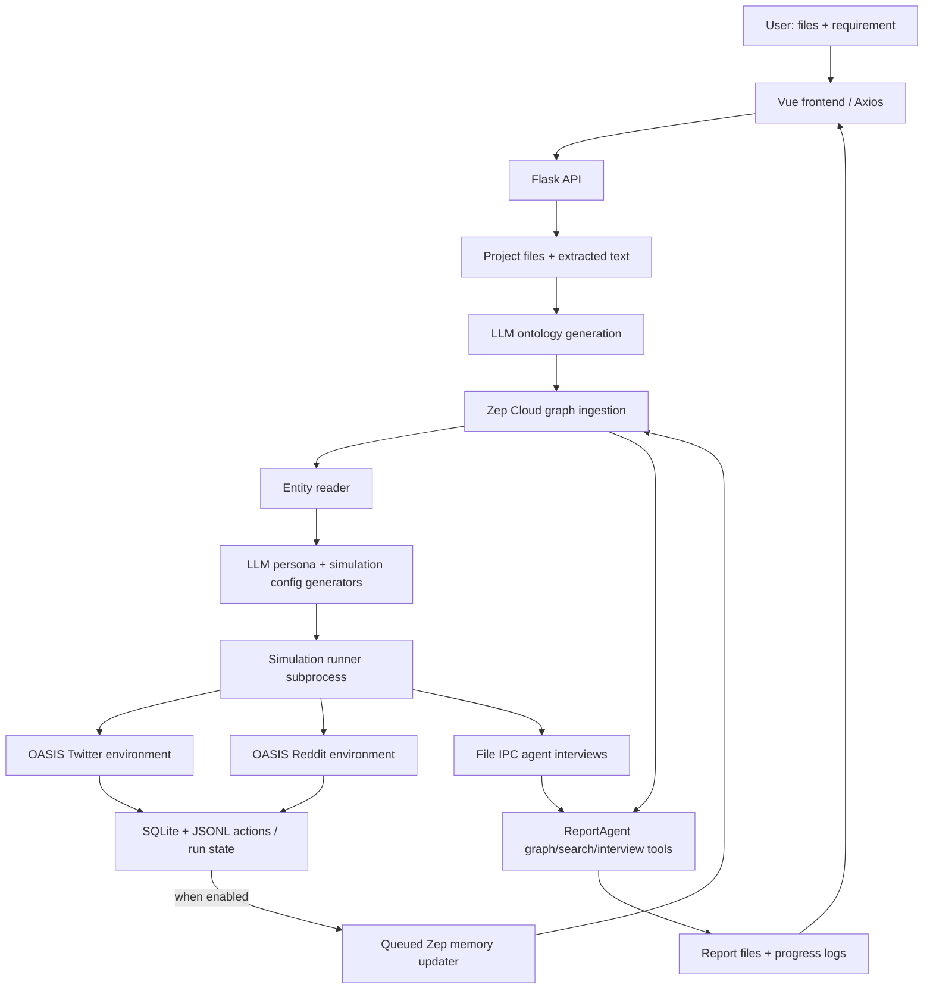

# MiroFish: source-backed deep analysis

## 1. Scope, snapshot aur evidence ka matlab

Yeh document repository **666ghj/MiroFish** ke actual tracked source ka analysis hai. Local checkout `E:\coding\code\Trade\MiroFish` hai. Pinned commit **7657031ac01184afe2cb220f5ee3545573b5e843** hai; inspection date **16 November 2026**. Yeh exact snapshot ki explanation hai, future `main` ka guarantee nahi. Source code mein feature add ya modify nahi kiya gaya. Analysis ka output yeh document aur sibling `mirofish-evidence` directory hai.

Repository inventory mein **128 tracked files**, **62 Python files**, **16 Vue components/views**, **9 JavaScript files**, aur Python AST mein **1,051 function/class definitions** mile. Route decorators se **60 HTTP route registrations** nikle: graph, simulation, report aur health. Definition count unique public APIs ya independent agents ki count nahi hai. Directory entries ko archive files mein add karne se REA counts alag hote hain; unhe source-file count ke saath confuse nahi karna.

Is analysis ke teen evidence levels hain: **source observed** matlab implementation se directly establish hua; **offline verified** matlab tests/build ya focused reproduction ne local behavior exercise kiya; **unverified external behavior** matlab real LLM, Zep Cloud ya OASIS end-to-end run is audit mein nahi chalaya. UI screenshots aur README demos ko runtime verification nahi maana gaya. Complete repository history clone nahi hui, isliye original development chronology, original authorship of every line aur unpublished design decisions establish nahi hote.

### REA ka actual use

User ke requested REA workflow ke liye pinned commit ka `git archive` ZIP banaya aur installed **REA CLI 6.7.0 `inspect-artifact`** se inspect kiya. Active session mein REA MCP tools available nahi the; CLI evidence actual REA result hai, MCP registration ka claim nahi. Archive SHA-256 **6f9ad7a2588a0faf975b8d9e8bd536b632c1e42fd3a21092ce27e1a4235ca0c6** hai. REA result mein root ZIP, **156 graph nodes, 157 occurrences, 156 edges**, complete-within-substeps coverage aur no integrity contradictions aaye. Evidence ID `ev_1081269a06ef80e5e55ddb32c323d0b31cf9f6cd9cf1714c2493d1e41fb19b0b` hai.

Yeh humne local source se banaye ZIP ki inventory hai, upstream released binary ki independently acquired identity nahi. REA ne ZIP members/relationships inventory kiye; usne Python/Vue execution, predictive accuracy ya hosted service behavior prove nahi kiya. Its own limitations: central-directory entries only; non-entry bytes out of scope; static artifact inspection does not execute target or establish language semantics. Semantic analysis normal source reading, AST inventory aur tests se hua. Raw `rea-artifact.json`, compact `rea-summary.json`, source manifest aur document validation evidence folder mein preserved hain.

## 2. Yeh project asal mein kya hai

MiroFish ek **LLM-driven multi-agent social scenario simulator aur reporting application** hai. User seed material upload karta hai aur natural-language simulation requirement deta hai. Application material se ontology aur knowledge graph banwati hai, graph entities ko simulated personas mein badalti hai, Twitter-like aur Reddit-like environments mein unke interactions chalati hai, graph-memory update enabled ho to simulated activity ko memory graph mein ingest karti hai (current Step3 UI ise enable karti hai), phir ReportAgent se evidence-guided narrative report aur chat provide karti hai. README ise “predicting anything” aur parallel digital world ke roop mein present karta hai; implementation ka concrete mechanism document-conditioned social simulation hai. Source: [README.md:35](https://github.com/666ghj/MiroFish/blob/7657031ac01184afe2cb220f5ee3545573b5e843/README.md#L35), [README.md:113](https://github.com/666ghj/MiroFish/blob/7657031ac01184afe2cb220f5ee3545573b5e843/README.md#L113), [backend/app/__init__.py:20](https://github.com/666ghj/MiroFish/blob/7657031ac01184afe2cb220f5ee3545573b5e843/backend/app/__init__.py#L20).

“Twitter/Reddit simulation” ka matlab OASIS ke local simulated platforms hai. Source mein real Twitter/Reddit publishing connector ya live brokerage order execution workflow nahi milta. Stock-price forecasting model, options engine, broker risk manager ya market-data terminal is project ka shipped core nahi hai. Financial signals seed text ho sakte hain, lekin upload ki gayi financial story se generated narrative ko calibrated market forecast kehne ka source evidence nahi. README financial prediction demos ko future examples ke roop mein mention karta hai. Source: [README.md:109](https://github.com/666ghj/MiroFish/blob/7657031ac01184afe2cb220f5ee3545573b5e843/README.md#L109), [backend/pyproject.toml:31](https://github.com/666ghj/MiroFish/blob/7657031ac01184afe2cb220f5ee3545573b5e843/backend/pyproject.toml#L31), simulation scripts described below.

Model weights train karne ka pipeline yahan nahi: application configured OpenAI-compatible provider ko prompts/API requests bhejti hai. Social behavior execution OASIS aur CAMEL dependencies ko delegate hota hai. Knowledge-graph storage/extraction/search Zep Cloud ko delegate hota hai. MiroFish ka apna major code orchestration, data contracts, personas/config generation, lifecycle protection, monitoring, report tools aur frontend workflow hai. Isliye ise ek self-contained foundation model ya independent graph database samajhna galat hoga. Source: [backend/pyproject.toml:15](https://github.com/666ghj/MiroFish/blob/7657031ac01184afe2cb220f5ee3545573b5e843/backend/pyproject.toml#L15), [backend/app/config.py:32](https://github.com/666ghj/MiroFish/blob/7657031ac01184afe2cb220f5ee3545573b5e843/backend/app/config.py#L32), [backend/app/utils/llm_client.py:1](https://github.com/666ghj/MiroFish/blob/7657031ac01184afe2cb220f5ee3545573b5e843/backend/app/utils/llm_client.py#L1).

## 3. Architecture aur ek request ka complete journey

User ke actions ka durable identity chain **project_id → graph_id → simulation_id → report_id** hai. Project raw files aur source requirement rakhta hai; graph external Zep resource hai; simulation personas/config/action artifacts rakhti hai; report separate generated output rakhta hai. Yeh ek single relational transaction nahi: local JSON/files, process memory, child processes, OASIS SQLite aur remote Zep ki alag lifecycles hain. Failure, reset, delete aur post-simulation barrier logic isi split ko coordinate karta hai. Exact state transitions aur file contracts niche service sections mein hain.

Typical flow: ontology endpoint multipart upload leta hai; seed text normalize/extract hota hai; LLM entity/edge schema propose karta hai. Build endpoint background graph ingestion task banata hai. Frontend task poll karta hai. Simulation create/prepare graph entities filter karta hai, profiles aur config generate karta hai. Start endpoint child script launch karta hai; runner actions monitor karta hai aur graph-memory mode enabled ho to memory updates feed karta hai. Completion/stopping aur Zep ingestion drain ke baad report generation admissible hoti hai. Report planning, tool calls, sections aur final Markdown banata hai. Interaction view ReportAgent chat aur retained simulation agents ke interviews use karti hai. Sirf route ka 200 response milna har asynchronous stage ki completion nahi hoti.

## 4. Stack, dependencies aur versions

| Layer | Declared implementation / dependency |
|---|---|
| Frontend | Vue `^3.5.24`, Vue Router `^4.6.3`, Vue I18n `^11.3.0`, Axios `^1.18.1`, D3 `^7.9.0` |
| Build | Vite `^7.3.6`, `@vitejs/plugin-vue ^6.0.1`; npm lockfiles shipped |
| Backend | Flask `>=3`, Flask-CORS `>=6`; threaded development server entry point |
| Python range | `>=3.11,<3.13` in backend pyproject, i.e. 3.11 or 3.12 |
| LLM transport | OpenAI SDK `>=1`; provider base URL/model configurable |
| Remote memory | `zep-cloud==3.25.0`, HTTPX `>=0.27` |
| Social simulation | `camel-oasis==0.2.5`, `camel-ai==0.2.78` |
| Parsing/validation | PyMuPDF, charset-normalizer, chardet, Pydantic |
| Root process orchestration | npm `concurrently ^9.2.4` |
| Reproducibility | root/frontend package-lock and backend uv.lock; Docker uses frozen/CI installation |

Sources: [frontend/package.json:1](https://github.com/666ghj/MiroFish/blob/7657031ac01184afe2cb220f5ee3545573b5e843/frontend/package.json#L1), [backend/pyproject.toml:1](https://github.com/666ghj/MiroFish/blob/7657031ac01184afe2cb220f5ee3545573b5e843/backend/pyproject.toml#L1), [backend/requirements.txt:1](https://github.com/666ghj/MiroFish/blob/7657031ac01184afe2cb220f5ee3545573b5e843/backend/requirements.txt#L1), [package.json:1](https://github.com/666ghj/MiroFish/blob/7657031ac01184afe2cb220f5ee3545573b5e843/package.json#L1), [Dockerfile:10](https://github.com/666ghj/MiroFish/blob/7657031ac01184afe2cb220f5ee3545573b5e843/Dockerfile#L10). Declared ranges aur actually resolved versions alag concepts hain: lockfile mein Vue 3.5.25 aur plugin-vue 6.0.2 resolve hote hain. `requirements.txt` broadly pyproject runtime dependencies repeat karta hai, lekin uv workflow locked dependency graph ke through install karta hai; unpinned pip install ko same environment claim nahi karna.

Preparation ke enable_twitter/enable_reddit flags profile/config generation ko control karte hain; simulation start ka `platform` argument alag script select karta hai. Omitted start platform `parallel` default hota hai, saved enable flags se automatically infer nahi hota. API-created single-platform preparation ko corresponding explicit start platform chahiye; current UI parallel start karti hai. Sources: [backend/app/api/simulation.py:1552](https://github.com/666ghj/MiroFish/blob/7657031ac01184afe2cb220f5ee3545573b5e843/backend/app/api/simulation.py#L1552), [backend/app/services/simulation_runner.py:465](https://github.com/666ghj/MiroFish/blob/7657031ac01184afe2cb220f5ee3545573b5e843/backend/app/services/simulation_runner.py#L465), [backend/scripts/run_parallel_simulation.py:1579](https://github.com/666ghj/MiroFish/blob/7657031ac01184afe2cb220f5ee3545573b5e843/backend/scripts/run_parallel_simulation.py#L1579).

### Setup prerequisite discrepancy

README aur root engines Node 18+ bolte hain. **Locked Vite 7.3.6 aur plugin-vue 6.0.2 ka actual engine `^20.19.0 || >=22.12.0` hai.** Isliye README ka Node 18 minimum current lockfile ke liye sufficient nahi. Yeh source/lockfile discrepancy hai, full install failure har host par reproduce karne ka claim nahi. Is audit ka frontend build Node 24.18.1 par hua. Default shell Python 3.13.5 repo ke declared supported range ke bahar tha; offline backend checks ke liye Python 3.12 isolated venv banayi gayi.

## 5. Configuration, startup aur deployment

`backend/app/config.py` root `.env` locate karke `load_dotenv(..., override=True)` karta hai. Root file absent ho to normal dotenv discovery karta hai. Matlab dotenv values existing environment values ko replace kar sakti hain. Config import-time class attributes define karta hai. CLI `run.py` pehle validate karta hai: **LLM_API_KEY aur ZEP_API_KEY required**, aur nonempty `ZEP_API_URL` explicitly unsupported. Current implementation **Zep Cloud only** hai. Example placeholder strings nonempty hote hain; startup presence check valid credential authentication prove nahi karti. Source: [backend/app/config.py:10](https://github.com/666ghj/MiroFish/blob/7657031ac01184afe2cb220f5ee3545573b5e843/backend/app/config.py#L10), [backend/app/config.py:64](https://github.com/666ghj/MiroFish/blob/7657031ac01184afe2cb220f5ee3545573b5e843/backend/app/config.py#L64), [backend/run.py:28](https://github.com/666ghj/MiroFish/blob/7657031ac01184afe2cb220f5ee3545573b5e843/backend/run.py#L28).

| Setting | Code default / behavior |
|---|---|
| SECRET_KEY | `mirofish-secret-key` fallback |
| FLASK_DEBUG | false; validation warns if enabled |
| FLASK_HOST / FLASK_PORT | `0.0.0.0` / `5001` in run.py |
| LLM_BASE_URL | `https://api.openai.com/v1` |
| LLM_MODEL_NAME | `gpt-4o-mini` |
| Example LLM choice | `.env.example` uses DashScope compatible endpoint + qwen-plus; differs from code fallback |
| Upload cap | 50 MiB Flask MAX_CONTENT_LENGTH |
| Allowed uploads | pdf, md, txt, markdown |
| DEFAULT_CHUNK_SIZE / overlap | 500 / 50; service/request overrides can differ |
| OASIS_DEFAULT_MAX_ROUNDS | 10 declared config; not evidence every run uses exactly 10 |
| Simulation storage | backend/uploads/simulations |
| REPORT_AGENT_MAX_TOOL_CALLS | 5 |
| REPORT_AGENT_MAX_REFLECTION_ROUNDS | 2 declared; usage assessed in report section |
| REPORT_AGENT_TEMPERATURE | 0.5 |

Source: [backend/app/config.py:22](https://github.com/666ghj/MiroFish/blob/7657031ac01184afe2cb220f5ee3545573b5e843/backend/app/config.py#L22), [.env.example:1](https://github.com/666ghj/MiroFish/blob/7657031ac01184afe2cb220f5ee3545573b5e843/.env.example#L1). Example also includes optional `LLM_BOOST_API_KEY`, `LLM_BOOST_BASE_URL`, `LLM_BOOST_MODEL_NAME`. Parallel runner reads these to optionally use a separate model/provider for simulation; presence alone is not a measured speed guarantee. Unused placeholders should not be treated as working optional credentials. Source: [backend/scripts/run_parallel_simulation.py:999](https://github.com/666ghj/MiroFish/blob/7657031ac01184afe2cb220f5ee3545573b5e843/backend/scripts/run_parallel_simulation.py#L999).

Flask app factory configures JSON Unicode output, request/response logging, global `/api/*` CORS with `origins: '*'`, simulation cleanup hooks, and three blueprints. `/health` returns service status; it does not validate external LLM/Zep/OASIS availability. JSON request bodies are logged at DEBUG; uploaded material, prompts and generated artifacts may therefore appear in local logs as well as external provider requests. Logger writes rotating per-day files, 10 MiB per file with five backups. Source: [backend/app/__init__.py:20](https://github.com/666ghj/MiroFish/blob/7657031ac01184afe2cb220f5ee3545573b5e843/backend/app/__init__.py#L20), [backend/app/utils/logger.py:31](https://github.com/666ghj/MiroFish/blob/7657031ac01184afe2cb220f5ee3545573b5e843/backend/app/utils/logger.py#L31).

Repository backend routes do not install a login/user/tenant ownership authentication layer. Combined with broad CORS, bind-all host, upload and lifecycle endpoints, this is relevant when exposing the app to other machines. This observation is an application-boundary description, not a verified exploit or a claim about protections in the separately hosted service. Environment keys themselves are not intentionally sent to the frontend by config. Source: [backend/app/__init__.py:43](https://github.com/666ghj/MiroFish/blob/7657031ac01184afe2cb220f5ee3545573b5e843/backend/app/__init__.py#L43), [backend/app/api/__init__.py:1](https://github.com/666ghj/MiroFish/blob/7657031ac01184afe2cb220f5ee3545573b5e843/backend/app/api/__init__.py#L1), API catalog.

Source deployment commands are root `npm run setup:all`, then `npm run dev` after configuring `.env`. Root setup does npm installs and backend `uv sync`; dev starts backend and frontend concurrently with kill-others. Frontend Vite serves port 3000, proxying `/api` to localhost:5001. Its `open: true` asks the developer server to open a browser; this audit did not launch it. Vite production build produces assets but the checked-in Docker command still uses `npm run dev`, not a production static hosting stack. Source: [package.json:6](https://github.com/666ghj/MiroFish/blob/7657031ac01184afe2cb220f5ee3545573b5e843/package.json#L6), [frontend/vite.config.js:1](https://github.com/666ghj/MiroFish/blob/7657031ac01184afe2cb220f5ee3545573b5e843/frontend/vite.config.js#L1), [Dockerfile:28](https://github.com/666ghj/MiroFish/blob/7657031ac01184afe2cb220f5ee3545573b5e843/Dockerfile#L28).

Docker base is `python:3.11`; apt installs distribution nodejs/npm, uv 0.9.26 copied from its official image. Build copies package locks and uv.lock, then `npm ci` and `uv sync --frozen`. Source copies follow dependency installation for caching. Compose uses `ghcr.io/666ghj/mirofish:latest`, `.env`, ports 3000/5001, restart unless-stopped and local uploads bind mount. It references a published image, not `build: .`; image digest is not pinned. Only uploads are mounted by compose, not backend logs. No image build/pull or external deployment was performed here. Source: [Dockerfile:1](https://github.com/666ghj/MiroFish/blob/7657031ac01184afe2cb220f5ee3545573b5e843/Dockerfile#L1), [docker-compose.yml:1](https://github.com/666ghj/MiroFish/blob/7657031ac01184afe2cb220f5ee3545573b5e843/docker-compose.yml#L1).

## 6. Supporting maintenance files, CI aur license

`.github/workflows/docker-image.yml` runs on tags or manual invocation, sets up QEMU/Buildx, builds Linux amd64/arm64 images and optionally logs in/publishes to GHCR. Manual publication is gated to default-branch runs with publish requested. Tags include tag ref, SHA and latest. Docker workflow is not proof that a particular container image has passed simulation tests. Source: [.github/workflows/docker-image.yml:1](https://github.com/666ghj/MiroFish/blob/7657031ac01184afe2cb220f5ee3545573b5e843/.github/workflows/docker-image.yml#L1).

Star-history workflow is unrelated to scenario simulation. It schedules aggregate GitHub star snapshots at 03:17 UTC on days 1 and 16, with repo/default-branch/actor controls. A small fetch-only script gets repository metadata count using a token; count output goes to an offline renderer; only JSON history and two SVG paths may be committed. Fetch helper refuses redirects, bounds responses, validates integer count and sanitizes errors; renderer validates schema, guards output paths and creates deterministic accessible light/dark SVGs. This workflow runs star-helper tests, not the complete application backend suite. Source: [.github/workflows/update-star-history.yml:1](https://github.com/666ghj/MiroFish/blob/7657031ac01184afe2cb220f5ee3545573b5e843/.github/workflows/update-star-history.yml#L1), [scripts/fetch_star_count.py:18](https://github.com/666ghj/MiroFish/blob/7657031ac01184afe2cb220f5ee3545573b5e843/scripts/fetch_star_count.py#L18), [scripts/star_history.py:1360](https://github.com/666ghj/MiroFish/blob/7657031ac01184afe2cb220f5ee3545573b5e843/scripts/star_history.py#L1360).

`star_history.py` CLI provides backfill, initialize, due, record, check. Backfill reads GitHub historical stargazer data through a gateway; initialize/record accept an aggregate count file; no fabricated interpolation is presented as observed daily stars. Static screenshots, logos, demo thumbnails, QR code and SVGs are presentation material, not model training data or run outputs. Third-party notices explain reviewed chart assets. Source: [scripts/star_history.py:1430](https://github.com/666ghj/MiroFish/blob/7657031ac01184afe2cb220f5ee3545573b5e843/scripts/star_history.py#L1430), [.github/star-history/THIRD_PARTY_NOTICES.md:1](https://github.com/666ghj/MiroFish/blob/7657031ac01184afe2cb220f5ee3545573b5e843/.github/star-history/THIRD_PARTY_NOTICES.md#L1).

Repository LICENSE is **AGPL-3.0**, also declared by root package and backend metadata. Yeh license identification hai; full legal advice ya third-party dependency license audit nahi. README acknowledgments explicitly credit OASIS/CAMEL and Shanda support. Developer history, commercial business terms aur hosted-service code not present in this snapshot remain unknown. Source: [LICENSE:1](https://github.com/666ghj/MiroFish/blob/7657031ac01184afe2cb220f5ee3545573b5e843/LICENSE#L1), [package.json:20](https://github.com/666ghj/MiroFish/blob/7657031ac01184afe2cb220f5ee3545573b5e843/package.json#L20), [README.md:189](https://github.com/666ghj/MiroFish/blob/7657031ac01184afe2cb220f5ee3545573b5e843/README.md#L189).

## 7. Reading the detailed subsystems

Following sections independently trace the graph/data layer, simulation execution, report tools and UI, with source locations. API and file appendices at the end provide complete inventories. Documentation completeness here means each tracked source area and exposed route has been accounted for; it does not mean every possible input, provider failure, race or deployment combination was executed.

## 8. Graph, ontology, memory aur shared utilities

### Architecture map

File upload -> parser/preprocessor -> persisted project text -> LLM ontology -> project-aware background graph worker -> Zep standalone graph + dynamic schema -> Zep Batch API document ingestion -> terminal batch/item validation -> full paginated graph reads -> project/task completion. Main orchestration API closure mein hai; GraphBuilderService.build_graph_async separate legacy/simple path hai. Zep graph extraction service ko text episodes diye jaate hain; local custom NLP/GNN engine implementation yahaan nahi hai ([backend/app/api/graph.py:651](https://github.com/666ghj/MiroFish/blob/7657031ac01184afe2cb220f5ee3545573b5e843/backend/app/api/graph.py#L651); [backend/app/services/graph_builder.py:75](https://github.com/666ghj/MiroFish/blob/7657031ac01184afe2cb220f5ee3545573b5e843/backend/app/services/graph_builder.py#L75); [backend/app/services/graph_builder.py:470](https://github.com/666ghj/MiroFish/blob/7657031ac01184afe2cb220f5ee3545573b5e843/backend/app/services/graph_builder.py#L470)). SDK explicitly zep-cloud==3.25.0 pinned hai ([backend/pyproject.toml:20](https://github.com/666ghj/MiroFish/blob/7657031ac01184afe2cb220f5ee3545573b5e843/backend/pyproject.toml#L20); [backend/requirements.txt:17](https://github.com/666ghj/MiroFish/blob/7657031ac01184afe2cb220f5ee3545573b5e843/backend/requirements.txt#L17)).

### Graph API: upload, ontology, build, reset, delete

GET project detail returns serialized Project or404; list query limit default50, created descending, response count returned records ka hai ([backend/app/api/graph.py:132](https://github.com/666ghj/MiroFish/blob/7657031ac01184afe2cb220f5ee3545573b5e843/backend/app/api/graph.py#L132); [backend/app/api/graph.py:151](https://github.com/666ghj/MiroFish/blob/7657031ac01184afe2cb220f5ee3545573b5e843/backend/app/api/graph.py#L151)).

POST /ontology/generate synchronous multipart/form-data route hai, async task endpoint nahi. Fields files[], simulation_requirement required by truthiness, project_name default Unnamed Project, optional additional_context. Whitespace-only requirement explicit strip/reject nahi. Missing files/all empty filenames400. Project pehle create hota hai; file loop only allowed suffixes accept karta hai, unsupported files silently skip. Each accepted file random saved filename se store, public project.files mein original filename/size only, parser->preprocessor; clean document texts ontology LLM ko, filename-headed concatenated all_text future graph ingestion ke liye extracted_text.txt mein. total_text_length headings bhi count karta hai. Allowed-file helper Config.ALLOWED_EXTENSIONS uses suffix; parser independently extensions check karta hai ([backend/app/api/graph.py:122](https://github.com/666ghj/MiroFish/blob/7657031ac01184afe2cb220f5ee3545573b5e843/backend/app/api/graph.py#L122); [backend/app/api/graph.py:265](https://github.com/666ghj/MiroFish/blob/7657031ac01184afe2cb220f5ee3545573b5e843/backend/app/api/graph.py#L265); [backend/app/api/graph.py:298](https://github.com/666ghj/MiroFish/blob/7657031ac01184afe2cb220f5ee3545573b5e843/backend/app/api/graph.py#L298); [backend/app/api/graph.py:328](https://github.com/666ghj/MiroFish/blob/7657031ac01184afe2cb220f5ee3545573b5e843/backend/app/api/graph.py#L328)).

No accepted documents -> new project deleted,400. Accepted but empty extracted text document_texts list mein add ho sakta hai; explicit all-text-content quality validation yahaan nahi. API individually extracts files, so unlike FileParser.extract_from_multiple helper, one parse exception whole ontology request fail karta hai. Generated ontology entity_types/edge_types project.ontology mein; analysis_summary separate; status ontology_generated. Response project_id/name/ontology/summary/files/text length ([backend/app/api/graph.py:342](https://github.com/666ghj/MiroFish/blob/7657031ac01184afe2cb220f5ee3545573b5e843/backend/app/api/graph.py#L342); [backend/app/api/graph.py:347](https://github.com/666ghj/MiroFish/blob/7657031ac01184afe2cb220f5ee3545573b5e843/backend/app/api/graph.py#L347); [backend/app/api/graph.py:373](https://github.com/666ghj/MiroFish/blob/7657031ac01184afe2cb220f5ee3545573b5e843/backend/app/api/graph.py#L373)).

Ontology errors deliberately sanitized: LLMResponseError safe message502; provider status integer -> generic HTTP status/request ID502, request ID restricted chars and128 cap, provider body not serialized. Other exceptions generic500; project exists to failed+public_error save, save-failure logged; response data project_id retained. This specialized safe error handling ko all endpoints par assume nahi karna: graph data/build general errors tracebacks expose kar sakte hain ([backend/app/api/graph.py:394](https://github.com/666ghj/MiroFish/blob/7657031ac01184afe2cb220f5ee3545573b5e843/backend/app/api/graph.py#L394); [backend/app/api/graph.py:424](https://github.com/666ghj/MiroFish/blob/7657031ac01184afe2cb220f5ee3545573b5e843/backend/app/api/graph.py#L424); [backend/app/api/graph.py:899](https://github.com/666ghj/MiroFish/blob/7657031ac01184afe2cb220f5ee3545573b5e843/backend/app/api/graph.py#L899)).

POST /build project lock ke andar implementation claim karta hai ([backend/app/api/graph.py:448](https://github.com/666ghj/MiroFish/blob/7657031ac01184afe2cb220f5ee3545573b5e843/backend/app/api/graph.py#L448)). JSON project_id required404 if nonexistent, created status -> ontology not generated400. force strict bool, string bool rejected400. graph_building + live in-memory pending/processing task -> reuse task/graph response. Completed + !force -> reuse completed metadata, no rebuild. Stale graph_building after restart: graph_id+zep_batch_id+operation_id required; server batch queued/processing/succeeded enables resume, otherwise persisted failed + recoverable409 unless force. In-memory task disappearance ko running daemon resurrection nahi maana gaya ([backend/app/api/graph.py:500](https://github.com/666ghj/MiroFish/blob/7657031ac01184afe2cb220f5ee3545573b5e843/backend/app/api/graph.py#L500); [backend/app/api/graph.py:515](https://github.com/666ghj/MiroFish/blob/7657031ac01184afe2cb220f5ee3545573b5e843/backend/app/api/graph.py#L515); [backend/app/api/graph.py:529](https://github.com/666ghj/MiroFish/blob/7657031ac01184afe2cb220f5ee3545573b5e843/backend/app/api/graph.py#L529); [backend/app/api/graph.py:573](https://github.com/666ghj/MiroFish/blob/7657031ac01184afe2cb220f5ee3545573b5e843/backend/app/api/graph.py#L573)).

Build graph_name fallback project.name; chunk defaults request -> project fields -> Config. chunk_size positive int, overlap int 0<=overlap<size. Python bool subclass-of-int issue explicitly excluded nahi by isinstance check. Need saved nonempty text and ontology. Failed project or force completed rebuild: lifecycle lock mein old Cloud delete, then clear graph/task/batch/op/error and save ontology_generated. Validation se pehle destructive cleanup nahi hota ([backend/app/api/graph.py:585](https://github.com/666ghj/MiroFish/blob/7657031ac01184afe2cb220f5ee3545573b5e843/backend/app/api/graph.py#L585); [backend/app/api/graph.py:605](https://github.com/666ghj/MiroFish/blob/7657031ac01184afe2cb220f5ee3545573b5e843/backend/app/api/graph.py#L605); [backend/app/api/graph.py:621](https://github.com/666ghj/MiroFish/blob/7657031ac01184afe2cb220f5ee3545573b5e843/backend/app/api/graph.py#L621)).

Creates new volatile task, saves project graph_building/task_id, captures locale, starts daemon thread. Worker split+validate all chunks before first Cloud mutation. Resume recomputes operation hash and rejects changed source chunks; does not recreate/set ontology/resubmit. New build callbacks persist caller-generated graph ID before POST, operation identity before batch POST and actual batch ID after; then set ontology->Batch API->wait. Progress5 chunk,10 graph,15 schema,15–55 submission ratio*40,55–90 poll ratio*35,95 graph read,100 success. Entire graph returned by service to derive counts; task result project_id/graph_id/counts/chunk_count/batch_id. Success saves project graph_completed/errorNone and task completed under project build lock. Worker error project.failed+str(error), task.failed+traceback; retained graph reference permits cleanup. HTTP initiating response success means task started, not graph ready ([backend/app/api/graph.py:637](https://github.com/666ghj/MiroFish/blob/7657031ac01184afe2cb220f5ee3545573b5e843/backend/app/api/graph.py#L637); [backend/app/api/graph.py:665](https://github.com/666ghj/MiroFish/blob/7657031ac01184afe2cb220f5ee3545573b5e843/backend/app/api/graph.py#L665); [backend/app/api/graph.py:679](https://github.com/666ghj/MiroFish/blob/7657031ac01184afe2cb220f5ee3545573b5e843/backend/app/api/graph.py#L679); [backend/app/api/graph.py:705](https://github.com/666ghj/MiroFish/blob/7657031ac01184afe2cb220f5ee3545573b5e843/backend/app/api/graph.py#L705); [backend/app/api/graph.py:737](https://github.com/666ghj/MiroFish/blob/7657031ac01184afe2cb220f5ee3545573b5e843/backend/app/api/graph.py#L737); [backend/app/api/graph.py:765](https://github.com/666ghj/MiroFish/blob/7657031ac01184afe2cb220f5ee3545573b5e843/backend/app/api/graph.py#L765); [backend/app/api/graph.py:779](https://github.com/666ghj/MiroFish/blob/7657031ac01184afe2cb220f5ee3545573b5e843/backend/app/api/graph.py#L779); [backend/app/api/graph.py:801](https://github.com/666ghj/MiroFish/blob/7657031ac01184afe2cb220f5ee3545573b5e843/backend/app/api/graph.py#L801); [backend/app/api/graph.py:818](https://github.com/666ghj/MiroFish/blob/7657031ac01184afe2cb220f5ee3545573b5e843/backend/app/api/graph.py#L818)).

Project reset/delete both project-build lock, absent404/live build409. Cloud deletion completes before local clear/remove; graph lock spans consumer check, Cloud mutation and local update, so another simulation claim cannot slip between them. reset preserves uploads/text/ontology, status ontology_generated if ontology exists else created, clears graph/task/batch/op/error. Project deletion removes local files only after Cloud deletion. Low-level model deletion on its own does not delete Cloud graph ([backend/app/api/graph.py:166](https://github.com/666ghj/MiroFish/blob/7657031ac01184afe2cb220f5ee3545573b5e843/backend/app/api/graph.py#L166); [backend/app/api/graph.py:213](https://github.com/666ghj/MiroFish/blob/7657031ac01184afe2cb220f5ee3545573b5e843/backend/app/api/graph.py#L213); [backend/app/models/project.py:238](https://github.com/666ghj/MiroFish/blob/7657031ac01184afe2cb220f5ee3545573b5e843/backend/app/models/project.py#L238)).

_active_graph_consumers collects report reader leases, retained updater IDs, active runner statuses starting/running/paused/stopping from all simulations with graph ID. It tries each finalization lock nonblocking; busy = active. Failed runner can discard fully inactive updater as explicit delete/reset recovery, removes graph-memory enabled flag. GraphInUseError409 blocks destructive operation. Cloud delete isn't automatically retried; NotFound treated already absent. Other failures do not intentionally clear local references ([backend/app/api/graph.py:40](https://github.com/666ghj/MiroFish/blob/7657031ac01184afe2cb220f5ee3545573b5e843/backend/app/api/graph.py#L40); [backend/app/api/graph.py:76](https://github.com/666ghj/MiroFish/blob/7657031ac01184afe2cb220f5ee3545573b5e843/backend/app/api/graph.py#L76)).

GET /data/<graph_id> requires ZEP key, directly fetches remote graph; no local project ownership lookup in this handler, exception500 includes str/error traceback. DELETE /delete/<graph_id> requires key plus at least one persisted project reference (otherwise404). Sort owning IDs, acquire all project locks then graph lock, reread references, active build409, guarded Cloud delete, clear every owner graph fields and reset appropriate status. Success preserves projects/uploads. GraphInUse409, other errors500 traceback. This is project-tracked Cloud deletion, not arbitrary graph deletion endpoint ([backend/app/api/graph.py:879](https://github.com/666ghj/MiroFish/blob/7657031ac01184afe2cb220f5ee3545573b5e843/backend/app/api/graph.py#L879); [backend/app/api/graph.py:907](https://github.com/666ghj/MiroFish/blob/7657031ac01184afe2cb220f5ee3545573b5e843/backend/app/api/graph.py#L907)).

### Project: disk persistence, Task: process memory

ProjectStatus created/ontology_generated/graph_building/graph_completed/failed. Project fields project_id/name/status/create-update timestamps; files,total_text_length; ontology,analysis_summary; graph_id,graph_build_task_id,zep_batch_id,zep_batch_operation_id; simulation_requirement; chunk_size500,chunk_overlap50; error. to_dict includes these; from_dict missing old fields defaults, unknown enum strings raise ([backend/app/models/project.py:17](https://github.com/666ghj/MiroFish/blob/7657031ac01184afe2cb220f5ee3545573b5e843/backend/app/models/project.py#L17); [backend/app/models/project.py:27](https://github.com/666ghj/MiroFish/blob/7657031ac01184afe2cb220f5ee3545573b5e843/backend/app/models/project.py#L27); [backend/app/models/project.py:80](https://github.com/666ghj/MiroFish/blob/7657031ac01184afe2cb220f5ee3545573b5e843/backend/app/models/project.py#L80)).

Root Config.UPLOAD_FOLDER/projects; per project project.json, files/, extracted_text.txt. ID proj_+12 UUID hex, naive datetime.now().isoformat. save_project directly overwrites UTF8 JSON, ensure_asciiFalse/indent2, updates timestamp; no atomic replace/file lock/DB transaction/version check in manager. get missing None, parse errors propagate. list default50 or None all, descending created_at; graph reverse lookup scans full list. Model constructs paths with provided project IDs without its own path-format validator. Save upload preserves lowercase extension, 8hex random basename, returns original_filename/saved_filename/path/size. Public ontology API only stores filename/size in project.files ([backend/app/models/project.py:110](https://github.com/666ghj/MiroFish/blob/7657031ac01184afe2cb220f5ee3545573b5e843/backend/app/models/project.py#L110); [backend/app/models/project.py:139](https://github.com/666ghj/MiroFish/blob/7657031ac01184afe2cb220f5ee3545573b5e843/backend/app/models/project.py#L139); [backend/app/models/project.py:174](https://github.com/666ghj/MiroFish/blob/7657031ac01184afe2cb220f5ee3545573b5e843/backend/app/models/project.py#L174); [backend/app/models/project.py:183](https://github.com/666ghj/MiroFish/blob/7657031ac01184afe2cb220f5ee3545573b5e843/backend/app/models/project.py#L183); [backend/app/models/project.py:204](https://github.com/666ghj/MiroFish/blob/7657031ac01184afe2cb220f5ee3545573b5e843/backend/app/models/project.py#L204); [backend/app/models/project.py:228](https://github.com/666ghj/MiroFish/blob/7657031ac01184afe2cb220f5ee3545573b5e843/backend/app/models/project.py#L228); [backend/app/models/project.py:257](https://github.com/666ghj/MiroFish/blob/7657031ac01184afe2cb220f5ee3545573b5e843/backend/app/models/project.py#L257)).

TaskStatus pending/processing/completed/failed. Task has UUID, type, datetime, progress0,message,result,error,metadata,progress_detail; datetimes serialize ISO. Singleton double-checked TaskManager dictionary + locks; **not disk durable**. get_task actual reference, missing update no-op, fields only nonNone so cannot clear result/error with None, no progress clamp/state transition enforcement. complete100 localized message; fail status/error doesn't reset progress. cleanup default24h old completed/failed only; list optional type sorted newest first ([backend/app/models/task.py:16](https://github.com/666ghj/MiroFish/blob/7657031ac01184afe2cb220f5ee3545573b5e843/backend/app/models/task.py#L16); [backend/app/models/task.py:25](https://github.com/666ghj/MiroFish/blob/7657031ac01184afe2cb220f5ee3545573b5e843/backend/app/models/task.py#L25); [backend/app/models/task.py:62](https://github.com/666ghj/MiroFish/blob/7657031ac01184afe2cb220f5ee3545573b5e843/backend/app/models/task.py#L62); [backend/app/models/task.py:103](https://github.com/666ghj/MiroFish/blob/7657031ac01184afe2cb220f5ee3545573b5e843/backend/app/models/task.py#L103); [backend/app/models/task.py:108](https://github.com/666ghj/MiroFish/blob/7657031ac01184afe2cb220f5ee3545573b5e843/backend/app/models/task.py#L108); [backend/app/models/task.py:147](https://github.com/666ghj/MiroFish/blob/7657031ac01184afe2cb220f5ee3545573b5e843/backend/app/models/task.py#L147); [backend/app/models/task.py:174](https://github.com/666ghj/MiroFish/blob/7657031ac01184afe2cb220f5ee3545573b5e843/backend/app/models/task.py#L174)).

### Parsing, preprocessing, chunking

FileParser supported .pdf/.md/.markdown/.txt only. Missing path FileNotFoundError; unsupported ValueError. PDF fitz.open + page.get_text + nonblank pages double-newline join; no OCR or image extraction pipeline. Markdown raw source decoded, no syntax removal. Text bytes strictUTF8 -> optional charset_normalizer -> optional chardet -> UTF8 replacement; detector failures ignored ([backend/app/utils/file_parser.py:11](https://github.com/666ghj/MiroFish/blob/7657031ac01184afe2cb220f5ee3545573b5e843/backend/app/utils/file_parser.py#L11); [backend/app/utils/file_parser.py:64](https://github.com/666ghj/MiroFish/blob/7657031ac01184afe2cb220f5ee3545573b5e843/backend/app/utils/file_parser.py#L64); [backend/app/utils/file_parser.py:81](https://github.com/666ghj/MiroFish/blob/7657031ac01184afe2cb220f5ee3545573b5e843/backend/app/utils/file_parser.py#L81); [backend/app/utils/file_parser.py:111](https://github.com/666ghj/MiroFish/blob/7657031ac01184afe2cb220f5ee3545573b5e843/backend/app/utils/file_parser.py#L111)).

Multi-file helper independently catches file parse errors, inserts error marker into combined source and continues. This differs from upload API loop which fails request on parse error. Helper document heading contains filename; it does not guarantee every document extracted successfully ([backend/app/utils/file_parser.py:138](https://github.com/666ghj/MiroFish/blob/7657031ac01184afe2cb220f5ee3545573b5e843/backend/app/utils/file_parser.py#L138)).

Chunk unit characters, not LLM tokens. Defaults500/50. <=size returns text untrimmed if nonblank else[]. Loop nominal end start+size; first qualifying separator KIND in priority Chinese sentence endings, English punctuation+newline, double newline, punctuation+space; chooses that kind's last occurrence if >30% target. strip each chunk; next start end-overlap. Not recursive semantic chunker; no intrinsic chunk/overlap validation, malformed values may prevent progress. API validation exists but legacy service directly calls helper. Separator length can extend nominal end slightly ([backend/app/utils/file_parser.py:161](https://github.com/666ghj/MiroFish/blob/7657031ac01184afe2cb220f5ee3545573b5e843/backend/app/utils/file_parser.py#L161); [backend/app/api/graph.py:587](https://github.com/666ghj/MiroFish/blob/7657031ac01184afe2cb220f5ee3545573b5e843/backend/app/api/graph.py#L587); [backend/app/services/graph_builder.py:144](https://github.com/666ghj/MiroFish/blob/7657031ac01184afe2cb220f5ee3545573b5e843/backend/app/services/graph_builder.py#L144)).

TextProcessor delegates extraction/splitting. preprocess CRLF/CR->LF,3+ newlines->2, trim each line+outer; stats len, newline+1, whitespace split word count (not linguistic tokenizer) ([backend/app/services/text_processor.py:13](https://github.com/666ghj/MiroFish/blob/7657031ac01184afe2cb220f5ee3545573b5e843/backend/app/services/text_processor.py#L13); [backend/app/services/text_processor.py:37](https://github.com/666ghj/MiroFish/blob/7657031ac01184afe2cb220f5ee3545573b5e843/backend/app/services/text_processor.py#L37); [backend/app/services/text_processor.py:64](https://github.com/666ghj/MiroFish/blob/7657031ac01184afe2cb220f5ee3545573b5e843/backend/app/services/text_processor.py#L64)).

### Ontology: LLM request, normalization, dynamic Zep schema

Prompt asks real social-media-speaking actors (people, companies, organizations, government/media/platforms/groups); concepts/topics/attitudes forbidden **in prompt**. Requested output object entity_types(name,description,attributes,examples), edge_types(name,description,source_targets,attributes), analysis_summary. Exactly10 actors (8 specific plus final Person/Organization),6–10 relations,1–3 attrs request. Language instruction locale appended, names English PascalCase/UPPER_SNAKE_CASE/snake_case, description/summary selected language. Semantic “real actor” validation not implemented beyond LLM guidance ([backend/app/services/ontology_generator.py:48](https://github.com/666ghj/MiroFish/blob/7657031ac01184afe2cb220f5ee3545573b5e843/backend/app/services/ontology_generator.py#L48); [backend/app/services/ontology_generator.py:75](https://github.com/666ghj/MiroFish/blob/7657031ac01184afe2cb220f5ee3545573b5e843/backend/app/services/ontology_generator.py#L75); [backend/app/services/ontology_generator.py:113](https://github.com/666ghj/MiroFish/blob/7657031ac01184afe2cb220f5ee3545573b5e843/backend/app/services/ontology_generator.py#L113); [backend/app/services/ontology_generator.py:138](https://github.com/666ghj/MiroFish/blob/7657031ac01184afe2cb220f5ee3545573b5e843/backend/app/services/ontology_generator.py#L138); [backend/app/services/ontology_generator.py:227](https://github.com/666ghj/MiroFish/blob/7657031ac01184afe2cb220f5ee3545573b5e843/backend/app/services/ontology_generator.py#L227)).

generate chat_json temp.3,max_tokensNone,max_attempts2 then validate. User requirement + document context + optional extra. Document context <=50,000 chars unchanged join; longer corpus each doc chunks8000/overlap200, up to60 equally spaced global samples, excerpt budget at least400 each, head+tail with omission marker. Budget shrinks*.85 while too big, final hard cap. This is a single request over representative excerpts, **not** per-chunk LLM summarization/map-reduce/full-corpus reading. simulation_requirement/additional_context outside50k document cap ([backend/app/services/ontology_generator.py:234](https://github.com/666ghj/MiroFish/blob/7657031ac01184afe2cb220f5ee3545573b5e843/backend/app/services/ontology_generator.py#L234); [backend/app/services/ontology_generator.py:250](https://github.com/666ghj/MiroFish/blob/7657031ac01184afe2cb220f5ee3545573b5e843/backend/app/services/ontology_generator.py#L250); [backend/app/services/ontology_generator.py:296](https://github.com/666ghj/MiroFish/blob/7657031ac01184afe2cb220f5ee3545573b5e843/backend/app/services/ontology_generator.py#L296); [backend/app/services/ontology_generator.py:333](https://github.com/666ghj/MiroFish/blob/7657031ac01184afe2cb220f5ee3545573b5e843/backend/app/services/ontology_generator.py#L333); [backend/app/services/ontology_generator.py:354](https://github.com/666ghj/MiroFish/blob/7657031ac01184afe2cb220f5ee3545573b5e843/backend/app/services/ontology_generator.py#L354); [backend/app/services/ontology_generator.py:370](https://github.com/666ghj/MiroFish/blob/7657031ac01184afe2cb220f5ee3545573b5e843/backend/app/services/ontology_generator.py#L370); [backend/app/services/ontology_generator.py:416](https://github.com/666ghj/MiroFish/blob/7657031ac01184afe2cb220f5ee3545573b5e843/backend/app/services/ontology_generator.py#L416)).

Validation top object required; bad entity/edge list->[],bad summary->empty. Entity bare string accepted, malformed/no name ignored; ASCII-alnum PascalCase helper, Unknown ignored, duplicates dedup; attrs normalize, examples nonlist->[], desc fallback/max100. Entity helper does not guard digit-leading names ([backend/app/services/ontology_generator.py:22](https://github.com/666ghj/MiroFish/blob/7657031ac01184afe2cb220f5ee3545573b5e843/backend/app/services/ontology_generator.py#L22); [backend/app/services/ontology_generator.py:432](https://github.com/666ghj/MiroFish/blob/7657031ac01184afe2cb220f5ee3545573b5e843/backend/app/services/ontology_generator.py#L432); [backend/app/services/ontology_generator.py:460](https://github.com/666ghj/MiroFish/blob/7657031ac01184afe2cb220f5ee3545573b5e843/backend/app/services/ontology_generator.py#L460)).

Person/Organization missing appended with fallback properties/examples; tail-specific types trimmed if necessary; max10. **Exactly10 not enforced**: empty LLM list becomes2 fallbacks, no invented8 types. Existing fallbacks not necessarily reordered last. Rare overlong output already containing both fallbacks is simply capped first10 ([backend/app/services/ontology_generator.py:500](https://github.com/666ghj/MiroFish/blob/7657031ac01184afe2cb220f5ee3545573b5e843/backend/app/services/ontology_generator.py#L500); [backend/app/services/ontology_generator.py:521](https://github.com/666ghj/MiroFish/blob/7657031ac01184afe2cb220f5ee3545573b5e843/backend/app/services/ontology_generator.py#L521)).

Edges bare name ignored (no endpoints); object name uppercase snake, digit leading REL_, duplicates/UNKNOWN removed. Endpoint maps original/case/Pascal identifiers after final entities capped; generic Entity allowed, unknown/removed type pairs discard, dedup/cap10. Edge descriptions max100,attrs normalize,cap10 relations;6 minimum not enforced. Zero-valid-pair edge may remain returned definition; install skips it ([backend/app/services/ontology_generator.py:35](https://github.com/666ghj/MiroFish/blob/7657031ac01184afe2cb220f5ee3545573b5e843/backend/app/services/ontology_generator.py#L35); [backend/app/services/ontology_generator.py:550](https://github.com/666ghj/MiroFish/blob/7657031ac01184afe2cb220f5ee3545573b5e843/backend/app/services/ontology_generator.py#L550); [backend/app/services/ontology_generator.py:567](https://github.com/666ghj/MiroFish/blob/7657031ac01184afe2cb220f5ee3545573b5e843/backend/app/services/ontology_generator.py#L567); [backend/app/services/graph_builder.py:394](https://github.com/666ghj/MiroFish/blob/7657031ac01184afe2cb220f5ee3545573b5e843/backend/app/services/graph_builder.py#L394)).

Shared attr helper first10 usable, string->{name,type:text,description:name}, dict needs nonblank string name,description fallback name; empty gets details fallback. Not snake_case/type validation, not duplicate-name removal; other dict fields preserved. Endpoint helper strip+dedup structurally valid source/target strings cap10 ([backend/app/utils/ontology.py:6](https://github.com/666ghj/MiroFish/blob/7657031ac01184afe2cb220f5ee3545573b5e843/backend/app/utils/ontology.py#L6); [backend/app/utils/ontology.py:26](https://github.com/666ghj/MiroFish/blob/7657031ac01184afe2cb220f5ee3545573b5e843/backend/app/utils/ontology.py#L26); [backend/app/utils/ontology.py:52](https://github.com/666ghj/MiroFish/blob/7657031ac01184afe2cb220f5ee3545573b5e843/backend/app/utils/ontology.py#L52); [backend/app/utils/ontology.py:73](https://github.com/666ghj/MiroFish/blob/7657031ac01184afe2cb220f5ee3545573b5e843/backend/app/utils/ontology.py#L73)).

set_ontology constructs dynamic Pydantic EntityModel subclasses; attributes Optional[EntityText], Field description/defaultNone. EdgeModel attrs Optional[str]; declared attr.type ignored. Reserved uuid/name/group_id/graph_id/name_embedding/summary/created_at case-insensitive prefix entity_. Max10 types, normalized attrs/pairs, edge classes Pascalized from snake; empty pair edge skip. graph.set_ontology graph_ids=[ID],entities dict (even empty),edges dict orNone; no retry wrapper. This is string/text ontology schema, not arbitrary property datatypes ([backend/app/services/graph_builder.py:313](https://github.com/666ghj/MiroFish/blob/7657031ac01184afe2cb220f5ee3545573b5e843/backend/app/services/graph_builder.py#L313); [backend/app/services/graph_builder.py:397](https://github.com/666ghj/MiroFish/blob/7657031ac01184afe2cb220f5ee3545573b5e843/backend/app/services/graph_builder.py#L397)).

generate_python_code returns code STRING (classes, ENTITY_TYPES,EDGE_TYPES,EDGE_SOURCE_TARGETS), not runtime execution path. It uses EntityText also on edge attrs, lacks runtime reserved-name safety rename and directly interpolates descriptions. Generated downloadable representation should not be conflated with installed dynamic schema ([backend/app/services/ontology_generator.py:627](https://github.com/666ghj/MiroFish/blob/7657031ac01184afe2cb220f5ee3545573b5e843/backend/app/services/ontology_generator.py#L627); [backend/app/services/graph_builder.py:318](https://github.com/666ghj/MiroFish/blob/7657031ac01184afe2cb220f5ee3545573b5e843/backend/app/services/graph_builder.py#L318)).

### GraphBuilderService: ingestion durability and failure handling

Legacy build_graph_async defaults name MiroFish Graph,500/50,350; task type graph_build metadata name,size,text len; daemon thread captures locale. Validates chunks before mutations, create/schema/submit/wait/info; exception traceback failed task. No project callbacks/cleanup here. Legacy progress bug: ratio0..1 multiplied .4/.3 before int, so doesn't traverse comments'20–60/60–90; project API uses40/35 properly ([backend/app/services/graph_builder.py:75](https://github.com/666ghj/MiroFish/blob/7657031ac01184afe2cb220f5ee3545573b5e843/backend/app/services/graph_builder.py#L75); [backend/app/services/graph_builder.py:121](https://github.com/666ghj/MiroFish/blob/7657031ac01184afe2cb220f5ee3545573b5e843/backend/app/services/graph_builder.py#L121); [backend/app/services/graph_builder.py:172](https://github.com/666ghj/MiroFish/blob/7657031ac01184afe2cb220f5ee3545573b5e843/backend/app/services/graph_builder.py#L172); [backend/app/services/graph_builder.py:188](https://github.com/666ghj/MiroFish/blob/7657031ac01184afe2cb220f5ee3545573b5e843/backend/app/services/graph_builder.py#L188); [backend/app/services/graph_builder.py:213](https://github.com/666ghj/MiroFish/blob/7657031ac01184afe2cb220f5ee3545573b5e843/backend/app/services/graph_builder.py#L213)).

create_graph generates mirofish_+16hex ID, calls persist callback before graph.create(name,description fixed MiroFish Social Simulation Graph). Ambiguous retryable exception -> GET same graph safe-read retry, up to3 NotFound probes sleep1/2; no duplicate POST. Cannot confirm -> original exception with reconciliation cause ([backend/app/services/graph_builder.py:218](https://github.com/666ghj/MiroFish/blob/7657031ac01184afe2cb220f5ee3545573b5e843/backend/app/services/graph_builder.py#L218)).

Operation identity SHA256(graph_id + ':' + SHA256(NUL-joined chunks UTF8)); ontology not hashed. add_text_batches journals op before batch.create; metadata op/graph/count; callback actual batch ID afterward. Transient create ambiguity reconciles list all account batch pages100 body next_cursor, metadata match, rejects >1 match, three scans sleep1/2. This supports reconciliation, not universal idempotency: normal add_text_batches doesn't first search a previous successful operation on every call ([backend/app/services/graph_builder.py:264](https://github.com/666ghj/MiroFish/blob/7657031ac01184afe2cb220f5ee3545573b5e843/backend/app/services/graph_builder.py#L264); [backend/app/services/graph_builder.py:270](https://github.com/666ghj/MiroFish/blob/7657031ac01184afe2cb220f5ee3545573b5e843/backend/app/services/graph_builder.py#L270); [backend/app/services/graph_builder.py:407](https://github.com/666ghj/MiroFish/blob/7657031ac01184afe2cb220f5ee3545573b5e843/backend/app/services/graph_builder.py#L407)).

validate chunk list nonempty, batch_size1..350,<=50k chunks,each<=10k characters. No token/byte count or blank-chunk check in this validator. Creates one batch; adds groups350 items type graph_episode/data_type text, source description, metadata op,index,SHA256 chunk ([backend/app/services/graph_builder.py:457](https://github.com/666ghj/MiroFish/blob/7657031ac01184afe2cb220f5ee3545573b5e843/backend/app/services/graph_builder.py#L457); [backend/app/services/graph_builder.py:567](https://github.com/666ghj/MiroFish/blob/7657031ac01184afe2cb220f5ee3545573b5e843/backend/app/services/graph_builder.py#L567)).

batch.add mutation never blindly replayed. Transient/lost reply or short acknowledgement -> safe list_items reconciliation, expected cumulative count+exact sequence index set0..expected-1; otherwise fails unconfirmed draft, no processing. List helper paginates limit100 with next_cursor None stop and repeated cursor rejection, three propagation probes sleep1/2. Recovered slice assumes list order, not explicit sorting there. batch.process once; any exception -> GET status, absent/draft unconfirmed error; otherwise waiter handles actual status. BatchSubmission carries ID/op/collected UUIDs/count ([backend/app/services/graph_builder.py:488](https://github.com/666ghj/MiroFish/blob/7657031ac01184afe2cb220f5ee3545573b5e843/backend/app/services/graph_builder.py#L488); [backend/app/services/graph_builder.py:521](https://github.com/666ghj/MiroFish/blob/7657031ac01184afe2cb220f5ee3545573b5e843/backend/app/services/graph_builder.py#L521); [backend/app/services/graph_builder.py:545](https://github.com/666ghj/MiroFish/blob/7657031ac01184afe2cb220f5ee3545573b5e843/backend/app/services/graph_builder.py#L545); [backend/app/services/graph_builder.py:582](https://github.com/666ghj/MiroFish/blob/7657031ac01184afe2cb220f5ee3545573b5e843/backend/app/services/graph_builder.py#L582); [backend/app/services/graph_builder.py:605](https://github.com/666ghj/MiroFish/blob/7657031ac01184afe2cb220f5ee3545573b5e843/backend/app/services/graph_builder.py#L605)).

_wait_for_batch default600sec, 3sec poll sleep, percent_complete/100 clamp. Terminal succeeded/partial/failed/invalid/canceled; only succeeded accepted. Lists items final; exact count expected, sequence sorted, every item succeeded+episodeUUID, sourceUUID if supplied must equal episodeUUID. skipped is not accepted by final success verification. Returns ordered episode UUID list. Non-success error includes failed count/first item error. Deadline checks outside individual HTTP/retries/final item listing, not preemptive total wall-time cancellation ([backend/app/services/graph_builder.py:631](https://github.com/666ghj/MiroFish/blob/7657031ac01184afe2cb220f5ee3545573b5e843/backend/app/services/graph_builder.py#L631)).

Legacy _wait_for_episodes separately polls processed bool,600sec,3sec, empty no-op,timeout raises; current document path actually calls _wait_for_batch despite API stale comment 'query each episode' ([backend/app/services/graph_builder.py:720](https://github.com/666ghj/MiroFish/blob/7657031ac01184afe2cb220f5ee3545573b5e843/backend/app/services/graph_builder.py#L720); [backend/app/api/graph.py:750](https://github.com/666ghj/MiroFish/blob/7657031ac01184afe2cb220f5ee3545573b5e843/backend/app/api/graph.py#L750); [backend/app/api/graph.py:765](https://github.com/666ghj/MiroFish/blob/7657031ac01184afe2cb220f5ee3545573b5e843/backend/app/api/graph.py#L765)).

_get_graph_info counts complete paginated node/edges, custom labels excluding Entity/Node. get_graph_data returns live nodes UUID/name/labels/summary/attrs/create time; edges UUID/name/fact/fact_type (fallback name), endpoint UUID/name,attrs,created/valid/invalid/expired timestamps,episodes (episode_ids fallback),counts. Datetimes stringify. No local graph DB snapshot persisted. Low-level delete_graph single SDK mutation ([backend/app/services/graph_builder.py:777](https://github.com/666ghj/MiroFish/blob/7657031ac01184afe2cb220f5ee3545573b5e843/backend/app/services/graph_builder.py#L777); [backend/app/services/graph_builder.py:800](https://github.com/666ghj/MiroFish/blob/7657031ac01184afe2cb220f5ee3545573b5e843/backend/app/services/graph_builder.py#L800); [backend/app/services/graph_builder.py:877](https://github.com/666ghj/MiroFish/blob/7657031ac01184afe2cb220f5ee3545573b5e843/backend/app/services/graph_builder.py#L877)).

### Shared Zep abstraction, safe retry, paging, lifecycle

Fixed Cloud base https://api.getzep.com/api/v2; request timeout60sec,ingestion600sec,search chars400/results50. get_zep_client rejects nonempty ZEP_API_URL override, strips/requires key, positive timeout; LRU4 client cache keyed key+timeout, clear helper for tests. Not self-host-compatible. Search query must string/nonblank strip+truncate400; limit int() converts,positive,clamp50 ([backend/app/utils/zep.py:21](https://github.com/666ghj/MiroFish/blob/7657031ac01184afe2cb220f5ee3545573b5e843/backend/app/utils/zep.py#L21); [backend/app/utils/zep.py:33](https://github.com/666ghj/MiroFish/blob/7657031ac01184afe2cb220f5ee3545573b5e843/backend/app/utils/zep.py#L33); [backend/app/utils/zep.py:56](https://github.com/666ghj/MiroFish/blob/7657031ac01184afe2cb220f5ee3545573b5e843/backend/app/utils/zep.py#L56); [backend/app/utils/zep.py:65](https://github.com/666ghj/MiroFish/blob/7657031ac01184afe2cb220f5ee3545573b5e843/backend/app/utils/zep.py#L65)).

Read retry only httpx timeout/transport,builtin ConnectionError/TimeoutError/OSError,Zep408/429/5xx. Auth/permission/notfound/validation/unknown immediate fail. max_attempts3 TOTAL,base2 exponential,cap60,numeric Retry-After honored (not HTTP-date),no jitter. Distinct from generic utils/retry.py. Cloud writes not arbitrarily covered by safe read helper ([backend/app/utils/zep.py:92](https://github.com/666ghj/MiroFish/blob/7657031ac01184afe2cb220f5ee3545573b5e843/backend/app/utils/zep.py#L92); [backend/app/utils/zep.py:107](https://github.com/666ghj/MiroFish/blob/7657031ac01184afe2cb220f5ee3545573b5e843/backend/app/utils/zep.py#L107); [backend/app/utils/zep.py:126](https://github.com/666ghj/MiroFish/blob/7657031ac01184afe2cb220f5ee3545573b5e843/backend/app/utils/zep.py#L126)).

Paging uses node/edge.with_raw_response.get_by_graph_id, page100 (1..100), optional max_items>=1 otherwise no cap. Reads response.data,opaque zep-next-cursor response HEADER case-insensitive; stops header absent, not short/empty page. Repeated/nonadvance cursor RuntimeError. Cap trims/logs; no dedup by UUID. Per-page typed safe read retries; errors propagate instead partial success. Batch list/items separately body next_cursor and zero cursor preserved via isNone ([backend/app/utils/zep_paging.py:15](https://github.com/666ghj/MiroFish/blob/7657031ac01184afe2cb220f5ee3545573b5e843/backend/app/utils/zep_paging.py#L15); [backend/app/utils/zep_paging.py:55](https://github.com/666ghj/MiroFish/blob/7657031ac01184afe2cb220f5ee3545573b5e843/backend/app/utils/zep_paging.py#L55); [backend/app/utils/zep_paging.py:121](https://github.com/666ghj/MiroFish/blob/7657031ac01184afe2cb220f5ee3545573b5e843/backend/app/utils/zep_paging.py#L121); [backend/app/utils/zep_paging.py:142](https://github.com/666ghj/MiroFish/blob/7657031ac01184afe2cb220f5ee3545573b5e843/backend/app/utils/zep_paging.py#L142); [backend/app/services/graph_builder.py:595](https://github.com/666ghj/MiroFish/blob/7657031ac01184afe2cb220f5ee3545573b5e843/backend/app/services/graph_builder.py#L595)).

Lifecycle graphID->RLock and graphID->readerID-set in module memory, creation guard, empty IDs reject, sorted lease readers, unregister cleans empty reader set; lock map not removed. Explicitly **process-local**, no distributed coordination across workers/hosts. Callers must use locks/leases; helper doesn't intercept all SDK operations ([backend/app/utils/zep_lifecycle.py:1](https://github.com/666ghj/MiroFish/blob/7657031ac01184afe2cb220f5ee3545573b5e843/backend/app/utils/zep_lifecycle.py#L1); [backend/app/utils/zep_lifecycle.py:12](https://github.com/666ghj/MiroFish/blob/7657031ac01184afe2cb220f5ee3545573b5e843/backend/app/utils/zep_lifecycle.py#L12); [backend/app/utils/zep_lifecycle.py:17](https://github.com/666ghj/MiroFish/blob/7657031ac01184afe2cb220f5ee3545573b5e843/backend/app/utils/zep_lifecycle.py#L17)).

### ZepEntityReader: simulation actor filtering/context

EntityNode uuid/name/labels/summary/attrs/related_edges/related_nodes, get_entity_type first nongeneric label. FilteredEntities entities/typeSet/total_count/filtered_count; typeSet serialization order unspecified. Shared client/read policy/paging. Node/edge dict methods drop temporal edge fields relative graph/report types ([backend/app/services/zep_entity_reader.py:21](https://github.com/666ghj/MiroFish/blob/7657031ac01184afe2cb220f5ee3545573b5e843/backend/app/services/zep_entity_reader.py#L21); [backend/app/services/zep_entity_reader.py:54](https://github.com/666ghj/MiroFish/blob/7657031ac01184afe2cb220f5ee3545573b5e843/backend/app/services/zep_entity_reader.py#L54); [backend/app/services/zep_entity_reader.py:113](https://github.com/666ghj/MiroFish/blob/7657031ac01184afe2cb220f5ee3545573b5e843/backend/app/services/zep_entity_reader.py#L113); [backend/app/services/zep_entity_reader.py:140](https://github.com/666ghj/MiroFish/blob/7657031ac01184afe2cb220f5ee3545573b5e843/backend/app/services/zep_entity_reader.py#L140)).

get_node_edges with graphID paginates all edges then source OR target filter. Without graphID SDK node.get_edges; code documents pinned SDK outgoing-only behavior despite API docs 'all edges'. SDK errors log+raise; not silently [] ([backend/app/services/zep_entity_reader.py:168](https://github.com/666ghj/MiroFish/blob/7657031ac01184afe2cb220f5ee3545573b5e843/backend/app/services/zep_entity_reader.py#L168)).

filter_defined_entities complete nodes,edges optionally once; discard generic-only Entity/Node; optional exact defined-label match; picks first matching/custom type for found-types but preserves labels. For each selected node scans all edges, enrich outgoing/incoming facts plus related node basic context. Complexity O(N*E) and all graph in memory, no adjacency index. get_entity_with_context uses safe node GET + full graph edges+nodes; actual404 None,auth/permission/exhausted failures propagate. get_entities_by_type delegates filter ([backend/app/services/zep_entity_reader.py:221](https://github.com/666ghj/MiroFish/blob/7657031ac01184afe2cb220f5ee3545573b5e843/backend/app/services/zep_entity_reader.py#L221); [backend/app/services/zep_entity_reader.py:339](https://github.com/666ghj/MiroFish/blob/7657031ac01184afe2cb220f5ee3545573b5e843/backend/app/services/zep_entity_reader.py#L339); [backend/app/services/zep_entity_reader.py:424](https://github.com/666ghj/MiroFish/blob/7657031ac01184afe2cb220f5ee3545573b5e843/backend/app/services/zep_entity_reader.py#L424)).

### ZepToolsService: actual search and interview behavior

Data containers SearchResult,NodeInfo,EdgeInfo,InsightForgeResult,PanoramaResult,AgentInterview,InterviewResult support dict/text rendering. Edge.is_expired/is_invalid tests nonNone, **not time comparison**; future invalid_at also historical ([backend/app/services/zep_tools.py:33](https://github.com/666ghj/MiroFish/blob/7657031ac01184afe2cb220f5ee3545573b5e843/backend/app/services/zep_tools.py#L33); [backend/app/services/zep_tools.py:63](https://github.com/666ghj/MiroFish/blob/7657031ac01184afe2cb220f5ee3545573b5e843/backend/app/services/zep_tools.py#L63); [backend/app/services/zep_tools.py:87](https://github.com/666ghj/MiroFish/blob/7657031ac01184afe2cb220f5ee3545573b5e843/backend/app/services/zep_tools.py#L87); [backend/app/services/zep_tools.py:132](https://github.com/666ghj/MiroFish/blob/7657031ac01184afe2cb220f5ee3545573b5e843/backend/app/services/zep_tools.py#L132); [backend/app/services/zep_tools.py:144](https://github.com/666ghj/MiroFish/blob/7657031ac01184afe2cb220f5ee3545573b5e843/backend/app/services/zep_tools.py#L144); [backend/app/services/zep_tools.py:220](https://github.com/666ghj/MiroFish/blob/7657031ac01184afe2cb220f5ee3545573b5e843/backend/app/services/zep_tools.py#L220); [backend/app/services/zep_tools.py:290](https://github.com/666ghj/MiroFish/blob/7657031ac01184afe2cb220f5ee3545573b5e843/backend/app/services/zep_tools.py#L290); [backend/app/services/zep_tools.py:346](https://github.com/666ghj/MiroFish/blob/7657031ac01184afe2cb220f5ee3545573b5e843/backend/app/services/zep_tools.py#L346)).

Service client shared, LLM lazy optional injected, safe read3/base2. search_graph default10 scope edges,normalized query/limit,SDK graph.search reranker cross_encoder; facts edge facts and formatted node summaries, total_count fact strings (not full graph total). **Docstring fallback stale:** except logs then raises; _local_search exists but no automatic invocation here. Private helper uses full graph+substring relevance, catches failures to partial output ([backend/app/services/zep_tools.py:406](https://github.com/666ghj/MiroFish/blob/7657031ac01184afe2cb220f5ee3545573b5e843/backend/app/services/zep_tools.py#L406); [backend/app/services/zep_tools.py:457](https://github.com/666ghj/MiroFish/blob/7657031ac01184afe2cb220f5ee3545573b5e843/backend/app/services/zep_tools.py#L457); [backend/app/services/zep_tools.py:536](https://github.com/666ghj/MiroFish/blob/7657031ac01184afe2cb220f5ee3545573b5e843/backend/app/services/zep_tools.py#L536); [backend/app/services/zep_tools.py:542](https://github.com/666ghj/MiroFish/blob/7657031ac01184afe2cb220f5ee3545573b5e843/backend/app/services/zep_tools.py#L542)).

Complete list wrappers, edge temporal defaultTrue, node detail404None else raise, node edges complete graph filter,bytype complete nodes label membership. Entity summary semantic search20 + exact case-insensitive name + relationships. Graph stats counts each custom label and relation name. simulation_context default30 facts+stats+first30 typed entity summaries. No caching; multiple whole graph reads per operation ([backend/app/services/zep_tools.py:646](https://github.com/666ghj/MiroFish/blob/7657031ac01184afe2cb220f5ee3545573b5e843/backend/app/services/zep_tools.py#L646); [backend/app/services/zep_tools.py:712](https://github.com/666ghj/MiroFish/blob/7657031ac01184afe2cb220f5ee3545573b5e843/backend/app/services/zep_tools.py#L712); [backend/app/services/zep_tools.py:746](https://github.com/666ghj/MiroFish/blob/7657031ac01184afe2cb220f5ee3545573b5e843/backend/app/services/zep_tools.py#L746); [backend/app/services/zep_tools.py:806](https://github.com/666ghj/MiroFish/blob/7657031ac01184afe2cb220f5ee3545573b5e843/backend/app/services/zep_tools.py#L806); [backend/app/services/zep_tools.py:853](https://github.com/666ghj/MiroFish/blob/7657031ac01184afe2cb220f5ee3545573b5e843/backend/app/services/zep_tools.py#L853); [backend/app/services/zep_tools.py:888](https://github.com/666ghj/MiroFish/blob/7657031ac01184afe2cb220f5ee3545573b5e843/backend/app/services/zep_tools.py#L888)).

InsightForge default5 LLM subquestions,temp.3,report context first500 chars; failure original query+3 Chinese variants. Each subquery edges15 +main edges20, exact-fact dedup. **Only subquery edges** feed entity UUIDs/chains; main query facts added but main edges not appended. Node detail failures swallowed debug,related facts entity-name substring. Chains simple one returned edge source--relation-->target dedup strings, no multi-hop traversal/causal reasoning, no final LLM synthesis in this function ([backend/app/services/zep_tools.py:943](https://github.com/666ghj/MiroFish/blob/7657031ac01184afe2cb220f5ee3545573b5e843/backend/app/services/zep_tools.py#L943); [backend/app/services/zep_tools.py:1009](https://github.com/666ghj/MiroFish/blob/7657031ac01184afe2cb220f5ee3545573b5e843/backend/app/services/zep_tools.py#L1009); [backend/app/services/zep_tools.py:1024](https://github.com/666ghj/MiroFish/blob/7657031ac01184afe2cb220f5ee3545573b5e843/backend/app/services/zep_tools.py#L1024); [backend/app/services/zep_tools.py:1069](https://github.com/666ghj/MiroFish/blob/7657031ac01184afe2cb220f5ee3545573b5e843/backend/app/services/zep_tools.py#L1069); [backend/app/services/zep_tools.py:1090](https://github.com/666ghj/MiroFish/blob/7657031ac01184afe2cb220f5ee3545573b5e843/backend/app/services/zep_tools.py#L1090)).

Panorama whole graph nodes/edges retained; current vs historical by temporal field presence. Query relevance substring+100,split keyword+10; zero-relevance facts also eligible. Separate active/historical cap50 default each,count fields pre-cap. include_expiredFalse suppresses historical_facts but all_edges still has them. QuickSearch direct edges semantic default10 ([backend/app/services/zep_tools.py:1143](https://github.com/666ghj/MiroFish/blob/7657031ac01184afe2cb220f5ee3545573b5e843/backend/app/services/zep_tools.py#L1143); [backend/app/services/zep_tools.py:1188](https://github.com/666ghj/MiroFish/blob/7657031ac01184afe2cb220f5ee3545573b5e843/backend/app/services/zep_tools.py#L1188); [backend/app/services/zep_tools.py:1209](https://github.com/666ghj/MiroFish/blob/7657031ac01184afe2cb220f5ee3545573b5e843/backend/app/services/zep_tools.py#L1209); [backend/app/services/zep_tools.py:1235](https://github.com/666ghj/MiroFish/blob/7657031ac01184afe2cb220f5ee3545573b5e843/backend/app/services/zep_tools.py#L1235)).

InterviewAgents default5, loads hardcoded backend/uploads/simulations/id (not Config.UPLOAD_FOLDER), Reddit JSON preferred, Twitter CSV fallback remaps fields. LLM picks list INDICES as agent IDs, range validation, firstN fallback on selection exception, no dedup. Questions custom or LLM; one numbered Chinese format-constrained prompt to SimulationRunner.interview_agents_batch(platformNone,timeout180). Despite docstring HTTP /api reference actual code direct method/IPC integration; environment must still run. Missing profiles/errors returned in result.summary, not fabricated answers. Expects twitter_idx/reddit_idx, labels both platforms even missing reply ([backend/app/services/zep_tools.py:1270](https://github.com/666ghj/MiroFish/blob/7657031ac01184afe2cb220f5ee3545573b5e843/backend/app/services/zep_tools.py#L1270); [backend/app/services/zep_tools.py:1363](https://github.com/666ghj/MiroFish/blob/7657031ac01184afe2cb220f5ee3545573b5e843/backend/app/services/zep_tools.py#L1363); [backend/app/services/zep_tools.py:1386](https://github.com/666ghj/MiroFish/blob/7657031ac01184afe2cb220f5ee3545573b5e843/backend/app/services/zep_tools.py#L1386); [backend/app/services/zep_tools.py:1503](https://github.com/666ghj/MiroFish/blob/7657031ac01184afe2cb220f5ee3545573b5e843/backend/app/services/zep_tools.py#L1503); [backend/app/services/zep_tools.py:1549](https://github.com/666ghj/MiroFish/blob/7657031ac01184afe2cb220f5ee3545573b5e843/backend/app/services/zep_tools.py#L1549)).

Tool-wrapped reply cleaner extracts arguments content/text/body/message/reply,regex fallback. Quote heuristic Chinese sentence split20..150 chars,longest3 then paired quotes; bio first1000. Summary each interview first500 chars,LLM temp.3/max800,fallback name-list. These are simulated-agent replies/heuristics, not independent human evidence or source-verification system ([backend/app/services/zep_tools.py:1420](https://github.com/666ghj/MiroFish/blob/7657031ac01184afe2cb220f5ee3545573b5e843/backend/app/services/zep_tools.py#L1420); [backend/app/services/zep_tools.py:1483](https://github.com/666ghj/MiroFish/blob/7657031ac01184afe2cb220f5ee3545573b5e843/backend/app/services/zep_tools.py#L1483); [backend/app/services/zep_tools.py:1632](https://github.com/666ghj/MiroFish/blob/7657031ac01184afe2cb220f5ee3545573b5e843/backend/app/services/zep_tools.py#L1632); [backend/app/services/zep_tools.py:1681](https://github.com/666ghj/MiroFish/blob/7657031ac01184afe2cb220f5ee3545573b5e843/backend/app/services/zep_tools.py#L1681)).

### Graph memory updater: queue, source text, final ingestion barrier

AgentActivity fields platform/agentID/name/actionType/args/round/timestamp. Descriptors create/like/dislike/repost/quote/follow/comments/comment votes/searchposts/searchuser/mute,unknown generic. Natural Chinese descriptions include action args context (author/content/target), formatted timestamp/platform/round/agent prefix. Although comment says no simulation prefix, actual code includes round. Worker locale doesn't translate hardcoded Chinese descriptors. Graph extraction still Zep NLP over text, not manual edge writes ([backend/app/services/zep_graph_memory_updater.py:25](https://github.com/666ghj/MiroFish/blob/7657031ac01184afe2cb220f5ee3545573b5e843/backend/app/services/zep_graph_memory_updater.py#L25); [backend/app/services/zep_graph_memory_updater.py:36](https://github.com/666ghj/MiroFish/blob/7657031ac01184afe2cb220f5ee3545573b5e843/backend/app/services/zep_graph_memory_updater.py#L36); [backend/app/services/zep_graph_memory_updater.py:62](https://github.com/666ghj/MiroFish/blob/7657031ac01184afe2cb220f5ee3545573b5e843/backend/app/services/zep_graph_memory_updater.py#L62); [backend/app/services/zep_graph_memory_updater.py:69](https://github.com/666ghj/MiroFish/blob/7657031ac01184afe2cb220f5ee3545573b5e843/backend/app/services/zep_graph_memory_updater.py#L69)).

Defaults5 activities **per platform**,send interval.5sec,max episode9500 chars. Unbounded Queue+platform buffers twitter/reddit (other lowercase platforms dynamic),locks/counters/failed list/pending UUIDs all in memory. simulation_id fallback unknown. Class does not autonomously tail actions files despite description; runner feeds it. DO_NOTHING skipped,event_type dict entries ignored,success exactlyFalse skipped,default now timestamp. Meaningful enqueue only when running, check+queue atomic under acceptance lock ([backend/app/services/zep_graph_memory_updater.py:227](https://github.com/666ghj/MiroFish/blob/7657031ac01184afe2cb220f5ee3545573b5e843/backend/app/services/zep_graph_memory_updater.py#L227); [backend/app/services/zep_graph_memory_updater.py:243](https://github.com/666ghj/MiroFish/blob/7657031ac01184afe2cb220f5ee3545573b5e843/backend/app/services/zep_graph_memory_updater.py#L243); [backend/app/services/zep_graph_memory_updater.py:350](https://github.com/666ghj/MiroFish/blob/7657031ac01184afe2cb220f5ee3545573b5e843/backend/app/services/zep_graph_memory_updater.py#L350); [backend/app/services/zep_graph_memory_updater.py:383](https://github.com/666ghj/MiroFish/blob/7657031ac01184afe2cb220f5ee3545573b5e843/backend/app/services/zep_graph_memory_updater.py#L383)).

Start daemon captures locale,idempotent while running. Worker get timeout1sec,buffer,threshold5 sends outside buffer lock,sleeps. No timer flush for below5 during running; tails flush on stop. Error logged,sleep1,continue. No queue backpressure bound ([backend/app/services/zep_graph_memory_updater.py:295](https://github.com/666ghj/MiroFish/blob/7657031ac01184afe2cb220f5ee3545573b5e843/backend/app/services/zep_graph_memory_updater.py#L295); [backend/app/services/zep_graph_memory_updater.py:410](https://github.com/666ghj/MiroFish/blob/7657031ac01184afe2cb220f5ee3545573b5e843/backend/app/services/zep_graph_memory_updater.py#L410)).

Payload text lines join under9500,split episodes,too-long single action explicit truncation marker. graph.add type text,created_at last activity RFC3339,source description simulation activity batch,metadata source/simulation_id/platform/count/min-max rounds/sorted comma-separated agent IDs+action types. Timestamp naive gets local timezone,invalid uses now; individual event timestamps in text ([backend/app/services/zep_graph_memory_updater.py:444](https://github.com/666ghj/MiroFish/blob/7657031ac01184afe2cb220f5ee3545573b5e843/backend/app/services/zep_graph_memory_updater.py#L444); [backend/app/services/zep_graph_memory_updater.py:472](https://github.com/666ghj/MiroFish/blob/7657031ac01184afe2cb220f5ee3545573b5e843/backend/app/services/zep_graph_memory_updater.py#L472); [backend/app/services/zep_graph_memory_updater.py:550](https://github.com/666ghj/MiroFish/blob/7657031ac01184afe2cb220f5ee3545573b5e843/backend/app/services/zep_graph_memory_updater.py#L550)).

Writes not retried because graph.add lacks idempotency key. Missing returned UUID fails. Confirmed UUID pending,counts increment. Failure payload/error retained _failed_batches,counter; attempted payload considered accounted to avoid replay. Comment “durably” means retained object list here, **not disk persistence** ([backend/app/services/zep_graph_memory_updater.py:519](https://github.com/666ghj/MiroFish/blob/7657031ac01184afe2cb220f5ee3545573b5e843/backend/app/services/zep_graph_memory_updater.py#L519); [backend/app/services/zep_graph_memory_updater.py:532](https://github.com/666ghj/MiroFish/blob/7657031ac01184afe2cb220f5ee3545573b5e843/backend/app/services/zep_graph_memory_updater.py#L532)).

stop single600sec deadline,acceptance lock closes enqueue,joins worker before tail flush,failed payload list raises incomplete ingestion,then pending UUID processed polling3sec. Queue empty/HTTP accepted alone not success. Worker timeout/flush deadline/poll timeout raise. Flush deadline retains unattempted buffer tail using processed_count; retry-stop may safely finish those,failed attempted writes never replayed. Poll list clear only full success. In-flight SDK timeout/retries not preempted and normal worker send doesn't receive deadline, so not hard600 wall clock bound ([backend/app/services/zep_graph_memory_updater.py:313](https://github.com/666ghj/MiroFish/blob/7657031ac01184afe2cb220f5ee3545573b5e843/backend/app/services/zep_graph_memory_updater.py#L313); [backend/app/services/zep_graph_memory_updater.py:560](https://github.com/666ghj/MiroFish/blob/7657031ac01184afe2cb220f5ee3545573b5e843/backend/app/services/zep_graph_memory_updater.py#L560); [backend/app/services/zep_graph_memory_updater.py:599](https://github.com/666ghj/MiroFish/blob/7657031ac01184afe2cb220f5ee3545573b5e843/backend/app/services/zep_graph_memory_updater.py#L599)).

Manager dict simulationID->updater+lock; replacing existing stops old before new start. Manager alone doesn't enforce one writer per graph; caller lifecycle guards do. Graph lookup includes retained failed/stopped updaters. stop_updater doesn't hold manager lock during long drain,only removes on success;failure visible to barriers. Explicit discard requires not running/no live worker; stop_all attempts each,retains failures,aggregates errors,done flag only empty. Registry process-local/volatile ([backend/app/services/zep_graph_memory_updater.py:643](https://github.com/666ghj/MiroFish/blob/7657031ac01184afe2cb220f5ee3545573b5e843/backend/app/services/zep_graph_memory_updater.py#L643); [backend/app/services/zep_graph_memory_updater.py:688](https://github.com/666ghj/MiroFish/blob/7657031ac01184afe2cb220f5ee3545573b5e843/backend/app/services/zep_graph_memory_updater.py#L688); [backend/app/services/zep_graph_memory_updater.py:706](https://github.com/666ghj/MiroFish/blob/7657031ac01184afe2cb220f5ee3545573b5e843/backend/app/services/zep_graph_memory_updater.py#L706); [backend/app/services/zep_graph_memory_updater.py:730](https://github.com/666ghj/MiroFish/blob/7657031ac01184afe2cb220f5ee3545573b5e843/backend/app/services/zep_graph_memory_updater.py#L730); [backend/app/services/zep_graph_memory_updater.py:750](https://github.com/666ghj/MiroFish/blob/7657031ac01184afe2cb220f5ee3545573b5e843/backend/app/services/zep_graph_memory_updater.py#L750)).

### LLM, retry, locale, logging utilities

LLMClient OpenAI-compatible Chat Completions (not Responses); Config defaults/injection key/base/model,requires key. chat default temp.7,max4096; strips think tags,BOM,outer JSON fence. GPT5-family model prefix detection omits temperature and uses max_completion_tokens,legacy max_tokens; None omits token cap. Provider errors unchanged. Text extraction supports string/list text/content values,missing choices empty ([backend/app/utils/llm_client.py:67](https://github.com/666ghj/MiroFish/blob/7657031ac01184afe2cb220f5ee3545573b5e843/backend/app/utils/llm_client.py#L67); [backend/app/utils/llm_client.py:91](https://github.com/666ghj/MiroFish/blob/7657031ac01184afe2cb220f5ee3545573b5e843/backend/app/utils/llm_client.py#L91); [backend/app/utils/llm_client.py:131](https://github.com/666ghj/MiroFish/blob/7657031ac01184afe2cb220f5ee3545573b5e843/backend/app/utils/llm_client.py#L131); [backend/app/utils/openai_chat_compat.py:13](https://github.com/666ghj/MiroFish/blob/7657031ac01184afe2cb220f5ee3545573b5e843/backend/app/utils/openai_chat_compat.py#L13); [backend/app/utils/openai_chat_compat.py:20](https://github.com/666ghj/MiroFish/blob/7657031ac01184afe2cb220f5ee3545573b5e843/backend/app/utils/openai_chat_compat.py#L20); [backend/app/utils/openai_chat_compat.py:60](https://github.com/666ghj/MiroFish/blob/7657031ac01184afe2cb220f5ee3545573b5e843/backend/app/utils/openai_chat_compat.py#L60)).

chat_json default temp.3,max4096,**one content attempt**. Starts JSON response_format; only explicit400/422 unsupported response_format detection body/param/code disables format and retries once separately from content attempts. Unrelated provider errors propagate; wrapper has no generic transport retry (SDK defaults separate). On invalid response and caller attempts>1 removes explicit cap for regeneration; ontology chooses2 ([backend/app/utils/llm_client.py:27](https://github.com/666ghj/MiroFish/blob/7657031ac01184afe2cb220f5ee3545573b5e843/backend/app/utils/llm_client.py#L27); [backend/app/utils/llm_client.py:159](https://github.com/666ghj/MiroFish/blob/7657031ac01184afe2cb220f5ee3545573b5e843/backend/app/utils/llm_client.py#L159)).

Parser rejects no choices,length finish,other finish exceptNone/stop,empty,invalid/truncated,top-level nonobject. Never repairs missing JSON braces. strict loads then raw_decode from start accepts complete object+prose, rejects extra complete JSON object/array in trailing suffix. LLMResponseError safe message+finish_reason without raw partial output. NonJSON chat doesn't finish-reason validate ([backend/app/utils/llm_client.py:19](https://github.com/666ghj/MiroFish/blob/7657031ac01184afe2cb220f5ee3545573b5e843/backend/app/utils/llm_client.py#L19); [backend/app/utils/llm_client.py:235](https://github.com/666ghj/MiroFish/blob/7657031ac01184afe2cb220f5ee3545573b5e843/backend/app/utils/llm_client.py#L235)).

Generic retry.py max_retries3 means4 attempts unlike shared Zep max_attempts3. Generic Exception default,delay1 factor2 cap30 BEFORE jitter*.5..1.5,callback; async same asyncio sleep. RetryableAPIClient sequential batch returns results/failures,continue_on_failureTrue. rg app search found no callers outside utility, so not universal active service policy ([backend/app/utils/retry.py:15](https://github.com/666ghj/MiroFish/blob/7657031ac01184afe2cb220f5ee3545573b5e843/backend/app/utils/retry.py#L15); [backend/app/utils/retry.py:80](https://github.com/666ghj/MiroFish/blob/7657031ac01184afe2cb220f5ee3545573b5e843/backend/app/utils/retry.py#L80); [backend/app/utils/retry.py:132](https://github.com/666ghj/MiroFish/blob/7657031ac01184afe2cb220f5ee3545573b5e843/backend/app/utils/retry.py#L132); [backend/app/utils/retry.py:195](https://github.com/666ghj/MiroFish/blob/7657031ac01184afe2cb220f5ee3545573b5e843/backend/app/utils/retry.py#L195)).

Locale loads root locales registry/translations at import. Accept-Language exact key match elsezh,not weighted standard negotiation. Background thread-local defaultzh. Dot translation selected->zh->key string,literal placeholder replace. LLM language instruction registry defaultChinese ([backend/app/utils/locale.py:8](https://github.com/666ghj/MiroFish/blob/7657031ac01184afe2cb220f5ee3545573b5e843/backend/app/utils/locale.py#L8); [backend/app/utils/locale.py:23](https://github.com/666ghj/MiroFish/blob/7657031ac01184afe2cb220f5ee3545573b5e843/backend/app/utils/locale.py#L23); [backend/app/utils/locale.py:35](https://github.com/666ghj/MiroFish/blob/7657031ac01184afe2cb220f5ee3545573b5e843/backend/app/utils/locale.py#L35); [backend/app/utils/locale.py:66](https://github.com/666ghj/MiroFish/blob/7657031ac01184afe2cb220f5ee3545573b5e843/backend/app/utils/locale.py#L66)).

Logger import creates backend/logs,per setup-date filename,RotatingFileHandler10MB/5 backups DEBUG;INFO stdout,no propagation,reuse existing handlers,Windows UTF8 reconfigure. Not midnight timer log rotation ([backend/app/utils/logger.py:13](https://github.com/666ghj/MiroFish/blob/7657031ac01184afe2cb220f5ee3545573b5e843/backend/app/utils/logger.py#L13); [backend/app/utils/logger.py:27](https://github.com/666ghj/MiroFish/blob/7657031ac01184afe2cb220f5ee3545573b5e843/backend/app/utils/logger.py#L27); [backend/app/utils/logger.py:30](https://github.com/666ghj/MiroFish/blob/7657031ac01184afe2cb220f5ee3545573b5e843/backend/app/utils/logger.py#L30); [backend/app/utils/logger.py:107](https://github.com/666ghj/MiroFish/blob/7657031ac01184afe2cb220f5ee3545573b5e843/backend/app/utils/logger.py#L107)).

### Existing tests: source coverage map (execution results in verification section)

- Ontology short/long representative sample and uncapped structured output: [backend/tests/test_ontology_generator.py:27](https://github.com/666ghj/MiroFish/blob/7657031ac01184afe2cb220f5ee3545573b5e843/backend/tests/test_ontology_generator.py#L27),[backend/tests/test_ontology_generator.py:36](https://github.com/666ghj/MiroFish/blob/7657031ac01184afe2cb220f5ee3545573b5e843/backend/tests/test_ontology_generator.py#L36),[backend/tests/test_ontology_generator.py:52](https://github.com/666ghj/MiroFish/blob/7657031ac01184afe2cb220f5ee3545573b5e843/backend/tests/test_ontology_generator.py#L52),[backend/tests/test_ontology_generator.py:68](https://github.com/666ghj/MiroFish/blob/7657031ac01184afe2cb220f5ee3545573b5e843/backend/tests/test_ontology_generator.py#L68).
- Attribute shapes/caps/fallback,dynamic pinned SDK schema,edge-only mapping,pair cap and endpoints: [backend/tests/test_ontology_attributes.py:15](https://github.com/666ghj/MiroFish/blob/7657031ac01184afe2cb220f5ee3545573b5e843/backend/tests/test_ontology_attributes.py#L15),[backend/tests/test_ontology_attributes.py:34](https://github.com/666ghj/MiroFish/blob/7657031ac01184afe2cb220f5ee3545573b5e843/backend/tests/test_ontology_attributes.py#L34),[backend/tests/test_ontology_attributes.py:102](https://github.com/666ghj/MiroFish/blob/7657031ac01184afe2cb220f5ee3545573b5e843/backend/tests/test_ontology_attributes.py#L102),[backend/tests/test_ontology_attributes.py:150](https://github.com/666ghj/MiroFish/blob/7657031ac01184afe2cb220f5ee3545573b5e843/backend/tests/test_ontology_attributes.py#L150),[backend/tests/test_ontology_attributes.py:174](https://github.com/666ghj/MiroFish/blob/7657031ac01184afe2cb220f5ee3545573b5e843/backend/tests/test_ontology_attributes.py#L174),[backend/tests/test_ontology_attributes.py:209](https://github.com/666ghj/MiroFish/blob/7657031ac01184afe2cb220f5ee3545573b5e843/backend/tests/test_ontology_attributes.py#L209),[backend/tests/test_ontology_attributes.py:240](https://github.com/666ghj/MiroFish/blob/7657031ac01184afe2cb220f5ee3545573b5e843/backend/tests/test_ontology_attributes.py#L240).
- Ontology safe API truncation/provider error: [backend/tests/test_ontology_api_errors.py:20](https://github.com/666ghj/MiroFish/blob/7657031ac01184afe2cb220f5ee3545573b5e843/backend/tests/test_ontology_api_errors.py#L20),[backend/tests/test_ontology_api_errors.py:49](https://github.com/666ghj/MiroFish/blob/7657031ac01184afe2cb220f5ee3545573b5e843/backend/tests/test_ontology_api_errors.py#L49).
- LLM truncation/empty retry,trailing prose,multiple JSON,array,format negotiation,provider no retry,no choices: [backend/tests/test_llm_json_responses.py:49](https://github.com/666ghj/MiroFish/blob/7657031ac01184afe2cb220f5ee3545573b5e843/backend/tests/test_llm_json_responses.py#L49),[backend/tests/test_llm_json_responses.py:94](https://github.com/666ghj/MiroFish/blob/7657031ac01184afe2cb220f5ee3545573b5e843/backend/tests/test_llm_json_responses.py#L94),[backend/tests/test_llm_json_responses.py:113](https://github.com/666ghj/MiroFish/blob/7657031ac01184afe2cb220f5ee3545573b5e843/backend/tests/test_llm_json_responses.py#L113),[backend/tests/test_llm_json_responses.py:123](https://github.com/666ghj/MiroFish/blob/7657031ac01184afe2cb220f5ee3545573b5e843/backend/tests/test_llm_json_responses.py#L123),[backend/tests/test_llm_json_responses.py:152](https://github.com/666ghj/MiroFish/blob/7657031ac01184afe2cb220f5ee3545573b5e843/backend/tests/test_llm_json_responses.py#L152),[backend/tests/test_llm_json_responses.py:176](https://github.com/666ghj/MiroFish/blob/7657031ac01184afe2cb220f5ee3545573b5e843/backend/tests/test_llm_json_responses.py#L176),[backend/tests/test_llm_json_responses.py:222](https://github.com/666ghj/MiroFish/blob/7657031ac01184afe2cb220f5ee3545573b5e843/backend/tests/test_llm_json_responses.py#L222),[backend/tests/test_llm_json_responses.py:246](https://github.com/666ghj/MiroFish/blob/7657031ac01184afe2cb220f5ee3545573b5e843/backend/tests/test_llm_json_responses.py#L246);compat GPT5/legacy/error/content shapes [backend/tests/test_openai_chat_compat.py:29](https://github.com/666ghj/MiroFish/blob/7657031ac01184afe2cb220f5ee3545573b5e843/backend/tests/test_openai_chat_compat.py#L29),[backend/tests/test_openai_chat_compat.py:53](https://github.com/666ghj/MiroFish/blob/7657031ac01184afe2cb220f5ee3545573b5e843/backend/tests/test_openai_chat_compat.py#L53),[backend/tests/test_openai_chat_compat.py:77](https://github.com/666ghj/MiroFish/blob/7657031ac01184afe2cb220f5ee3545573b5e843/backend/tests/test_openai_chat_compat.py#L77),[backend/tests/test_openai_chat_compat.py:107](https://github.com/666ghj/MiroFish/blob/7657031ac01184afe2cb220f5ee3545573b5e843/backend/tests/test_openai_chat_compat.py#L107).
- Client permanent failure,Retry-After,sharing/timeout,endpoint override/internal settings: [backend/tests/test_zep_retry_and_client.py:10](https://github.com/666ghj/MiroFish/blob/7657031ac01184afe2cb220f5ee3545573b5e843/backend/tests/test_zep_retry_and_client.py#L10),[backend/tests/test_zep_retry_and_client.py:27](https://github.com/666ghj/MiroFish/blob/7657031ac01184afe2cb220f5ee3545573b5e843/backend/tests/test_zep_retry_and_client.py#L27),[backend/tests/test_zep_retry_and_client.py:52](https://github.com/666ghj/MiroFish/blob/7657031ac01184afe2cb220f5ee3545573b5e843/backend/tests/test_zep_retry_and_client.py#L52),[backend/tests/test_zep_retry_and_client.py:75](https://github.com/666ghj/MiroFish/blob/7657031ac01184afe2cb220f5ee3545573b5e843/backend/tests/test_zep_retry_and_client.py#L75),[backend/tests/test_zep_retry_and_client.py:82](https://github.com/666ghj/MiroFish/blob/7657031ac01184afe2cb220f5ee3545573b5e843/backend/tests/test_zep_retry_and_client.py#L82),[backend/tests/test_zep_retry_and_client.py:107](https://github.com/666ghj/MiroFish/blob/7657031ac01184afe2cb220f5ee3545573b5e843/backend/tests/test_zep_retry_and_client.py#L107).
- Edge cap/positional compatibility/opaque cursor/repeated cursor: [backend/tests/test_zep_edge_paging.py:18](https://github.com/666ghj/MiroFish/blob/7657031ac01184afe2cb220f5ee3545573b5e843/backend/tests/test_zep_edge_paging.py#L18),[backend/tests/test_zep_edge_paging.py:44](https://github.com/666ghj/MiroFish/blob/7657031ac01184afe2cb220f5ee3545573b5e843/backend/tests/test_zep_edge_paging.py#L44),[backend/tests/test_zep_edge_paging.py:60](https://github.com/666ghj/MiroFish/blob/7657031ac01184afe2cb220f5ee3545573b5e843/backend/tests/test_zep_edge_paging.py#L60),[backend/tests/test_zep_edge_paging.py:95](https://github.com/666ghj/MiroFish/blob/7657031ac01184afe2cb220f5ee3545573b5e843/backend/tests/test_zep_edge_paging.py#L95).
- SDK get_edges method: [backend/tests/test_zep_entity_reader_edges.py:7](https://github.com/666ghj/MiroFish/blob/7657031ac01184afe2cb220f5ee3545573b5e843/backend/tests/test_zep_entity_reader_edges.py#L7),[backend/tests/test_zep_entity_reader_edges.py:12](https://github.com/666ghj/MiroFish/blob/7657031ac01184afe2cb220f5ee3545573b5e843/backend/tests/test_zep_entity_reader_edges.py#L12).
- Search cap,incoming context,auth/read failure propagation,episode timeout,current Batch API/identity,lost graph/create/add replies,terminal items/status/deadline,SDK serialization: [backend/tests/test_zep_cloud_contracts.py:16](https://github.com/666ghj/MiroFish/blob/7657031ac01184afe2cb220f5ee3545573b5e843/backend/tests/test_zep_cloud_contracts.py#L16),[backend/tests/test_zep_cloud_contracts.py:59](https://github.com/666ghj/MiroFish/blob/7657031ac01184afe2cb220f5ee3545573b5e843/backend/tests/test_zep_cloud_contracts.py#L59),[backend/tests/test_zep_cloud_contracts.py:123](https://github.com/666ghj/MiroFish/blob/7657031ac01184afe2cb220f5ee3545573b5e843/backend/tests/test_zep_cloud_contracts.py#L123),[backend/tests/test_zep_cloud_contracts.py:155](https://github.com/666ghj/MiroFish/blob/7657031ac01184afe2cb220f5ee3545573b5e843/backend/tests/test_zep_cloud_contracts.py#L155),[backend/tests/test_zep_cloud_contracts.py:174](https://github.com/666ghj/MiroFish/blob/7657031ac01184afe2cb220f5ee3545573b5e843/backend/tests/test_zep_cloud_contracts.py#L174),[backend/tests/test_zep_cloud_contracts.py:192](https://github.com/666ghj/MiroFish/blob/7657031ac01184afe2cb220f5ee3545573b5e843/backend/tests/test_zep_cloud_contracts.py#L192),[backend/tests/test_zep_cloud_contracts.py:237](https://github.com/666ghj/MiroFish/blob/7657031ac01184afe2cb220f5ee3545573b5e843/backend/tests/test_zep_cloud_contracts.py#L237),[backend/tests/test_zep_cloud_contracts.py:266](https://github.com/666ghj/MiroFish/blob/7657031ac01184afe2cb220f5ee3545573b5e843/backend/tests/test_zep_cloud_contracts.py#L266),[backend/tests/test_zep_cloud_contracts.py:312](https://github.com/666ghj/MiroFish/blob/7657031ac01184afe2cb220f5ee3545573b5e843/backend/tests/test_zep_cloud_contracts.py#L312),[backend/tests/test_zep_cloud_contracts.py:352](https://github.com/666ghj/MiroFish/blob/7657031ac01184afe2cb220f5ee3545573b5e843/backend/tests/test_zep_cloud_contracts.py#L352),[backend/tests/test_zep_cloud_contracts.py:399](https://github.com/666ghj/MiroFish/blob/7657031ac01184afe2cb220f5ee3545573b5e843/backend/tests/test_zep_cloud_contracts.py#L399),[backend/tests/test_zep_cloud_contracts.py:418](https://github.com/666ghj/MiroFish/blob/7657031ac01184afe2cb220f5ee3545573b5e843/backend/tests/test_zep_cloud_contracts.py#L418),[backend/tests/test_zep_cloud_contracts.py:436](https://github.com/666ghj/MiroFish/blob/7657031ac01184afe2cb220f5ee3545573b5e843/backend/tests/test_zep_cloud_contracts.py#L436).
- Lifecycle Cloud-before-local,active consumers,build reuse,restart recovery,batch resume,force bool,lock race: [backend/tests/test_zep_graph_lifecycle.py:38](https://github.com/666ghj/MiroFish/blob/7657031ac01184afe2cb220f5ee3545573b5e843/backend/tests/test_zep_graph_lifecycle.py#L38),[backend/tests/test_zep_graph_lifecycle.py:73](https://github.com/666ghj/MiroFish/blob/7657031ac01184afe2cb220f5ee3545573b5e843/backend/tests/test_zep_graph_lifecycle.py#L73),[backend/tests/test_zep_graph_lifecycle.py:95](https://github.com/666ghj/MiroFish/blob/7657031ac01184afe2cb220f5ee3545573b5e843/backend/tests/test_zep_graph_lifecycle.py#L95),[backend/tests/test_zep_graph_lifecycle.py:119](https://github.com/666ghj/MiroFish/blob/7657031ac01184afe2cb220f5ee3545573b5e843/backend/tests/test_zep_graph_lifecycle.py#L119),[backend/tests/test_zep_graph_lifecycle.py:150](https://github.com/666ghj/MiroFish/blob/7657031ac01184afe2cb220f5ee3545573b5e843/backend/tests/test_zep_graph_lifecycle.py#L150),[backend/tests/test_zep_graph_lifecycle.py:186](https://github.com/666ghj/MiroFish/blob/7657031ac01184afe2cb220f5ee3545573b5e843/backend/tests/test_zep_graph_lifecycle.py#L186),[backend/tests/test_zep_graph_lifecycle.py:247](https://github.com/666ghj/MiroFish/blob/7657031ac01184afe2cb220f5ee3545573b5e843/backend/tests/test_zep_graph_lifecycle.py#L247),[backend/tests/test_zep_graph_lifecycle.py:288](https://github.com/666ghj/MiroFish/blob/7657031ac01184afe2cb220f5ee3545573b5e843/backend/tests/test_zep_graph_lifecycle.py#L288),[backend/tests/test_zep_graph_lifecycle.py:310](https://github.com/666ghj/MiroFish/blob/7657031ac01184afe2cb220f5ee3545573b5e843/backend/tests/test_zep_graph_lifecycle.py#L310),[backend/tests/test_zep_graph_lifecycle.py:331](https://github.com/666ghj/MiroFish/blob/7657031ac01184afe2cb220f5ee3545573b5e843/backend/tests/test_zep_graph_lifecycle.py#L331).
- Updater tail drain,network outside lock,provenance/size,failed writes/failed action,enqueue race,poll deadline,inactive discard,unattempted flush tail: [backend/tests/test_zep_graph_memory_updater.py:50](https://github.com/666ghj/MiroFish/blob/7657031ac01184afe2cb220f5ee3545573b5e843/backend/tests/test_zep_graph_memory_updater.py#L50),[backend/tests/test_zep_graph_memory_updater.py:66](https://github.com/666ghj/MiroFish/blob/7657031ac01184afe2cb220f5ee3545573b5e843/backend/tests/test_zep_graph_memory_updater.py#L66),[backend/tests/test_zep_graph_memory_updater.py:86](https://github.com/666ghj/MiroFish/blob/7657031ac01184afe2cb220f5ee3545573b5e843/backend/tests/test_zep_graph_memory_updater.py#L86),[backend/tests/test_zep_graph_memory_updater.py:109](https://github.com/666ghj/MiroFish/blob/7657031ac01184afe2cb220f5ee3545573b5e843/backend/tests/test_zep_graph_memory_updater.py#L109),[backend/tests/test_zep_graph_memory_updater.py:123](https://github.com/666ghj/MiroFish/blob/7657031ac01184afe2cb220f5ee3545573b5e843/backend/tests/test_zep_graph_memory_updater.py#L123),[backend/tests/test_zep_graph_memory_updater.py:144](https://github.com/666ghj/MiroFish/blob/7657031ac01184afe2cb220f5ee3545573b5e843/backend/tests/test_zep_graph_memory_updater.py#L144),[backend/tests/test_zep_graph_memory_updater.py:180](https://github.com/666ghj/MiroFish/blob/7657031ac01184afe2cb220f5ee3545573b5e843/backend/tests/test_zep_graph_memory_updater.py#L180),[backend/tests/test_zep_graph_memory_updater.py:198](https://github.com/666ghj/MiroFish/blob/7657031ac01184afe2cb220f5ee3545573b5e843/backend/tests/test_zep_graph_memory_updater.py#L198),[backend/tests/test_zep_graph_memory_updater.py:212](https://github.com/666ghj/MiroFish/blob/7657031ac01184afe2cb220f5ee3545573b5e843/backend/tests/test_zep_graph_memory_updater.py#L212).
- Report ingestion barrier,failed restart guard,reader lease: [backend/tests/test_zep_report_barrier.py:26](https://github.com/666ghj/MiroFish/blob/7657031ac01184afe2cb220f5ee3545573b5e843/backend/tests/test_zep_report_barrier.py#L26),[backend/tests/test_zep_report_barrier.py:113](https://github.com/666ghj/MiroFish/blob/7657031ac01184afe2cb220f5ee3545573b5e843/backend/tests/test_zep_report_barrier.py#L113),[backend/tests/test_zep_report_barrier.py:149](https://github.com/666ghj/MiroFish/blob/7657031ac01184afe2cb220f5ee3545573b5e843/backend/tests/test_zep_report_barrier.py#L149). Simulation completion/shutdown ingestion barriers: [backend/tests/test_zep_simulation_barrier.py:18](https://github.com/666ghj/MiroFish/blob/7657031ac01184afe2cb220f5ee3545573b5e843/backend/tests/test_zep_simulation_barrier.py#L18),[backend/tests/test_zep_simulation_barrier.py:58](https://github.com/666ghj/MiroFish/blob/7657031ac01184afe2cb220f5ee3545573b5e843/backend/tests/test_zep_simulation_barrier.py#L58),[backend/tests/test_zep_simulation_barrier.py:339](https://github.com/666ghj/MiroFish/blob/7657031ac01184afe2cb220f5ee3545573b5e843/backend/tests/test_zep_simulation_barrier.py#L339),[backend/tests/test_zep_simulation_barrier.py:428](https://github.com/666ghj/MiroFish/blob/7657031ac01184afe2cb220f5ee3545573b5e843/backend/tests/test_zep_simulation_barrier.py#L428).

Coverage mostly mocked contract/regression evidence; it does not prove external provider extraction semantics or production liveness. Preserve caveats: project JSON durable != tasks/queues durable; API build != legacy service worker; exact10 entity types prompt != guarantee; ontology excerpts != entire corpus LLM comprehension;600sec polling != hard cancellation; InsightForge chain strings != causal multi-hop inference; process-local locks != distributed coordination; stale fallback/episode/updater comments != actual execution.

## 9. Simulation, agents, scheduling aur process lifecycle

### 1. Simulation asal mein kis layer par hoti hai

MiroFish apna social-network engine yahan implement nahi karta. Dependency pins `camel-oasis==0.2.5` aur `camel-ai==0.2.78` hain ([backend/pyproject.toml:24](https://github.com/666ghj/MiroFish/blob/7657031ac01184afe2cb220f5ee3545573b5e843/backend/pyproject.toml#L24), [backend/requirements.txt:22](https://github.com/666ghj/MiroFish/blob/7657031ac01184afe2cb220f5ee3545573b5e843/backend/requirements.txt#L22)). Script OASIS se `generate_twitter_agent_graph`, `generate_reddit_agent_graph`, `LLMAction`, `ManualAction`, aur action types import karta hai ([backend/scripts/run_parallel_simulation.py:161](https://github.com/666ghj/MiroFish/blob/7657031ac01184afe2cb220f5ee3545573b5e843/backend/scripts/run_parallel_simulation.py#L161)). Profile ko agent graph mein convert karna, platform environment, model-based individual action execution aur underlying platform database OASIS ko delegate hote hain: graph generation [backend/scripts/run_parallel_simulation.py:1138](https://github.com/666ghj/MiroFish/blob/7657031ac01184afe2cb220f5ee3545573b5e843/backend/scripts/run_parallel_simulation.py#L1138) / [backend/scripts/run_parallel_simulation.py:1329](https://github.com/666ghj/MiroFish/blob/7657031ac01184afe2cb220f5ee3545573b5e843/backend/scripts/run_parallel_simulation.py#L1329); `oasis.make(..., database_path=..., semaphore=30)` [backend/scripts/run_parallel_simulation.py:1155](https://github.com/666ghj/MiroFish/blob/7657031ac01184afe2cb220f5ee3545573b5e843/backend/scripts/run_parallel_simulation.py#L1155) / [backend/scripts/run_parallel_simulation.py:1346](https://github.com/666ghj/MiroFish/blob/7657031ac01184afe2cb220f5ee3545573b5e843/backend/scripts/run_parallel_simulation.py#L1346); environment reset [backend/scripts/run_parallel_simulation.py:1162](https://github.com/666ghj/MiroFish/blob/7657031ac01184afe2cb220f5ee3545573b5e843/backend/scripts/run_parallel_simulation.py#L1162) / [backend/scripts/run_parallel_simulation.py:1353](https://github.com/666ghj/MiroFish/blob/7657031ac01184afe2cb220f5ee3545573b5e843/backend/scripts/run_parallel_simulation.py#L1353); selected agents ke liye `{agent: LLMAction()}` aur `await env.step(actions)` [backend/scripts/run_parallel_simulation.py:1253](https://github.com/666ghj/MiroFish/blob/7657031ac01184afe2cb220f5ee3545573b5e843/backend/scripts/run_parallel_simulation.py#L1253) / [backend/scripts/run_parallel_simulation.py:1452](https://github.com/666ghj/MiroFish/blob/7657031ac01184afe2cb220f5ee3545573b5e843/backend/scripts/run_parallel_simulation.py#L1452).

MiroFish ki own responsibilities: Zep entities se profile/persona banana; time/activity/event config banana; agent participation select karna; child Python process launch karna; OASIS SQLite traces ko readable action JSONL mein project karna; Flask polling APIs; post-run interviews ko file-based IPC se route karna. OASIS internal feed ranking, memory implementation, exact LLM action prompt ya social graph algorithm ko in wrapper calls se independently prove nahi kiya ja sakta ([backend/app/services/simulation_manager.py:244](https://github.com/666ghj/MiroFish/blob/7657031ac01184afe2cb220f5ee3545573b5e843/backend/app/services/simulation_manager.py#L244), [backend/app/services/simulation_runner.py:371](https://github.com/666ghj/MiroFish/blob/7657031ac01184afe2cb220f5ee3545573b5e843/backend/app/services/simulation_runner.py#L371), [backend/scripts/run_parallel_simulation.py:657](https://github.com/666ghj/MiroFish/blob/7657031ac01184afe2cb220f5ee3545573b5e843/backend/scripts/run_parallel_simulation.py#L657)).

### 2. State, creation aur preparation

`SimulationStatus` values `created`, `preparing`, `ready`, `running`, `stopping`, `paused`, `stopped`, `completed`, `failed` hain ([backend/app/services/simulation_manager.py:25](https://github.com/666ghj/MiroFish/blob/7657031ac01184afe2cb220f5ee3545573b5e843/backend/app/services/simulation_manager.py#L25)). Manager metadata `state.json` mein store hota hai, default location `backend/uploads/simulations/<simulation_id>/`; manager instance ke paas memory cache bhi hai ([backend/app/services/simulation_manager.py:138](https://github.com/666ghj/MiroFish/blob/7657031ac01184afe2cb220f5ee3545573b5e843/backend/app/services/simulation_manager.py#L138), [backend/app/services/simulation_manager.py:158](https://github.com/666ghj/MiroFish/blob/7657031ac01184afe2cb220f5ee3545573b5e843/backend/app/services/simulation_manager.py#L158), [backend/app/services/simulation_manager.py:170](https://github.com/666ghj/MiroFish/blob/7657031ac01184afe2cb220f5ee3545573b5e843/backend/app/services/simulation_manager.py#L170)). ID `sim_` + UUID hex ke first 12 characters hai ([backend/app/services/simulation_manager.py:208](https://github.com/666ghj/MiroFish/blob/7657031ac01184afe2cb220f5ee3545573b5e843/backend/app/services/simulation_manager.py#L208)). State mein project/graph IDs, enable flags, entity/profile count, generated flags, config reasoning, current round, platform statuses, timestamps, error rakhe jaate hain ([backend/app/services/simulation_manager.py:45](https://github.com/666ghj/MiroFish/blob/7657031ac01184afe2cb220f5ee3545573b5e843/backend/app/services/simulation_manager.py#L45), [backend/app/services/simulation_manager.py:80](https://github.com/666ghj/MiroFish/blob/7657031ac01184afe2cb220f5ee3545573b5e843/backend/app/services/simulation_manager.py#L80)). Default platform: both enabled hone par Reddit; Twitter-only par Twitter; otherwise Reddit ([backend/app/services/simulation_manager.py:103](https://github.com/666ghj/MiroFish/blob/7657031ac01184afe2cb220f5ee3545573b5e843/backend/app/services/simulation_manager.py#L103)).

`POST /api/simulation/create`: project_id required; project existence mandatory; explicit graph_id otherwise project.graph_id; graph missing = 400, project missing = 404; enable_twitter / enable_reddit absent hon to dono true ([backend/app/api/simulation.py:224](https://github.com/666ghj/MiroFish/blob/7657031ac01184afe2cb220f5ee3545573b5e843/backend/app/api/simulation.py#L224)). Is create path par dono false reject karne ya flags ko strict JSON booleans validate karne ka check nahi dikhta ([backend/app/api/simulation.py:248](https://github.com/666ghj/MiroFish/blob/7657031ac01184afe2cb220f5ee3545573b5e843/backend/app/api/simulation.py#L248)).

Manager prepare start par `preparing`, error=None, profiles_generated=False, config_generated=False aur empty config reasoning persist karta hai ([backend/app/services/simulation_manager.py:283](https://github.com/666ghj/MiroFish/blob/7657031ac01184afe2cb220f5ee3545573b5e843/backend/app/services/simulation_manager.py#L283)). Zep reader `filter_defined_entities(..., enrich_with_edges=True)` se entities leta hai; provided entity types filter mein pass hote hain; count zero ho to failed save karke ValueError raise hota hai ([backend/app/services/simulation_manager.py:303](https://github.com/666ghj/MiroFish/blob/7657031ac01184afe2cb220f5ee3545573b5e843/backend/app/services/simulation_manager.py#L303), [backend/app/services/simulation_manager.py:326](https://github.com/666ghj/MiroFish/blob/7657031ac01184afe2cb220f5ee3545573b5e843/backend/app/services/simulation_manager.py#L326)). Entity index profile user_id aur config agent_id ki identity alignment ka base hai ([backend/app/services/oasis_profile_generator.py:972](https://github.com/666ghj/MiroFish/blob/7657031ac01184afe2cb220f5ee3545573b5e843/backend/app/services/oasis_profile_generator.py#L972), [backend/app/services/simulation_config_generator.py:883](https://github.com/666ghj/MiroFish/blob/7657031ac01184afe2cb220f5ee3545573b5e843/backend/app/services/simulation_config_generator.py#L883)).

Profiles pehle generate hote hain; Reddit enabled ho to realtime file Reddit JSON, otherwise Twitter enabled ho to Twitter CSV. Dono enabled hon to during generation sirf Reddit realtime file; end mein enabled platforms ke final files save hote hain ([backend/app/services/simulation_manager.py:365](https://github.com/666ghj/MiroFish/blob/7657031ac01184afe2cb220f5ee3545573b5e843/backend/app/services/simulation_manager.py#L365), [backend/app/services/simulation_manager.py:401](https://github.com/666ghj/MiroFish/blob/7657031ac01184afe2cb220f5ee3545573b5e843/backend/app/services/simulation_manager.py#L401)). `profiles_generated` count > 0 se set hota hai ([backend/app/services/simulation_manager.py:389](https://github.com/666ghj/MiroFish/blob/7657031ac01184afe2cb220f5ee3545573b5e843/backend/app/services/simulation_manager.py#L389)). Config generate karke `simulation_config.json` likha jaata hai; config_generated=True, reasoning save aur final status ready ([backend/app/services/simulation_manager.py:443](https://github.com/666ghj/MiroFish/blob/7657031ac01184afe2cb220f5ee3545573b5e843/backend/app/services/simulation_manager.py#L443)). Old comments mein scripts copy karne ka zikr hai, lekin actual implementation scripts ko `backend/scripts/` mein hi rakhti hai ([backend/app/services/simulation_manager.py:459](https://github.com/666ghj/MiroFish/blob/7657031ac01184afe2cb220f5ee3545573b5e843/backend/app/services/simulation_manager.py#L459), [backend/app/services/simulation_manager.py:542](https://github.com/666ghj/MiroFish/blob/7657031ac01184afe2cb220f5ee3545573b5e843/backend/app/services/simulation_manager.py#L542)). Any exception failed state aur string error persist karke re-raise hota hai ([backend/app/services/simulation_manager.py:468](https://github.com/666ghj/MiroFish/blob/7657031ac01184afe2cb220f5ee3545573b5e843/backend/app/services/simulation_manager.py#L468)).

API `POST /prepare` daemon thread + TaskManager use karta hai. Project ka saved simulation_requirement required hai; extracted document text project se aata hai. API profile worker default 5 hai; manager method default 3, generator default 5 ([backend/app/api/simulation.py:487](https://github.com/666ghj/MiroFish/blob/7657031ac01184afe2cb220f5ee3545573b5e843/backend/app/api/simulation.py#L487), [backend/app/api/simulation.py:499](https://github.com/666ghj/MiroFish/blob/7657031ac01184afe2cb220f5ee3545573b5e843/backend/app/api/simulation.py#L499), [backend/app/api/simulation.py:646](https://github.com/666ghj/MiroFish/blob/7657031ac01184afe2cb220f5ee3545573b5e843/backend/app/api/simulation.py#L646); [backend/app/services/simulation_manager.py:252](https://github.com/666ghj/MiroFish/blob/7657031ac01184afe2cb220f5ee3545573b5e843/backend/app/services/simulation_manager.py#L252); [backend/app/services/oasis_profile_generator.py:901](https://github.com/666ghj/MiroFish/blob/7657031ac01184afe2cb220f5ee3545573b5e843/backend/app/services/oasis_profile_generator.py#L901)). API pehle synchronous lightweight entity preview (`enrich_with_edges=False`) karta hai; fail ho to warning aur background actual attempt phir bhi hota hai ([backend/app/api/simulation.py:503](https://github.com/666ghj/MiroFish/blob/7657031ac01184afe2cb220f5ee3545573b5e843/backend/app/api/simulation.py#L503)). Isliye prepare request ka return entirely instant/offline nahi hai.

Progress reading 0–20%, profiles 20–70%, config 70–90%, copying_scripts 90–100% mapping hai; current manager copy phase emit nahi karta, final TaskManager.complete_task completion deta hai ([backend/app/api/simulation.py:554](https://github.com/666ghj/MiroFish/blob/7657031ac01184afe2cb220f5ee3545573b5e843/backend/app/api/simulation.py#L554), [backend/app/api/simulation.py:629](https://github.com/666ghj/MiroFish/blob/7657031ac01184afe2cb220f5ee3545573b5e843/backend/app/api/simulation.py#L629)). `force_regenerate` prepared-file shortcut bypass karta hai ([backend/app/api/simulation.py:446](https://github.com/666ghj/MiroFish/blob/7657031ac01184afe2cb220f5ee3545573b5e843/backend/app/api/simulation.py#L446) onward). `POST /prepare/status` actual decorator POST hai, docstring ka GET wording authoritative nahi; simulation_id ho to file-based prepared detection task_id se pehle hoti hai ([backend/app/api/simulation.py:677](https://github.com/666ghj/MiroFish/blob/7657031ac01184afe2cb220f5ee3545573b5e843/backend/app/api/simulation.py#L677), [backend/app/api/simulation.py:714](https://github.com/666ghj/MiroFish/blob/7657031ac01184afe2cb220f5ee3545573b5e843/backend/app/api/simulation.py#L714)).

Prepared detection ki actual condition docstring se broader hai: state.json, simulation_config.json, reddit_profiles.json **aur** twitter_profiles.csv sab required; acceptable persisted statuses ready/preparing/running/completed/stopped/failed, plus config_generated true ([backend/app/api/simulation.py:296](https://github.com/666ghj/MiroFish/blob/7657031ac01184afe2cb220f5ee3545573b5e843/backend/app/api/simulation.py#L296), [backend/app/api/simulation.py:341](https://github.com/666ghj/MiroFish/blob/7657031ac01184afe2cb220f5ee3545573b5e843/backend/app/api/simulation.py#L341)). Status preparing milne par helper disk par ready rewrite bhi karta hai ([backend/app/api/simulation.py:354](https://github.com/666ghj/MiroFish/blob/7657031ac01184afe2cb220f5ee3545573b5e843/backend/app/api/simulation.py#L354)). Profiles count Reddit list se nikala jaata hai ([backend/app/api/simulation.py:344](https://github.com/666ghj/MiroFish/blob/7657031ac01184afe2cb220f5ee3545573b5e843/backend/app/api/simulation.py#L344)). Consequence: legitimate single-platform prepare apni enabled profile file hi banata hai, lekin this helper dono maangta hai; normal ready start is helper ko skip kar sakta hai, later recovery/restart detection mismatch ho sakta hai. Failed status alone shortcut ko block nahi karta if all files and config flag survive.

### 3. Persona generation aur file contracts

`OasisAgentProfile` fields: user_id, username source (`user_name`), name, public bio, persona, karma, friend/follower/status counts, optional age/gender/MBTI/country/profession/topics, source entity UUID/type, created date ([backend/app/services/oasis_profile_generator.py:80](https://github.com/666ghj/MiroFish/blob/7657031ac01184afe2cb220f5ee3545573b5e843/backend/app/services/oasis_profile_generator.py#L80)). Constructor boundary `_coerce_to_str` / `_coerce_to_str_list` nested LLM object/list outputs normalize karte hain; empty bio = name; empty persona = generic participant sentence ([backend/app/services/oasis_profile_generator.py:34](https://github.com/666ghj/MiroFish/blob/7657031ac01184afe2cb220f5ee3545573b5e843/backend/app/services/oasis_profile_generator.py#L34), [backend/app/services/oasis_profile_generator.py:58](https://github.com/666ghj/MiroFish/blob/7657031ac01184afe2cb220f5ee3545573b5e843/backend/app/services/oasis_profile_generator.py#L58), [backend/app/services/oasis_profile_generator.py:111](https://github.com/666ghj/MiroFish/blob/7657031ac01184afe2cb220f5ee3545573b5e843/backend/app/services/oasis_profile_generator.py#L111)). Yeh actual semantic validation ya fact checking nahi hai.

Generator constructor LLM_API_KEY require karta hai even when later use_llm=False select kiya jaaye; optional Zep client initialization failure warn hoti hai (`:243`). Har entity ka name preserve; generated username alphanumeric/underscore normalization, full normalized name + underscore + random three digits (100–999) use karta hai (`:338`). Entity context attributes, all provided related edges/facts aur related-node summaries se banta hai (`:457`). Additional Zep search graph-scoped edges limit30 aur nodes limit20, reranker rrf, two worker requests se karta hai (`:379`). Facts deduplicate hote hain; final context added facts first15 aur summaries first10 tak use karta hai (`:519`). Zep retryable exhausted errors warning ke baad empty extra context return kar sakte hain; nonretryable errors re-raise hote hain (`:450`), jinko per-profile outer fallback catch kar sakta hai (`:983`). Context building use_llm=False branch se bhi pehle hoti hai, isliye rule-based request necessarily no Zep reads nahi hai (`:298`).

LLM prompt entity ko individual vs group/institution choose karta hai; unrecognized non-individual type group prompt leta hai (`:532`, `:556`). Three attempts; JSON object response; parse/truncation repair; missing bio/persona summary se fill; unrecoverable result par rule-based persona (`:568`, `:594`, `:622`). Rule fallbacks type-based templates aur random age/gender/MBTI/country use karte hain, e.g. students/alumni 18–30, experts/publicfigure/faculty 35–60, institutions age30/gender other/ISTJ/China (`:818`). Karma/follower/friend/status missing values random generated hain (`:318`). Inhe extracted historical statistics treat karna source se supported nahi.

Batch ThreadPoolExecutor results original entity-index positions mein store karta hai, completion order mein IDs reshuffle nahi karta (`:927`, `:1003`). Har completion par currently available profiles whole realtime file rewrite hote hain; save exceptions warning; per-entity failure minimal profile (entity summary or generic participant) deta hai (`:933`, `:983`). This is fallback completion, not proof that all personas were richly generated. Writes direct `open(...,'w')` hain, atomic file replacement nahi (`:948`).

Final Twitter CSV exact five columns `user_id,name,username,user_char,description`: ID enumerated row index; user_char = bio + persona (if distinct), description=bio, CR/LF spaces mein replace (`:1114`). Final Reddit JSON uses explicit profile.user_id; bio first150 chars; persona retained; karma default1000, age30, normalized gender (`male/female/other`, Chinese mappings), MBTI ISTJ, country China defaults, optional profession/topics (`:1165`, `:1190`). Realtime serializers `to_reddit_format` / `to_twitter_format` final saver contracts se perfectly identical nahi hain: realtime Reddit serializer optional age etc omit kar sakta hai aur full bio rakh sakta hai (`:123`, `:151`, `:947`).

### 4. Config: generated metadata versus executed controls

`SimulationParameters` stores IDs/requirement, time_config, agent_configs, event_config, optional platform configs, LLM model/base URL, timestamp, reasoning ([backend/app/services/simulation_config_generator.py:148](https://github.com/666ghj/MiroFish/blob/7657031ac01184afe2cb220f5ee3545573b5e843/backend/app/services/simulation_config_generator.py#L148)). Config constructor LLM key require karta hai ([backend/app/services/simulation_config_generator.py:226](https://github.com/666ghj/MiroFish/blob/7657031ac01184afe2cb220f5ee3545573b5e843/backend/app/services/simulation_config_generator.py#L226)). Shared context max50000, time prompt context10000, event8000, entity summaries300, per-type displayed entities20; agent batch size15 ([backend/app/services/simulation_config_generator.py:215](https://github.com/666ghj/MiroFish/blob/7657031ac01184afe2cb220f5ee3545573b5e843/backend/app/services/simulation_config_generator.py#L215)). Actual platform defaults hardcoded hain, LLM-generated nahi: Twitter recency/popularity/relevance .4/.3/.3, viral10, echo .5; Reddit .3/.4/.3, viral15, echo .6 ([backend/app/services/simulation_config_generator.py:338](https://github.com/666ghj/MiroFish/blob/7657031ac01184afe2cb220f5ee3545573b5e843/backend/app/services/simulation_config_generator.py#L338)).

Config LLM calls three attempts, temperature .7/.6/.5, JSON object output, truncated JSON repair; exceptions par waits 2*(attempt+1) seconds; exhausted calls raise (`:435`). Time generation catches failure aur default config leta hai (`:590`). Default total72h, each round60min, min=max(1,N//15), max=max(5,N//5), peaks19–22, offpeak0–5, morning6–8, work9–18 (`:599`). Parser oversized min/max correct karta hai, lekin N=1 case mein computed max min+1 ho sakta hai; scheduler final sampling available candidates se clamp karta hai (`:613`; [backend/scripts/run_parallel_simulation.py:1077](https://github.com/666ghj/MiroFish/blob/7657031ac01184afe2cb220f5ee3545573b5e843/backend/scripts/run_parallel_simulation.py#L1077)). Parser fixed multipliers peak1.5, offpeak.05, morning.4, work.7 set karta hai ([backend/app/services/simulation_config_generator.py:633](https://github.com/666ghj/MiroFish/blob/7657031ac01184afe2cb220f5ee3545573b5e843/backend/app/services/simulation_config_generator.py#L633)). Runtime fallback if config lacks values differs: minutes_per_round30, broader peak list and offpeak multiplier.3 ([backend/scripts/run_parallel_simulation.py:1050](https://github.com/666ghj/MiroFish/blob/7657031ac01184afe2cb220f5ee3545573b5e843/backend/scripts/run_parallel_simulation.py#L1050), [backend/scripts/run_parallel_simulation.py:1214](https://github.com/666ghj/MiroFish/blob/7657031ac01184afe2cb220f5ee3545573b5e843/backend/scripts/run_parallel_simulation.py#L1214)).

Event LLM failure → empty topics, empty narrative, no initial posts ([backend/app/services/simulation_config_generator.py:710](https://github.com/666ghj/MiroFish/blob/7657031ac01184afe2cb220f5ee3545573b5e843/backend/app/services/simulation_config_generator.py#L710)). Parser `scheduled_events=[]` explicitly sets; generated scheduled timeline injection implement nahi karta ([backend/app/services/simulation_config_generator.py:721](https://github.com/666ghj/MiroFish/blob/7657031ac01184afe2cb220f5ee3545573b5e843/backend/app/services/simulation_config_generator.py#L721)). Poster assignment exact lowercase entity type first; aliases next (official/university/government, media, student/person, professor/expert/teacher, alumni/person, organization/NGO/company/group); matches round-robin; no match → highest influence_weight agent, otherwise0 ([backend/app/services/simulation_config_generator.py:730](https://github.com/666ghj/MiroFish/blob/7657031ac01184afe2cb220f5ee3545573b5e843/backend/app/services/simulation_config_generator.py#L730)). Final event post fields content/poster_type/poster_agent_id hain ([backend/app/services/simulation_config_generator.py:804](https://github.com/666ghj/MiroFish/blob/7657031ac01184afe2cb220f5ee3545573b5e843/backend/app/services/simulation_config_generator.py#L804)).

Agent configs every entity ko assigned index/UUID/name/type ke saath create hote hain. Missing/failed batch output per-entity rule fallback use karta hai; partial LLM config missing fields defaults leta hai (`:874`). Rules institution activity .2 influence3, media .5/2.5, professor/expert/official .4/2, student .8/.8, alumni .6/1, other .7/1, different active-hour windows aur post/comment/delay values (`:910`).

Runtime selection algorithm important hai: `target_count=int(random.uniform(base_min,base_max)*multiplier)`; current simulated hour peak then offpeak otherwise1; each agent active_hours mein ho aur random()<activity_level ho to candidate; random.sample capped by target and available; invalid OASIS agent lookup silently ignored ([backend/scripts/run_parallel_simulation.py:1040](https://github.com/666ghj/MiroFish/blob/7657031ac01184afe2cb220f5ee3545573b5e843/backend/scripts/run_parallel_simulation.py#L1040)). Same algorithm single scripts mein hai ([backend/scripts/run_twitter_simulation.py:462](https://github.com/666ghj/MiroFish/blob/7657031ac01184afe2cb220f5ee3545573b5e843/backend/scripts/run_twitter_simulation.py#L462), [backend/scripts/run_reddit_simulation.py:469](https://github.com/666ghj/MiroFish/blob/7657031ac01184afe2cb220f5ee3545573b5e843/backend/scripts/run_reddit_simulation.py#L469)). Per-hour field names ke bawajood this selection **each round** hoti hai; 30-minute rounds per hour twice selection karte hain. `round_num` argument selection function mein unused hai.

Wrapper runner loops mein `posts_per_hour`, `comments_per_hour`, response delays, sentiment_bias, stance, influence_weight directly consume nahi hote; influence only initial-poster fallback assignment mein use hota hai. Morning/work multipliers stored hain but scheduler only peak/offpeak branches use karta hai. twitter_config/reddit_config recency/viral/echo knobs oasis.make ko pass nahi hote. hot_topics/narrative_direction runtime loop mein feed nahi hote. Source boundary: yeh fields config mein available hona enforce hone ka evidence nahi; actual visible runtime inputs `agent_configs` se ID/active_hours/activity_level, time fields, initial_posts, model selection hain ([backend/app/services/simulation_config_generator.py:53](https://github.com/666ghj/MiroFish/blob/7657031ac01184afe2cb220f5ee3545573b5e843/backend/app/services/simulation_config_generator.py#L53), [backend/app/services/simulation_config_generator.py:131](https://github.com/666ghj/MiroFish/blob/7657031ac01184afe2cb220f5ee3545573b5e843/backend/app/services/simulation_config_generator.py#L131); [backend/scripts/run_parallel_simulation.py:984](https://github.com/666ghj/MiroFish/blob/7657031ac01184afe2cb220f5ee3545573b5e843/backend/scripts/run_parallel_simulation.py#L984), [backend/scripts/run_parallel_simulation.py:1047](https://github.com/666ghj/MiroFish/blob/7657031ac01184afe2cb220f5ee3545573b5e843/backend/scripts/run_parallel_simulation.py#L1047), [backend/scripts/run_parallel_simulation.py:1155](https://github.com/666ghj/MiroFish/blob/7657031ac01184afe2cb220f5ee3545573b5e843/backend/scripts/run_parallel_simulation.py#L1155), [backend/scripts/run_parallel_simulation.py:1172](https://github.com/666ghj/MiroFish/blob/7657031ac01184afe2cb220f5ee3545573b5e843/backend/scripts/run_parallel_simulation.py#L1172)).

### 5. Platform runs aur actions

Twitter actions six: CREATE_POST, LIKE_POST, REPOST, FOLLOW, DO_NOTHING, QUOTE_POST ([backend/scripts/run_parallel_simulation.py:178](https://github.com/666ghj/MiroFish/blob/7657031ac01184afe2cb220f5ee3545573b5e843/backend/scripts/run_parallel_simulation.py#L178)). Reddit thirteen: LIKE_POST, DISLIKE_POST, CREATE_POST, CREATE_COMMENT, LIKE_COMMENT, DISLIKE_COMMENT, SEARCH_POSTS, SEARCH_USER, TREND, REFRESH, DO_NOTHING, FOLLOW, MUTE ([backend/scripts/run_parallel_simulation.py:188](https://github.com/666ghj/MiroFish/blob/7657031ac01184afe2cb220f5ee3545573b5e843/backend/scripts/run_parallel_simulation.py#L188)). Interview regular available_actions list ka part nahi; explicitly ManualAction se invoke hota hai ([backend/scripts/run_parallel_simulation.py:331](https://github.com/666ghj/MiroFish/blob/7657031ac01184afe2cb220f5ee3545573b5e843/backend/scripts/run_parallel_simulation.py#L331)).

Parallel main uses `asyncio.gather` for two platform coroutines; distinct graphs/envs/SQLite files; no direct cross-platform posting/agent-memory sharing wrapper code here (`:1579`). Twitter normal LLM env config; Reddit optional BOOST config if BOOST API key exists, otherwise general. Model env name precedence over config llm_model, then gpt-4o-mini only if key absent in config. Keys copied into OPENAI_API_KEY; base URL into OPENAI_API_BASE_URL. Env vars process-global hain; two model creation paths same process mein update karte hain (`:984`). Config saved llm_base_url itself model factory path mein read nahi hota. API key missing raises before network run (`:1026`).

Every run old platform SQLite DB remove karta hai then reset; existing DB se resume nahi (`:1151`, `:1342`). Initial events round0 ManualAction CREATE_POST ke through injected; Twitter action dict one entry per agent hone ke kaaran same poster ke multiple initial posts overwrite hote hain, although logging/count har post pe hota hai (`:1180`). Parallel Reddit same poster ke actions list mein accumulate karta hai (`:1378`). Single Twitter simple dictionary overwrite use karta hai; single Reddit bhi list accumulate karta hai ([backend/scripts/run_twitter_simulation.py:612](https://github.com/666ghj/MiroFish/blob/7657031ac01184afe2cb220f5ee3545573b5e843/backend/scripts/run_twitter_simulation.py#L612); [backend/scripts/run_reddit_simulation.py:603](https://github.com/666ghj/MiroFish/blob/7657031ac01184afe2cb220f5ee3545573b5e843/backend/scripts/run_reddit_simulation.py#L603)).

Total rounds floor(total_hours*60/minutes_per_round); positive max_rounds cap. Round index0 se simulated_minutes, hour modulo24, day+1; logged normal rounds1..N. Empty selected agent list ho to no env.step; parallel empty round start/end still log hota hai ([backend/scripts/run_parallel_simulation.py:1214](https://github.com/666ghj/MiroFish/blob/7657031ac01184afe2cb220f5ee3545573b5e843/backend/scripts/run_parallel_simulation.py#L1214), [backend/scripts/run_parallel_simulation.py:1228](https://github.com/666ghj/MiroFish/blob/7657031ac01184afe2cb220f5ee3545573b5e843/backend/scripts/run_parallel_simulation.py#L1228), [backend/scripts/run_parallel_simulation.py:1247](https://github.com/666ghj/MiroFish/blob/7657031ac01184afe2cb220f5ee3545573b5e843/backend/scripts/run_parallel_simulation.py#L1247)). No wall-clock sleep corresponding to simulated minute/hour; await calls ki runtime duration hi wall-clock cost hai. Parallel shutdown flag loop beginning par check hota hai; simulation_end configured total_rounds se log hota hai even if shutdown break earlier ([backend/scripts/run_parallel_simulation.py:1230](https://github.com/666ghj/MiroFish/blob/7657031ac01184afe2cb220f5ee3545573b5e843/backend/scripts/run_parallel_simulation.py#L1230), [backend/scripts/run_parallel_simulation.py:1283](https://github.com/666ghj/MiroFish/blob/7657031ac01184afe2cb220f5ee3545573b5e843/backend/scripts/run_parallel_simulation.py#L1283)).

Parallel SQLite trace reading rowid cursor se hoti hai, timestamp cursor nahi; refresh/sign_up filter hote hain; action names uppercase map; selected fields content/post_id/comment_id/quoted_id/new_post_id/follow_id/query/like_id/dislike_id retained (`:611`, `:657`). Post/comment/author/quote/follow context additional DB queries se enrich hota hai; failure warning hai (`:749`). Reader all trace rows since last rowid dekhta hai; initial manual actions already round0 logged hain, initial trace cursor advance separately nahi hota, so first later nonempty round's fetch can include initial creates again (`:1169`, `:1206`, `:1257`). Initial log action default success true execution se pehle write hoti hai (`:1192`), so this event is not independently confirmed execution outcome.

PlatformActionLogger each JSONL action mein round, wall-clock timestamp, agent/name, action_type,args,result,success likhta hai; platform directory se implied ([backend/scripts/action_logger.py:43](https://github.com/666ghj/MiroFish/blob/7657031ac01184afe2cb220f5ee3545573b5e843/backend/scripts/action_logger.py#L43)). SimulationLogManager paths twitter/actions.jsonl, reddit/actions.jsonl, simulation.log banata hai ([backend/scripts/action_logger.py:125](https://github.com/666ghj/MiroFish/blob/7657031ac01184afe2cb220f5ee3545573b5e843/backend/scripts/action_logger.py#L125)). Metadata mismatches: simulation_start total_rounds hours*2 hardcoded hai ([backend/scripts/action_logger.py:92](https://github.com/666ghj/MiroFish/blob/7657031ac01184afe2cb220f5ee3545573b5e843/backend/scripts/action_logger.py#L92)); round_end mein simulated_hours field nahi ([backend/scripts/action_logger.py:80](https://github.com/666ghj/MiroFish/blob/7657031ac01184afe2cb220f5ee3545573b5e843/backend/scripts/action_logger.py#L80)), but runner reader it expects with default0 ([backend/app/services/simulation_runner.py:831](https://github.com/666ghj/MiroFish/blob/7657031ac01184afe2cb220f5ee3545573b5e843/backend/app/services/simulation_runner.py#L831)), so current code's displayed simulated-hour progress can remain0. `result` / `success` parallel fetch call se explicitly supplied nahi, logger default None/true use karta hai ([backend/scripts/run_parallel_simulation.py:1264](https://github.com/666ghj/MiroFish/blob/7657031ac01184afe2cb220f5ee3545573b5e843/backend/scripts/run_parallel_simulation.py#L1264)).

Single-platform scripts graph/env/action loop/IPC implement karte hain but PlatformActionLogger/trace-to-JSONL projection call nahi karte; runner still only platform actions.jsonl reads. Isliye SQLite mein real simulated content hone ke bawajood single-script run live action counters/timeline absent reh sakte hain ([backend/scripts/run_twitter_simulation.py:531](https://github.com/666ghj/MiroFish/blob/7657031ac01184afe2cb220f5ee3545573b5e843/backend/scripts/run_twitter_simulation.py#L531), [backend/scripts/run_reddit_simulation.py:523](https://github.com/666ghj/MiroFish/blob/7657031ac01184afe2cb220f5ee3545573b5e843/backend/scripts/run_reddit_simulation.py#L523); [backend/app/services/simulation_runner.py:626](https://github.com/666ghj/MiroFish/blob/7657031ac01184afe2cb220f5ee3545573b5e843/backend/app/services/simulation_runner.py#L626)). Missing profile path single script return karta hai; parallel function empty result return karta hai, mandatory nonzero failure raise nahi ([backend/scripts/run_twitter_simulation.py:573](https://github.com/666ghj/MiroFish/blob/7657031ac01184afe2cb220f5ee3545573b5e843/backend/scripts/run_twitter_simulation.py#L573); [backend/scripts/run_parallel_simulation.py:1133](https://github.com/666ghj/MiroFish/blob/7657031ac01184afe2cb220f5ee3545573b5e843/backend/scripts/run_parallel_simulation.py#L1133)).

### 6. Process lifecycle, monitoring, stop aur recovery

Runner states idle/starting/running/paused/stopping/stopped/completed/failed declared hain ([backend/app/services/simulation_runner.py:40](https://github.com/666ghj/MiroFish/blob/7657031ac01184afe2cb220f5ee3545573b5e843/backend/app/services/simulation_runner.py#L40)). Comment pause/resume mention karta hai, lekin inspected public runner/API paths mein pause/resume operations nahi; enum declaration alone resume feature prove nahi karta ([backend/app/services/simulation_runner.py:204](https://github.com/666ghj/MiroFish/blob/7657031ac01184afe2cb220f5ee3545573b5e843/backend/app/services/simulation_runner.py#L204)). run_state.json persists scalar progress, platform booleans/completion/counters, PID, timestamps/error, newest-first recent actions capped50, rounds_count ([backend/app/services/simulation_runner.py:110](https://github.com/666ghj/MiroFish/blob/7657031ac01184afe2cb220f5ee3545573b5e843/backend/app/services/simulation_runner.py#L110), [backend/app/services/simulation_runner.py:155](https://github.com/666ghj/MiroFish/blob/7657031ac01184afe2cb220f5ee3545573b5e843/backend/app/services/simulation_runner.py#L155), [backend/app/services/simulation_runner.py:196](https://github.com/666ghj/MiroFish/blob/7657031ac01184afe2cb220f5ee3545573b5e843/backend/app/services/simulation_runner.py#L196), [backend/app/services/simulation_runner.py:357](https://github.com/666ghj/MiroFish/blob/7657031ac01184afe2cb220f5ee3545573b5e843/backend/app/services/simulation_runner.py#L357)). Rounds list itself save/load reconstruct nahi hoti; load scalar fields/recent actions only ([backend/app/services/simulation_runner.py:301](https://github.com/666ghj/MiroFish/blob/7657031ac01184afe2cb220f5ee3545573b5e843/backend/app/services/simulation_runner.py#L301)). PID stored hona same as live process ownership recover karna nahi: process/monitor handles class memory dicts mein hain ([backend/app/services/simulation_runner.py:227](https://github.com/666ghj/MiroFish/blob/7657031ac01184afe2cb220f5ee3545573b5e843/backend/app/services/simulation_runner.py#L227)).

Start config existence require karta hai; computes duration; per-simulation lock atomically STARTING claim karta hai; active starting/running/paused/stopping ya surviving graph updater ho to reject (`:392`, `:423`). Graph memory default false; requested with graph ID ho to updater startup synchronous, failure FAILED persists aur launch abort hota hai (`:440`). Script selection twitter/reddit/otherwise parallel. Child `sys.executable script --config fullpath [--max-rounds N]`, cwd simulation dir, UTF8 env, stdout+stderr same simulation.log (write mode), `start_new_session=True` (`:517`). No stdout PIPE fill risk. Under lock process PID, handles, monitor registration aur RUNNING publish; monitor thread start fail ho to process terminate, files/queues clean, updater cleanup, FAILED save (`:560`, `:579`).

Monitor ~2 sec interval log tail reads + run_state writes; process exit par final log tail; lock-protected finalization (`:620`). `simulation_end` sets individual platform completed/running false, but does **not** immediately mark runner terminal; waits process exit plus optional graph ingestion drain (`:806`). Enabled-platform completion helper file existence se infers, flags/config enable fields se nahi (`:882`). Monitor after process exit RUNNER_COMPLETED if exit0, FAILED with last2000 chars of simulation.log if nonzero/monitor error; manual stop desired STOPPED. Graph updater drain pe status STOPPING; incomplete drain => FAILED error (`:674`). `state.json` secondary projection sync failure log hoti hai, authoritative finalization/drain continue hota hai (`:249`).

Default scripts normal loop ke baad environment alive rakhke interview commands wait karte hain. Runner launch `--no-wait` pass nahi karta; hence all platform completed flags true hone ke baad process/runner running reh sakta hai until close-env/stop ([backend/scripts/run_parallel_simulation.py:1596](https://github.com/666ghj/MiroFish/blob/7657031ac01184afe2cb220f5ee3545573b5e843/backend/scripts/run_parallel_simulation.py#L1596); [backend/app/services/simulation_runner.py:517](https://github.com/666ghj/MiroFish/blob/7657031ac01184afe2cb220f5ee3545573b5e843/backend/app/services/simulation_runner.py#L517)). This distinction intentional finalization barrier ke saath read karna chahiye.

Stop STOPPING + manual marker persist karke producer terminate karta hai. Windows taskkill /PID /T, timeout par /F; fallback process.terminate/kill. Unix process-group SIGTERM then SIGKILL ([backend/app/services/simulation_runner.py:909](https://github.com/666ghj/MiroFish/blob/7657031ac01184afe2cb220f5ee3545573b5e843/backend/app/services/simulation_runner.py#L909)). Monitor ownership ho to join timeout=max(30, ingestion wait + HTTP timeout +5); still alive => SimulationStopPending, STOPPING maintained ([backend/app/services/simulation_runner.py:1018](https://github.com/666ghj/MiroFish/blob/7657031ac01184afe2cb220f5ee3545573b5e843/backend/app/services/simulation_runner.py#L1018)). Monitor absent ho to stop path drain/finalize karta hai. Failed/stopping state with retained updater retry finalize ho sakti hai; already STOPPED idempotent ([backend/app/services/simulation_runner.py:965](https://github.com/666ghj/MiroFish/blob/7657031ac01184afe2cb220f5ee3545573b5e843/backend/app/services/simulation_runner.py#L965)). API stop pending 202, not fabricated failed terminal ([backend/app/api/simulation.py:1788](https://github.com/666ghj/MiroFish/blob/7657031ac01184afe2cb220f5ee3545573b5e843/backend/app/api/simulation.py#L1788); tested [backend/tests/test_zep_simulation_barrier.py:156](https://github.com/666ghj/MiroFish/blob/7657031ac01184afe2cb220f5ee3545573b5e843/backend/tests/test_zep_simulation_barrier.py#L156)).

Start API platform strict twitter/reddit/parallel, max_rounds int-cast positive, force and graph-memory flags actual JSON boolean required ([backend/app/api/simulation.py:1552](https://github.com/666ghj/MiroFish/blob/7657031ac01184afe2cb220f5ee3545573b5e843/backend/app/api/simulation.py#L1552)). Non-ready but prepared states reset ready; if active finalization exists force required. Force stop pending/failure =>409; cleanup not allowed before STOPPED. Cleanup failure=>500 ([backend/app/api/simulation.py:1601](https://github.com/666ghj/MiroFish/blob/7657031ac01184afe2cb220f5ee3545573b5e843/backend/app/api/simulation.py#L1601)). Graph-memory start uses current project.graph_id; graph changed/old simulation graph=>409; active report graph readers=>409; lifecycle lock surrounds consistency check and runner start ([backend/app/api/simulation.py:1681](https://github.com/666ghj/MiroFish/blob/7657031ac01184afe2cb220f5ee3545573b5e843/backend/app/api/simulation.py#L1681)).

Force cleanup removes run_state, simulation.log, stdout/stderr, platform DBs, env_status, platform actions.jsonl, cached runner state; config/profiles remain ([backend/app/services/simulation_runner.py:1365](https://github.com/666ghj/MiroFish/blob/7657031ac01184afe2cb220f5ee3545573b5e843/backend/app/services/simulation_runner.py#L1365)). It does not list ipc_commands/ipc_responses or old root actions.jsonl for deletion ([backend/app/services/simulation_runner.py:1398](https://github.com/666ghj/MiroFish/blob/7657031ac01184afe2cb220f5ee3545573b5e843/backend/app/services/simulation_runner.py#L1398)). Force cleanup code only inside non-ready recovery branch; READY state with force true doesn't automatically take that branch ([backend/app/api/simulation.py:1601](https://github.com/666ghj/MiroFish/blob/7657031ac01184afe2cb220f5ee3545573b5e843/backend/app/api/simulation.py#L1601)). Non-force rerun from completed/stopped prepared state does not automatically clear old JSONL, while scripts delete databases; append logger and new monitor cursor0 can therefore read historic log data ([backend/app/api/simulation.py:1656](https://github.com/666ghj/MiroFish/blob/7657031ac01184afe2cb220f5ee3545573b5e843/backend/app/api/simulation.py#L1656); [backend/scripts/action_logger.py:65](https://github.com/666ghj/MiroFish/blob/7657031ac01184afe2cb220f5ee3545573b5e843/backend/scripts/action_logger.py#L65); [backend/app/services/simulation_runner.py:635](https://github.com/666ghj/MiroFish/blob/7657031ac01184afe2cb220f5ee3545573b5e843/backend/app/services/simulation_runner.py#L635)).

Shutdown cleanup registered through atexit/signals; cleanup coordinates producer stop, monitor tail/drain and retryable failure rather than blindly declaring success ([backend/app/services/simulation_runner.py:1449](https://github.com/666ghj/MiroFish/blob/7657031ac01184afe2cb220f5ee3545573b5e843/backend/app/services/simulation_runner.py#L1449), [backend/app/services/simulation_runner.py:1554](https://github.com/666ghj/MiroFish/blob/7657031ac01184afe2cb220f5ee3545573b5e843/backend/app/services/simulation_runner.py#L1554)). Persisted file reload isn't full process/agent-state restore ([backend/app/services/simulation_runner.py:301](https://github.com/666ghj/MiroFish/blob/7657031ac01184afe2cb220f5ee3545573b5e843/backend/app/services/simulation_runner.py#L301), [backend/app/services/simulation_runner.py:227](https://github.com/666ghj/MiroFish/blob/7657031ac01184afe2cb220f5ee3545573b5e843/backend/app/services/simulation_runner.py#L227)); no checkpoint/replay of OASIS agent memories appears here.

### 7. Interview IPC and environment lifetime

IPC filesystem paths ipc_commands/<UUID>.json, ipc_responses/<UUID>.json, env_status.json ([backend/app/services/simulation_ipc.py:102](https://github.com/666ghj/MiroFish/blob/7657031ac01184afe2cb220f5ee3545573b5e843/backend/app/services/simulation_ipc.py#L102)). Client writes command then polls response every .5 sec, defaults60 sec single,120 batch,30 close; parse failures retried; response receive removes request/response best-effort; timeout removes command and raises TimeoutError ([backend/app/services/simulation_ipc.py:117](https://github.com/666ghj/MiroFish/blob/7657031ac01184afe2cb220f5ee3545573b5e843/backend/app/services/simulation_ipc.py#L117), [backend/app/services/simulation_ipc.py:189](https://github.com/666ghj/MiroFish/blob/7657031ac01184afe2cb220f5ee3545573b5e843/backend/app/services/simulation_ipc.py#L189), [backend/app/services/simulation_ipc.py:224](https://github.com/666ghj/MiroFish/blob/7657031ac01184afe2cb220f5ee3545573b5e843/backend/app/services/simulation_ipc.py#L224), [backend/app/services/simulation_ipc.py:254](https://github.com/666ghj/MiroFish/blob/7657031ac01184afe2cb220f5ee3545573b5e843/backend/app/services/simulation_ipc.py#L254)). Script polls oldest mtime commands first; response write removes request ([backend/scripts/run_parallel_simulation.py:256](https://github.com/666ghj/MiroFish/blob/7657031ac01184afe2cb220f5ee3545573b5e843/backend/scripts/run_parallel_simulation.py#L256), [backend/scripts/run_parallel_simulation.py:279](https://github.com/666ghj/MiroFish/blob/7657031ac01184afe2cb220f5ee3545573b5e843/backend/scripts/run_parallel_simulation.py#L279)). No socket/RPC broker, delivery acknowledgement journal or atomic rename in this protocol. Client timeout doesn't prove already-running model call cancelled ([backend/app/services/simulation_ipc.py:178](https://github.com/666ghj/MiroFish/blob/7657031ac01184afe2cb220f5ee3545573b5e843/backend/app/services/simulation_ipc.py#L178)).

Liveness check only parses env_status.json status=='alive'; timestamp freshness/PID health not checked (`:270`). Single scripts set running after env reset, alive only after main loop; parallel writes alive after all platform coroutines finish and IPC handler constructed ([backend/scripts/run_twitter_simulation.py:603](https://github.com/666ghj/MiroFish/blob/7657031ac01184afe2cb220f5ee3545573b5e843/backend/scripts/run_twitter_simulation.py#L603), [backend/scripts/run_twitter_simulation.py:677](https://github.com/666ghj/MiroFish/blob/7657031ac01184afe2cb220f5ee3545573b5e843/backend/scripts/run_twitter_simulation.py#L677); [backend/scripts/run_parallel_simulation.py:1604](https://github.com/666ghj/MiroFish/blob/7657031ac01184afe2cb220f5ee3545573b5e843/backend/scripts/run_parallel_simulation.py#L1604)). Thus interview endpoint's 'env running' really means post-loop IPC-wait available, not any time child exists. Crashed process can leave stale alive flag; this check itself cannot disambiguate.

API interviews require simulation ID + agent ID/prompt, valid optional platform, alive check; prefix Chinese instruction asks agent use persona/all prior memory/actions, no tools, direct text; prefix not duplicated if already starts with exact prefix ([backend/app/api/simulation.py:55](https://github.com/666ghj/MiroFish/blob/7657031ac01184afe2cb220f5ee3545573b5e843/backend/app/api/simulation.py#L55), [backend/app/api/simulation.py:2355](https://github.com/666ghj/MiroFish/blob/7657031ac01184afe2cb220f5ee3545573b5e843/backend/app/api/simulation.py#L2355)). This is prompt instruction, not a wrapper-side tool capability sandbox. Single/batch/all defaults60/120/180 seconds. ValueError400, timeout504, other500. API outer success:true can contain runner result success:false after IPC failed response; callers must inspect nested result ([backend/app/api/simulation.py:2399](https://github.com/666ghj/MiroFish/blob/7657031ac01184afe2cb220f5ee3545573b5e843/backend/app/api/simulation.py#L2399); [backend/app/services/simulation_runner.py:1740](https://github.com/666ghj/MiroFish/blob/7657031ac01184afe2cb220f5ee3545573b5e843/backend/app/services/simulation_runner.py#L1740)).

Interview executes `ManualAction(ActionType.INTERVIEW, {'prompt':prompt})` through the same existing env.step, then newest SQLite trace interview for agent; response field or raw info, timestamp returned ([backend/scripts/run_parallel_simulation.py:317](https://github.com/666ghj/MiroFish/blob/7657031ac01184afe2cb220f5ee3545573b5e843/backend/scripts/run_parallel_simulation.py#L317), [backend/scripts/run_parallel_simulation.py:517](https://github.com/666ghj/MiroFish/blob/7657031ac01184afe2cb220f5ee3545573b5e843/backend/scripts/run_parallel_simulation.py#L517)). It does not reconstruct persona freshly or call report agent. Explicit platform invokes only it; omitted platform interviews all available envs concurrently, with per-platform results; at least one platform no-error counts as completed ([backend/scripts/run_parallel_simulation.py:345](https://github.com/666ghj/MiroFish/blob/7657031ac01184afe2cb220f5ee3545573b5e843/backend/scripts/run_parallel_simulation.py#L345)). A no-error result can still have response=None if DB trace absent because reader returns default object ([backend/scripts/run_parallel_simulation.py:521](https://github.com/666ghj/MiroFish/blob/7657031ac01184afe2cb220f5ee3545573b5e843/backend/scripts/run_parallel_simulation.py#L521)).

Batch divides platform requests; item platform overrides shared default; unspecified routes both available. Executes one action dict per platform (Twitter block then Reddit); duplicate agent same platform overwrites earlier prompt in action dict. Returned results keyed twitter_ID/reddit_ID also overwrite duplicate IDs; warnings/errors may leave partial results; nonempty results=>completed (`:416`). `interview/all` enumerates agent_configs IDs and calls batch ([backend/app/services/simulation_runner.py:1817](https://github.com/666ghj/MiroFish/blob/7657031ac01184afe2cb220f5ee3545573b5e843/backend/app/services/simulation_runner.py#L1817)). History reads trace action='interview', optional agent, each platform LIMIT then merge timestamp-desc and cap combined limit ([backend/app/services/simulation_runner.py:1925](https://github.com/666ghj/MiroFish/blob/7657031ac01184afe2cb220f5ee3545573b5e843/backend/app/services/simulation_runner.py#L1925)).

Close env IPC replies completed before caller closes actual OASIS envs; main sets stopped status and awaits env.close ([backend/scripts/run_parallel_simulation.py:594](https://github.com/666ghj/MiroFish/blob/7657031ac01184afe2cb220f5ee3545573b5e843/backend/scripts/run_parallel_simulation.py#L594), [backend/scripts/run_parallel_simulation.py:1632](https://github.com/666ghj/MiroFish/blob/7657031ac01184afe2cb220f5ee3545573b5e843/backend/scripts/run_parallel_simulation.py#L1632)). Runner close method already-not-alive returns success; response timeout also returns success message 'may be closing' ([backend/app/services/simulation_runner.py:1877](https://github.com/666ghj/MiroFish/blob/7657031ac01184afe2cb220f5ee3545573b5e843/backend/app/services/simulation_runner.py#L1877)). API close-env unconditionally sets manager SimulationStatus.COMPLETED if method returned, even nested unsuccessful command response; monitor finalization can subsequently publish actual run outcome ([backend/app/api/simulation.py:2849](https://github.com/666ghj/MiroFish/blob/7657031ac01184afe2cb220f5ee3545573b5e843/backend/app/api/simulation.py#L2849)).

### 8. Read APIs and exact limits

Profiles normal route uses manager's platform-specific file loading; invalid platform manager rejects ([backend/app/services/simulation_manager.py:501](https://github.com/666ghj/MiroFish/blob/7657031ac01184afe2cb220f5ee3545573b5e843/backend/app/services/simulation_manager.py#L501)). Realtime profiles/config direct disk reads Config.OASIS_SIMULATION_DATA_DIR, file mtime, generated flags/status/error; partial-write parse failures return [] / None instead of fatal. profiles is_generating iff status preparing; config stage preparing+profiles flag→generating_config or generating_profiles, ready→completed, failed→failed ([backend/app/api/simulation.py:1095](https://github.com/666ghj/MiroFish/blob/7657031ac01184afe2cb220f5ee3545573b5e843/backend/app/api/simulation.py#L1095), [backend/app/api/simulation.py:1205](https://github.com/666ghj/MiroFish/blob/7657031ac01184afe2cb220f5ee3545573b5e843/backend/app/api/simulation.py#L1205)). They expose failure state instead of endless generating.

`/run-status` absent run state returns successful idle/default data rather than404 ([backend/app/api/simulation.py:1891](https://github.com/666ghj/MiroFish/blob/7657031ac01184afe2cb220f5ee3545573b5e843/backend/app/api/simulation.py#L1891)). Detail route full all_actions plus separate twitter_actions/reddit_actions disk se read karta hai; recent_actions specifically current_round ke actions hain, cached last50 nahi; rounds_count memory rounds length se aata hai ([backend/app/api/simulation.py:1960](https://github.com/666ghj/MiroFish/blob/7657031ac01184afe2cb220f5ee3545573b5e843/backend/app/api/simulation.py#L1960), [backend/app/api/simulation.py:1993](https://github.com/666ghj/MiroFish/blob/7657031ac01184afe2cb220f5ee3545573b5e843/backend/app/api/simulation.py#L1993)). `/actions` limit100 offset0 filters platform/agent/round; underlying reader loads full files then newest timestamp sort and Python slice. New platform files first; only if no matching actions does it fall back root legacy actions.jsonl ([backend/app/services/simulation_runner.py:1087](https://github.com/666ghj/MiroFish/blob/7657031ac01184afe2cb220f5ee3545573b5e843/backend/app/services/simulation_runner.py#L1087), [backend/app/services/simulation_runner.py:1156](https://github.com/666ghj/MiroFish/blob/7657031ac01184afe2cb220f5ee3545573b5e843/backend/app/services/simulation_runner.py#L1156), [backend/app/services/simulation_runner.py:1217](https://github.com/666ghj/MiroFish/blob/7657031ac01184afe2cb220f5ee3545573b5e843/backend/app/services/simulation_runner.py#L1217)). Malformed JSON/event records skipped. API count current returned page length, not guaranteed full count ([backend/app/api/simulation.py:2045](https://github.com/666ghj/MiroFish/blob/7657031ac01184afe2cb220f5ee3545573b5e843/backend/app/api/simulation.py#L2045)).

Timeline and agent stats call get_actions(limit=10000), so newest10000 actions only, not unbounded full history. Timeline groups by round, active agents distinct numeric IDs (same ID across platforms merges), action counts/types; zero-action rounds disappear because grouping uses actions. Stats likewise only agents with logged actions, sorted total_actions desc ([backend/app/services/simulation_runner.py:1251](https://github.com/666ghj/MiroFish/blob/7657031ac01184afe2cb220f5ee3545573b5e843/backend/app/services/simulation_runner.py#L1251), [backend/app/services/simulation_runner.py:1322](https://github.com/666ghj/MiroFish/blob/7657031ac01184afe2cb220f5ee3545573b5e843/backend/app/services/simulation_runner.py#L1322)). Input newest-first means first_action_time initialized newest, subsequent last_action_time overwritten older as loop proceeds; labels should not be assumed chronological min/max ([backend/app/services/simulation_runner.py:1288](https://github.com/666ghj/MiroFish/blob/7657031ac01184afe2cb220f5ee3545573b5e843/backend/app/services/simulation_runner.py#L1288), [backend/app/services/simulation_runner.py:1301](https://github.com/666ghj/MiroFish/blob/7657031ac01184afe2cb220f5ee3545573b5e843/backend/app/services/simulation_runner.py#L1301), [backend/app/services/simulation_runner.py:1344](https://github.com/666ghj/MiroFish/blob/7657031ac01184afe2cb220f5ee3545573b5e843/backend/app/services/simulation_runner.py#L1344), [backend/app/services/simulation_runner.py:1357](https://github.com/666ghj/MiroFish/blob/7657031ac01184afe2cb220f5ee3545573b5e843/backend/app/services/simulation_runner.py#L1357)).

Posts/comments read raw SQLite post/comment tables; platform default actual simulation flags, otherwise fallback Reddit. Missing DB returns successful empty data; missing table OperationalError also empty. Posts default limit50 offset0, newest created_at; total separately counted. Comments default50 optional post_id, newest; no total ([backend/app/api/simulation.py:2147](https://github.com/666ghj/MiroFish/blob/7657031ac01184afe2cb220f5ee3545573b5e843/backend/app/api/simulation.py#L2147), [backend/app/api/simulation.py:2225](https://github.com/666ghj/MiroFish/blob/7657031ac01184afe2cb220f5ee3545573b5e843/backend/app/api/simulation.py#L2225)). These routes hardcode uploads/simulations path and don't use Config.OASIS_SIMULATION_DATA_DIR unlike realtime helpers ([backend/app/api/simulation.py:2164](https://github.com/666ghj/MiroFish/blob/7657031ac01184afe2cb220f5ee3545573b5e843/backend/app/api/simulation.py#L2164), [backend/app/api/simulation.py:2242](https://github.com/666ghj/MiroFish/blob/7657031ac01184afe2cb220f5ee3545573b5e843/backend/app/api/simulation.py#L2242)). Config normal/download and script download are file retrieval, not execution ([backend/app/api/simulation.py:1308](https://github.com/666ghj/MiroFish/blob/7657031ac01184afe2cb220f5ee3545573b5e843/backend/app/api/simulation.py#L1308), [backend/app/api/simulation.py:1344](https://github.com/666ghj/MiroFish/blob/7657031ac01184afe2cb220f5ee3545573b5e843/backend/app/api/simulation.py#L1344), [backend/app/api/simulation.py:1373](https://github.com/666ghj/MiroFish/blob/7657031ac01184afe2cb220f5ee3545573b5e843/backend/app/api/simulation.py#L1373)).

### 9. Tests read and what they establish

- [backend/tests/test_simulation_prepare_failure.py:34](https://github.com/666ghj/MiroFish/blob/7657031ac01184afe2cb220f5ee3545573b5e843/backend/tests/test_simulation_prepare_failure.py#L34): realtime config/profile endpoint failed state, error, is_generating=False; [backend/tests/test_simulation_prepare_failure.py:62](https://github.com/666ghj/MiroFish/blob/7657031ac01184afe2cb220f5ee3545573b5e843/backend/tests/test_simulation_prepare_failure.py#L62): zero entities clears old generated flags/reasoning, persists failed and raises.
- [backend/tests/test_profile_field_normalization.py:12](https://github.com/666ghj/MiroFish/blob/7657031ac01184afe2cb220f5ee3545573b5e843/backend/tests/test_profile_field_normalization.py#L12): nested strings/objects/lists normalization; [backend/tests/test_profile_field_normalization.py:26](https://github.com/666ghj/MiroFish/blob/7657031ac01184afe2cb220f5ee3545573b5e843/backend/tests/test_profile_field_normalization.py#L26) constructor single normalization boundary; [backend/tests/test_profile_field_normalization.py:50](https://github.com/666ghj/MiroFish/blob/7657031ac01184afe2cb220f5ee3545573b5e843/backend/tests/test_profile_field_normalization.py#L50) saved Twitter/Reddit normalized persona contracts.
- [backend/tests/test_platform_profiles.py:23](https://github.com/666ghj/MiroFish/blob/7657031ac01184afe2cb220f5ee3545573b5e843/backend/tests/test_platform_profiles.py#L23): Twitter-only default CSV; [backend/tests/test_platform_profiles.py:33](https://github.com/666ghj/MiroFish/blob/7657031ac01184afe2cb220f5ee3545573b5e843/backend/tests/test_platform_profiles.py#L33) Reddit-only JSON; [backend/tests/test_platform_profiles.py:41](https://github.com/666ghj/MiroFish/blob/7657031ac01184afe2cb220f5ee3545573b5e843/backend/tests/test_platform_profiles.py#L41) explicit platform overrides dual default; [backend/tests/test_platform_profiles.py:51](https://github.com/666ghj/MiroFish/blob/7657031ac01184afe2cb220f5ee3545573b5e843/backend/tests/test_platform_profiles.py#L51) invalid platform rejected.
- [backend/tests/test_zep_simulation_barrier.py:18](https://github.com/666ghj/MiroFish/blob/7657031ac01184afe2cb220f5ee3545573b5e843/backend/tests/test_zep_simulation_barrier.py#L18): graph drain failure surfaces FAILED; [backend/tests/test_zep_simulation_barrier.py:58](https://github.com/666ghj/MiroFish/blob/7657031ac01184afe2cb220f5ee3545573b5e843/backend/tests/test_zep_simulation_barrier.py#L58) simulation_end alone leaves runner RUNNING; [backend/tests/test_zep_simulation_barrier.py:82](https://github.com/666ghj/MiroFish/blob/7657031ac01184afe2cb220f5ee3545573b5e843/backend/tests/test_zep_simulation_barrier.py#L82) monitor timeout leaves STOPPING; [backend/tests/test_zep_simulation_barrier.py:118](https://github.com/666ghj/MiroFish/blob/7657031ac01184afe2cb220f5ee3545573b5e843/backend/tests/test_zep_simulation_barrier.py#L118) failed retained ingestion can retry to STOPPED; [backend/tests/test_zep_simulation_barrier.py:156](https://github.com/666ghj/MiroFish/blob/7657031ac01184afe2cb220f5ee3545573b5e843/backend/tests/test_zep_simulation_barrier.py#L156) stop API pending202; [backend/tests/test_zep_simulation_barrier.py:195](https://github.com/666ghj/MiroFish/blob/7657031ac01184afe2cb220f5ee3545573b5e843/backend/tests/test_zep_simulation_barrier.py#L195) string booleans rejected; [backend/tests/test_zep_simulation_barrier.py:208](https://github.com/666ghj/MiroFish/blob/7657031ac01184afe2cb220f5ee3545573b5e843/backend/tests/test_zep_simulation_barrier.py#L208) force restart pending returns409 and no cleanup; [backend/tests/test_zep_simulation_barrier.py:273](https://github.com/666ghj/MiroFish/blob/7657031ac01184afe2cb220f5ee3545573b5e843/backend/tests/test_zep_simulation_barrier.py#L273) monitor startup failure terminates spawned process and clears handles; [backend/tests/test_zep_simulation_barrier.py:339](https://github.com/666ghj/MiroFish/blob/7657031ac01184afe2cb220f5ee3545573b5e843/backend/tests/test_zep_simulation_barrier.py#L339) shutdown ordering producer-terminate → tail-read → updater-drain; [backend/tests/test_zep_simulation_barrier.py:428](https://github.com/666ghj/MiroFish/blob/7657031ac01184afe2cb220f5ee3545573b5e843/backend/tests/test_zep_simulation_barrier.py#L428) failed shutdown drain remains retryable and cleanup_done=False.

Yeh tests mocks/local tmp files use karte hain; inka evidence live social prediction accuracy, persona factuality, OASIS model quality, ya deterministic reproduction establish nahi karta. Is note ki limitations upar exact wrapper source behavior se derived hain; koi suggested feature/addition include nahi ki gayi.

## 10. ReportAgent, frontend aur interaction

### Actual mental model and prediction boundary

Browser Vue3 SPA hai: seed docs+requirement -> ontology/graph -> simulated personas/environment -> Twitter/Reddit-style simulation -> graph-evidence-based LLM report -> report chat/agent interview. Frontend Flask `/api` clients call karta hai; report author graph_id,simulation_id,requirement ke saath LLMClient+ZepToolsService use karta hai ([frontend/src/api/simulation.js:7](https://github.com/666ghj/MiroFish/blob/7657031ac01184afe2cb220f5ee3545573b5e843/frontend/src/api/simulation.js#L7), [backend/app/services/report_agent.py:890](https://github.com/666ghj/MiroFish/blob/7657031ac01184afe2cb220f5ee3545573b5e843/backend/app/services/report_agent.py#L890)).

Prompts simulation ko “future rehearsal” aur agent speech ko future human behavior ki prediction bolte hain ([backend/app/services/report_agent.py:552](https://github.com/666ghj/MiroFish/blob/7657031ac01184afe2cb220f5ee3545573b5e843/backend/app/services/report_agent.py#L552), [backend/app/services/report_agent.py:615](https://github.com/666ghj/MiroFish/blob/7657031ac01184afe2cb220f5ee3545573b5e843/backend/app/services/report_agent.py#L615)). Yeh prompt framing hai, empirical predictive accuracy ka proof nahin. Report execution outline -> retrieval loops -> generated prose -> formatting -> complete hai; independent actual-future outcome test, calibration, confidence interval ya backtest is path mein nahin ([backend/app/services/report_agent.py:1642](https://github.com/666ghj/MiroFish/blob/7657031ac01184afe2cb220f5ee3545573b5e843/backend/app/services/report_agent.py#L1642), [backend/app/services/report_agent.py:1699](https://github.com/666ghj/MiroFish/blob/7657031ac01184afe2cb220f5ee3545573b5e843/backend/app/services/report_agent.py#L1699), [backend/app/services/report_agent.py:1741](https://github.com/666ghj/MiroFish/blob/7657031ac01184afe2cb220f5ee3545573b5e843/backend/app/services/report_agent.py#L1741)). Agent quotations synthetic simulated utterances hain, real respondents ke verified statements nahin.

### Frontend shell, routing and state

[frontend/src/main.js:1](https://github.com/666ghj/MiroFish/blob/7657031ac01184afe2cb220f5ee3545573b5e843/frontend/src/main.js#L1) creates app, installs router/i18n; [frontend/src/App.vue:1](https://github.com/666ghj/MiroFish/blob/7657031ac01184afe2cb220f5ee3545573b5e843/frontend/src/App.vue#L1) router-view renders. Six routes ([frontend/src/router/index.js:1](https://github.com/666ghj/MiroFish/blob/7657031ac01184afe2cb220f5ee3545573b5e843/frontend/src/router/index.js#L1)): `/` Home; `/process/:projectId` MainView; `/simulation/:simulationId` Step2; `/simulation/:simulationId/start` Step3; `/report/:reportId` Step4; `/interaction/:reportId` Step5. Uses HTML5 createWebHistory ([frontend/src/router/index.js:47](https://github.com/666ghj/MiroFish/blob/7657031ac01184afe2cb220f5ee3545573b5e843/frontend/src/router/index.js#L47)), so deployed host ko deep-link SPA fallback chahiye (inference).

Important: router's `Process` import is **MainView.vue**, not old `views/Process.vue` ([frontend/src/router/index.js:3](https://github.com/666ghj/MiroFish/blob/7657031ac01184afe2cb220f5ee3545573b5e843/frontend/src/router/index.js#L3)). Old Process has its own graph D3 implementation ([frontend/src/views/Process.vue:415](https://github.com/666ghj/MiroFish/blob/7657031ac01184afe2cb220f5ee3545573b5e843/frontend/src/views/Process.vue#L415), [frontend/src/views/Process.vue:873](https://github.com/666ghj/MiroFish/blob/7657031ac01184afe2cb220f5ee3545573b5e843/frontend/src/views/Process.vue#L873)) but is not current route. MainView state has step1..5, phases upload=-1/ontology0/build1/complete2, split/graph/workbench layout ([frontend/src/views/MainView.vue:94](https://github.com/666ghj/MiroFish/blob/7657031ac01184afe2cb220f5ee3545573b5e843/frontend/src/views/MainView.vue#L94)). Routed views reuse GraphPanel + step component. Report/interaction defaults workbench ([frontend/src/views/ReportView.vue:87](https://github.com/666ghj/MiroFish/blob/7657031ac01184afe2cb220f5ee3545573b5e843/frontend/src/views/ReportView.vue#L87), [frontend/src/views/InteractionView.vue:87](https://github.com/666ghj/MiroFish/blob/7657031ac01184afe2cb220f5ee3545573b5e843/frontend/src/views/InteractionView.vue#L87)), simulation split ([frontend/src/views/SimulationView.vue:88](https://github.com/666ghj/MiroFish/blob/7657031ac01184afe2cb220f5ee3545573b5e843/frontend/src/views/SimulationView.vue#L88)). Domain state lives local refs and API loads. Only shared store pendingUpload is reactive memory singleton, not persistent storage ([frontend/src/store/pendingUpload.js:6](https://github.com/666ghj/MiroFish/blob/7657031ac01184afe2cb220f5ee3545573b5e843/frontend/src/store/pendingUpload.js#L6)). URL IDs recover server artifacts; chats/layout/selections mostly memory-only.

#### Home and Step1

Home filters extensions pdf/md/txt, silently omits invalid files, no size/content validation in this function ([frontend/src/views/Home.vue:276](https://github.com/666ghj/MiroFish/blob/7657031ac01184afe2cb220f5ee3545573b5e843/frontend/src/views/Home.vue#L276)). Start stores File objects+requirement, routes Process/new ([frontend/src/views/Home.vue:298](https://github.com/666ghj/MiroFish/blob/7657031ac01184afe2cb220f5ee3545573b5e843/frontend/src/views/Home.vue#L298)). pendingUpload clear explicit; reload/new tab loses files, and MainView shows “No pending files found” ([frontend/src/store/pendingUpload.js:13](https://github.com/666ghj/MiroFish/blob/7657031ac01184afe2cb220f5ee3545573b5e843/frontend/src/store/pendingUpload.js#L13), [frontend/src/views/MainView.vue:194](https://github.com/666ghj/MiroFish/blob/7657031ac01184afe2cb220f5ee3545573b5e843/frontend/src/views/MainView.vue#L194)). MainView sends repeated files+simulation_requirement FormData, clears store only success, replaces URL project_id, auto-builds graph ([frontend/src/views/MainView.vue:202](https://github.com/666ghj/MiroFish/blob/7657031ac01184afe2cb220f5ee3545573b5e843/frontend/src/views/MainView.vue#L202)). Graph clients: multipart POST `/api/graph/ontology/generate`, POST build, GET task/data/project ([frontend/src/api/graph.js:8](https://github.com/666ghj/MiroFish/blob/7657031ac01184afe2cb220f5ee3545573b5e843/frontend/src/api/graph.js#L8), [frontend/src/api/graph.js:24](https://github.com/666ghj/MiroFish/blob/7657031ac01184afe2cb220f5ee3545573b5e843/frontend/src/api/graph.js#L24), [frontend/src/api/graph.js:37](https://github.com/666ghj/MiroFish/blob/7657031ac01184afe2cb220f5ee3545573b5e843/frontend/src/api/graph.js#L37), [frontend/src/api/graph.js:49](https://github.com/666ghj/MiroFish/blob/7657031ac01184afe2cb220f5ee3545573b5e843/frontend/src/api/graph.js#L49), [frontend/src/api/graph.js:61](https://github.com/666ghj/MiroFish/blob/7657031ac01184afe2cb220f5ee3545573b5e843/frontend/src/api/graph.js#L61)).

Existing project recovery: ontology_generated/no graph auto-build, graph_building/task_id resumes task poll, graph_completed loads graph ([frontend/src/views/MainView.vue:234](https://github.com/666ghj/MiroFish/blob/7657031ac01184afe2cb220f5ee3545573b5e843/frontend/src/views/MainView.vue#L234)). Build recognizes reused response; otherwise polls task every2sec ([frontend/src/views/MainView.vue:275](https://github.com/666ghj/MiroFish/blob/7657031ac01184afe2cb220f5ee3545573b5e843/frontend/src/views/MainView.vue#L275), [frontend/src/views/MainView.vue:330](https://github.com/666ghj/MiroFish/blob/7657031ac01184afe2cb220f5ee3545573b5e843/frontend/src/views/MainView.vue#L330)). Completed stops timers, refreshes project/full graph; failed stops task poll and sets error; network errors console-only ([frontend/src/views/MainView.vue:335](https://github.com/666ghj/MiroFish/blob/7657031ac01184afe2cb220f5ee3545573b5e843/frontend/src/views/MainView.vue#L335)). A10sec graph polling helper at [frontend/src/views/MainView.vue:306](https://github.com/666ghj/MiroFish/blob/7657031ac01184afe2cb220f5ee3545573b5e843/frontend/src/views/MainView.vue#L306) has no invocation found in active MainView: don't claim realtime initial-build graph updates are wired. Manual/final graph loads wired ([frontend/src/views/MainView.vue:383](https://github.com/666ghj/MiroFish/blob/7657031ac01184afe2cb220f5ee3545573b5e843/frontend/src/views/MainView.vue#L383)); unmount timers clear ([frontend/src/views/MainView.vue:415](https://github.com/666ghj/MiroFish/blob/7657031ac01184afe2cb220f5ee3545573b5e843/frontend/src/views/MainView.vue#L415)). Step1 shows ontology/stats/logs and creates simulation with both enable_twitter:true and enable_reddit:true, then routes env ([frontend/src/components/Step1GraphBuild.vue:214](https://github.com/666ghj/MiroFish/blob/7657031ac01184afe2cb220f5ee3545573b5e843/frontend/src/components/Step1GraphBuild.vue#L214)).

#### Step2 prepare and recovery

Auto-prepare mount ([frontend/src/components/Step2EnvSetup.vue:1089](https://github.com/666ghj/MiroFish/blob/7657031ac01184afe2cb220f5ee3545573b5e843/frontend/src/components/Step2EnvSetup.vue#L1089)); payload use_llm_for_profiles:true, parallel_profile_count:5 ([frontend/src/components/Step2EnvSetup.vue:780](https://github.com/666ghj/MiroFish/blob/7657031ac01184afe2cb220f5ee3545573b5e843/frontend/src/components/Step2EnvSetup.vue#L780)). already_prepared loads saved artifacts; otherwise task_id/count and polls. Prepare2sec, profiles3sec, config2sec ([frontend/src/components/Step2EnvSetup.vue:835](https://github.com/666ghj/MiroFish/blob/7657031ac01184afe2cb220f5ee3545573b5e843/frontend/src/components/Step2EnvSetup.vue#L835), [frontend/src/components/Step2EnvSetup.vue:843](https://github.com/666ghj/MiroFish/blob/7657031ac01184afe2cb220f5ee3545573b5e843/frontend/src/components/Step2EnvSetup.vue#L843), [frontend/src/components/Step2EnvSetup.vue:961](https://github.com/666ghj/MiroFish/blob/7657031ac01184afe2cb220f5ee3545573b5e843/frontend/src/components/Step2EnvSetup.vue#L961)). Profiles show types/count/latest; config shows agents/posts/topics/time/narrative ([frontend/src/components/Step2EnvSetup.vue:917](https://github.com/666ghj/MiroFish/blob/7657031ac01184afe2cb220f5ee3545573b5e843/frontend/src/components/Step2EnvSetup.vue#L917), [frontend/src/components/Step2EnvSetup.vue:973](https://github.com/666ghj/MiroFish/blob/7657031ac01184afe2cb220f5ee3545573b5e843/frontend/src/components/Step2EnvSetup.vue#L973)). Ready/completed/already_prepared loads artifacts; failed stops all three pollers+emits error ([frontend/src/components/Step2EnvSetup.vue:743](https://github.com/666ghj/MiroFish/blob/7657031ac01184afe2cb220f5ee3545573b5e843/frontend/src/components/Step2EnvSetup.vue#L743), [frontend/src/components/Step2EnvSetup.vue:902](https://github.com/666ghj/MiroFish/blob/7657031ac01184afe2cb220f5ee3545573b5e843/frontend/src/components/Step2EnvSetup.vue#L902)). Realtime and restored config paths check persisted failure before ready ([frontend/src/components/Step2EnvSetup.vue:982](https://github.com/666ghj/MiroFish/blob/7657031ac01184afe2cb220f5ee3545573b5e843/frontend/src/components/Step2EnvSetup.vue#L982), [frontend/src/components/Step2EnvSetup.vue:1048](https://github.com/666ghj/MiroFish/blob/7657031ac01184afe2cb220f5ee3545573b5e843/frontend/src/components/Step2EnvSetup.vue#L1048)). Network catches mostly warn and continue next interval, no backoff ([frontend/src/components/Step2EnvSetup.vue:912](https://github.com/666ghj/MiroFish/blob/7657031ac01184afe2cb220f5ee3545573b5e843/frontend/src/components/Step2EnvSetup.vue#L912), [frontend/src/components/Step2EnvSetup.vue:1029](https://github.com/666ghj/MiroFish/blob/7657031ac01184afe2cb220f5ee3545573b5e843/frontend/src/components/Step2EnvSetup.vue#L1029)); unmount clears all ([frontend/src/components/Step2EnvSetup.vue:1097](https://github.com/666ghj/MiroFish/blob/7657031ac01184afe2cb220f5ee3545573b5e843/frontend/src/components/Step2EnvSetup.vue#L1097)).

Auto rounds floor(hours*60/minutes_per_round), UI clamps max to at least40 (`:694`). custom toggle false, recommended value40 (`:675`); default does not send max_rounds; custom emitted and routed as query maxRounds (`:752`, [frontend/src/views/SimulationView.vue:153](https://github.com/666ghj/MiroFish/blob/7657031ac01184afe2cb220f5ee3545573b5e843/frontend/src/views/SimulationView.vue#L153)). Estimated duration rounds*0.6 minutes is UI heuristic ([frontend/src/components/Step2EnvSetup.vue:460](https://github.com/666ghj/MiroFish/blob/7657031ac01184afe2cb220f5ee3545573b5e843/frontend/src/components/Step2EnvSetup.vue#L460)). Entering env view checks live environment, attempts close(timeout10), fallback stop ([frontend/src/views/SimulationView.vue:184](https://github.com/666ghj/MiroFish/blob/7657031ac01184afe2cb220f5ee3545573b5e843/frontend/src/views/SimulationView.vue#L184)); back from run similarly closes/stops then navigates even after logged errors ([frontend/src/views/SimulationRunView.vue:152](https://github.com/666ghj/MiroFish/blob/7657031ac01184afe2cb220f5ee3545573b5e843/frontend/src/views/SimulationRunView.vue#L152)). Navigation can therefore mutate running sim state.

#### Step3 run

Mount auto-starts ([frontend/src/components/Step3Simulation.vue:691](https://github.com/666ghj/MiroFish/blob/7657031ac01184afe2cb220f5ee3545573b5e843/frontend/src/components/Step3Simulation.vue#L691)), resets local actions/status/timers; POST start hardcodes platform:'parallel', force:true, enable_graph_memory_update:true, optional max_rounds ([frontend/src/components/Step3Simulation.vue:383](https://github.com/666ghj/MiroFish/blob/7657031ac01184afe2cb220f5ee3545573b5e843/frontend/src/components/Step3Simulation.vue#L383)). Revisiting run route may force rerun, not merely attach to current run. Status poll2sec/detail3sec ([frontend/src/components/Step3Simulation.vue:465](https://github.com/666ghj/MiroFish/blob/7657031ac01184afe2cb220f5ee3545573b5e843/frontend/src/components/Step3Simulation.vue#L465)). Detail repeatedly fetches all_actions, appends deduped action.id or timestamp-platform-agent-action key, no pruning ([frontend/src/components/Step3Simulation.vue:561](https://github.com/666ghj/MiroFish/blob/7657031ac01184afe2cb220f5ee3545573b5e843/frontend/src/components/Step3Simulation.vue#L561)). Timeline supports post/repost/like/comment/follow/search/quote/up/downvote/idle badges ([frontend/src/components/Step3Simulation.vue:595](https://github.com/666ghj/MiroFish/blob/7657031ac01184afe2cb220f5ee3545573b5e843/frontend/src/components/Step3Simulation.vue#L595)).

Terminal completed/stopped uses authoritative runner_status after backend ingestion barrier, failed emits error, both stop polling (`:514`). A checkPlatformsCompleted helper exists but not authoritative branch. Stop API success immediately marks phase2/completed locally (`:441`), but report server still checks barrier. Run view refreshes graph30sec while processing/final at stop ([frontend/src/views/SimulationRunView.vue:277](https://github.com/666ghj/MiroFish/blob/7657031ac01184afe2cb220f5ee3545573b5e843/frontend/src/views/SimulationRunView.vue#L277), [frontend/src/views/SimulationRunView.vue:294](https://github.com/666ghj/MiroFish/blob/7657031ac01184afe2cb220f5ee3545573b5e843/frontend/src/views/SimulationRunView.vue#L294)). Generate report button local double-click guard, **force_regenerate:true**, navigates by returned report_id; task_id not stored in route ([frontend/src/components/Step3Simulation.vue:645](https://github.com/666ghj/MiroFish/blob/7657031ac01184afe2cb220f5ee3545573b5e843/frontend/src/components/Step3Simulation.vue#L645)).

### Report API lifecycle

POST `/api/report/generate` accepts simulation_id, force_regenerate defaultfalse actual JSON boolean only ([backend/app/api/report.py:32](https://github.com/666ghj/MiroFish/blob/7657031ac01184afe2cb220f5ee3545573b5e843/backend/app/api/report.py#L32)). Missing sim400/nonexistent404; requires no live updater, no active starting/running/paused/stopping runner, and terminal completed/stopped ([backend/app/api/report.py:84](https://github.com/666ghj/MiroFish/blob/7657031ac01184afe2cb220f5ee3545573b5e843/backend/app/api/report.py#L84)). Requires project exists/GRAPH_COMPLETED/graph_id/nonempty requirement and matching state.graph_id when present ([backend/app/api/report.py:119](https://github.com/666ghj/MiroFish/blob/7657031ac01184afe2cb220f5ee3545573b5e843/backend/app/api/report.py#L119)). Barrier failures409, missing fields400.

Under graph_lifecycle_lock re-reads graph/sim/run/updater to prevent race; optionally reuse existing completed report if not force, else task+UUID and register graph reader lease (`:163`, `:214`, `:233`). Worker captures locale, updates TaskManager, creates ReportAgent; finally unregisters reader; thread-start failure also unregisters (`:242`, `:245`, `:291`). Plain daemon thread, not durable job queue (`:294`). Response immediate report_id/task_id/generating/already_generated:false (`:301`).

Other routes (prefix `/api/report`):

| Route | Source/contract |
|---|---|
| POST /generate/status | task_id or simulation_id completed shortcut; **no report_id accepted**, missing task400/missing task object404 ([backend/app/api/report.py:322](https://github.com/666ghj/MiroFish/blob/7657031ac01184afe2cb220f5ee3545573b5e843/backend/app/api/report.py#L322)). |
| GET /<report_id> | serialized report or404 ([backend/app/api/report.py:396](https://github.com/666ghj/MiroFish/blob/7657031ac01184afe2cb220f5ee3545573b5e843/backend/app/api/report.py#L396)). |
| GET /by-simulation/<simulation_id> | manager sim lookup ([backend/app/api/report.py:438](https://github.com/666ghj/MiroFish/blob/7657031ac01184afe2cb220f5ee3545573b5e843/backend/app/api/report.py#L438)). |
| GET /list | optional simulation_id, limit default50 ([backend/app/api/report.py:477](https://github.com/666ghj/MiroFish/blob/7657031ac01184afe2cb220f5ee3545573b5e843/backend/app/api/report.py#L477)). |
| GET /<report_id>/download | Markdown attachment, fallback NamedTemporaryFile delete=False ([backend/app/api/report.py:517](https://github.com/666ghj/MiroFish/blob/7657031ac01184afe2cb220f5ee3545573b5e843/backend/app/api/report.py#L517)). |
| DELETE /<report_id> | whole folder/legacy files ([backend/app/api/report.py:563](https://github.com/666ghj/MiroFish/blob/7657031ac01184afe2cb220f5ee3545573b5e843/backend/app/api/report.py#L563)). |
| POST /chat | simulation_id,message,chat_history; no report_id binding ([backend/app/api/report.py:591](https://github.com/666ghj/MiroFish/blob/7657031ac01184afe2cb220f5ee3545573b5e843/backend/app/api/report.py#L591)). |
| GET /<report_id>/progress | progress.json or404 ([backend/app/api/report.py:688](https://github.com/666ghj/MiroFish/blob/7657031ac01184afe2cb220f5ee3545573b5e843/backend/app/api/report.py#L688)). |
| GET /<report_id>/sections | saved sections, generated count, is_complete ([backend/app/api/report.py:729](https://github.com/666ghj/MiroFish/blob/7657031ac01184afe2cb220f5ee3545573b5e843/backend/app/api/report.py#L729)). |
| GET /<report_id>/section/<int:index> | section_NN.md or404, actual generation starts1 ([backend/app/api/report.py:780](https://github.com/666ghj/MiroFish/blob/7657031ac01184afe2cb220f5ee3545573b5e843/backend/app/api/report.py#L780)). |
| GET /check/<simulation_id> | has_report/status/id/interview_unlocked only completed ([backend/app/api/report.py:826](https://github.com/666ghj/MiroFish/blob/7657031ac01184afe2cb220f5ee3545573b5e843/backend/app/api/report.py#L826)); reporting lock flag, not chat enforcement. |
| GET /<report_id>/agent-log and /console-log | incremental from_line ([backend/app/api/report.py:877](https://github.com/666ghj/MiroFish/blob/7657031ac01184afe2cb220f5ee3545573b5e843/backend/app/api/report.py#L877), [backend/app/api/report.py:972](https://github.com/666ghj/MiroFish/blob/7657031ac01184afe2cb220f5ee3545573b5e843/backend/app/api/report.py#L972)). |
| GET .../agent-log/stream and .../console-log/stream | full JSON once, **not SSE/token streaming** ([backend/app/api/report.py:936](https://github.com/666ghj/MiroFish/blob/7657031ac01184afe2cb220f5ee3545573b5e843/backend/app/api/report.py#L936), [backend/app/api/report.py:1018](https://github.com/666ghj/MiroFish/blob/7657031ac01184afe2cb220f5ee3545573b5e843/backend/app/api/report.py#L1018)). |
| POST /tools/search and /tools/statistics | debug Zep search graph+query limit10/statistics graph required ([backend/app/api/report.py:1054](https://github.com/666ghj/MiroFish/blob/7657031ac01184afe2cb220f5ee3545573b5e843/backend/app/api/report.py#L1054), [backend/app/api/report.py:1102](https://github.com/666ghj/MiroFish/blob/7657031ac01184afe2cb220f5ee3545573b5e843/backend/app/api/report.py#L1102)). |

Many error handlers return raw str(e)+traceback JSON ([backend/app/api/report.py:313](https://github.com/666ghj/MiroFish/blob/7657031ac01184afe2cb220f5ee3545573b5e843/backend/app/api/report.py#L313), [backend/app/api/report.py:677](https://github.com/666ghj/MiroFish/blob/7657031ac01184afe2cb220f5ee3545573b5e843/backend/app/api/report.py#L677), [backend/app/api/report.py:866](https://github.com/666ghj/MiroFish/blob/7657031ac01184afe2cb220f5ee3545573b5e843/backend/app/api/report.py#L866)).

### ReportAgent planning, tools, exact ReAct loop

Dataclasses ReportSection(title/content), ReportOutline(title/summary/sections), Report(meta/status/markdown/error) serialize dict/markdown ([backend/app/services/report_agent.py:389](https://github.com/666ghj/MiroFish/blob/7657031ac01184afe2cb220f5ee3545573b5e843/backend/app/services/report_agent.py#L389)). Agent graph/sim/requirement+optional injected LLM/tools ([backend/app/services/report_agent.py:890](https://github.com/666ghj/MiroFish/blob/7657031ac01184afe2cb220f5ee3545573b5e843/backend/app/services/report_agent.py#L890)). Planning first calls get_simulation_context **outside try** ([backend/app/services/report_agent.py:1196](https://github.com/666ghj/MiroFish/blob/7657031ac01184afe2cb220f5ee3545573b5e843/backend/app/services/report_agent.py#L1196)), passes counts/types/entities + first10 related facts; chat_json temp0.3 ([backend/app/services/report_agent.py:1205](https://github.com/666ghj/MiroFish/blob/7657031ac01184afe2cb220f5ee3545573b5e843/backend/app/services/report_agent.py#L1205), [backend/app/services/report_agent.py:1215](https://github.com/666ghj/MiroFish/blob/7657031ac01184afe2cb220f5ee3545573b5e843/backend/app/services/report_agent.py#L1215)). Parses section titles (ignores description), title/summary; prompt says2..5 sections but parser no count/nonempty/type validation ([backend/app/services/report_agent.py:571](https://github.com/666ghj/MiroFish/blob/7657031ac01184afe2cb220f5ee3545573b5e843/backend/app/services/report_agent.py#L571), [backend/app/services/report_agent.py:1227](https://github.com/666ghj/MiroFish/blob/7657031ac01184afe2cb220f5ee3545573b5e843/backend/app/services/report_agent.py#L1227)). Exception inside LLM/parse try gives fixed Chinese fallback three-section “future prediction” outline; initial context failure escapes instead ([backend/app/services/report_agent.py:1247](https://github.com/666ghj/MiroFish/blob/7657031ac01184afe2cb220f5ee3545573b5e843/backend/app/services/report_agent.py#L1247)).

Tools exposed in descriptions (`:925`): insight_forge(query,optional report_context) calls graph+requirement+section context (`:977`); panorama_search(query,include_expired=True), boolean-like strings true/1/yes accepted (`:988`); quick_search(query,limit10), numeric string converted no clamp here (`:1001`); interview_agents(interview_topic or query,max_agents5 upper-clamped10, no lower clamp) calls simulation interview service (`:1014`). Old search_graph/get_simulation_context redirects plus statistics/entity summary/by-type retained in executor, not advertised (`:1029`). Errors become Chinese failure-text return values; loop counts these attempts as tool calls (`:1066`, `:1489`). This is not successful-evidence verification.

Tool calling is **prompt/text protocol**, not native provider function calling: XML `<tool_call>{name,parameters}</tool_call>` parser, fallback bare whole/trailing JSON; fallback recognizes name/tool and parameters/params and four-tool allow-list (`:1073`, `:1120`). XML path json.loads directly appends without same allow-list/key normalization (`:1083`), so malformed/wrong-shaped JSON can later fail; invalid JSON ignored. No full argument schema validation here.

Section prompt supplies report/section/requirement/tools, previous sections each truncated4000chars (`:1294`, `:1303`). It demands retrieval-only facts, original simulated-agent quotations translated into report language, no invented names/stats/tool results, no inner headings, one tool or final at a time (`:644`, `:737`). Instructions are not an independent fact checker.

Actual per-section loop: **5 iterations**, min3 desired attempted tools, MAX_TOOL_CALLS_PER_SECTION5; each LLM call temp0.5/max_tokens4096 (`:1324`, `:1343`). Executes only first tool call per iteration, appends sanitized assistant response and real observation as user message, tracks used tools/nudges unused but no strict diversity (`:1460`, `:1498`). Normal Final Answer rejected while calls<3, then suffix accepted; sufficiently searched free text without prefix also finalizes (`:1414`, `:1532`).

Tool+Final Answer conflict: first2 rejected/re-prompted (consume iterations), third truncates first closing XML tool tag and executes (`:1368`). None responses retry; after5 iterations **extra forced-final LLM call** (`:1350`, `:1546`). Thus min3 is not a hard final guarantee: fallback can return fewer/no successful calls. Force-final None returns localized placeholder and report can continue completed (`:1556`). Forced-final text doesn't pass `_strip_fake_tool_results` before return (`:1560`). Max normal section LLM calls6, excluding internal tool LLM calls. `MAX_REFLECTION_ROUNDS=3` exists (`:884`) but generate_report proceeds sections->assembly directly (`:1741`), no separate reflection/fact-check stage despite docstring.

Sanitizer removes nested/case-insensitive/attributed tool_result blocks, unmatched opening and malformed tail, preserves outside text; used normal section histories/finals and chat (`:1144`). This only strips a specific fabricated-result syntax, not all hallucinations/injections.

### Persistence, logging, partial recovery and UI reporting

Folder Config.UPLOAD_FOLDER/reports/report_id: meta.json, outline.json, progress.json, section_01.md..., full_report.md, agent_log.jsonl, console_log.txt ([backend/app/services/report_agent.py:1931](https://github.com/666ghj/MiroFish/blob/7657031ac01184afe2cb220f5ee3545573b5e843/backend/app/services/report_agent.py#L1931)). Path helper simply joins report_id, no explicit normalized-child validation ([backend/app/services/report_agent.py:1958](https://github.com/666ghj/MiroFish/blob/7657031ac01184afe2cb220f5ee3545573b5e843/backend/app/services/report_agent.py#L1958)). Saves direct JSON/markdown writes, no atomic temp rename/manager save lock ([backend/app/services/report_agent.py:2247](https://github.com/666ghj/MiroFish/blob/7657031ac01184afe2cb220f5ee3545573b5e843/backend/app/services/report_agent.py#L2247), [backend/app/services/report_agent.py:2474](https://github.com/666ghj/MiroFish/blob/7657031ac01184afe2cb220f5ee3545573b5e843/backend/app/services/report_agent.py#L2474)).

generate_report saves pending meta/progress, planning outline, sections as completed, final markdown/meta/progress100; exception saves failed meta/progress-1 + completed sections and returns failed object (`:1621`, `:1716`, `:1765`, `:1784`). No chapter resume entrypoint shown: new ID starts whole generation. Task progress, progress.json and meta status are separate channels; meta not updated every iteration. Percentages are orchestration progress, not forecast confidence.

save_section cleans repeated first5-line heading, demotes all remaining headings to bold, trims leading rules (`:2142`, `:2179`). assemble concatenates filename-sorted section files with report title/summary; postprocess dedup headings in5-line window, preserves recognized main/section titles, demotes others, caps blank lines (`:2287`, `:2318`, `:2348`).

Structured logs append complete details with timestamp/elapsed/report/action/stage/section; tool calls/results, LLM response, section_content and section_complete separate (`:36`, `:237`). section_complete raw full string is built after save_section but from uncleaned section_content, so UI can differ from cleaned download formatting (`:1717`, `:1721`). Console handlers attach shared report_agent/zep_tools loggers with no per-thread/report filter, so concurrent report console output can cross-contaminate (inference, `:335`). Handlers close success/failure (`:366`).

Agent log reader scans entire file, returns from_line+total_lines+has_more:false, skips malformed JSON lines (`:2066`). UI advances from_line+returned logs.length, not total_lines; skipped bad lines can create cursor lag/replayed records (inference, [frontend/src/components/Step4Report.vue:2068](https://github.com/666ghj/MiroFish/blob/7657031ac01184afe2cb220f5ee3545573b5e843/frontend/src/components/Step4Report.vue#L2068)). This is incremental payload, not offset-seek file reading.

Step4 polls agent log2sec/console1.5sec, initially immediate fetch and replay from0, new reportId resets refs, unmount stops timers ([frontend/src/components/Step4Report.vue:2024](https://github.com/666ghj/MiroFish/blob/7657031ac01184afe2cb220f5ee3545573b5e843/frontend/src/components/Step4Report.vue#L2024), [frontend/src/components/Step4Report.vue:2157](https://github.com/666ghj/MiroFish/blob/7657031ac01184afe2cb220f5ee3545573b5e843/frontend/src/components/Step4Report.vue#L2157), [frontend/src/components/Step4Report.vue:2190](https://github.com/666ghj/MiroFish/blob/7657031ac01184afe2cb220f5ee3545573b5e843/frontend/src/components/Step4Report.vue#L2190)). planning_complete sets outline; section_start sets active; section_complete installs full content; report_complete marks done/stops polling/unlocks Interaction ([frontend/src/components/Step4Report.vue:2037](https://github.com/666ghj/MiroFish/blob/7657031ac01184afe2cb220f5ee3545573b5e843/frontend/src/components/Step4Report.vue#L2037), [frontend/src/components/Step4Report.vue:2055](https://github.com/666ghj/MiroFish/blob/7657031ac01184afe2cb220f5ee3545573b5e843/frontend/src/components/Step4Report.vue#L2055), [frontend/src/components/Step4Report.vue:131](https://github.com/666ghj/MiroFish/blob/7657031ac01184afe2cb220f5ee3545573b5e843/frontend/src/components/Step4Report.vue#L131)). Primary content comes logs, not backend sections/progress endpoints or GET markdown. Failed `error` action lacks terminal branch in fetchAgentLog: page can remain processing/poll forever; fetch errors warn only ([frontend/src/components/Step4Report.vue:2024](https://github.com/666ghj/MiroFish/blob/7657031ac01184afe2cb220f5ee3545573b5e843/frontend/src/components/Step4Report.vue#L2024)). Missing/legacy log files can leave empty UI even if report metadata is completed. Report-complete event is logged **before** final save/meta/progress; short UI/API timing disagreement or later save failure possible (inference from [backend/app/services/report_agent.py:1758](https://github.com/666ghj/MiroFish/blob/7657031ac01184afe2cb220f5ee3545573b5e843/backend/app/services/report_agent.py#L1758), [backend/app/services/report_agent.py:1765](https://github.com/666ghj/MiroFish/blob/7657031ac01184afe2cb220f5ee3545573b5e843/backend/app/services/report_agent.py#L1765)).

Tool cards use custom free-text parsers for insight/panorama/interview/quick search and raw-result fallback/toggle ([frontend/src/components/Step4Report.vue:498](https://github.com/666ghj/MiroFish/blob/7657031ac01184afe2cb220f5ee3545573b5e843/frontend/src/components/Step4Report.vue#L498), [frontend/src/components/Step4Report.vue:544](https://github.com/666ghj/MiroFish/blob/7657031ac01184afe2cb220f5ee3545573b5e843/frontend/src/components/Step4Report.vue#L544), [frontend/src/components/Step4Report.vue:627](https://github.com/666ghj/MiroFish/blob/7657031ac01184afe2cb220f5ee3545573b5e843/frontend/src/components/Step4Report.vue#L627), [frontend/src/components/Step4Report.vue:689](https://github.com/666ghj/MiroFish/blob/7657031ac01184afe2cb220f5ee3545573b5e843/frontend/src/components/Step4Report.vue#L689), [frontend/src/components/Step4Report.vue:904](https://github.com/666ghj/MiroFish/blob/7657031ac01184afe2cb220f5ee3545573b5e843/frontend/src/components/Step4Report.vue#L904)). These aren't stable structured schema renderers; tool text language/format drift can degrade card extraction.

### Chat and interaction

POST report/chat validates sim+message, loads sim/project; graph=state.graph_id or project.graph_id, creates new ReportAgent each request ([backend/app/api/report.py:619](https://github.com/666ghj/MiroFish/blob/7657031ac01184afe2cb220f5ee3545573b5e843/backend/app/api/report.py#L619)). No terminal-ingestion/read-lease barrier or completed-report requirement unlike generate; route ignores selected screen report_id because none sent ([backend/app/api/report.py:637](https://github.com/666ghj/MiroFish/blob/7657031ac01184afe2cb220f5ee3545573b5e843/backend/app/api/report.py#L637)).

chat injects first15000chars of get_report_by_simulation markdown, last10 supplied histories, requirement/tools ([backend/app/services/report_agent.py:1833](https://github.com/666ghj/MiroFish/blob/7657031ac01184afe2cb220f5ee3545573b5e843/backend/app/services/report_agent.py#L1833)). Two loop iterations/max1 tool each/max2 total, temp0.5; observations clipped1500chars; third final LLM call if necessary, no explicit chat max_tokens ([backend/app/services/report_agent.py:1867](https://github.com/666ghj/MiroFish/blob/7657031ac01184afe2cb220f5ee3545573b5e843/backend/app/services/report_agent.py#L1867), [backend/app/services/report_agent.py:1913](https://github.com/666ghj/MiroFish/blob/7657031ac01184afe2cb220f5ee3545573b5e843/backend/app/services/report_agent.py#L1913)). Returns response/tool_calls/sources; sources are **query strings**, not validated citations ([backend/app/services/report_agent.py:1886](https://github.com/666ghj/MiroFish/blob/7657031ac01184afe2cb220f5ee3545573b5e843/backend/app/services/report_agent.py#L1886), [backend/app/services/report_agent.py:1924](https://github.com/666ghj/MiroFish/blob/7657031ac01184afe2cb220f5ee3545573b5e843/backend/app/services/report_agent.py#L1924)). interview_topic tool calls may give empty source query. Histories forwarded unchanged except last10 slice; no role/content schema validation here ([backend/app/services/report_agent.py:1857](https://github.com/666ghj/MiroFish/blob/7657031ac01184afe2cb220f5ee3545573b5e843/backend/app/services/report_agent.py#L1857)).

Step5 uses local per-target chat histories ([frontend/src/components/Step5Interaction.vue:429](https://github.com/666ghj/MiroFish/blob/7657031ac01184afe2cb220f5ee3545573b5e843/frontend/src/components/Step5Interaction.vue#L429), [frontend/src/components/Step5Interaction.vue:491](https://github.com/666ghj/MiroFish/blob/7657031ac01184afe2cb220f5ee3545573b5e843/frontend/src/components/Step5Interaction.vue#L491)); report chat sends last10 prior role/content, stores only answer/response+timestamp, ignores returned sources/tool_calls in send handler ([frontend/src/components/Step5Interaction.vue:682](https://github.com/666ghj/MiroFish/blob/7657031ac01184afe2cb220f5ee3545573b5e843/frontend/src/components/Step5Interaction.vue#L682)). Direct agent chat POSTs batch interview using profile **array index as agent_id** and last6 history entries embedded in Chinese prompt ([frontend/src/components/Step5Interaction.vue:712](https://github.com/666ghj/MiroFish/blob/7657031ac01184afe2cb220f5ee3545573b5e843/frontend/src/components/Step5Interaction.vue#L712)). Result preference reddit then twitter then first result; only one platform answer shown ([frontend/src/components/Step5Interaction.vue:744](https://github.com/666ghj/MiroFish/blob/7657031ac01184afe2cb220f5ee3545573b5e843/frontend/src/components/Step5Interaction.vue#L744)). Survey sends selected index/question batch, chooses reddit/twitter per respondent ([frontend/src/components/Step5Interaction.vue:805](https://github.com/666ghj/MiroFish/blob/7657031ac01184afe2cb220f5ee3545573b5e843/frontend/src/components/Step5Interaction.vue#L805)). This is synthetic-agent survey, not real public sample.

Step5 loads report then full logs0 once to restore outline/sections (section_index<100); no ongoing poll (`:875`, `:892`). Profiles realtime GET without platform means backend-selected platform; UI assumes profile index identity (`:917`). Mount and immediate watchers both call loads; changing reportId watcher does not itself clear chat caches/sections (`:940`). Chat cache not persisted to storage/server. ReportView/InteractionView load report->sim->project->**current project.graph_id**, not report.graph_id: old report can display rebuilt graph (inference from [frontend/src/views/ReportView.vue:145](https://github.com/666ghj/MiroFish/blob/7657031ac01184afe2cb220f5ee3545573b5e843/frontend/src/views/ReportView.vue#L145), [frontend/src/views/InteractionView.vue:146](https://github.com/666ghj/MiroFish/blob/7657031ac01184afe2cb220f5ee3545573b5e843/frontend/src/views/InteractionView.vue#L146)).

### Graph and locale

GraphPanel D3/SVG maps first non-Entity label to type, encounter-order ten-color palette, filters edges missing either endpoint ([frontend/src/components/GraphPanel.vue:284](https://github.com/666ghj/MiroFish/blob/7657031ac01184afe2cb220f5ee3545573b5e843/frontend/src/components/GraphPanel.vue#L284), [frontend/src/components/GraphPanel.vue:328](https://github.com/666ghj/MiroFish/blob/7657031ac01184afe2cb220f5ee3545573b5e843/frontend/src/components/GraphPanel.vue#L328), [frontend/src/components/GraphPanel.vue:369](https://github.com/666ghj/MiroFish/blob/7657031ac01184afe2cb220f5ee3545573b5e843/frontend/src/components/GraphPanel.vue#L369)). Self relations collapse one loop/node retaining details; parallel edges spread curvature ([frontend/src/components/GraphPanel.vue:395](https://github.com/666ghj/MiroFish/blob/7657031ac01184afe2cb220f5ee3545573b5e843/frontend/src/components/GraphPanel.vue#L395)). Force link/manybody-400/center, zoom0.1..4, node drag threshold3px, selection highlights incident edges and detail raw data ([frontend/src/components/GraphPanel.vue:472](https://github.com/666ghj/MiroFish/blob/7657031ac01184afe2cb220f5ee3545573b5e843/frontend/src/components/GraphPanel.vue#L472), [frontend/src/components/GraphPanel.vue:492](https://github.com/666ghj/MiroFish/blob/7657031ac01184afe2cb220f5ee3545573b5e843/frontend/src/components/GraphPanel.vue#L492), [frontend/src/components/GraphPanel.vue:650](https://github.com/666ghj/MiroFish/blob/7657031ac01184afe2cb220f5ee3545573b5e843/frontend/src/components/GraphPanel.vue#L650)). Deep graph watch rebuilds layout, previous sim stopped, resize listener; unmount stops sim/removes listener ([frontend/src/components/GraphPanel.vue:333](https://github.com/666ghj/MiroFish/blob/7657031ac01184afe2cb220f5ee3545573b5e843/frontend/src/components/GraphPanel.vue#L333), [frontend/src/components/GraphPanel.vue:786](https://github.com/666ghj/MiroFish/blob/7657031ac01184afe2cb220f5ee3545573b5e843/frontend/src/components/GraphPanel.vue#L786), [frontend/src/components/GraphPanel.vue:804](https://github.com/666ghj/MiroFish/blob/7657031ac01184afe2cb220f5ee3545573b5e843/frontend/src/components/GraphPanel.vue#L804)). Display positions not calibrated causal/probability embeddings.

i18n eagerly loads root locale JSON via glob filtered languages manifest; localStorage locale or zh, fallback zh ([frontend/src/i18n/index.js:1](https://github.com/666ghj/MiroFish/blob/7657031ac01184afe2cb220f5ee3545573b5e843/frontend/src/i18n/index.js#L1)). Manifest zh/en/es/fr/pt/ru/de with llmInstruction, no Hindi ([locales/languages.json:1](https://github.com/666ghj/MiroFish/blob/7657031ac01184afe2cb220f5ee3545573b5e843/locales/languages.json#L1)). Switcher sets locale/localStorage ([frontend/src/components/LanguageSwitcher.vue:37](https://github.com/666ghj/MiroFish/blob/7657031ac01184afe2cb220f5ee3545573b5e843/frontend/src/components/LanguageSwitcher.vue#L37)); Axios sends Accept-Language ([frontend/src/api/index.js:14](https://github.com/666ghj/MiroFish/blob/7657031ac01184afe2cb220f5ee3545573b5e843/frontend/src/api/index.js#L14)); worker captures locale. Hardcoded English/Chinese statuses, times and agent-history prompts remain ([frontend/src/views/MainView.vue:137](https://github.com/666ghj/MiroFish/blob/7657031ac01184afe2cb220f5ee3545573b5e843/frontend/src/views/MainView.vue#L137), [frontend/src/components/GraphPanel.vue:306](https://github.com/666ghj/MiroFish/blob/7657031ac01184afe2cb220f5ee3545573b5e843/frontend/src/components/GraphPanel.vue#L306), [frontend/src/components/Step5Interaction.vue:725](https://github.com/666ghj/MiroFish/blob/7657031ac01184afe2cb220f5ee3545573b5e843/frontend/src/components/Step5Interaction.vue#L725)).

### Client surface, mismatch and limitations

Graph client methods listed above; simulation client exports create/prepare/prepare-status, get/list simulation, profiles/realtime, config/realtime, start/stop, run-status/detail, posts(offset/limit), timeline(round bounds), agent-stats, filtered actions, close-env/env-status, batch interview, history limit20 ([frontend/src/api/simulation.js:7](https://github.com/666ghj/MiroFish/blob/7657031ac01184afe2cb220f5ee3545573b5e843/frontend/src/api/simulation.js#L7), [frontend/src/api/simulation.js:15](https://github.com/666ghj/MiroFish/blob/7657031ac01184afe2cb220f5ee3545573b5e843/frontend/src/api/simulation.js#L15), [frontend/src/api/simulation.js:23](https://github.com/666ghj/MiroFish/blob/7657031ac01184afe2cb220f5ee3545573b5e843/frontend/src/api/simulation.js#L23), [frontend/src/api/simulation.js:31](https://github.com/666ghj/MiroFish/blob/7657031ac01184afe2cb220f5ee3545573b5e843/frontend/src/api/simulation.js#L31), [frontend/src/api/simulation.js:40](https://github.com/666ghj/MiroFish/blob/7657031ac01184afe2cb220f5ee3545573b5e843/frontend/src/api/simulation.js#L40), [frontend/src/api/simulation.js:50](https://github.com/666ghj/MiroFish/blob/7657031ac01184afe2cb220f5ee3545573b5e843/frontend/src/api/simulation.js#L50), [frontend/src/api/simulation.js:59](https://github.com/666ghj/MiroFish/blob/7657031ac01184afe2cb220f5ee3545573b5e843/frontend/src/api/simulation.js#L59), [frontend/src/api/simulation.js:68](https://github.com/666ghj/MiroFish/blob/7657031ac01184afe2cb220f5ee3545573b5e843/frontend/src/api/simulation.js#L68), [frontend/src/api/simulation.js:76](https://github.com/666ghj/MiroFish/blob/7657031ac01184afe2cb220f5ee3545573b5e843/frontend/src/api/simulation.js#L76), [frontend/src/api/simulation.js:85](https://github.com/666ghj/MiroFish/blob/7657031ac01184afe2cb220f5ee3545573b5e843/frontend/src/api/simulation.js#L85), [frontend/src/api/simulation.js:93](https://github.com/666ghj/MiroFish/blob/7657031ac01184afe2cb220f5ee3545573b5e843/frontend/src/api/simulation.js#L93), [frontend/src/api/simulation.js:101](https://github.com/666ghj/MiroFish/blob/7657031ac01184afe2cb220f5ee3545573b5e843/frontend/src/api/simulation.js#L101), [frontend/src/api/simulation.js:109](https://github.com/666ghj/MiroFish/blob/7657031ac01184afe2cb220f5ee3545573b5e843/frontend/src/api/simulation.js#L109), [frontend/src/api/simulation.js:120](https://github.com/666ghj/MiroFish/blob/7657031ac01184afe2cb220f5ee3545573b5e843/frontend/src/api/simulation.js#L120), [frontend/src/api/simulation.js:132](https://github.com/666ghj/MiroFish/blob/7657031ac01184afe2cb220f5ee3545573b5e843/frontend/src/api/simulation.js#L132), [frontend/src/api/simulation.js:144](https://github.com/666ghj/MiroFish/blob/7657031ac01184afe2cb220f5ee3545573b5e843/frontend/src/api/simulation.js#L144), [frontend/src/api/simulation.js:153](https://github.com/666ghj/MiroFish/blob/7657031ac01184afe2cb220f5ee3545573b5e843/frontend/src/api/simulation.js#L153), [frontend/src/api/simulation.js:161](https://github.com/666ghj/MiroFish/blob/7657031ac01184afe2cb220f5ee3545573b5e843/frontend/src/api/simulation.js#L161), [frontend/src/api/simulation.js:169](https://github.com/666ghj/MiroFish/blob/7657031ac01184afe2cb220f5ee3545573b5e843/frontend/src/api/simulation.js#L169), [frontend/src/api/simulation.js:177](https://github.com/666ghj/MiroFish/blob/7657031ac01184afe2cb220f5ee3545573b5e843/frontend/src/api/simulation.js#L177), [frontend/src/api/simulation.js:186](https://github.com/666ghj/MiroFish/blob/7657031ac01184afe2cb220f5ee3545573b5e843/frontend/src/api/simulation.js#L186)). Omitted platform intentionally omitted from params for profiles/posts so backend selects. HistoryDatabase loads20 history records and offers modal navigation project/simulation/report ([frontend/src/components/HistoryDatabase.vue:403](https://github.com/666ghj/MiroFish/blob/7657031ac01184afe2cb220f5ee3545573b5e843/frontend/src/components/HistoryDatabase.vue#L403), [frontend/src/components/HistoryDatabase.vue:413](https://github.com/666ghj/MiroFish/blob/7657031ac01184afe2cb220f5ee3545573b5e843/frontend/src/components/HistoryDatabase.vue#L413), [frontend/src/components/HistoryDatabase.vue:424](https://github.com/666ghj/MiroFish/blob/7657031ac01184afe2cb220f5ee3545573b5e843/frontend/src/components/HistoryDatabase.vue#L424), [frontend/src/components/HistoryDatabase.vue:435](https://github.com/666ghj/MiroFish/blob/7657031ac01184afe2cb220f5ee3545573b5e843/frontend/src/components/HistoryDatabase.vue#L435), [frontend/src/components/HistoryDatabase.vue:446](https://github.com/666ghj/MiroFish/blob/7657031ac01184afe2cb220f5ee3545573b5e843/frontend/src/components/HistoryDatabase.vue#L446)); route changes/home reactivation reload history and observer controls stacked-card expansion ([frontend/src/components/HistoryDatabase.vue:462](https://github.com/666ghj/MiroFish/blob/7657031ac01184afe2cb220f5ee3545573b5e843/frontend/src/components/HistoryDatabase.vue#L462), [frontend/src/components/HistoryDatabase.vue:543](https://github.com/666ghj/MiroFish/blob/7657031ac01184afe2cb220f5ee3545573b5e843/frontend/src/components/HistoryDatabase.vue#L543), [frontend/src/components/HistoryDatabase.vue:549](https://github.com/666ghj/MiroFish/blob/7657031ac01184afe2cb220f5ee3545573b5e843/frontend/src/components/HistoryDatabase.vue#L549)). It is an API-backed history viewer, not a database engine.

- Axios baseURL VITE_API_BASE_URL or absolute localhost5001, timeout300000ms/default JSON ([frontend/src/api/index.js:5](https://github.com/666ghj/MiroFish/blob/7657031ac01184afe2cb220f5ee3545573b5e843/frontend/src/api/index.js#L5)). Vite dev port3000/proxy/api->5001 ([frontend/vite.config.js:14](https://github.com/666ghj/MiroFish/blob/7657031ac01184afe2cb220f5ee3545573b5e843/frontend/vite.config.js#L14)), but default absolute URL bypasses relative proxy; remote deployment without env tries user's localhost (inference).
- Response unwraps response.data; rejects success:false; non2xx backend error/message replaces error.message. Despite “retry mechanism” comment, no retry implementation ([frontend/src/api/index.js:26](https://github.com/666ghj/MiroFish/blob/7657031ac01184afe2cb220f5ee3545573b5e843/frontend/src/api/index.js#L26)). Polling repeatedly requests independently.
- Exported getReportStatus issues GET `/api/report/generate/status?report_id=...`, backend only POST JSON task_id/simulation_id ([frontend/src/api/report.js:15](https://github.com/666ghj/MiroFish/blob/7657031ac01184afe2cb220f5ee3545573b5e843/frontend/src/api/report.js#L15), [backend/app/api/report.py:322](https://github.com/666ghj/MiroFish/blob/7657031ac01184afe2cb220f5ee3545573b5e843/backend/app/api/report.py#L322)). rg finds only export, no callers; active Step4 log polling avoids broken wrapper. Don't overstate as current main-flow failure.
- get_report_by_simulation returns **first os.listdir match**, not newest/completed ([backend/app/services/report_agent.py:2547](https://github.com/666ghj/MiroFish/blob/7657031ac01184afe2cb220f5ee3545573b5e843/backend/app/services/report_agent.py#L2547)). list_reports separately sorts newest ([backend/app/services/report_agent.py:2568](https://github.com/666ghj/MiroFish/blob/7657031ac01184afe2cb220f5ee3545573b5e843/backend/app/services/report_agent.py#L2568)). Regenerated reports accumulate, so chat/check/cache/by-simulation can pick an older or failed first match; screen report isn't bound to report-chat request.
- force flag only affects completed-cache reuse; no active same-simulation report dedupe visible, independent requests can create separate reader leases/workers ([backend/app/api/report.py:214](https://github.com/666ghj/MiroFish/blob/7657031ac01184afe2cb220f5ee3545573b5e843/backend/app/api/report.py#L214)). Local double-click guard covers only one component ([frontend/src/components/Step3Simulation.vue:651](https://github.com/666ghj/MiroFish/blob/7657031ac01184afe2cb220f5ee3545573b5e843/frontend/src/components/Step3Simulation.vue#L651)).
- Daemon workers/direct files: abrupt server exit may leave partial pending/planning/generating files; no restart/resume shown ([backend/app/api/report.py:294](https://github.com/666ghj/MiroFish/blob/7657031ac01184afe2cb220f5ee3545573b5e843/backend/app/api/report.py#L294), [backend/app/services/report_agent.py:1621](https://github.com/666ghj/MiroFish/blob/7657031ac01184afe2cb220f5ee3545573b5e843/backend/app/services/report_agent.py#L1621)). Concurrent JSON read/direct write may throw; manager doesn't use atomic rename in cited saves.
- Report/chat/survey custom regex Markdown feeds v-html with **no escaping or HTML sanitizer** in functions ([frontend/src/components/Step4Report.vue:51](https://github.com/666ghj/MiroFish/blob/7657031ac01184afe2cb220f5ee3545573b5e843/frontend/src/components/Step4Report.vue#L51), [frontend/src/components/Step4Report.vue:1874](https://github.com/666ghj/MiroFish/blob/7657031ac01184afe2cb220f5ee3545573b5e843/frontend/src/components/Step4Report.vue#L1874), [frontend/src/components/Step5Interaction.vue:273](https://github.com/666ghj/MiroFish/blob/7657031ac01184afe2cb220f5ee3545573b5e843/frontend/src/components/Step5Interaction.vue#L273), [frontend/src/components/Step5Interaction.vue:557](https://github.com/666ghj/MiroFish/blob/7657031ac01184afe2cb220f5ee3545573b5e843/frontend/src/components/Step5Interaction.vue#L557)). User chat itself also renders this way. HTML injection/XSS surface is code-based inference, no exploit executed.
- setInterval async pollers have no in-flight guard/cancellation; slow requests can overlap/out-of-order; logs/actions grow unbounded in shown handlers ([frontend/src/components/Step4Report.vue:2157](https://github.com/666ghj/MiroFish/blob/7657031ac01184afe2cb220f5ee3545573b5e843/frontend/src/components/Step4Report.vue#L2157), [frontend/src/components/Step3Simulation.vue:465](https://github.com/666ghj/MiroFish/blob/7657031ac01184afe2cb220f5ee3545573b5e843/frontend/src/components/Step3Simulation.vue#L465)). Agent-log endpoint rescans full file; full details/results retained ([backend/app/services/report_agent.py:2095](https://github.com/666ghj/MiroFish/blob/7657031ac01184afe2cb220f5ee3545573b5e843/backend/app/services/report_agent.py#L2095), [frontend/src/components/Step4Report.vue:2035](https://github.com/666ghj/MiroFish/blob/7657031ac01184afe2cb220f5ee3545573b5e843/frontend/src/components/Step4Report.vue#L2035)).
- Download temp fallback delete=False has no cleanup shown, and omits explicit UTF-8 unlike normal saves ([backend/app/api/report.py:538](https://github.com/666ghj/MiroFish/blob/7657031ac01184afe2cb220f5ee3545573b5e843/backend/app/api/report.py#L538)).
- Frontend package scripts only dev/build/preview, no test runner/script; Vue3.5/router4.6/i18n11.3/D3 7.9/Axios1.18/Vite7.3 ([frontend/package.json:6](https://github.com/666ghj/MiroFish/blob/7657031ac01184afe2cb220f5ee3545573b5e843/frontend/package.json#L6)). Node prerequisite discrepancy and build results are recorded in the verification section.

### Test evidence inventory

[backend/tests/test_report_tool_result_sanitizer.py:6](https://github.com/666ghj/MiroFish/blob/7657031ac01184afe2cb220f5ee3545573b5e843/backend/tests/test_report_tool_result_sanitizer.py#L6) parametrizes fake tool-result stripping including malformed/nested variants; [backend/tests/test_report_tool_result_sanitizer.py:25](https://github.com/666ghj/MiroFish/blob/7657031ac01184afe2cb220f5ee3545573b5e843/backend/tests/test_report_tool_result_sanitizer.py#L25) preserves legitimate text. These establish fixture-level syntax sanitization, not hallucination absence or forecast accuracy.

[backend/tests/test_zep_report_barrier.py:26](https://github.com/666ghj/MiroFish/blob/7657031ac01184afe2cb220f5ee3545573b5e843/backend/tests/test_zep_report_barrier.py#L26) ingestion wait; [backend/tests/test_zep_report_barrier.py:67](https://github.com/666ghj/MiroFish/blob/7657031ac01184afe2cb220f5ee3545573b5e843/backend/tests/test_zep_report_barrier.py#L67) active rerun not returning stale completed report; [backend/tests/test_zep_report_barrier.py:113](https://github.com/666ghj/MiroFish/blob/7657031ac01184afe2cb220f5ee3545573b5e843/backend/tests/test_zep_report_barrier.py#L113) failed ingestion after restart cannot report; [backend/tests/test_zep_report_barrier.py:149](https://github.com/666ghj/MiroFish/blob/7657031ac01184afe2cb220f5ee3545573b5e843/backend/tests/test_zep_report_barrier.py#L149) graph reader lease blocks graph start/delete. Monkeypatched route/lifecycle contracts, not provider end-to-end behavior or prediction validation. Actual execution results are recorded in the verification section.

## Verification: kya actually check hua

Source snapshot ka inventory, archive evidence, Python syntax, backend unit tests, frontend build aur document-reference consistency alag checks hain. Kisi ek ka pass hona baaki checks ka substitute nahi.

| Check | Actual result | Practical meaning |
|---|---|---|
| Git source identity | HEAD `7657031ac01184afe2cb220f5ee3545573b5e843` | Analysis pinned snapshot par hai |
| Tracked source inventory | 128 files, per-file SHA-256 and line counts retained | Document file coverage mechanically inspect ho sakti hai |
| Python AST parse | 62 files parsed, 0 errors | Source syntax inspected; runtime dependencies/behavior prove nahi |
| Backend pytest | **129 passed in 14.56s**, Python 3.12, Windows | Shipped offline tests pass in isolated minimal test environment |
| Root unittest | **28 run: 27 pass, 1 failure**, Python 3.12; same failure on 3.13 | Star-history helper suite is not fully passing on this Windows host |
| Frontend install/build | npm ci then npm run build exit 0, Node 24.18.1 | Locked frontend compiles; no browser end-to-end click test |
| Build warning | JS chunk 520.18 kB; >500 kB minified warning | Build succeeded with warning, not a runtime performance benchmark |
| REA archive inspection | complete-within-substeps, no integrity contradictions | ZIP inventory evidence, not application semantics |
| Document audit | Saved final check in `document-validation.json` | References, API/file inclusion, source hashes and document structure checked |

Commands/logs: `backend-tests.txt`, `root-tests-py312.txt`, `root-tests.txt`, `frontend-install.txt`, `frontend-build.txt`, `test-environment.txt`, `verification-manifest.json`. First frontend command was accidentally issued from evidence root, which has no package lock; it failed before installation. Correcting working directory to the isolated frontend copy produced the recorded successful build. No repository source repair was made.

### Windows failure ka reproduced cause

Failure `test_count_file_rejects_symlinks_malformed_and_extreme_values` ka last symlink assertion hai ([tests/test_local_star_history.py:414](https://github.com/666ghj/MiroFish/blob/7657031ac01184afe2cb220f5ee3545573b5e843/tests/test_local_star_history.py#L414), [tests/test_local_star_history.py:440](https://github.com/666ghj/MiroFish/blob/7657031ac01184afe2cb220f5ee3545573b5e843/tests/test_local_star_history.py#L440)). `load_star_count_file` opens with O_RDONLY and conditionally adds O_NOFOLLOW ([scripts/star_history.py:510](https://github.com/666ghj/MiroFish/blob/7657031ac01184afe2cb220f5ee3545573b5e843/scripts/star_history.py#L510)). Windows Python mein `os.O_NOFOLLOW` absent tha; os.open followed the link and fstat saw a normal target file. Reproduction mein is_symlink=true file se count **0** return hua instead of raising StarHistoryError. Evidence `windows-symlink-reproduction.json`. Thus exact finding count-file symlink rejection is platform-dependent; malformed/negative/oversize cases ko failure ka cause nahi bola gaya. CI star-history workflow Ubuntu par chalta hai, so this Windows observation alone does not prove that CI fails. User asked analysis, isliye implementation untouched rakhi gayi.

### Test boundaries

Backend test filenames cover ontology types/attributes/API failures, JSON LLM fallbacks, OpenAI response parameter compatibility, profile normalization and per-platform file contracts, zero-entity prepare failure, report tool-result sanitization, Zep Cloud SDK contracts, graph lifecycle, edge pagination, retry/client, memory-update drain/failure behavior, report/simulation ingestion barriers and manual-validation script behavior. Actual assertions mostly mocks/fakes/local temporary files use karti hain; passing them real credentials ya external service availability validate nahi karta. Full list source appendix mein included hai.

Offline checks ke liye Python 3.12 venv evidence directory mein banayi aur Flask/OpenAI/Zep/parser/test dependencies install ki. Entire heavy OASIS/CAMEL runtime environment install nahi kiya; test pass ko frozen production environment ka full validation claim nahi. Backend tests real provider requests ke replacement fakes use karte hain. Config placeholders ko valid key treat karke API run nahi ki gayi. No actual private `.env` read/printed, no paid LLM inference, no graph creation/deletion on Zep Cloud, no GitHub write, no Docker launch aur no hosted deployment hua.

Manual `backend/scripts/validate_zep_cloud_integration.py` real Cloud validation script deliberately automated suite se separate hai. It captures caller key before config dotenv override, exercises temporal graph updates/retrieval/memory ingestion and cleans graph unless keep-graph supplied; if drain uncertain, retains graph rather than race-delete. Is audit mein is script ka **live mode nahi** chala. `backend/scripts/test_profile_format.py` bhi supplemental developer diagnostic hai, passing backend pytest ka part automatically nahi maana. Source: [backend/scripts/validate_zep_cloud_integration.py:1](https://github.com/666ghj/MiroFish/blob/7657031ac01184afe2cb220f5ee3545573b5e843/backend/scripts/validate_zep_cloud_integration.py#L1), [backend/scripts/test_profile_format.py:1](https://github.com/666ghj/MiroFish/blob/7657031ac01184afe2cb220f5ee3545573b5e843/backend/scripts/test_profile_format.py#L1).

## Source-grounded limitations aur unknowns

1. **Prediction claim vs validation:** seed-conditioned personas, synthetic social actions aur generated narrative code mein implemented hain; arbitrary future prediction ki measured accuracy/calibration independent ground-truth evaluation se establish nahi hoti. README vision, report prompt language aur a particular generated report ko observed real-world truth nahi kehna.
2. **External dependencies:** LLM provider and Zep Cloud are operational dependencies; source alone provider uptime, billing, data retention, rate limits or internal extraction correctness guarantee nahi karta. OASIS core execution third-party implementation hai.
3. **Persistence boundaries:** durable JSON/text/SQLite coexist with process-local task state, locks/read leases/runner handles. Restart se every background operation resume hona established behavior nahi; detailed service sections distinguish metadata recovery from live environment recovery.
4. **Input/prompt quality:** PDF text extraction and generated ontology/personas inherit source omissions and model errors. Scanned PDF OCR path this parser mein nahi; simulation agents are synthetic. No fixed monetary cost or deterministic run duration can be derived without actual provider usage.
5. **Runtime mismatches:** detailed notes flag single-platform logging gaps, metadata/counter mismatches, stale client routes and generated configuration fields not consumed by scripts. These are source observations, not all independently reproduced end-to-end failures.
6. **Deployment boundary:** development Flask/Vite launch, broad CORS, no app login/tenant ownership and default secret require attention if serving beyond a local controlled environment. Hosted mirofish.ai may have protections not included here; its architecture was not reverse engineered.
7. **Completeness boundary:** every tracked file and route is catalogued; vendor source, closed deployment components, full Git history, remote datasets, hidden tests and unexecuted race schedules remain outside evidence. This document does not claim zero defects or prove that nothing can ever go wrong.

## Short glossary

| Term | Is repo mein meaning |
|---|---|
| Seed material | User-uploaded documents from which scenario context is extracted |
| Ontology | Allowed entity classes, edge classes and their fields; generated schema |
| Entity/node | Person/organization/other typed object in Zep graph |
| Edge/fact | Relationship and text fact connecting graph nodes |
| Episode | Text/activity record submitted into graph memory ingestion |
| Persona/profile | Graph-context-conditioned synthetic agent identity and behavioral description |
| Round | Configured time step, not a wall-clock minute or model training epoch |
| GraphRAG | Graph retrieval context supplied to generation; not proof all retrieved facts are true |
| ReportAgent | Tool-using LLM reporting loop over scenario graph and optional agent interviews |
| IPC | Local command/response JSON files between Flask backend and simulation process |
| Barrier/drain | Wait for producer shutdown and pending graph ingestion before permitting report/destructive lifecycle changes |

## Appendix A. Complete HTTP route catalog

AST-derived exact route registrations; Flask implicit HEAD/OPTIONS ko separate APIs nahi count kiya. Har route exercised hone ka claim nahi. Path variables literal source notation mein hain. Prefix registrations app factory se included hain.

| Methods | Full route | Handler | Source |
|---|---|---|---|
| GET | `/health` | `health` | [backend/app/__init__.py:73](https://github.com/666ghj/MiroFish/blob/7657031ac01184afe2cb220f5ee3545573b5e843/backend/app/__init__.py#L73) |
| GET | `/api/graph/project/<project_id>` | `get_project` | [backend/app/api/graph.py:133](https://github.com/666ghj/MiroFish/blob/7657031ac01184afe2cb220f5ee3545573b5e843/backend/app/api/graph.py#L133) |
| GET | `/api/graph/project/list` | `list_projects` | [backend/app/api/graph.py:152](https://github.com/666ghj/MiroFish/blob/7657031ac01184afe2cb220f5ee3545573b5e843/backend/app/api/graph.py#L152) |
| DELETE | `/api/graph/project/<project_id>` | `delete_project` | [backend/app/api/graph.py:167](https://github.com/666ghj/MiroFish/blob/7657031ac01184afe2cb220f5ee3545573b5e843/backend/app/api/graph.py#L167) |
| POST | `/api/graph/project/<project_id>/reset` | `reset_project` | [backend/app/api/graph.py:214](https://github.com/666ghj/MiroFish/blob/7657031ac01184afe2cb220f5ee3545573b5e843/backend/app/api/graph.py#L214) |
| POST | `/api/graph/ontology/generate` | `generate_ontology` | [backend/app/api/graph.py:266](https://github.com/666ghj/MiroFish/blob/7657031ac01184afe2cb220f5ee3545573b5e843/backend/app/api/graph.py#L266) |
| POST | `/api/graph/build` | `build_graph` | [backend/app/api/graph.py:449](https://github.com/666ghj/MiroFish/blob/7657031ac01184afe2cb220f5ee3545573b5e843/backend/app/api/graph.py#L449) |
| GET | `/api/graph/task/<task_id>` | `get_task` | [backend/app/api/graph.py:845](https://github.com/666ghj/MiroFish/blob/7657031ac01184afe2cb220f5ee3545573b5e843/backend/app/api/graph.py#L845) |
| GET | `/api/graph/tasks` | `list_tasks` | [backend/app/api/graph.py:864](https://github.com/666ghj/MiroFish/blob/7657031ac01184afe2cb220f5ee3545573b5e843/backend/app/api/graph.py#L864) |
| GET | `/api/graph/data/<graph_id>` | `get_graph_data` | [backend/app/api/graph.py:880](https://github.com/666ghj/MiroFish/blob/7657031ac01184afe2cb220f5ee3545573b5e843/backend/app/api/graph.py#L880) |
| DELETE | `/api/graph/delete/<graph_id>` | `delete_graph` | [backend/app/api/graph.py:908](https://github.com/666ghj/MiroFish/blob/7657031ac01184afe2cb220f5ee3545573b5e843/backend/app/api/graph.py#L908) |
| POST | `/api/report/generate` | `generate_report` | [backend/app/api/report.py:33](https://github.com/666ghj/MiroFish/blob/7657031ac01184afe2cb220f5ee3545573b5e843/backend/app/api/report.py#L33) |
| POST | `/api/report/generate/status` | `get_generate_status` | [backend/app/api/report.py:323](https://github.com/666ghj/MiroFish/blob/7657031ac01184afe2cb220f5ee3545573b5e843/backend/app/api/report.py#L323) |
| GET | `/api/report/<report_id>` | `get_report` | [backend/app/api/report.py:397](https://github.com/666ghj/MiroFish/blob/7657031ac01184afe2cb220f5ee3545573b5e843/backend/app/api/report.py#L397) |
| GET | `/api/report/by-simulation/<simulation_id>` | `get_report_by_simulation` | [backend/app/api/report.py:439](https://github.com/666ghj/MiroFish/blob/7657031ac01184afe2cb220f5ee3545573b5e843/backend/app/api/report.py#L439) |
| GET | `/api/report/list` | `list_reports` | [backend/app/api/report.py:478](https://github.com/666ghj/MiroFish/blob/7657031ac01184afe2cb220f5ee3545573b5e843/backend/app/api/report.py#L478) |
| GET | `/api/report/<report_id>/download` | `download_report` | [backend/app/api/report.py:518](https://github.com/666ghj/MiroFish/blob/7657031ac01184afe2cb220f5ee3545573b5e843/backend/app/api/report.py#L518) |
| DELETE | `/api/report/<report_id>` | `delete_report` | [backend/app/api/report.py:564](https://github.com/666ghj/MiroFish/blob/7657031ac01184afe2cb220f5ee3545573b5e843/backend/app/api/report.py#L564) |
| POST | `/api/report/chat` | `chat_with_report_agent` | [backend/app/api/report.py:592](https://github.com/666ghj/MiroFish/blob/7657031ac01184afe2cb220f5ee3545573b5e843/backend/app/api/report.py#L592) |
| GET | `/api/report/<report_id>/progress` | `get_report_progress` | [backend/app/api/report.py:689](https://github.com/666ghj/MiroFish/blob/7657031ac01184afe2cb220f5ee3545573b5e843/backend/app/api/report.py#L689) |
| GET | `/api/report/<report_id>/sections` | `get_report_sections` | [backend/app/api/report.py:730](https://github.com/666ghj/MiroFish/blob/7657031ac01184afe2cb220f5ee3545573b5e843/backend/app/api/report.py#L730) |
| GET | `/api/report/<report_id>/section/<int:section_index>` | `get_single_section` | [backend/app/api/report.py:781](https://github.com/666ghj/MiroFish/blob/7657031ac01184afe2cb220f5ee3545573b5e843/backend/app/api/report.py#L781) |
| GET | `/api/report/check/<simulation_id>` | `check_report_status` | [backend/app/api/report.py:827](https://github.com/666ghj/MiroFish/blob/7657031ac01184afe2cb220f5ee3545573b5e843/backend/app/api/report.py#L827) |
| GET | `/api/report/<report_id>/agent-log` | `get_agent_log` | [backend/app/api/report.py:878](https://github.com/666ghj/MiroFish/blob/7657031ac01184afe2cb220f5ee3545573b5e843/backend/app/api/report.py#L878) |
| GET | `/api/report/<report_id>/agent-log/stream` | `stream_agent_log` | [backend/app/api/report.py:937](https://github.com/666ghj/MiroFish/blob/7657031ac01184afe2cb220f5ee3545573b5e843/backend/app/api/report.py#L937) |
| GET | `/api/report/<report_id>/console-log` | `get_console_log` | [backend/app/api/report.py:973](https://github.com/666ghj/MiroFish/blob/7657031ac01184afe2cb220f5ee3545573b5e843/backend/app/api/report.py#L973) |
| GET | `/api/report/<report_id>/console-log/stream` | `stream_console_log` | [backend/app/api/report.py:1019](https://github.com/666ghj/MiroFish/blob/7657031ac01184afe2cb220f5ee3545573b5e843/backend/app/api/report.py#L1019) |
| POST | `/api/report/tools/search` | `search_graph_tool` | [backend/app/api/report.py:1055](https://github.com/666ghj/MiroFish/blob/7657031ac01184afe2cb220f5ee3545573b5e843/backend/app/api/report.py#L1055) |
| POST | `/api/report/tools/statistics` | `get_graph_statistics_tool` | [backend/app/api/report.py:1103](https://github.com/666ghj/MiroFish/blob/7657031ac01184afe2cb220f5ee3545573b5e843/backend/app/api/report.py#L1103) |
| GET | `/api/simulation/entities/<graph_id>` | `get_graph_entities` | [backend/app/api/simulation.py:79](https://github.com/666ghj/MiroFish/blob/7657031ac01184afe2cb220f5ee3545573b5e843/backend/app/api/simulation.py#L79) |
| GET | `/api/simulation/entities/<graph_id>/<entity_uuid>` | `get_entity_detail` | [backend/app/api/simulation.py:124](https://github.com/666ghj/MiroFish/blob/7657031ac01184afe2cb220f5ee3545573b5e843/backend/app/api/simulation.py#L124) |
| GET | `/api/simulation/entities/<graph_id>/by-type/<entity_type>` | `get_entities_by_type` | [backend/app/api/simulation.py:157](https://github.com/666ghj/MiroFish/blob/7657031ac01184afe2cb220f5ee3545573b5e843/backend/app/api/simulation.py#L157) |
| POST | `/api/simulation/create` | `create_simulation` | [backend/app/api/simulation.py:196](https://github.com/666ghj/MiroFish/blob/7657031ac01184afe2cb220f5ee3545573b5e843/backend/app/api/simulation.py#L196) |
| POST | `/api/simulation/prepare` | `prepare_simulation` | [backend/app/api/simulation.py:390](https://github.com/666ghj/MiroFish/blob/7657031ac01184afe2cb220f5ee3545573b5e843/backend/app/api/simulation.py#L390) |
| POST | `/api/simulation/prepare/status` | `get_prepare_status` | [backend/app/api/simulation.py:678](https://github.com/666ghj/MiroFish/blob/7657031ac01184afe2cb220f5ee3545573b5e843/backend/app/api/simulation.py#L678) |
| GET | `/api/simulation/<simulation_id>` | `get_simulation` | [backend/app/api/simulation.py:791](https://github.com/666ghj/MiroFish/blob/7657031ac01184afe2cb220f5ee3545573b5e843/backend/app/api/simulation.py#L791) |
| GET | `/api/simulation/list` | `list_simulations` | [backend/app/api/simulation.py:824](https://github.com/666ghj/MiroFish/blob/7657031ac01184afe2cb220f5ee3545573b5e843/backend/app/api/simulation.py#L824) |
| GET | `/api/simulation/history` | `get_simulation_history` | [backend/app/api/simulation.py:912](https://github.com/666ghj/MiroFish/blob/7657031ac01184afe2cb220f5ee3545573b5e843/backend/app/api/simulation.py#L912) |
| GET | `/api/simulation/<simulation_id>/profiles` | `get_simulation_profiles` | [backend/app/api/simulation.py:1026](https://github.com/666ghj/MiroFish/blob/7657031ac01184afe2cb220f5ee3545573b5e843/backend/app/api/simulation.py#L1026) |
| GET | `/api/simulation/<simulation_id>/profiles/realtime` | `get_simulation_profiles_realtime` | [backend/app/api/simulation.py:1064](https://github.com/666ghj/MiroFish/blob/7657031ac01184afe2cb220f5ee3545573b5e843/backend/app/api/simulation.py#L1064) |
| GET | `/api/simulation/<simulation_id>/config/realtime` | `get_simulation_config_realtime` | [backend/app/api/simulation.py:1179](https://github.com/666ghj/MiroFish/blob/7657031ac01184afe2cb220f5ee3545573b5e843/backend/app/api/simulation.py#L1179) |
| GET | `/api/simulation/<simulation_id>/config` | `get_simulation_config` | [backend/app/api/simulation.py:1309](https://github.com/666ghj/MiroFish/blob/7657031ac01184afe2cb220f5ee3545573b5e843/backend/app/api/simulation.py#L1309) |
| GET | `/api/simulation/<simulation_id>/config/download` | `download_simulation_config` | [backend/app/api/simulation.py:1345](https://github.com/666ghj/MiroFish/blob/7657031ac01184afe2cb220f5ee3545573b5e843/backend/app/api/simulation.py#L1345) |
| GET | `/api/simulation/script/<script_name>/download` | `download_simulation_script` | [backend/app/api/simulation.py:1374](https://github.com/666ghj/MiroFish/blob/7657031ac01184afe2cb220f5ee3545573b5e843/backend/app/api/simulation.py#L1374) |
| POST | `/api/simulation/generate-profiles` | `generate_profiles` | [backend/app/api/simulation.py:1428](https://github.com/666ghj/MiroFish/blob/7657031ac01184afe2cb220f5ee3545573b5e843/backend/app/api/simulation.py#L1428) |
| POST | `/api/simulation/start` | `start_simulation` | [backend/app/api/simulation.py:1502](https://github.com/666ghj/MiroFish/blob/7657031ac01184afe2cb220f5ee3545573b5e843/backend/app/api/simulation.py#L1502) |
| POST | `/api/simulation/stop` | `stop_simulation` | [backend/app/api/simulation.py:1789](https://github.com/666ghj/MiroFish/blob/7657031ac01184afe2cb220f5ee3545573b5e843/backend/app/api/simulation.py#L1789) |
| GET | `/api/simulation/<simulation_id>/run-status` | `get_run_status` | [backend/app/api/simulation.py:1866](https://github.com/666ghj/MiroFish/blob/7657031ac01184afe2cb220f5ee3545573b5e843/backend/app/api/simulation.py#L1866) |
| GET | `/api/simulation/<simulation_id>/run-status/detail` | `get_run_status_detail` | [backend/app/api/simulation.py:1924](https://github.com/666ghj/MiroFish/blob/7657031ac01184afe2cb220f5ee3545573b5e843/backend/app/api/simulation.py#L1924) |
| GET | `/api/simulation/<simulation_id>/actions` | `get_simulation_actions` | [backend/app/api/simulation.py:2025](https://github.com/666ghj/MiroFish/blob/7657031ac01184afe2cb220f5ee3545573b5e843/backend/app/api/simulation.py#L2025) |
| GET | `/api/simulation/<simulation_id>/timeline` | `get_simulation_timeline` | [backend/app/api/simulation.py:2079](https://github.com/666ghj/MiroFish/blob/7657031ac01184afe2cb220f5ee3545573b5e843/backend/app/api/simulation.py#L2079) |
| GET | `/api/simulation/<simulation_id>/agent-stats` | `get_agent_stats` | [backend/app/api/simulation.py:2119](https://github.com/666ghj/MiroFish/blob/7657031ac01184afe2cb220f5ee3545573b5e843/backend/app/api/simulation.py#L2119) |
| GET | `/api/simulation/<simulation_id>/posts` | `get_simulation_posts` | [backend/app/api/simulation.py:2148](https://github.com/666ghj/MiroFish/blob/7657031ac01184afe2cb220f5ee3545573b5e843/backend/app/api/simulation.py#L2148) |
| GET | `/api/simulation/<simulation_id>/comments` | `get_simulation_comments` | [backend/app/api/simulation.py:2226](https://github.com/666ghj/MiroFish/blob/7657031ac01184afe2cb220f5ee3545573b5e843/backend/app/api/simulation.py#L2226) |
| POST | `/api/simulation/interview` | `interview_agent` | [backend/app/api/simulation.py:2305](https://github.com/666ghj/MiroFish/blob/7657031ac01184afe2cb220f5ee3545573b5e843/backend/app/api/simulation.py#L2305) |
| POST | `/api/simulation/interview/batch` | `interview_agents_batch` | [backend/app/api/simulation.py:2434](https://github.com/666ghj/MiroFish/blob/7657031ac01184afe2cb220f5ee3545573b5e843/backend/app/api/simulation.py#L2434) |
| POST | `/api/simulation/interview/all` | `interview_all_agents` | [backend/app/api/simulation.py:2572](https://github.com/666ghj/MiroFish/blob/7657031ac01184afe2cb220f5ee3545573b5e843/backend/app/api/simulation.py#L2572) |
| POST | `/api/simulation/interview/history` | `get_interview_history` | [backend/app/api/simulation.py:2675](https://github.com/666ghj/MiroFish/blob/7657031ac01184afe2cb220f5ee3545573b5e843/backend/app/api/simulation.py#L2675) |
| POST | `/api/simulation/env-status` | `get_env_status` | [backend/app/api/simulation.py:2747](https://github.com/666ghj/MiroFish/blob/7657031ac01184afe2cb220f5ee3545573b5e843/backend/app/api/simulation.py#L2747) |
| POST | `/api/simulation/close-env` | `close_simulation_env` | [backend/app/api/simulation.py:2812](https://github.com/666ghj/MiroFish/blob/7657031ac01184afe2cb220f5ee3545573b5e843/backend/app/api/simulation.py#L2812) |

## Appendix B. Complete tracked-file coverage index

Every tracked file is accounted for below. Index inclusion means inventoried, not independently runtime-tested. Large lockfiles record dependencies; binary images are design/demo assets and were not treated as source evidence of execution. Python symbols are separately recorded in `mirofish-evidence/symbol-catalog.json`.

| File | Lines / bytes | Role |
|---|---|---|
| [.dockerignore:1](https://github.com/666ghj/MiroFish/blob/7657031ac01184afe2cb220f5ee3545573b5e843/.dockerignore#L1) | 23 lines | Application entry, dependency/build/deploy configuration, license or project documentation |
| [.env.example:1](https://github.com/666ghj/MiroFish/blob/7657031ac01184afe2cb220f5ee3545573b5e843/.env.example#L1) | 16 lines | Application entry, dependency/build/deploy configuration, license or project documentation |
| [.github/star-history/THIRD_PARTY_NOTICES.md:1](https://github.com/666ghj/MiroFish/blob/7657031ac01184afe2cb220f5ee3545573b5e843/.github/star-history/THIRD_PARTY_NOTICES.md#L1) | 29 lines | Release/star-history automation or provenance data/notices |
| [.github/star-history/history.json:1](https://github.com/666ghj/MiroFish/blob/7657031ac01184afe2cb220f5ee3545573b5e843/.github/star-history/history.json#L1) | 886 lines | Release/star-history automation or provenance data/notices |
| [.github/workflows/docker-image.yml:1](https://github.com/666ghj/MiroFish/blob/7657031ac01184afe2cb220f5ee3545573b5e843/.github/workflows/docker-image.yml#L1) | 60 lines | Release/star-history automation or provenance data/notices |
| [.github/workflows/update-star-history.yml:1](https://github.com/666ghj/MiroFish/blob/7657031ac01184afe2cb220f5ee3545573b5e843/.github/workflows/update-star-history.yml#L1) | 500 lines | Release/star-history automation or provenance data/notices |
| [.gitignore:1](https://github.com/666ghj/MiroFish/blob/7657031ac01184afe2cb220f5ee3545573b5e843/.gitignore#L1) | 60 lines | Application entry, dependency/build/deploy configuration, license or project documentation |
| [Dockerfile:1](https://github.com/666ghj/MiroFish/blob/7657031ac01184afe2cb220f5ee3545573b5e843/Dockerfile#L1) | 29 lines | Application entry, dependency/build/deploy configuration, license or project documentation |
| [LICENSE:1](https://github.com/666ghj/MiroFish/blob/7657031ac01184afe2cb220f5ee3545573b5e843/LICENSE#L1) | 661 lines | Application entry, dependency/build/deploy configuration, license or project documentation |
| [README-ZH.md:1](https://github.com/666ghj/MiroFish/blob/7657031ac01184afe2cb220f5ee3545573b5e843/README-ZH.md#L1) | 203 lines | Application entry, dependency/build/deploy configuration, license or project documentation |
| [README.md:1](https://github.com/666ghj/MiroFish/blob/7657031ac01184afe2cb220f5ee3545573b5e843/README.md#L1) | 203 lines | Application entry, dependency/build/deploy configuration, license or project documentation |
| [backend/app/__init__.py:1](https://github.com/666ghj/MiroFish/blob/7657031ac01184afe2cb220f5ee3545573b5e843/backend/app/__init__.py#L1) | 80 lines | Application entry, dependency/build/deploy configuration, license or project documentation |
| [backend/app/api/__init__.py:1](https://github.com/666ghj/MiroFish/blob/7657031ac01184afe2cb220f5ee3545573b5e843/backend/app/api/__init__.py#L1) | 14 lines | HTTP boundary, validation and asynchronous orchestration |
| [backend/app/api/graph.py:1](https://github.com/666ghj/MiroFish/blob/7657031ac01184afe2cb220f5ee3545573b5e843/backend/app/api/graph.py#L1) | 963 lines | HTTP boundary, validation and asynchronous orchestration |
| [backend/app/api/report.py:1](https://github.com/666ghj/MiroFish/blob/7657031ac01184afe2cb220f5ee3545573b5e843/backend/app/api/report.py#L1) | 1139 lines | HTTP boundary, validation and asynchronous orchestration |
| [backend/app/api/simulation.py:1](https://github.com/666ghj/MiroFish/blob/7657031ac01184afe2cb220f5ee3545573b5e843/backend/app/api/simulation.py#L1) | 2878 lines | HTTP boundary, validation and asynchronous orchestration |
| [backend/app/config.py:1](https://github.com/666ghj/MiroFish/blob/7657031ac01184afe2cb220f5ee3545573b5e843/backend/app/config.py#L1) | 76 lines | Application entry, dependency/build/deploy configuration, license or project documentation |
| [backend/app/models/__init__.py:1](https://github.com/666ghj/MiroFish/blob/7657031ac01184afe2cb220f5ee3545573b5e843/backend/app/models/__init__.py#L1) | 9 lines | Project/task state contracts and persistence |
| [backend/app/models/project.py:1](https://github.com/666ghj/MiroFish/blob/7657031ac01184afe2cb220f5ee3545573b5e843/backend/app/models/project.py#L1) | 320 lines | Project/task state contracts and persistence |
| [backend/app/models/task.py:1](https://github.com/666ghj/MiroFish/blob/7657031ac01184afe2cb220f5ee3545573b5e843/backend/app/models/task.py#L1) | 186 lines | Project/task state contracts and persistence |
| [backend/app/services/__init__.py:1](https://github.com/666ghj/MiroFish/blob/7657031ac01184afe2cb220f5ee3545573b5e843/backend/app/services/__init__.py#L1) | 73 lines | Domain service; detailed subsystem trace above |
| [backend/app/services/graph_builder.py:1](https://github.com/666ghj/MiroFish/blob/7657031ac01184afe2cb220f5ee3545573b5e843/backend/app/services/graph_builder.py#L1) | 879 lines | Domain service; detailed subsystem trace above |
| [backend/app/services/oasis_profile_generator.py:1](https://github.com/666ghj/MiroFish/blob/7657031ac01184afe2cb220f5ee3545573b5e843/backend/app/services/oasis_profile_generator.py#L1) | 1248 lines | Domain service; detailed subsystem trace above |
| [backend/app/services/ontology_generator.py:1](https://github.com/666ghj/MiroFish/blob/7657031ac01184afe2cb220f5ee3545573b5e843/backend/app/services/ontology_generator.py#L1) | 732 lines | Domain service; detailed subsystem trace above |
| [backend/app/services/report_agent.py:1](https://github.com/666ghj/MiroFish/blob/7657031ac01184afe2cb220f5ee3545573b5e843/backend/app/services/report_agent.py#L1) | 2619 lines | Domain service; detailed subsystem trace above |
| [backend/app/services/simulation_config_generator.py:1](https://github.com/666ghj/MiroFish/blob/7657031ac01184afe2cb220f5ee3545573b5e843/backend/app/services/simulation_config_generator.py#L1) | 993 lines | Domain service; detailed subsystem trace above |
| [backend/app/services/simulation_ipc.py:1](https://github.com/666ghj/MiroFish/blob/7657031ac01184afe2cb220f5ee3545573b5e843/backend/app/services/simulation_ipc.py#L1) | 394 lines | Domain service; detailed subsystem trace above |
| [backend/app/services/simulation_manager.py:1](https://github.com/666ghj/MiroFish/blob/7657031ac01184afe2cb220f5ee3545573b5e843/backend/app/services/simulation_manager.py#L1) | 564 lines | Domain service; detailed subsystem trace above |
| [backend/app/services/simulation_runner.py:1](https://github.com/666ghj/MiroFish/blob/7657031ac01184afe2cb220f5ee3545573b5e843/backend/app/services/simulation_runner.py#L1) | 2033 lines | Domain service; detailed subsystem trace above |
| [backend/app/services/text_processor.py:1](https://github.com/666ghj/MiroFish/blob/7657031ac01184afe2cb220f5ee3545573b5e843/backend/app/services/text_processor.py#L1) | 71 lines | Domain service; detailed subsystem trace above |
| [backend/app/services/zep_entity_reader.py:1](https://github.com/666ghj/MiroFish/blob/7657031ac01184afe2cb220f5ee3545573b5e843/backend/app/services/zep_entity_reader.py#L1) | 446 lines | Domain service; detailed subsystem trace above |
| [backend/app/services/zep_graph_memory_updater.py:1](https://github.com/666ghj/MiroFish/blob/7657031ac01184afe2cb220f5ee3545573b5e843/backend/app/services/zep_graph_memory_updater.py#L1) | 791 lines | Domain service; detailed subsystem trace above |
| [backend/app/services/zep_tools.py:1](https://github.com/666ghj/MiroFish/blob/7657031ac01184afe2cb220f5ee3545573b5e843/backend/app/services/zep_tools.py#L1) | 1734 lines | Domain service; detailed subsystem trace above |
| [backend/app/utils/__init__.py:1](https://github.com/666ghj/MiroFish/blob/7657031ac01184afe2cb220f5ee3545573b5e843/backend/app/utils/__init__.py#L1) | 10 lines | Shared provider/parsing/schema/retry/locale/logging support |
| [backend/app/utils/file_parser.py:1](https://github.com/666ghj/MiroFish/blob/7657031ac01184afe2cb220f5ee3545573b5e843/backend/app/utils/file_parser.py#L1) | 203 lines | Shared provider/parsing/schema/retry/locale/logging support |
| [backend/app/utils/llm_client.py:1](https://github.com/666ghj/MiroFish/blob/7657031ac01184afe2cb220f5ee3545573b5e843/backend/app/utils/llm_client.py#L1) | 290 lines | Shared provider/parsing/schema/retry/locale/logging support |
| [backend/app/utils/locale.py:1](https://github.com/666ghj/MiroFish/blob/7657031ac01184afe2cb220f5ee3545573b5e843/backend/app/utils/locale.py#L1) | 69 lines | Shared provider/parsing/schema/retry/locale/logging support |
| [backend/app/utils/logger.py:1](https://github.com/666ghj/MiroFish/blob/7657031ac01184afe2cb220f5ee3545573b5e843/backend/app/utils/logger.py#L1) | 126 lines | Shared provider/parsing/schema/retry/locale/logging support |
| [backend/app/utils/ontology.py:1](https://github.com/666ghj/MiroFish/blob/7657031ac01184afe2cb220f5ee3545573b5e843/backend/app/utils/ontology.py#L1) | 103 lines | Shared provider/parsing/schema/retry/locale/logging support |
| [backend/app/utils/openai_chat_compat.py:1](https://github.com/666ghj/MiroFish/blob/7657031ac01184afe2cb220f5ee3545573b5e843/backend/app/utils/openai_chat_compat.py#L1) | 101 lines | Shared provider/parsing/schema/retry/locale/logging support |
| [backend/app/utils/retry.py:1](https://github.com/666ghj/MiroFish/blob/7657031ac01184afe2cb220f5ee3545573b5e843/backend/app/utils/retry.py#L1) | 238 lines | Shared provider/parsing/schema/retry/locale/logging support |
| [backend/app/utils/zep.py:1](https://github.com/666ghj/MiroFish/blob/7657031ac01184afe2cb220f5ee3545573b5e843/backend/app/utils/zep.py#L1) | 162 lines | Shared provider/parsing/schema/retry/locale/logging support |
| [backend/app/utils/zep_lifecycle.py:1](https://github.com/666ghj/MiroFish/blob/7657031ac01184afe2cb220f5ee3545573b5e843/backend/app/utils/zep_lifecycle.py#L1) | 51 lines | Shared provider/parsing/schema/retry/locale/logging support |
| [backend/app/utils/zep_paging.py:1](https://github.com/666ghj/MiroFish/blob/7657031ac01184afe2cb220f5ee3545573b5e843/backend/app/utils/zep_paging.py#L1) | 160 lines | Shared provider/parsing/schema/retry/locale/logging support |
| [backend/pyproject.toml:1](https://github.com/666ghj/MiroFish/blob/7657031ac01184afe2cb220f5ee3545573b5e843/backend/pyproject.toml#L1) | 56 lines | Application entry, dependency/build/deploy configuration, license or project documentation |
| [backend/requirements.txt:1](https://github.com/666ghj/MiroFish/blob/7657031ac01184afe2cb220f5ee3545573b5e843/backend/requirements.txt#L1) | 36 lines | Application entry, dependency/build/deploy configuration, license or project documentation |
| [backend/run.py:1](https://github.com/666ghj/MiroFish/blob/7657031ac01184afe2cb220f5ee3545573b5e843/backend/run.py#L1) | 50 lines | Application entry, dependency/build/deploy configuration, license or project documentation |
| [backend/scripts/action_logger.py:1](https://github.com/666ghj/MiroFish/blob/7657031ac01184afe2cb220f5ee3545573b5e843/backend/scripts/action_logger.py#L1) | 305 lines | Simulation child runtime or supplemental manual validation tool |
| [backend/scripts/run_parallel_simulation.py:1](https://github.com/666ghj/MiroFish/blob/7657031ac01184afe2cb220f5ee3545573b5e843/backend/scripts/run_parallel_simulation.py#L1) | 1699 lines | Simulation child runtime or supplemental manual validation tool |
| [backend/scripts/run_reddit_simulation.py:1](https://github.com/666ghj/MiroFish/blob/7657031ac01184afe2cb220f5ee3545573b5e843/backend/scripts/run_reddit_simulation.py#L1) | 769 lines | Simulation child runtime or supplemental manual validation tool |
| [backend/scripts/run_twitter_simulation.py:1](https://github.com/666ghj/MiroFish/blob/7657031ac01184afe2cb220f5ee3545573b5e843/backend/scripts/run_twitter_simulation.py#L1) | 780 lines | Simulation child runtime or supplemental manual validation tool |
| [backend/scripts/test_profile_format.py:1](https://github.com/666ghj/MiroFish/blob/7657031ac01184afe2cb220f5ee3545573b5e843/backend/scripts/test_profile_format.py#L1) | 166 lines | Simulation child runtime or supplemental manual validation tool |
| [backend/scripts/validate_zep_cloud_integration.py:1](https://github.com/666ghj/MiroFish/blob/7657031ac01184afe2cb220f5ee3545573b5e843/backend/scripts/validate_zep_cloud_integration.py#L1) | 904 lines | Simulation child runtime or supplemental manual validation tool |
| [backend/tests/test_llm_json_responses.py:1](https://github.com/666ghj/MiroFish/blob/7657031ac01184afe2cb220f5ee3545573b5e843/backend/tests/test_llm_json_responses.py#L1) | 259 lines | Existing offline regression/contract tests; see verification boundaries |
| [backend/tests/test_ontology_api_errors.py:1](https://github.com/666ghj/MiroFish/blob/7657031ac01184afe2cb220f5ee3545573b5e843/backend/tests/test_ontology_api_errors.py#L1) | 70 lines | Existing offline regression/contract tests; see verification boundaries |
| [backend/tests/test_ontology_attributes.py:1](https://github.com/666ghj/MiroFish/blob/7657031ac01184afe2cb220f5ee3545573b5e843/backend/tests/test_ontology_attributes.py#L1) | 257 lines | Existing offline regression/contract tests; see verification boundaries |
| [backend/tests/test_ontology_generator.py:1](https://github.com/666ghj/MiroFish/blob/7657031ac01184afe2cb220f5ee3545573b5e843/backend/tests/test_ontology_generator.py#L1) | 79 lines | Existing offline regression/contract tests; see verification boundaries |
| [backend/tests/test_openai_chat_compat.py:1](https://github.com/666ghj/MiroFish/blob/7657031ac01184afe2cb220f5ee3545573b5e843/backend/tests/test_openai_chat_compat.py#L1) | 123 lines | Existing offline regression/contract tests; see verification boundaries |
| [backend/tests/test_platform_profiles.py:1](https://github.com/666ghj/MiroFish/blob/7657031ac01184afe2cb220f5ee3545573b5e843/backend/tests/test_platform_profiles.py#L1) | 55 lines | Existing offline regression/contract tests; see verification boundaries |
| [backend/tests/test_profile_field_normalization.py:1](https://github.com/666ghj/MiroFish/blob/7657031ac01184afe2cb220f5ee3545573b5e843/backend/tests/test_profile_field_normalization.py#L1) | 76 lines | Existing offline regression/contract tests; see verification boundaries |
| [backend/tests/test_report_tool_result_sanitizer.py:1](https://github.com/666ghj/MiroFish/blob/7657031ac01184afe2cb220f5ee3545573b5e843/backend/tests/test_report_tool_result_sanitizer.py#L1) | 28 lines | Existing offline regression/contract tests; see verification boundaries |
| [backend/tests/test_simulation_prepare_failure.py:1](https://github.com/666ghj/MiroFish/blob/7657031ac01184afe2cb220f5ee3545573b5e843/backend/tests/test_simulation_prepare_failure.py#L1) | 102 lines | Existing offline regression/contract tests; see verification boundaries |
| [backend/tests/test_zep_cloud_contracts.py:1](https://github.com/666ghj/MiroFish/blob/7657031ac01184afe2cb220f5ee3545573b5e843/backend/tests/test_zep_cloud_contracts.py#L1) | 501 lines | Existing offline regression/contract tests; see verification boundaries |
| [backend/tests/test_zep_cloud_validation_script.py:1](https://github.com/666ghj/MiroFish/blob/7657031ac01184afe2cb220f5ee3545573b5e843/backend/tests/test_zep_cloud_validation_script.py#L1) | 105 lines | Existing offline regression/contract tests; see verification boundaries |
| [backend/tests/test_zep_edge_paging.py:1](https://github.com/666ghj/MiroFish/blob/7657031ac01184afe2cb220f5ee3545573b5e843/backend/tests/test_zep_edge_paging.py#L1) | 112 lines | Existing offline regression/contract tests; see verification boundaries |
| [backend/tests/test_zep_entity_reader_edges.py:1](https://github.com/666ghj/MiroFish/blob/7657031ac01184afe2cb220f5ee3545573b5e843/backend/tests/test_zep_entity_reader_edges.py#L1) | 44 lines | Existing offline regression/contract tests; see verification boundaries |
| [backend/tests/test_zep_graph_lifecycle.py:1](https://github.com/666ghj/MiroFish/blob/7657031ac01184afe2cb220f5ee3545573b5e843/backend/tests/test_zep_graph_lifecycle.py#L1) | 418 lines | Existing offline regression/contract tests; see verification boundaries |
| [backend/tests/test_zep_graph_memory_updater.py:1](https://github.com/666ghj/MiroFish/blob/7657031ac01184afe2cb220f5ee3545573b5e843/backend/tests/test_zep_graph_memory_updater.py#L1) | 237 lines | Existing offline regression/contract tests; see verification boundaries |
| [backend/tests/test_zep_report_barrier.py:1](https://github.com/666ghj/MiroFish/blob/7657031ac01184afe2cb220f5ee3545573b5e843/backend/tests/test_zep_report_barrier.py#L1) | 297 lines | Existing offline regression/contract tests; see verification boundaries |
| [backend/tests/test_zep_retry_and_client.py:1](https://github.com/666ghj/MiroFish/blob/7657031ac01184afe2cb220f5ee3545573b5e843/backend/tests/test_zep_retry_and_client.py#L1) | 112 lines | Existing offline regression/contract tests; see verification boundaries |
| [backend/tests/test_zep_simulation_barrier.py:1](https://github.com/666ghj/MiroFish/blob/7657031ac01184afe2cb220f5ee3545573b5e843/backend/tests/test_zep_simulation_barrier.py#L1) | 484 lines | Existing offline regression/contract tests; see verification boundaries |
| [backend/uv.lock:1](https://github.com/666ghj/MiroFish/blob/7657031ac01184afe2cb220f5ee3545573b5e843/backend/uv.lock#L1) | 2792 lines | Resolved dependency graph / build reproducibility |
| [docker-compose.yml:1](https://github.com/666ghj/MiroFish/blob/7657031ac01184afe2cb220f5ee3545573b5e843/docker-compose.yml#L1) | 14 lines | Application entry, dependency/build/deploy configuration, license or project documentation |
| [frontend/.gitignore:1](https://github.com/666ghj/MiroFish/blob/7657031ac01184afe2cb220f5ee3545573b5e843/frontend/.gitignore#L1) | 24 lines | Application entry, dependency/build/deploy configuration, license or project documentation |
| [frontend/index.html:1](https://github.com/666ghj/MiroFish/blob/7657031ac01184afe2cb220f5ee3545573b5e843/frontend/index.html#L1) | 18 lines | Application entry, dependency/build/deploy configuration, license or project documentation |
| [frontend/package-lock.json:1](https://github.com/666ghj/MiroFish/blob/7657031ac01184afe2cb220f5ee3545573b5e843/frontend/package-lock.json#L1) | 2230 lines | Resolved dependency graph / build reproducibility |
| [frontend/package.json:1](https://github.com/666ghj/MiroFish/blob/7657031ac01184afe2cb220f5ee3545573b5e843/frontend/package.json#L1) | 22 lines | Application entry, dependency/build/deploy configuration, license or project documentation |
| [frontend/public/icon.png:1](https://github.com/666ghj/MiroFish/blob/7657031ac01184afe2cb220f5ee3545573b5e843/frontend/public/icon.png#L1) | 30341 bytes | Static visual/demo asset; not runtime/model validation |
| [frontend/src/App.vue:1](https://github.com/666ghj/MiroFish/blob/7657031ac01184afe2cb220f5ee3545573b5e843/frontend/src/App.vue#L1) | 47 lines | SPA route/view/component/client/local state; detailed frontend trace above |
| [frontend/src/api/graph.js:1](https://github.com/666ghj/MiroFish/blob/7657031ac01184afe2cb220f5ee3545573b5e843/frontend/src/api/graph.js#L1) | 66 lines | SPA route/view/component/client/local state; detailed frontend trace above |
| [frontend/src/api/index.js:1](https://github.com/666ghj/MiroFish/blob/7657031ac01184afe2cb220f5ee3545573b5e843/frontend/src/api/index.js#L1) | 62 lines | SPA route/view/component/client/local state; detailed frontend trace above |
| [frontend/src/api/report.js:1](https://github.com/666ghj/MiroFish/blob/7657031ac01184afe2cb220f5ee3545573b5e843/frontend/src/api/report.js#L1) | 51 lines | SPA route/view/component/client/local state; detailed frontend trace above |
| [frontend/src/api/simulation.js:1](https://github.com/666ghj/MiroFish/blob/7657031ac01184afe2cb220f5ee3545573b5e843/frontend/src/api/simulation.js#L1) | 188 lines | SPA route/view/component/client/local state; detailed frontend trace above |
| [frontend/src/assets/logo/MiroFish_logo_compressed.jpeg:1](https://github.com/666ghj/MiroFish/blob/7657031ac01184afe2cb220f5ee3545573b5e843/frontend/src/assets/logo/MiroFish_logo_compressed.jpeg#L1) | 180620 bytes | SPA route/view/component/client/local state; detailed frontend trace above |
| [frontend/src/assets/logo/MiroFish_logo_left.jpeg:1](https://github.com/666ghj/MiroFish/blob/7657031ac01184afe2cb220f5ee3545573b5e843/frontend/src/assets/logo/MiroFish_logo_left.jpeg#L1) | 600901 bytes | SPA route/view/component/client/local state; detailed frontend trace above |
| [frontend/src/components/GraphPanel.vue:1](https://github.com/666ghj/MiroFish/blob/7657031ac01184afe2cb220f5ee3545573b5e843/frontend/src/components/GraphPanel.vue#L1) | 1423 lines | SPA route/view/component/client/local state; detailed frontend trace above |
| [frontend/src/components/HistoryDatabase.vue:1](https://github.com/666ghj/MiroFish/blob/7657031ac01184afe2cb220f5ee3545573b5e843/frontend/src/components/HistoryDatabase.vue#L1) | 1348 lines | SPA route/view/component/client/local state; detailed frontend trace above |
| [frontend/src/components/LanguageSwitcher.vue:1](https://github.com/666ghj/MiroFish/blob/7657031ac01184afe2cb220f5ee3545573b5e843/frontend/src/components/LanguageSwitcher.vue#L1) | 124 lines | SPA route/view/component/client/local state; detailed frontend trace above |
| [frontend/src/components/Step1GraphBuild.vue:1](https://github.com/666ghj/MiroFish/blob/7657031ac01184afe2cb220f5ee3545573b5e843/frontend/src/components/Step1GraphBuild.vue#L1) | 700 lines | SPA route/view/component/client/local state; detailed frontend trace above |
| [frontend/src/components/Step2EnvSetup.vue:1](https://github.com/666ghj/MiroFish/blob/7657031ac01184afe2cb220f5ee3545573b5e843/frontend/src/components/Step2EnvSetup.vue#L1) | 2623 lines | SPA route/view/component/client/local state; detailed frontend trace above |
| [frontend/src/components/Step3Simulation.vue:1](https://github.com/666ghj/MiroFish/blob/7657031ac01184afe2cb220f5ee3545573b5e843/frontend/src/components/Step3Simulation.vue#L1) | 1268 lines | SPA route/view/component/client/local state; detailed frontend trace above |
| [frontend/src/components/Step4Report.vue:1](https://github.com/666ghj/MiroFish/blob/7657031ac01184afe2cb220f5ee3545573b5e843/frontend/src/components/Step4Report.vue#L1) | 5162 lines | SPA route/view/component/client/local state; detailed frontend trace above |
| [frontend/src/components/Step5Interaction.vue:1](https://github.com/666ghj/MiroFish/blob/7657031ac01184afe2cb220f5ee3545573b5e843/frontend/src/components/Step5Interaction.vue#L1) | 2584 lines | SPA route/view/component/client/local state; detailed frontend trace above |
| [frontend/src/i18n/index.js:1](https://github.com/666ghj/MiroFish/blob/7657031ac01184afe2cb220f5ee3545573b5e843/frontend/src/i18n/index.js#L1) | 27 lines | SPA route/view/component/client/local state; detailed frontend trace above |
| [frontend/src/main.js:1](https://github.com/666ghj/MiroFish/blob/7657031ac01184afe2cb220f5ee3545573b5e843/frontend/src/main.js#L1) | 11 lines | SPA route/view/component/client/local state; detailed frontend trace above |
| [frontend/src/router/index.js:1](https://github.com/666ghj/MiroFish/blob/7657031ac01184afe2cb220f5ee3545573b5e843/frontend/src/router/index.js#L1) | 52 lines | SPA route/view/component/client/local state; detailed frontend trace above |
| [frontend/src/store/pendingUpload.js:1](https://github.com/666ghj/MiroFish/blob/7657031ac01184afe2cb220f5ee3545573b5e843/frontend/src/store/pendingUpload.js#L1) | 33 lines | SPA route/view/component/client/local state; detailed frontend trace above |
| [frontend/src/views/Home.vue:1](https://github.com/666ghj/MiroFish/blob/7657031ac01184afe2cb220f5ee3545573b5e843/frontend/src/views/Home.vue#L1) | 953 lines | SPA route/view/component/client/local state; detailed frontend trace above |
| [frontend/src/views/InteractionView.vue:1](https://github.com/666ghj/MiroFish/blob/7657031ac01184afe2cb220f5ee3545573b5e843/frontend/src/views/InteractionView.vue#L1) | 355 lines | SPA route/view/component/client/local state; detailed frontend trace above |
| [frontend/src/views/MainView.vue:1](https://github.com/666ghj/MiroFish/blob/7657031ac01184afe2cb220f5ee3545573b5e843/frontend/src/views/MainView.vue#L1) | 554 lines | SPA route/view/component/client/local state; detailed frontend trace above |
| [frontend/src/views/Process.vue:1](https://github.com/666ghj/MiroFish/blob/7657031ac01184afe2cb220f5ee3545573b5e843/frontend/src/views/Process.vue#L1) | 2076 lines | SPA route/view/component/client/local state; detailed frontend trace above |
| [frontend/src/views/ReportView.vue:1](https://github.com/666ghj/MiroFish/blob/7657031ac01184afe2cb220f5ee3545573b5e843/frontend/src/views/ReportView.vue#L1) | 353 lines | SPA route/view/component/client/local state; detailed frontend trace above |
| [frontend/src/views/SimulationRunView.vue:1](https://github.com/666ghj/MiroFish/blob/7657031ac01184afe2cb220f5ee3545573b5e843/frontend/src/views/SimulationRunView.vue#L1) | 452 lines | SPA route/view/component/client/local state; detailed frontend trace above |
| [frontend/src/views/SimulationView.vue:1](https://github.com/666ghj/MiroFish/blob/7657031ac01184afe2cb220f5ee3545573b5e843/frontend/src/views/SimulationView.vue#L1) | 439 lines | SPA route/view/component/client/local state; detailed frontend trace above |
| [frontend/vite.config.js:1](https://github.com/666ghj/MiroFish/blob/7657031ac01184afe2cb220f5ee3545573b5e843/frontend/vite.config.js#L1) | 25 lines | Application entry, dependency/build/deploy configuration, license or project documentation |
| [locales/en.json:1](https://github.com/666ghj/MiroFish/blob/7657031ac01184afe2cb220f5ee3545573b5e843/locales/en.json#L1) | 667 lines | Language registry or translation strings |
| [locales/languages.json:1](https://github.com/666ghj/MiroFish/blob/7657031ac01184afe2cb220f5ee3545573b5e843/locales/languages.json#L1) | 30 lines | Language registry or translation strings |
| [locales/zh.json:1](https://github.com/666ghj/MiroFish/blob/7657031ac01184afe2cb220f5ee3545573b5e843/locales/zh.json#L1) | 667 lines | Language registry or translation strings |
| [package-lock.json:1](https://github.com/666ghj/MiroFish/blob/7657031ac01184afe2cb220f5ee3545573b5e843/package-lock.json#L1) | 333 lines | Resolved dependency graph / build reproducibility |
| [package.json:1](https://github.com/666ghj/MiroFish/blob/7657031ac01184afe2cb220f5ee3545573b5e843/package.json#L1) | 21 lines | Application entry, dependency/build/deploy configuration, license or project documentation |
| [scripts/fetch_star_count.py:1](https://github.com/666ghj/MiroFish/blob/7657031ac01184afe2cb220f5ee3545573b5e843/scripts/fetch_star_count.py#L1) | 146 lines | Repository star-history maintenance, independent of simulator |
| [scripts/star_history.py:1](https://github.com/666ghj/MiroFish/blob/7657031ac01184afe2cb220f5ee3545573b5e843/scripts/star_history.py#L1) | 1489 lines | Repository star-history maintenance, independent of simulator |
| [static/image/MiroFish_logo.jpeg:1](https://github.com/666ghj/MiroFish/blob/7657031ac01184afe2cb220f5ee3545573b5e843/static/image/MiroFish_logo.jpeg#L1) | 3695828 bytes | Static visual/demo asset; not runtime/model validation |
| [static/image/MiroFish_logo_compressed.jpeg:1](https://github.com/666ghj/MiroFish/blob/7657031ac01184afe2cb220f5ee3545573b5e843/static/image/MiroFish_logo_compressed.jpeg#L1) | 180620 bytes | Static visual/demo asset; not runtime/model validation |
| [static/image/QQ群.png:1](https://github.com/666ghj/MiroFish/blob/7657031ac01184afe2cb220f5ee3545573b5e843/static/image/QQ群.png#L1) | 120848 bytes | Static visual/demo asset; not runtime/model validation |
| [static/image/Screenshot/运行截图1.png:1](https://github.com/666ghj/MiroFish/blob/7657031ac01184afe2cb220f5ee3545573b5e843/static/image/Screenshot/运行截图1.png#L1) | 68746 bytes | Static visual/demo asset; not runtime/model validation |
| [static/image/Screenshot/运行截图2.png:1](https://github.com/666ghj/MiroFish/blob/7657031ac01184afe2cb220f5ee3545573b5e843/static/image/Screenshot/运行截图2.png#L1) | 251662 bytes | Static visual/demo asset; not runtime/model validation |
| [static/image/Screenshot/运行截图3.png:1](https://github.com/666ghj/MiroFish/blob/7657031ac01184afe2cb220f5ee3545573b5e843/static/image/Screenshot/运行截图3.png#L1) | 261109 bytes | Static visual/demo asset; not runtime/model validation |
| [static/image/Screenshot/运行截图4.png:1](https://github.com/666ghj/MiroFish/blob/7657031ac01184afe2cb220f5ee3545573b5e843/static/image/Screenshot/运行截图4.png#L1) | 79115 bytes | Static visual/demo asset; not runtime/model validation |
| [static/image/Screenshot/运行截图5.png:1](https://github.com/666ghj/MiroFish/blob/7657031ac01184afe2cb220f5ee3545573b5e843/static/image/Screenshot/运行截图5.png#L1) | 123071 bytes | Static visual/demo asset; not runtime/model validation |
| [static/image/Screenshot/运行截图6.png:1](https://github.com/666ghj/MiroFish/blob/7657031ac01184afe2cb220f5ee3545573b5e843/static/image/Screenshot/运行截图6.png#L1) | 460712 bytes | Static visual/demo asset; not runtime/model validation |
| [static/image/shanda_logo.png:1](https://github.com/666ghj/MiroFish/blob/7657031ac01184afe2cb220f5ee3545573b5e843/static/image/shanda_logo.png#L1) | 29599 bytes | Static visual/demo asset; not runtime/model validation |
| [static/image/star-history-dark.svg:1](https://github.com/666ghj/MiroFish/blob/7657031ac01184afe2cb220f5ee3545573b5e843/static/image/star-history-dark.svg#L1) | 1 lines | Static visual/demo asset; not runtime/model validation |
| [static/image/star-history-light.svg:1](https://github.com/666ghj/MiroFish/blob/7657031ac01184afe2cb220f5ee3545573b5e843/static/image/star-history-light.svg#L1) | 1 lines | Static visual/demo asset; not runtime/model validation |
| [static/image/武大模拟演示封面.png:1](https://github.com/666ghj/MiroFish/blob/7657031ac01184afe2cb220f5ee3545573b5e843/static/image/武大模拟演示封面.png#L1) | 203822 bytes | Static visual/demo asset; not runtime/model validation |
| [static/image/红楼梦模拟推演封面.jpg:1](https://github.com/666ghj/MiroFish/blob/7657031ac01184afe2cb220f5ee3545573b5e843/static/image/红楼梦模拟推演封面.jpg#L1) | 464493 bytes | Static visual/demo asset; not runtime/model validation |
| [tests/test_local_star_count_fetch.py:1](https://github.com/666ghj/MiroFish/blob/7657031ac01184afe2cb220f5ee3545573b5e843/tests/test_local_star_count_fetch.py#L1) | 331 lines | Existing offline regression/contract tests; see verification boundaries |
| [tests/test_local_star_history.py:1](https://github.com/666ghj/MiroFish/blob/7657031ac01184afe2cb220f5ee3545573b5e843/tests/test_local_star_history.py#L1) | 954 lines | Existing offline regression/contract tests; see verification boundaries |

## Appendix C. Saved evidence and reproduction

| Evidence | Purpose |
|---|---|
| [MiroFish-source.zip](mirofish-evidence/MiroFish-source.zip) | Pinned git archive supplied to REA |
| [rea-artifact.json](mirofish-evidence/rea-artifact.json) | Full actual REA CLI evidence |
| [rea-summary.json](mirofish-evidence/rea-summary.json) | Evidence identity, counts and limitations |
| [source-inventory.json](mirofish-evidence/source-inventory.json) | All tracked file SHA-256/size/line inventory |
| [api-catalog.json](mirofish-evidence/api-catalog.json) | All 60 route registrations and source locations |
| [symbol-catalog.json](mirofish-evidence/symbol-catalog.json) | All Python function/class AST definitions |
| [inventory-summary.json](mirofish-evidence/inventory-summary.json) | Counts and Python syntax parsing result |
| [backend-tests.txt](mirofish-evidence/backend-tests.txt) | 129 passing backend offline tests |
| [root-tests-py312.txt](mirofish-evidence/root-tests-py312.txt) | 28 helper tests: 27 pass, 1 Windows failure |
| [windows-symlink-reproduction.json](mirofish-evidence/windows-symlink-reproduction.json) | Focused Windows failure reproduction |
| [frontend-build.txt](mirofish-evidence/frontend-build.txt) | Successful isolated Vite production build and warning |
| [frontend-install.txt](mirofish-evidence/frontend-install.txt) | Isolated npm ci output |
| [test-environment.txt](mirofish-evidence/test-environment.txt) | Installed lightweight audit/test environment |
| [verification-manifest.json](mirofish-evidence/verification-manifest.json) | Commands, results, explicit untested surfaces |
| [simulation-audit.md](mirofish-evidence/simulation-audit.md) | Independent post-write simulation review; overview clarifications incorporated |
| [report-ui-audit.md](mirofish-evidence/report-ui-audit.md) | Independent post-write report/UI review; editorial clarifications incorporated |
| [document-validation.json](mirofish-evidence/document-validation.json) | Source citations/links/inventory/final file checks |

Reproduce source inventories with `python mirofish-evidence/inventory.py`; compose with `python mirofish-evidence/compose-document.py`; validate with `python mirofish-evidence/validate-document.py`. Existing backend tests: run the recorded Python 3.12 environment from `MiroFish/backend` with `python -m pytest tests -q --disable-warnings -p no:cacheprovider`. Root helper tests: from `MiroFish`, `python -m unittest discover -s tests -v`. Frontend build was isolated under evidence directory; no live services or repository source changes are required for these offline checks.
