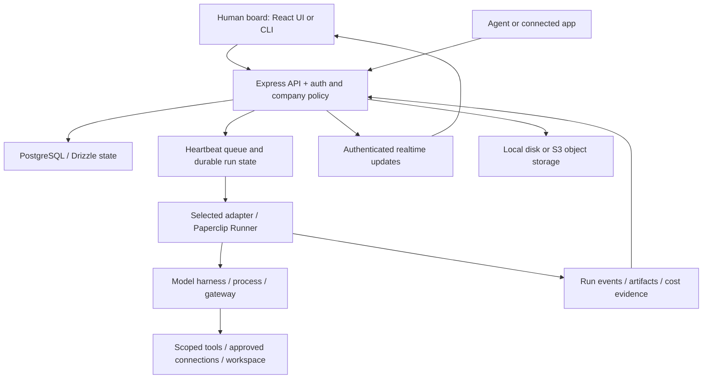

# Paperclip — deep source analysis

> Requested output name `mirofish.md` hai, lekin is report ka subject **paperclipai/paperclip** hai. Previous MiroFish report ka separate backup preserved hai. Yeh report kisi feature ko implement nahi karti.

## Snapshot aur method

Local checkout `E:\coding\code\Trade\paperclip`, upstream `https://github.com/paperclipai/paperclip`, branch master, pinned commit **9de343b3fe2e2d4dc84fc8386d9ce04d553f39d6**. Inspection date 16 November 2026. Code/tests current behavior ke authority hain; dated plans/docs ko current implementation samajhkar repeat nahi kiya. Shallow checkout development chronology ya original design decisions prove nahi karta. Source: `AGENTS.md:8`.

REA skill aur parallel source-review workflow use hua. Installed **REA CLI 6.7.0** ne pinned git archive par `inspect-artifact --format json --full-output` run kiya. Actual raw result `paperclip-evidence/rea-artifact.json` hai. Active REA MCP connection ka claim nahi. Yeh local source ZIP ki member/integrity inventory hai, upstream released application binary ka decompilation ya JS/TS execution proof nahi. Source behavior direct source reading aur catalogs se establish hua. REA limitations aur exact archive digest final evidence summary mein hain; static inventory ko runtime correctness, sandbox security ya deployment acceptance nahi bola gaya.

## Yeh kya hai aur kaise bana hai

Paperclip **AI-agent organizations ka control plane** hai. Ismein company banana, goals/projects/tasks assign karna, human aur agent org chart manage karna, governed actions approve karna, agent runs schedule karna, budgets/spend monitor karna, execution artifacts review karna aur integrations connect karna ek application mein aata hai. Yeh foundation model train nahi karta. Claude/Codex aur doosre harnesses/adapters ko work context, identity, credentials, tools aur execution lifecycle deta hai. Agent ka proposed output aur server ka authoritative task/approval/run state alag hain. Source: `README.md:1`, `AGENTS.md:57`, `server/src/app.ts:1`.

Current repository purane small task-manager descriptions se bahut aage hai: native Paperclip Runner, multiple local/remote adapters, plugins/sandbox providers, app connections, chat/channels, cases/workflows, skills/team catalogs, evaluations, CLI, release and cloud tooling coexist karte hain. Har directory equal production maturity imply nahi karti: tests, prototypes, eval cases, catalog assets, static screenshots, plans aur vendored runtime copies bhi tracked hain. Package/service/schema catalogs niche aur evidence mein separate rakhe gaye hain.

Typical path: board actor creates company/agent/task; company/actor checks gate API; atomic checkout protects ownership; eligible heartbeat becomes persisted run; server selects execution mode and prepares identity/workspace/tools; adapter or Runner executes configured harness; events, cancellation, usage and artifacts return; server-side finalizers apply task/workflow/budget decisions; UI invalidates queries or reads live run streams. Reported model success by itself is not a governance bypass. Exact code branches/defaults are in domain sections below.

## Stack aur monorepo layout

Root is private ESM TypeScript/JavaScript pnpm workspace. Current root requires **Node >=24.11.0**, package manager **pnpm 9.15.4**. Node 24 policy is checked across manifests, workflows and Dockerfiles. Package versions commonly 0.3.1 are source manifest versions, not independently verified latest npm release versions. Source: `package.json:1`, `pnpm-workspace.yaml:1`, `scripts/check-node-version-policy.mjs:7`.

| Area | Responsibility |
|---|---|
| server | Express REST, auth, policies, orchestration, services, events, storage, maintenance |
| ui | React/Vite board app, query/cache layer, realtime, workspace/run views |
| packages/db | Drizzle ORM, PostgreSQL clients, schema, SQL migrations, embedded DB management |
| packages/shared | Cross-layer types, validators, paths, constants and config contracts |
| packages/adapters + adapter-utils | Harness/process/gateway integrations and normalized adapter contracts |
| packages/paperclip-runner + paperclip-eval-kernel | Native execution protocol/runtime and evaluation infrastructure |
| packages/plugins | Plugin SDK, worker-facing features and sandbox providers |
| packages/mcp-server and companion MCP packages | Tool-facing interfaces; not unrestricted blanket agent access |
| packages/skills-catalog + teams-catalog | App-shipped reusable skills and teams; operational skills also exist under skills/ |
| cli | Published paperclipai entrypoint, onboarding, config, admin and agent/client commands |
| integrations | External app/provider connection implementation/assets; see domain notes |
| scripts + docker + .github/workflows | Development, verification, build, release, migration and runtime qualification |
| doc + docs + maps + evals + tests | Documentation, coverage maps, evaluation/acceptance fixtures and regression suites |

Server dependencies include Express, Better Auth-related identity infrastructure, provider SDKs and PostgreSQL. UI uses React with Vite, TanStack Query, editor and terminal libraries; exact manifest versions/dependency edges are preserved in `packages.json` and pnpm lockfile rather than inferred from product labels. DB package declares drizzle-orm ^0.45.2, postgres ^3.4.9 and embedded-postgres ^18.1.0-beta.16. Workspace patches alter PostgreSQL, embedded DB, ACP and chat-adapter packages; a plain npm install without workspace patch/override resolution is not an equivalent runtime. Source: `server/package.json:1`, `ui/package.json:1`, `packages/db/package.json:1`, `pnpm-workspace.yaml:1`.

## Configuration, storage aur deployment

Server loads deployment/config/env through explicit policy helpers. Deployment modes include `local_trusted` and `authenticated`; local trusted forces private exposure. Authenticated mode defaults secrets strict mode true. Current default host fallback is **127.0.0.1**, port **3100**; env/file settings can override. Bind modes, public URL, allowed hosts, managed-cloud prerequisites and auth-signup options are separate contracts; changing host alone is not a full secure-public-deployment configuration. Source: `server/src/config.ts:190`, `server/src/config.ts:380`.

Absent DATABASE_URL uses embedded PostgreSQL with instance-local data; external PostgreSQL URL and separate migration URL are supported. SQL schema/migrations, not JSON files, own company/task/run records. Storage objects use provider **local_disk** by default or S3; S3 defaults bucket paperclip, region us-east-1, optional endpoint/prefix/path-style. Logs/traces, filesystem workspaces, object storage and database backups are different durability boundaries. Source: `doc/DATABASE.md:8`, `server/src/storage/config.ts:15`, `server/src/config.ts:389`.

Scheduler enable flag defaults enabled; interval defaults **30,000 ms**, clamped at least10,000ms. DB backups default enabled; backup interval/retention and workspace cleanup/compaction flags have independent configuration. Compaction, git-cache expiry, restore points, skill retention and task-directory retention must not be collapsed into a single cleanup guarantee. Authenticated deployments default company deletion disabled unless explicitly configured; local trusted defaults it enabled. Source: `server/src/config.ts:273`, `server/src/config.ts:303`, `server/src/config.ts:399`, `server/src/config.ts:442`.

Root dev script delegates to scripts/dev-runner.ts; source development requires pnpm workspace dependency setup. Root build/typecheck/test scripts first ensure workspace links. CLI is a separately publishable entrypoint, not merely `server/src/index.ts`. Production build includes UI/runner vendor/assets materialization and platform tooling; standalone source-file checks are not enough to establish an installable release. Source: `package.json:6`, `server/package.json:1`, `cli/package.json:1`.

Docker uses multi-stage **node:24-trixie-slim**, pinned/digest-checked platform assets and frozen Runner lockfile validation; agent runtime images, runner image, smoke images and app image serve different purposes. Quickstart composes one app container with embedded DB, persistent `/paperclip`, port3100, pids_limit2048, 90-second stop grace, authenticated/private mode and required BETTER_AUTH_SECRET. Tool-action signing secret is a separate variable. Cloud stage separately bundles optional plugins/server dependencies; self-hosted and cloud image payloads are not identical. This audit did not build/pull/run these images. Source: `Dockerfile:1`, `docker/docker-compose.quickstart.yml:13`, `Dockerfile:1`.

## Verification scope and limits

This task is source analysis, not a repository behavior change. Source remains untouched. No provider keys, real agent work, GitHub writes, paid inference, cloud deployment or live Paperclip company was used. Full pnpm install/typecheck/build/Vitest/browser/database integration suites were not executed; checkout lacks installed workspace dependencies and native/external runtime prerequisites. Repository AGENTS explicitly prefers the smallest relevant verification rather than automatic repo-wide testing. Source: `AGENTS.md:124`.

Executed focused Node helper suite: `node --test scripts/check-no-git-push.test.mjs scripts/release-package-map.test.mjs` on Windows/Node24.18.1: **26 tests, 19 pass, 7 fail**. Failures are release-manifest discovery paths: platform join produces backslashes, manifest directories contain slashes. Focused reproduction:35 public packages discovered,32 unmatched raw dirs,0 unmatched after slash normalization. No source fix was applied. This is a Windows release-helper finding; it does not prove Linux release CI fails or the Paperclip server is broken. Source: `scripts/release-package-map.mjs:18`, `scripts/release-package-map.mjs:123`; outputs and reproduction retained.

All-file hashes, package manifests, lexical route sites, SQL table declarations, module and test-file catalogs supplement domain reading. Route extraction is **lexical**, not a TypeScript AST/router runtime: includes router mount paths and possible same-named method calls; dynamic routes may be omitted. It must not be advertised as an exact complete runtime API count. File inventory is coverage bookkeeping, not proof every line was semantically audited. Model/runtime containment, real authorization combinations, concurrent DB schedules and adapter/provider failures remain unexecuted beyond source/test inspection.

Company/permission checks, checkout atomicity, approval gates and budget auto-pause are design and implementation boundaries; they are not a claim of bug-free isolation or sandbox exploit resistance. External model output, tool events, summaries and synthetic eval metrics require their own evidence. This report records observed structure and known verification limits, and adds no new product features or guarantees.
