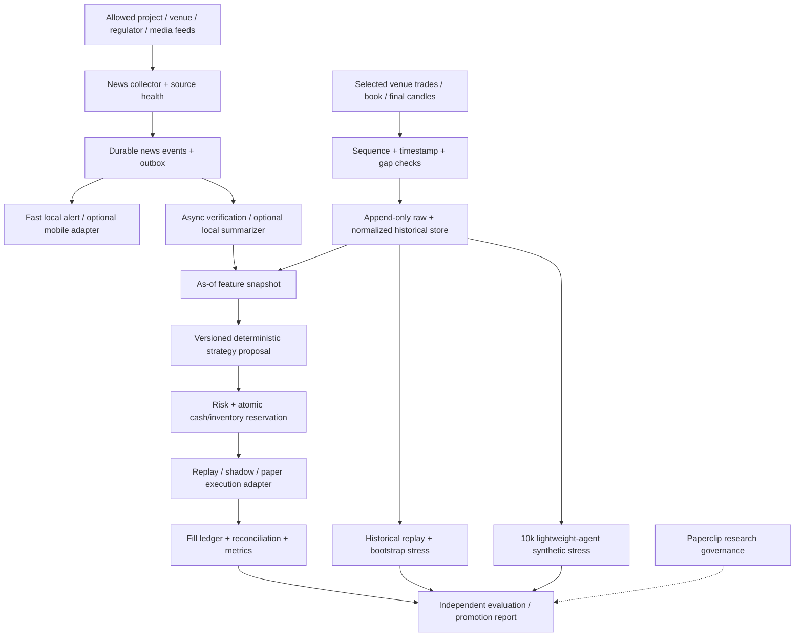

# Crypto Research, News Delivery aur Trade Validation — Plan V1

> **For agentic workers:** Implementation ke waqt `subagent-driven-development` ya `executing-plans` workflow task-by-task use karein. Neeche unchecked tasks proposed work hain; is research turn mein system build ya live trade execute nahi hua.

**Goal:** BTC/ETH jaise crypto markets mein free-source data quality, reliable news discovery, realistic execution testing aur deterministic risk controls improve karke evidence-based trading decisions ki quality badhana; guaranteed profit ya globally first news delivery claim nahi.

**Architecture:** Direct venue data recorder aur lightweight news collector hot path mein; same versioned strategy/risk contracts replay, shadow aur paper modes mein. OpenBB context adapters, TradingAgents research, MiroFish-inspired scenario generation aur Paperclip governance optional outer layers hain.

**Tech stack, proposed:** Python async HTTP/WebSockets, Decimal/integer exchange units, append-only compressed raw events, Parquet + DuckDB research reads, SQLite transactional paper ledger/outbox, local dashboard/SSE. Freqtrade candle screening optional adapter; an event-driven matching engine such as NautilusTrader for higher-fidelity execution research after compatibility qualification. Multiple backtest engines ke numbers silently mix nahi honge.

**Spec:** User ke eight crypto-only questions, preserved in [scope checkpoint](PLANV1-CHECKPOINT.md). Research checked **17 November 2026**, Asia/Kolkata. Current source snapshots niche pinned hain; external API access/pricing/limits change ho sakte hain.

## A. Decision aur scope

Sabse promising improvement sequence **better data → honest cost-aware validation → small controlled experiments → operational safeguards** hai. News jaldi aane ya agents ka vote badhne se automatically edge establish nahi hoti. Profit probability ka estimate sirf selected venue/pair/holding horizon, actual information availability aur modeled execution assumptions ke conditional hoga. Is plan ne koi new BTC/ETH profitable strategy demonstrate nahi ki.

**User-confirmed scope: BTC/ETH spot aur perpetual futures dono ka comparison chahiye.** V1 now includes both product branches, with equal-notional and equal-risk research comparisons and separate paper-promotion gates. No leverage level, venue or live execution has been authorized. Unborrowed spot stays the simpler benchmark; the futures branch cannot run without qualified funding/margin/liquidation accounting. Exchange, capital, horizon, hardware, jurisdiction and quote/margin currency remain unspecified. Initial signal research compares closed1m/5m/15m bars, not a claim of milliseconds-news arbitrage. No paid subscriptions/trials or paid cloud inference are allowed in any branch; own compute, electricity, storage, bandwidth and trading fees are not claimed free. Detailed comparison is in SectionI.

### Global constraints and asset-type gate

No-paid rule optional components par bhi apply hota hai: no paid cloud LLM, paid news endpoint, subscription, paid broadcast or auto-upgrade fallback. A verified no-charge free tier may be optional only within its documented quota and permission; uncertain entitlement remains disabled. Optional local inference can use already-owned compute after model-license and compatibility checks. Current MiroFish Cloud dependency is not silently replaced by a claimed existing local adapter.

Crypto assets must not fall through equity fundamentals: BTC/ETH par company EPS, P/E, earnings calendar, SEC CIK or NYSE session mandatory features invalid hain. Optional crypto context can include protocol/security/release/status events and independently qualified public on-chain metrics; an unverified node/indexer service is not a hidden free-data dependency. Stablecoin quote risk, venue product IDs and timezone rules stay explicit. All future execution remains paper-only until a separate user decision; creating this plan is not trading permission.

### Approaches considered

| Approach | Benefit | Limitation | V1 decision |
|---|---|---|---|
| Existing five repos ko unchanged jod dena | Familiar modules/reports | Stock sessions, cloud/model costs, missing execution ledger, latency and stale-risk gaps survive | Reject as complete crypto system |
| Small collector + deterministic strategy/risk + candle screening, then event replay | Free-source baseline, auditable, testable stages | Own integration contracts, prospective news/L2 recording required | **Recommended staged approach** |
| 10,000 LLM personas first, then trade by consensus | Rich scenario narratives | Correlated opinions, high compute/inference demand, no exchange fill model or measured edge | Optional later scenario research only |

Freqtrade official docs describe candle-level fill assumptions and a future-data diagnostic; this makes it useful as a screening baseline, not sufficient evidence for queue-sensitive fast execution. NautilusTrader documents explicit fill/liquidity/queue choices; its defaults also need review. Neither was installed or qualified in this planning turn. [Freqtrade backtesting](https://www.freqtrade.io/en/stable/backtesting/), [lookahead caveats](https://www.freqtrade.io/en/latest/lookahead-analysis/), [Nautilus fill model](https://nautilustrader.io/docs/latest/concepts/backtesting/fill-models/), [queue tracking](https://nautilustrader.io/docs/latest/concepts/backtesting/trade-execution/).

### Existing documents reviewed aur identity

| File / repo | Pinned revision / role |
|---|---|
| [daytrade.md](daytrade.md) / day-trader-skill | `3d0f4ef6986f4984b7c6bd46f7ff4f87744c3abd`: stock scanner/entry/exit/sizing/risk/Time Machine |
| [obb.md](obb.md) / OpenBB | `e43353a82815ff9ba56ad1b7ad47c32729dcf314`: data normalization/provider extension layer |
| [tradingagent.md](tradingagent.md) / TradingAgents | `9fa1196fffbcfd9de5146d2dd2869df84ab99838`: research/debate graph; crypto branch exists |
| [mirofish.md](mirofish.md) / Paperclip | `9de343b3fe2e2d4dc84fc8386d9ce04d553f39d6`: filename followed previous request, content is Paperclip |
| [Original MiroFish report](paperclip-evidence/mirofish-original-report.md) | `7657031ac01184afe2cb220f5ee3545573b5e843`: social-agent simulator, not exchange matching engine |
| [Runtime checkpoint](RUNTIME-TEST-CHECKPOINT.md), [plan scope](PLANV1-CHECKPOINT.md) | Administrative evidence; not new market-data providers or profitable strategies |

Root-level Markdown files were inventoried, with original MiroFish backup explicitly included. Source modules were checked for consequential claims; complete independent semantic audit of every Markdown inside all five source repositories is not claimed. [Review manifest](planv1-evidence/md-review-inventory.json).

### Evidence labels

**Source-observed** = pinned implementation. **Current-doc verified** = linked primary documentation read for this plan. **Bounded access observed** = one/few HTTP fetches, not a latency SLA. **Proposed** = work not built, benchmarked or passed. Runtime tests from earlier turns show software contract behavior, not strategy profitability or live provider completeness. Source code was not changed in this planning task.

## B. Shared architecture and data contracts

Raw market truth and simulated orders remain separate stores/namespaces. A synthetic headline/agent post must never enter verified news feeds. Slow LLM/report/graph work must not block market capture, an alert's first delivery, order-state reconciliation or risk-reducing controls.

| Contract | Required fields / invariant |
|---|---|
| MarketEvent | venue, product type, canonical instrument, source timestamp+unit, receive UTC+monotonic, sequence/trade ID, payload hash, connection ID; preserve raw evidence |
| NewsEvent | source ID/URL, source-published/updated time if present, first-seen/ingested time, version, trust/verification status, asset/event tags, payload digest |
| FeatureSnapshot | max available-at time, closed-bar cutoff, input manifest/version, gap/sequence health; no future or revised knowledge leakage |
| TradeProposal | strategy/code/config version, instrument, side, signal cutoff, rationale tags, planned horizon/stop/target, expiry; untrusted until risk accepted |
| RiskDecision | proposal hash + account/pending-order/market/metadata/policy versions, approved qty, measured loss assumptions, reservation ID, issued/expiry time |
| Order/Fill | clientOrderId, venue ID, idempotent event/fill ID, requested/accepted/filled qty, prices/fees/currency, status timestamps, reconciliation state |
| Experiment | data and code hashes, all trials, parameter search budget, seed(s), splits/regimes, fill/cost model, resulting ledger and confidence limits |

## C. Eight required investigations

Detailed source findings and proposed replacements follow. Headings1–8 map directly to the user's questions; trade decision and speed claims remain subject to their stated constraints.
