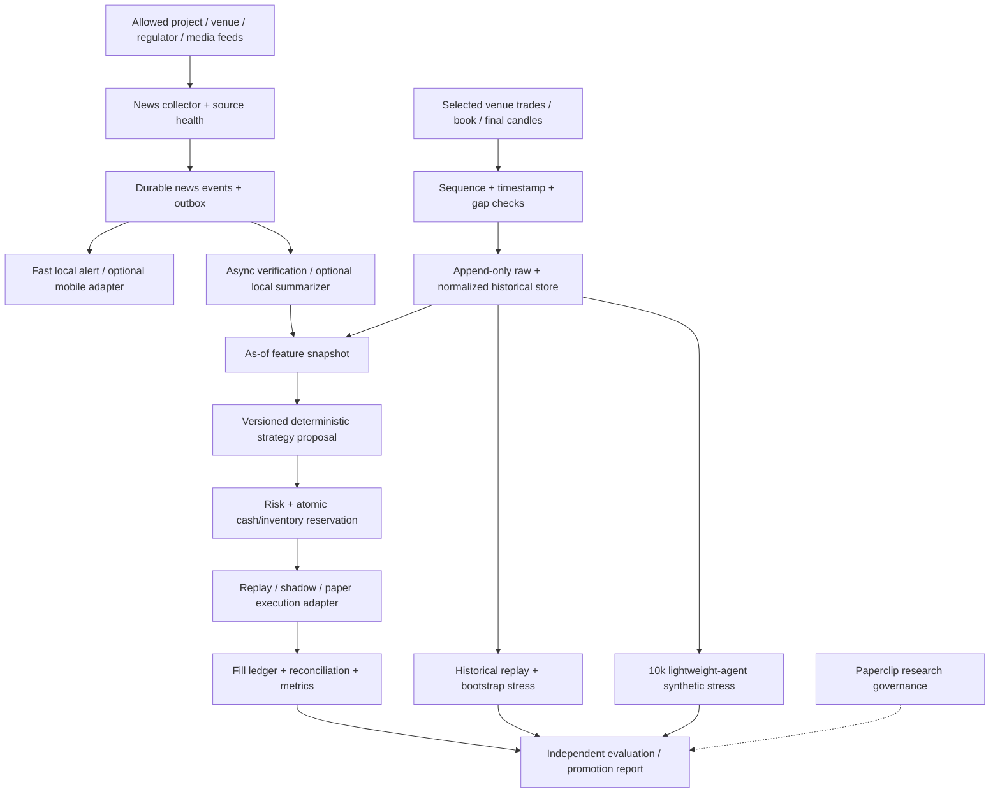

# Crypto Research, News Delivery aur Trade Validation — Plan V1

> **For agentic workers:** Implementation ke waqt `subagent-driven-development` ya `executing-plans` workflow task-by-task use karein. Neeche unchecked tasks proposed work hain; is research turn mein system build ya live trade execute nahi hua.

**Goal:** BTC/ETH jaise crypto markets mein free-source data quality, reliable news discovery, realistic execution testing aur deterministic risk controls improve karke evidence-based trading decisions ki quality badhana; guaranteed profit ya globally first news delivery claim nahi.

**Architecture:** Direct venue data recorder aur lightweight news collector hot path mein; same versioned strategy/risk contracts replay, shadow aur paper modes mein. OpenBB context adapters, TradingAgents research, MiroFish-inspired scenario generation aur Paperclip governance optional outer layers hain.

**Tech stack, proposed:** Python async HTTP/WebSockets, Decimal/integer exchange units, append-only compressed raw events, Parquet + DuckDB research reads, SQLite transactional paper ledger/outbox, local dashboard/SSE. Freqtrade candle screening optional adapter; an event-driven matching engine such as NautilusTrader for higher-fidelity execution research after compatibility qualification. Multiple backtest engines ke numbers silently mix nahi honge.

**Spec:** User ke eight crypto-only questions, preserved in [scope checkpoint](PLANV1-CHECKPOINT.md). Research checked **17 November 2026**, Asia/Kolkata. Current source snapshots niche pinned hain; external API access/pricing/limits change ho sakte hain.

## A. Decision aur scope

Sabse promising improvement sequence **better data → honest cost-aware validation → small controlled experiments → operational safeguards** hai. News jaldi aane ya agents ka vote badhne se automatically edge establish nahi hoti. Profit probability ka estimate sirf selected venue/pair/holding horizon, actual information availability aur modeled execution assumptions ke conditional hoga. Is plan ne koi new BTC/ETH profitable strategy demonstrate nahi ki.

**User-confirmed scope: BTC/ETH spot aur perpetual futures dono ka comparison chahiye.** V1 now includes both product branches, with equal-notional and equal-risk research comparisons and separate paper-promotion gates. No leverage level, venue or live execution has been authorized. Unborrowed spot stays the simpler benchmark; the futures branch cannot run without qualified funding/margin/liquidation accounting. Exchange, capital, horizon, hardware, jurisdiction and quote/margin currency remain unspecified. Initial signal research compares closed1m/5m/15m bars, not a claim of milliseconds-news arbitrage. No paid subscriptions/trials or paid cloud inference are allowed in any branch; own compute, electricity, storage, bandwidth and trading fees are not claimed free. Detailed comparison is in SectionI.

### Global constraints and asset-type gate

No-paid rule optional components par bhi apply hota hai: no paid cloud LLM, paid news endpoint, subscription, paid broadcast or auto-upgrade fallback. A verified no-charge free tier may be optional only within its documented quota and permission; uncertain entitlement remains disabled. Optional local inference can use already-owned compute after model-license and compatibility checks. Current MiroFish Cloud dependency is not silently replaced by a claimed existing local adapter.

Crypto assets must not fall through equity fundamentals: BTC/ETH par company EPS, P/E, earnings calendar, SEC CIK or NYSE session mandatory features invalid hain. Optional crypto context can include protocol/security/release/status events and independently qualified public on-chain metrics; an unverified node/indexer service is not a hidden free-data dependency. Stablecoin quote risk, venue product IDs and timezone rules stay explicit. All future execution remains paper-only until a separate user decision; creating this plan is not trading permission.

### Approaches considered

| Approach | Benefit | Limitation | V1 decision |
|---|---|---|---|
| Existing five repos ko unchanged jod dena | Familiar modules/reports | Stock sessions, cloud/model costs, missing execution ledger, latency and stale-risk gaps survive | Reject as complete crypto system |
| Small collector + deterministic strategy/risk + candle screening, then event replay | Free-source baseline, auditable, testable stages | Own integration contracts, prospective news/L2 recording required | **Recommended staged approach** |
| 10,000 LLM personas first, then trade by consensus | Rich scenario narratives | Correlated opinions, high compute/inference demand, no exchange fill model or measured edge | Optional later scenario research only |

Freqtrade official docs describe candle-level fill assumptions and a future-data diagnostic; this makes it useful as a screening baseline, not sufficient evidence for queue-sensitive fast execution. NautilusTrader documents explicit fill/liquidity/queue choices; its defaults also need review. Neither was installed or qualified in this planning turn. [Freqtrade backtesting](https://www.freqtrade.io/en/stable/backtesting/), [lookahead caveats](https://www.freqtrade.io/en/latest/lookahead-analysis/), [Nautilus fill model](https://nautilustrader.io/docs/latest/concepts/backtesting/fill-models/), [queue tracking](https://nautilustrader.io/docs/latest/concepts/backtesting/trade-execution/).

### Existing documents reviewed aur identity

| File / repo | Pinned revision / role |
|---|---|
| [daytrade.md](daytrade.md) / day-trader-skill | `3d0f4ef6986f4984b7c6bd46f7ff4f87744c3abd`: stock scanner/entry/exit/sizing/risk/Time Machine |
| [obb.md](obb.md) / OpenBB | `e43353a82815ff9ba56ad1b7ad47c32729dcf314`: data normalization/provider extension layer |
| [tradingagent.md](tradingagent.md) / TradingAgents | `9fa1196fffbcfd9de5146d2dd2869df84ab99838`: research/debate graph; crypto branch exists |
| [mirofish.md](mirofish.md) / Paperclip | `9de343b3fe2e2d4dc84fc8386d9ce04d553f39d6`: filename followed previous request, content is Paperclip |
| [Original MiroFish report](paperclip-evidence/mirofish-original-report.md) | `7657031ac01184afe2cb220f5ee3545573b5e843`: social-agent simulator, not exchange matching engine |
| [Runtime checkpoint](RUNTIME-TEST-CHECKPOINT.md), [plan scope](PLANV1-CHECKPOINT.md) | Administrative evidence; not new market-data providers or profitable strategies |

Root-level Markdown files were inventoried, with original MiroFish backup explicitly included. Source modules were checked for consequential claims; complete independent semantic audit of every Markdown inside all five source repositories is not claimed. [Review manifest](planv1-evidence/md-review-inventory.json).

### Evidence labels

**Source-observed** = pinned implementation. **Current-doc verified** = linked primary documentation read for this plan. **Bounded access observed** = one/few HTTP fetches, not a latency SLA. **Proposed** = work not built, benchmarked or passed. Runtime tests from earlier turns show software contract behavior, not strategy profitability or live provider completeness. Source code was not changed in this planning task.

## B. Shared architecture and data contracts



Raw market truth and simulated orders remain separate stores/namespaces. A synthetic headline/agent post must never enter verified news feeds. Slow LLM/report/graph work must not block market capture, an alert's first delivery, order-state reconciliation or risk-reducing controls.

| Contract | Required fields / invariant |
|---|---|
| MarketEvent | venue, product type, canonical instrument, source timestamp+unit, receive UTC+monotonic, sequence/trade ID, payload hash, connection ID; preserve raw evidence |
| NewsEvent | source ID/URL, source-published/updated time if present, first-seen/ingested time, version, trust/verification status, asset/event tags, payload digest |
| FeatureSnapshot | max available-at time, closed-bar cutoff, input manifest/version, gap/sequence health; no future or revised knowledge leakage |
| TradeProposal | strategy/code/config version, instrument, side, signal cutoff, rationale tags, planned horizon/stop/target, expiry; untrusted until risk accepted |
| RiskDecision | proposal hash + account/pending-order/market/metadata/policy versions, approved qty, measured loss assumptions, reservation ID, issued/expiry time |
| Order/Fill | clientOrderId, venue ID, idempotent event/fill ID, requested/accepted/filled qty, prices/fees/currency, status timestamps, reconciliation state |
| Experiment | data and code hashes, all trials, parameter search budget, seed(s), splits/regimes, fill/cost model, resulting ledger and confidence limits |

## C. Eight required investigations

Detailed source findings and proposed replacements follow. Headings1–8 map directly to the user's questions; trade decision and speed claims remain subject to their stated constraints.


## Eight-point navigation

- [1. News: source, freshness, free access aur fastest practical delivery](#news)
- [2. Backtesting: implemented capability aur cost-aware validation](#backtesting)
- [3. Historical data aur charts: venue truth, units, gaps and replay](#historical-data)
- [4. Time Machine: exact method aur crypto replacement](#time-machine)
- [5. MiroFish aur10,000+ agents: what can actually be tested](#agent-simulation)
- [6. Volume: measurement, liquidity and validation](#volume)
- [7. Risk management: crypto capital, execution and operational controls](#risk)
- [8. Data → entry → exit plan → sizing → risk: integrated replacement](#trade-pipeline)
- [Spot vs Perpetual: user-confirmed comparison](#spot-vs-perpetual)

<a id="news"></a>

## 1. News: source, freshness, free access aur fastest practical delivery

### 1. Sabse important distinction

News lookback, collection frequency aur delivery latency teen alag settings hain. `--hours 48` ka matlab pichhle 48 ghante ki eligible stories hai; iska matlab har 48 ghante collect karna nahi. Poll interval 60 seconds rakhne par unchanged source se pichhle 48 ghante ka overlap har minute read ho sakta hai. Durable dedupe repeats rokega. Source publication, feed appearance aur our detection bhi separate hain: publisher ne story likh di lekin feed/CDN mein der se aayi, toh local ten-millisecond processing lost minutes recover nahi karegi. Feed ka advertised timestamp actual first public availability ka independently measured proof nahi hai.

Proposed latency ledger: `source_published_at`, `source_updated_at`, `first_seen_at`, `ingested_at`, `queued_at`, `channel_accepted_at`, optional `client_received_at`. UTC wall clock plus local monotonic stage timings record hon. Apparent source-age ko `first_seen_at - source_published_at` label karein, provider transport latency nahi. Mobile OS sleep, muted notifications, connectivity aur third-party delivery source availability se independently delay kar sakte hain. Receipt/HTTP200 handset display ka proof nahi.

### 2. Actual five-project behavior aur reuse boundary

**day-trader-skill**, commit `3d0f4ef6986f4984b7c6bd46f7ff4f87744c3abd`: `trader-news/news.py:381` collect function Yahoo ticker RSS aur SEC company Atom fetch karta hai. `:411` selection default48h, `:488` CLI hours option, `:525` actual filter invocation hain. `:354` dedupe, `:375` fingerprint, `:428` persisted seen state aur `:481` one-shot main hain. Source mein continuous news daemon nahi. `trader-news/SKILL.md:76` host loop suggestion ko scheduler implementation mat banayein. `trader-news/news.py:160` fetcher request gap/timeout collection behavior hai, hours flag se unrelated. Equity ticker/CIK-oriented discovery ko crypto universe par direct copy karna valid nahi; durable state, overlap aur deterministic tagging pattern useful hain. [Pinned source](https://github.com/Jakeschincariol/day-trader-skill/blob/3d0f4ef6986f4984b7c6bd46f7ff4f87744c3abd/trader-news/news.py#L381).

**OpenBB**, commit `e43353a82815ff9ba56ad1b7ad47c32729dcf314`: `openbb_platform/extensions/news/openbb_news/rss.py:111` request-time RSS fetch route hai. `:127` default `fetch_body=True`; `:149` feed fetch, `:151` sort/latest-limit, `:159` per-article body fanout aur `:180` normalized rows hain. `parser.py:27` eight-second feed timeout, `:28` six-second article timeout, `:200` feed fetch aur `:215` network failure se empty feed return path hain. Empty result ko healthy source silence kehna unsafe hoga. `registry.py:796` CoinDesk feed registration hai; registration current provider availability/SLA guarantee nahi. Fast path mein body fetch explicitly disable karein, article enrichment baad mein bounded worker se karein. Route mein source scheduler, durable dedupe aur per-source health state implement nahi. [RSS route](https://github.com/openbq-org/OpenBB/blob/e43353a82815ff9ba56ad1b7ad47c32729dcf314/openbb_platform/extensions/news/openbb_news/rss.py#L111), [parser](https://github.com/openbq-org/OpenBB/blob/e43353a82815ff9ba56ad1b7ad47c32729dcf314/openbb_platform/extensions/news/openbb_news/parser.py#L200).

**TradingAgents**, commit `9fa1196fffbcfd9de5146d2dd2869df84ab99838`: `tradingagents/agents/analysts/news_analyst.py:13` model-facing news/macro/event tools provide karta hai. `dataflows/vendors/yahoo/news.py:87` quote-feed then tagged-search fallback use karta hai; `:116` date filtering aur coverage handling hain. Yeh recent news sample hai, complete timestamped archive/push nahi. `dataflows/vendors/alpha_vantage/news.py:10` NEWS_SENTIMENT wrapper aur `:37` global lookback function hain. Date range ko polling speed mat samjhein. Default graph har raw headline par run karna latency aur paid-model calls badhayega. Fast deterministic alert directly banayein; local optional summarizer output separately attach karein. [Yahoo adapter](https://github.com/TauricResearch/TradingAgents/blob/9fa1196fffbcfd9de5146d2dd2869df84ab99838/tradingagents/dataflows/vendors/yahoo/news.py#L87).

**Original MiroFish**, commit `7657031ac01184afe2cb220f5ee3545573b5e843`: `backend/app/api/graph.py:266` ontology route aur `:312` uploaded files read karta hai. Documents se social simulation banane ka mechanism live news acquisition nahi. Simulated Twitter/Reddit posts ko real public platform monitoring mat bolna. UI task-status polling seconds mein hona upstream real-world news polling ka evidence nahi. News snapshot ko later scenario seed banaya ja sakta hai, lekin LLM/Zep/OASIS-dependent full pipeline critical alert path se bahar rahe. [Upload route](https://github.com/666ghj/MiroFish/blob/7657031ac01184afe2cb220f5ee3545573b5e843/backend/app/api/graph.py#L266).

**Paperclip**, commit `9de343b3fe2e2d4dc84fc8386d9ce04d553f39d6`: README/control-plane services task execution, runs aur governance supply karte hain. `server/src/services/budgets.ts:533` budget incident enforcement aur `server/src/services/accounting-transaction.ts:111` post-commit activity publishing relevant orchestration patterns hain. Dedicated exchange/project/regulator news-source adapter in traced paths establish nahi hua. Paperclip realtime UI updates ko external newswire availability mat samjhein. Existing `mirofish.md` actually Paperclip report hai; original simulator report `paperclip-evidence/mirofish-original-report.md` mein preserved hai. [Paperclip identity](https://github.com/paperclipai/paperclip/blob/9de343b3fe2e2d4dc84fc8386d9ce04d553f39d6/README.md#L1).

### 3. Verified free baseline aur excluded/conditional sources

Official issuer/project feeds first, specialist media secondary, source health always visible. Bounded unauthenticated GET checks on research date returned HTTP200 and valid RSS for Ethereum Foundation `https://blog.ethereum.org/feed.xml` (646items), Kraken blog `https://blog.kraken.com/feed` (10items), CoinDesk `https://www.coindesk.com/arc/outboundfeeds/rss/` (25items), Kraken status `https://status.kraken.com/history.rss` (25items). Counts are one-time observations, retention commitments nahi. In GETs mein credential/subscription nahi laga; general redistribution rights, numeric request ceilings aur zero publication lag establish nahi hote. Ethereum source ki security/protocol categories useful hain; Kraken blog own exchange announcements deta hai; CoinDesk independently reported discovery hai, official confirmation nahi. [Ethereum primary blog](https://blog.ethereum.org/).

Kraken status API publicly documented summary/incidents/maintenance endpoints aur RSS/Atom links supply karta hai. Page par webhook subscription form bhi available hai. Webhook incidents/status updates ke liye hai, har listing/news story ke liye nahi. Public page ke example GET mein credential nahi; documented numeric limit ya delivery SLA is page se establish nahi hua. Direct push available and verified configured ho toh use karein; user endpoint/public TLS hosting requirement ke karan default local machine ke liye RSS/JSON polling simpler hai. No hosting purchase assume karein. [Kraken status API](https://status.kraken.com/api).

SEC official RSS catalogue press releases, litigation aur selected EDGAR feeds list karta hai. Crypto filtering required hai: sab SEC news crypto news nahi. Press-release/RSS public access baseline mein API key nahi; identified User-Agent aur fair access required. SEC developer guidance total10 requests/second across machines ceiling deta hai; yeh target rate nahi. Proposed 60–120-second regulator polling much lower rahe. EDGAR corporate filings ko crypto issuer/project announcements ka universal replacement nahi banayein. [SEC feeds](https://www.sec.gov/about/rss-feeds), [SEC fair access](https://www.sec.gov/about/developer-resources).

**Current availability correction:** CFTC official RSS page explicitly states feeds temporarily disabled since October2026. CFTC RSS ko active baseline connector list mein na rakhein. Official press-release webpage manual/source-permitted conditional fetch fallback ho sakta hai, separately verified parser/policy ke baad. [CFTC current notice](https://www.cftc.gov/RSS/index.htm).

GitHub public project releases ko unauthenticated REST se read kar sakte hain. Releases endpoint ordinary tags ko include nahi karta. Public unauthenticated budget60requests/hour/IP, authenticated personal budget generally5000/hour; secondary limits also apply. Ten repos each60-second polling would600/hour, free unauthenticated budget se tenfold beyond hai. Baseline three relevant repos each5minutes means36/hour plus health/other requests headroom. Optional free account PAT read-only public resources ke liye can improve budget, lekin secret lifecycle required. Arbitrary third-party project repo par webhook install karna owner/admin permission ke bina possible nahi. [Releases](https://docs.github.com/en/rest/releases/releases#list-releases), [limits](https://docs.github.com/en/rest/using-the-rest-api/rate-limits-for-the-rest-api), [webhook permissions](https://docs.github.com/en/webhooks/types-of-webhooks).

**Binance distinction:** official dedicated Announcements WebSocket topic `com_announcement_en` exists and publishes English announcement objects including publication time/title/body. Yeh ordinary trade/ticker/depth market WebSocket se separate product hai. Announcements connection requires user API key header and signed request using secret, is valid up to24h, expects clientPING every30s and caps incoming messages5/s. Docs inspected pricing/free entitlement certify nahi karti. Isliye OPTIONAL/OFF pending zero-charge eligibility verification; account/key not present ho toh disabled, signup/trading permissions/paid subscription automatically nahi. Anonymous free push mat promise karein. [Announcement topic](https://developers.binance.com/en/docs/products/announcements/announcement), [authentication](https://developers.binance.com/en/docs/products/announcements/general-info).

**Alpha Vantage correction:** generic support page free key25requests/day bolta hai, lekin current NEWS_SENTIMENT documentation explicitly endpoint premium mark karti hai. Crypto ticker syntax support free entitlement nahi hai. TradingAgents mein adapter exist hone ke bawajood NEWS_SENTIMENT free baseline se exclude karein. Demo response production coverage nahi. X public streaming, premium newswires aur unlimited free aggregator API assume nahi kiye gaye. [Endpoint entitlement](https://www.alphavantage.co/documentation/#news-sentiment), [generic free plan](https://www.alphavantage.co/support/).

Telegram outbound ordinary bot messaging no-cost documented hai; own bot token/chat onboarding required. Bots arbitrary channel posts automatically inspect nahi kar sakte; membership/access limitations apply. Delivery adapter single-chat approximately1message/second guard use kare, bursts coalesce kare, paid broadcast OFF rahe. API acceptance versus screen arrival separate metrics hain. Local dashboard/SSE remains no-credential primary delivery; mobile bot is opt-in integration, no messages sent during this research. [Telegram FAQ](https://core.telegram.org/bots/faq).

### 4. Proposed scheduler, safety aur measurable acceptance

All below intervals design defaults hain, provider guarantees/permissions nahi. Small watchlist se start: two highest-priority RSS sources60s, remaining project/media/regulator sources120s, GitHub5min under shared request budget. Conditional GET ETag/Last-Modified where supported, Cache-Control/Retry-After respect, one inflight/source, per-host concurrency1, jitter and persisted cursors. Provider imposes higher floor toh that wins. Source-specific budget before shorter interval; no undocumented cache bypass, rotating identities/IPs, paid fallback or broad crawl. 429/403 par bounded backoff/circuit breaker; retries incident time ko silently erase na karein. Website terms/robots review aur source attribution onboarding record mein rakhein. RSS availability article reproduction license nahi.

Fast pipeline: fetch metadata → parse/validate → stable source ID/canonicalURL/hash dedupe → deterministic crypto/event tag → durable append+outbox → local SSE → optional mobile queue. Full-body fetch, source verification and local-model enrichment asynchronous. First alert headline/link/source/time/status de; unverified source ko verified language na de. Updates/corrections same story version ke roop mein preserve hon; identical headlines across publishers evidence links lose kiye bina cluster hon. Unknown timestamps retained with explicit unknown status. Restart par replay bounded overlap without duplicate user alert. Non-crypto headlines discard/quarantine after explicit entity rules; ticker collisions like ONE/NEAR require context.

**Single canonical, unmeasured internal SLO:** full feed/message body received by collector → parse/dedupe/durable event+outbox → local publish has p95≤250ms and p99≤2s under declared healthy hardware/load. These are different percentiles, not two conflicting p95 budgets. Source first-availability-to-detection remains polling wait plus HTTP/source delays. Observed publication-age is a diagnostic only, not an SLA we control; publisher timestamps and CDN lag may be unknown. Remote channel API acceptance p95≤5s after queueing is a separate unmeasured target; handset display has no promised bound. Push and RSS use the same internal-stage definition after receipt. Record actual p50/p95/p99, failures, sample counts and clock skew; zero samples means unmeasured, not0ms.

Acceptance work later: captured RSS fixtures for duplicates/edits/out-of-order/missing dates; fake-clock scheduler for budget/429/Retry-After; process restart/outbox recovery; bounded live observation with network timestamps; screen receipt measured only when explicitly observable. Price WebSocket may attach contextual moves but never create a news fact. No exchange order endpoint, trading key permission, paid LLM or background purchase is necessary for this news-only architecture.

### 5. Operational decisions jo final plan mein explicit rahen

Free ka operational meaning subscription spend zero hai; existing computer ki electricity, disk, Internet aur continuously awake rehne ki requirement disappear nahi hoti. Laptop sleeping/offline ho toh collector missed interval ko fresh observation nahi dikhayega. Resume ke baad last successful watermark se overlap fetch karega aur backlog alert ko delayed label dega. Publisher feed ki finite retention ke bahar gap ho toh historical completeness unknown report karega. Always-on paid server silently add nahi hoga.

Source registry mein owner/domain, canonical endpoint, category, crypto entities, authentication mode, free-entitlement evidence date, terms-review date, configured minimum interval, timeout, request budget, expected timestamp fields aur disabled reason store karein. Health view `healthy`, `degraded`, `rate_limited`, `auth_required`, `disabled`, `unknown` distinguish kare. Feed mein zero items, HTTP failure, XML parse failure aur actual no-new-events separate counters hon. One broken provider whole intake queue ko stop nahi karega.

Alert priority deterministic evidence se assign ho: issuer-confirmed exploit/security notice, exchange suspension/delisting, stablecoin issuance/redemption interruption aur regulator crypto enforcement higher priority; generic promotional/price-prediction stories lower. Priority is attention routing, expected return estimate nahi. Source-title keyword alone decisive evidence nahi; ambiguous claim needs linked original document. Conflicting reports side-by-side retained hon, newest text automatically truth na ban jaaye. Deletion, correction aur changed effective dates meaningful versions hain.

Initial validation dataset mein crypto-only filtering precision aur critical-event recall manually inspect hon. Measure first-source lead, secondary confirmation delay, duplicate suppression aur false urgent alerts separately. Faster notification ke liye silently weak source verification accept karna necessary nahi: initial headline can honestly say source-reported, confirmation later. No claimed profitability, no fabricated news-to-price causality aur no guaranteed opportunity window final plan mein add ho.

<a id="backtesting"></a>

## 2. Backtesting: implemented capability aur cost-aware validation

### 1. Existing repositories ki sahi boundary

TradingAgents checkout `9fa1196fffbcfd9de5146d2dd2869df84ab99838` mein `tradingagents/graph/trading_graph.py:167` ka `propagate(company_name, trade_date, asset_type, portfolio)` analysts/debate/risk graph chalata hai aur final state/rating return karta hai. Crypto branch available hai. Historical date pass karna historical financial backtest ki guarantee nahin: is method ke contract mein exchange-event replay, bid/ask fills, trade ledger aur fee-adjusted equity curve nahin hain. Historical agents ko point-in-time tools dena bhi alag requirement hai. Is graph ko research/signal producer maano; portfolio simulator implement/verify kiye bina annual return claim mat jodo. [Inspected source](https://github.com/TauricResearch/TradingAgents/blob/9fa1196fffbcfd9de5146d2dd2869df84ab99838/tradingagents/graph/trading_graph.py#L167).

OpenBB checkout `e43353a82815ff9ba56ad1b7ad47c32729dcf314` mein crypto `price_router.py:21–61` `CryptoHistorical` model aur provider-dependent query se `OBBject` return karta hai. Provider interface useful normalization layer hai; universal free data coverage, exchange connectivity, backtesting ya order execution us endpoint se establish nahin hoti. Different providers ke symbols, supported intervals, entitlements aur retention alag validate honge. Plan mein OpenBB optional contextual/history adapter ho, selected exchange ka raw truth recorder direct adapter ho. [Inspected crypto historical router](https://github.com/openbq-org/OpenBB/blob/e43353a82815ff9ba56ad1b7ad47c32729dcf314/openbb_platform/extensions/crypto/openbb_crypto/price/price_router.py#L21).

Day-trader checkout `3d0f4ef6986f4984b7c6bd46f7ff4f87744c3abd` ka TimeMachine actual runnable simulator hai, lekin US-equity session assumptions ke saath. Existing captured equity replay verified the software path, not BTC/ETH performance. No crypto edge is inferred from that earlier run.

### 5. Proposed validation, costs aur uncertainty

Chronological walk-forward folds: training lookbacks/parameters, separate validation choice, then frozen next test window. Example calendar split proposal 180d train/30d validation/30d test, monthly advance; data coverage insufficient ho to narrower pilot visibly provisional rahe. Maximum feature lookback aur label/position holding interval record karo. Boundary par overlapping outcome intervals purge karo; fold construction mein future-side training present ho to appropriate embargo apply karo. Strict forward-only evaluation mein unnecessary future-data training mat add karo. Final untouched holdout only once use ho; all parameter/agent-prompt trials log hon. Multiple testing creates selection bias; [primary backtest-overfitting paper](https://www.davidhbailey.com/dhbpapers/backtest-prob.pdf) supports keeping model-selection risk explicit.

Fees per venue, maker/taker tier and effective date parameterized hon; no assumed zero-fee tier. Market buys ask side aur sells bid side se start karein; available depth consumption, size rounding/min-notional, latency, partial fill/reject/cancel and adverse price move apply hon. Limit touch guaranteed fill nahin: queue-ahead assumptions, traded-through evidence, volume participation cap aur timeout model chahiye. L2 aggregate depth exact own queue position reveal nahin karta; optimistic/base/pessimistic queue assumptions report karo. Adverse selection maker rebate ko offset kar sakti hai. Stop gap actual available fill par settle ho, −1R cap mat lagao. Unborrowed spot branch has no perpetual funding. The user-confirmed perpetual comparison requires a separate actual-funding/margin/liquidation model before its paper execution qualifies.

Cost study gross alpha se net expectancy tak decomposition dikhaye: fees, spread, slippage/impact and turnover. Base estimates plus doubled-cost/wider-spread/delayed-fill sensitivity run ho; assumed values clearly labeled hon. Report total return, max drawdown and duration, net expectancy/trade, trade count, exposure, turnover, profit factor, tail loss, fill/partial/reject rates, spread/slippage distributions and fee share. Benchmark cash, buy-and-hold and simple fixed rule under same costs/period. Sharpe annualization 24/7 convention aur serial-dependence caveat ke saath ho.

Monte Carlo extension mein contiguous moving/stationary blocks ya whole-day/week blocks sample karo, aur BTC/ETH jointly resample karo to cross-asset dependence rahe. Block length autocorrelation/holding horizon informed sensitivity ho; best P&L length select mat karo. Regime strata (lagged volatility, liquidity, trend) only contemporaneously available features se define hon. Small strata insufficient sample label karein. Bootstrap confidence bands block-level historical uncertainty ke liye hon; random seed repetition numerical stability ke liye. Unique days/weeks, independent-ish blocks, OOS trades, pool dates and simulated paths separate counts hon. Confidence interval model assumptions ke conditional hai, profitability guarantee nahin.

Candle-screening baseline ko conditional prototype maanein. Freqtrade documents requested-price/range-based assumptions; no-slippage backtest is insufficient for news-sensitive fast trading. Its lookahead check can miss untriggered branches. Event execution study should configure finite liquidity, queue assumptions and actual costs explicitly rather than accept any simulator default. [Backtest assumptions](https://www.freqtrade.io/en/stable/backtesting/), [diagnostic scope](https://www.freqtrade.io/en/latest/lookahead-analysis/), [fill-model controls](https://nautilustrader.io/docs/latest/concepts/backtesting/fill-models/).

<a id="historical-data"></a>

## 3. Historical data aur charts: venue truth, units, gaps and replay

### 3. Free/public exchange data: verified contracts

Binance Spot public archive daily/monthly files aur checksums provide karta hai. Important schema break: **2025-01-01 onward Spot archive timestamps microseconds** hain. Raw trade, aggregate-trade aur kline files separate formats hain; archive is live depth-history promise nahin. Date partitions, checksum aur revisions track karo. [Official archive README](https://github.com/binance/binance-public-data).

Binance WS trade, kline aur depth distinct streams hain. Kline `x=true` closure flag hai. WS timestamps default milliseconds; `timeUnit=MICROSECOND` opt-in hai, archive conversion rule se confuse mat karo. Connection lifetime24h aur ping/pong handling required hai. Depth reconstruction mein stream buffer, REST snapshot aur update-ID alignment chahiye; already-covered events discard karo; first buffered event snapshot ID ko documented range mein cover kare; `U > local_id+1` gap par book discard/resnapshot. Quantity updates absolute sizes hain, zero removes level. [Official WS specification](https://raw.githubusercontent.com/binance/binance-spot-api-docs/master/web-socket-streams.md).

REST `GET /api/v3/klines` open-time keyed bars, maximum1000 per request, supports start/end; bounded pagination chahiye. Candle fields base volume, quote volume, trade count aur taker-buy fields distinguish karte hain. Historical tick/depth availability har endpoint ki separate property hai; candle API se queue reconstruct nahin hoti. [Official REST specification](https://raw.githubusercontent.com/binance/binance-spot-api-docs/master/rest-api.md).

Coinbase Exchange public `ws-feed` without authentication available hai; Direct feed authentication requires. Most applicable messages have per-product sequence progression; gaps/out-of-order handling zaroori hai. Channel contract follow karo, unrelated channels ki sequence fields ko blindly contiguous mat assume karo. [Official overview](https://docs.cdp.coinbase.com/exchange/websocket-feed/overview). Heartbeat last trade IDs aur sequence checks mein useful hai; L2 offers delivery/synchronization semantics and full feed needs queued messages plus REST snapshot replay. [Channels](https://docs.cdp.coinbase.com/exchange/websocket-feed/channels).

Coinbase Exchange candle REST maximum300/request aur limited granularity deta hai, including300-second bars. Historical data incomplete ho sakta hai; no-tick intervals publish nahin hote. Response requested start se pehle candles include kar sakta hai. Sort, dedupe, trim ranges aur classify gaps. Frequent REST candle polling ke bajay real-time trades/book use karne ki docs guidance hai. [Official candles](https://docs.cdp.coinbase.com/api-reference/exchange-api/rest-api/products/get-product-candles).

Kraken REST OHLC only most recent720 entries deta hai; `since` se unlimited older candles nahin milte. Last row current uncommitted interval hai: closed-bar strategy se exclude karo. [Official OHLC](https://docs.kraken.com/api-reference/market-data/get-ohlc-data). Public WSv2 L2 aggregated quantities deta hai. Book checksum CRC32 top10 levels cover karta hai; decimal/string precision preserve karo, whole message process karke checksum validate karo, qty0 remove karo aur subscribed depth truncate karo. Mismatch par strategy pause/resnapshot proposal hai. [Book](https://docs.kraken.com/exchange/api-reference/spot-websocket-v2/book), [checksum guide](https://docs.kraken.com/exchange/guides/websockets/book-checksum-v2).

Public docs ka matlab owner ki location/IP/account ko access guaranteed nahin. Pehle small read-only connectivity/product/schema test, legal availability aur terms verify honge. Is research mein live endpoint access ya exchange eligibility validate nahin ki gayi. Free market data fee-free trading, unrestricted redistribution, perpetual uptime ya all historical L2 entitlement ka promise nahin.

### 4. Proposed BTC/ETH replay architecture

MVP single eligible exchange ke BTC aur ETH spot, single quote currency, completed5m strategy se start kare. USD aur USDT ko interchangeable cash mat maano. UTC event clock canonical ho; 24/7 candles/day partitions, weekends included. New York opening range transplant karne ke bajay explicit UTC anchor/window strategy parameter ho. User timezone sirf display aur report timestamps ke liye ho. Spot shorting assume mat karo; initial portfolio cash plus existing inventory constraints implement kare.

Append-only raw envelopes mein venue/product, exchange event time, local receive time, original unit, trade/update ID, connection ID, schema version aur payload hash store hon. Normalized tables raw records reference karein. Trade identity se dedupe; connection reconnect duplicate trades double-count na kare. Reconnect gaps REST/archive se reconcile hon where available. Missing trade/book interval ko zero-return/zero-volume label mat do. Reconstructed empty interval only verified no-trade evidence se valid ho; outage means unknown. Data-quality state signal eligibility ko gate kare.

Historical candle mode useful research baseline hai; tick+book mode later higher-fidelity execution study hai. Charts pe candles, volume, planned signal, actual simulated fill, stop/target, gaps aur cost-adjusted equity separate series hon. Hover provenance aur as-of time de. Future chart candles research agent ke historical prompt se excluded hon. News/funding/context data point-in-time availability time ke according join hon; revised current values historical snapshot substitute nahin.

Storage proposal mein compressed daily raw trade partitions aur compact normalized bars first deliverable hon; continuous L2 capture separate opt-in storage budget ho. Initial downloader poora exchange catalog crawl na kare: selected two products, explicit date range, rate-limit aware bounded requests and resume checkpoint use kare. Manifest mein source URL, fetched-at, first/last timestamps, expected/observed bars, missing intervals, duplicate count, unit conversion version and SHA-256 ho. Latest mutable day ko immutable historical day se distinguish karo. Archive correction aaye to old hash retain karke new dataset version banao; old experiment silently overwrite na ho. Reproduction package configuration, code commit, dependency lock, seed and data manifest reference kare; exchange outage ko strategy loss se separate count karna operational review ko clear banata hai. Research graphs aur reports curated normalized slice read karein, raw recorder ko modify na karein.

Replay processing order deterministic ho: ingest event, update book/bar, finalize bar when complete, compute features from available data, emit signal, risk/portfolio check, apply latency, simulate order lifecycle, record fill and cash/inventory. Close-based signal same close price par magical fill na le; next eligible quote/trade after decision+latency earliest fill ho. Bar-only mode explicit next-bar fill plus conservative range rules use kare. Identical strategy function research replay, shadow live aur paper flows mein reused ho, taki history/live volume-rule mismatch repeat na ho.

<a id="time-machine"></a>

## 4. Time Machine: exact method aur crypto replacement

### 2. TimeMachine ka exact algorithm aur limitations

`chart_url:188` Yahoo `range=60d&interval=5m` request banata hai. Parser `271` complete OHLC, five-minute-grid bars, New York 09:30–16:00 retain karta hai; completion cutoff supplied clock aur Yahoo `regularMarketTime` ka earlier time hai. `full_sessions:318` plan date se strictly purane, exactly 78-slot sessions leta hai; missing/short days excluded. Minimum 20 full sessions hard gate hai. Actual pool date range/count authoritative hai; request label 60d exact delivered history duration ka proof nahin. Entry slot 0–76, completed entry candle present aur at least one future candle required hai. Entry outside observed candle high/low ±$0.01 warning hai, fatal refusal nahin. [TimeMachine source](https://github.com/Jakeschincariol/day-trader-skill/blob/3d0f4ef6986f4984b7c6bd46f7ff4f87744c3abd/trader-timemachine/timemachine.py#L188).

`build_pool:335` har historical session ke slot i ka `(open, high, low, close)/previous_close` tuple store karta hai. `simulate:349` each future slot par independently historical whole-bar tuple draw karta hai; default window ±2 slots, seed19, 10,000 replays. Window0 exact same-clock bucket hai. Yeh **same-clock whole-bar resampling** hai; contiguous multi-bar block bootstrap nahin. Within-bar OHLC relation preserved hai, serial dependence, whole-day regimes aur news sequence nahin. Sampled open unpack hota hai lekin execution calculation mein use nahin hota. [Pool and sampling](https://github.com/Jakeschincariol/day-trader-skill/blob/3d0f4ef6986f4984b7c6bd46f7ff4f87744c3abd/trader-timemachine/timemachine.py#L335).

Stop/target same candle mein touch hon to stop first. Long aur sell mirrored hain. Stop outcome fixed −1R hai, gap-through-stop par bhi; commission, spread, liquidity, latency aur partial fills model nahin hote. Outcome lock hone ke baad underlying path horizon tak continue hota hai. Isliye terminal price fan account-return distribution nahin. Main summary ke alag 2,000 paths fan bands banate hain; quantiles 10,000 summary se differ kar sakte hain. Green target ya favorable neither outcome hai; target/stop/neither exclusive hain, green additional overlapping statistic hai. [Simulation and result scoring](https://github.com/Jakeschincariol/day-trader-skill/blob/3d0f4ef6986f4984b7c6bd46f7ff4f87744c3abd/trader-timemachine/timemachine.py#L349).

`normalize_plan:590` saved `flat_by` retains karta hai, lekin `time_machine:699` default session close use karta hai: normal 16:00, listed early-close 13:00. Planner 15:55 ka default automatic simulator horizon nahin banta. Existing equity reproduction mein `--until 15:55` explicit rakho. Explicit --until 15:55 ends on the 15:50–15:55 candle; omitting --until defaults to 16:00 and includes the 15:55–16:00 candle. Hardcoded early-close table durable crypto calendar nahin. Historical ORB replay `451` first breakout close, inferred midpoint/far-edge/percentage stop aur targetR reproduce karta hai; configurable volume filter, ATR calculation aur all entry-window settings reproduce nahin karta. Is output ko complete same-strategy backtest kehna misleading hoga. [Horizon](https://github.com/Jakeschincariol/day-trader-skill/blob/3d0f4ef6986f4984b7c6bd46f7ff4f87744c3abd/trader-timemachine/timemachine.py#L679), [historical rule](https://github.com/Jakeschincariol/day-trader-skill/blob/3d0f4ef6986f4984b7c6bd46f7ff4f87744c3abd/trader-timemachine/timemachine.py#L451).

10,000 replays 10,000 independent market observations nahin hain. Finite historical pool se synthetic draws numerical Monte Carlo error kam kar sakte hain; historical sampling uncertainty aur missing regimes nahin mita sakte. Conditional target-share verdict neither outcomes ko headline denominator se hata deta hai; especially high-neither result mein unconditional expectancy aur outcome counts saath dikhne chahiye.

**Replacement decision:** one experiment mode historical event replay, second joint contiguous-block bootstrap, third regime/fault stress. Horizon crypto holding rule se explicit ho, US market close se nahi. Har output mein target-first/stop-first/neither counts, settled net P&L, conditional vs unconditional probability and historical-pool size show hon. Seed reproducibility numerical stability hai, real-world prediction accuracy nahi. Exact same strategy/volume/stop rules ko replay and paper mode mein share karna mandatory contract ho.

<a id="agent-simulation"></a>

## 5. MiroFish aur10,000+ agents: what can actually be tested

### 1. 10,000 synthetic agents ka realistic meaning

MiroFish ke pinned source mein simulation actions posts, likes, reposts, follows, comments aur searches hain. Parallel runner selected active personas ke liye `LLMAction()` banakar OASIS environment step karta hai. Yeh Twitter/Reddit social environment hai; order acceptance, price-time matching, reserved cash, inventory settlement ya stop orders ka exchange implementation is path mein nahi hai. Isliye MiroFish social output ko seedha exchange matching engine ya 10,000 crypto traders kehna incorrect hoga. Existing audit ne external OASIS/LLM/Zep end-to-end load run verify nahi kiya. [MiroFish action configuration](https://github.com/666ghj/MiroFish/blob/7657031ac01184afe2cb220f5ee3545573b5e843/backend/app/config.py#L44-L55), [active-agent execution](https://github.com/666ghj/MiroFish/blob/7657031ac01184afe2cb220f5ee3545573b5e843/backend/scripts/run_parallel_simulation.py#L1235-L1258).

10,000+ identities feasible engineering target ho sakti hain, lekin tested simultaneous capacity nahi. Agent count, active agents per step, decisions per second, total event count aur LLM requests alag metrics hon. 10,000 personas ka file banana, 10,000 agents ka complete market session chalana, aur 10,000 concurrent LLM generations teen separate claims hain. Har scale milestone pe hardware, memory, wall time, event throughput, p95 processing delay, queue backlog, failure rate aur provider token count record karna hoga. Proposed ladder 100 → 1,000 → 10,000 lightweight agents hai; failure par smaller stable scale preserve hoga.

Recommended design mein deterministic discrete-event exchange simulator core hoga. Seeded agents market makers, momentum followers, mean-reversion traders, liquidity takers, inventory reducers aur inactive holders represent karenge. Unke budgets, reaction delay, order size distribution, cancellation behavior aur risk limits explicit honge. Matching engine per-market price-time priority, finite depth, partial fills aur cash/inventory reservations own karega. Agent policy order intent de; engine acceptance/fill authority rahe. Shared timestamp mein deterministic tie-breaker future runs ko reproducible banaye. Generated population real market participants ka measured sample nahi hai.

MiroFish ko optional social scenario branch rakhein: sparse LLM personas selected news/event windows par sentiment narratives aur behavioral parameter shifts propose karein. Thousands lightweight agents un bounded shifts ko consume karein. LLM se har tick par har agent ka action maangna default nahi ho. Scenario outputs schema-validated hon aur maximum magnitude/duration limits hon; a false rumor scenario ko verified news fact mein promote na karein. Same base model aur same seed documents se banaye agents independent corroborating witnesses nahi; unanimous sentiment correlated generation bhi ho sakta hai. Scenarios risk robustness test karte hain, probability ya profit prove nahi karte.

### 2. Free/open source aur actual operating cost

MiroFish AGPL source availability ka matlab runtime services free hona nahi. Current config `LLM_API_KEY` aur `ZEP_API_KEY` require karta hai, aur custom `ZEP_API_URL` reject karke Cloud-only boundary rakhta hai. Is snapshot ko unchanged fully local stack claim nahi kar sakte. [MiroFish license](https://github.com/666ghj/MiroFish/blob/7657031ac01184afe2cb220f5ee3545573b5e843/LICENSE#L1), [configuration validation](https://github.com/666ghj/MiroFish/blob/7657031ac01184afe2cb220f5ee3545573b5e843/backend/app/config.py#L64-L76).

Plan v1 ka no-paid-call baseline deterministic simulator, local recorded data aur local results store ho. Social branch disabled-by-default rahe; enable only qualified local inference or explicitly verified no-charge access within quota. A provider/budget setting alone cannot enable paid calls under this plan. Zep-dependent graph branch ko replace karna separate adapter/compatibility work hai. Optional local model provider API transport ki cost kam kar sakta hai, lekin hardware RAM/VRAM, electricity, storage, model license, setup aur latency remain karte hain. Ollama subset OpenAI-compatible API aur localhost endpoint document karta hai; yeh complete MiroFish/CAMEL compatibility ya acceptable quality ka proof nahi. [Ollama compatibility](https://docs.ollama.com/api/openai-compatibility).

Cost sheet separate columns rakhe: software license, historical/live data rights, cloud memory, inference input/output tokens, GPU/CPU time aur retention storage. Calls = active personas × invoked steps × scenario repetitions, with separate preparation/report overhead. Sparse triggering, caching immutable scenarios aur bounded runs use karein; cache reuse ko new independent evidence count na karein. Paid provider aur local model benchmark bina measured figures invent na karein. “10k LLM agents free” delivery promise explicitly reject hoga.

### 3. Simulation ko validate kaise karna hai

Pehla stage historical event replay ho, fictional agent forecasts nahi. Raw trade/book events mein exchange event time, received time, sequence and source retain hon. At decision time t sirf t tak available events dikhayein; closed candle signal earliest next eligible event par act kare. Revised news, final daily candle aur later knowledge-graph memory historical decision window mein inject na hon. Same seed, source digest aur configuration se identical event ledger expected ho. LLM nondeterminism ho to prompts, model identity aur actual outputs save hon; reproducibility cached outputs se claim ho.

Calibration sirf training period par karein. Spread, depth, volatility, order arrival/cancel rates, imbalance, volume clustering aur fill delay actual replay distributions se compare hon. Validation period mein parameters freeze hon; test period untouched rahe. Thin-book crisis aur weekend windows include hon. L2 aggregate depth se exact individual queue position known nahi hoti: conservative/base/optimistic queue assumptions separately report hon. Replay external market evolution ko fixed rakhta hai; counterfactual own-order impact identify nahi karta. Synthetic mode impact assumptions expose kare aur sensitivity tests dikhaye.

Acceptance gates performance se pehle accounting invariants hon: no negative available cash, no unowned spot sale, finite numbers only, no duplicate fill, no future event visibility, per-fill base/quote asset transfers and fee reconciliation (market-value equity can change with marks), and deterministic cancel/replace races. Uske baad spread/depth/fill calibration, then latency/gap fault tests, then strategy walk-forward. Results fee/slippage stressed aur baseline-relative hon. Paper fills proof nahi: Alpaca openly lists market impact, queue position aur latency slippage as omitted effects. Yeh limitation simulator design mein explicitly model/label honi chahiye. [Alpaca paper limitations](https://docs.alpaca.markets/us/docs/paper-trading).

<a id="volume"></a>

## 6. Volume: measurement, liquidity and validation

### 6. Volume design aur release criteria

Existing entry module `entry.py:487–524` trigger candle volume ko opening-range bars ki average volume se compare karta hai when `--min-volume-x` set. Crypto extension mein venue-specific closed-bar relative volume, lagged same-UTC weekday/time baseline, quote notional, trade count, spread, top-book depth aur imbalance candidate features hon. Compute baseline without current/future candle leakage. Bid/ask aggression venue field semantics ke according derive ho; Binance buyer-maker flag ko buy aggression ke opposite side relation se interpret karo. Spot, perpetual, exchange and quote-currency volumes separate rahen; USD conversion rate as-of joined ho. Cross-venue divergence contextual signal hai, consolidated executable liquidity nahin.

Reported traded volume, displayed depth aur executable size different quantities hain. Spoofed/cancelled depth and suspect exchange reports ko guaranteed liquidity mat treat karo. Cong et al. ka primary study sampled unregulated exchanges mein substantial wash trading document karta hai; historical sample findings ko specific current BTC venue ki measured wash percentage mat bana do. [Crypto Wash Trading](https://www.nber.org/papers/w30783). Proposal: venue quality flags, outlier trade-size/notional checks, independent venue comparison and missing-data gating. Public data alone account ownership reveal nahin karta, so wash detection heuristic uncertainty visible rahe.

Data gate: complete declared coverage, validated units/IDs, closed-candle parity, explicit gaps and raw/normalized checksums. Replay gate: deterministic run manifest, per-fill cash/inventory transfer reconciliation, with separate mark-to-market P&L, no future inputs, all net costs represented, stop/target collision and partial-fill scenarios verified. Research gate: untouched OOS results, cost stress, adequate unique periods/trades and uncertainty disclosed; no universal minimum trade count fabricated. Shadow gate: continuous read-only feed and predicted paper fills reconcile with recorded quotes, outages disable new signals. These are proposed acceptance criteria; current repos/evidence have not passed this BTC/ETH system because it has not been built.

### Proposed feature definitions (not validated alpha)

- `quote_notional = sum(trade_price * base_quantity)`, not bar-close times volume when exact trade data exists. `RVOL = current_closed_bar_volume / median(past comparable closed-bar volumes)`; comparable UTC/weekday buckets and finite lookback chosen on training data only. Missing coverage/zero denominator returns invalid, not an invented signal.
- `spread_bps = 10000*(best_ask-best_bid)/mid`. For buy quantity q, executable ask-side VWAP walks finite depth; insufficient depth rejects or partially fills per declared rule. More reported24h volume doesn't imply enough size at the current spread.
- `OBI = (bid_notional - ask_notional)/(bid_notional + ask_notional)` over the same declared depth/radius. Cancelable displayed liquidity is not guaranteed fill liquidity. Record the measurement window and depth limit.
- Signed trade imbalance/CVD uses documented aggressor semantics. On Binance buyer-is-maker=true means buyer passive, so the trade is sell-initiated; don't reverse this flag. These measure aggression, not identifiable investor inflows or guaranteed future direction.
- BTC/USDT spot, BTC/USD spot and BTC perpetual contracts have different units/fees/venues. Never add raw token counts across them or call unrelated venue volume executable on the chosen venue. Mark conversions at their available-at time.


<a id="risk"></a>

## 7. Risk management: crypto capital, execution and operational controls

### 5. Crypto risk/sizing replacement contract

The reference branch is unborrowed spot, long-only, BTC/ETH plus explicit quote currency; user-confirmed perpetual comparison uses its own qualified contract/accounting branch. US stock session, cents, integer shares, `day` TIF aur New York flat-by ko directly reuse na karein. Crypto worker continuous UTC clock par chale, maintenance/disconnection states support kare; operator-defined rolling 24h loss window aur optional UTC reporting boundary separate rakhe. Exact venue/symbol metadata se tick size, quantity step, min/max quantity, notional aur supported order type/TIF validate hon. Decimal arithmetic aur rounding ke baad risk re-evaluate ho. Venue defaults universal nahi. [Binance symbol filters](https://github.com/binance/binance-spot-api-docs/blob/master/filters.md).

Proposed long sizing: unit stress loss = entry ask minus stressed stop execution price plus entry/exit fees. Quantity = step-floor(min(trade-risk budget/unit stress loss, free quote cash/all-in entry cost, remaining asset/portfolio exposure caps, liquidity participation cap)). Hypothetical example: cash 1,000 units, risk allowance 10, entry 100, stressed stop execution 98.5 aur combined per-unit cost 0.2 de to risk bound 5.882 units; actual step/filter rounding and cash bound ke baad accepted quantity niklegi. Yeh recommendation ya venue fee estimate nahi. Stop fills guaranteed maximum loss nahi; crash gap scenario separately budget breach expose kare.

Immutable `RiskDecision` mein proposal hash, account/order-ledger version, market sequence/time, metadata version, policy version, approved quantity, fees/stress assumptions, issued-at aur expires-at hon. Atomic transaction risk check plus cash/risk reserve kare. Send-time changed version, expired TTL, drifted price, missing sequence ya unknown order state par fresh decision required ho; fail closed new entries. Data stale ho to blind market exits trigger na karein: independent healthy feed/venue reconciliation se risk-reducing route decide ho. Binance sequencing docs gap par book discard/rebuild instruct karte hain. [Book synchronization](https://github.com/binance/binance-spot-api-docs/blob/master/web-socket-streams.md#how-to-manage-a-local-order-book-correctly).

Order lifecycle proposed→reserved→submitted→acknowledged→partial→filled/cancelled/rejected/unknown persist ho. Idempotent client order IDs, unique fill IDs aur reconcile-before-retry duplicate placement rokein. Cancel request ko fill-free assume na karein. Partial entry ke protective quantity adjust ho; target/stop simultaneous events inventory oversell na karein. Exits reduce-only behavior locally enforce ho where native facility absent. Daily controls actual realized fees-inclusive P&L, marked open loss, reserved pending risk aur drawdown separate measure karein. BTC/ETH shared-factor concentration limit aggregate positions/pending orders across strategies; estimated correlation stress mein unstable ho sakti hai, so gross exposure cap bhi ho. Perpetual leverage, funding, mark/index price, margin and liquidation are explicit V1 comparison requirements, with separate paper-promotion gates and no hidden leverage default.

### Operational risk additions, proposed

Keep independent limits for per-trade modeled loss, rolling24h realized plus marked loss, gross exposure, BTC/ETH factor concentration, open-order reservations, venue/quote-currency concentration and strategy drawdown. These are configurable research constraints, not validated personal allocation percentages. Balance/token depeg, exchange outage/custody, precision, bad feed and compromised source/key scenarios belong in stress tests. No withdrawal permission is needed for paper research; any future real executor needs separately scoped credentials and explicit user authorization.

Stale feed prevents new entries; protective order monitoring/reconciliation must keep running. A stop's trigger is not guaranteed execution. The response to unknown order state is reconcile by client/venue ID before retry, never blindly duplicate. If native reduce-only/OCO/brackets are absent for selected spot order types, local orchestration must enforce inventory reservations and address its own outage risk. Any fallback remains unqualified until tested on that venue.


<a id="trade-pipeline"></a>

## 8. Data → entry → exit plan → sizing → risk: integrated replacement

### 4. Existing day-trader money chain aur gaps

Current chain roughly scanner → completed-candle entry → exit plan → simulation → budget sizing → risk check → broker ticket/approval hai. Central mandatory transaction orchestrator sab stages enforce nahi karta; local files aur host workflow handoffs important hain. Exit planner price/pct/ATR/opening-range stop aur R-multiple/price target support karta hai. Budget function long-only stock plan ke entry/stop/target leta hai; limit price, otherwise higher fresh quote/plan entry reference use karta hai. Quantity floor minimum of loss budget, position cap, order cap aur available cash constraints hai; bracket proposal separate output hai. [Exit inputs](https://github.com/Jakeschincariol/day-trader-skill/blob/3d0f4ef6986f4984b7c6bd46f7ff4f87744c3abd/trader-exit/exit.py#L234-L262), [sizing and bracket](https://github.com/Jakeschincariol/day-trader-skill/blob/3d0f4ef6986f4984b7c6bd46f7ff4f87744c3abd/trader-budget/size.py#L305-L440).

Risk checker current reference se stop distance × shares measure karta hai, RR aur daily planned-risk total check karta hai. Missing fresh quote par plan entry usable reh sakti hai; ticket readiness matching fingerprint aur same calendar-date PASS par depend karti hai. Ticket `max_loss()` saved plan.max_loss return kar sakta hai, fresh risk result ka measured loss nahi. Thus stale same-day PASS aur measured-versus-logged planned loss inconsistent ho sakte hain; this source behavior ka evidence hai, newly executed exploit claim nahi. Pending orders cash reservation bhi current integration mein authoritative exchange ledger nahi. [Risk reference](https://github.com/Jakeschincariol/day-trader-skill/blob/3d0f4ef6986f4984b7c6bd46f7ff4f87744c3abd/trader-risk/check.py#L486-L506), [measured loss](https://github.com/Jakeschincariol/day-trader-skill/blob/3d0f4ef6986f4984b7c6bd46f7ff4f87744c3abd/trader-risk/check.py#L589-L621), [ticket loss](https://github.com/Jakeschincariol/day-trader-skill/blob/3d0f4ef6986f4984b7c6bd46f7ff4f87744c3abd/trader-broker/ticket.py#L195-L211), [dated readiness](https://github.com/Jakeschincariol/day-trader-skill/blob/3d0f4ef6986f4984b7c6bd46f7ff4f87744c3abd/trader-broker/ticket.py#L315-L340).

TradingAgents trader provides model-generated transaction proposal with technical/portfolio context; Portfolio Manager synthesizes risk debate into typed rating or free-text fallback. Useful research input hai; deterministic cash ledger, exchange limits aur mandatory risk enforcement ka substitute nahi. Proposal entry/stop sizing ko untrusted candidate fields maanein. [Trader proposal](https://github.com/TauricResearch/TradingAgents/blob/9fa1196fffbcfd9de5146d2dd2869df84ab99838/tradingagents/agents/trader/trader.py#L21-L98), [final synthesis](https://github.com/TauricResearch/TradingAgents/blob/9fa1196fffbcfd9de5146d2dd2869df84ab99838/tradingagents/agents/managers/portfolio_manager.py#L23-L104).

### 6. Paperclip ka organization role aur bounded rollout

Paperclip company/project/agent ownership, checkout, approvals, budgets aur audit artifacts coordinate kare. Research agents read-only datasets; strategy agent proposals; simulator isolated runs; risk service deterministic policy; executor only paper/test credentials; operator promotion authority. Model text risk override na kar sake. Hard process/network/credential separation deployment mein implement karna padega; org chart alone sandbox nahi. Approval record idempotency useful hai, but generic approved task ko permanent trading permission na maanein. [Approval resolution](https://github.com/paperclipai/paperclip/blob/9de343b3fe2e2d4dc84fc8386d9ce04d553f39d6/server/src/lib/approval-records.ts#L7-L48).

Paperclip budget policies billed usage control karti hain: active positive amount and hard-stop setting necessary hain; reached budget/unpriced usage scope pause/cancel path trigger karta hai. Yeh trading loss/cash limit nahi. Provider cancellation durable delivery ke through hoti hai, immediate exchange order cancellation guaranteed nahi. Proposed organization budget aur trading ledger completely separate authoritative controls rakhein, dedicated execution kill-switch aur health monitor ho. [Hard-stop condition](https://github.com/paperclipai/paperclip/blob/9de343b3fe2e2d4dc84fc8386d9ce04d553f39d6/server/src/services/budgets.ts#L254-L263), [scope enforcement](https://github.com/paperclipai/paperclip/blob/9de343b3fe2e2d4dc84fc8386d9ce04d553f39d6/server/src/services/budgets.ts#L695-L725).

Rollout gates: event/ledger schemas → replay accounting → 100/1k/10k measured synthetic load → sparse social scenarios → shadow decisions → explicit venue paper adapter reconciliation. Every promotion requires saved dataset/config digest, invariant report, calibration results, cost ledger and known limitations. No live keys, live orders or profit claims are required to complete Plan v1. 

Fault catalogue minimum coverage: exchange acknowledgement lost after successful submit; duplicate WebSocket fill; partial entry followed by disconnect; cancel acknowledgement arriving after a fill; quote asset fee deduction; stale exchange filters; weekend liquidity collapse; simultaneous BTC/ETH signals competing for cash; and restart while order status is unknown. Each scenario ka expected ledger transition written before implementation ho. Passing result mein account snapshot, open orders, reservations aur fills reconcile hon; unknown state ko optimistic cancelled mark na karein. Safety monitor strategy model se independent run kare, persistent operator stop honor kare, aur recovery ke baad approvals automatically revive na kare.

### Proposed decision-to-fill contract

1. Read a healthy, versioned, point-in-time market/news snapshot. Input freshness and source truth are separate flags.
2. Evaluate the fixed strategy only at its declared decision boundary; reject expired signals and incomplete required history. A chosen24/7 session anchor is explicit and tested, not “NYSE open” accidentally copied.
3. Build entry/stop/target/horizon and expected order type. Compute required reward after costs; if spread/fees erase plausible payoff or the stop is not executable under assumptions, reject the proposal.
4. Size from stress loss and free/reserved cash, then round with current venue filters and re-check all caps. Cash needed for entry fees and multiple pending orders counts.
5. Atomically reserve cash/inventory/risk and issue versioned short-lived RiskDecision. Validate it again at paper-send time; changed portfolio, market sequence, policy or metadata invalidates it.
6. Execute through paper/shadow adapter, apply latency/fill/reject/partial/cancel rules and journal each transition. No same-close magical fill after seeing the candle.
7. Reconcile positions/orders/fees, resize protective quantities after partial fills, and update actual risk. Record planned versus actual stop price and measured versus realized loss separately.
8. Evaluate OOS net outcomes and safety violations; neither LLM confidence nor a Paperclip approval can bypass deterministic risk gates.


## D. Profit probability ko honestly measure karna

Objective sirf winning-trade percentage maximize karna nahi. Positive average **net** outcome, acceptable drawdown/tail exposure, stable execution aur enough independent historical periods chahiye. A 70% win-rate strategy large losses se negative ho sakti hai; lower win rate with larger realized wins profitable ho sakti hai. Har report mein wins/losses/flat outcomes aur costs ka denominator explicit ho.

Let `W` = mean positive trade outcome **net of all modeled costs**, `L` = absolute mean negative net outcome. For a two-outcome sample with no zero-net trades, `p` is win probability and `E_net = p*W − (1−p)*L`; break-even is `L/(W+L)`. With actual zero-net outcomes, use **unconditional** `E_net = p_win*W − p_loss*L`, with `p_win+p_loss+p_zero=1`. Equivalently, `E_net=(1−p_zero)*[p_cond*W−(1−p_cond)*L]`, where `p_cond=p_win/(1−p_zero)` and p_zero<1. Break-even formula then concerns p_cond, not the unconditional win fraction. If every trade is zero-net, expectancy=0 and p_cond is undefined.

Flat means exactly zero **net** settlement, not zero gross price move, no-fill intent, or TimeMachine “neither”. Neither/timeout positions must close/mark under the declared horizon rule and contribute their actual net outcome. Report no-fill/cancelled intentions separately from executed-trade denominators. Fees already included in W/L must not be subtracted again; gross accounting must include them once. For hypothetical p_win0.40, p_loss0.50, p_zero0.10 and W55.86/L24.99, unconditional expectancy is9.849 quote units, not the value produced by pretending all non-wins are losses. These are accounting identities and fictional inputs, not known BTC/ETH probabilities.

### Fictional worked crypto example — arithmetic only

| Input | Hypothetical value |
|---|---|
| Instrument | BTC/USDT spot; not a current quote or recommendation |
| Entry reference / stressed stop execution | 100,000 / 98,500 USDT per BTC |
| Combined modeled round-trip cost allowance | 200 USDT per BTC, fictional conservative budget; actual venue fee not quoted |
| Trade risk budget / illustrative quantity step | 25 USDT / 0.00001 BTC; actual venue metadata must replace step |
| Per-BTC modeled loss | 1,500 + 200 = 1,700 USDT |
| Quantity before other caps | floor-to-step(25/1,700) = **0.01470 BTC** |
| Modeled loss at that quantity | **24.99 USDT**; gap/failure can lose more |
| Target execution, fictional | 104,000; net win=(4,000−200)×0.01470=**55.86 USDT** |
| Break-even win rate | 24.99/(24.99+55.86)=**30.9091%** for this simplified two-outcome model |

Do not infer a30.9% attainable market hit rate from that payoff ratio. The example omits variable costs/partials/correlation/outages beyond the listed allowance and must still satisfy free cash, exposure, min-notional, depth and order-type checks. No proposed fixed capital-risk percentage is an optimized personal allocation.

### Research protocol and acceptance

- Pre-register a tiny hypothesis set: technical-only baseline; same baseline + liquidity/cost filter; same + verified-news avoidance/selection rule. Freeze parameter search budget. News doesn't automatically supply a buy/sell sign.
- Train/validate only on earlier periods; compare complete equivalent test periods with fees and turnover. The maximum label/holding interval controls overlap purge; rolling feature warmup can read legitimate past data, not future outcomes. Final holdout is consumed once; after reviewing it, future changes need new out-of-sample evidence.
- A historical-news test needs captured `available_at` evidence. Current RSS archive publication time, retrospectively revised articles, current GraphRAG memory and a modern LLM's learned future facts can leak outcomes. Prompting “pretend it is old date” cannot certify removal of model knowledge. Where availability history is missing, start prospective collection and label old study unavailable or exploratory.
- Run feature/agent ablation against an identical cost/fill engine. Report all tested rules/prompts, not only winner. Selection risk is real even with a holdout; multiple-testing assessment and block-aware uncertainty belong in the promotion report. [Primary research on backtest overfitting](https://www.davidhbailey.com/dhbpapers/backtest-prob.pdf).
- Analyze base and stressed fees/spread/latency, turnover caps, outage and gap windows, separate BTC/ETH results and combined portfolio. Use a fixed threshold chosen before test. An example research gate is positive net expectancy with a pre-specified block-bootstrap lower confidence bound above0; where sample support fails, status is **inconclusive/no promotion**, not forced PASS. This is a chosen gate, not a guarantee of future returns.
- Compare cash, buy-and-hold and a simple rule on matching periods/capital; buy-and-hold risk differs, so report drawdown/exposure too. Calendar-day count, unique regimes and effective blocks matter alongside trade/path count. Do not manufacture a universal minimum number of trades or annualize a short lucky week into a promise.
- Execution validation precedes profit scoring: same fixture produces identical ledger; no future visibility; no negative free cash; per-fill asset transfer and fee reconciliation; no duplicate fills; sequence-gap rejection; stop/target collision; fee-currency conversion; venue filter rejection; partial/cancel race; unknown order response reconciliation.

## E. News speed: delivery budget, not an impossible global guarantee

End-to-end observed alert delay decomposes into publisher/feed/CDN delay + source discovery + network fetch/push + parse/dedupe/persistence + outbound queue + notification/client display. Local code can reduce only part of this chain. No inspected free source establishes complete, earliest global newswire coverage. News can be priced into BTC/ETH before any public feed alert; execute/no-execute remains a separate tested decision.

For periodic polling interval P, **under healthy, immediate source availability and uniform arrival phase**, expected discovery wait is P/2. A60s poll suggests30s average polling wait;15s suggests7.5s. These are math illustrations, not measured delivery times or permission to poll every15s. Actual worst-case delay is unbounded across source outage, backoff or network failure.

Start source-policy-compliant60–120s RSS polls and documented GitHub budget, then lower interval only after per-source permission/limits/cache behavior and health measurements support it. Verified eligible pushes can remove the polling component. If a source does not publish limits or terms are unclear, do not label aggressive polling as permitted. Authenticated announcement push remains off until free eligibility/account access is verified; bypassing429/IP bans or paying for a feed violates this design.

Proposed **internal** benchmark targets: full feed/message body received→parse/dedupe/durable event+outbox+local publish p95≤250ms and p99≤2s; duplicate/reordered replay produces exactly one initial local event plus explicit revisions; queue overflow and source staleness visible. These are unmeasured targets on stated hardware/load, excluding source waiting and handset arrival. Benchmark before adopting tighter targets. Preserve p50/p95/p99, max, failure/drop counts, sample sizes and busy periods. Publish-time skew should be a diagnostic, not silently clipped to zero latency.

Local dashboard is baseline no-credential delivery; optional phone queue must have client receipts if actual handset latency is claimed. One open feed can miss late edits/deletions: preserve versions and correction/retraction alerts. During network loss, stale label and suspended new-trade eligibility are preferable to apparently current news. Source-health warning frequency must not consume the entire mobile rate budget.

### Required risk configuration before any paper promotion

Fields include max trade-loss quote, max aggregate/open-order reserved risk, asset/gross/venue/quote exposure, rolling-loss/drawdown thresholds, max signal/quote age, risk-decision TTL, spread/depth/participation caps and reconciliation timeout. These are owner/research-policy inputs, not values inferred from a repo example. Unset critical fields block promotion. Price drift/sequence changes require a fresh bounded risk check; high message rates must not be handled by silently relaxing staleness or endlessly starving the queue. Test valid-send and reject behavior under realistic burst loads.

Scenario event weights and synthetic participant mix are assumptions unless calibrated on training data and checked on held-out observations. Counts or vote fractions from an uncalibrated social world cannot become market probabilities. Conditional bootstrap confidence and prospective empirical trade-outcome confidence remain separate reports.

## F. Proposed implementation map

Future code should live in a **new** `crypto-research/` module under Trade, rather than silently changing the inspected source repositories. This directory is a proposal; it has not been created by this plan. Existing repo functions can be reused behind narrow adapters with their source/license obligations preserved.

```text
crypto-research/
  config/        selected venues/pairs, source allowlist, policies; no secret literals
  contracts/     event, proposal, risk decision, order/fill, experiment schemas
  collectors/    market WS/REST/archive and allowed RSS/status/release sources
  storage/       immutable raw/normalized manifests, transactional ledger/outbox
  features/      closed-bar, volume/liquidity and as-of joins
  strategies/    small deterministic baseline; optional research-graph adapter
  replay/        event clock, fills/fees/queue model, cost and fault scenarios
  simulation/    bootstrap ensembles and separate lightweight-agent market world
  risk/          sizing, versioned decisions, reservations, exits and kill switch
  execution/     shadow + paper only by default; reconciliation adapter
  alerts/        local delivery, optional phone outbox and receipt ledger
  evaluation/    walk-forward, ablation, calibration and promotion artifacts
  tests/         data contracts, chronology, accounting, failure and load fixtures
```

Minimal versioned schemas and adapter boundaries first; no Kubernetes, paid message bus or full five-repo deployment required to collect two pairs and a few news feeds. Exact library versions and supported Windows/Linux environment must be pinned during implementation; this research did not certify the proposed new environment.

### Task P0 — Freeze experiment and source eligibility

- [ ] Choose owner-permitted venue, spot and linear-perpetual product IDs, quote/margin currencies, horizon, capital limits and local hardware; user has confirmed comparison of both products, not execution permissions.
- [ ] Record each source API/terms/auth/rate/retention policy, last checked date, attribution and disabled paid/unknown connectors.
- [ ] Test: configuration rejects paid baseline connectors, missing venue metadata and futures-without-margin-model; no private key required for read-only baseline.
- [ ] Deliverable: versioned config/schema/source ledger; no strategy performance score yet.

### Task P1 — Record market truth before building forecasts

- [ ] Create paired BTC/ETH spot and selected linear-perpetual collectors from the start, with product-separated trade/book data. Capture perpetual mark/index and funding schedules/snapshots as-of alongside spot, so equal-period comparison is possible. Bound archive downloads, checksum/units and resumable manifests; use sequence-aware reconnect/backfill. If derivative data is not legally/publicly available, mark that branch unavailable rather than substituting spot prices.
- [ ] Normalize final1m/5m/15m candles; retain partial stream separately. Chart displays observed data, gaps and as-of provenance.
- [ ] Test: ms versusµs, duplicate IDs, missed sequence, out-of-order messages, UTC day boundary, no-trade interval versus outage, incomplete candle, corrupt archive and changed metadata.
- [ ] Deliverable: replayable raw/normalized slice; health status blocks new signals on invalid data. L2 strategy testing waits for actual captured book coverage.

### Task P2 — News collector and fast alerts

- [ ] Implement small verified source allowlist, conditional HTTP polling, source budget, dedupe/versioning, health state and durable outbox.
- [ ] Fast alert sends source/headline/link/trust/time first; optional full body/local summary later. Errors and corrections are explicit.
- [ ] Test: malformed feed, stale/bad timestamp, duplicate/republication, negative/ambiguous ticker, correction/retraction,403/429/5xx, slow source, ETag304, restart/outbox replay, phone unavailable.
- [ ] Deliverable: measured local-stage latency and source-age ledger; independent ground truth is required before source-wide missing-story recall can be claimed.

### Task P3 — Baseline strategy, cost-aware backtest and honest comparisons

- [ ] Implement one tiny deterministic baseline and pre-specified liquidity/news variants with identical live/replay feature functions.
- [ ] Add product-specific fees, spread, latency, fill assumptions and futures funding/margin rules before optimization; choose candle screening or event engine interface explicitly and preserve its semantics.
- [ ] Test: truncating future data cannot change earlier decisions; LLM research gets no future/revised memory; fill cannot precede decision+latency; same price touch doesn't guarantee limit fill.
- [ ] Deliverable: train/validation/test/holdout manifests, all-trials log, net equity/drawdown/tail/turnover/cost/fill metrics and no-edge/inconclusive outcomes retained. Freqtrade lookahead diagnostic is supplementary; its docs note untriggered signal paths can escape detection.

### Task P4 — Crypto Time Machine and parameter uncertainty

- [ ] Add joint-asset contiguous-block/regime sensitivity alongside exact historical replay. Fix horizon definition and stop execution semantics; report terminal underlying prices separately from settled account P&L.
- [ ] Test: block dependence preserved as designed; seed reproducible; gap stop can lose worse than−1R; same-bar ambiguity policy visible; neither/timeout outcome resolved at actual executable price.
- [ ] Deliverable:10,000+ scenario outcomes if compute permits, unique historical-sample count, cost stresses and assumptions. Path count is not evidence count.

### Task P5 —10,000+ lightweight-agent stress world

- [ ] Implement finite-depth matching/accounting with synthetic participants, calibrated only on training data. Sparse social scenarios remain optional/no paid API baseline.
- [ ] Benchmark100→1,000→10,000 agents on stated hardware: events/s, p95/p99 step latency, peak RAM, queue growth and reproducible event ledger. Define resource cap and stop on overload rather than dropping risk events silently.
- [ ] Test: no money/inventory creation, partial fills/cancels, shared-liquidity consumption, order priority, bounded scenario magnitudes and seeded reruns. Synthetic “people” never become real vote samples.
- [ ] Deliverable: capacity/calibration report or explicit capacity failure; no unbenchmarked10k-agent capacity promise.

### Task P6 — Risk state machine and paper reconciliation

- [ ] Implement Decimal sizing, venue filters, fee/stress budgets, portfolio concentration, atomic reservations and short-lived versioned risk decisions.
- [ ] Wire an always-on local paper/shadow executor; any later exchange testnet is optional and separately validated for eligibility/price realism. Live trading remains disabled. Spot and perpetual branches must pass their separate SectionI gates before paper qualification.
- [ ] Test: stale PASS, quote drift, metadata/filter change, concurrent strategies consuming same cash, partial entry/exit protection, cancel/fill race, timeout-unknown state, duplicate request/fill, restart and missing credentials.
- [ ] Deliverable: trustworthy order/fill/account ledger and separate organization compute budget versus trading risk ledger. No trading permission is implied by a Paperclip task approval.

### Task P7 — Independent acceptance and continued forward observation

- [ ] Run all contract/invariant/fault gates, frozen walk-forward evaluation, cost/latency stress and cross-venue robustness where equivalent data exists.
- [ ] Collect prospective shadow decisions with exact first-seen news and market context; compare modeled fills with subsequent recorded trade/book evidence while acknowledging the unobserved own-order counterfactual.
- [ ] Deliverable: versioned promotion dossier listing pass/fail/inconclusive evidence, confidence limits, missing coverage, hardware/cost and explicit remaining risks. A live-capital proposal requires a separate user decision and cannot follow automatically from this plan.

## G. Priorities aur what “better” means

| Priority | Concrete improvement | Metric/gate | Not enough by itself |
|---|---|---|---|
| P0 | Correct clocks, source eligibility, Decimal units | Zero unexplained unit/identity/chronology errors in fixtures | More indicators |
| P1 | Reliable capture/news-first local path | Measured health/coverage/latency distributions, no silent gaps | Faster headline summary |
| P2 | Same signal code + cost/fill accounting | Deterministic ledger, net OOS comparison, turnover/cost stress | Gross backtest return |
| P3 | Atomic risk and reconciliation | No double-spend/duplicate fill; stale versions reject | Same-day PASS file |
| P4 | Bootstrap and10k synthetic stress | Calibration, dependence/seed/hardware evidence, tail exposure | More generated paths or unanimous agents |

“Best” depends on horizon and data coverage. For low-frequency BTC/ETH research, sound candles and realistic fee assumptions are an immediate upgrade. For seconds/ticks/queue-sensitive entries, capture venue trades/book and validate execution first. With free public news, optimize reliable low-latency detection on an explicit source set; do not claim the fastest global newswire. If no strategy survives the protocol, the correct output is **no trade/no demonstrated edge**, which protects capital better than manufacturing confidence.


<a id="spot-vs-perpetual"></a>

## I. User-confirmed scope: Spot vs Perpetual Futures comparison

**Preference received17November2026:** user explicitly wants **dono ka comparison**. V1 therefore covers BTC/ETH spot and perpetual-futures research side by side. Exchange, quote/margin currency, jurisdiction, capital and risk limits are still unspecified. Comparison is not permission to use leverage or place orders; all execution remains shadow/paper. Unborrowed spot remains the simpler reference case, not the only product in scope.

### Product and risk comparison

| Dimension | Unborrowed spot | Perpetual futures | Required comparison rule |
|---|---|---|---|
| Position | Own BTC/ETH inventory | Derivative exposure, long or short subject to contract rules | Record product and contract identity, not just BTC symbol |
| Capital | Pay purchase notional plus fees | Post margin against notional; leverage changes collateral requirement | Report total-equity returns separately from margin ROI |
| Main recurring holding flow | No perpetual funding; custody/other charges may exist | Funding may be paid or received at eligible settlement events | Use actual event schedule and rates; no universal8h assumption |
| Price inputs | Spot trades/book | Own trades/book plus mark, index, basis and funding data | Spot candles cannot substitute for derivative fills/liquidation |
| Forced close | No margin liquidation when no borrowing | Maintenance-margin and venue liquidation rules apply | Stop-loss does not guarantee exit before liquidation |
| Fees | Account-tier spot fees/spread/impact | Account-tier derivative fees/spread/impact plus funding and modeled close/liquidation costs | Neither product assumed cheaper or zero-cost |
| Limits | Cash/inventory, venue filters | Collateral, risk tiers, position/margin modes, contract filters | Validate selected venue independently |
| Additional tail risks | Market crash, venue/custody, quote depeg | Same plus collateral loss, basis divergence, forced deleveraging/liquidation | No extra risk accepted just because expected return is higher |

Venue rules are product-specific. Binance's current USDⓈ-M documentation exposes mark/index prices, funding history and adjusted funding parameters; it does not establish this user's region/account eligibility. Bybit documents different isolated/cross/portfolio liquidation treatment and mark-price triggering, illustrating why a generic last-price candle is insufficient. These are documentation examples, not venue recommendations or account qualification. [Binance futures market-data contracts](https://developers.binance.com/en/docs/catalog/core-trading-derivatives-trading-usd-s-m-futures/api/rest-api/market-data), [Bybit liquidation rules](https://www.bybit.com/en/help-center/article/UTA-Trading-Rules-Liquidation-Process).

### How to compare performance fairly

1. First compare spot-long versus linear-perpetual-long at **equal notional, equivalent signals and equal initial total equity**, on overlapping periods with each product's own executable prices/costs. This separates product costs/basis from leveraged exposure. Never rank spot against a larger leveraged position by raw dollars alone.
2. Separately compare **equal pre-specified stress-loss budget**, including stop-gap, funding and margin constraints; resulting notionals may differ. Report gross/net exposure and risk alongside return. A lower collateral requirement does not increase the risk allowance automatically.
3. A perpetual long/short strategy is a third experiment. Its short opportunities change the strategy, not merely the instrument wrapper. Report the incremental short-leg results and drawdown separately.
4. Split by holding duration, funding-boundary crossings, volatility/liquidity regimes, directional market and weekend/outage conditions. Record funding cost/credit as realized only when eligible under venue rules; a favorable future funding sign is not known in advance.
5. Report net P&L, drawdown/tail loss, total-equity return, gross exposure, turnover, funding debit/credit, collateral utilization, margin calls/forced closes and rejected/partial fills. If futures risk or price history is incomplete, outcome is **not comparable/inconclusive**, not a synthetic zero-cost result.

### Funding, quantity and margin accounting

Start a futures research branch with one explicitly **linear quote-margined** BTC/ETH perpetual contract family. Inverse/coin-margined contracts require a different payoff/collateral engine and cannot reuse this formula unchanged. For linear base quantity q and position sign s=+1 long/−1 short, gross close P&L is `s*q*(exit-entry)`. At a funding event, a simplified signed cash flow is `−s*abs(q)*mark_at_settlement*rate`, **only after** validating the selected contract's quantity units, settlement eligibility, sign convention and fee currency. Round once with venue precision; journal settlements independently from fills.

For a simplified paper illustration, initial margin approximately N/L is a collateral calculation, not maximum loss or the venue's liquidation formula. The real model must include initial/maintenance requirements, tiers, close/open-order fee reserves, collateral valuation/haircuts and eligible account-mode balances. Do not estimate liquidation solely as an adverse price move of1/L; use the venue's actual rule and state. In cross mode, other positions/orders and collateral changes affect account risk. Isolated mode still needs auto-add-margin configuration and funding/fee effects modeled.

**Fictional arithmetic, not current prices/rates:** spot and linear perpetual both hold0.01BTC at100,000USDT/BTC, so each has1,000USDT notional. A1% favorable price change gives10USDT gross P&L in either instrument. At illustrative2× leverage, simplified collateral is500USDT, so10USDT looks like2% margin ROI but remains1% of a1,000USDT total account before costs. Hypothetical funding rate+0.01% on that1,000USDT notional is0.10USDT paid by a long at one eligible event under the stated sign convention. These numbers neither establish an available leverage level nor a profitable funding strategy.

### Explicit short-side sizing and nonlinear costs

Use q≥0 with a separate side flag, never negative quantity as a substitute for validated order side. For a long, stress price loss per unit is entry-buy execution minus adverse stop-sell execution; for a short it is adverse stop-buy execution minus entry-sell execution. Add entry/exit costs and conservative funding debits. Do not reduce an emergency risk reserve using speculative future funding credits. Both directions also need margin, liquidation and portfolio constraints; failure before a stop is a separate scenario, not a capped stop loss.

Depth-dependent VWAP, fees, tiers and funding exposure can depend on size. The simple risk-budget/unit-loss formula is a first bound: propose q, compute size-aware execution and margin costs, round, re-evaluate and reduce/reject until all constraints hold. A constant per-unit fee assumption cannot certify a large order's final risk. Paper tests must exercise both long and short stop gaps and reject margin-unsafe quantities even when the stop-distance bound passes.

### Free data requirements for futures branch

Alongside trade/depth data, retain historical mark/index prices, actual funding event timestamps/rates, predicted-rate snapshots with their own available-at times, current contract metadata, maintenance/risk tiers and fee schedules effective at the experiment date. Binance examples include `/fapi/v1/premiumIndex`, `/fapi/v1/fundingRate` and `/fapi/v1/fundingInfo`; the last concerns symbols with adjusted funding settings, so absence is not proof of zero funding or a complete schedule. Public documentation is not an authenticated account-tier lookup or guaranteed access. Permissioned/account data, inaccessible history and missing historical risk-tier changes must be disclosed; no paid dataset fallback is allowed.

Open interest, basis and liquidation-stream observations can be research features only after freshness/units/coverage qualification. Open interest is outstanding exposure, not traded volume. A venue liquidation feed need not expose every liquidation; do not infer complete market-wide forced selling from an unqualified public sample.

### Two separate paper-promotion gates

- **Spot gate:** cash plus fee reservation, owned-inventory exits, spot tick/step/notional filters, partial-fill protection, reconciliation and existing chronology/cost gates.
- **Perpetual gate:** all shared gates plus long/short accounting, funding sign/boundary tests, contract multipliers, separate mark/last/index clocks, tier transitions, leverage/margin/position-mode changes, collateral depeg, stop-versus-liquidation race, reduce-only/close semantics and venue forced-close accounting.
- Test that repeated funding is not charged twice after restart, no realized funding value is revealed before its historical availability, liquidation can occur before a last-price stop, and equal-notional comparison does not silently increase exposure with leverage.
- First falsify the margin engine against deterministic venue-rule fixtures. Then run historical replay, cost/funding stress and shadow/paper observation. No claim that either product has passed these gates is made in this plan.

**Decision policy:** choose neither product automatically. Compare net evidence and risk under both normal and adverse assumptions; reject a branch that needs missing data, unacceptable risk, paid access or unavailable legal/account permission. A leveraged result with higher margin ROI alone is not improved probability of profitable trading.


## H. Research evidence, limits and validation record

This file is a proposed engineering/research plan, not a live trading service or a calibrated profitability forecast. Current primary documentation and pinned source were reviewed; bounded RSS GETs establish only access at that observation, not publication-to-phone speed. No new backtest,10k-agent load test, exchange order, paid subscription or paid model invocation was run for this plan. Earlier repository software tests are not financial validation of the proposed BTC/ETH system.

The requested “better” system has not passed its future acceptance gates because it has not been implemented. User explicitly chose spot-versus-perpetual comparison; exchange, capital, margin/leverage settings and jurisdiction remain unspecified. No live execution or leverage permission is inferred. Local software or a free tier still consumes hardware/quotas; Cloud-only Zep and paid news/model endpoints cannot be silently called free.

Evidence:

- [Markdown review manifest](planv1-evidence/md-review-inventory.json)
- [News primary sources and bounded RSS observations](planv1-evidence/news-sources.json)
- [Market data/backtest source ledger](planv1-evidence/sources-data.json)
- [Simulation/risk source ledger](planv1-evidence/sources-sim-risk.json)
- [Root methodology sources](planv1-evidence/method-sources.json)
- [Coverage, citations and arithmetic checks](planv1-evidence/validation.json)
- [Independent final review](planv1-evidence/cross-review.md)

External pages were checked on17November2026; entitlement, endpoint behavior and terms must be rechecked before implementation. Pinned GitHub links identify analyzed source, not a claim that current upstream HEAD matches it. Mechanical reference checks validate paths/line ranges, not every semantic inference or future strategy outcome.
