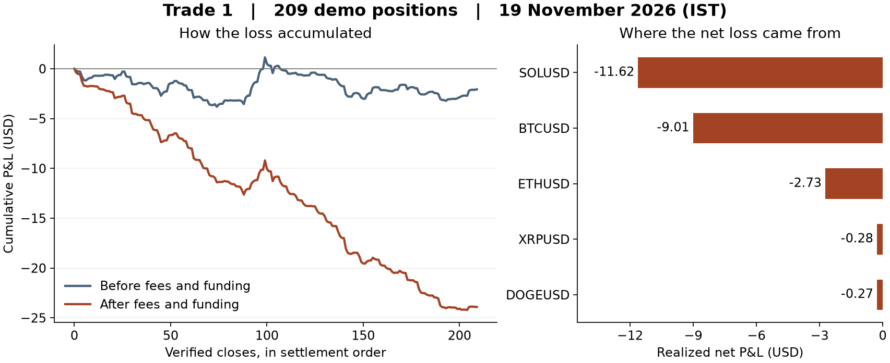
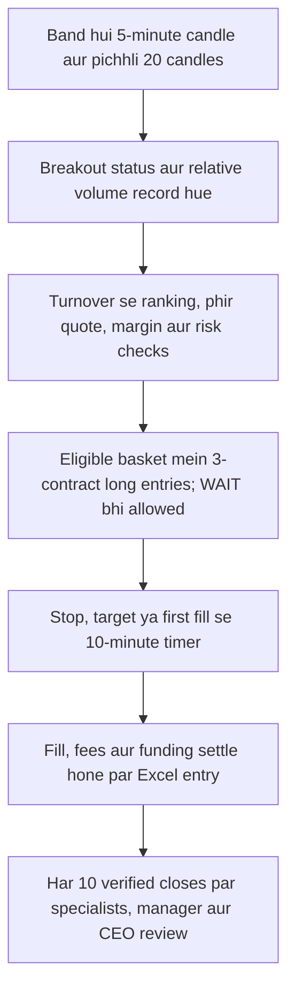

# Trade 1 ka result | 19 November 2026

**10,000 ka target tha. Delta India testnet par 209 verified trades complete hue (2.09%). Fees aur funding ke baad 49 trades profit mein aur 160 loss mein band hue. Kul net P&L −$23.90119818 tha.** Is run mein profit kamane wale trades mile, lekin ek average loss ka size ek average win se bada tha aur losses teen guna se bhi zyada baar aaye.

## 1. Loop kahan tak pahuncha?

Har verified position mein 3 contracts the. 65 entry baskets ek hi IST settlement day mein aaye. Owner ne nayi entries pause ki; aakhri ETH lot settle hone ke baad checkpoint par open positions aur pending orders dono zero the. 20 poore groups ka review hua. Agle group mein 9 verified closes hain. Ye numbers **demo fills** se hain. Neeche 15 aur 30 minute wale alternatives ko alag se *modeled* likha hai. [Verified checkpoint](crypto-trader-skills/TRADE1-DIAGNOSIS.md)

| Settlement order | Net winners | Fees aur funding ke baad |
| --- | ---: | ---: |
| Pehle 100 trades | 27 | −$10.04345 |
| Agle 100 trades | 18 | −$14.03395 |
| Aakhri 9 trades | 4 | +$0.17620 |
| **Kul 209** | **49 (23.4%)** | **−$23.90120** |

Aakhri 9 ka chhota profit dekhkar recovery ka faisla lena jaldi hoga. Sabhi 209 trades ek hi strategy version par chale. [Trade 1 workbook, Trades aur Reviews sheets](crypto-trader-skills/outputs/01a1df70-6789-76b0-9431-f0c905a7987a/trade1.xlsx)

## 2. Excel mein sabse zaroori baat kya dikhi?

Baayen graph mein neeli line actual fill prices par price movement ka result hai. Laal line mein commissions aur signed funding bhi judte hain. **91 positions gross profit mein thi. Inmein se 42 fees aur funding ke baad profit kho baithi.** Daayen graph mein SOL aur BTC milkar lagbhag $20.63 ka loss dikhate hain. Har coin par 3 contracts the, lekin contract value aur dollar exposure alag the. Dollar-loss ranking se coin ki intrinsic quality tay nahi hoti.

| Coin | Verified | Net wins | Gross P&L | Fees | Net P&L |
| --- | ---: | ---: | ---: | ---: | ---: |
| SOL | 36 | 8 | −$3.030 | $8.588 | −$11.618 |
| BTC | 47 | 10 | +$0.477 | $9.466 | −$9.008 |
| ETH | 61 | 16 | +$0.755 | $3.473 | −$2.730 |
| XRP | 60 | 15 | −$0.089 | $0.186 | −$0.275 |
| DOGE | 5 | 0 | −$0.177 | $0.095 | −$0.271 |

Table rounded hai. Exact hisaab **−$2.06400000 gross − $21.80788456 fees − $0.02931362 net funding debit = −$23.90119818**. BTC aur ETH ka gross halka positive tha, lekin dono apni trading fees cover karne se kaafi door the. [Coin aur cost reconciliation](crypto-trader-skills/TRADE1-DIAGNOSIS.md)

## 3. Skill ke saath trades kaise select hue aur edge kahan kamzor tha?

Breakout ke liye last closed candle ka close pichhli 20 candles ke highest high se upar aur historical average volume positive hona tha. Relative volume record hua. Delta batch planner mein minimum relative-volume threshold ya READY-only entry ki shart nahi thi. Isliye high turnover aur acceptable risk wale coin par WAIT ke saath bhi long order ja sakta tha. Time Machine ka simulation is entry decision ka input nahi tha. [Signal code](crypto-trader-skills/crypto_skills/delta_signal.py) · [Batch planner](crypto-trader-skills/crypto_skills/delta_plan.py)

| Entry ke waqt status | Trades | Net wins | Gross P&L | Fees | Net P&L |
| --- | ---: | ---: | ---: | ---: | ---: |
| WAIT | 193 | 48 | +$1.116 | $19.853 | −$18.766 |
| READY | 15 | 1 | −$2.424 | $1.719 | −$4.143 |
| Signal unavailable | 1 | 0 | −$0.756 | $0.236 | −$0.992 |

**193/209 entries par breakout confirm nahi hua tha.** WAIT group ka chhota gross gain uski fees cover nahi kar paya. READY group bhi is sample mein gross loss mein raha. Sirf WAIT hata dene ka result dekhne ke liye same decision times, skipped opportunities aur portfolio rules par dobara comparison chahiye. Ek group ke trades delete karna us alternate portfolio ko reproduce nahi karta.

**Self-learning ka result.** 5 specialists, manager aur CEO ke 20 completed reviews mein 19 ten-trade groups loss mein the. Sirf group 10 net profit mein tha (+$2.01318). CEO ne 19 baar current rule retain kiya aur ek baar four-READY candidate test ke liye bheja. Koi candidate production rule tak promote nahi hua. Reviews ne hypothesis di, jabki measured profitable improvement abhi establish hona baaki hai. [Review decisions](crypto-trader-skills/runs/trade1/reviews.json)

## 4. Kya news aa rahi thi aur usse entry mein madad mili?

**Feed test mein kuch news aayi thi. Is campaign mein automated entries ke liye news use hone ka evidence nahi mila.** 17 November ke separate test mein Cointelegraph RSS se HTTP 200 aur 30 items mile. Reported 0.302 seconds HTTP request ka samay tha. CoinDesk test mein redirect reject hua aur zero items mile. In tests se 19 November ke campaign ki continuous coverage ya publication-to-delivery delay measure nahi hota. [Cointelegraph test](crypto-trader-skills/verification/public-news-direct-smoke.json) · [CoinDesk test](crypto-trader-skills/verification/public-news-smoke.json)

News skill ek invocation mein configured RSS/Atom sources poll karti hai, duplicates hataati hai aur per-source polling interval aur backoff rakhti hai. Campaign ke 372 local entry-journal records aur 209 verified positions ki field audit mein linked headline, article ID ya sentiment field nahi mili. Delta decision path ne candles, products, quotes aur account risk padhe. **Kis khabar ne koi trade bachaya ya profit badhaya, iska hisaab is data se nahi nikal sakta.** [News implementation](crypto-trader-skills/crypto_skills/news.py) · [Delta decision path](crypto-trader-skills/crypto_skills/delta_signal.py)

## 5. Loss ke measured reasons kya the?

1. **Trading ki cost ke muqable price move chhota tha.** Sirf fees $21.8079 thi, ya lagbhag $0.1043 per close. Gross P&L bhi −$2.064 tha. Is run ki fees zero maan lene par bhi gross result negative rehta. Spread aur slippage actual fills mein pehle hi aa sakte hain. Inhe dobara loss mein jodna double counting hoga.
2. **Wins ki sankhya aur size dono kam pade.** Winners ka total +$6.6551 aur losers ka total −$30.5563 tha. Average win +$0.1358 aur average loss −$0.1910 tha. Inhi payoffs par break-even ke liye win rate lagbhag 58.4% chahiye hota. Observed 23.4% par average verified trade −$0.11436 raha. Future payoffs badlenge to break-even rate bhi badlega.
3. **Sab positions long thi aur sabhi exits timer se hue.** Isse ek direction aur ek holding rule ka result mila. Chhote moves baar-baar costs se haar gaye. Girta hua market, stop distance, fill delay ya kisi specific headline ko primary cause kehne ke liye matched alternative chahiye. Ek din ke baskets mein coins saath move kar sakte hain.
4. **Lamba hold simple fix nahi dikha.** Workbook ke 131 comparable 15-minute estimates mein actual winners 34 aur modeled winners 26 the. Average modeled net P&L actual se $0.04602 kam tha. 96 comparable 30-minute estimates mein winners **19 se 26** hue, phir bhi average P&L **$0.04591 kam** tha. Dono horizons ke matched sets alag hain. Jahan funding ya price evidence nahi mila, wahan zero profit assume nahi kiya. [Exit research sheet](crypto-trader-skills/outputs/01a1df70-6789-76b0-9431-f0c905a7987a/trade1.xlsx) · [Supplemental comparisons](crypto-trader-skills/TRADE1-DIAGNOSIS.md#duration-and-execution-evidence)

## 6. Ab profit ki probability improve karne ke liye kya karein?

**Meri recommendation hai ki naye demo entries par hold rakhein aur pehle frozen strategy ko passive data par hara kar dikhayein.** Agla decision do numbers par lein — fees ke baad kitne trades jeete aur har trade ne average kitne dollars kamaye. Saath mein daily net, kitne signals skip hue aur peak se kitna drawdown hua, ye dekhein. Bahut kam trades lekar win rate badhane par total earning phir bhi gir sakti hai.

| Priority | Agla experiment | Faisla kaise lenge |
| --- | --- | --- |
| 1. Existing four-READY test poora karein | Baseline aur four-READY ko same 5-minute opportunities, balances, quantities aur risk caps par replay karein. Registered window 20 Nov 2026 se 12 Feb 2027 tak hai, end date exclusive. | 84 poore IST din aur paired 7-day blocks use karein. Positive after-cost expectancy, baseline se win rate aur average net dono mein improvement, stressed costs aur drawdown checks verify karein. |
| 2. Cost ke baad entry ki gunjaish maapein | Har eligible quote par fee, spread, available depth aur 3 contracts ka USD notional log karein. Purane dates par expected move aur round-trip cost compare karne ka rule freeze karein. | Naye dates par same timestamps pe baseline se compare karein. Skip hue wins, avoided losses, missed fills aur net per day bhi ginein. |
| 3. News ka alag experiment karein | Free source ke har item ka ID, source, publication time, first-seen UTC, affected coin aur feed health save karein. Decision ke waqt pehle se received items hi join karein. | Median aur 95th-percentile delivery delay, outages aur duplicate rate report karein. Pehle se define kiya news filter lagakar, uske bina wale matched replay se net P&L compare karein. |
| 4. Promotion ko evidence se baandhein | Har 10 closes par loss reasons review karein. Ek baar mein ek candidate change freeze karein aur uska untouched result manager aur CEO ko dein. | Correlated coins ko independent bets ginke confidence na badhayein. Candidate qualify hone par chhota demo pilot chalayein aur actual fills ko replay se milaayein. |

Four-READY filter ka pehle se ek historical pilot hai. Base costs par 76 modeled candidate positions ka win rate 36.84% tha, baseline ki 1,656 positions par 17.69%. Phir bhi candidate ki average trade **−$0.1424** thi. Higher execution costs par candidate **−$0.2567**, baseline **−$0.2373** raha. 3,360 possible windows mein sirf 860 ke usable data the. Isi wajah se pehla decision fresh, pre-registered sample par hona chahiye. [Pilot, assumptions aur validation protocol](crypto-trader-skills/runs/trade1/research-ready-pilot.md) · [Qualification calculations](crypto-trader-skills/crypto_skills/delta_candidate_score.py)

**Verification ka scope.** Teen independent agent checks ne workbook ki rows, news records aur strategy/review code dekhe. Chart settled ledger se bana aur totals workbook se reconcile hue. Report 19 November 2026 ke paused cohort par based hai. Ek hi din se alag market conditions mein future profit ki probability estimate karna abhi mumkin nahi hai.

## 7. Purane Delta days par naya backtest | 23 September–20 October 2026

**Four-READY ko abhi promote karne ka evidence nahi mila.** Is naye sample mein base costs par win rate **16.22%** raha, baseline ka **17.90%** tha. Average filled position ka net loss **$0.2381** tha, baseline ka **$0.1298**. Stress test mein bhi candidate ka average after-cost P&L negative raha aur baseline se neeche tha.

4–17 November ko pehle signal-frequency study mein dekha gaya tha. Isliye is test ke liye dono documented Delta studies se pehle ki dates li gayi. Pehli 14-day window mein 9 usable dates mili, isliye window ko usi cutoff se peeche 28 calendar days tak badhaya. Final test mein **21 dates par usable market data** tha. 8,064 five-minute decision times mein se **4,980 usable** the aur unmein **45 four-READY opportunities** thi. 1,344 UTC hour-crossing slots, 56 IST date-crossing slots aur 1,684 incomplete data slots exclude hue. Saat dates par coverage rule se koi slot pass nahi hua. [Pehle ka feasibility check](crypto-trader-skills/runs/trade1/research-ready-feasibility.md) · [Pehla P&L pilot](crypto-trader-skills/runs/trade1/research-ready-pilot.md)

| Cost scenario | Rule | Models mein filled positions | Wins | Win rate | Total net P&L | Average net per position |
| --- | --- | ---: | ---: | ---: | ---: | ---: |
| Base | Baseline, WAIT allowed | 3,777 | 676 | 17.90% | −$490.24 | −$0.1298 |
| Base | Four-READY | 37 | 6 | 16.22% | −$8.81 | −$0.2381 |
| Stress | Baseline, WAIT allowed | 2,749 | 455 | 16.55% | −$235.41 | −$0.0856 |
| Stress | Four-READY | 15 | 2 | 13.33% | −$1.36 | −$0.0907 |

Four-READY mein kam total loss ke saath bahut kam positions fill hui. Base scenario mein candidate ke modeled fills 12 dates par aaye. Stress mein wider modeled slippage ke kaaran IOC limit ke andar aur kam orders fill hue. Isliye base aur stress ki totals alag fill samples se aati hain. [Day-wise P&L, fees, no-fills aur drawdown](crypto-trader-skills/research/delta-october-comparison.json)

**Dono rules ke liye ek hi model.** BTC, SOL, ETH, DOGE aur XRP Delta India testnet perpetuals ke 5-minute trade aur mark candles use hue. Signal aur turnover order decide hone se pehle band ho chuke candles se nikle. Dono rules par wahi batch planner laga. Har basket mein chaar eligible coins ke orders the, har order 3 contracts ka tha. Har IST date $160.7083 modeled cash se shuru hui. Planner ka per-position planned loss cap $10, daily realized loss plus reserved risk cap $30, margin budget 80% aur maximum leverage 5× tha. Triggered stop ya target ke baad modeled exit hua, warna 10-minute timer use hua. [Trade 1 planner](crypto-trader-skills/crypto_skills/delta_plan.py)

**Cost aur execution assumptions.** Dono arms ne 5.9 bp per side fees aur 2 bp per side assumed half-spread use kiya. Extra slippage base mein 1 bp aur stress mein 5 bp per side thi. Next traded bar ki open price ko costs ke saath IOC limit par check kiya. Entry bar mein volume zero ya price limit se upar ho to order zero-filled count hua. Agar timer bar mein traded volume zero tha, mark open ko exit proxy banaya. Ek candle mein stop aur target dono touch hone par stop priority thi. UTC-hour crossing omit karke modeled funding settlements se bacha. Planned loss aur actual exit loss alag ho sakte hain, especially gap ke waqt.

Candles se historical spread, executable depth aur intrabar fill sequence pata nahi chala. Kuch slots outcome ke paas price data missing hone par retrospective coverage mask se exclude hue. Isliye ye results model ke under ek screening comparison hain. Isi model mein **baseline aur four-READY dono costs ke baad negative rahe**. [Reproducible backtest script](crypto-trader-skills/research/delta_october_comparison.py) · [Delta candle endpoint](https://docs.delta.exchange/#get-historical-ohlc-candles)
